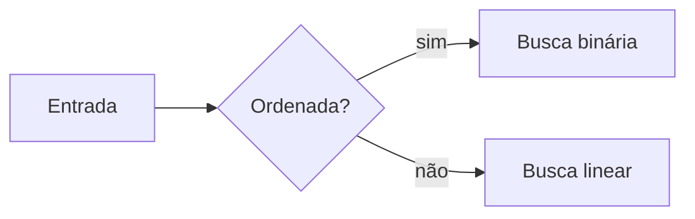

# 🎓 Sala de Aula

Uma sala de aula web para estudar **Ciência da Computação, Engenharia de Software e desenvolvimento**, do básico ao avançado. Cada aula combina explicação em linguagem simples, diagramas, código comentado e perguntas para treinar o que você aprendeu. Funciona no computador e no celular, e o progresso fica salvo no próprio navegador.

## O que tem aqui

- **19 trilhas e mais de 120 módulos** planejados, de Fundamentos de programação até Sistemas distribuídos, Segurança e Carreira ([currículo completo](docs/curriculo/curriculo.md)).
- **Aulas em Markdown**: cada módulo é um arquivo `.md` com seções fixas (por que importa, intuição, visual, conceito, código, erros comuns, prática, resumo).
- **Perguntas dentro da aula**: múltipla escolha, verdadeiro ou falso, resposta curta, prever a saída e desafio de código, com explicação depois de responder.
- **Diagramas** em [Mermaid](https://mermaid.js.org/) escritos direto no texto da aula.
- **Progresso local**: aulas concluídas e perguntas acertadas ficam no `localStorage`, com exportação e importação em JSON para backup.
- **Responsivo**: layout próprio para telas pequenas, alvos de toque de 44 a 48 px, tema claro e escuro conforme o sistema.

## Como rodar

Pré-requisito: [Node.js](https://nodejs.org/) 20 ou mais novo.

```bash
npm install
npm run dev       # abre em http://localhost:5173
npm run build     # gera o site estático em dist/
npm run preview   # serve o dist/ para conferir o build
```

Para estudar no celular com o servidor de desenvolvimento, rode `npm run dev -- --host` e abra no celular o endereço de rede que aparece no terminal (os dois aparelhos precisam estar na mesma rede Wi-Fi).

## Publicar

O workflow [`deploy.yml`](.github/workflows/deploy.yml) publica o site no GitHub Pages a cada push na `main`. Para ativar, vá em **Settings → Pages** do repositório e escolha **Source: GitHub Actions**. O app usa rotas com `#` e caminhos relativos, então funciona em qualquer subpasta sem configuração extra.

## Estrutura

```
content/trilhas/            conteúdo que aparece no app
  02-estruturas-de-dados/
    _trilha.md              título, descrição e lista de módulos da trilha
    ED-01-complexidade-big-o.md   uma aula (um módulo)
docs/
  curriculo/                currículo, modelo de aula e mapeamento OSSU
  avaliacao/                especificação do sistema de perguntas, schema e banco inicial
  design/                   protótipo da identidade visual e dos componentes visuais
scripts/gerar-trilhas.mjs   gera os _trilha.md a partir de docs/curriculo/curriculo.md
src/
  lib/conteudo.ts           lê content/ em tempo de build e monta trilhas e módulos
  lib/progresso.ts          progresso no localStorage
  components/               Markdown, Quiz, Diagrama, Flashcard, BarraProgresso
  pages/                    Início, Trilha, Aula
```

## Como escrever uma aula

1. Crie `content/trilhas/<trilha>/<CÓDIGO>-<nome>.md`, por exemplo `content/trilhas/02-estruturas-de-dados/ED-03-listas-ligadas.md`.
2. Use o front matter e as seções do [modelo de aula](docs/curriculo/modelo-de-aula.md). O `codigo` precisa ser o mesmo do currículo: é ele que liga a aula ao módulo planejado e guarda o progresso.
3. Rode `npm run dev` e abra a trilha. O módulo deixa de aparecer como "em breve".

Front matter mínimo:

```yaml
---
codigo: ED-03
titulo: Listas ligadas
nivel: basico            # basico | intermediario | avancado
prerequisitos: [ED-01]
duracao_min: 45
objetivos:
  - "Implementar inserção e remoção em uma lista ligada"
---
```

### Perguntas

Cada pergunta é um bloco de código com a linguagem `quiz`, em YAML:

````markdown
```quiz
id: ED-03-q1
tipo: multipla_escolha   # multipla_escolha | verdadeiro_falso | resposta_curta | prever_saida | codigo
pergunta: "Qual o custo de inserir no início de uma lista ligada?"
opcoes: ["O(1)", "O(log n)", "O(n)", "O(n²)"]
resposta: 0              # índice começando em 0; true/false; ou texto da resposta modelo
explicacao: "Basta criar o nó e apontar a cabeça para ele."
dificuldade: 1
```
````

Nos tipos abertos (`resposta_curta`, `prever_saida`, `codigo`) o aluno escreve a resposta, vê a resposta modelo e os termos esperados (`palavras_chave`) e marca se acertou. O enunciado aceita Markdown, inclusive blocos de código.

### Diagramas

````markdown

````

### Novas trilhas ou módulos no currículo

Edite `docs/curriculo/curriculo.md` e rode `node scripts/gerar-trilhas.mjs --forcar` para recriar os `_trilha.md`.

## Tecnologias

[Vite](https://vite.dev/), [React](https://react.dev/) e TypeScript; [react-markdown](https://github.com/remarkjs/react-markdown) com GFM; [yaml](https://eemeli.org/yaml/) para front matter e perguntas; [Mermaid](https://mermaid.js.org/) carregado só quando a aula tem diagrama. Não há servidor nem banco de dados.

## Documentos do projeto

- [MEMORY.md](MEMORY.md): decisões, estado atual e próximos passos.
- [TEAM.md](TEAM.md): quem cuida de quê.
