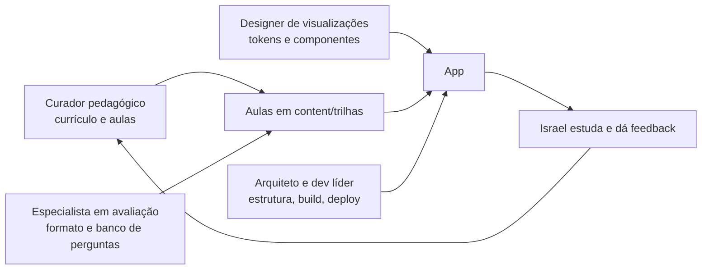

# Equipe

A sala de aula é construída por uma pequena equipe, cada papel com uma frente de trabalho. O Israel é o dono do projeto e o aluno: define prioridades, revisa o conteúdo e aprova as mudanças.

| Papel | Responsabilidade | Entregas no repositório |
|---|---|---|
| **Israel** (dono do produto e aluno) | Define o que estudar e em que ordem, testa as aulas, aprova os PRs | Feedback e prioridades |
| **Arquiteto e dev líder** | Stack, estrutura do app, formato do conteúdo, navegação, progresso, build e publicação | `src/`, `scripts/`, `.github/`, `README.md`, `MEMORY.md` |
| **Curador pedagógico** | Currículo (trilhas, módulos, pré-requisitos, ordem de estudo), modelo de aula e escrita das aulas | `docs/curriculo/`, `content/trilhas/**/*.md` |
| **Designer de visualizações** | Identidade visual (cores, tipografia, tokens, tema claro e escuro, mobile) e componentes de explicação visual passo a passo | `docs/design/`, estilos e componentes visuais em `src/` |
| **Especialista em avaliação** | Tipos de pergunta, feedback, correção automática, repetição espaçada e banco de questões | `docs/avaliacao/`, perguntas das aulas |

## Como o trabalho se encaixa

## Combinados

- O **código do módulo** (ex.: `ED-01`) é o identificador comum entre currículo, aula, perguntas e progresso. Não reutilize códigos.
- Toda aula segue o [modelo de aula](docs/curriculo/modelo-de-aula.md); toda pergunta segue a [especificação de avaliação](docs/avaliacao/especificacao-quiz.md).
- Mudanças entram por pull request, com o build passando.
