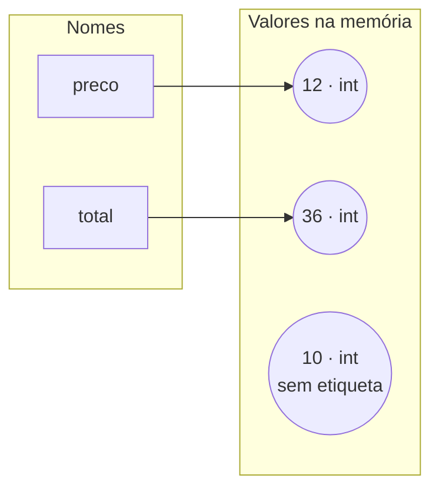

# Variáveis, tipos e operadores

## Por que isso importa

Quase todo programa é feito de três coisas: guardar dados, fazer contas com eles e tomar decisões. Esta aula cuida das duas primeiras. Saber exatamente o que `=`, `//` e `%` fazem evita os erros mais traiçoeiros de quem começa: aqueles em que o programa roda sem reclamar, mas a conta sai errada.

## Intuição

Pense na memória do computador como um **armário de caixas** e nas variáveis como **etiquetas**. Quando você escreve `preco = 10`, o Python coloca o valor `10` numa caixa e cola a etiqueta `preco` nela. Escrever `preco = 12` não "apaga o 10 da etiqueta": cola a etiqueta numa caixa nova, com 12. A caixa velha, sem etiqueta, é jogada fora depois.

Os **operadores** são as ferramentas que você usa sobre as caixas: somar, dividir, comparar. E o **tipo** é o que está escrito na lateral da caixa ("número inteiro", "texto"), que decide quais ferramentas funcionam.

## Visual



Linha por linha, o que acontece neste programa:

```
preco = 10           preco ─► [10]
preco = 12           preco ─► [12]        [10] fica sem etiqueta e é descartado
total = preco * 3    total ─► [36]        preco continua ─► [12]
preco = preco + 1    preco ─► [13]        total continua 36: ele guardou o resultado, não a conta
```

> **Para o app**: animação em que cada linha acende e a etiqueta se move para a nova caixa.

## Conceito técnico

### Atribuição

`nome = expressão` faz duas coisas, **nesta ordem**: calcula a expressão da direita e depois liga o nome da esquerda ao resultado. Por isso `x = x + 1` faz sentido: primeiro lê o `x` atual, soma 1, e só então muda o `x`.

Atalhos úteis:

| Escrita | Equivale a |
|---|---|
| `x += 1` | `x = x + 1` |
| `x -= 2` | `x = x - 2` |
| `x *= 3` | `x = x * 3` |
| `x //= 2` | `x = x // 2` |
| `a, b = 1, 2` | `a = 1` e `b = 2` ao mesmo tempo |
| `a, b = b, a` | troca os valores de `a` e `b` |

**Convenções de nome (PEP 8)**: `snake_case` para variáveis (`preco_total`), MAIÚSCULAS para constantes que não devem mudar (`TAXA_JUROS = 0.02`). Palavras reservadas como `if`, `for`, `class` e `True` não podem ser nomes.

### Tipagem dinâmica × estática

Em Python, **o tipo está no valor, não na variável**. A mesma etiqueta pode apontar para um número e depois para um texto:

```python
x = 10
print(type(x))   # <class 'int'>
x = "dez"
print(type(x))   # <class 'str'>
```

Isso é **tipagem dinâmica** (Python, JavaScript, Ruby). Em linguagens de **tipagem estática** (C, Java, Go, TypeScript) você declara o tipo da variável, e o compilador recusa o programa se você tentar guardar outra coisa nela:

```c
int idade = 26;
idade = "vinte e seis";   // erro de compilação: texto não cabe num int
```

O Python também é **fortemente tipado**: ele não converte tipos por conta própria (`"7" + 2` é erro). O JavaScript é **fracamente tipado**: `"7" + 2` dá `"72"` e `"7" - 2` dá `5`, o que gera surpresas.

### Operadores aritméticos

| Operador | Nome | Exemplo | Resultado |
|---|---|---|---|
| `+` | soma | `7 + 2` | `9` |
| `-` | subtração | `7 - 2` | `5` |
| `*` | multiplicação | `7 * 2` | `14` |
| `/` | divisão | `7 / 2` | `3.5` (sempre `float`) |
| `//` | divisão inteira | `7 // 2` | `3` |
| `%` | resto (módulo) | `7 % 2` | `1` |
| `**` | potência | `2 ** 10` | `1024` |

`//` e `%` andam juntos: para qualquer `a` e `b`, vale `a == (a // b) * b + a % b`. Exemplo: `17 = 3 * 5 + 2`, então `17 // 5` é `3` e `17 % 5` é `2`.

Usos clássicos do `%`:

- `n % 2 == 0` testa se `n` é **par**.
- `n % 10` é o **último dígito** de `n`, e `n // 10` tira o último dígito.
- `segundos % 60` são os segundos que **sobram** depois de contar os minutos inteiros.

### Precedência: quem é calculado primeiro

Da maior para a menor prioridade (igual à matemática da escola, com alguns extras):

```
1. ( )                      parênteses
2. **                       potência (associa da direita: 2 ** 3 ** 2 = 2 ** 9)
3. -x                       sinal negativo
4. *  /  //  %              multiplicação e divisões, da esquerda para a direita
5. +  -                     soma e subtração, da esquerda para a direita
6. <  <=  >  >=  ==  !=     comparações
7. not
8. and
9. or
```

`2 + 3 * 4` é `14`, não `20`. `-2 ** 2` é `-4`, porque a potência vem antes do sinal. Na dúvida, **use parênteses**: eles não custam nada e deixam a intenção clara.

### Comparação e lógica

Comparações devolvem `bool`: `==` (igual), `!=` (diferente), `<`, `<=`, `>`, `>=`. Atenção: `=` guarda, `==` compara.

Para combinar condições:

| Operador | Verdadeiro quando | Exemplo |
|---|---|---|
| `and` | as duas partes são verdadeiras | `idade >= 18 and tem_cnh` |
| `or` | pelo menos uma parte é verdadeira | `dia == "sábado" or dia == "domingo"` |
| `not` | a parte é falsa | `not chovendo` |

O Python permite comparações encadeadas como na matemática: `0 <= nota <= 10` significa `0 <= nota and nota <= 10`.

### O problema do float

```python
print(0.1 + 0.2)          # 0.30000000000000004
print(0.1 + 0.2 == 0.3)   # False
```

Não é bug do Python: o `float` guarda números em **binário**, e `0.1` não tem representação exata em binário (assim como `1/3` não tem representação exata em decimal: `0.3333...`). O valor guardado é um pouquinho diferente, e o erro aparece nas contas.

Regras práticas:

- Para **mostrar**, arredonde: `round(x, 2)` ou `f"{x:.2f}"`.
- Para **comparar** floats, use uma tolerância: `abs(a - b) < 1e-9`, ou `math.isclose(a, b)`.
- Para **dinheiro**, trabalhe em **centavos inteiros** (`int`) ou use o módulo `decimal`.

### None

`None` é o valor que representa "nada" ou "ainda não tem valor". Seu tipo é `NoneType`. Você vai encontrá-lo bastante em funções (FP-04).

## Código

Conversão de unidades com `//` e `%`, um padrão que aparece em relógios, troco, calendários e jogos:

```python
total = int(input("Quantos segundos? "))   # experimente 3725

horas = total // 3600          # quantas horas inteiras cabem
resto = total % 3600           # o que sobra depois de tirar as horas
minutos = resto // 60
segundos = resto % 60

print(f"{horas}h {minutos}min {segundos}s")   # 1h 2min 5s
```

Troca de valores, do jeito "de qualquer linguagem" e do jeito do Python:

```python
a = 5
b = 9

# com variável auxiliar (funciona em C, Java, JavaScript...)
aux = a
a = b
b = aux
print(a, b)   # 9 5

# atribuição múltipla do Python
a, b = b, a
print(a, b)   # 5 9
```

Precedência e lógica em ação:

```python
print(2 + 3 * 4)        # 14
print((2 + 3) * 4)      # 20
print(10 - 4 - 3)       # 3: da esquerda para a direita
print(2 ** 3 ** 2)      # 512: potência associa da direita
print(-7 // 2)          # -4: // arredonda para baixo, não "corta"
nota = 7.5
print(0 <= nota <= 10)  # True
print(nota >= 7 and nota < 9)   # True
print(not nota >= 7)    # False
```

O mesmo em JavaScript, para comparar (no JS `//` é comentário: a divisão inteira é `Math.floor(a / b)`):

```javascript
console.log(7 / 2);             // 3.5
console.log(Math.floor(7 / 2)); // 3
console.log(7 % 2);             // 1
console.log("7" + 2);           // 72: o JS converte o número em texto sem avisar
console.log("7" - 2);           // 5: aqui converte o texto em número
console.log(0.1 + 0.2);         // 0.30000000000000004: o mesmo float do Python
```

## Erros comuns

- **Ler `=` como "é igual".** `=` guarda; quem compara é `==`. `if x = 5:` é erro de sintaxe.
- **Achar que uma variável "lembra a conta".** Depois de `total = preco * 3`, mudar `preco` não muda `total`.
- **Esquecer a precedência.** `media = n1 + n2 / 2` divide só o `n2`. O certo é `(n1 + n2) / 2`.
- **Usar `/` quando queria `//`.** `7 / 2` é `3.5`, e um `float` não serve como posição de lista nem como quantidade de itens.
- **Comparar floats com `==`.** `0.1 + 0.2 == 0.3` é `False`. Arredonde ou use tolerância.
- **Guardar dinheiro em float.** Somas de centavos acumulam erro; use centavos em `int`.
- **Escrever `x =+ 1`** achando que é `x += 1`. `=+ 1` guarda `+1` (um positivo) em `x`.

## Pratique

```quiz
id: FP-02-q1
tipo: prever_saida
pergunta: |
  O que este programa imprime?
  ```python
  preco = 10
  total = preco * 3
  preco = 20
  print(total)
  ```
resposta: "30"
explicacao: "total recebeu o resultado da conta (30) no momento em que a linha 2 rodou. Mudar preco depois não refaz a conta: a variável guarda o valor, não a fórmula."
dificuldade: 1
```

```quiz
id: FP-02-q2
tipo: multipla_escolha
pergunta: "Quanto vale `2 + 3 * 2 ** 2`?"
opcoes: ["100", "14", "20", "36"]
resposta: 1
explicacao: "Primeiro a potência (2 ** 2 = 4), depois a multiplicação (3 * 4 = 12) e por último a soma (2 + 12 = 14). Seria 100 se fosse ((2 + 3) * 2) ** 2."
dificuldade: 1
```

```quiz
id: FP-02-q3
tipo: multipla_escolha
pergunta: "Quais são os valores de `17 // 5` e `17 % 5`?"
opcoes: ["3.4 e 0", "3 e 2", "3 e 0.4", "2 e 3"]
resposta: 1
explicacao: "5 cabe 3 vezes em 17 (3 * 5 = 15) e sobram 2. A divisão inteira dá o quociente (3) e o resto dá o que sobrou (2). 3.4 seria o resultado de 17 / 5."
dificuldade: 1
```

```quiz
id: FP-02-q4
tipo: verdadeiro_falso
pergunta: "Em Python, `0.1 + 0.2 == 0.3` é True."
resposta: false
explicacao: "O float guarda os números em binário, e 0.1 e 0.2 não têm representação exata. A soma dá 0.30000000000000004. Para comparar floats, use uma tolerância (abs(a - b) < 1e-9) ou math.isclose."
dificuldade: 1
```

```quiz
id: FP-02-q5
tipo: multipla_escolha
pergunta: "Qual expressão testa se `n` é ímpar?"
opcoes: ["n / 2 == 1", "n // 2 == 1", "n % 2 == 1", "n % 2 == 0"]
resposta: 2
explicacao: "O resto da divisão por 2 é 1 para ímpares e 0 para pares. n // 2 é a metade (arredondada para baixo), e n / 2 == 1 só vale para n = 2."
dificuldade: 1
```

```quiz
id: FP-02-q6
tipo: prever_saida
pergunta: |
  O que este programa imprime?
  ```python
  a = 3
  b = 8
  a, b = b, a + b
  print(a, b)
  ```
resposta: "8 11"
explicacao: "Na atribuição múltipla, o lado direito inteiro é calculado antes de qualquer variável mudar: (b, a + b) vira (8, 11) usando os valores antigos. Só então a recebe 8 e b recebe 11."
dificuldade: 2
```

```quiz
id: FP-02-q7
tipo: multipla_escolha
pergunta: "Qual é o valor de `not (5 > 3 and 2 > 4) or False`?"
opcoes: ["True", "False", "Erro", "None"]
resposta: 0
explicacao: "5 > 3 é True e 2 > 4 é False, então o and dá False. not False é True, e True or False é True."
dificuldade: 2
```

```quiz
id: FP-02-q8
tipo: multipla_escolha
pergunta: "Em JavaScript, o que `\"7\" - 2` produz?"
opcoes: ["\"72\"", "5", "\"5\"", "Erro de tipo"]
resposta: 1
explicacao: "O JavaScript é fracamente tipado: com -, ele converte o texto \"7\" em número e faz a conta (5). Com + ele faria o contrário e juntaria os textos (\"72\"). Em Python, as duas formas dariam TypeError."
dificuldade: 2
```

```quiz
id: FP-02-q9
tipo: resposta_curta
pergunta: "Qual a diferença entre tipagem dinâmica e estática? Dê um exemplo de linguagem de cada."
resposta: "Na tipagem dinâmica o tipo fica no valor e é conferido durante a execução; a mesma variável pode guardar valores de tipos diferentes (Python, JavaScript). Na estática o tipo é declarado para a variável e conferido pelo compilador antes de rodar (C, Java, TypeScript)."
palavras_chave: ["valor", "variável", "compilador", "execução"]
dificuldade: 2
```

```quiz
id: FP-02-q10
tipo: codigo
linguagem: python
pergunta: |
  **Média de três notas.** Leia três notas (podem ter casas decimais), uma por linha, e imprima a média com **uma casa decimal**. Para `7`, `8.5` e `6`:

  ```
  Média: 7.2
  ```

  Cuidado com a precedência: a soma precisa acontecer antes da divisão.
usa: [float]
testes:
  - entradas: ["7", "8.5", "6"]
    saida: "Média: 7.2"
  - entradas: ["10", "10", "10"]
    saida: "Média: 10.0"
  - entradas: ["5.5", "3", "9.25"]
    visivel: false
    saida: "Média: 5.9"
dica: "Leia cada nota com float(input()). A média é (n1 + n2 + n3) / 3, com os parênteses. Para uma casa decimal: f\"{media:.1f}\"."
solucao: |
  n1 = float(input("Nota 1: "))
  n2 = float(input("Nota 2: "))
  n3 = float(input("Nota 3: "))
  media = (n1 + n2 + n3) / 3
  print(f"Média: {media:.1f}")
explicacao: "Sem os parênteses, n1 + n2 + n3 / 3 dividiria só a última nota. :.1f formata com uma casa decimal sem mudar o valor guardado em media."
dificuldade: 1
```

```quiz
id: FP-02-q11
tipo: codigo
linguagem: python
pergunta: |
  **Segundos para horas, minutos e segundos.** Leia um número inteiro de segundos e imprima no formato `Hh Mmin Ss`. Para `3725`:

  ```
  1h 2min 5s
  ```
usa: [int]
testes:
  - entrada: "3725"
    saida: "1h 2min 5s"
  - entrada: "59"
    saida: "0h 0min 59s"
  - entrada: "86399"
    visivel: false
    saida: "23h 59min 59s"
  - entrada: "7200"
    visivel: false
    saida: "2h 0min 0s"
dica: "Uma hora tem 3600 segundos. total // 3600 dá as horas; total % 3600 é o que sobra. Repita a ideia com 60 para os minutos."
solucao: |
  total = int(input("Segundos: "))
  horas = total // 3600
  resto = total % 3600
  minutos = resto // 60
  segundos = resto % 60
  print(f"{horas}h {minutos}min {segundos}s")
explicacao: "// conta quantas unidades inteiras cabem e % guarda a sobra. O mesmo padrão resolve troco, conversão de centímetros em metros e dias em semanas."
dificuldade: 2
```

```quiz
id: FP-02-q12
tipo: codigo
linguagem: python
pergunta: |
  **Troco em notas.** Uma máquina só tem notas de 50, 20, 10 e 5 e moedas de 1 real. Leia o valor do troco (inteiro) e imprima quantas de cada usar, sempre a maior nota possível primeiro. Para `88`:

  ```
  50: 1
  20: 1
  10: 1
  5: 1
  1: 3
  ```
usa: [int]
testes:
  - entrada: "88"
    saida: |
      50: 1
      20: 1
      10: 1
      5: 1
      1: 3
  - entrada: "40"
    saida: |
      50: 0
      20: 2
      10: 0
      5: 0
      1: 0
  - entrada: "199"
    visivel: false
    saida: |
      50: 3
      20: 2
      10: 0
      5: 1
      1: 4
dica: "Comece pelo 50: valor // 50 é a quantidade de notas, e valor % 50 é o que ainda falta pagar. Atualize o valor e repita para 20, 10, 5 e 1."
solucao: |
  valor = int(input("Troco: "))
  print(f"50: {valor // 50}")
  valor = valor % 50
  print(f"20: {valor // 20}")
  valor = valor % 20
  print(f"10: {valor // 10}")
  valor = valor % 10
  print(f"5: {valor // 5}")
  valor = valor % 5
  print(f"1: {valor}")
explicacao: "A cada nota, // diz quantas cabem e % deixa só o que falta. Reatribuir valor = valor % 50 é o 'etiqueta numa caixa nova' da intuição: o nome passa a apontar para o restante."
dificuldade: 2
```

```quiz
id: FP-02-q13
tipo: codigo
linguagem: python
pergunta: |
  **Conserte a conta de dinheiro.** O programa abaixo soma o preço de 3 itens de R$ 0,10 e diz se o total é R$ 0,30, mas imprime `False`. Corrija trabalhando em **centavos inteiros** (leia o preço em reais, converta para centavos com `round(preco * 100)`). Para a entrada `0.10`:

  ```
  Total: 30 centavos
  True
  ```
codigo_inicial: |
  preco = float(input("Preço: "))
  total = preco + preco + preco
  print(f"Total: {total} reais")
  print(total == 0.3)
usa: [round, float]
testes:
  - entrada: "0.10"
    saida: |
      Total: 30 centavos
      True
  - entrada: "0.20"
    visivel: false
    saida: |
      Total: 60 centavos
      False
dica: "centavos = round(preco * 100) transforma 0.10 em 10 (int). Some os centavos e compare com 30, um int, sem nenhum erro de float."
solucao: |
  preco = float(input("Preço: "))
  centavos = round(preco * 100)
  total = centavos + centavos + centavos
  print(f"Total: {total} centavos")
  print(total == 30)
explicacao: "0.1 não existe exatamente em binário, então somar floats acumula erro. round(preco * 100) vira um int, e contas com int são exatas. É assim que bancos e lojas guardam dinheiro."
dificuldade: 2
```

```quiz
id: FP-02-q14
tipo: codigo
linguagem: python
pergunta: |
  **Ano bissexto (só com operadores).** Um ano é bissexto se é divisível por 4 **e** não é divisível por 100, **ou** se é divisível por 400. Leia o ano e imprima `True` ou `False` usando **uma única expressão** com `%`, `and`, `or` (sem `if`). Para `2024`:

  ```
  True
  ```
usa: [int]
testes:
  - entrada: "2024"
    saida: "True"
  - entrada: "1900"
    saida: "False"
  - entrada: "2000"
    saida: "True"
  - entrada: "2023"
    visivel: false
    saida: "False"
  - entrada: "2400"
    visivel: false
    saida: "True"
dica: "\"Divisível por 4\" é ano % 4 == 0. Monte (div. por 4 and não div. por 100) or div. por 400. Os parênteses deixam claro, mas and já tem prioridade sobre or."
solucao: |
  ano = int(input("Ano: "))
  bissexto = (ano % 4 == 0 and ano % 100 != 0) or ano % 400 == 0
  print(bissexto)
explicacao: "1900 é divisível por 4 e por 100, mas não por 400: não é bissexto. 2000 é divisível por 400: é. A expressão já produz um bool, então dá para imprimir direto, sem if."
dificuldade: 2
```

```quiz
id: FP-02-q15
tipo: codigo
linguagem: javascript
pergunta: |
  **Celsius para Fahrenheit em JavaScript.** Leia a temperatura em °C com `prompt()`, converta para número com `Number()` e imprima com `console.log` no formato abaixo. A fórmula é `F = C * 9 / 5 + 32`. Para `25`:

  ```
  25°C = 77°F
  ```
usa: [prompt, Number, console.log]
testes:
  - entrada: "25"
    saida: "25°C = 77°F"
  - entrada: "-40"
    saida: "-40°C = -40°F"
  - entrada: "100"
    visivel: false
    saida: "100°C = 212°F"
dica: "Como o input() do Python, prompt() devolve texto: \"25\" * 9 até funciona no JS, mas \"25\" + 32 daria \"2532\". Converta com Number(...) logo na leitura. Para montar o texto use crases: `${c}°C = ${f}°F`."
solucao: |
  const c = Number(prompt("Temperatura em °C: "));
  const f = c * 9 / 5 + 32;
  console.log(`${c}°C = ${f}°F`);
explicacao: "Number() faz o papel do int()/float() do Python. Sem ele, o + 32 juntaria textos. A template string (com crases) é a f-string do JavaScript."
dificuldade: 1
```

## Resumo

- `=` **calcula a direita e depois liga o nome** ao resultado; a variável guarda o valor, não a conta.
- Em Python o **tipo está no valor** (tipagem dinâmica), e o Python não mistura tipos sozinho (tipagem forte).
- `//` dá o quociente e `%` dá o resto: juntos resolvem conversões de unidades, troco e paridade.
- Precedência: `()` › `**` › `* / // %` › `+ -` › comparações › `not` › `and` › `or`. Na dúvida, parênteses.
- `float` tem erro de representação: arredonde para mostrar, use tolerância para comparar e centavos inteiros para dinheiro.

## Para ir além

- Leia o capítulo sobre números do tutorial oficial: docs.python.org/pt-br/3/tutorial/introduction.html.
- **Próximo módulo**: FP-03 Controle de fluxo: condicionais e laços.
