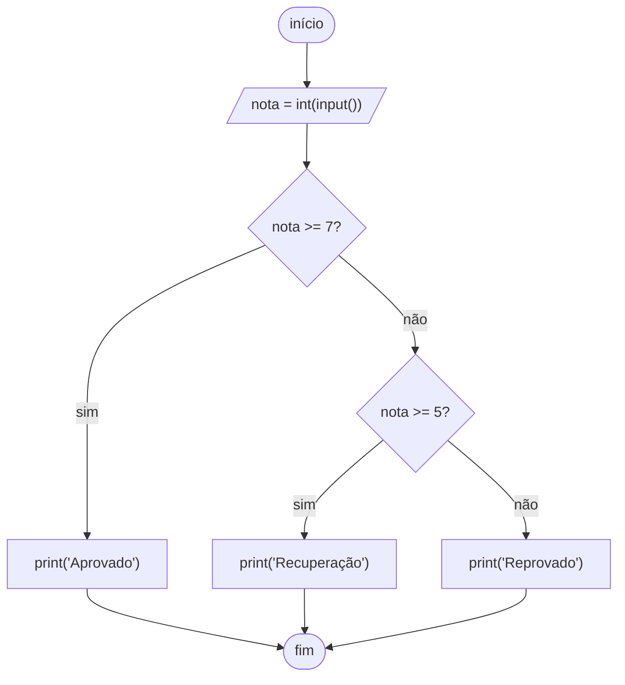

# Controle de fluxo: condicionais e laços

## Por que isso importa

Até agora seus programas rodavam de cima para baixo, uma linha de cada vez, sempre igual. Com **condicionais** o programa escolhe caminhos ("se a senha estiver certa, entra"), e com **laços** ele repete trabalho ("para cada aluno, calcule a média"). Com só essas duas ideias, mais variáveis, já dá para escrever qualquer algoritmo que existe: é o que os cientistas chamam de linguagem **Turing-completa**.

## Intuição

- **if** é uma **bifurcação na estrada**: a placa (condição) decide se você vai para a esquerda ou para a direita, e depois os caminhos se juntam de novo.
- **while** é **lavar a louça**: *enquanto* tiver prato na pia, lave um prato. Você não sabe de antemão quantos pratos são, só sabe quando parar.
- **for** é **corrigir uma pilha de provas**: *para cada* prova da pilha, corrija. Você sabe exatamente sobre o que vai repetir.

## Visual



Teste de mesa de um laço: anote o valor de cada variável a cada volta. É a ferramenta número 1 para entender (e depurar) laços.

```
soma = 0
for i in range(1, 5):
    soma = soma + i

volta │  i  │ soma antes │ soma depois
──────┼─────┼────────────┼────────────
  1   │  1  │     0      │     1
  2   │  2  │     1      │     3
  3   │  3  │     3      │     6
  4   │  4  │     6      │    10      ← range(1, 5) para ANTES do 5
```

> **Para o app**: animação do teste de mesa, com a linha atual acesa e a tabela crescendo a cada volta.

## Conceito técnico

### if, elif, else

```text
if condição_1:
    bloco 1          # roda se condição_1 for True
elif condição_2:
    bloco 2          # só é testado se a condição_1 foi False
else:
    bloco 3          # roda se nenhuma das anteriores foi True
```

- Só **um** dos blocos roda: o primeiro cuja condição for verdadeira. Por isso a **ordem importa**: teste o caso mais restrito primeiro.
- `elif` e `else` são opcionais. Pode haver quantos `elif` quiser.
- A condição pode ser qualquer valor: `0`, `0.0`, `""`, `[]` e `None` contam como **falso**; o resto, como verdadeiro. `if nome:` significa "se o nome não estiver vazio".
- **Expressão condicional** (if de uma linha) para escolher um valor: `status = "par" if n % 2 == 0 else "ímpar"`.

### while

```text
while condição:
    bloco            # repete enquanto a condição for True
```

A condição é testada **antes de cada volta**. Algo dentro do bloco precisa, em algum momento, tornar a condição falsa, senão o laço nunca termina (**laço infinito**; no app ele é interrompido depois de 5 segundos, no terminal use `Ctrl+C`).

Use `while` quando **não se sabe quantas voltas** serão: ler até o usuário digitar "sair", tentar até acertar, dividir até chegar a zero.

### for e range

```text
for variável in sequência:
    bloco            # roda uma vez para cada item, com a variável valendo aquele item
```

O `for` do Python percorre **qualquer coleção**: uma lista, os caracteres de um texto, as linhas de um arquivo. Para contar, use `range`:

| Chamada | Gera | Observação |
|---|---|---|
| `range(5)` | 0, 1, 2, 3, 4 | começa em 0 e **não inclui** o 5 |
| `range(2, 6)` | 2, 3, 4, 5 | início incluído, fim excluído |
| `range(0, 10, 3)` | 0, 3, 6, 9 | o 3º número é o passo |
| `range(5, 0, -1)` | 5, 4, 3, 2, 1 | passo negativo conta para trás |

`range(n)` dá exatamente **n voltas**, o que é a forma mais comum de "repita n vezes".

### break e continue

- `break` **sai do laço** na hora (o resto das voltas é cancelado).
- `continue` **pula para a próxima volta** (o resto do bloco desta volta é ignorado).

Os dois valem para o laço mais interno onde estão.

### Padrões de laço que você vai usar sempre

| Padrão | Ideia | Esqueleto |
|---|---|---|
| **Acumulador** | somar/juntar algo a cada volta | `total = 0` antes; `total += x` dentro |
| **Contador** | contar quantos atendem a uma condição | `qtd = 0` antes; `if cond: qtd += 1` dentro |
| **Máximo/mínimo** | guardar o melhor visto até agora | `maior = primeiro`; `if x > maior: maior = x` |
| **Busca** | parar quando achar | `if achou: break` |
| **Sentinela** | ler até um valor especial | `while True:` + `if valor == "fim": break` |

### Laços aninhados

Um laço dentro do outro: para **cada** volta de fora, o de dentro roda **inteiro**. Com 10 voltas fora e 10 dentro, o bloco interno roda 100 vezes. Isso é a origem do O(n²) que você vai ver em ED-01.

## Código

Classificar uma nota (a ordem das condições importa):

```python
nota = float(input("Nota: "))
if nota < 0 or nota > 10:
    print("Nota inválida")
elif nota >= 7:
    print("Aprovado")
elif nota >= 5:            # aqui já sabemos que nota < 7
    print("Recuperação")
else:
    print("Reprovado")
```

`while` com sentinela: somar números até o usuário digitar 0 (escreva vários números, um por linha, no campo de entrada):

```python
total = 0
qtd = 0
while True:
    n = int(input("Número (0 para parar): "))
    if n == 0:
        break
    total += n
    qtd += 1
print(f"{qtd} números, soma {total}")
```

Tabuada com `for` e `range`:

```python
n = 7
for i in range(1, 11):
    print(f"{n} x {i} = {n * i}")
```

Contar dígitos de um número dividindo por 10 até acabar (`while`, porque não sabemos quantas voltas):

```python
n = 2026
digitos = 0
while n > 0:
    n = n // 10      # tira o último dígito
    digitos += 1
print(digitos)       # 4
```

Laço aninhado: um triângulo de asteriscos.

```python
for linha in range(1, 5):
    print("*" * linha)
```

`continue` para pular os múltiplos de 3:

```python
for i in range(1, 11):
    if i % 3 == 0:
        continue
    print(i, end=" ")    # end=" " troca a quebra de linha por espaço
print()
# 1 2 4 5 7 8 10
```

## Erros comuns

- **Ordem errada das condições.** Testar `nota >= 5` antes de `nota >= 7` faz uma nota 9 cair em "Recuperação".
- **Usar vários `if` quando queria `elif`.** Com `if` separados, todos são testados e mais de um bloco pode rodar.
- **Esquecer de atualizar a variável do `while`**, criando um laço infinito (`while i < 10:` sem `i += 1`).
- **Erro de "um a mais ou um a menos" (off-by-one).** `range(1, 10)` vai até 9. Para incluir o 10, use `range(1, 11)`.
- **Inicializar o acumulador dentro do laço.** `total = 0` dentro do `for` zera a soma a cada volta.
- **Comparar com `=`** (`if x = 5:`). Comparação é `==`.
- **Indentação errada no fim do laço.** Um `print` com recuo fica dentro do laço e roda várias vezes; sem recuo, roda uma vez depois.

## Pratique

```quiz
id: FP-03-q1
tipo: prever_saida
pergunta: |
  O que este programa imprime?
  ```python
  x = 15
  if x > 10:
      print("A")
  elif x > 5:
      print("B")
  if x > 12:
      print("C")
  else:
      print("D")
  ```
resposta: "A e depois C"
explicacao: "O primeiro bloco if/elif imprime só A (o elif não é testado porque o if já foi verdadeiro). O segundo if é um bloco novo e independente: 15 > 12, então imprime C."
dificuldade: 1
```

```quiz
id: FP-03-q2
tipo: multipla_escolha
pergunta: "Quais números `range(2, 11, 3)` gera?"
opcoes: ["2, 5, 8, 11", "2, 5, 8", "3, 6, 9", "2, 3, 4, ..., 10"]
resposta: 1
explicacao: "Começa em 2 e soma 3 a cada passo: 2, 5, 8. O próximo seria 11, mas o fim é excluído."
dificuldade: 1
```

```quiz
id: FP-03-q3
tipo: prever_saida
pergunta: |
  O que este programa imprime?
  ```python
  i = 1
  while i < 20:
      i = i * 3
  print(i)
  ```
resposta: "27"
explicacao: "Teste de mesa: i vale 1, 3, 9, 27. Quando i é 9, a condição 9 < 20 ainda vale e i vira 27. Aí 27 < 20 é falso, o laço para e imprime 27."
dificuldade: 2
```

```quiz
id: FP-03-q4
tipo: multipla_escolha
pergunta: "Quantas vezes `print` é chamado?\n\n```python\nfor i in range(3):\n    for j in range(4):\n        print(i, j)\n```"
opcoes: ["3", "4", "7", "12"]
resposta: 3
explicacao: "Para cada uma das 3 voltas de fora, o laço de dentro roda inteiro (4 voltas): 3 × 4 = 12."
dificuldade: 1
```

```quiz
id: FP-03-q5
tipo: verdadeiro_falso
pergunta: "`continue` encerra o laço imediatamente, assim como `break`."
resposta: false
explicacao: "continue só pula o resto da volta atual e segue para a próxima. Quem encerra o laço é break."
dificuldade: 1
```

```quiz
id: FP-03-q6
tipo: prever_saida
pergunta: |
  Este programa deveria somar de 1 a 5. O que ele imprime de verdade?
  ```python
  for i in range(1, 6):
      soma = 0
      soma += i
  print(soma)
  ```
resposta: "5"
explicacao: "soma = 0 está dentro do laço, então é zerada em toda volta. Na última volta soma vira 0 + 5 = 5. O acumulador precisa ser inicializado antes do laço para dar 15."
dificuldade: 2
```

```quiz
id: FP-03-q7
tipo: multipla_escolha
pergunta: "Quando escolher `while` em vez de `for`?"
opcoes: ["Sempre que houver uma lista", "Quando não se sabe de antemão quantas voltas serão", "Quando o laço precisa de um contador", "Nunca: o for é sempre melhor"]
resposta: 1
explicacao: "while repete enquanto uma condição vale, ideal quando o número de voltas depende do que acontece (ler até 'sair', dividir até zero). for é para percorrer uma sequência conhecida ou repetir n vezes."
dificuldade: 1
```

```quiz
id: FP-03-q8
tipo: codigo
linguagem: python
pergunta: |
  **Faixa etária.** Leia a idade e imprima a faixa: `criança` (0 a 11), `adolescente` (12 a 17), `adulto` (18 a 59) ou `idoso` (60 ou mais). Idade negativa imprime `inválida`. Para `15`:

  ```
  adolescente
  ```
usa: [if, int]
testes:
  - entrada: "15"
    saida: "adolescente"
  - entrada: "8"
    saida: "criança"
  - entrada: "60"
    saida: "idoso"
  - entrada: "18"
    visivel: false
    saida: "adulto"
  - entrada: "-3"
    visivel: false
    saida: "inválida"
  - entrada: "12"
    visivel: false
    saida: "adolescente"
dica: "Use if/elif/else. Teste primeiro o caso inválido; depois vá subindo: idade <= 11, idade <= 17, idade <= 59. Como só um bloco roda, cada elif já sabe que os anteriores falharam."
solucao: |
  idade = int(input("Idade: "))
  if idade < 0:
      print("inválida")
  elif idade <= 11:
      print("criança")
  elif idade <= 17:
      print("adolescente")
  elif idade <= 59:
      print("adulto")
  else:
      print("idoso")
explicacao: "Com elif, cada condição só é testada se as anteriores foram falsas, então não é preciso escrever idade >= 12 and idade <= 17: o >= 12 já está garantido. Os testes ocultos conferem as bordas (12, 18)."
dificuldade: 1
```

```quiz
id: FP-03-q9
tipo: codigo
linguagem: python
pergunta: |
  **Soma de 1 até n.** Leia `n` e imprima a soma 1 + 2 + ... + n usando um laço (sem a fórmula). Para `100`:

  ```
  5050
  ```
usa: [for, range]
testes:
  - entrada: "100"
    saida: "5050"
  - entrada: "1"
    saida: "1"
  - entrada: "10"
    visivel: false
    saida: "55"
  - entrada: "0"
    visivel: false
    saida: "0"
dica: "Padrão acumulador: soma = 0 antes do laço; dentro, soma += i. Para i ir de 1 até n inclusive, use range(1, n + 1)."
solucao: |
  n = int(input("n: "))
  soma = 0
  for i in range(1, n + 1):
      soma += i
  print(soma)
explicacao: "range(1, n + 1) inclui o n porque o fim é excluído. Com n = 0, o range é vazio, o laço não roda e a soma fica 0. (A fórmula n * (n + 1) // 2 dá o mesmo em O(1): você vai ver em ED-01.)"
dificuldade: 1
```

```quiz
id: FP-03-q10
tipo: codigo
linguagem: python
pergunta: |
  **Adivinhe o número.** O número secreto é `42`. Leia palpites (um por linha) até acertar. Para cada palpite errado imprima `maior` ou `menor` (dizendo se o secreto é maior ou menor). Ao acertar, imprima `acertou em N tentativas`. Para as entradas `50`, `30`, `42`:

  ```
  menor
  maior
  acertou em 3 tentativas
  ```
usa: [while, int]
testes:
  - entradas: ["50", "30", "42"]
    saida: |
      menor
      maior
      acertou em 3 tentativas
  - entradas: ["42"]
    saida: "acertou em 1 tentativas"
  - entradas: ["1", "100", "41", "43", "42"]
    visivel: false
    saida: |
      maior
      menor
      maior
      menor
      acertou em 5 tentativas
dica: "Você não sabe quantos palpites serão: use while. Uma forma: while True com break ao acertar. Conte as tentativas com um contador que soma 1 a cada palpite."
solucao: |
  SECRETO = 42
  tentativas = 0
  while True:
      palpite = int(input("Palpite: "))
      tentativas += 1
      if palpite == SECRETO:
          print(f"acertou em {tentativas} tentativas")
          break
      elif palpite < SECRETO:
          print("maior")
      else:
          print("menor")
explicacao: "while True com break é o padrão sentinela: repete até um evento acontecer. O contador é incrementado antes do teste para contar também o palpite certo."
dificuldade: 2
```

```quiz
id: FP-03-q11
tipo: codigo
linguagem: python
pergunta: |
  **Maior, menor e média.** Leia `n` e depois `n` números inteiros (um por linha). Imprima o maior, o menor e a média com 2 casas. Para `4`, `7`, `-2`, `10`, `3`:

  ```
  maior: 10
  menor: -2
  média: 4.50
  ```
usa: [for, range, if]
testes:
  - entradas: ["4", "7", "-2", "10", "3"]
    saida: |
      maior: 10
      menor: -2
      média: 4.50
  - entradas: ["1", "5"]
    saida: |
      maior: 5
      menor: 5
      média: 5.00
  - entradas: ["3", "-5", "-1", "-9"]
    visivel: false
    saida: |
      maior: -1
      menor: -9
      média: -5.00
dica: "Leia o primeiro número antes do laço e use-o para iniciar maior e menor (começar com 0 dá errado se todos forem negativos). Depois um for range(n - 1) lê o resto e atualiza maior, menor e a soma."
solucao: |
  n = int(input("Quantos? "))
  primeiro = int(input())
  maior = primeiro
  menor = primeiro
  soma = primeiro
  for i in range(n - 1):
      x = int(input())
      if x > maior:
          maior = x
      if x < menor:
          menor = x
      soma += x
  print(f"maior: {maior}")
  print(f"menor: {menor}")
  print(f"média: {soma / n:.2f}")
explicacao: "Iniciar maior com 0 falharia no teste com todos negativos (o maior seria 0, que nem está na entrada). Começar pelo primeiro valor lido resolve. Os dois if são separados (não elif) porque um mesmo número pode atualizar os dois, como no caso de um número só."
dificuldade: 2
```

```quiz
id: FP-03-q12
tipo: codigo
linguagem: python
pergunta: |
  **FizzBuzz.** Leia `n` e imprima os números de 1 a n, um por linha, trocando múltiplos de 3 por `Fizz`, múltiplos de 5 por `Buzz` e múltiplos de 3 e 5 ao mesmo tempo por `FizzBuzz`. Para `5`:

  ```
  1
  2
  Fizz
  4
  Buzz
  ```
usa: [for, if]
testes:
  - entrada: "5"
    saida: |
      1
      2
      Fizz
      4
      Buzz
  - entrada: "15"
    saida: |
      1
      2
      Fizz
      4
      Buzz
      Fizz
      7
      8
      Fizz
      Buzz
      11
      Fizz
      13
      14
      FizzBuzz
  - entrada: "16"
    visivel: false
    saida: |
      1
      2
      Fizz
      4
      Buzz
      Fizz
      7
      8
      Fizz
      Buzz
      11
      Fizz
      13
      14
      FizzBuzz
      16
dica: "A ordem das condições é a pegadinha: teste primeiro o caso mais restrito (múltiplo de 15, ou de 3 e de 5), senão o 15 cai no if do 3 e imprime Fizz."
solucao: |
  n = int(input("n: "))
  for i in range(1, n + 1):
      if i % 15 == 0:
          print("FizzBuzz")
      elif i % 3 == 0:
          print("Fizz")
      elif i % 5 == 0:
          print("Buzz")
      else:
          print(i)
explicacao: "FizzBuzz é um clássico de entrevista justamente por testar a ordem das condições. Múltiplo de 3 e de 5 ao mesmo tempo é o mesmo que múltiplo de 15."
dificuldade: 2
```

```quiz
id: FP-03-q13
tipo: codigo
linguagem: python
pergunta: |
  **Número primo.** Leia um inteiro `n` (n ≥ 2) e imprima `primo` ou `não é primo`. Um número é primo se só é divisível por 1 e por ele mesmo. Use `break` para parar assim que achar um divisor. Para `29`:

  ```
  primo
  ```
usa: [for, break, int]
testes:
  - entrada: "29"
    saida: "primo"
  - entrada: "21"
    saida: "não é primo"
  - entrada: "2"
    saida: "primo"
  - entrada: "97"
    visivel: false
    saida: "primo"
  - entrada: "91"
    visivel: false
    saida: "não é primo"
dica: "Comece com uma variável primo = True. Teste os divisores d de 2 até n - 1: se n % d == 0, marque primo = False e dê break. Depois do laço, decida o que imprimir. (Bônus: basta testar até a raiz quadrada de n.)"
solucao: |
  n = int(input("n: "))
  primo = True
  for d in range(2, n):
      if n % d == 0:
          primo = False
          break
  if primo:
      print("primo")
  else:
      print("não é primo")
explicacao: "A variável primo funciona como uma 'bandeira' (flag): começa True e vira False se algum divisor aparecer. break evita testar o resto à toa. Com n = 2, range(2, 2) é vazio e a bandeira continua True."
dificuldade: 2
```

```quiz
id: FP-03-q14
tipo: codigo
linguagem: python
pergunta: |
  **Pirâmide de números (laços aninhados).** Leia `n` e imprima `n` linhas: a linha `i` tem os números de 1 até `i`, separados por espaço. Para `4`:

  ```
  1
  1 2
  1 2 3
  1 2 3 4
  ```
usa: [for, range]
testes:
  - entrada: "4"
    saida: |
      1
      1 2
      1 2 3
      1 2 3 4
  - entrada: "1"
    saida: "1"
  - entrada: "6"
    visivel: false
    saida: |
      1
      1 2
      1 2 3
      1 2 3 4
      1 2 3 4 5
      1 2 3 4 5 6
dica: "Um for para as linhas (i de 1 a n) e, dentro dele, outro for para os números (j de 1 a i). print(j, end=\" \") imprime sem pular linha; depois do laço de dentro, um print() vazio pula a linha. Espaço sobrando no fim da linha não conta."
solucao: |
  n = int(input("n: "))
  for i in range(1, n + 1):
      for j in range(1, i + 1):
          print(j, end=" ")
      print()
explicacao: "O laço de dentro depende da variável do laço de fora (range(1, i + 1)), por isso cada linha tem um número a mais. O print() vazio está no nível do for de fora: roda uma vez por linha."
dificuldade: 2
```

## Resumo

- `if/elif/else`: só **um** bloco roda, o primeiro com condição verdadeira. A **ordem** das condições importa.
- `while` repete **enquanto** a condição vale: use quando não se sabe o número de voltas e garanta que ela fique falsa.
- `for` percorre uma sequência; `range(início, fim, passo)` **exclui o fim**.
- `break` sai do laço, `continue` pula para a próxima volta.
- Padrões: **acumulador**, **contador**, **máximo/mínimo**, **busca** e **sentinela**. Rastreie com **teste de mesa**.

## Para ir além

- Resolva os primeiros problemas do **Beecrowd** (beecrowd.com.br), em português, categoria Iniciante: são exatamente if e laços com entrada e saída.
- **Próximo módulo**: FP-04 Funções, escopo e recursão.
