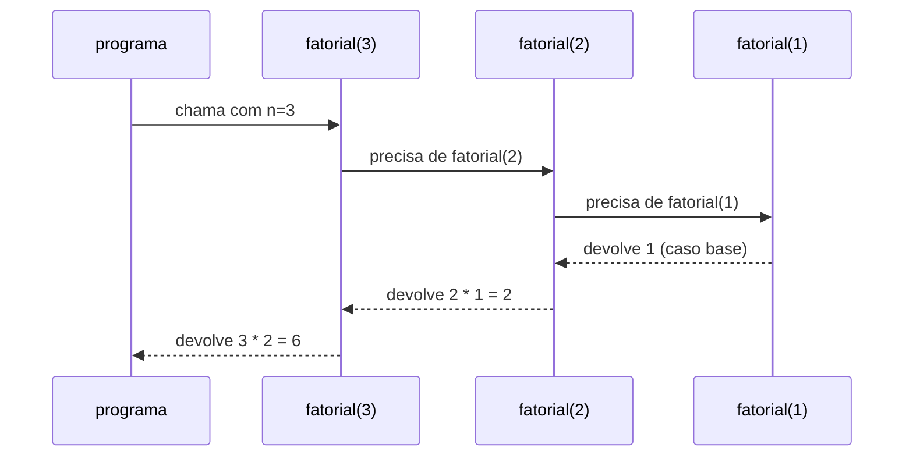

# Funções, escopo e recursão (introdução)

## Por que isso importa

Programas reais têm milhares de linhas. Ninguém consegue pensar em tudo de uma vez, então dividimos o problema em pedaços com nome: `calcular_frete`, `validar_cpf`, `enviar_email`. Funções evitam copiar e colar código, deixam cada parte testável sozinha e são a base de tudo o que vem depois: objetos, bibliotecas, APIs. Recursão, por sua vez, é a forma natural de lidar com estruturas que se repetem dentro de si mesmas, como pastas dentro de pastas e árvores.

## Intuição

Uma função é uma **máquina com entrada e saída**, como um liquidificador: você coloca ingredientes (argumentos), ela faz o trabalho lá dentro e devolve o suco (valor de retorno). Quem usa não precisa saber como ela funciona por dentro, só o que entra e o que sai. Isso é **abstração**.

**Recursão** é como as **bonecas russas** (matrioscas): para abrir todas, abra a de fora e repita o mesmo processo com a de dentro, até chegar na menor, que não abre (o **caso base**).

## Visual

A pilha de chamadas guarda onde cada função parou. Para `fatorial(3)`:

```
chamada          pilha (topo em cima)                      volta
───────────────────────────────────────────────────────────────────────
fatorial(3)      [fatorial(3)]
 fatorial(2)     [fatorial(2)] [fatorial(3)]
  fatorial(1)    [fatorial(1)] [fatorial(2)] [fatorial(3)]  ← caso base: devolve 1
 fatorial(2)     [fatorial(2)] [fatorial(3)]               ← 2 * 1 = 2
fatorial(3)      [fatorial(3)]                             ← 3 * 2 = 6
                 []                                         resultado: 6
```



## Conceito técnico

### Definindo e chamando

```python
def area_retangulo(base, altura):       # base e altura são PARÂMETROS
    """Devolve a área de um retângulo."""   # docstring: documenta a função
    return base * altura

a = area_retangulo(3, 4)                 # 3 e 4 são ARGUMENTOS
print(a)                                 # 12
```

- `def` cria a função, mas **não executa** nada. O corpo só roda quando a função é **chamada** com `()`.
- **Parâmetros** são os nomes na definição; **argumentos** são os valores passados na chamada.
- `return` **devolve** um valor para quem chamou e **encerra** a função na hora. Sem `return`, a função devolve `None`.

### return × print

É a confusão número 1:

| | `print` | `return` |
|---|---|---|
| O que faz | mostra na tela | devolve o valor para quem chamou |
| Dá para usar o resultado numa conta? | não | sim |
| Encerra a função? | não | sim |

```python
def dobro_print(x):
    print(x * 2)

def dobro_return(x):
    return x * 2

r1 = dobro_print(5)     # mostra 10, mas r1 vale None
r2 = dobro_return(5)    # não mostra nada, e r2 vale 10
print(r2 + 1)           # 11
print(r1 + 1)           # TypeError: None + 1
```

Regra prática: funções que **calculam** devem **retornar**; quem chama decide se imprime.

### Parâmetros padrão e argumentos nomeados

```python
def saudar(nome, saudacao="Olá"):
    return f"{saudacao}, {nome}!"

print(saudar("Ana"))                        # Olá, Ana!
print(saudar("Ana", "Bom dia"))             # Bom dia, Ana!
print(saudar(saudacao="Oi", nome="Bia"))    # Oi, Bia!: nomeados, em qualquer ordem
```

Uma função pode devolver vários valores separados por vírgula (na verdade, uma tupla):

```python
def divide(a, b):
    return a // b, a % b

q, r = divide(17, 5)    # q = 3, r = 2
```

### Escopo

Variáveis criadas **dentro** de uma função são **locais**: só existem enquanto a função roda e não são vistas de fora. Variáveis criadas fora de qualquer função são **globais**.

```python
taxa = 0.1                 # global

def com_taxa(valor):
    total = valor * (1 + taxa)   # lê a global taxa: permitido
    return total                 # total é local

print(com_taxa(100))       # 110.00000000000001
print(total)               # NameError: total só existia dentro da função
```

Se você **atribuir** a um nome dentro da função, ele vira local, mesmo que exista uma global com o mesmo nome. Dá para mudar uma global com a palavra `global`, mas **evite**: funções que só dependem dos parâmetros e só se comunicam pelo `return` são muito mais fáceis de testar e entender (você vai ver isso de novo como "funções puras" em FP-07).

### A pilha de chamadas

Cada chamada ganha um **quadro (frame)** na pilha de chamadas, com seus parâmetros e variáveis locais. Quando a função retorna, o quadro sai da pilha e a execução volta exatamente para onde parou. É a pilha (LIFO) que você viu em ED-02, usada pelo próprio Python. Quando acontece um erro, o *traceback* é uma foto dessa pilha.

### Recursão

Uma função **recursiva** chama a si mesma com um problema **menor**. Toda recursão tem duas partes:

1. **Caso base**: o problema pequeno o bastante para responder direto, sem recursão.
2. **Passo recursivo**: reduz o problema e confia que a chamada menor resolve o resto.

```python
def fatorial(n):
    if n <= 1:                     # caso base
        return 1
    return n * fatorial(n - 1)     # passo: n! = n × (n−1)!
```

Sem caso base (ou se o passo não se aproxima dele), a pilha cresce até estourar: `RecursionError` (no Python o limite padrão é ~1000 chamadas). Todo laço pode virar recursão e vice-versa; use recursão quando ela deixar o código mais claro, como em árvores (ED-05) e em divisão e conquista (AL-04).

## Código

Decompondo um problema em funções pequenas:

```python
def eh_bissexto(ano):
    return (ano % 4 == 0 and ano % 100 != 0) or ano % 400 == 0


def dias_no_mes(mes, ano):
    if mes == 2:
        return 29 if eh_bissexto(ano) else 28
    if mes in (4, 6, 9, 11):
        return 30
    return 31


for mes in range(1, 4):
    print(mes, dias_no_mes(mes, 2024))
```

Repare como `dias_no_mes` fica legível porque o detalhe do ano bissexto mora em outra função, com um nome que explica.

Recursão: somar os dígitos de um número.

```python
def soma_digitos(n):
    if n < 10:                              # um dígito só: caso base
        return n
    return n % 10 + soma_digitos(n // 10)   # último dígito + soma do resto


print(soma_digitos(2026))   # 2 + 0 + 2 + 6 = 10
```

Fibonacci recursivo (bonito, mas lento: cada chamada faz duas, e o número de chamadas explode; em AL-09 você vai ver como resolver isso com programação dinâmica):

```python
def fib(n):
    if n < 2:
        return n
    return fib(n - 1) + fib(n - 2)


print([fib(i) for i in range(10)])   # [0, 1, 1, 2, 3, 5, 8, 13, 21, 34]
```

## Erros comuns

- **Imprimir em vez de retornar.** A função "funciona" na tela, mas quem chama recebe `None`.
- **Esquecer os parênteses.** `area_retangulo` é a função; `area_retangulo(3, 4)` é a chamada.
- **Código depois do `return`.** Nunca roda: o `return` encerra a função.
- **Esperar que uma variável local exista fora da função** (`NameError`).
- **Recursão sem caso base**, ou com um passo que não diminui o problema (`fatorial(n)` chamando `fatorial(n)`): `RecursionError`.
- **Usar uma lista ou dicionário como valor padrão** (`def f(x, lista=[])`): o mesmo objeto é reaproveitado entre chamadas. Use `lista=None` e crie dentro.

## Pratique

```quiz
id: FP-04-q1
tipo: prever_saida
pergunta: |
  O que este programa imprime?
  ```python
  def f(x):
      print("dentro", x)
      return x + 1
      print("depois")

  y = f(3)
  print(y)
  ```
resposta: "dentro 3 e depois 4. A linha print(\"depois\") nunca roda."
explicacao: "A chamada f(3) imprime 'dentro 3' e o return devolve 4, encerrando a função. Qualquer código depois do return é inalcançável."
dificuldade: 1
```

```quiz
id: FP-04-q2
tipo: multipla_escolha
pergunta: "Qual é o valor de `r` depois de `r = mostra(5)`, se `mostra` só faz `print(x * 2)` e não tem return?"
opcoes: ["10", "\"10\"", "None", "Erro"]
resposta: 2
explicacao: "A função imprime 10 na tela, mas não devolve nada. Toda função sem return devolve None, e é isso que r recebe."
dificuldade: 1
```

```quiz
id: FP-04-q3
tipo: prever_saida
pergunta: |
  O que este programa imprime?
  ```python
  x = 10

  def muda():
      x = 99
      return x

  print(muda())
  print(x)
  ```
resposta: "99 e depois 10"
explicacao: "A atribuição x = 99 dentro da função cria uma variável local x, que não tem relação com a global. A global continua valendo 10."
dificuldade: 2
```

```quiz
id: FP-04-q4
tipo: multipla_escolha
pergunta: "O que acontece ao chamar esta função com `conta(3)`?\n\n```python\ndef conta(n):\n    print(n)\n    conta(n - 1)\n```"
opcoes: ["Imprime 3, 2, 1 e para", "Imprime 3, 2, 1, 0 e para", "Imprime sem parar até dar RecursionError", "Erro de sintaxe"]
resposta: 2
explicacao: "Não há caso base: a função sempre chama a si mesma, passando por 0, -1, -2... até a pilha de chamadas passar do limite (~1000) e o Python lançar RecursionError."
dificuldade: 2
```

```quiz
id: FP-04-q5
tipo: verdadeiro_falso
pergunta: "Escrever `def f(): ...` executa o corpo da função."
resposta: false
explicacao: "def só cria a função e liga o nome f a ela. O corpo roda apenas quando a função é chamada, com f()."
dificuldade: 1
```

```quiz
id: FP-04-q6
tipo: resposta_curta
pergunta: "Quais são as duas partes obrigatórias de uma função recursiva e o que acontece se faltar uma delas?"
resposta: "O caso base, que responde direto sem chamar a função de novo, e o passo recursivo, que chama a função com um problema menor que se aproxima do caso base. Sem caso base (ou se o passo não se aproxima dele), a recursão não termina e estoura a pilha (RecursionError)."
palavras_chave: ["caso base", "menor", "pilha"]
dificuldade: 1
```

```quiz
id: FP-04-q7
tipo: codigo
linguagem: python
pergunta: |
  **Função com retorno.** Escreva `imc(peso, altura)` que **retorna** o IMC arredondado para 1 casa com `round`. Os testes chamam a função diretamente, por exemplo `imc(70, 1.75)` deve retornar `22.9`.
codigo_inicial: |
  def imc(peso, altura):
      # calcule e retorne (não imprima)
      pass
usa: [def, return, round]
testes:
  - chamada: "imc(70, 1.75)"
    saida: "22.9"
  - chamada: "imc(54.5, 1.62)"
    saida: "20.8"
  - chamada: "imc(90, 1.8)"
    visivel: false
    saida: "27.8"
dica: "return round(peso / altura ** 2, 1). Não use print: o teste olha o valor devolvido."
solucao: |
  def imc(peso, altura):
      return round(peso / altura ** 2, 1)
explicacao: "O teste compara o valor que a função devolve. Se você usasse print, a função devolveria None e o teste falharia, mesmo com o número certo aparecendo na tela."
dificuldade: 1
```

```quiz
id: FP-04-q8
tipo: codigo
linguagem: python
pergunta: |
  **Parâmetro padrão.** Escreva `preco_final(preco, desconto=0)` que retorna o preço com o desconto percentual aplicado, arredondado para 2 casas. `preco_final(100)` retorna `100.0` (sem desconto) e `preco_final(80, 25)` retorna `60.0`.
codigo_inicial: |
  def preco_final(preco, desconto=0):
      pass
usa: [def, return, round]
testes:
  - chamada: "preco_final(80, 25)"
    saida: "60.0"
  - chamada: "preco_final(100)"
    saida: "100.0"
  - chamada: "preco_final(59.9, desconto=10)"
    saida: "53.91"
  - chamada: "preco_final(10, 100)"
    visivel: false
    saida: "0.0"
dica: "O preço com desconto é preco * (1 - desconto / 100). Envolva com round(..., 2)."
solucao: |
  def preco_final(preco, desconto=0):
      return round(preco * (1 - desconto / 100), 2)
explicacao: "desconto=0 faz o parâmetro ser opcional. A chamada preco_final(59.9, desconto=10) usa um argumento nomeado. Como / sempre dá float, o retorno é 100.0 mesmo sem desconto."
dificuldade: 1
```

```quiz
id: FP-04-q9
tipo: codigo
linguagem: python
pergunta: |
  **Funções que usam funções.** Escreva `eh_primo(n)` que retorna `True` ou `False`, e depois `contar_primos(limite)` que **usa** `eh_primo` para retornar quantos primos existem de 2 até `limite` (inclusive). `contar_primos(10)` retorna `4` (2, 3, 5, 7).
codigo_inicial: |
  def eh_primo(n):
      pass


  def contar_primos(limite):
      pass
usa: [def, return, for, eh_primo]
testes:
  - chamada: "eh_primo(7)"
    saida: "True"
  - chamada: "eh_primo(1)"
    saida: "False"
  - chamada: "contar_primos(10)"
    saida: "4"
  - chamada: "contar_primos(100)"
    visivel: false
    saida: "25"
  - chamada: "eh_primo(49)"
    visivel: false
    saida: "False"
dica: "Em eh_primo, números menores que 2 não são primos. Dá para retornar False assim que achar um divisor, sem precisar de break: o return já encerra. Em contar_primos, um contador e um for de 2 até limite + 1."
solucao: |
  def eh_primo(n):
      if n < 2:
          return False
      for d in range(2, n):
          if n % d == 0:
              return False
      return True


  def contar_primos(limite):
      qtd = 0
      for n in range(2, limite + 1):
          if eh_primo(n):
              qtd += 1
      return qtd
explicacao: "return dentro do laço faz o papel do break e ainda entrega o resultado. Separar eh_primo deixa contar_primos curta e fácil de ler, e cada uma pode ser testada sozinha: é a decomposição em ação."
dificuldade: 2
```

```quiz
id: FP-04-q10
tipo: codigo
linguagem: python
pergunta: |
  **Potência recursiva.** Escreva `potencia(base, exp)` **recursiva** (sem `**` e sem laço) para `exp >= 0`. Lembre: b⁰ = 1 e bⁿ = b × bⁿ⁻¹. `potencia(2, 10)` retorna `1024`.
codigo_inicial: |
  def potencia(base, exp):
      pass
usa: [def, return, if, potencia]
testes:
  - chamada: "potencia(2, 10)"
    saida: "1024"
  - chamada: "potencia(5, 0)"
    saida: "1"
  - chamada: "potencia(3, 4)"
    visivel: false
    saida: "81"
dica: "Caso base: se exp == 0, retorne 1. Passo: retorne base * potencia(base, exp - 1)."
solucao: |
  def potencia(base, exp):
      if exp == 0:
          return 1
      return base * potencia(base, exp - 1)
explicacao: "Cada chamada diminui exp em 1 até chegar em 0, o caso base. potencia(2, 3) = 2 * potencia(2, 2) = 2 * 2 * potencia(2, 1) = 2 * 2 * 2 * 1 = 8."
dificuldade: 2
```

```quiz
id: FP-04-q11
tipo: codigo
linguagem: python
pergunta: |
  **Inverter texto com recursão.** Escreva `inverter(texto)` recursiva que retorna o texto de trás para frente. `inverter("abc")` retorna `'cba'`. Dica de ferramentas: `texto[0]` é o primeiro caractere e `texto[1:]` é o texto sem o primeiro.
codigo_inicial: |
  def inverter(texto):
      pass
usa: [def, return, if, inverter]
testes:
  - chamada: "inverter('abc')"
    saida: "'cba'"
  - chamada: "inverter('')"
    saida: "''"
  - chamada: "inverter('roma')"
    visivel: false
    saida: "'amor'"
dica: "Caso base: texto vazio retorna texto vazio. Passo: o inverso de 'abc' é o inverso de 'bc' seguido de 'a', ou seja, inverter(texto[1:]) + texto[0]."
solucao: |
  def inverter(texto):
      if texto == "":
          return ""
      return inverter(texto[1:]) + texto[0]
explicacao: "A cada chamada o texto fica um caractere menor, até ficar vazio. Na volta da pilha os primeiros caracteres vão sendo colocados no fim. (Em Python o jeito do dia a dia é texto[::-1], que você vai ver em FP-05.)"
dificuldade: 3
```

## Resumo

- `def` cria a função; ela só roda quando é **chamada** com `()`. Parâmetros na definição, argumentos na chamada.
- `return` **devolve e encerra**; `print` só mostra. Sem `return`, a função devolve `None`.
- Variáveis de dentro da função são **locais**. Prefira se comunicar por parâmetros e `return` a usar globais.
- Cada chamada ganha um quadro na **pilha de chamadas**; o traceback é uma foto dela.
- Recursão = **caso base** + **passo** que diminui o problema. Sem isso: `RecursionError`.

## Para ir além

- Visualize suas funções e a pilha de chamadas no **Python Tutor** (pythontutor.com): cole os exemplos desta aula e execute passo a passo.
- **Próximos módulos**: MD-01 Lógica proposicional (semana 4) e depois FP-05 Arrays, strings e manipulação de texto.
