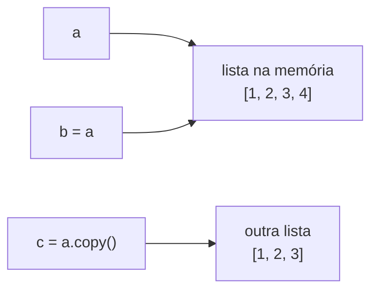

# Arrays, strings e manipulação de texto

## Por que isso importa

Quase nenhum programa trabalha com um dado só: são listas de alunos, linhas de um arquivo, palavras de um texto, pixels de uma imagem. **Arrays** (em Python, **listas**) guardam muitos valores em sequência, e **strings** são sequências de caracteres. Limpar e transformar texto é provavelmente a tarefa mais comum do dia a dia de um dev: ler um CSV, validar um e-mail, montar uma URL, gerar um relatório.

## Intuição

Uma lista é como uma **fileira de armários numerados**, começando do **0**. Cada armário guarda um valor, e você pega o conteúdo pelo número: "me dá o armário 2". Dá para colocar armários novos no fim, tirar do meio e reorganizar.

Uma string é parecida, mas é uma **frase gravada em pedra**: dá para ler cada letra pela posição, mas não dá para trocar uma letra. Para "mudar" o texto, você talha uma pedra nova.

## Visual

Índices positivos (da esquerda, a partir de 0) e negativos (da direita, a partir de −1):

```
            0        1        2        3        4
        ┌────────┬────────┬────────┬────────┬────────┐
frutas  │ "uva"  │ "kiwi" │ "pera" │ "maçã" │ "figo" │
        └────────┴────────┴────────┴────────┴────────┘
           −5       −4       −3       −2       −1

frutas[0]    → "uva"        frutas[-1]   → "figo"
frutas[1:3]  → ["kiwi", "pera"]       (do 1 até ANTES do 3)
frutas[:2]   → ["uva", "kiwi"]        (do começo até antes do 2)
frutas[3:]   → ["maçã", "figo"]       (do 3 até o fim)
frutas[::2]  → ["uva", "pera", "figo"] (de 2 em 2)
frutas[::-1] → a lista ao contrário
```

Aliasing: duas etiquetas na mesma caixa (lembra da intuição de FP-02?):



Depois de `b = a`, as duas etiquetas apontam para a **mesma** lista: `b.append(4)` também muda `a`. Só `c`, que é uma cópia, fica com `[1, 2, 3]`.

## Conceito técnico

### Listas

```python
notas = [7.5, 9.0, 6.0]
vazia = []
mista = [1, "dois", 3.0, True]   # pode misturar tipos (mas raramente é boa ideia)
```

| Operação | Faz | Custo (ED-01) |
|---|---|---|
| `len(l)` | quantidade de elementos | O(1) |
| `l[i]`, `l[i] = x` | lê / troca o elemento da posição i | O(1) |
| `l.append(x)` | coloca no fim | O(1) |
| `l.insert(i, x)` | coloca na posição i, empurrando o resto | O(n) |
| `l.pop()` / `l.pop(i)` | tira e devolve o último / o da posição i | O(1) / O(n) |
| `l.remove(x)` | tira a primeira ocorrência de x | O(n) |
| `x in l` | x está na lista? | O(n) |
| `l.index(x)` | posição da primeira ocorrência | O(n) |
| `l.count(x)` | quantas vezes x aparece | O(n) |
| `l.sort()` | ordena a própria lista (não devolve nada) | O(n log n) |
| `sorted(l)` | devolve uma **nova** lista ordenada | O(n log n) |
| `l.reverse()` | inverte a própria lista | O(n) |
| `sum(l)`, `max(l)`, `min(l)` | soma, maior, menor | O(n) |
| `l1 + l2` | nova lista juntando as duas | O(n) |

Índice que não existe dá `IndexError`. Uma lista de n elementos tem índices de `0` a `n − 1`.

**Array × lista**: em C e Java, um *array* tem tamanho fixo e um tipo só. A lista do Python é um **array dinâmico**: cresce sozinha (quando enche, aloca um espaço maior e copia tudo, por isso `append` é O(1) *amortizado*). O mesmo vale para o `Array` do JavaScript e o `ArrayList` do Java.

### Percorrendo

```python
notas = [7.5, 9.0, 6.0]

for nota in notas:                  # cada elemento
    print(nota)

for i, nota in enumerate(notas):    # posição e elemento
    print(i, nota)

for i in range(len(notas)):         # só as posições (útil para trocar valores)
    notas[i] = notas[i] + 0.5
```

**Compreensão de lista**: uma forma curta de criar uma lista a partir de outra.

```python
notas = [7.5, 9.0, 6.0]
nomes = ["ana", "bia"]
quadrados = [x ** 2 for x in range(5)]            # [0, 1, 4, 9, 16]
aprovados = [n for n in notas if n >= 7]          # filtra: [7.5, 9.0]
nomes_maiusc = [nome.upper() for nome in nomes]   # transforma: ['ANA', 'BIA']
print(quadrados, aprovados, nomes_maiusc)
```

### Strings

Strings são **sequências imutáveis** de caracteres: índices e fatias funcionam igual às listas, mas `s[0] = "X"` dá `TypeError`. Todo método de string **devolve uma string nova**.

| Método | Exemplo | Resultado |
|---|---|---|
| `upper()` / `lower()` | `"Olá".upper()` | `"OLÁ"` |
| `capitalize()` / `title()` | `"ana maria".title()` | `"Ana Maria"` |
| `strip()` | `"  oi \n".strip()` | `"oi"` (tira espaços das pontas) |
| `split(sep)` | `"a,b,c".split(",")` | `["a", "b", "c"]` |
| `split()` | `"um  dois\ttrês".split()` | `["um", "dois", "três"]` (qualquer espaço) |
| `sep.join(lista)` | `"-".join(["a", "b"])` | `"a-b"` |
| `replace(a, b)` | `"1,5".replace(",", ".")` | `"1.5"` |
| `find(sub)` | `"banana".find("na")` | `2` (−1 se não achar) |
| `count(sub)` | `"banana".count("a")` | `3` |
| `startswith` / `endswith` | `"foto.png".endswith(".png")` | `True` |
| `isdigit()` / `isalpha()` | `"123".isdigit()` | `True` |
| `sub in s` | `"@" in email` | `True` ou `False` |

`split` e `join` são opostos e aparecem juntos o tempo todo: quebrar um texto em pedaços, trabalhar na lista, juntar de volta.

**Caracteres são números**: `ord("A")` é `65` e `chr(66)` é `"B"`. Por trás, o texto é guardado em **Unicode** (cada caractere tem um número) e gravado em bytes com a codificação **UTF-8**. É por isso que um arquivo aberto com a codificação errada mostra `ç` no lugar de `ç`.

### Tuplas

Uma **tupla** é uma lista imutável, escrita com parênteses: `ponto = (3, 4)`. Use para dados que andam juntos e não mudam (coordenadas, data, linha de banco). Desempacotar: `x, y = ponto`.

### Mutabilidade e aliasing

- **Mutáveis**: lista, dicionário, conjunto. Podem ser alterados no lugar.
- **Imutáveis**: int, float, str, bool, tupla. "Alterar" cria um objeto novo.

`b = a` **não copia** uma lista: cria outro nome para o mesmo objeto. Para copiar use `a.copy()`, `list(a)` ou `a[:]`. Isso também vale para funções: uma lista passada como argumento pode ser alterada lá dentro, e a mudança aparece para quem chamou.

### Matrizes

Uma matriz é uma lista de listas: `m[linha][coluna]`.

```python
m = [
    [1, 2, 3],
    [4, 5, 6],
]
print(m[1][2])     # 6: linha 1, coluna 2
print(len(m), len(m[0]))   # 2 linhas, 3 colunas
```

Cuidado: `[[0] * 3] * 2` cria duas referências para a **mesma** linha. Use `[[0] * 3 for _ in range(2)]`.

## Código

Limpando e analisando um texto:

```python
frase = "  O rato roeu a roupa do Rei de Roma  "
limpa = frase.strip().lower()
palavras = limpa.split()
print(palavras)
print(len(palavras), "palavras")
print("começam com r:", [p for p in palavras if p.startswith("r")])
print(" ".join(palavras[::-1]))   # palavras em ordem inversa
```

Lendo uma linha de números separados por espaço (formato muito comum em exercícios e arquivos):

```python
linha = input("Números: ")          # experimente: 4 8 15 16 23 42
numeros = [int(x) for x in linha.split()]
print("soma:", sum(numeros))
print("maior:", max(numeros))
print("ordenados ao contrário:", sorted(numeros, reverse=True))
```

Aliasing na prática:

```python
a = [1, 2, 3]
b = a          # mesmo objeto
c = a.copy()   # objeto novo
b.append(4)
print(a)       # [1, 2, 3, 4]: a mudou junto!
print(c)       # [1, 2, 3]
print(a is b, a is c)   # True False: is pergunta "é o mesmo objeto?"
```

Strings são imutáveis:

```python
s = "gato"
# s[0] = "p"           # TypeError: 'str' object does not support item assignment
s = "p" + s[1:]        # cria uma string nova
print(s)               # pato
```

## Erros comuns

- **Esquecer que o índice começa em 0** e acessar `l[len(l)]` (`IndexError`). O último é `l[-1]` ou `l[len(l) - 1]`.
- **Fazer `l = l.sort()`**. `sort()` ordena no lugar e devolve `None`; a lista vira `None`. Use `l.sort()` sozinho ou `l = sorted(l)`.
- **Achar que `s.upper()` muda `s`**. Strings são imutáveis: guarde o resultado (`s = s.upper()`).
- **`b = a` achando que copiou** a lista.
- **Remover itens de uma lista enquanto percorre a mesma lista com `for`**: elementos são pulados. Crie uma lista nova com os que ficam.
- **Somar números lidos como texto**: `"3 4".split()` dá `["3", "4"]`, strings. Converta com `int`.
- **Criar matriz com `[[0] * n] * m`**: todas as linhas são a mesma lista.

## Pratique

```quiz
id: FP-05-q1
tipo: prever_saida
pergunta: |
  O que este programa imprime?
  ```python
  l = [10, 20, 30, 40, 50]
  print(l[1], l[-2])
  print(l[1:4])
  print(l[::-2])
  ```
resposta: "20 40, depois [20, 30, 40] e por fim [50, 30, 10]"
explicacao: "l[1] é o segundo elemento (20) e l[-2] é o penúltimo (40). l[1:4] vai do índice 1 até antes do 4. Com passo -2 a fatia começa do fim e pula de 2 em 2: 50, 30, 10."
dificuldade: 1
```

```quiz
id: FP-05-q2
tipo: multipla_escolha
pergunta: "Depois de `nums = [3, 1, 2]` e `nums = nums.sort()`, quanto vale `nums`?"
opcoes: ["[1, 2, 3]", "[3, 1, 2]", "None", "Erro"]
resposta: 2
explicacao: "sort() ordena a lista no lugar e devolve None. Ao atribuir o retorno de volta a nums, a lista ordenada se perde e nums vira None. Use só nums.sort() ou nums = sorted(nums)."
dificuldade: 2
```

```quiz
id: FP-05-q3
tipo: prever_saida
pergunta: |
  O que este programa imprime?
  ```python
  a = [1, 2]
  b = a
  b.append(3)
  c = a[:]
  c.append(4)
  print(a, b, c)
  ```
resposta: "[1, 2, 3] [1, 2, 3] [1, 2, 3, 4]"
explicacao: "b = a faz b apontar para a mesma lista, então o append(3) aparece nas duas. a[:] cria uma cópia: o append(4) só muda c."
dificuldade: 2
```

```quiz
id: FP-05-q4
tipo: multipla_escolha
pergunta: "Qual o resultado de `\"-\".join(\"2026 10 31\".split())`?"
opcoes: ["\"2026-10-31\"", "[\"2026\", \"10\", \"31\"]", "\"2-0-2-6- -1-0- -3-1\"", "\"-2026-10-31-\""]
resposta: 0
explicacao: "split() quebra o texto nos espaços: ['2026', '10', '31']. join coloca o separador '-' entre cada par de elementos, sem nas pontas."
dificuldade: 1
```

```quiz
id: FP-05-q5
tipo: verdadeiro_falso
pergunta: "Em Python, `s = \"casa\"` e depois `s[0] = \"m\"` deixa `s` valendo \"masa\"."
resposta: false
explicacao: "Strings são imutáveis: a atribuição a um índice dá TypeError. Para 'mudar', crie uma string nova: s = \"m\" + s[1:]."
dificuldade: 1
```

```quiz
id: FP-05-q6
tipo: multipla_escolha
pergunta: "Qual a complexidade de `x in lista` para uma lista com n elementos?"
opcoes: ["O(1)", "O(log n)", "O(n)", "O(n²)"]
resposta: 2
explicacao: "A lista não sabe onde x está: precisa comparar elemento por elemento até achar ou chegar ao fim. Para buscas O(1) em média use um set ou dict (ED-04)."
dificuldade: 2
```

```quiz
id: FP-05-q7
tipo: codigo
linguagem: python
pergunta: |
  **Estatísticas de uma linha.** Leia uma linha com números inteiros separados por espaço e imprima a quantidade, a soma, o maior e os números em ordem crescente. Para `5 3 9 1`:

  ```
  4 números
  soma 18
  maior 9
  1 3 5 9
  ```
usa: [split, int]
testes:
  - entrada: "5 3 9 1"
    saida: |
      4 números
      soma 18
      maior 9
      1 3 5 9
  - entrada: "42"
    saida: |
      1 números
      soma 42
      maior 42
      42
  - entrada: "-3 10 -7 0 10"
    visivel: false
    saida: |
      5 números
      soma 10
      maior 10
      -7 -3 0 10 10
dica: "numeros = [int(x) for x in input().split()]. Depois len, sum, max e sorted. Para imprimir a lista separada por espaço, converta cada número para str e use \" \".join(...)."
solucao: |
  numeros = [int(x) for x in input("Números: ").split()]
  print(f"{len(numeros)} números")
  print(f"soma {sum(numeros)}")
  print(f"maior {max(numeros)}")
  print(" ".join(str(n) for n in sorted(numeros)))
explicacao: "split() quebra a linha em textos, e a compreensão converte cada um com int. join só aceita strings, por isso os números são convertidos com str antes. (print(*sorted(numeros)) também funciona: o * espalha a lista como argumentos.)"
dificuldade: 1
```

```quiz
id: FP-05-q8
tipo: codigo
linguagem: python
pergunta: |
  **Palíndromo.** Escreva `eh_palindromo(texto)` que retorna `True` se o texto é igual lido de trás para frente, **ignorando espaços e maiúsculas**. `eh_palindromo("Socorram me subi no onibus em Marrocos")` retorna `True`.
codigo_inicial: |
  def eh_palindromo(texto):
      pass
usa: [def, return, lower, replace]
testes:
  - chamada: "eh_palindromo('arara')"
    saida: "True"
  - chamada: "eh_palindromo('Socorram me subi no onibus em Marrocos')"
    saida: "True"
  - chamada: "eh_palindromo('python')"
    saida: "False"
  - chamada: "eh_palindromo('A base do teto desaba')"
    visivel: false
    saida: "True"
  - chamada: "eh_palindromo('ab')"
    visivel: false
    saida: "False"
dica: "Normalize primeiro: texto.lower().replace(\" \", \"\"). Depois compare com a versão invertida, que é a fatia [::-1]."
solucao: |
  def eh_palindromo(texto):
      limpo = texto.lower().replace(" ", "")
      return limpo == limpo[::-1]
explicacao: "Os métodos podem ser encadeados porque cada um devolve uma string nova. [::-1] percorre a string do fim para o começo. A comparação já é um bool, então pode ser retornada direto."
dificuldade: 1
```

```quiz
id: FP-05-q9
tipo: codigo
linguagem: python
pergunta: |
  **Contar vogais.** Escreva `contar_vogais(texto)` que retorna quantas vogais (a, e, i, o, u, maiúsculas ou minúsculas, sem acento) o texto tem. `contar_vogais("Programação")` retorna `4` (o "ã" não conta).
codigo_inicial: |
  def contar_vogais(texto):
      pass
usa: [def, for, return]
testes:
  - chamada: "contar_vogais('banana')"
    saida: "3"
  - chamada: "contar_vogais('Programação')"
    saida: "4"
  - chamada: "contar_vogais('xyz')"
    saida: "0"
  - chamada: "contar_vogais('AEIOU aeiou')"
    visivel: false
    saida: "10"
dica: "Percorra cada caractere com for. Teste se ele, em minúsculas, está em \"aeiou\" (o operador in funciona com strings) e conte."
solucao: |
  def contar_vogais(texto):
      qtd = 0
      for c in texto:
          if c.lower() in "aeiou":
              qtd += 1
      return qtd
explicacao: "Um for sobre uma string percorre seus caracteres. c in \"aeiou\" testa se c é um dos caracteres daquela string. Em P-r-o-g-r-a-m-a-ç-ã-o, as vogais sem acento são o, a, a, o: 4."
dificuldade: 1
```

```quiz
id: FP-05-q10
tipo: codigo
linguagem: python
pergunta: |
  **Remover repetidos mantendo a ordem.** Escreva `sem_repetidos(lista)` que retorna uma **nova** lista com os elementos na ordem da primeira aparição, sem repetições. `sem_repetidos([3, 1, 3, 2, 1])` retorna `[3, 1, 2]`. A lista original não pode ser alterada.
codigo_inicial: |
  def sem_repetidos(lista):
      pass
usa: [def, for, append, return]
testes:
  - chamada: "sem_repetidos([3, 1, 3, 2, 1])"
    saida: "[3, 1, 2]"
  - chamada: "sem_repetidos([])"
    saida: "[]"
  - chamada: "sem_repetidos(['a', 'b', 'a'])"
    saida: "['a', 'b']"
  - chamada: "(lambda l: (sem_repetidos(l), l))([1, 1, 2])"
    visivel: false
    saida: "([1, 2], [1, 1, 2])"
dica: "Crie resultado = [] e percorra a lista: se o elemento ainda não está em resultado (not in), faça append."
solucao: |
  def sem_repetidos(lista):
      resultado = []
      for x in lista:
          if x not in resultado:
              resultado.append(x)
      return resultado
explicacao: "Criar uma lista nova evita alterar a original (o teste oculto confere isso). Esta versão é O(n²), porque not in percorre resultado; em ED-04 você vai fazer em O(n) com um set guardando os já vistos."
dificuldade: 2
```

```quiz
id: FP-05-q11
tipo: codigo
linguagem: python
pergunta: |
  **Cifra de César.** Escreva `cifrar(texto, k)` que desloca cada letra **minúscula** `k` posições no alfabeto, dando a volta no z (`cifrar("xyz", 3)` retorna `'abc'`). Qualquer outro caractere fica igual. Use `ord` e `chr`.
codigo_inicial: |
  def cifrar(texto, k):
      pass
usa: [def, ord, chr, return]
testes:
  - chamada: "cifrar('abc', 1)"
    saida: "'bcd'"
  - chamada: "cifrar('xyz', 3)"
    saida: "'abc'"
  - chamada: "cifrar('ola, mundo!', 13)"
    saida: "'byn, zhaqb!'"
  - chamada: "cifrar(cifrar('segredo', 5), 21)"
    visivel: false
    saida: "'segredo'"
dica: "Para uma letra c: posição = ord(c) - ord(\"a\") (de 0 a 25). Nova posição = (posição + k) % 26. Volte com chr(nova + ord(\"a\")). Monte o resultado somando caractere por caractere numa string."
solucao: |
  def cifrar(texto, k):
      resultado = ""
      for c in texto:
          if "a" <= c <= "z":
              pos = (ord(c) - ord("a") + k) % 26
              resultado += chr(pos + ord("a"))
          else:
              resultado += c
      return resultado
explicacao: "ord transforma a letra em número, a conta com % 26 dá a volta no alfabeto (o mesmo truque do relógio e do overflow de MD-04) e chr volta para letra. Cifrar com 5 e depois com 21 dá 26, uma volta completa: o texto original."
dificuldade: 2
```

```quiz
id: FP-05-q12
tipo: codigo
linguagem: python
pergunta: |
  **Transposta de matriz.** Escreva `transposta(m)` que recebe uma matriz (lista de listas) e retorna a transposta: as linhas viram colunas. `transposta([[1, 2, 3], [4, 5, 6]])` retorna `[[1, 4], [2, 5], [3, 6]]`.
codigo_inicial: |
  def transposta(m):
      pass
usa: [def, for, return]
testes:
  - chamada: "transposta([[1, 2, 3], [4, 5, 6]])"
    saida: "[[1, 4], [2, 5], [3, 6]]"
  - chamada: "transposta([[7]])"
    saida: "[[7]]"
  - chamada: "transposta([[1, 2], [3, 4], [5, 6]])"
    visivel: false
    saida: "[[1, 3, 5], [2, 4, 6]]"
dica: "A matriz tem len(m) linhas e len(m[0]) colunas. A linha j da transposta é formada por m[i][j] para cada i. Dois for aninhados (ou uma compreensão dentro de outra)."
solucao: |
  def transposta(m):
      linhas = len(m)
      colunas = len(m[0])
      t = []
      for j in range(colunas):
          nova = []
          for i in range(linhas):
              nova.append(m[i][j])
          t.append(nova)
      return t
explicacao: "O laço de fora percorre as colunas da original (que viram linhas da transposta) e o de dentro, as linhas. Em uma linha: [[m[i][j] for i in range(len(m))] for j in range(len(m[0]))]."
dificuldade: 2
```

```quiz
id: FP-05-q13
tipo: codigo
linguagem: javascript
pergunta: |
  **Iniciais em JavaScript.** Escreva a função `iniciais(nome)` que retorna as iniciais em maiúsculas de cada parte do nome, separadas por ponto. `iniciais("israel carvalho silva")` retorna `'I.C.S.'`. Em JS: `texto.split(" ")`, `p[0]`, `.toUpperCase()` e `lista.join("")` funcionam como no Python.
codigo_inicial: |
  function iniciais(nome) {
    // escreva aqui
  }
usa: [function, split, toUpperCase, return]
testes:
  - chamada: "iniciais('israel carvalho silva')"
    saida: "'I.C.S.'"
  - chamada: "iniciais('Ana')"
    saida: "'A.'"
  - chamada: "iniciais('maria das dores')"
    visivel: false
    saida: "'M.D.D.'"
dica: "nome.split(\" \") dá a lista das partes. Percorra com for (const p of partes) e vá somando p[0].toUpperCase() + \".\" numa variável que começa como \"\"."
solucao: |
  function iniciais(nome) {
    let resultado = "";
    for (const p of nome.split(" ")) {
      resultado += p[0].toUpperCase() + ".";
    }
    return resultado;
  }
explicacao: "for...of no JavaScript é o for...in do Python: percorre os elementos. Strings em JS também são imutáveis e indexadas a partir de 0. Uma versão funcional: nome.split(\" \").map(p => p[0].toUpperCase() + \".\").join(\"\") (você vai ver map em FP-07)."
dificuldade: 2
```

## Resumo

- Listas guardam sequências **mutáveis**; índices vão de **0 a n − 1**, e negativos contam do fim.
- Fatias `[início:fim:passo]` **excluem o fim** e funcionam em listas, strings e tuplas; `[::-1]` inverte.
- `append` é O(1), `insert(0, x)` e `x in lista` são O(n).
- Strings são **imutáveis**: métodos devolvem strings novas. `split` quebra e `join` junta.
- `b = a` **não copia**: é outro nome para a mesma lista. Copie com `a.copy()`.

## Para ir além

- Leia "Strings" e "Lists" no tutorial oficial: docs.python.org/pt-br/3/tutorial/introduction.html.
- **Próximo módulo** no seu caminho: FP-08 Tratamento de erros e depuração.
