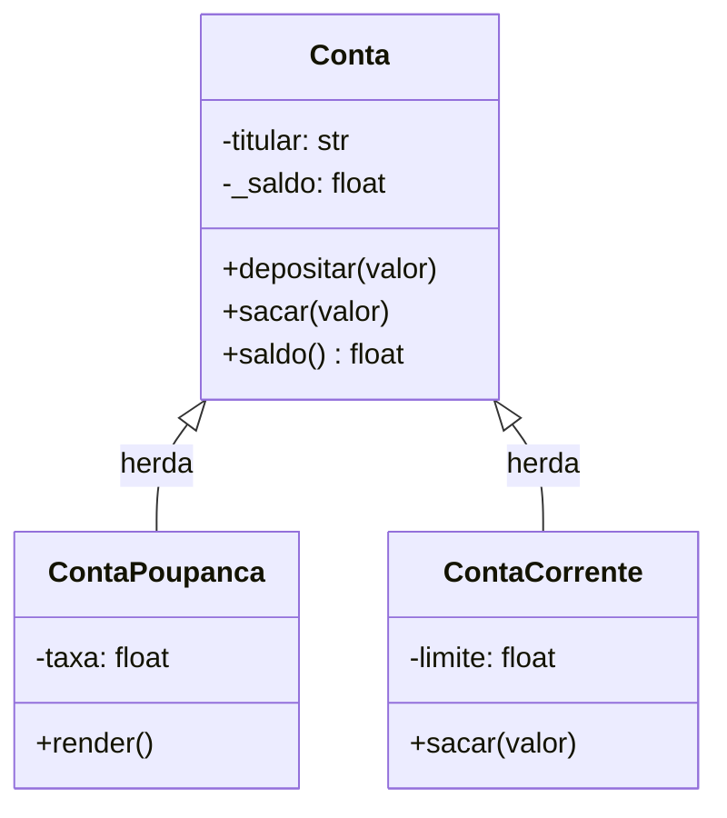

# Programação orientada a objetos: classes, herança, polimorfismo

## Por que isso importa

Até aqui, dados (variáveis, listas) e comportamento (funções) viviam separados. Em sistemas grandes isso vira bagunça: qual função pode mexer no saldo da conta? Quem garante que ele nunca fica negativo? A **programação orientada a objetos (POO)** junta dados e comportamento num mesmo lugar, o **objeto**, e define quem pode fazer o quê com ele. É o paradigma dominante em Java, C#, Kotlin e muito presente em Python, TypeScript e nos frameworks web. Também é a base dos padrões de projeto (ES-04) e do SOLID (ES-03).

## Intuição

Uma **classe** é a **planta de uma casa**: diz quantos quartos, onde fica a porta, o que dá para fazer nela. Um **objeto** é **uma casa construída** a partir da planta. Da mesma planta saem várias casas, cada uma com sua cor e seus moradores (os **atributos**), mas todas com as mesmas funcionalidades (os **métodos**: abrir a porta, acender a luz).

**Herança**: a planta "casa com piscina" reaproveita tudo da planta "casa" e só acrescenta a piscina. **Polimorfismo**: você manda "acender a luz" em qualquer casa e cada uma faz do seu jeito (uma tem interruptor, outra é por voz), mas você não precisa saber qual é qual.

## Visual



Uma classe, vários objetos, cada um com seus atributos:

```
             classe Conta  (a planta)
          ┌─────────┴──────────┐
   objeto c1                objeto c2
   titular = "Ana"          titular = "Bia"
   _saldo  = 100            _saldo  = 2500

c1.depositar(50)  →  dentro do método, self é c1  →  c1._saldo vira 150
```

## Conceito técnico

### Classe, objeto, atributo, método

```python
class Conta:
    def __init__(self, titular, saldo=0):   # construtor: roda ao criar o objeto
        self.titular = titular              # atributo do objeto
        self._saldo = saldo

    def depositar(self, valor):             # método: função que pertence à classe
        self._saldo += valor


c1 = Conta("Ana", 100)    # cria um objeto (instância): chama __init__
c1.depositar(50)          # chama o método; o Python passa c1 como self
print(c1.titular, c1._saldo)   # Ana 150
```

- `class Nome:` define a classe. Convenção: `PascalCase`.
- `__init__` é o **construtor**: inicializa os atributos de cada objeto novo.
- **`self`** é o próprio objeto sobre o qual o método foi chamado. `c1.depositar(50)` é, por baixo, `Conta.depositar(c1, 50)`. Todo método recebe `self` como primeiro parâmetro.
- Atributos criados com `self.x = ...` pertencem a **cada objeto**. Atributos escritos direto no corpo da classe são **compartilhados** por todos (atributos de classe).

### Encapsulamento

O objeto deve proteger seu estado: em vez de qualquer código mexer em `conta._saldo` diretamente, as mudanças passam por **métodos que validam**.

```python
def sacar(self, valor):
    if valor <= 0 or valor > self._saldo:
        raise ValueError("saque inválido")
    self._saldo -= valor
```

Em Python, o `_` na frente (`_saldo`) é uma **convenção** de "uso interno, não mexa" (Java e C# têm `private` de verdade). Para expor um valor só para leitura, use `@property`:

```python
@property
def saldo(self):
    return self._saldo     # c1.saldo funciona, c1.saldo = 10 dá erro
```

### Métodos especiais (dunder)

Métodos com dois sublinhados dos dois lados ensinam o Python a usar seus objetos com a sintaxe da linguagem:

| Método | Usado por | Exemplo |
|---|---|---|
| `__init__` | criar o objeto | `Conta("Ana")` |
| `__str__` | `print(obj)`, `str(obj)` | texto para o usuário |
| `__repr__` | console, listas, depuração | texto para o programador |
| `__eq__` | `a == b` | comparar por conteúdo |
| `__len__` | `len(obj)` | tamanho |
| `__lt__` | `a < b`, `sorted` | ordenar |

### Herança

Uma **subclasse** herda atributos e métodos da **superclasse** e pode **acrescentar** ou **sobrescrever** comportamentos.

```python
class ContaPoupanca(Conta):              # ContaPoupanca é uma Conta
    def __init__(self, titular, saldo=0, taxa=0.005):
        super().__init__(titular, saldo)  # reaproveita o construtor da mãe
        self.taxa = taxa

    def render(self):                     # método novo
        self._saldo += self._saldo * self.taxa
```

`super()` chama a versão da classe mãe. `isinstance(obj, Conta)` é `True` para objetos da classe e de todas as subclasses.

Use herança só quando a relação é **"é um"** de verdade (uma poupança **é uma** conta). Se a relação é **"tem um"** (um carro **tem um** motor), use **composição**: um atributo que guarda outro objeto. Prefira composição na dúvida: hierarquias de herança profundas são rígidas e difíceis de mudar.

### Polimorfismo

"Muitas formas": objetos de classes diferentes respondem à **mesma mensagem** (mesmo nome de método), cada um do seu jeito. O código que usa não precisa de `if tipo == ...`:

```python
for forma in [Circulo(1), Retangulo(2, 3), Quadrado(2)]:
    print(forma.area())    # cada classe calcula a sua área
```

Em Python isso funciona até sem herança, desde que o método exista (**duck typing**: "se anda como pato e grasna como pato, é um pato"). Em linguagens estáticas (Java, TypeScript), a garantia vem de uma classe base ou de uma **interface** comum.

### Os quatro pilares

| Pilar | Em uma frase |
|---|---|
| **Abstração** | expor o que o objeto faz, esconder como |
| **Encapsulamento** | o objeto protege o próprio estado |
| **Herança** | reaproveitar e especializar uma classe |
| **Polimorfismo** | tratar objetos diferentes pela mesma interface |

## Código

Uma conta completa, com validação, `property` e `__str__`:

```python
class Conta:
    def __init__(self, titular, saldo=0):
        self.titular = titular
        self._saldo = saldo
        self._extrato = []

    @property
    def saldo(self):
        return self._saldo

    def depositar(self, valor):
        if valor <= 0:
            raise ValueError("depósito deve ser positivo")
        self._saldo += valor
        self._extrato.append(f"+{valor}")

    def sacar(self, valor):
        if valor <= 0 or valor > self._saldo:
            raise ValueError("saque inválido")
        self._saldo -= valor
        self._extrato.append(f"-{valor}")

    def __str__(self):
        return f"Conta de {self.titular}: R$ {self._saldo:.2f}"


c = Conta("Israel", 100)
c.depositar(50)
c.sacar(30)
print(c)              # Conta de Israel: R$ 120.00
print(c.saldo)        # 120
print(c._extrato)     # ['+50', '-30']
try:
    c.sacar(1000)
except ValueError as e:
    print("erro:", e)
```

Herança e polimorfismo com formas:

```python
import math


class Forma:
    def area(self):
        raise NotImplementedError("cada forma calcula sua área")

    def descrever(self):
        return f"{type(self).__name__} com área {self.area():.2f}"


class Circulo(Forma):
    def __init__(self, raio):
        self.raio = raio

    def area(self):
        return math.pi * self.raio ** 2


class Retangulo(Forma):
    def __init__(self, largura, altura):
        self.largura = largura
        self.altura = altura

    def area(self):
        return self.largura * self.altura


class Quadrado(Retangulo):
    def __init__(self, lado):
        super().__init__(lado, lado)


formas = [Circulo(1), Retangulo(2, 3), Quadrado(2)]
for f in formas:
    print(f.descrever())
print("total:", round(sum(f.area() for f in formas), 2))
```

`descrever` é escrito **uma vez** na classe mãe e funciona para todas, porque chama `self.area()`, que cada subclasse implementa.

## Erros comuns

- **Esquecer o `self`** na definição (`def depositar(valor):`) ou no acesso (`saldo += valor` em vez de `self._saldo += valor`).
- **Confundir classe e objeto**: `Conta.depositar(50)` falha; é `c.depositar(50)` num objeto criado.
- **Esquecer de chamar `super().__init__`** na subclasse: os atributos da mãe não são criados (`AttributeError`).
- **Herança para reaproveitar código sem relação "é um"** (`class Carro(Motor)`). Use composição.
- **Lista como atributo de classe** (`class Turma: alunos = []`): todos os objetos compartilham a mesma lista. Crie no `__init__`.
- **Mexer direto nos atributos internos** de fora da classe, pulando a validação dos métodos.

## Pratique

```quiz
id: FP-06-q1
tipo: multipla_escolha
pergunta: "Na chamada `c.depositar(50)`, o que o parâmetro `self` recebe?"
opcoes: ["50", "A classe Conta", "O objeto c", "Nada: self é opcional"]
resposta: 2
explicacao: "O Python passa automaticamente o objeto antes do ponto como primeiro argumento. c.depositar(50) equivale a Conta.depositar(c, 50): self é c e valor é 50."
dificuldade: 1
```

```quiz
id: FP-06-q2
tipo: prever_saida
pergunta: |
  O que este programa imprime?
  ```python
  class Contador:
      def __init__(self):
          self.n = 0

      def mais(self):
          self.n += 1
          return self

  a = Contador()
  b = Contador()
  a.mais().mais()
  b.mais()
  print(a.n, b.n)
  ```
resposta: "2 1"
explicacao: "Cada objeto tem seu próprio atributo n. a.mais() devolve o próprio a (return self), então a.mais().mais() incrementa a duas vezes. b é outro objeto, incrementado uma vez."
dificuldade: 2
```

```quiz
id: FP-06-q3
tipo: multipla_escolha
pergunta: "Qual relação justifica usar herança?"
opcoes: ["Carro tem um Motor", "Gerente é um Funcionário", "Pedido tem vários Itens", "Usuário usa um Banco de dados"]
resposta: 1
explicacao: "Herança modela 'é um': todo gerente é um funcionário, com algo a mais. As outras são relações 'tem um' ou 'usa', que se modelam com composição (um atributo que guarda o outro objeto)."
dificuldade: 1
```

```quiz
id: FP-06-q4
tipo: verdadeiro_falso
pergunta: "Em Python, um atributo chamado `_saldo` não pode ser acessado de fora da classe."
resposta: false
explicacao: "O sublinhado é só uma convenção que diz 'uso interno'. O Python não impede o acesso. Linguagens como Java e C# têm private de verdade; em Python o encapsulamento depende de disciplina e de @property."
dificuldade: 1
```

```quiz
id: FP-06-q5
tipo: resposta_curta
pergunta: "O que é polimorfismo? Dê um exemplo."
resposta: "É poder tratar objetos de classes diferentes pela mesma interface: a mesma chamada de método faz coisas diferentes conforme o objeto. Exemplo: uma lista de formas onde forma.area() calcula a área do círculo, do retângulo ou do quadrado, cada classe do seu jeito, sem ifs por tipo."
palavras_chave: ["mesmo método", "classes diferentes", "interface"]
dificuldade: 2
```

```quiz
id: FP-06-q6
tipo: codigo
linguagem: python
pergunta: |
  **Classe com validação.** Complete a classe `Conta`: `depositar(valor)` e `sacar(valor)` alteram `self._saldo` e lançam `ValueError` se o valor for `<= 0`; `sacar` também lança `ValueError` se o valor for maior que o saldo. A propriedade `saldo` devolve o saldo. A função `operar` (já pronta) é a que os testes usam.
codigo_inicial: |
  class Conta:
      def __init__(self, titular, saldo=0):
          self.titular = titular
          self._saldo = saldo

      @property
      def saldo(self):
          return self._saldo

      def depositar(self, valor):
          pass

      def sacar(self, valor):
          pass


  # não mude: os testes usam esta função
  def operar(saldo_inicial, operacoes):
      c = Conta("teste", saldo_inicial)
      for tipo, valor in operacoes:
          try:
              if tipo == "d":
                  c.depositar(valor)
              else:
                  c.sacar(valor)
          except ValueError:
              pass
      return c.saldo
usa: [class, def, raise]
testes:
  - chamada: "operar(100, [('d', 50), ('s', 30)])"
    saida: "120"
  - chamada: "operar(100, [('s', 500)])"
    saida: "100"
  - chamada: "operar(0, [('d', -10), ('d', 0), ('d', 5)])"
    saida: "5"
  - chamada: "operar(50, [('s', 50), ('s', 1), ('d', 20), ('s', -5)])"
    visivel: false
    saida: "20"
dica: "Em depositar: if valor <= 0: raise ValueError(...); depois self._saldo += valor. Em sacar, junte as duas condições inválidas com or antes de subtrair."
solucao: |
  class Conta:
      def __init__(self, titular, saldo=0):
          self.titular = titular
          self._saldo = saldo

      @property
      def saldo(self):
          return self._saldo

      def depositar(self, valor):
          if valor <= 0:
              raise ValueError("depósito deve ser positivo")
          self._saldo += valor

      def sacar(self, valor):
          if valor <= 0 or valor > self._saldo:
              raise ValueError("saque inválido")
          self._saldo -= valor


  # não mude: os testes usam esta função
  def operar(saldo_inicial, operacoes):
      c = Conta("teste", saldo_inicial)
      for tipo, valor in operacoes:
          try:
              if tipo == "d":
                  c.depositar(valor)
              else:
                  c.sacar(valor)
          except ValueError:
              pass
      return c.saldo
explicacao: "A regra 'o saldo nunca fica negativo' mora dentro da classe, num só lugar. Quem usa a conta não consegue quebrá-la sem querer: as operações inválidas são recusadas e o estado continua consistente. Isso é encapsulamento."
dificuldade: 2
```

```quiz
id: FP-06-q7
tipo: codigo
linguagem: python
pergunta: |
  **Métodos especiais.** Crie a classe `Fracao` com `__init__(self, num, den)`, `__str__` que devolve `"num/den"`, `__add__` que soma duas frações (devolvendo uma `Fracao` nova, **simplificada**) e `__eq__` que compara pelo valor (1/2 == 2/4). Use `math.gcd` (máximo divisor comum) para simplificar.
codigo_inicial: |
  import math


  class Fracao:
      def __init__(self, num, den):
          pass
usa: [class, def, gcd]
testes:
  - chamada: "str(Fracao(1, 2))"
    saida: "'1/2'"
  - chamada: "str(Fracao(1, 2) + Fracao(1, 3))"
    saida: "'5/6'"
  - chamada: "str(Fracao(1, 4) + Fracao(1, 4))"
    saida: "'1/2'"
  - chamada: "Fracao(1, 2) == Fracao(2, 4)"
    saida: "True"
  - chamada: "Fracao(1, 3) == Fracao(1, 2)"
    visivel: false
    saida: "False"
  - chamada: "str(Fracao(3, 10) + Fracao(1, 5))"
    visivel: false
    saida: "'1/2'"
dica: "a/b + c/d = (a*d + c*b) / (b*d). Para simplificar, divida numerador e denominador pelo math.gcd dos dois (faça isso no __init__, assim toda fração nasce simplificada). Para o __eq__, compare a*d == c*b."
solucao: |
  import math


  class Fracao:
      def __init__(self, num, den):
          m = math.gcd(num, den)
          self.num = num // m
          self.den = den // m

      def __str__(self):
          return f"{self.num}/{self.den}"

      def __add__(self, outra):
          return Fracao(self.num * outra.den + outra.num * self.den, self.den * outra.den)

      def __eq__(self, outra):
          return self.num * outra.den == outra.num * self.den
explicacao: "__add__ faz o + funcionar com seus objetos e __eq__ faz o ==. Sem __eq__, o Python compararia identidade (se são o mesmo objeto na memória), e Fracao(1, 2) == Fracao(2, 4) daria False."
dificuldade: 3
```

```quiz
id: FP-06-q8
tipo: codigo
linguagem: python
pergunta: |
  **Herança e polimorfismo.** A classe `Funcionario` está pronta. Crie `Gerente`, que herda de `Funcionario`, recebe também um `bonus` e sobrescreve `salario()` para somar o bônus ao salário base. Depois complete `folha(equipe)`, que retorna a soma dos salários de uma lista com funcionários e gerentes **sem testar o tipo** de cada um.
codigo_inicial: |
  class Funcionario:
      def __init__(self, nome, base):
          self.nome = nome
          self.base = base

      def salario(self):
          return self.base


  class Gerente(Funcionario):
      pass


  def folha(equipe):
      pass
usa: [class, super, def, return]
testes:
  - chamada: "Gerente('Bia', 5000, 1500).salario()"
    saida: "6500"
  - chamada: "Gerente('Bia', 5000, 1500).nome"
    saida: "'Bia'"
  - chamada: "folha([Funcionario('Ana', 3000), Gerente('Bia', 5000, 1500)])"
    saida: "9500"
  - chamada: "folha([])"
    visivel: false
    saida: "0"
  - chamada: "isinstance(Gerente('C', 1, 1), Funcionario)"
    visivel: false
    saida: "True"
dica: "No __init__ do Gerente, chame super().__init__(nome, base) e guarde self.bonus. Em salario, retorne super().salario() + self.bonus. Em folha, some p.salario() para cada pessoa."
solucao: |
  class Funcionario:
      def __init__(self, nome, base):
          self.nome = nome
          self.base = base

      def salario(self):
          return self.base


  class Gerente(Funcionario):
      def __init__(self, nome, base, bonus):
          super().__init__(nome, base)
          self.bonus = bonus

      def salario(self):
          return super().salario() + self.bonus


  def folha(equipe):
      total = 0
      for pessoa in equipe:
          total += pessoa.salario()
      return total
explicacao: "folha chama salario() sem saber se é Funcionario ou Gerente: cada objeto responde do seu jeito (polimorfismo). Se amanhã surgir um Estagiario com outra regra, folha não muda. super() reaproveita o construtor e o cálculo da classe mãe."
dificuldade: 2
```

```quiz
id: FP-06-q9
tipo: codigo
linguagem: typescript
pergunta: |
  **Classes em TypeScript.** Em TS os tipos dos atributos são declarados e `private` é de verdade (conferido pelo compilador). Complete a classe `Pilha` (ED-02!) com `empilhar(x: number)`, `desempilhar(): number` (lança `Error("vazia")` se estiver vazia) e `tamanho(): number`. A função `usar` (pronta) é a que os testes chamam.
codigo_inicial: |
  class Pilha {
    private itens: number[] = [];

    empilhar(x: number): void {
    }

    desempilhar(): number {
      return 0;
    }

    tamanho(): number {
      return 0;
    }
  }

  // não mude: os testes usam esta função
  function usar(ops: (number | string)[]): (number | string)[] {
    const p = new Pilha();
    const saida: (number | string)[] = [];
    for (const op of ops) {
      if (op === "pop") {
        try {
          saida.push(p.desempilhar());
        } catch (e) {
          saida.push("erro");
        }
      } else if (op === "len") {
        saida.push(p.tamanho());
      } else {
        p.empilhar(op as number);
      }
    }
    return saida;
  }
usa: [class, private, throw, return]
testes:
  - chamada: "usar([1, 2, 3, 'pop', 'len'])"
    saida: "[ 3, 2 ]"
  - chamada: "usar(['pop'])"
    saida: "[ 'erro' ]"
  - chamada: "usar([5, 'pop', 7, 8, 'pop', 'pop', 'pop', 'len'])"
    visivel: false
    saida: "[ 5, 8, 7, 'erro', 0 ]"
dica: "Use this.itens.push(x) para empilhar e this.itens.pop() para desempilhar. Antes do pop, if (this.itens.length === 0) throw new Error(\"vazia\"). O tamanho é this.itens.length."
solucao: |
  class Pilha {
    private itens: number[] = [];

    empilhar(x: number): void {
      this.itens.push(x);
    }

    desempilhar(): number {
      if (this.itens.length === 0) {
        throw new Error("vazia");
      }
      return this.itens.pop() as number;
    }

    tamanho(): number {
      return this.itens.length;
    }
  }

  // não mude: os testes usam esta função
  function usar(ops: (number | string)[]): (number | string)[] {
    const p = new Pilha();
    const saida: (number | string)[] = [];
    for (const op of ops) {
      if (op === "pop") {
        try {
          saida.push(p.desempilhar());
        } catch (e) {
          saida.push("erro");
        }
      } else if (op === "len") {
        saida.push(p.tamanho());
      } else {
        p.empilhar(op as number);
      }
    }
    return saida;
  }
explicacao: "this em TS/JS é o self do Python, mas não aparece na lista de parâmetros. private impede (em tempo de compilação) que código de fora mexa em itens. Observação: o app remove os tipos para rodar, ainda sem checar os tipos como o compilador tsc faria."
dificuldade: 2
```

## Resumo

- **Classe** é a planta; **objeto** é a instância. `__init__` inicializa e **`self`** é o próprio objeto.
- **Encapsulamento**: mudanças de estado passam por métodos que validam; `_atributo` = uso interno.
- **Métodos especiais** (`__str__`, `__eq__`, `__add__`...) integram seus objetos à sintaxe do Python.
- **Herança** para "é um", com `super()`; **composição** para "tem um" (na dúvida, composição).
- **Polimorfismo**: o mesmo método em classes diferentes; o código cliente não precisa de `if` por tipo.

## Para ir além

- Mais adiante: ES-03 Princípios SOLID e ES-04 Padrões de projeto aprofundam como desenhar boas classes.
- **Próximo módulo**: FP-07 Programação funcional, o "outro lado" da moeda.
