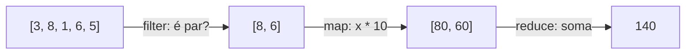

# Programação funcional: funções puras, map/filter/reduce, imutabilidade

## Por que isso importa

Muitos bugs nascem de **estado compartilhado que muda**: uma função altera uma lista que outra parte do programa ainda estava usando, e o erro aparece longe da causa. A **programação funcional** reduz isso com funções que só calculam (sem mexer em nada fora delas) e dados que não mudam. O estilo está em toda parte: `map`/`filter`/`reduce` no JavaScript e no React, streams no Java, Spark para big data, e linguagens inteiras como Haskell, Elixir e Clojure. Saber os dois estilos (objetos e funções) e quando usar cada um é sinal de maturidade.

## Intuição

Uma **função pura** é como uma **calculadora**: você digita 2 + 3 e sempre sai 5, não importa a hora, quantas vezes ou quem digita, e ela não muda nada no mundo. Uma função **impura** é como uma **máquina de café com contador**: além de dar o café, ela anota no caderno quantos cafés já saíram, e o resultado pode depender do que está anotado.

`map`, `filter` e `reduce` são uma **linha de produção**: `filter` é o inspetor que descarta peças com defeito, `map` é a máquina que pinta cada peça, `reduce` é a caixa que junta todas num pacote só.

## Visual



Cada passo devolve uma **coleção nova**; a lista original `[3, 8, 1, 6, 5]` continua intacta.

```
Pura                                Impura
───────────────────────────────     ────────────────────────────────────
def dobro(x):                       total = 0
    return x * 2                    def soma_no_total(x):
                                        global total
mesma entrada → mesma saída             total += x      ← muda algo fora
não mexe em nada fora                   return total    ← resultado depende
fácil de testar                                           do histórico
```

## Conceito técnico

### Funções puras e efeitos colaterais

Uma função é **pura** quando:

1. Com os **mesmos argumentos**, devolve **sempre o mesmo resultado**.
2. **Não tem efeitos colaterais**: não altera variáveis globais nem os argumentos, não imprime, não lê arquivo, não acessa rede.

Vantagens: dá para testar só com entrada e saída, dá para rodar em paralelo sem medo, o resultado pode ser guardado em cache (memoização), e o código é mais fácil de entender (você olha só a função).

Programas precisam de efeitos (mostrar na tela, salvar no banco). A ideia não é eliminá-los, e sim **empurrá-los para as bordas**: um núcleo de funções puras que calcula tudo e uma camada fina que lê a entrada e mostra o resultado.

### Imutabilidade

Em vez de alterar um dado, crie um novo com a mudança:

```python
# mutável: altera a lista recebida (quem chamou vê a mudança!)
def adicionar_mut(lista, x):
    lista.append(x)

# imutável: devolve uma lista nova, a original fica igual
def adicionar(lista, x):
    return lista + [x]
```

Tipos imutáveis do Python: `int`, `float`, `str`, `tuple`, `frozenset`. No JavaScript, use spread (`[...lista, x]`, `{...obj, campo: valor}`) e `const`.

### Funções são valores (primeira classe)

Uma função pode ser guardada numa variável, passada como argumento e devolvida por outra função. Uma função que recebe ou devolve funções é uma **função de ordem superior**.

```python
def aplicar_duas_vezes(f, x):
    return f(f(x))

def mais_tres(x):
    return x + 3

print(aplicar_duas_vezes(mais_tres, 10))   # 16
```

### lambda

Função anônima de **uma expressão**, útil para passar funções curtas:

```python
dobro = lambda x: x * 2          # o mesmo que def dobro(x): return x * 2
print(dobro(4))                  # 8
```

Em JavaScript, a **arrow function**: `const dobro = x => x * 2;`

### map, filter, reduce e sorted com key

| Função | Faz | Exemplo | Resultado |
|---|---|---|---|
| `map(f, l)` | aplica f em cada item | `list(map(str.upper, ["a", "b"]))` | `['A', 'B']` |
| `filter(f, l)` | mantém os itens em que f dá True | `list(filter(lambda x: x > 0, [3, -1, 2]))` | `[3, 2]` |
| `reduce(f, l, ini)` | combina tudo num valor só | `reduce(lambda a, x: a + x, [1, 2, 3], 0)` | `6` |
| `sorted(l, key=f)` | ordena pelo valor de f | `sorted(["bb", "a", "ccc"], key=len)` | `['a', 'bb', 'ccc']` |
| `max(l, key=f)` | o item com maior f | `max(alunos, key=lambda a: a["nota"])` | o melhor aluno |

`map` e `filter` devolvem iteradores "preguiçosos" (calculam sob demanda); use `list(...)` para ver tudo. `reduce` mora no módulo `functools`.

Em Python, as **compreensões** costumam ser mais legíveis que `map`/`filter` com lambda, e fazem a mesma coisa:

```python
[x * 10 for x in nums if x % 2 == 0]                         # compreensão
list(map(lambda x: x * 10, filter(lambda x: x % 2 == 0, nums)))   # equivalente
```

### Closures

Uma função criada dentro de outra **lembra as variáveis** do lugar onde nasceu, mesmo depois que a função de fora terminou:

```python
def multiplicador(n):
    def multiplica(x):
        return x * n        # n vem do ambiente onde multiplica foi criada
    return multiplica

triplo = multiplicador(3)
print(triplo(10))          # 30
```

Closures são a base de decoradores (Python), de hooks do React e de callbacks em JavaScript.

## Código

Um pipeline funcional sobre dados de alunos, sem alterar a lista original:

```python
from functools import reduce

alunos = [
    {"nome": "Ana", "nota": 8.5},
    {"nome": "Bia", "nota": 6.0},
    {"nome": "Caio", "nota": 9.2},
    {"nome": "Davi", "nota": 4.8},
]

aprovados = [a for a in alunos if a["nota"] >= 7]
nomes = [a["nome"] for a in aprovados]
media = reduce(lambda soma, a: soma + a["nota"], alunos, 0) / len(alunos)
ranking = sorted(alunos, key=lambda a: a["nota"], reverse=True)

print(nomes)                              # ['Ana', 'Caio']
print(round(media, 2))                    # 7.12
print([a["nome"] for a in ranking])       # ['Caio', 'Ana', 'Bia', 'Davi']
print(alunos[0])                          # a original não mudou
```

O mesmo em JavaScript, com métodos encadeados:

```javascript
const alunos = [
  { nome: "Ana", nota: 8.5 },
  { nome: "Bia", nota: 6.0 },
  { nome: "Caio", nota: 9.2 },
  { nome: "Davi", nota: 4.8 },
];

const nomes = alunos
  .filter((a) => a.nota >= 7)
  .map((a) => a.nome);
const soma = alunos.reduce((acc, a) => acc + a.nota, 0);
const ranking = [...alunos].sort((x, y) => y.nota - x.nota);   // cópia antes de ordenar!

console.log(nomes);
console.log(soma / alunos.length);
console.log(ranking.map((a) => a.nome));
```

Repare no `[...alunos]` antes do `sort`: no JS, `sort` **altera** o array original, então copiamos primeiro.

Composição de funções (montar uma função nova a partir de outras):

```python
def compor(f, g):
    return lambda x: f(g(x))

limpar = compor(str.lower, str.strip)
print(limpar("  OLÁ Mundo  "))   # 'olá mundo'
```

## Erros comuns

- **Esquecer o `list(...)` em volta de `map`/`filter`** e imprimir `<map object at 0x...>`.
- **lambda com várias linhas.** Lambda é uma expressão só; para mais, use `def`.
- **Lambda gigante e ilegível.** Se precisa de comentário para entender, dê um nome com `def`.
- **Achar que `sort()` é funcional.** Em Python, `list.sort()` e, em JS, `array.sort()` alteram a lista. Use `sorted()` ou copie antes.
- **Alterar o argumento dentro de uma função "pura"** (`lista.append`). Quem chamou vê a lista mudada.
- **Closure em laço** (JS com `var`, Python com lambda dentro de `for`): todas as funções veem o **último** valor da variável. Passe o valor como argumento padrão (`lambda x, i=i: ...`).

## Pratique

```quiz
id: FP-07-q1
tipo: multipla_escolha
pergunta: "Qual destas funções é pura?"
opcoes: ["def f(l): l.append(1); return l", "def f(x): print(x); return x", "def f(x, y): return x * y + 1", "def f(): return random.randint(1, 6)"]
resposta: 2
explicacao: "x * y + 1 depende só dos argumentos e não altera nada fora. A primeira altera a lista recebida, a segunda imprime (efeito colateral) e a última dá resultados diferentes a cada chamada."
dificuldade: 1
```

```quiz
id: FP-07-q2
tipo: prever_saida
pergunta: |
  O que este programa imprime?
  ```python
  nums = [1, 2, 3, 4, 5, 6]
  r = list(map(lambda x: x ** 2, filter(lambda x: x % 2 == 1, nums)))
  print(r)
  print(nums)
  ```
resposta: "[1, 9, 25] e depois [1, 2, 3, 4, 5, 6]"
explicacao: "filter mantém os ímpares (1, 3, 5) e map eleva cada um ao quadrado. Nada disso altera nums, que continua igual: map e filter produzem valores novos."
dificuldade: 1
```

```quiz
id: FP-07-q3
tipo: multipla_escolha
pergunta: "Qual o resultado de `sorted([\"banana\", \"kiwi\", \"maçã\"], key=len)`?"
opcoes: ["['banana', 'kiwi', 'maçã']", "['kiwi', 'maçã', 'banana']", "['maçã', 'kiwi', 'banana']", "['kiwi', 'banana', 'maçã']"]
resposta: 1
explicacao: "key=len ordena pelo tamanho: kiwi (4), maçã (4), banana (6). Em caso de empate, sorted mantém a ordem original (é estável), por isso kiwi vem antes de maçã."
dificuldade: 2
```

```quiz
id: FP-07-q4
tipo: prever_saida
pergunta: |
  O que este programa imprime?
  ```python
  def contador():
      n = 0
      def proximo():
          nonlocal n
          n += 1
          return n
      return proximo

  a = contador()
  b = contador()
  print(a(), a(), b())
  ```
resposta: "1 2 1"
explicacao: "Cada chamada de contador() cria um n novo e uma closure que se lembra dele. a e b têm contadores independentes. nonlocal permite que a função de dentro altere o n da função de fora."
dificuldade: 3
```

```quiz
id: FP-07-q5
tipo: verdadeiro_falso
pergunta: "Em JavaScript, `const nums = [3, 1, 2]; nums.sort();` deixa `nums` igual a `[3, 1, 2]`, porque nums é const."
resposta: false
explicacao: "const impede reatribuir o nome (nums = outra coisa), mas não impede alterar o conteúdo do array. sort ordena no lugar, então nums vira [1, 2, 3]. Para não alterar, use [...nums].sort() ou nums.toSorted()."
dificuldade: 2
```

```quiz
id: FP-07-q6
tipo: resposta_curta
pergunta: "Por que funções puras são mais fáceis de testar?"
resposta: "Porque o resultado depende só dos argumentos e a função não mexe em nada fora dela. O teste só precisa chamar com uma entrada e comparar a saída, sem preparar estado global, arquivos ou banco, e o resultado é sempre o mesmo."
palavras_chave: ["argumentos", "mesmo resultado", "estado"]
dificuldade: 1
```

```quiz
id: FP-07-q7
tipo: codigo
linguagem: python
pergunta: |
  **Torne a função pura.** `aplicar_desconto` altera a lista recebida. Reescreva para **retornar uma lista nova** com os preços com desconto (arredondados em 2 casas), sem mudar a original. Os testes conferem as duas coisas.
codigo_inicial: |
  def aplicar_desconto(precos, pct):
      for i in range(len(precos)):
          precos[i] = round(precos[i] * (1 - pct / 100), 2)
      return precos
usa: [def, return, round]
testes:
  - chamada: "aplicar_desconto([100, 50], 10)"
    saida: "[90.0, 45.0]"
  - chamada: "(lambda p: (aplicar_desconto(p, 50), p))([10.0, 20.0])"
    saida: "([5.0, 10.0], [10.0, 20.0])"
  - chamada: "aplicar_desconto([], 30)"
    visivel: false
    saida: "[]"
  - chamada: "(lambda p: (aplicar_desconto(p, 25), p))([8.0])"
    visivel: false
    saida: "([6.0], [8.0])"
dica: "Uma compreensão de lista cria uma lista nova: [round(p * (1 - pct / 100), 2) for p in precos]."
solucao: |
  def aplicar_desconto(precos, pct):
      return [round(p * (1 - pct / 100), 2) for p in precos]
explicacao: "A versão original 'funcionava', mas destruía os preços originais de quem chamou: um bug esperando para acontecer (ex.: mostrar o preço cheio riscado ao lado do novo). A compreensão constrói uma lista nova, e a original fica intacta."
dificuldade: 1
```

```quiz
id: FP-07-q8
tipo: codigo
linguagem: python
pergunta: |
  **Ordenar com key.** Escreva `ranking(alunos)` que recebe uma lista de tuplas `(nome, nota)` e retorna só os **nomes**, da maior nota para a menor; em caso de empate, em ordem alfabética. `ranking([("Bia", 8), ("Ana", 9), ("Caio", 8)])` retorna `['Ana', 'Bia', 'Caio']`.
codigo_inicial: |
  def ranking(alunos):
      pass
usa: [def, sorted, lambda, return]
testes:
  - chamada: "ranking([('Bia', 8), ('Ana', 9), ('Caio', 8)])"
    saida: "['Ana', 'Bia', 'Caio']"
  - chamada: "ranking([])"
    saida: "[]"
  - chamada: "ranking([('Zé', 5), ('Lia', 5), ('Mel', 10), ('Bob', 5)])"
    visivel: false
    saida: "['Mel', 'Bob', 'Lia', 'Zé']"
dica: "A key pode devolver uma tupla, e tuplas são comparadas elemento a elemento: key=lambda a: (-a[1], a[0]) ordena pela nota decrescente (o sinal de menos inverte) e, no empate, pelo nome."
solucao: |
  def ranking(alunos):
      ordenados = sorted(alunos, key=lambda a: (-a[1], a[0]))
      return [nome for nome, nota in ordenados]
explicacao: "Uma key que devolve tupla resolve critérios de desempate: primeiro compara -nota (maior nota vira o menor número, então vem antes) e, se empatar, compara o nome. sorted não altera a lista original."
dificuldade: 2
```

```quiz
id: FP-07-q9
tipo: codigo
linguagem: python
pergunta: |
  **Funções que fabricam funções.** Escreva `criar_validador(minimo, maximo)` que **retorna uma função** que recebe um número e diz (`True`/`False`) se ele está no intervalo `[minimo, maximo]`. Depois escreva `filtrar_validos(nums, validador)` que usa `filter` para devolver a lista dos que passam.
codigo_inicial: |
  def criar_validador(minimo, maximo):
      pass


  def filtrar_validos(nums, validador):
      pass
usa: [def, return, filter]
testes:
  - chamada: "criar_validador(0, 10)(5)"
    saida: "True"
  - chamada: "criar_validador(0, 10)(11)"
    saida: "False"
  - chamada: "filtrar_validos([-1, 0, 5, 10, 15], criar_validador(0, 10))"
    saida: "[0, 5, 10]"
  - chamada: "filtrar_validos([1, 2, 3], criar_validador(5, 9))"
    visivel: false
    saida: "[]"
  - chamada: "[v(7) for v in (criar_validador(1, 6), criar_validador(7, 7))]"
    visivel: false
    saida: "[False, True]"
dica: "Dentro de criar_validador, defina uma função valida(x) que retorna minimo <= x <= maximo, e retorne valida (sem parênteses!). Em filtrar_validos: return list(filter(validador, nums))."
solucao: |
  def criar_validador(minimo, maximo):
      def valida(x):
          return minimo <= x <= maximo
      return valida


  def filtrar_validos(nums, validador):
      return list(filter(validador, nums))
explicacao: "valida é uma closure: lembra minimo e maximo mesmo depois que criar_validador terminou. Retornar valida (sem parênteses) devolve a função; valida() a chamaria. Cada chamada de criar_validador fabrica um validador independente."
dificuldade: 2
```

```quiz
id: FP-07-q10
tipo: codigo
linguagem: javascript
pergunta: |
  **map, filter e reduce em JavaScript.** Escreva `totalCarrinho(itens)` que recebe uma lista de objetos `{ nome, preco, qtd }` e retorna o total dos itens **com qtd maior que 0**, usando `filter`, `map` e `reduce` (sem `for`). `totalCarrinho([{ nome: "pão", preco: 2, qtd: 3 }, { nome: "leite", preco: 5, qtd: 0 }])` retorna `6`.
codigo_inicial: |
  function totalCarrinho(itens) {
    // filter, map, reduce
  }
usa: [filter, map, reduce, return]
testes:
  - chamada: "totalCarrinho([{ nome: 'pão', preco: 2, qtd: 3 }, { nome: 'leite', preco: 5, qtd: 0 }])"
    saida: "6"
  - chamada: "totalCarrinho([])"
    saida: "0"
  - chamada: "totalCarrinho([{ nome: 'a', preco: 10, qtd: 2 }, { nome: 'b', preco: 1.5, qtd: 4 }, { nome: 'c', preco: 99, qtd: 0 }])"
    visivel: false
    saida: "26"
dica: "itens.filter((i) => i.qtd > 0).map((i) => i.preco * i.qtd).reduce((soma, v) => soma + v, 0). O 0 no fim é o valor inicial: sem ele, a lista vazia dá erro."
solucao: |
  function totalCarrinho(itens) {
    return itens
      .filter((i) => i.qtd > 0)
      .map((i) => i.preco * i.qtd)
      .reduce((soma, v) => soma + v, 0);
  }
explicacao: "Cada método devolve um array novo (filter, map) ou um valor (reduce), por isso dá para encadear. O valor inicial 0 do reduce é obrigatório para o carrinho vazio: sem ele, reduce numa lista vazia lança TypeError."
dificuldade: 2
```

## Resumo

- **Função pura**: mesma entrada → mesma saída, sem efeitos colaterais. Empurre os efeitos para as bordas do programa.
- **Imutabilidade**: crie dados novos em vez de alterar (`lista + [x]`, `sorted`, spread no JS).
- Funções são **valores**: podem ser passadas, devolvidas e guardadas; `lambda` cria funções curtas.
- **map** transforma, **filter** seleciona, **reduce** combina; `sorted(key=...)` ordena por critério.
- **Closure**: função que lembra as variáveis de onde nasceu.

## Para ir além

- Mais adiante: a trilha 18 (Paradigmas de linguagens) aprofunda funcional e tipagem.
- **Próximos módulos** no seu caminho: WB-01 HTML semântico e CSS e ET-01 Ética em tecnologia.
