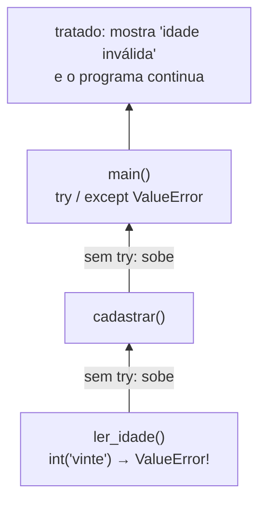

# Tratamento de erros, depuração e leitura de stack traces

## Por que isso importa

Programas de verdade recebem dados ruins: o usuário digita "dez" em vez de 10, o arquivo não existe, a internet cai. Um programa profissional não "quebra na cara" do usuário: ele **trata** o que é esperado e **avisa com clareza** o que não é. E, como todo programador passa boa parte do tempo caçando bugs, depurar com método (em vez de mudar coisas aleatoriamente até funcionar) é uma das habilidades que mais separam iniciantes de profissionais.

## Intuição

Uma **exceção** é como o **alarme de incêndio** de um prédio. Quando algo dá errado no 5º andar (uma função lá no fundo), o alarme sobe andar por andar até alguém que saiba lidar com ele (um `try/except`). Se ninguém lida, ele chega na portaria e o prédio é evacuado: o programa para e mostra o traceback.

**Depurar** é trabalho de **detetive**: você não sai prendendo suspeitos aleatórios. Reproduz a cena do crime, junta pistas (mensagens, prints), levanta uma hipótese e faz um teste que a confirme ou descarte.

## Visual

Como uma exceção sobe pela pilha de chamadas até achar quem a trate:



Anatomia de um traceback (leia **de baixo para cima**):

```
Traceback (most recent call last):
  File "main.py", line 12, in <module>        ← 3º: o programa chamou main()... (o mais antigo)
    main()
  File "main.py", line 9, in main             ← 2º: ...que chamou media()...
    print(media(notas))
  File "main.py", line 4, in media            ← 1º: ...e aqui estourou (o mais recente)
    return sum(valores) / len(valores)
ZeroDivisionError: division by zero           ← O QUÊ: tipo e mensagem. Comece por aqui!
```

## Conceito técnico

### Tipos de exceção mais comuns

| Exceção | Quando acontece | Exemplo |
|---|---|---|
| `SyntaxError` | o código não segue a gramática (antes de rodar) | `if x > 1 print(x)` |
| `NameError` | nome não definido | `pirnt("oi")` |
| `TypeError` | operação com o tipo errado | `"a" + 1` |
| `ValueError` | tipo certo, valor inválido | `int("vinte")` |
| `IndexError` | índice fora da lista | `[1, 2][5]` |
| `KeyError` | chave inexistente no dicionário | `{"a": 1}["b"]` |
| `ZeroDivisionError` | divisão por zero | `1 / 0` |
| `AttributeError` | método/atributo que o tipo não tem | `(5).upper()` |
| `FileNotFoundError` | arquivo não existe | `open("x.txt")` |
| `RecursionError` | recursão sem fim | função sem caso base |

### try / except / else / finally

```python
texto = input("Número: ")
try:
    # código que PODE dar erro
    n = int(texto)
except ValueError:
    # roda só se aconteceu ValueError no try
    print("não é número")
else:
    # roda só se o try terminou SEM erro
    print("li", n)
finally:
    # roda SEMPRE, com ou sem erro (fechar arquivo, liberar recurso)
    print("fim da leitura")
```

Regras de ouro:

- **Capture só o que você sabe tratar** e o tipo específico (`except ValueError`). Um `except:` sozinho (ou `except Exception`) esconde bugs de verdade, como um `NameError` por erro de digitação.
- **Mantenha o `try` pequeno**: só a linha que pode falhar. Assim você sabe de onde veio o erro.
- Para pegar mais de um tipo: `except (ValueError, TypeError):`. Para ver a mensagem: `except ValueError as e: print(e)`.

### raise: recusando dados inválidos

Suas funções também podem (e devem) lançar exceções quando recebem algo que não faz sentido:

```python
def sacar(saldo, valor):
    if valor <= 0:
        raise ValueError("o valor do saque deve ser positivo")
    if valor > saldo:
        raise ValueError(f"saldo insuficiente: saldo {saldo}, saque {valor}")
    return saldo - valor
```

Lançar é melhor que devolver um valor "mágico" (como `-1` ou `None`) que quem chamou pode esquecer de conferir: a exceção não pode ser ignorada sem querer.

**Fail fast** (falhe cedo): é mais fácil achar um bug quando o programa para no primeiro sinal de problema do que quando o dado errado se espalha e explode 200 linhas depois.

### assert

`assert condição, "mensagem"` lança `AssertionError` se a condição for falsa. Use para conferir **suposições internas** do seu código ("aqui a lista nunca está vazia") e em testes simples. Não use para validar entrada do usuário: asserts podem ser desligados (`python -O`).

```python
def media(valores):
    assert len(valores) > 0, "media() precisa de pelo menos um valor"
    return sum(valores) / len(valores)

assert media([2, 4]) == 3     # um mini-teste: se falhar, você fica sabendo
```

### Depuração com método

1. **Reproduza**: ache uma entrada que sempre causa o problema. Quanto menor, melhor.
2. **Leia a mensagem**: tipo do erro, última linha, número da linha.
3. **Isole**: qual a menor parte do código que ainda falha? Comente pedaços, teste funções sozinhas.
4. **Levante uma hipótese** ("acho que `i` passa do tamanho da lista") e **teste**: um `print(i, len(lista))` ou um ponto de parada.
5. **Corrija a causa**, não o sintoma, e **teste de novo** (incluindo os casos que já funcionavam).

Ferramentas:

- **print de depuração**: `print(f"{i=} {total=}")` mostra nome e valor (o `=` dentro da f-string faz isso).
- **Depurador**: `breakpoint()` no meio do código para a execução e abre o `pdb` (no terminal); no VS Code, clique ao lado do número da linha para um ponto de parada e use F10/F11 para avançar.
- **Pato de borracha**: explique o código linha por linha em voz alta (para um pato, um amigo ou um chatbot). Muitas vezes você acha o bug no meio da explicação.

## Código

Ler um número até a pessoa digitar um válido (escreva várias linhas no campo de entrada, por exemplo `vinte`, `-3` e `20`):

```python
while True:
    texto = input("Idade: ")
    try:
        idade = int(texto)
    except ValueError:
        print(f"'{texto}' não é um número inteiro, tente de novo")
        continue
    if idade < 0:
        print("idade não pode ser negativa")
        continue
    break
print("ok:", idade)
```

Exceção atravessando funções e sendo tratada no lugar certo:

```python
def media(valores):
    return sum(valores) / len(valores)


def relatorio(turma):
    return f"média da turma: {media(turma):.1f}"


for turma in ([7, 8, 9], []):
    try:
        print(relatorio(turma))
    except ZeroDivisionError:
        print("turma sem notas")
```

`else` e `finally` em ação:

```python
for texto in ["10", "dez"]:
    try:
        n = int(texto)
    except ValueError as e:
        print("erro:", e)
    else:
        print("dobro:", n * 2)
    finally:
        print("--- terminou", texto)
```

## Erros comuns

- **Ler o traceback de cima para baixo** e se perder. A causa costuma estar na **última** linha, e o lugar no último `File ... line`.
- **`except:` sem tipo** engolindo tudo, inclusive erros de digitação que você precisaria ver.
- **`try` gigante** em volta de 30 linhas: você não sabe qual delas falhou.
- **Tratar e esconder** (`except: pass`): o erro some, mas o problema continua, e agora sem pistas.
- **Mudar coisas aleatoriamente** até funcionar. Sem entender a causa, o bug volta.
- **Usar `assert` para validar entrada do usuário.** Use `if` + `raise`.

## Pratique

```quiz
id: FP-08-q1
tipo: multipla_escolha
pergunta: "Num traceback com várias funções, onde está a linha que efetivamente causou o erro?"
opcoes: ["No primeiro 'File ... line' (o de cima)", "No último 'File ... line' (logo antes da mensagem)", "Sempre na linha 1", "O traceback não informa"]
resposta: 1
explicacao: "O traceback lista as chamadas da mais antiga (em cima) para a mais recente (embaixo). O último File/line é onde o erro aconteceu, e a linha seguinte diz o tipo e a mensagem."
dificuldade: 1
```

```quiz
id: FP-08-q2
tipo: prever_saida
pergunta: |
  O que este programa imprime?
  ```python
  try:
      x = int("5")
      y = 10 / (x - 5)
      print("A")
  except ValueError:
      print("B")
  except ZeroDivisionError:
      print("C")
  else:
      print("D")
  finally:
      print("E")
  ```
resposta: "C e depois E"
explicacao: "int(\"5\") funciona (x = 5), mas 10 / 0 lança ZeroDivisionError: o resto do try (print A) é pulado e cai no except correspondente (C). else só roda se não houve erro. finally roda sempre (E)."
dificuldade: 2
```

```quiz
id: FP-08-q3
tipo: multipla_escolha
pergunta: "Qual exceção `int(\"3.5\")` lança?"
opcoes: ["TypeError", "ValueError", "SyntaxError", "Nenhuma: devolve 3"]
resposta: 1
explicacao: "O tipo do argumento está certo (é uma str), mas o conteúdo não representa um inteiro. Tipo certo com valor inválido é ValueError. int(3.5), com um float, funcionaria e daria 3."
dificuldade: 1
```

```quiz
id: FP-08-q4
tipo: verdadeiro_falso
pergunta: "É uma boa prática envolver o programa inteiro em `try: ... except: pass` para ele nunca quebrar."
resposta: false
explicacao: "Isso esconde todos os erros, inclusive bugs reais, e o programa segue com dados errados sem nenhuma pista. Capture só exceções específicas que você sabe tratar, no menor trecho possível."
dificuldade: 1
```

```quiz
id: FP-08-q5
tipo: resposta_curta
pergunta: "Por que lançar uma exceção (raise) costuma ser melhor do que devolver um valor especial como -1 quando a função recebe dados inválidos?"
resposta: "Porque quem chama pode esquecer de conferir o -1 e seguir com um valor errado, espalhando o problema. A exceção interrompe o fluxo e não pode ser ignorada sem querer: ou é tratada, ou o programa para mostrando onde está o problema (fail fast)."
palavras_chave: ["ignorar", "conferir", "interrompe"]
dificuldade: 2
```

```quiz
id: FP-08-q6
tipo: codigo
linguagem: python
pergunta: |
  **Leitura robusta.** Leia linhas até receber um número inteiro válido. Para cada linha inválida imprima `inválido: TEXTO`. Ao receber um válido, imprima `dobro: N`. Para as entradas `abc`, `4.5` e `21`:

  ```
  inválido: abc
  inválido: 4.5
  dobro: 42
  ```
usa: [while, try, int]
testes:
  - entradas: ["abc", "4.5", "21"]
    saida: |
      inválido: abc
      inválido: 4.5
      dobro: 42
  - entradas: ["7"]
    saida: "dobro: 14"
  - entradas: ["", "sete", "-3"]
    visivel: false
    saida: |
      inválido:
      inválido: sete
      dobro: -6
dica: "while True: leia o texto; no try, converta com int; no except ValueError, imprima a mensagem (o laço continua sozinho); no else, imprima o dobro e dê break."
solucao: |
  while True:
      texto = input("Número: ")
      try:
          n = int(texto)
      except ValueError:
          print(f"inválido: {texto}")
      else:
          print(f"dobro: {n * 2}")
          break
explicacao: "O try fica só em volta da conversão, a linha que pode falhar. O else separa o caminho de sucesso. Um texto vazio também é inválido para int, e o teste oculto confere isso."
dificuldade: 1
```

```quiz
id: FP-08-q7
tipo: codigo
linguagem: python
pergunta: |
  **raise na validação.** Escreva `sacar(saldo, valor)` que retorna o novo saldo. Se `valor <= 0`, lance `ValueError("valor inválido")`. Se `valor > saldo`, lance `ValueError("saldo insuficiente")`. Os testes usam a função `tentar` (já pronta), que devolve o resultado ou a mensagem do erro.
codigo_inicial: |
  def sacar(saldo, valor):
      pass


  # não mude: os testes usam esta função
  def tentar(saldo, valor):
      try:
          return sacar(saldo, valor)
      except ValueError as e:
          return f"erro: {e}"
usa: [def, raise, if]
testes:
  - chamada: "tentar(100, 30)"
    saida: "70"
  - chamada: "tentar(100, 0)"
    saida: "'erro: valor inválido'"
  - chamada: "tentar(50, 80)"
    saida: "'erro: saldo insuficiente'"
  - chamada: "tentar(50, -10)"
    visivel: false
    saida: "'erro: valor inválido'"
  - chamada: "tentar(50, 50)"
    visivel: false
    saida: "0"
dica: "Teste primeiro o valor (if valor <= 0: raise ValueError(\"valor inválido\")), depois o saldo. Se passar pelos dois, return saldo - valor."
solucao: |
  def sacar(saldo, valor):
      if valor <= 0:
          raise ValueError("valor inválido")
      if valor > saldo:
          raise ValueError("saldo insuficiente")
      return saldo - valor


  # não mude: os testes usam esta função
  def tentar(saldo, valor):
      try:
          return sacar(saldo, valor)
      except ValueError as e:
          return f"erro: {e}"
explicacao: "sacar não decide o que fazer com o erro: só avisa. Quem chama (tentar) decide tratar transformando em mensagem. Essa divisão de responsabilidades é o padrão em código profissional. Sacar exatamente o saldo é permitido (50 > 50 é falso)."
dificuldade: 2
```

```quiz
id: FP-08-q8
tipo: codigo
linguagem: python
pergunta: |
  **Ache o bug.** A função abaixo deveria retornar a média das notas **válidas** (de 0 a 10) e ignorar as outras, mas ela tem dois bugs: um dá erro com certas listas e outro dá a média errada. Rode, leia a mensagem, use prints se precisar e conserte. Se não houver nota válida, retorne `0`.
codigo_inicial: |
  def media_valida(notas):
      soma = 0
      qtd = 0
      for i in range(len(notas) + 1):
          if 0 <= notas[i] <= 10:
              soma += notas[i]
      qtd = len(notas)
      return soma / qtd
usa: [def, return]
testes:
  - chamada: "media_valida([8, 6, 10])"
    saida: "8.0"
  - chamada: "media_valida([7, -1, 9, 15])"
    saida: "8.0"
  - chamada: "media_valida([])"
    saida: "0"
  - chamada: "media_valida([11, -2])"
    visivel: false
    saida: "0"
  - chamada: "media_valida([0, 10, 5])"
    visivel: false
    saida: "5.0"
dica: "Bug 1: range(len(notas) + 1) passa um índice além do fim (IndexError). Bug 2: qtd conta todas as notas, inclusive as inválidas; conte só quando a nota entra na soma. E proteja a divisão quando qtd for 0."
solucao: |
  def media_valida(notas):
      soma = 0
      qtd = 0
      for nota in notas:
          if 0 <= nota <= 10:
              soma += nota
              qtd += 1
      if qtd == 0:
          return 0
      return soma / qtd
explicacao: "O IndexError aparece no primeiro teste e é o bug 'barulhento'. O segundo é um erro de lógica, silencioso: só aparece comparando com um resultado conhecido (7 e 9 dão média 8, mas a versão errada dividia por 4). Por isso os testes com resposta conhecida são tão importantes."
dificuldade: 2
```

```quiz
id: FP-08-q9
tipo: codigo
linguagem: python
pergunta: |
  **Processar registros com erros.** Escreva `somar_precos(linhas)` que recebe uma lista de textos no formato `"produto;preço"` e retorna uma tupla `(total, erros)`: a soma dos preços válidos e quantas linhas tinham problema (sem `;` ou com preço que não é número). Ex.: `somar_precos(["pão;2.5", "leite;x", "café"])` retorna `(2.5, 2)`.
codigo_inicial: |
  def somar_precos(linhas):
      pass
usa: [def, try, split, float, return]
testes:
  - chamada: "somar_precos(['pão;2.5', 'leite;x', 'café'])"
    saida: "(2.5, 2)"
  - chamada: "somar_precos(['a;1', 'b;2', 'c;3.5'])"
    saida: "(6.5, 0)"
  - chamada: "somar_precos([])"
    saida: "(0, 0)"
  - chamada: "somar_precos(['x;;1', 'y;10', ';'])"
    visivel: false
    saida: "(10.0, 2)"
dica: "Para cada linha: partes = linha.split(\";\"). Dentro de um try, desempacote nome, preco = partes (ValueError se não forem exatamente 2 partes) e converta float(preco) (ValueError se não for número). Um único except ValueError conta o erro."
solucao: |
  def somar_precos(linhas):
      total = 0
      erros = 0
      for linha in linhas:
          try:
              nome, preco = linha.split(";")
              total += float(preco)
          except ValueError:
              erros += 1
      return total, erros
explicacao: "Os dois problemas (quantidade errada de partes ao desempacotar e texto que não é número) lançam ValueError, então um único except trata ambos. Uma linha com erro não impede as outras de serem processadas: é assim que se lida com arquivos reais, cheios de linhas imperfeitas."
dificuldade: 3
```

## Resumo

- Leia o traceback **de baixo para cima**: tipo e mensagem, depois o último `File ... line`.
- `try` (pequeno) + `except TipoEspecífico` + `else` (sucesso) + `finally` (sempre).
- Use `raise ValueError("mensagem clara")` para recusar dados inválidos: **falhe cedo**.
- `assert` confere suposições internas, não entrada do usuário.
- Depure com método: **reproduzir, ler, isolar, hipótese, testar, corrigir a causa**.

## Para ir além

- Use o **Python Tutor** ou o depurador do VS Code para executar os exemplos linha a linha.
- **Próximos módulos** no seu caminho: FP-09 Git e GitHub e FP-10 Projeto sistemático de funções.
