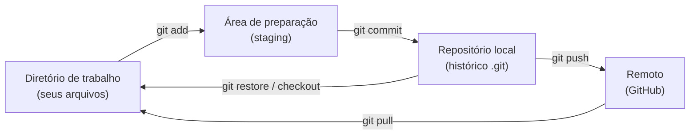
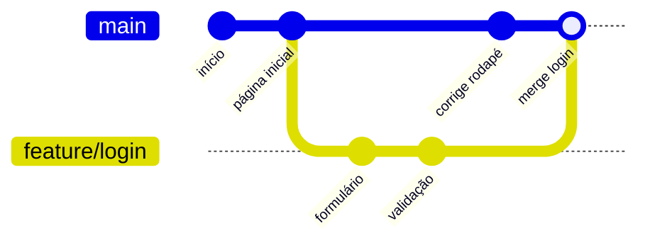

# Git e GitHub: commits, branches, merge, pull requests

## Por que isso importa

Sem controle de versão, projetos viram pastas como `trabalho_final_v2_AGORA_VAI.py`. O **Git** guarda o histórico completo do código, deixa você voltar no tempo, experimentar sem medo em ramos separados e trabalhar em equipe sem um sobrescrever o outro. O **GitHub** hospeda repositórios Git e adiciona revisão de código (pull requests). Toda empresa de software usa isso, e seu perfil no GitHub vira parte do seu currículo. Esta própria sala de aula é desenvolvida assim: cada aula nova chega por um pull request.

## Intuição

Pense num **jogo com pontos de salvamento**. Cada **commit** é um save: uma foto do projeto inteiro, com um recado ("derrotei o chefe da fase 2"). Você pode voltar a qualquer save.

Uma **branch** é como abrir um **save alternativo** para testar uma estratégia arriscada sem perder o jogo principal. Se der certo, você **junta** (merge) as conquistas no jogo principal; se der errado, apaga o save alternativo.

O **GitHub** é a **nuvem** onde os saves ficam guardados e onde o time combina quais saves alternativos entram no jogo principal (o **pull request** é esse pedido: "posso juntar meu save no principal? Dá uma olhada antes").

## Visual

As três áreas do Git e os comandos que movem as mudanças entre elas:



Histórico com uma branch e um merge (cada `o` é um commit; o tempo anda para a direita):

```
main:          o───o───o─────────────o      ← commit de merge (junta as duas linhas)
                        \           /
feature/login:           o───o───o          ← commits feitos na branch
```



## Conceito técnico

### Conceitos

- **Repositório**: a pasta do projeto + a pasta oculta `.git`, onde mora todo o histórico.
- **Commit**: uma foto de todos os arquivos rastreados, com autor, data, mensagem e um ponteiro para o commit anterior (o "pai"). É identificado por um **hash** (ex.: `a1b2c3d`), calculado a partir do conteúdo: mudar qualquer coisa muda o hash.
- **Branch**: só um **ponteiro móvel** para um commit. Criar uma branch é barato (é um arquivo de 41 bytes).
- **HEAD**: o ponteiro para "onde você está agora" (normalmente, uma branch).
- **Remoto** (`origin`): uma cópia do repositório em outro lugar, como o GitHub.

### O ciclo do dia a dia

| Comando | Faz |
|---|---|
| `git init` | transforma a pasta atual num repositório |
| `git clone URL` | baixa um repositório remoto inteiro (com histórico) |
| `git status` | mostra o que mudou e o que está preparado. **Rode o tempo todo.** |
| `git diff` | mostra as mudanças linha a linha (`+` adicionada, `-` removida) |
| `git add arquivo` | prepara a mudança para o próximo commit (`git add .` = tudo) |
| `git commit -m "mensagem"` | grava a foto do que está preparado |
| `git log --oneline` | lista os commits, um por linha |
| `git restore arquivo` | descarta mudanças não commitadas no arquivo (cuidado: não tem volta) |
| `git revert HASH` | cria um commit novo que desfaz um commit antigo (seguro em branch compartilhada) |

**Por que existe o staging?** Para você escolher o que entra em cada commit. Mexeu em duas coisas não relacionadas? Faça dois commits, cada um com um assunto.

**Boas mensagens de commit**: verbo no imperativo e o porquê. "Corrige cálculo de frete para CEP do Norte" é ótimo; "ajustes" e "mudanças" não dizem nada. Commits pequenos e frequentes são mais fáceis de revisar e de desfazer.

**.gitignore**: arquivo com padrões do que o Git deve ignorar: `node_modules/`, `__pycache__/`, `.env` (senhas!), arquivos gerados no build. **Nunca faça commit de senhas e chaves**: mesmo apagando depois, elas ficam no histórico.

### Branches e merge

```
git switch -c feature/login   # cria a branch e vai para ela (antigo: git checkout -b)
# ... edita, add, commit ...
git switch main               # volta para a main
git merge feature/login       # traz os commits da feature para a main
git branch -d feature/login   # apaga o ponteiro (os commits continuam no histórico)
```

Dois tipos de merge:

- **Fast-forward**: se a `main` não andou desde que a branch saiu, o Git só move o ponteiro da `main` para frente. Nenhum commit novo.
- **Merge de três vias**: se as duas andaram, o Git compara as duas pontas com o ancestral comum e cria um **commit de merge** com dois pais.

### Conflitos

Se as duas branches mudaram **as mesmas linhas** do mesmo arquivo, o Git não adivinha qual versão vale e marca o conflito no arquivo:

```
<<<<<<< HEAD
preco = 10
=======
preco = 12
>>>>>>> feature/promocao
```

Para resolver: edite o arquivo deixando a versão certa (pode ser uma, outra ou uma combinação), **apague os marcadores**, depois `git add arquivo` e `git commit`. Conflito não é erro nem desastre: é o Git pedindo uma decisão humana.

### Remoto e GitHub

| Comando | Faz |
|---|---|
| `git remote -v` | mostra os remotos configurados |
| `git push -u origin minha-branch` | envia a branch para o GitHub (o `-u` liga as duas, depois basta `git push`) |
| `git pull` | baixa e junta as novidades do remoto (`fetch` + `merge`) |
| `git fetch` | só baixa, sem juntar |

**Fluxo de pull request (PR)**, usado em quase toda empresa e projeto open source:

1. Crie uma branch a partir da `main` atualizada.
2. Faça commits pequenos com mensagens claras.
3. `git push` da branch e abra um **PR** no GitHub, explicando o quê e o porquê.
4. O **CI** (testes automáticos) roda; colegas **revisam** e comentam linhas.
5. Ajuste com novos commits na mesma branch (o PR atualiza sozinho).
6. Aprovado e com CI verde, faça o **merge** na `main`.

## Código

Uma sessão completa, do zero ao primeiro merge:

```
$ mkdir projeto && cd projeto
$ git init
Initialized empty Git repository in /home/israel/projeto/.git/
$ echo "print('olá')" > ola.py
$ git status
Untracked files:
        ola.py
$ git add ola.py
$ git commit -m "Adiciona primeiro script"
[main (root-commit) 3f2a1b0] Adiciona primeiro script
 1 file changed, 1 insertion(+)
$ git switch -c feature/nome
Switched to a new branch 'feature/nome'
$ echo "nome = input('Nome: ')" >> ola.py
$ git diff
+nome = input('Nome: ')
$ git commit -am "Pergunta o nome"
$ git switch main
$ git merge feature/nome
Fast-forward
 ola.py | 1 +
$ git log --oneline
8c1d9e2 (HEAD -> main, feature/nome) Pergunta o nome
3f2a1b0 Adiciona primeiro script
```

`git commit -am` faz o `add` dos arquivos **já rastreados** e o commit de uma vez (arquivos novos ainda precisam de `git add`).

> **Ainda sem executor de Git no app**: pratique num terminal de verdade. O desafio de código abaixo implementa, em Python, a ideia por trás do `git diff`.

## Erros comuns

- **Commitar senhas, `.env` ou `node_modules`.** Configure o `.gitignore` antes do primeiro commit.
- **Commits gigantes com mensagem "update".** Ninguém consegue revisar nem desfazer só uma parte.
- **Trabalhar direto na `main`** em projetos com outras pessoas. Use branches e PRs.
- **Entrar em pânico com conflito.** Leia os marcadores, decida, apague-os, `add` e `commit`.
- **`git push --force` em branch compartilhada**: apaga o trabalho dos outros. Se precisar desfazer algo já publicado, use `git revert`.
- **Esquecer o `git pull`** antes de começar o dia, e trabalhar sobre uma versão velha.

## Pratique

```quiz
id: FP-09-q1
tipo: multipla_escolha
pergunta: "Você editou `app.py` e rodou `git commit -m \"corrige bug\"`, mas o Git diz que não há nada para commitar. O que faltou?"
opcoes: ["git push", "git add app.py", "git init", "git merge"]
resposta: 1
explicacao: "O commit grava só o que está na área de preparação (staging). Mudanças no diretório de trabalho precisam de git add antes. (git commit -am também funcionaria, por ser um arquivo já rastreado.)"
dificuldade: 1
```

```quiz
id: FP-09-q2
tipo: multipla_escolha
pergunta: "O que é uma branch no Git, tecnicamente?"
opcoes: ["Uma cópia completa de todos os arquivos", "Um ponteiro móvel para um commit", "Um repositório separado no GitHub", "Uma pasta dentro do projeto"]
resposta: 1
explicacao: "Uma branch é só um nome que aponta para um commit e avança a cada novo commit feito nela. Por isso criar branches é instantâneo e barato: nada é copiado."
dificuldade: 1
```

```quiz
id: FP-09-q3
tipo: multipla_escolha
pergunta: "Quando acontece um merge fast-forward?"
opcoes: ["Sempre que há conflito", "Quando a branch de destino não recebeu commits desde que a outra branch saiu dela", "Quando as duas branches mudaram arquivos diferentes", "Só com git push --force"]
resposta: 1
explicacao: "Se a main não andou, todos os commits da feature já estão 'na frente' dela, e o Git só move o ponteiro da main para a ponta da feature, sem criar commit de merge."
dificuldade: 2
```

```quiz
id: FP-09-q4
tipo: verdadeiro_falso
pergunta: "Se você commitar uma senha e, no commit seguinte, apagar o arquivo, a senha deixa de estar no repositório."
resposta: false
explicacao: "O histórico guarda todos os commits: qualquer pessoa com acesso pode voltar ao commit antigo e ver a senha. A senha precisa ser trocada imediatamente (e o histórico reescrito, se possível)."
dificuldade: 1
```

```quiz
id: FP-09-q5
tipo: multipla_escolha
pergunta: "Qual a forma segura de desfazer um commit que já foi enviado (push) para uma branch que outras pessoas usam?"
opcoes: ["git reset --hard e git push --force", "Apagar o repositório e criar de novo", "git revert HASH, que cria um commit desfazendo o anterior", "git restore"]
resposta: 2
explicacao: "revert não reescreve o histórico: adiciona um commit novo com a mudança inversa, e ninguém perde trabalho. reset + push --force reescreve o histórico compartilhado e quebra o trabalho dos colegas."
dificuldade: 2
```

```quiz
id: FP-09-q6
tipo: resposta_curta
pergunta: "Descreva os passos para resolver um conflito de merge."
resposta: "Abrir o arquivo com conflito, ler as duas versões entre os marcadores <<<<<<<, ======= e >>>>>>>, editar deixando o conteúdo correto (uma das versões ou uma combinação), apagar os marcadores, rodar git add no arquivo e depois git commit para concluir o merge."
palavras_chave: ["marcadores", "editar", "add", "commit"]
dificuldade: 2
```

```quiz
id: FP-09-q7
tipo: multipla_escolha
pergunta: "Qual destas é a melhor mensagem de commit?"
opcoes: ["ajustes", "update app.py", "Corrige divisão por zero na média quando a turma está vazia", "commit 23"]
resposta: 2
explicacao: "Uma boa mensagem diz o que mudou e por quê, de forma que alguém lendo o git log meses depois entenda sem abrir o código. As outras não dizem nada útil."
dificuldade: 1
```

```quiz
id: FP-09-q8
tipo: codigo
linguagem: python
pergunta: |
  **Um mini `git diff`.** Escreva `diff(antes, depois)` que recebe duas listas de linhas e retorna uma lista de textos: primeiro `"- linha"` para cada linha de `antes` que não está em `depois` (na ordem de `antes`), depois `"+ linha"` para cada linha de `depois` que não está em `antes` (na ordem de `depois`).

  `diff(["a", "b", "c"], ["a", "c", "d"])` retorna `['- b', '+ d']`.
codigo_inicial: |
  def diff(antes, depois):
      pass
usa: [def, for, append, return]
testes:
  - chamada: "diff(['a', 'b', 'c'], ['a', 'c', 'd'])"
    saida: "['- b', '+ d']"
  - chamada: "diff(['x'], ['x'])"
    saida: "[]"
  - chamada: "diff([], ['print(1)', 'print(2)'])"
    saida: "['+ print(1)', '+ print(2)']"
  - chamada: "diff(['preco = 10', 'total = 0'], ['preco = 12', 'total = 0'])"
    visivel: false
    saida: "['- preco = 10', '+ preco = 12']"
dica: "Dois laços em sequência (não aninhados): o primeiro percorre antes e adiciona \"- \" + linha quando linha not in depois; o segundo faz o mesmo ao contrário com \"+ \"."
solucao: |
  def diff(antes, depois):
      resultado = []
      for linha in antes:
          if linha not in depois:
              resultado.append("- " + linha)
      for linha in depois:
          if linha not in antes:
              resultado.append("+ " + linha)
      return resultado
explicacao: "Uma linha alterada aparece como uma removida e uma adicionada, exatamente como no git diff. O diff de verdade é mais esperto: usa o algoritmo de maior subsequência comum (programação dinâmica, AL-09) para respeitar a ordem e as linhas repetidas."
dificuldade: 2
```

## Resumo

- Git guarda **commits** (fotos do projeto, com hash e pai). `status`, `add`, `commit`, `log`, `diff` são o dia a dia.
- Três áreas: **trabalho → staging (add) → repositório (commit)**, e o remoto com push/pull.
- **Branch** é um ponteiro barato; **merge** junta histórias (fast-forward ou commit de merge).
- **Conflito** = mesmas linhas mudadas nos dois lados: edite, tire os marcadores, `add`, `commit`.
- **Pull request**: branch → push → PR → CI e revisão → merge. Nunca commite segredos.

## Para ir além

- Treine visualmente no **Learn Git Branching** (learngitbranching.js.org, tem em português).
- Crie seu repositório no GitHub, faça um PR para você mesmo e faça o merge.
- **Próximo módulo**: FP-10 Projeto sistemático de funções.
