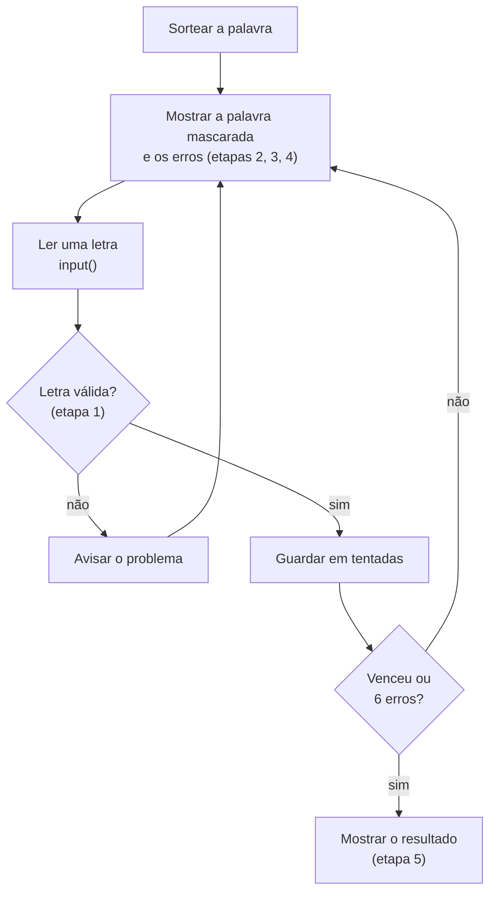

# Projeto: jogo da forca no terminal

## O que você vai construir

Um jogo da forca que roda no terminal. O computador sorteia uma palavra secreta, você chuta uma letra por vez e vê a palavra se revelar. Cada letra errada desenha mais uma parte do boneco; com 6 erros, você perde.

```text
+---+
|   |
|   O
|  /|
|
|
=====
Palavra: p _ _ _ o n
Erros (3/6): a e i
Letra: t
```

Este é o fechamento da Trilha 0: ele junta **variáveis, condicionais, laços, funções, listas e strings** num programa só. O segredo para não se perder é o mesmo da [receita de projeto](#/aula/18-paradigmas-de-linguagens/FP-10-receita-de-projeto): dividir em funções pequenas, testar cada uma e só no fim montar o laço do jogo.

## Como o projeto funciona

Cada etapa abaixo é uma função com um desafio na IDE. Quando todas passarem, você monta o jogo completo no seu computador. O contador no topo da página mostra quantas etapas você já resolveu.



### O estado do jogo

Antes de qualquer código, decida **que dados** descrevem uma partida em andamento (é o passo "definição de dados" da receita):

```python
palavra = "casa"          # str: a palavra secreta, em minúsculas
tentadas = ["a", "x"]     # list[str]: letras já chutadas, na ordem
MAX_ERROS = 6             # int: constante, erros até perder
```

Repare no que **não** está aqui: a palavra mascarada (`_ a _ a`) e a quantidade de erros. Elas são **calculadas** a partir de `palavra` e `tentadas`. Guardar só o mínimo evita que duas variáveis "discordem" entre si, um bug clássico de jogos.

## Etapa 1: validar o chute

O usuário pode digitar qualquer coisa: `ab`, `7`, nada, ou uma letra repetida. O jogo não pode quebrar nem contar isso como erro. Escreva uma função que diz **o que está errado** com o chute, ou devolve texto vazio se está tudo certo. Devolver a mensagem (em vez de imprimir) deixa a função fácil de testar.

```quiz
id: PJ-01-e1
tipo: codigo
linguagem: python
pergunta: |
  Escreva `validar_chute(chute: str, tentadas: list[str]) -> str`. O `chute` já chega limpo (sem espaços e em minúsculas). Devolva:

  - `"Digite uma letra só."` se o chute não tem exatamente 1 caractere ou não é uma letra (use `isalpha()`);
  - `"Você já tentou essa letra."` se a letra já está em `tentadas`;
  - `""` (texto vazio) se o chute é válido.
codigo_inicial: |
  def validar_chute(chute: str, tentadas: list[str]) -> str:
      """Mensagem do problema com o chute, ou "" se ele é válido."""
      return "?"
usa: [def, if, return, isalpha]
testes:
  - chamada: "validar_chute('a', [])"
    saida: "''"
  - chamada: "validar_chute('ab', [])"
    saida: "'Digite uma letra só.'"
  - chamada: "validar_chute('e', ['a', 'e'])"
    saida: "'Você já tentou essa letra.'"
  - chamada: "validar_chute('', ['a'])"
    visivel: false
    saida: "'Digite uma letra só.'"
  - chamada: "validar_chute('7', [])"
    visivel: false
    saida: "'Digite uma letra só.'"
  - chamada: "validar_chute('z', ['a', 'e'])"
    visivel: false
    saida: "''"
dica: "Confira primeiro o formato: if len(chute) != 1 or not chute.isalpha(). Só depois veja se a letra está em tentadas (com in). Se passou pelos dois, return \"\"."
solucao: |
  def validar_chute(chute: str, tentadas: list[str]) -> str:
      """Mensagem do problema com o chute, ou "" se ele é válido."""
      if len(chute) != 1 or not chute.isalpha():
          return "Digite uma letra só."
      if chute in tentadas:
          return "Você já tentou essa letra."
      return ""
explicacao: "A ordem dos testes importa: '' (vazio) também não está em tentadas, então precisa cair na primeira regra. Como texto vazio é falso em Python, o laço do jogo pode fazer `if problema:` para saber se há algo a avisar."
dificuldade: 1
```

## Etapa 2: mostrar a palavra mascarada

A palavra aparece com `_` no lugar das letras ainda não descobertas, separadas por espaço para ficar legível no terminal: `casa` com as tentativas `["a"]` vira `_ a _ a`.

```quiz
id: PJ-01-e2
tipo: codigo
linguagem: python
pergunta: |
  Escreva `mascarar(palavra: str, tentadas: list[str]) -> str`: para cada letra da palavra, mostre a letra se ela já foi tentada ou `_` se não, tudo separado por um espaço. Depois, usando `mascarar`, escreva `venceu(palavra: str, tentadas: list[str]) -> bool`, que diz se não falta descobrir nenhuma letra.
codigo_inicial: |
  def mascarar(palavra: str, tentadas: list[str]) -> str:
      """Palavra com _ nas letras não tentadas, separadas por espaço."""
      return ""


  def venceu(palavra: str, tentadas: list[str]) -> bool:
      """True se todas as letras da palavra já foram tentadas."""
      return False
usa: [def, for, return, join]
testes:
  - chamada: "mascarar('casa', ['a'])"
    saida: "'_ a _ a'"
  - chamada: "mascarar('casa', [])"
    saida: "'_ _ _ _'"
  - chamada: "venceu('casa', ['s', 'a', 'c'])"
    saida: "True"
  - chamada: "venceu('casa', ['c', 'a', 'x'])"
    saida: "False"
  - chamada: "mascarar('banana', ['n', 'z', 'a'])"
    visivel: false
    saida: "'_ a n a n a'"
  - chamada: "venceu('ovo', ['v', 'o'])"
    visivel: false
    saida: "True"
dica: "Monte uma lista vazia, percorra a palavra com for letra in palavra e faça append da letra ou de \"_\". No fim, \" \".join(lista). Para venceu: a pessoa venceu se \"_\" não aparece em mascarar(palavra, tentadas)."
solucao: |
  def mascarar(palavra: str, tentadas: list[str]) -> str:
      """Palavra com _ nas letras não tentadas, separadas por espaço."""
      partes = []
      for letra in palavra:
          if letra in tentadas:
              partes.append(letra)
          else:
              partes.append("_")
      return " ".join(partes)


  def venceu(palavra: str, tentadas: list[str]) -> bool:
      """True se todas as letras da palavra já foram tentadas."""
      return "_" not in mascarar(palavra, tentadas)
explicacao: "As letras repetidas (os três 'a' de banana) aparecem juntas porque o for olha cada posição. `venceu` reaproveita `mascarar` em vez de repetir a lógica: se um dia a máscara mudar, as duas continuam concordando. Se você fez o desafio FP-10-q8, esta etapa é uma revisão."
dificuldade: 1
```

Antes de seguir, preveja o que acontece:

```quiz
id: PJ-01-q1
tipo: prever_saida
pergunta: |
  Com as funções da etapa 2, o que este trecho imprime?

  ```python
  tentadas = ["o", "e"]
  print(mascarar("ovo", tentadas))
  print(venceu("ovo", tentadas))
  ```
resposta: |
  o _ o
  False
explicacao: "As duas posições com 'o' aparecem; o 'v' ainda não foi tentado, então fica '_' e a pessoa ainda não venceu. O 'e' errado não muda nada na máscara: ele só conta como erro."
dificuldade: 1
```

## Etapa 3: contar os erros

Um chute é **errado** quando a letra foi tentada e não está na palavra. Em vez de guardar um contador separado (que pode sair de sincronia), calculamos a lista de letras erradas a partir do estado.

```quiz
id: PJ-01-e3
tipo: codigo
linguagem: python
pergunta: |
  Escreva `letras_erradas(palavra: str, tentadas: list[str]) -> list[str]`, que devolve as letras de `tentadas` que **não** estão na palavra, na mesma ordem em que foram tentadas. O número de erros do jogo é `len(letras_erradas(...))`.
codigo_inicial: |
  def letras_erradas(palavra: str, tentadas: list[str]) -> list[str]:
      """Letras tentadas que não estão na palavra, na ordem das tentativas."""
      return ["?"]
usa: [def, for, return]
testes:
  - chamada: "letras_erradas('casa', ['a', 'x', 'c', 'z'])"
    saida: "['x', 'z']"
  - chamada: "letras_erradas('casa', [])"
    saida: "[]"
  - chamada: "letras_erradas('sol', ['e', 'a', 'o', 'i'])"
    visivel: false
    saida: "['e', 'a', 'i']"
  - chamada: "len(letras_erradas('ovo', ['o', 'v']))"
    visivel: false
    saida: "0"
dica: "É o modelo de lista com filtro: comece com erradas = [], percorra tentadas e faça append só quando letra not in palavra. (Também dá com list comprehension.)"
solucao: |
  def letras_erradas(palavra: str, tentadas: list[str]) -> list[str]:
      """Letras tentadas que não estão na palavra, na ordem das tentativas."""
      erradas = []
      for letra in tentadas:
          if letra not in palavra:
              erradas.append(letra)
      return erradas
explicacao: "Percorremos `tentadas`, não a palavra: queremos as tentativas que falharam. Calcular os erros a partir de `palavra` e `tentadas` garante que o número de erros nunca discorda das letras mostradas na tela."
dificuldade: 1
```

## Etapa 4: desenhar a forca

Cada erro acrescenta uma parte do boneco: cabeça, tronco, braço esquerdo, braço direito, perna esquerda e perna direita. O desenho tem sempre 7 linhas; o que muda são os caracteres de cada parte, que viram espaço enquanto ainda não apareceram.

```text
0 erros     3 erros     6 erros
+---+       +---+       +---+
|   |       |   |       |   |
|           |   O       |   O
|           |  /|       |  /|\
|           |           |  / \
|           |           |
=====       =====       =====
```

```quiz
id: PJ-01-e4
tipo: codigo
linguagem: python
pergunta: |
  Escreva `desenhar(erros: int) -> str`, que devolve o desenho da forca (as 7 linhas juntas com `"\n"`) para 0 a 6 erros, como no quadro acima. A ordem das partes é: `O` (1 erro), `|` (2), `/` braço (3), `\` braço (4), `/` perna (5), `\` perna (6).

  As duas últimas linhas do editor leem o número de erros e imprimem o desenho (não mude). Espaços no fim das linhas não contam. Lembre que, dentro de um texto Python, a barra invertida se escreve `"\\"`.
codigo_inicial: |
  def desenhar(erros: int) -> str:
      """Desenho da forca com `erros` partes do boneco."""
      linhas = [
          "+---+",
          "|   |",
          "|",
          "|",
          "|",
          "|",
          "=====",
      ]
      return "\n".join(linhas)


  # não mude: lê o número de erros e mostra o desenho
  print(desenhar(int(input())))
usa: [def, return, join]
testes:
  - entrada: "0"
    saida: |
      +---+
      |   |
      |
      |
      |
      |
      =====
  - entrada: "3"
    saida: |
      +---+
      |   |
      |   O
      |  /|
      |
      |
      =====
  - entrada: "6"
    saida: |
      +---+
      |   |
      |   O
      |  /|\
      |  / \
      |
      =====
  - entrada: "4"
    visivel: false
    saida: |
      +---+
      |   |
      |   O
      |  /|\
      |
      |
      =====
  - entrada: "1"
    visivel: false
    saida: |
      +---+
      |   |
      |   O
      |
      |
      |
      =====
  - entrada: "5"
    visivel: false
    saida: |
      +---+
      |   |
      |   O
      |  /|\
      |  /
      |
      =====
dica: "Crie uma variável por parte, com a parte ou um espaço: cabeca = \"O\" if erros >= 1 else \" \". Faça o mesmo para tronco (>= 2), braços (>= 3 e >= 4) e pernas (>= 5 e >= 6). Depois monte as linhas com f-strings: f\"|  {braco_e}{tronco}{braco_d}\"."
solucao: |
  def desenhar(erros: int) -> str:
      """Desenho da forca com `erros` partes do boneco."""
      cabeca = "O" if erros >= 1 else " "
      tronco = "|" if erros >= 2 else " "
      braco_e = "/" if erros >= 3 else " "
      braco_d = "\\" if erros >= 4 else " "
      perna_e = "/" if erros >= 5 else " "
      perna_d = "\\" if erros >= 6 else " "
      linhas = [
          "+---+",
          "|   |",
          f"|   {cabeca}",
          f"|  {braco_e}{tronco}{braco_d}",
          f"|  {perna_e} {perna_d}",
          "|",
          "=====",
      ]
      return "\n".join(linhas)


  # não mude: lê o número de erros e mostra o desenho
  print(desenhar(int(input())))
explicacao: "Uma variável por parte, com o caractere ou um espaço, mantém o desenho sempre com o mesmo formato: só o conteúdo muda. A expressão `x if condição else y` (operador ternário) escolhe um de dois valores numa linha. Outra solução comum é guardar os 7 desenhos prontos numa lista e devolver `desenhos[erros]`."
dificuldade: 2
```

## Etapa 5: o laço do jogo

Agora as peças se juntam. O jogo repete **enquanto** a pessoa não venceu **e** não chegou a 6 erros. A cada rodada ele mostra o estado, lê uma letra, valida e, se estiver tudo certo, guarda em `tentadas`. Um chute inválido só gera o aviso e **não** conta como erro.

```quiz
id: PJ-01-q2
tipo: multipla_escolha
pergunta: "Qual condição mantém o laço do jogo rodando?"
opcoes:
  - "while venceu(palavra, tentadas) or erros < 6:"
  - "while not venceu(palavra, tentadas) and erros < 6:"
  - "while not venceu(palavra, tentadas) or erros < 6:"
  - "while erros <= 6:"
resposta: 1
explicacao: "O jogo continua só se as duas coisas forem verdade: ainda não venceu E ainda não perdeu. Com `or`, bastaria uma delas e o jogo nunca pararia depois de vencer (ou de perder). `erros <= 6` deixaria jogar com 6 erros, um a mais que o permitido."
dificuldade: 1
```

```quiz
id: PJ-01-e5
tipo: codigo
linguagem: python
pergunta: |
  Escreva `jogar(palavra: str)`, o laço do jogo, usando as funções das etapas anteriores (já estão prontas no editor). A cada rodada, imprima exatamente:

  ```text
  Palavra: _ a _ a
  Erros (1/6): x
  ```

  (as letras erradas separadas por espaço) e leia a letra com `input("Letra: ")`, limpando com `.strip().lower()`. Se `validar_chute` devolver uma mensagem, imprima a mensagem; senão, guarde a letra em `tentadas`.

  Quando o laço terminar, imprima `Você venceu! A palavra era casa.` ou `Você perdeu! A palavra era casa.` (com a palavra certa). Neste desafio a palavra secreta vem da primeira linha da entrada; no jogo de verdade ela será sorteada. O texto do `input` não aparece na saída esperada.
codigo_inicial: |
  MAX_ERROS = 6


  def validar_chute(chute: str, tentadas: list[str]) -> str:
      if len(chute) != 1 or not chute.isalpha():
          return "Digite uma letra só."
      if chute in tentadas:
          return "Você já tentou essa letra."
      return ""


  def mascarar(palavra: str, tentadas: list[str]) -> str:
      return " ".join(letra if letra in tentadas else "_" for letra in palavra)


  def venceu(palavra: str, tentadas: list[str]) -> bool:
      return "_" not in mascarar(palavra, tentadas)


  def letras_erradas(palavra: str, tentadas: list[str]) -> list[str]:
      return [letra for letra in tentadas if letra not in palavra]


  def jogar(palavra: str) -> None:
      """Roda uma partida da forca com a palavra secreta."""
      tentadas = []
      # escreva o laço aqui


  # não mude: a palavra secreta vem da primeira linha da entrada
  jogar(input())
usa: [while, input, if, print]
testes:
  - entradas: ["casa", "a", "x", "c", "s"]
    saida: |
      Palavra: _ _ _ _
      Erros (0/6):
      Palavra: _ a _ a
      Erros (0/6):
      Palavra: _ a _ a
      Erros (1/6): x
      Palavra: c a _ a
      Erros (1/6): x
      Você venceu! A palavra era casa.
  - entradas: ["ovo", "ov", "O", "o", "v"]
    saida: |
      Palavra: _ _ _
      Erros (0/6):
      Digite uma letra só.
      Palavra: _ _ _
      Erros (0/6):
      Palavra: o _ o
      Erros (0/6):
      Você já tentou essa letra.
      Palavra: o _ o
      Erros (0/6):
      Você venceu! A palavra era ovo.
  - entradas: ["sol", "a", "b", "c", "d", "e", "f"]
    visivel: false
    saida: |
      Palavra: _ _ _
      Erros (0/6):
      Palavra: _ _ _
      Erros (1/6): a
      Palavra: _ _ _
      Erros (2/6): a b
      Palavra: _ _ _
      Erros (3/6): a b c
      Palavra: _ _ _
      Erros (4/6): a b c d
      Palavra: _ _ _
      Erros (5/6): a b c d e
      Você perdeu! A palavra era sol.
  - entradas: ["pao", "x", "x", "7", "p", "a", "z", "o"]
    visivel: false
    saida: |
      Palavra: _ _ _
      Erros (0/6):
      Palavra: _ _ _
      Erros (1/6): x
      Você já tentou essa letra.
      Palavra: _ _ _
      Erros (1/6): x
      Digite uma letra só.
      Palavra: _ _ _
      Erros (1/6): x
      Palavra: p _ _
      Erros (1/6): x
      Palavra: p a _
      Erros (1/6): x
      Palavra: p a _
      Erros (2/6): x z
      Você venceu! A palavra era pao.
dica: "Use while not venceu(palavra, tentadas) and len(letras_erradas(palavra, tentadas)) < MAX_ERROS:. Dentro: calcule erradas, imprima as duas linhas com f-strings (\" \".join(erradas) para as letras), leia chute = input(\"Letra: \").strip().lower(), guarde problema = validar_chute(chute, tentadas) e faça if problema: print(problema) else: tentadas.append(chute). Depois do laço, um if venceu(...) escolhe a mensagem final."
solucao: |
  MAX_ERROS = 6


  def validar_chute(chute: str, tentadas: list[str]) -> str:
      if len(chute) != 1 or not chute.isalpha():
          return "Digite uma letra só."
      if chute in tentadas:
          return "Você já tentou essa letra."
      return ""


  def mascarar(palavra: str, tentadas: list[str]) -> str:
      return " ".join(letra if letra in tentadas else "_" for letra in palavra)


  def venceu(palavra: str, tentadas: list[str]) -> bool:
      return "_" not in mascarar(palavra, tentadas)


  def letras_erradas(palavra: str, tentadas: list[str]) -> list[str]:
      return [letra for letra in tentadas if letra not in palavra]


  def jogar(palavra: str) -> None:
      """Roda uma partida da forca com a palavra secreta."""
      tentadas = []
      while not venceu(palavra, tentadas) and len(letras_erradas(palavra, tentadas)) < MAX_ERROS:
          erradas = letras_erradas(palavra, tentadas)
          print(f"Palavra: {mascarar(palavra, tentadas)}")
          print(f"Erros ({len(erradas)}/{MAX_ERROS}): {' '.join(erradas)}")
          chute = input("Letra: ").strip().lower()
          problema = validar_chute(chute, tentadas)
          if problema:
              print(problema)
          else:
              tentadas.append(chute)
      if venceu(palavra, tentadas):
          print(f"Você venceu! A palavra era {palavra}.")
      else:
          print(f"Você perdeu! A palavra era {palavra}.")


  # não mude: a palavra secreta vem da primeira linha da entrada
  jogar(input())
explicacao: "O laço não guarda nada além de `tentadas`: a máscara, os erros e a vitória são recalculados a cada volta pelas funções das etapas anteriores. Por isso o laço ficou curto e fácil de ler. Repare no segundo teste: 'O' maiúsculo vira 'o' pelo .lower() e a repetição é avisada sem contar como erro."
dificuldade: 2
```

## Etapa 6 (bônus): palavras com acento

Em português, muitas palavras têm acento ou cedilha: `maçã`, `avô`, `ação`. Pedir para a pessoa digitar `ç` ou `ã` no terminal é chato. A saída é comparar uma versão **sem acentos** da palavra com o chute, e mostrar a palavra original no final.

```quiz
id: PJ-01-e6
tipo: codigo
linguagem: python
pergunta: |
  Escreva `remover_acentos(palavra: str) -> str`, que troca cada letra acentuada pela letra sem acento e `ç` por `c`, mantendo as outras. Use o dicionário `TROCAS` que já está no editor.
codigo_inicial: |
  TROCAS = {
      "á": "a", "à": "a", "â": "a", "ã": "a",
      "é": "e", "ê": "e",
      "í": "i",
      "ó": "o", "ô": "o", "õ": "o",
      "ú": "u", "ü": "u",
      "ç": "c",
  }


  def remover_acentos(palavra: str) -> str:
      """A palavra sem acentos nem cedilha."""
      return palavra
usa: [def, for, return, get]
testes:
  - chamada: "remover_acentos('maçã')"
    saida: "'maca'"
  - chamada: "remover_acentos('casa')"
    saida: "'casa'"
  - chamada: "remover_acentos('ação')"
    visivel: false
    saida: "'acao'"
  - chamada: "remover_acentos('pêssego')"
    visivel: false
    saida: "'pessego'"
dica: "Monte o resultado letra por letra. TROCAS.get(letra, letra) devolve a troca se a letra estiver no dicionário e a própria letra se não estiver: é exatamente o que você precisa."
solucao: |
  TROCAS = {
      "á": "a", "à": "a", "â": "a", "ã": "a",
      "é": "e", "ê": "e",
      "í": "i",
      "ó": "o", "ô": "o", "õ": "o",
      "ú": "u", "ü": "u",
      "ç": "c",
  }


  def remover_acentos(palavra: str) -> str:
      """A palavra sem acentos nem cedilha."""
      resultado = ""
      for letra in palavra:
          resultado += TROCAS.get(letra, letra)
      return resultado
explicacao: "`dict.get(chave, padrão)` evita um `if letra in TROCAS` e nunca dá KeyError. No jogo, use `remover_acentos(palavra)` nas comparações (mascarar, venceu, letras_erradas) e a palavra original só na mensagem final. Uma alternativa da biblioteca padrão é `unicodedata.normalize('NFD', palavra)`, que separa a letra do acento."
dificuldade: 1
```

## Montando tudo no seu computador

Com as etapas resolvidas, falta só **sortear a palavra** e juntar as peças num arquivo. Crie uma pasta `forca`, abra-a no VS Code (ou outro editor) e salve o arquivo abaixo como `forca.py`. Ele usa `random.choice`, que sorteia um item de uma lista, e mostra o desenho da etapa 4 a cada rodada.

```python
import random

MAX_ERROS = 6
PALAVRAS = ["python", "terminal", "variavel", "funcao", "lista", "laco", "teclado"]


def validar_chute(chute: str, tentadas: list[str]) -> str:
    if len(chute) != 1 or not chute.isalpha():
        return "Digite uma letra só."
    if chute in tentadas:
        return "Você já tentou essa letra."
    return ""


def mascarar(palavra: str, tentadas: list[str]) -> str:
    return " ".join(letra if letra in tentadas else "_" for letra in palavra)


def venceu(palavra: str, tentadas: list[str]) -> bool:
    return "_" not in mascarar(palavra, tentadas)


def letras_erradas(palavra: str, tentadas: list[str]) -> list[str]:
    return [letra for letra in tentadas if letra not in palavra]


def desenhar(erros: int) -> str:
    partes = ["O", "|", "/", "\\", "/", "\\"]
    p = [partes[i] if erros > i else " " for i in range(6)]
    return "\n".join(["+---+", "|   |", f"|   {p[0]}", f"|  {p[2]}{p[1]}{p[3]}", f"|  {p[4]} {p[5]}", "|", "====="])


def jogar(palavra: str) -> None:
    tentadas = []
    while not venceu(palavra, tentadas) and len(letras_erradas(palavra, tentadas)) < MAX_ERROS:
        erradas = letras_erradas(palavra, tentadas)
        print(desenhar(len(erradas)))
        print(f"Palavra: {mascarar(palavra, tentadas)}")
        print(f"Erros ({len(erradas)}/{MAX_ERROS}): {' '.join(erradas)}")
        chute = input("Letra: ").strip().lower()
        problema = validar_chute(chute, tentadas)
        if problema:
            print(problema)
        else:
            tentadas.append(chute)
        print()
    print(desenhar(len(letras_erradas(palavra, tentadas))))
    if venceu(palavra, tentadas):
        print(f"Você venceu! A palavra era {palavra}.")
    else:
        print(f"Você perdeu! A palavra era {palavra}.")


if __name__ == "__main__":
    jogar(random.choice(PALAVRAS))
```

No terminal, dentro da pasta, rode:

```bash
python3 forca.py
```

(no Windows, `python forca.py`). O `if __name__ == "__main__":` faz o jogo começar só quando você roda o arquivo, e não quando outro arquivo importa as funções dele, por exemplo um arquivo de testes.

### Publique no GitHub

Use o que você viu em [FP-09](#/aula/00-fundamentos-de-programacao/FP-09-git-e-github):

```bash
git init
git add forca.py
git commit -m "Jogo da forca no terminal"
```

Depois crie um repositório vazio no GitHub e siga as instruções de "push an existing repository". Cada melhoria abaixo pode virar um commit (ou uma branch com pull request, para treinar o fluxo completo).

## Ideias para ir além

Escolha uma ou duas; cada uma treina um conceito diferente.

- **Palavras de um arquivo**: leia `palavras.txt` com `open(...)` e `splitlines()`, e trate o `FileNotFoundError` (FP-08) mostrando uma mensagem amigável.
- **Dica**: com o comando `?`, revele uma letra ao custo de um erro (o problem set 2 do MIT tem uma versão parecida).
- **Placar**: jogue várias partidas seguidas e mostre vitórias e derrotas no fim. Pergunte "Jogar de novo? (s/n)".
- **Acentos**: integre a etapa 6, comparando com a palavra sem acentos e mostrando a original.
- **Testes automáticos**: crie `test_forca.py` com funções `assert` (ou o `pytest`) para `mascarar`, `letras_erradas` e `desenhar`. Isso só é fácil porque o jogo foi dividido em funções que devolvem valores em vez de imprimir.

```quiz
id: PJ-01-q3
tipo: resposta_curta
pergunta: "Por que `mascarar`, `letras_erradas` e `desenhar` **devolvem** texto em vez de imprimir direto? O que isso facilitou neste projeto?"
resposta: "Funções que devolvem valores podem ser testadas sozinhas (com assert ou com os testes da IDE), reaproveitadas umas nas outras (venceu usa mascarar) e combinadas de jeitos diferentes. Só o laço do jogo imprime; o resto é lógica pura, fácil de conferir."
palavras_chave: ["testar", "reaproveitar", "devolve", "laço"]
dificuldade: 2
```

```quiz
id: PJ-01-q4
tipo: verdadeiro_falso
pergunta: "No projeto, guardar um contador `erros` e somar 1 a cada letra errada seria tão seguro quanto calcular `len(letras_erradas(palavra, tentadas))`."
resposta: false
explicacao: "Funciona se tudo der certo, mas cria duas fontes da verdade: se algum caminho do código esquecer de somar (ou somar num chute repetido), o contador e as letras na tela passam a discordar. Calcular a partir do estado mínimo (`palavra` e `tentadas`) elimina esse tipo de bug."
dificuldade: 2
```

## Resumo

- Comece pelo **estado**: `palavra` e `tentadas` bastam; o resto é calculado.
- Divida em **funções pequenas que devolvem valores**: `validar_chute`, `mascarar`, `venceu`, `letras_erradas`, `desenhar`.
- O **laço do jogo** só orquestra: mostra, lê, valida, guarda, até vencer ou perder.
- **Valide a entrada** antes de usá-la; chute inválido avisa e não conta como erro.
- Termine com o jogo rodando no terminal e o código **no GitHub**.

## Para ir além

- **MIT 6.0001, Problem Set 2**: a mesma ideia, com uma versão que dá dicas comparando palavras parecidas.
- **Próximo passo no caminho**: as semanas 7-8 trazem FP-06 (orientação a objetos). Um bom exercício é reescrever a forca com uma classe `Partida` que guarda `palavra` e `tentadas` e tem os métodos `chutar`, `mascara` e `acabou`.
