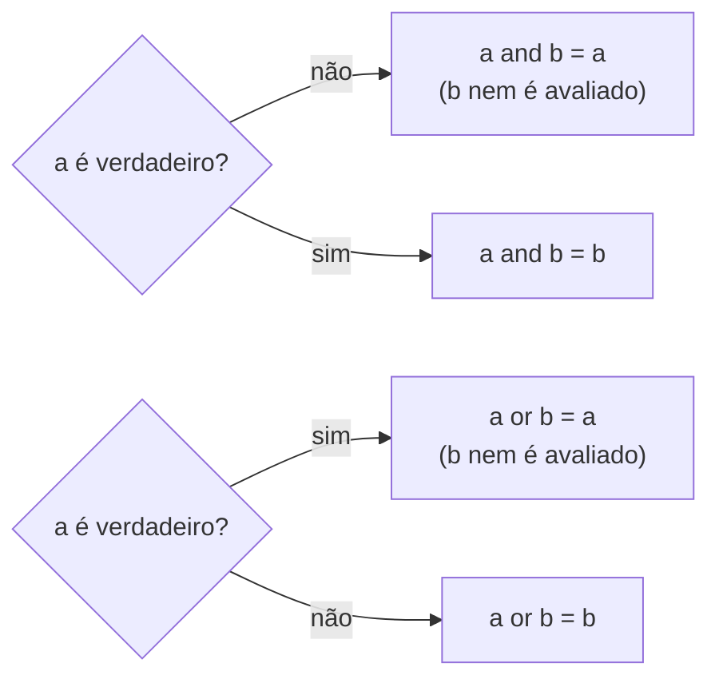

# Lógica proposicional e tabelas-verdade

## Por que isso importa

Todo `if` é uma fórmula de lógica. Saber lógica proposicional é o que permite simplificar um `if not (a and not b) or c` monstruoso, perceber que dois testes são equivalentes, escrever testes que cobrem todos os casos e entender os circuitos do processador (portas lógicas, em AC-01). É também a base das provas matemáticas (MD-03) e de bancos de dados (o `WHERE` do SQL é lógica pura).

## Intuição

Uma **proposição** é uma frase que é verdadeira ou falsa, sem meio-termo: "está chovendo", "a senha tem 8 caracteres". Os **conectivos** juntam proposições como peças de Lego:

- **E (∧)**: "vou à praia se fizer sol **e** eu tiver folga". Precisa das duas.
- **OU (∨)**: "aceito Pix **ou** cartão". Qualquer uma serve (inclusive as duas).
- **NÃO (¬)**: inverte.
- **SE... ENTÃO (→)**: uma **promessa**. "Se chover, eu levo guarda-chuva." A promessa só é quebrada se chover **e** eu não levar. Se não chover, a promessa não foi quebrada, leve eu ou não.

## Visual

Tabela-verdade de todos os conectivos. Com 2 proposições há 2² = 4 combinações (com n proposições, 2ⁿ linhas: a mesma conta de bits de MD-04):

```
 p │ q ║ ¬p │ p ∧ q │ p ∨ q │ p ⊕ q │ p → q │ p ↔ q
───┼───╫────┼───────┼───────┼───────┼───────┼───────
 V │ V ║  F │   V   │   V   │   F   │   V   │   V
 V │ F ║  F │   F   │   V   │   V   │   F   │   F
 F │ V ║  V │   F   │   V   │   V   │   V   │   F
 F │ F ║  V │   F   │   F   │   F   │   V   │   V
```

Pense em p e q como dois círculos que se cruzam. Um diagrama assim tem 4 regiões, uma para cada linha da tabela. Onde cada fórmula é verdadeira (███):

```
                 só p     p e q     só q     fora dos dois
                (V, F)   (V, V)    (F, V)       (F, F)
p ∧ q              ·       ███        ·            ·
p ∨ q             ███      ███       ███           ·
p ⊕ q             ███       ·        ███           ·
¬(p ∨ q)           ·        ·         ·           ███
p → q              ·       ███       ███          ███
```

Como o Python avalia `a and b` e `a or b` (o **curto-circuito**, explicado mais abaixo):



## Conceito técnico

### Conectivos e sua leitura

| Símbolo | Nome | Lê-se | Em Python | Verdadeiro quando |
|---|---|---|---|---|
| ¬p | negação | não p | `not p` | p é falso |
| p ∧ q | conjunção | p e q | `p and q` | os dois são verdadeiros |
| p ∨ q | disjunção | p ou q | `p or q` | pelo menos um é verdadeiro |
| p ⊕ q | ou exclusivo (XOR) | ou p ou q | `p != q` | exatamente um é verdadeiro |
| p → q | implicação | se p então q | `not p or q` | não é o caso de p ser V e q ser F |
| p ↔ q | bicondicional | p se e somente se q | `p == q` | os dois têm o mesmo valor |

**Precedência** (da mais forte para a mais fraca): ¬, ∧, ∨, →, ↔. Então `¬p ∨ q ∧ r` é `(¬p) ∨ (q ∧ r)`. Na dúvida, parênteses.

### A implicação, com calma

p → q só é **falsa** quando p é verdadeira e q é falsa. As linhas em que p é falsa são verdadeiras "por vacuidade": a promessa não foi testada, então não foi quebrada.

A partir de "se p então q" surgem três variações:

| Nome | Fórmula | Equivalente à original? |
|---|---|---|
| Recíproca | q → p | **não** |
| Inversa | ¬p → ¬q | **não** |
| **Contrapositiva** | ¬q → ¬p | **sim** |

Exemplo: "se é um quadrado, então tem 4 lados" (verdadeira). A contrapositiva "se não tem 4 lados, não é quadrado" também é verdadeira. A recíproca "se tem 4 lados, é quadrado" é falsa (um retângulo comum).

### Tautologia, contradição, contingência

- **Tautologia**: verdadeira em **todas** as linhas. Ex.: p ∨ ¬p.
- **Contradição**: falsa em todas. Ex.: p ∧ ¬p.
- **Contingência**: depende dos valores. Ex.: p → q.

Duas fórmulas são **equivalentes** (≡) quando têm a mesma coluna na tabela-verdade, ou seja, quando A ↔ B é tautologia.

### Equivalências que você vai usar em código

| Lei | Equivalência |
|---|---|
| Dupla negação | ¬¬p ≡ p |
| **De Morgan** | ¬(p ∧ q) ≡ ¬p ∨ ¬q  e  ¬(p ∨ q) ≡ ¬p ∧ ¬q |
| Implicação | p → q ≡ ¬p ∨ q |
| Contrapositiva | p → q ≡ ¬q → ¬p |
| Distributiva | p ∧ (q ∨ r) ≡ (p ∧ q) ∨ (p ∧ r) |
| Absorção | p ∨ (p ∧ q) ≡ p |
| Identidade | p ∧ V ≡ p,  p ∨ F ≡ p |

De Morgan em português: "não (chove **e** venta)" é o mesmo que "não chove **ou** não venta". Ao negar, o E vira OU e vice-versa, e cada parte é negada.

### Lógica no código

**Curto-circuito**: o Python avalia `and` e `or` da esquerda para a direita e **para assim que sabe a resposta**. Em `a and b`, se `a` é falso, `b` nem é avaliado. Isso é usado para proteger contas:

```python
total = 50
divisor = 0
if divisor != 0 and total / divisor > 10:   # sem o curto-circuito, dividiria por zero
    print("média alta")
print("sem erro: a divisão nem foi calculada")
```

**Operadores bit a bit** (`&`, `|`, `^`, `~`) aplicam a mesma tabela a cada bit de um número (MD-04): `0b1100 & 0b1010 == 0b1000`. Não confunda com `and`/`or`, que trabalham com o valor inteiro como verdadeiro ou falso.

## Código

Gerar a tabela-verdade com laços aninhados:

```python
print("p     q     p→q")
for p in (True, False):
    for q in (True, False):
        implica = (not p) or q
        print(f"{p!s:5} {q!s:5} {implica}")
```

Verificar uma equivalência testando todas as combinações (força bruta: com n variáveis são 2ⁿ casos):

```python
equivalentes = True
for p in (True, False):
    for q in (True, False):
        if (not (p and q)) != ((not p) or (not q)):
            equivalentes = False
print("De Morgan vale?", equivalentes)   # True
```

Simplificando um `if` com De Morgan:

```python
idade = 20
tem_convite = False

# antes: difícil de ler
if not (idade < 18 or not tem_convite):
    print("entra")

# depois: ¬(a ∨ ¬b) ≡ ¬a ∧ b
if idade >= 18 and tem_convite:
    print("entra")
```

## Erros comuns

- **Achar que "ou" é exclusivo.** Em lógica (e em programação), p ∨ q é verdadeiro também quando os dois são.
- **Achar que p → q é falsa quando p é falsa.** Com p falsa, a implicação é sempre verdadeira.
- **Confundir a recíproca com a contrapositiva.** Só a contrapositiva (¬q → ¬p) é equivalente.
- **Negar só metade no De Morgan.** ¬(p ∧ q) **não** é ¬p ∧ ¬q: o conectivo também troca.
- **Escrever `if x == 1 or 2:`** achando que testa "x é 1 ou 2". O Python lê `(x == 1) or 2`, e `2` é sempre verdadeiro. O certo é `x == 1 or x == 2` (ou `x in (1, 2)`).
- **Usar `&` e `|` no lugar de `and`/`or` em condições.** Funcionam com bool, mas não fazem curto-circuito e têm outra precedência.

## Pratique

```quiz
id: MD-01-q1
tipo: multipla_escolha
pergunta: "Em qual linha `p → q` é falsa?"
opcoes: ["p = V, q = V", "p = V, q = F", "p = F, q = V", "p = F, q = F"]
resposta: 1
explicacao: "A implicação é uma promessa: só é quebrada quando a condição acontece (p verdadeiro) e o resultado não (q falso). Nas linhas com p falso ela é verdadeira por vacuidade."
dificuldade: 1
```

```quiz
id: MD-01-q2
tipo: multipla_escolha
pergunta: "Pela lei de De Morgan, `¬(p ∨ q)` é equivalente a:"
opcoes: ["¬p ∨ ¬q", "¬p ∧ ¬q", "p ∧ q", "¬p ∨ q"]
resposta: 1
explicacao: "Ao negar uma disjunção, cada parte é negada e o OU vira E: 'não (p ou q)' significa 'nem p nem q', isto é, ¬p ∧ ¬q."
dificuldade: 1
```

```quiz
id: MD-01-q3
tipo: multipla_escolha
pergunta: "Quantas linhas tem a tabela-verdade de uma fórmula com 4 variáveis?"
opcoes: ["4", "8", "16", "32"]
resposta: 2
explicacao: "Cada variável tem 2 valores possíveis; as combinações são 2 × 2 × 2 × 2 = 2⁴ = 16, como os 16 valores de 4 bits."
dificuldade: 1
```

```quiz
id: MD-01-q4
tipo: multipla_escolha
pergunta: "Qual destas é uma tautologia?"
opcoes: ["p ∧ ¬p", "p → q", "(p ∧ q) → p", "p ∨ q"]
resposta: 2
explicacao: "(p ∧ q) → p: se p e q são verdadeiros, p é verdadeiro, então a implicação nunca é quebrada. p ∧ ¬p é contradição; p → q e p ∨ q dependem dos valores (contingências)."
dificuldade: 2
```

```quiz
id: MD-01-q5
tipo: multipla_escolha
pergunta: "\"Se o código compila, então não há erro de sintaxe.\" Qual é a contrapositiva?"
opcoes: ["Se não há erro de sintaxe, o código compila.", "Se o código não compila, há erro de sintaxe.", "Se há erro de sintaxe, o código não compila.", "O código compila e há erro de sintaxe."]
resposta: 2
explicacao: "A contrapositiva de p → q é ¬q → ¬p: nega e troca de lugar. q é 'não há erro de sintaxe', então ¬q é 'há erro de sintaxe'; ¬p é 'não compila'. A opção A é a recíproca e a B é a inversa; nenhuma das duas é equivalente."
dificuldade: 2
```

```quiz
id: MD-01-q6
tipo: verdadeiro_falso
pergunta: "Em Python, `if x == 1 or 2:` só entra no if quando x vale 1 ou 2."
resposta: false
explicacao: "O Python lê (x == 1) or 2. Quando x não é 1, a expressão vale 2, que é verdadeiro. Ou seja, o if sempre entra. O certo é x == 1 or x == 2, ou x in (1, 2)."
dificuldade: 2
```

```quiz
id: MD-01-q7
tipo: prever_saida
pergunta: |
  O que este programa imprime?
  ```python
  def checa():
      print("checou")
      return True

  print(False and checa())
  print(True or checa())
  print(True and checa())
  ```
resposta: "False, True, depois checou e True"
explicacao: "Curto-circuito: em False and ..., o resultado já é False e checa() nem é chamada. Em True or ..., o resultado já é True. Só em True and checa() é preciso avaliar a direita: checa imprime 'checou' e devolve True."
dificuldade: 2
```

```quiz
id: MD-01-q8
tipo: codigo
linguagem: python
pergunta: |
  **Conectivos como funções.** Escreva três funções que recebem `bool` e retornam `bool`: `implica(p, q)` (p → q), `xor(p, q)` (ou exclusivo) e `bicond(p, q)` (p ↔ q). Use só `not`, `and`, `or`, `==` ou `!=`.
codigo_inicial: |
  def implica(p, q):
      pass


  def xor(p, q):
      pass


  def bicond(p, q):
      pass
usa: [def, return]
testes:
  - chamada: "implica(True, False)"
    saida: "False"
  - chamada: "implica(False, False)"
    saida: "True"
  - chamada: "xor(True, True)"
    saida: "False"
  - chamada: "bicond(False, False)"
    saida: "True"
  - chamada: "[implica(p, q) for p in (True, False) for q in (True, False)]"
    visivel: false
    saida: "[True, False, True, True]"
  - chamada: "[xor(p, q) for p in (True, False) for q in (True, False)]"
    visivel: false
    saida: "[False, True, True, False]"
  - chamada: "[bicond(p, q) for p in (True, False) for q in (True, False)]"
    visivel: false
    saida: "[True, False, False, True]"
dica: "p → q é equivalente a ¬p ∨ q. XOR é verdadeiro quando os valores são diferentes; bicondicional, quando são iguais."
solucao: |
  def implica(p, q):
      return not p or q


  def xor(p, q):
      return p != q


  def bicond(p, q):
      return p == q
explicacao: "Com bool, != já é o XOR e == já é o bicondicional. A implicação usa a equivalência p → q ≡ ¬p ∨ q. Os testes ocultos conferem a tabela inteira de cada conectivo."
dificuldade: 1
```

```quiz
id: MD-01-q9
tipo: codigo
linguagem: python
pergunta: |
  **Tabela-verdade.** Imprima a tabela-verdade de `(p or q) and not r` com 1 para verdadeiro e 0 para falso, com as linhas na ordem abaixo (p, q e r começando em 1, como na contagem binária de 7 até 0). A primeira linha é o cabeçalho.

  ```
  p q r | s
  1 1 1 | 0
  1 1 0 | 1
  ...
  0 0 0 | 0
  ```
usa: [for, int]
testes:
  - saida: |
      p q r | s
      1 1 1 | 0
      1 1 0 | 1
      1 0 1 | 0
      1 0 0 | 1
      0 1 1 | 0
      0 1 0 | 1
      0 0 1 | 0
      0 0 0 | 0
  - visivel: false
    saida: |
      p q r | s
      1 1 1 | 0
      1 1 0 | 1
      1 0 1 | 0
      1 0 0 | 1
      0 1 1 | 0
      0 1 0 | 1
      0 0 1 | 0
      0 0 0 | 0
dica: "Três for aninhados, cada um em (True, False). int(True) é 1 e int(False) é 0. Para o resultado: s = (p or q) and not r."
solucao: |
  print("p q r | s")
  for p in (True, False):
      for q in (True, False):
          for r in (True, False):
              s = (p or q) and not r
              print(f"{int(p)} {int(q)} {int(r)} | {int(s)}")
explicacao: "Cada for aninhado dobra o número de linhas: 2 × 2 × 2 = 8. O laço de fora varia mais devagar (p) e o de dentro mais rápido (r), exatamente como os bits ao contar em binário."
dificuldade: 2
```

```quiz
id: MD-01-q10
tipo: codigo
linguagem: python
pergunta: |
  **Verificador de equivalência.** Escreva `equivalentes(f, g)` que recebe duas funções de duas variáveis booleanas e retorna `True` se elas dão o mesmo resultado para **todas** as 4 combinações de `p` e `q`. Os testes passam funções prontas com `lambda` (uma função escrita numa linha só: `lambda p, q: not (p and q)` é o mesmo que um `def` que retorna `not (p and q)`).
codigo_inicial: |
  def equivalentes(f, g):
      pass
usa: [def, for, return]
testes:
  - chamada: "equivalentes(lambda p, q: not (p and q), lambda p, q: not p or not q)"
    saida: "True"
  - chamada: "equivalentes(lambda p, q: not (p and q), lambda p, q: not p and not q)"
    saida: "False"
  - chamada: "equivalentes(lambda p, q: not p or q, lambda p, q: not q or p)"
    visivel: false
    saida: "False"
  - chamada: "equivalentes(lambda p, q: not p or q, lambda p, q: q or not p)"
    visivel: false
    saida: "True"
dica: "Dois for aninhados em (True, False). Se f(p, q) != g(p, q) em alguma combinação, retorne False na hora. Se o laço terminar sem achar diferença, retorne True."
solucao: |
  def equivalentes(f, g):
      for p in (True, False):
          for q in (True, False):
              if f(p, q) != g(p, q):
                  return False
      return True
explicacao: "Funções também são valores e podem ser passadas como argumento (você vai explorar isso em FP-07). O teste oculto mostra que p → q não é equivalente à recíproca q → p, mas é equivalente a q ∨ ¬p (o ∨ é comutativo)."
dificuldade: 3
```

## Resumo

- Proposição: frase que é **V ou F**. Conectivos: ¬, ∧, ∨, ⊕, →, ↔.
- Com **n** variáveis, a tabela-verdade tem **2ⁿ** linhas.
- **p → q** só é falsa com p = V e q = F; equivale a **¬p ∨ q** e à **contrapositiva ¬q → ¬p** (a recíproca não!).
- **De Morgan**: ¬(p ∧ q) ≡ ¬p ∨ ¬q e ¬(p ∨ q) ≡ ¬p ∧ ¬q. Use para simplificar `if`s.
- `and` e `or` fazem **curto-circuito**; `&`, `|`, `^` operam bit a bit.

## Para ir além

- **Próximos módulos**: MD-02 Conjuntos, relações e funções; MD-03 Técnicas de prova; e, na arquitetura, AC-01 Portas lógicas, que são estes conectivos feitos de transistores.
- No seu caminho: FP-05 Arrays, strings e manipulação de texto (semana 5).
