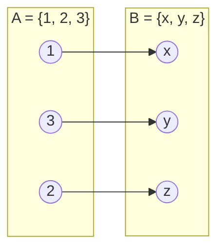

# Conjuntos, relações e funções

## Por que isso importa

Quase toda estrutura de dados é um conjunto, uma relação ou uma função disfarçada. Um `set` é um conjunto. Um `dict` é uma função das chaves para os valores. Uma tabela de banco de dados é uma relação (o nome "banco relacional" vem daí). Um grafo é um conjunto de vértices com uma relação entre eles. Saber esse vocabulário deixa claro por que um `JOIN` pode explodir de tamanho, por que uma função de hash **não** pode ser injetora e o que significa "agrupar por" algo.

## Intuição

- **Conjunto**: um saco de coisas **sem repetição** e **sem ordem**. `{maçã, pera}` e `{pera, maçã, maçã}` são o mesmo conjunto.
- **Relação**: uma lista de pares "x está ligado a y". "Ana segue Bia" e "Bia segue Caio" formam uma relação "segue" entre pessoas.
- **Função**: uma relação em que **cada entrada tem exatamente uma saída**. "CPF → pessoa" é função; "pessoa → telefone" talvez não seja (há quem tenha dois).

## Visual



Cada elemento de A tem **uma** seta (é função), nenhum elemento de B recebe duas setas (é **injetora**) e todo elemento de B recebe alguma seta (é **sobrejetora**). Logo, é uma **bijeção**: dá para desfazer o caminho.

Operações de conjuntos com A = {1, 2, 3, 4} e B = {3, 4, 5}:

| Operação | Notação | Python | Resultado |
|---|---|---|---|
| União | A ∪ B | `A \| B` | {1, 2, 3, 4, 5} |
| Interseção | A ∩ B | `A & B` | {3, 4} |
| Diferença | A − B | `A - B` | {1, 2} |
| Diferença simétrica | A △ B | `A ^ B` | {1, 2, 5} |
| Pertence | 3 ∈ A | `3 in A` | verdadeiro |
| Subconjunto | {1, 2} ⊆ A | `{1, 2} <= A` | verdadeiro |

## Conceito técnico

### Conjuntos

Um conjunto é definido só pelos seus elementos. Notações comuns:

```text
listando:          A = {2, 4, 6, 8}
por propriedade:   A = { x ∈ ℕ | x é par e 0 < x < 10 }
vazio:             ∅ = {}
tamanho:           |A| = 4
```

A notação "por propriedade" é exatamente a **compreensão de conjunto** do Python: `{x for x in range(1, 10) if x % 2 == 0}`.

O **complemento** de A (Aᶜ) é tudo do universo U que não está em A. Leis de De Morgan, as mesmas da lógica (MD-01):

```text
(A ∪ B)ᶜ = Aᶜ ∩ Bᶜ
(A ∩ B)ᶜ = Aᶜ ∪ Bᶜ
```

**Princípio da inclusão-exclusão** para contar uma união sem contar duas vezes:

```text
|A ∪ B| = |A| + |B| − |A ∩ B|
```

### Produto cartesiano e conjunto das partes

- **Produto cartesiano**: A × B = todos os pares (a, b) com a ∈ A e b ∈ B. Tamanho: |A| · |B|. Um `JOIN` sem condição no SQL é exatamente isso, por isso explode.
- **Conjunto das partes** P(A): o conjunto de **todos os subconjuntos** de A. Tamanho: 2^|A|, porque cada elemento está ou não está em cada subconjunto (uma escolha binária por elemento).

```text
A = {1, 2}
A × A = {(1,1), (1,2), (2,1), (2,2)}           → 2 · 2 = 4 pares
P(A)  = {∅, {1}, {2}, {1, 2}}                    → 2² = 4 subconjuntos
```

### Relações

Uma **relação** R de A em B é qualquer subconjunto de A × B. Escrevemos `a R b` quando (a, b) ∈ R. Quando A = B, dizemos "relação em A". Propriedades importantes:

| Propriedade | Definição | Exemplo que tem | Exemplo que não tem |
|---|---|---|---|
| Reflexiva | todo a: a R a | "≤" em números | "<" (3 < 3 é falso) |
| Simétrica | a R b ⇒ b R a | "é irmão de" | "é pai de" |
| Antissimétrica | a R b e b R a ⇒ a = b | "≤" | "é amigo de" |
| Transitiva | a R b e b R c ⇒ a R c | "é ancestral de" | "é pai de" |

Uma relação **reflexiva, simétrica e transitiva** é uma **relação de equivalência**. Ela divide o conjunto em **classes de equivalência**: grupos separados em que todos dentro de um grupo se relacionam. Exemplo: "têm o mesmo resto na divisão por 3" divide os inteiros em três classes (resto 0, 1 e 2). É o que um `GROUP BY` faz.

Uma relação **reflexiva, antissimétrica e transitiva** é uma **ordem parcial**: "≤" nos números, "⊆" nos conjuntos, "precisa ser feito antes de" nas tarefas (a base da ordenação topológica).

### Funções

Uma **função** f: A → B é uma relação em que cada a ∈ A tem **exatamente um** b com (a, b) ∈ f. A é o **domínio**, B o **contradomínio**, e o conjunto das saídas que realmente aparecem é a **imagem**.

| Tipo | Significado | Consequência |
|---|---|---|
| **Injetora** | entradas diferentes ⇒ saídas diferentes | nada "colide" |
| **Sobrejetora** | toda saída de B é atingida | imagem = B |
| **Bijetora** | injetora e sobrejetora | tem **inversa** f⁻¹ |

Se A e B são finitos e f: A → B é injetora, então |A| ≤ |B|. Ao contrário: se |A| > |B|, **alguma colisão é inevitável**. É o **princípio da casa dos pombos**, e é por isso que uma função de hash de textos (infinitos) para 64 bits (finitos) sempre tem colisões (ED-04).

**Composição**: (g ∘ f)(x) = g(f(x)). Primeiro f, depois g.

## Código

`set` e `dict` são conjuntos e funções de verdade:

```python
pares = {x for x in range(10) if x % 2 == 0}
primos = {2, 3, 5, 7}
print(sorted(pares & primos))      # [2]
print(sorted(pares | primos))      # [0, 2, 3, 4, 5, 6, 7, 8]
print(len(pares | primos) == len(pares) + len(primos) - len(pares & primos))  # True

# Uma função finita é um dict: cada chave tem exatamente um valor
quadrado = {x: x * x for x in [-2, -1, 0, 1, 2]}
imagem = set(quadrado.values())
print(sorted(imagem))                          # [0, 1, 4]
print(len(imagem) == len(quadrado))            # False: não é injetora (-2 e 2 dão 4)
```

Produto cartesiano e conjunto das partes com `itertools`:

```python
from itertools import product, combinations

A = [1, 2, 3]
print(list(product(A, ["x", "y"])))     # 6 pares
partes = [c for k in range(len(A) + 1) for c in combinations(A, k)]
print(len(partes), partes)               # 8 subconjuntos, de () até (1, 2, 3)
```

Classes de equivalência (agrupar pelo resto da divisão por 3):

```python
classes = {}
for n in range(10):
    classes.setdefault(n % 3, []).append(n)
print(classes)   # {0: [0, 3, 6, 9], 1: [1, 4, 7], 2: [2, 5, 8]}
```

## Erros comuns

- **Achar que conjunto tem ordem ou repetição.** `{3, 1, 2} == {1, 2, 3}` é `True`, e `len({1, 1, 1})` é 1.
- **Escrever `{}` querendo o conjunto vazio.** Em Python, `{}` é um `dict` vazio; o conjunto vazio é `set()`.
- **Confundir ∈ com ⊆.** `1 ∈ {1, 2}`, mas `{1} ⊆ {1, 2}`. `{1} ∈ {1, 2}` é falso.
- **Somar |A| + |B| para contar a união** sem subtrair a interseção.
- **Achar que "simétrica" e "antissimétrica" são opostas.** A igualdade "=" é as duas ao mesmo tempo; "é amigo de" (sem auto-amizade) é simétrica e não é antissimétrica; "<" é antissimétrica (por vacuidade) e não é simétrica.
- **Confundir contradomínio com imagem.** f(x) = x² de ℤ em ℤ tem contradomínio ℤ, mas imagem só {0, 1, 4, 9, ...}. Por isso não é sobrejetora.

## Pratique

```quiz
id: MD-02-q1
tipo: multipla_escolha
pergunta: "Com A = {1, 2, 3, 4} e B = {2, 4, 6}, quanto é A − B?"
opcoes: ["{6}", "{1, 3}", "{2, 4}", "{1, 3, 6}"]
resposta: 1
explicacao: "A − B são os elementos de A que não estão em B: tirando o 2 e o 4, sobram 1 e 3. O 6 não entra porque nem está em A. {1, 3, 6} seria a diferença simétrica."
dificuldade: 1
```

```quiz
id: MD-02-q2
tipo: multipla_escolha
pergunta: "Um conjunto A tem 5 elementos. Quantos elementos tem o conjunto das partes P(A)?"
opcoes: ["5", "10", "25", "32"]
resposta: 3
explicacao: "Cada um dos 5 elementos está ou não está em cada subconjunto: 2 escolhas por elemento, 2⁵ = 32 subconjuntos (incluindo o vazio e o próprio A)."
dificuldade: 1
```

```quiz
id: MD-02-q3
tipo: multipla_escolha
pergunta: "Numa turma, 20 alunos fazem Python, 15 fazem SQL e 8 fazem os dois. Quantos fazem pelo menos um dos dois?"
opcoes: ["35", "27", "43", "12"]
resposta: 1
explicacao: "Inclusão-exclusão: |P ∪ S| = 20 + 15 − 8 = 27. Os 8 que fazem os dois foram contados duas vezes na soma 20 + 15."
dificuldade: 1
```

```quiz
id: MD-02-q4
tipo: multipla_escolha
pergunta: "A relação \"x divide y\" nos inteiros positivos é:"
opcoes: ["Reflexiva, simétrica e transitiva (equivalência)", "Reflexiva, antissimétrica e transitiva (ordem parcial)", "Só simétrica", "Nenhuma das três propriedades"]
resposta: 1
explicacao: "Todo x divide x (reflexiva). Se x divide y e y divide x, então x = y (antissimétrica). Se x divide y e y divide z, x divide z (transitiva). Não é simétrica: 2 divide 4, mas 4 não divide 2."
dificuldade: 2
```

```quiz
id: MD-02-q5
tipo: verdadeiro_falso
pergunta: "Uma função de hash que leva qualquer texto a um número de 32 bits pode ser injetora se for bem projetada."
resposta: false
explicacao: "Existem infinitos textos e só 2³² saídas. Pelo princípio da casa dos pombos, duas entradas diferentes vão cair na mesma saída. Um bom hash só torna as colisões raras e bem espalhadas; nunca impossíveis."
dificuldade: 2
```

```quiz
id: MD-02-q6
tipo: multipla_escolha
pergunta: "f: ℤ → ℤ com f(x) = 2x. Ela é:"
opcoes: ["Injetora e sobrejetora", "Injetora, mas não sobrejetora", "Sobrejetora, mas não injetora", "Nem injetora nem sobrejetora"]
resposta: 1
explicacao: "Se 2a = 2b, então a = b: injetora. Mas nenhum inteiro x dá f(x) = 3, então os ímpares nunca são atingidos: não é sobrejetora em ℤ."
dificuldade: 2
```

```quiz
id: MD-02-q7
tipo: prever_saida
pergunta: |
  O que este código imprime?
  ```python
  A = {1, 2, 3}
  B = {3, 4}
  print(len(A | B), len(A & B), len(A ^ B), {3} <= A, {3} in [A])
  ```
resposta: "4 1 3 True False"
explicacao: "União {1,2,3,4}: 4. Interseção {3}: 1. Diferença simétrica {1,2,4}: 3. {3} <= A testa subconjunto: True. {3} in [A] pergunta se o conjunto {3} é um elemento da lista [A]; o único elemento é {1,2,3}, que é diferente de {3}: False."
dificuldade: 2
```

```quiz
id: MD-02-q8
tipo: codigo
linguagem: python
pergunta: |
  **Propriedades de uma relação.** Uma relação num conjunto `A` é dada como um conjunto de pares `R`. Escreva `propriedades(A, R)` que devolve uma tupla de três booleanos: `(reflexiva, simetrica, transitiva)`.
codigo_inicial: |
  def propriedades(A, R):
      reflexiva = False
      simetrica = False
      transitiva = False
      return (reflexiva, simetrica, transitiva)
usa: [def, for, return]
testes:
  - chamada: "propriedades({1, 2, 3}, {(1, 1), (2, 2), (3, 3), (1, 2), (2, 1)})"
    saida: "(True, True, True)"
  - chamada: "propriedades({1, 2, 3}, {(1, 2), (2, 3)})"
    saida: "(False, False, False)"
  - chamada: "propriedades({1, 2}, {(1, 1), (2, 2), (1, 2)})"
    saida: "(True, False, True)"
  - chamada: "propriedades({1, 2, 3}, {(1, 2), (2, 1)})"
    visivel: false
    saida: "(False, True, False)"
  - chamada: "propriedades({1, 2}, set())"
    visivel: false
    saida: "(False, True, True)"
dica: "Reflexiva: all((a, a) in R for a in A). Simétrica: para todo (a, b) em R, (b, a) está em R. Transitiva: para todo (a, b) e (c, d) em R com b == c, (a, d) está em R."
solucao: |
  def propriedades(A, R):
      reflexiva = all((a, a) in R for a in A)
      simetrica = all((b, a) in R for (a, b) in R)
      transitiva = True
      for (a, b) in R:
          for (c, d) in R:
              if b == c and (a, d) not in R:
                  transitiva = False
      return (reflexiva, simetrica, transitiva)
explicacao: "Cada propriedade é um 'para todo', que vira all(...) ou um laço que procura um contraexemplo. Repare no caso {(1,2),(2,1)}: não é transitiva, porque 1→2 e 2→1 exigiriam (1,1). E a relação vazia é simétrica e transitiva por vacuidade: não há nenhum par para quebrar a regra."
dificuldade: 2
```

```quiz
id: MD-02-q9
tipo: codigo
linguagem: python
pergunta: |
  **Classificar uma função finita.** Uma função de `A` em `B` é dada como um `dict` (chave = entrada, valor = saída). Escreva `classificar(f, B)` que devolve `"bijetora"`, `"injetora"`, `"sobrejetora"` ou `"nenhuma"`.
codigo_inicial: |
  def classificar(f, B):
      return "nenhuma"
usa: [def, return, set]
testes:
  - chamada: "classificar({1: 'a', 2: 'b', 3: 'c'}, {'a', 'b', 'c'})"
    saida: "'bijetora'"
  - chamada: "classificar({1: 'a', 2: 'b'}, {'a', 'b', 'c'})"
    saida: "'injetora'"
  - chamada: "classificar({1: 'a', 2: 'a', 3: 'b'}, {'a', 'b'})"
    saida: "'sobrejetora'"
  - chamada: "classificar({1: 'a', 2: 'a'}, {'a', 'b'})"
    saida: "'nenhuma'"
  - chamada: "classificar({x: x * x for x in range(-2, 3)}, {0, 1, 4})"
    visivel: false
    saida: "'sobrejetora'"
  - chamada: "classificar({}, set())"
    visivel: false
    saida: "'bijetora'"
dica: "imagem = set(f.values()). Injetora: len(imagem) == len(f) (nenhuma saída repetida). Sobrejetora: imagem == B."
solucao: |
  def classificar(f, B):
      imagem = set(f.values())
      injetora = len(imagem) == len(f)
      sobrejetora = imagem == B
      if injetora and sobrejetora:
          return "bijetora"
      if injetora:
          return "injetora"
      if sobrejetora:
          return "sobrejetora"
      return "nenhuma"
explicacao: "Se duas entradas caem na mesma saída, o conjunto de saídas fica menor que o número de entradas: é o teste de injetora. Sobrejetora é comparar a imagem com o contradomínio inteiro. Repare que x² em {-2,...,2} cobre {0, 1, 4}, mas -2 e 2 colidem."
dificuldade: 2
```

```quiz
id: MD-02-q10
tipo: codigo
linguagem: python
pergunta: |
  **Classes de equivalência.** Escreva `classes(itens, chave)` que agrupa os itens pela relação "têm a mesma chave" e devolve uma lista de listas: cada grupo na ordem em que os itens aparecem, e os grupos na ordem do primeiro item de cada um.
codigo_inicial: |
  def classes(itens, chave):
      grupos = []
      return grupos
usa: [def, for, return]
testes:
  - chamada: "classes(range(7), lambda n: n % 3)"
    saida: "[[0, 3, 6], [1, 4], [2, 5]]"
  - chamada: "classes(['ana', 'bia', 'carla', 'davi', 'eva'], len)"
    saida: "[['ana', 'bia', 'eva'], ['carla'], ['davi']]"
  - chamada: "classes([], len)"
    saida: "[]"
  - chamada: "classes(['Python', 'sql', 'PYTHON', 'Sql', 'c'], str.lower)"
    visivel: false
    saida: "[['Python', 'PYTHON'], ['sql', 'Sql'], ['c']]"
dica: "Use um dict de chave → lista. O dict do Python lembra a ordem de inserção, então list(d.values()) já sai na ordem do primeiro item de cada grupo."
solucao: |
  def classes(itens, chave):
      por_chave = {}
      for x in itens:
          por_chave.setdefault(chave(x), []).append(x)
      return list(por_chave.values())
explicacao: "\"Ter a mesma chave\" é sempre uma relação de equivalência (reflexiva, simétrica e transitiva, porque herda essas propriedades da igualdade). As classes são os grupos do dict. É o que GROUP BY no SQL e itertools.groupby fazem."
dificuldade: 2
```

## Resumo

- **Conjunto**: sem ordem, sem repetição. União, interseção, diferença; `|A ∪ B| = |A| + |B| − |A ∩ B|`.
- **|A × B| = |A|·|B|** e **|P(A)| = 2^|A|**: crescem rápido, por isso JOINs sem filtro e "testar todos os subconjuntos" explodem.
- **Relação** = conjunto de pares. Reflexiva + simétrica + transitiva = **equivalência** (agrupar). Reflexiva + antissimétrica + transitiva = **ordem parcial**.
- **Função**: cada entrada, exatamente uma saída. Injetora (sem colisões), sobrejetora (atinge tudo), bijetora (tem inversa).
- **Casa dos pombos**: mais entradas que saídas ⇒ colisão garantida.

## Para ir além

- O capítulo 4 do MIT 6.042J tem muitos exercícios resolvidos; vale fazer os de relações.
- **Próximo módulo**: MD-03 Técnicas de prova. Mais adiante, MD-06 Teoria dos grafos usa tudo isto: um grafo é um conjunto de vértices com uma relação de adjacência.
