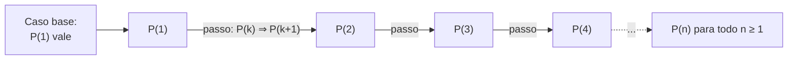

# Técnicas de prova: direta, contradição, indução

## Por que isso importa

Testes mostram que o código funciona **nos casos que você testou**. Uma prova mostra que funciona **em todos**. Você não vai escrever provas formais todo dia, mas o raciocínio aparece o tempo todo: "este laço termina?", "esta busca binária nunca perde o elemento?", "esta recursão chega no caso base?". A indução, em particular, é **a mesma ideia** da recursão: se você entende uma, entende a outra. E em entrevistas, justificar a correção de um algoritmo em voz alta é o que separa uma resposta boa de uma ótima.

## Intuição

- **Prova direta**: uma receita. Parto do que sei, aplico definições e regras, chego no que quero.
- **Contradição**: "suponha que não. Então... absurdo!" Como um detetive que mostra que o suspeito não poderia estar em dois lugares ao mesmo tempo.
- **Indução**: uma fileira infinita de dominós. Se o **primeiro cai** (caso base) e **cada um derruba o próximo** (passo indutivo), todos caem.
- **Contraexemplo**: para derrubar "todo cisne é branco", basta **um** cisne preto.

## Visual



Qual técnica tentar primeiro:

| A afirmação parece... | Tente |
|---|---|
| "Se A, então B", com A dando informação útil | Prova direta |
| "Se A, então B", mas "não B" é mais fácil de usar | Contraposição: provar "se não B, então não A" |
| "Não existe...", "é irracional", "há infinitos..." | Contradição |
| "Para todo n ≥ n₀, P(n)" | Indução |
| "Todo x tem tal propriedade" e você desconfia que é falso | Procure um contraexemplo |

## Conceito técnico

### Prova direta

Use as **definições**. Um inteiro n é **par** se n = 2k para algum inteiro k, e **ímpar** se n = 2k + 1.

```text
Afirmação: a soma de dois ímpares é par.
Prova: sejam a = 2j + 1 e b = 2k + 1, com j e k inteiros.
       a + b = 2j + 2k + 2 = 2(j + k + 1).
       Como j + k + 1 é inteiro, a + b é par.  ∎
```

O símbolo ∎ marca o fim da prova.

### Contraposição

"Se P, então Q" é **equivalente** a "se não Q, então não P" (MD-01). Às vezes o segundo é muito mais fácil.

```text
Afirmação: se n² é par, então n é par.
Direto é difícil (de n² = 2k, como tirar a raiz?). Contrapositiva: se n é ímpar, n² é ímpar.
Prova: n = 2k + 1  ⇒  n² = 4k² + 4k + 1 = 2(2k² + 2k) + 1, que é ímpar.  ∎
```

### Contradição

Suponha que a afirmação é **falsa** e deduza algo impossível. Então ela tem que ser verdadeira.

```text
Afirmação: existem infinitos números primos (Euclides).
Prova: suponha que são finitos: p₁, p₂, ..., pₙ. Seja N = p₁·p₂·...·pₙ + 1.
       N deixa resto 1 na divisão por cada pᵢ, então nenhum deles divide N.
       Mas todo inteiro > 1 tem algum divisor primo. Esse primo não está na lista:
       contradição com "a lista tem todos".  ∎
```

Cuidado: N **não** precisa ser primo (2·3·5·7·11·13 + 1 = 30031 = 59 · 509). O argumento só diz que N tem um fator primo fora da lista.

### Indução matemática

Para provar P(n) para todo n ≥ n₀:

1. **Caso base**: prove P(n₀).
2. **Hipótese de indução (HI)**: suponha P(k) para um k ≥ n₀ qualquer.
3. **Passo indutivo**: usando a HI, prove P(k + 1).

```text
Afirmação: 1 + 2 + ... + n = n(n + 1)/2, para todo n ≥ 1.

Base (n = 1): lado esquerdo = 1; lado direito = 1·2/2 = 1.  ✓
HI: suponha 1 + 2 + ... + k = k(k + 1)/2.
Passo: 1 + 2 + ... + k + (k + 1)
     = k(k + 1)/2 + (k + 1)            ← usei a HI
     = (k + 1)(k/2 + 1)
     = (k + 1)(k + 2)/2                 ← é a fórmula com n = k + 1.  ∎
```

Essa soma aparece em todo lugar: é o número de comparações do selection sort (AL-02).

**Indução forte**: no passo, você pode supor P(n₀), P(n₀+1), ..., P(k) **todos** verdadeiros, não só P(k). Útil quando o caso k + 1 depende de casos bem anteriores, como "todo inteiro ≥ 2 é produto de primos" (n = a·b com a, b menores que n).

### Indução e recursão são a mesma coisa

Uma função recursiva correta é uma prova por indução escondida:

| Indução | Recursão |
|---|---|
| Caso base | `if n == 0: return ...` |
| Hipótese: P(k) vale | "suponha que a chamada recursiva devolve a resposta certa" |
| Passo: P(k) ⇒ P(k+1) | montar a resposta de n a partir da chamada com n − 1 |

Se o caso base está certo e cada chamada se aproxima dele, a função está certa para todo n. É assim que se raciocina sobre recursão (FP-04) sem tentar "simular a pilha na cabeça".

### Invariantes de laço

Um **invariante** é uma afirmação verdadeira **antes de cada iteração** de um laço. Provar um invariante é uma indução sobre o número de iterações:

- **Inicialização**: vale antes da primeira iteração (caso base).
- **Manutenção**: se vale antes de uma iteração, vale antes da próxima (passo).
- **Término**: quando o laço acaba, o invariante + a condição de parada dão o resultado.

No insertion sort (AL-02): "antes da iteração i, `l[0:i]` está ordenado". No fim, i = n, então a lista inteira está ordenada. Na busca binária (AL-01): "se o alvo está na lista, está entre `ini` e `fim`".

### Contraexemplos

Para derrubar "para todo x, P(x)", basta **um** x com P(x) falso. E cuidado com padrões que "sempre funcionam" nos primeiros casos:

```text
n² + n + 41 é primo para n = 0, 1, 2, ..., 39   (Euler)
mas para n = 40: 40² + 40 + 41 = 1681 = 41²      ← contraexemplo
```

Por isso testar muitos casos **não** prova nada; serve para encontrar contraexemplos e ganhar confiança antes de provar.

## Código

O computador não prova, mas **caça contraexemplos** muito bem:

```python
def eh_primo(n):
    if n < 2:
        return False
    d = 2
    while d * d <= n:
        if n % d == 0:
            return False
        d += 1
    return True

for n in range(100):
    if not eh_primo(n * n + n + 41):
        print("contraexemplo:", n)    # 40
        break
```

E dá para **checar** um invariante enquanto o código roda, com `assert`:

```python
def insertion(l):
    for i in range(1, len(l)):
        assert all(l[j] <= l[j + 1] for j in range(i - 1)), "invariante quebrado"
        atual = l[i]
        j = i - 1
        while j >= 0 and l[j] > atual:
            l[j + 1] = l[j]
            j -= 1
        l[j + 1] = atual
    return l

print(insertion([5, 2, 4, 1, 3]))
```

## Erros comuns

- **Provar com exemplos.** "Funciona para 1, 2, 3 e 100" não é prova de "para todo n".
- **Esquecer o caso base** na indução. Sem ele, dá para "provar" absurdos: "n = n + 1 implica n + 1 = n + 2" é um passo válido, mas não há base.
- **Não usar a hipótese de indução** no passo. Se a HI não aparece, ou a prova é direta (e não precisava de indução) ou tem um buraco.
- **Confundir contraposição com recíproca.** "Se chove, a rua molha" equivale a "se a rua não molhou, não choveu", mas **não** a "se a rua molhou, choveu".
- **Supor o que se quer provar** (raciocínio circular), por exemplo usar P(k + 1) dentro do passo.
- **Achar que um contraexemplo precisa ser "típico".** Um único caso, por mais estranho que seja, derruba um "para todo".

## Pratique

```quiz
id: MD-03-q1
tipo: multipla_escolha
pergunta: "Qual é a contrapositiva de \"se um número é divisível por 6, então é par\"?"
opcoes: ["Se um número é par, então é divisível por 6", "Se um número não é par, então não é divisível por 6", "Se um número não é divisível por 6, então não é par", "Um número é divisível por 6 e não é par"]
resposta: 1
explicacao: "A contrapositiva de 'se P, então Q' é 'se não Q, então não P'. Ela é equivalente à original. A opção 1 é a recíproca (falsa: 4 é par e não é divisível por 6); a opção 3 é a inversa, também falsa."
dificuldade: 1
```

```quiz
id: MD-03-q2
tipo: multipla_escolha
pergunta: "Numa prova por indução de P(n) para n ≥ 1, o que o passo indutivo precisa mostrar?"
opcoes: ["Que P(1) é verdadeiro", "Que P(k) é verdadeiro para todo k", "Que, se P(k) é verdadeiro, então P(k + 1) também é", "Que P(k + 1) implica P(k)"]
resposta: 2
explicacao: "O passo é a implicação P(k) ⇒ P(k + 1), para um k qualquer. Junto com o caso base P(1), isso garante P(2), P(3), ... como dominós. Supor P(k) para todo k seria supor o que se quer provar."
dificuldade: 1
```

```quiz
id: MD-03-q3
tipo: multipla_escolha
pergunta: "Para provar que √2 é irracional, qual técnica é a mais natural?"
opcoes: ["Indução em n", "Contradição: supor √2 = a/b em fração irredutível e chegar num absurdo", "Contraexemplo", "Prova direta calculando √2"]
resposta: 1
explicacao: "'Irracional' significa 'não existe fração igual a ele', uma afirmação negativa. Supondo √2 = a/b irredutível, chega-se a 2b² = a², então a é par, depois b também é par, contradizendo 'irredutível'."
dificuldade: 2
```

```quiz
id: MD-03-q4
tipo: verdadeiro_falso
pergunta: "Se um programa passou em 1 milhão de testes aleatórios, isso prova que ele está correto para todas as entradas."
resposta: false
explicacao: "Testes só cobrem os casos testados. O polinômio n² + n + 41 dá primos de n = 0 até 39 e falha em 40. Testes servem para achar erros e ganhar confiança; correção para todas as entradas pede um argumento (prova, invariante, tipos)."
dificuldade: 1
```

```quiz
id: MD-03-q5
tipo: multipla_escolha
pergunta: "No insertion sort, qual afirmação é um invariante útil do laço externo (antes da iteração i)?"
opcoes: ["l[i] é o menor elemento da lista", "l[0:i] contém os mesmos elementos de antes, agora em ordem crescente", "A lista inteira está ordenada", "l[i:] está ordenada"]
resposta: 1
explicacao: "Vale no início (l[0:1] tem um elemento só), se mantém (cada iteração encaixa l[i] na parte ordenada) e, no fim (i = n), diz exatamente que a lista toda está ordenada. As outras opções não valem durante o laço."
dificuldade: 2
```

```quiz
id: MD-03-q6
tipo: resposta_curta
pergunta: "Prove, em poucas linhas, que o produto de dois números ímpares é ímpar."
resposta: "Sejam a = 2j + 1 e b = 2k + 1. Então a·b = 4jk + 2j + 2k + 1 = 2(2jk + j + k) + 1, que é da forma 2m + 1 com m inteiro, portanto ímpar."
palavras_chave: ["2j + 1", "2k + 1", "2m + 1", "ímpar"]
dificuldade: 2
```

```quiz
id: MD-03-q7
tipo: resposta_curta
pergunta: "Explique por que uma função recursiva que calcula o fatorial está correta, usando a ideia de indução."
resposta: "Caso base: fat(0) devolve 1, que é 0!. Passo: supondo que fat(n − 1) devolve (n − 1)!, fat(n) devolve n · (n − 1)! = n!. Como cada chamada diminui n até chegar em 0, a função está correta para todo n ≥ 0."
palavras_chave: ["caso base", "hipótese", "n - 1", "termina"]
dificuldade: 2
```

```quiz
id: MD-03-q8
tipo: codigo
linguagem: python
pergunta: |
  **Caçador de contraexemplos.** Escreva `contraexemplo(p, inicio, fim)` que testa a propriedade `p` (uma função que devolve `True`/`False`) para cada inteiro de `inicio` até `fim` **inclusive** e devolve o **primeiro** n em que `p(n)` é falso, ou `None` se a propriedade valeu em todos.
codigo_inicial: |
  def contraexemplo(p, inicio, fim):
      return None
usa: [def, for, return]
testes:
  - chamada: "contraexemplo(lambda n: n * n >= n, 0, 1000)"
    saida: "None"
  - chamada: "contraexemplo(lambda n: 2 ** n > n * n, 5, 100)"
    saida: "None"
  - chamada: "contraexemplo(lambda n: 2 ** n > n * n, 1, 100)"
    saida: "2"
  - chamada: "contraexemplo(lambda n: all((n * n + n + 41) % d for d in range(2, n * n + n + 41)), 0, 100)"
    visivel: false
    saida: "40"
  - chamada: "contraexemplo(lambda n: True, 3, 2)"
    visivel: false
    saida: "None"
dica: "for n in range(inicio, fim + 1): se not p(n), devolva n. Depois do laço, devolva None."
solucao: |
  def contraexemplo(p, inicio, fim):
      for n in range(inicio, fim + 1):
          if not p(n):
              return n
      return None
explicacao: "2ⁿ > n² falha em n = 2, 3 e 4 (4 = 4, 8 < 9, 16 = 16) e vale de 5 em diante, o que se prova por indução com base em n = 5. Já n² + n + 41 parece sempre primo e quebra em 40. A busca acha erros; só a prova garante o 'para todo'."
dificuldade: 1
```

```quiz
id: MD-03-q9
tipo: codigo
linguagem: python
pergunta: |
  **Torre de Hanói, uma indução que roda.** Para mover n discos da haste `origem` para `destino` usando `aux`: mova n − 1 discos para `aux`, mova o maior para `destino`, mova os n − 1 de `aux` para `destino`. Escreva `hanoi(n, origem, destino, aux)` que devolve a **lista de movimentos** como pares `(de, para)`.
codigo_inicial: |
  def hanoi(n, origem, destino, aux):
      return []
usa: [def, return, hanoi]
testes:
  - chamada: "hanoi(1, 'A', 'C', 'B')"
    saida: "[('A', 'C')]"
  - chamada: "hanoi(2, 'A', 'C', 'B')"
    saida: "[('A', 'B'), ('A', 'C'), ('B', 'C')]"
  - chamada: "[len(hanoi(n, 'A', 'C', 'B')) for n in range(6)]"
    saida: "[0, 1, 3, 7, 15, 31]"
  - chamada: "hanoi(3, 'A', 'C', 'B')"
    visivel: false
    saida: "[('A', 'C'), ('A', 'B'), ('C', 'B'), ('A', 'C'), ('B', 'A'), ('B', 'C'), ('A', 'C')]"
dica: "Caso base: n == 0 devolve []. Senão: hanoi(n - 1, origem, aux, destino) + [(origem, destino)] + hanoi(n - 1, aux, destino, origem)."
solucao: |
  def hanoi(n, origem, destino, aux):
      if n == 0:
          return []
      return (hanoi(n - 1, origem, aux, destino)
              + [(origem, destino)]
              + hanoi(n - 1, aux, destino, origem))
explicacao: "A correção é uma indução: com 0 discos não há nada a fazer; supondo que hanoi(n − 1) funciona, os três passos movem n discos sem pôr um maior sobre um menor. O número de movimentos M(n) = 2·M(n − 1) + 1 com M(0) = 0 dá 2ⁿ − 1, outra fórmula provável por indução (MD-07)."
dificuldade: 2
```

```quiz
id: MD-03-q10
tipo: codigo
linguagem: python
pergunta: |
  **Verificar um invariante.** A função `soma_impares(n)` soma os n primeiros ímpares com um laço. O invariante é: "depois de somar i ímpares, `total == i * i`". Escreva `soma_impares(n)` que devolve uma tupla `(total, invariante_ok)`, em que `invariante_ok` é `True` se o invariante valeu em **todas** as iterações (cheque dentro do laço, depois de cada soma).
codigo_inicial: |
  def soma_impares(n):
      total = 0
      ok = True
      return (total, ok)
usa: [def, for, return]
testes:
  - chamada: "soma_impares(1)"
    saida: "(1, True)"
  - chamada: "soma_impares(5)"
    saida: "(25, True)"
  - chamada: "soma_impares(0)"
    saida: "(0, True)"
  - chamada: "soma_impares(1000)"
    visivel: false
    saida: "(1000000, True)"
dica: "for i in range(1, n + 1): o i-ésimo ímpar é 2 * i - 1. Some ao total e, logo depois, se total != i * i, marque ok = False."
solucao: |
  def soma_impares(n):
      total = 0
      ok = True
      for i in range(1, n + 1):
          total += 2 * i - 1
          if total != i * i:
              ok = False
      return (total, ok)
explicacao: "1 = 1², 1 + 3 = 2², 1 + 3 + 5 = 3²... A prova por indução: se a soma dos k primeiros ímpares é k², somar o próximo (2k + 1) dá k² + 2k + 1 = (k + 1)². O laço é a mesma indução executada passo a passo, e o teste do invariante é o 'assert' da prova."
dificuldade: 2
```

## Resumo

- **Direta**: definições + álgebra, do que sei ao que quero.
- **Contraposição**: "se P então Q" ≡ "se não Q então não P". **Contradição**: suponho o contrário e chego num absurdo.
- **Indução**: caso base + (P(k) ⇒ P(k+1)). **Forte**: pode supor todos os casos anteriores.
- **Recursão é indução**: caso base + "a chamada menor funciona" ⇒ a função funciona.
- **Invariante de laço**: inicialização, manutenção, término.
- **Um contraexemplo** derruba um "para todo"; muitos exemplos **não** provam nada.

## Para ir além

- Faça os exercícios dos capítulos 4 a 6 e 10 do Book of Proof; as soluções dos ímpares estão no livro.
- **Próximo módulo**: no caminho principal, ED-07 Heaps e filas de prioridade e AL-03 Ordenação eficiente. Mais adiante, MD-07 Recorrências e somatórios usa indução para resolver T(n) = 2T(n/2) + n.
