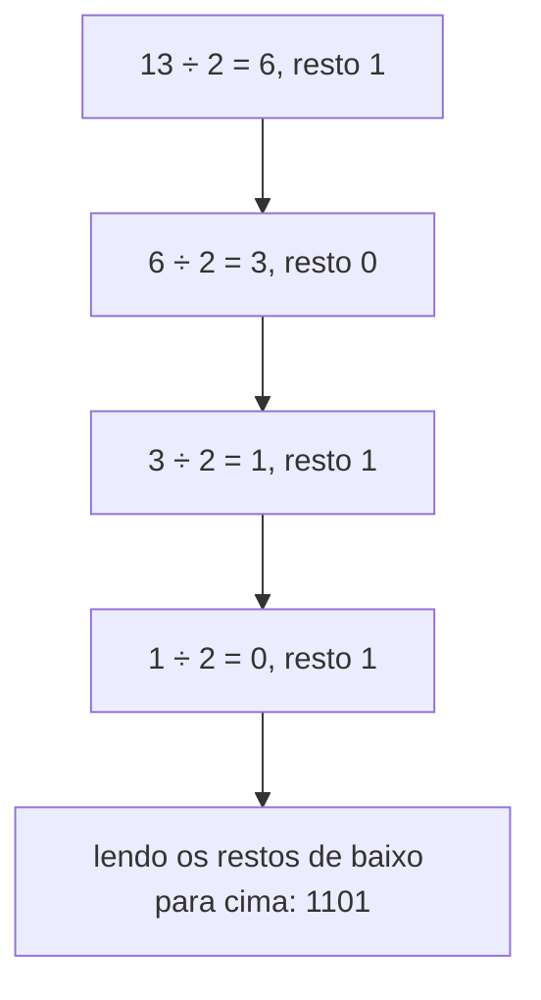

# Sistemas de numeração: binário, hexadecimal, complemento de dois

## Por que isso importa

Tudo dentro do computador é 0 ou 1: números, textos, imagens, o próprio programa. Entender binário explica por que um `int` de 32 bits "estoura" em 2.147.483.647, por que as cores no CSS se escrevem `#FF8800`, por que endereços de memória aparecem como `0x7ffe...` e por que `0.1` não é exato em float. É também a base das próximas trilhas de arquitetura de computadores e redes (máscaras de sub-rede são binário puro).

## Intuição

Pense num **hodômetro de carro**: cada rodinha vai de 0 a 9 e, quando passa do 9, volta a 0 e empurra a rodinha da esquerda. Isso é a base 10.

Agora imagine um hodômetro em que cada rodinha só tem **0 e 1**. Ele conta assim: `000`, `001`, `010`, `011`, `100`... Cada vez que uma rodinha passa do 1, volta a 0 e empurra a vizinha. É exatamente a base 2. O computador usa base 2 porque é fácil construir um circuito com dois estados bem distintos: **com tensão** (1) e **sem tensão** (0).

## Visual

O valor de cada dígito depende da **posição** (por isso "notação posicional"). Em base 10 as posições valem 1, 10, 100...; em base 2 valem 1, 2, 4, 8...:

```
decimal 2026  =  2·1000 + 0·100 + 2·10 + 6·1

binário 1101  =  1·8  +  1·4  +  0·2  +  1·1  =  13
                 2³      2²      2¹      2⁰
```

Contando de 0 a 15 nas três bases. Repare que 4 bits fecham exatamente um dígito hexadecimal:

```
dec  bin   hex      dec  bin   hex
 0   0000   0        8   1000   8
 1   0001   1        9   1001   9
 2   0010   2       10   1010   A
 3   0011   3       11   1011   B
 4   0100   4       12   1100   C
 5   0101   5       13   1101   D
 6   0110   6       14   1110   E
 7   0111   7       15   1111   F
```

Decimal para binário pelo método das divisões sucessivas por 2 (os restos, lidos **de baixo para cima**, formam o número):



## Conceito técnico

### Bits, bytes e quanto cabe

- **bit**: um dígito binário (0 ou 1).
- **byte**: 8 bits. É a menor unidade que o computador endereça na memória.
- Com **n bits** existem **2ⁿ combinações**. Sem sinal, elas representam de `0` a `2ⁿ − 1`.

| Bits | Combinações | Faixa sem sinal | Faixa com sinal (complemento de dois) |
|---|---|---|---|
| 8 | 256 | 0 a 255 | −128 a 127 |
| 16 | 65.536 | 0 a 65.535 | −32.768 a 32.767 |
| 32 | ~4,3 bilhões | 0 a 4.294.967.295 | −2.147.483.648 a 2.147.483.647 |
| 64 | ~1,8·10¹⁹ | 0 a 2⁶⁴ − 1 | −2⁶³ a 2⁶³ − 1 |

Prefixos: 1 KiB = 2¹⁰ = 1024 bytes, 1 MiB = 2²⁰ bytes, 1 GiB = 2³⁰ bytes. (Fabricantes de disco usam KB = 1000, por isso o "HD de 1 TB" aparece com menos espaço no sistema.)

### Conversões

**Binário → decimal**: some as potências de 2 onde há um 1. `101101` = 32 + 8 + 4 + 1 = **45**.

**Decimal → binário**: divida por 2 repetidamente e leia os restos de baixo para cima (como no diagrama), ou subtraia a maior potência de 2 que couber: 45 = 32 + 13 = 32 + 8 + 5 = 32 + 8 + 4 + 1 → `101101`.

**Hexadecimal (base 16)** usa os dígitos `0-9` e `A-F` (A=10 ... F=15). Como 16 = 2⁴, **cada dígito hex corresponde a exatamente 4 bits**, e a conversão é só agrupar:

```
binário   1011 0110 1111
hex          B    6    F      → 0xB6F

hex       0x3C  →  3 = 0011, C = 1100  →  0011 1100  →  60 em decimal
```

O prefixo `0x` indica hexadecimal; `0b` indica binário. Um byte sempre cabe em 2 dígitos hex (`00` a `FF`), por isso hex é o jeito preferido de mostrar memória, cores (`#RRGGBB`, cada par de 00 a FF) e hashes.

**Octal (base 8)** agrupa 3 bits. Hoje aparece quase só nas permissões de arquivo do Linux (`chmod 755`, você vai ver em SO-08).

### Números negativos: complemento de dois

O computador não tem um "sinal de menos". A solução usada em praticamente todos os processadores é o **complemento de dois**: com n bits, o bit mais à esquerda passa a valer **−2ⁿ⁻¹** em vez de +2ⁿ⁻¹.

Em 8 bits, a posição da esquerda vale −128:

```
posição:   −128   64   32   16    8    4    2    1
0000 0101:    0    0    0    0    0    1    0    1   =  5
1111 1011:    1    1    1    1    1    0    1    1   = −128 + 64 + 32 + 16 + 8 + 2 + 1 = −5
1000 0000:    1    0    0    0    0    0    0    0   = −128  (o menor valor)
0111 1111:    0    1    1    1    1    1    1    1   =  127  (o maior valor)
```

**Receita para achar −x**: escreva x em binário, **inverta todos os bits** e **some 1**.

```
 5   = 0000 0101
inverte 1111 1010
 +1   = 1111 1011   → −5
```

Por que é genial: a **mesma soma** dos números sem sinal funciona para os com sinal. `5 + (−5)` = `0000 0101 + 1111 1011` = `1 0000 0000`; o 9º bit não cabe e é descartado, sobrando `0000 0000` = 0. O hardware não precisa de um circuito separado para subtrair.

Atalho útil: em n bits, o padrão de bits de −x é o mesmo que o número sem sinal **2ⁿ − x**. Em 8 bits, −5 tem os bits de 256 − 5 = 251.

### Overflow

Quando o resultado não cabe nos bits disponíveis, ele "dá a volta", como o hodômetro que passa de 999.999 para 000.000. Em 8 bits com sinal, `127 + 1` vira `1000 0000` = **−128**. Esse tipo de erro já derrubou um foguete (Ariane 5, 1996) e fez o contador de visualizações do YouTube estourar em 2014 (o clipe "Gangnam Style" passou de 2.147.483.647).

O `int` do Python cresce sozinho e nunca estoura, mas C, Java, Go, Rust e o banco de dados têm tamanhos fixos.

### Operações bit a bit (prévia)

| Operador | Nome | Exemplo (em binário) |
|---|---|---|
| `&` | E bit a bit | `1100 & 1010 = 1000` |
| `\|` | OU bit a bit | `1100 \| 1010 = 1110` |
| `^` | OU exclusivo | `1100 ^ 1010 = 0110` |
| `<<` | desloca à esquerda (multiplica por 2) | `0011 << 1 = 0110` |
| `>>` | desloca à direita (divide por 2) | `0110 >> 1 = 0011` |

Elas aparecem em máscaras de rede, permissões, flags e criptografia. A lógica por trás (E, OU, NÃO) é o assunto de MD-01.

## Código

O Python fala todas essas bases:

```python
print(bin(45))           # 0b101101
print(hex(255))          # 0xff
print(int("101101", 2))  # 45: lê o texto como base 2
print(int("ff", 16))     # 255: lê como base 16
print(0b1101, 0x3C)      # 13 60: literais em outras bases

# format() sem o prefixo, com largura fixa e zeros à esquerda
print(format(5, "08b"))  # 00000101
print(format(255, "X"))  # FF
print(f"{60:04x}")       # 003c: o mesmo dentro de uma f-string
```

Complemento de dois em 8 bits, usando o atalho 2ⁿ − x:

```python
n = -5
bits = format(n % 256, "08b")   # -5 % 256 = 251
print(bits)                     # 11111011

# e de volta: se o bit da esquerda é 1, o valor é negativo
valor = int(bits, 2)            # 251
if valor >= 128:
    valor = valor - 256
print(valor)                    # -5
```

Overflow simulado: o que um `int8` de C faria com 127 + 1:

```python
x = 127 + 1
como_int8 = (x + 128) % 256 - 128
print(como_int8)   # -128
```

## Erros comuns

- **Ler o binário da esquerda para a direita no método das divisões.** Os restos saem do bit **menos** significativo para o mais significativo: leia de baixo para cima.
- **Esquecer que a contagem começa em 0.** Com 8 bits o maior valor sem sinal é 255, não 256.
- **Achar que −5 em binário é "5 com um 1 na frente"** (`1000 0101`). Isso é "sinal e magnitude", que não é usado para inteiros. Em complemento de dois é `1111 1011`.
- **Confundir `^` com potência.** Em Python, C e JavaScript, `^` é OU exclusivo: `2 ^ 3` é `1`. Potência é `**` (ou `Math.pow`).
- **Esquecer a base no `int()`.** `int("101")` é cento e um; `int("101", 2)` é cinco.

## Pratique

```quiz
id: MD-04-q1
tipo: multipla_escolha
pergunta: "Quanto vale o binário `1011` em decimal?"
opcoes: ["11", "13", "1011", "9"]
resposta: 0
explicacao: "1·8 + 0·4 + 1·2 + 1·1 = 11. Cada posição vale o dobro da posição à direita."
dificuldade: 1
```

```quiz
id: MD-04-q2
tipo: multipla_escolha
pergunta: "Quantos valores diferentes cabem em 10 bits?"
opcoes: ["10", "100", "1000", "1024"]
resposta: 3
explicacao: "Com n bits há 2ⁿ combinações: 2¹⁰ = 1024 (de 0 a 1023, sem sinal). É por isso que 1 KiB tem 1024 bytes."
dificuldade: 1
```

```quiz
id: MD-04-q3
tipo: multipla_escolha
pergunta: "Qual é o hexadecimal do binário `1110 0101`?"
opcoes: ["0xE5", "0x5E", "0xD5", "0x229"]
resposta: 0
explicacao: "Agrupe em 4 bits: 1110 = 14 = E e 0101 = 5. Logo 0xE5 (229 em decimal). Cada dígito hex é exatamente um grupo de 4 bits."
dificuldade: 1
```

```quiz
id: MD-04-q4
tipo: multipla_escolha
pergunta: "Em complemento de dois com 8 bits, como fica −1?"
opcoes: ["1000 0001", "1111 1110", "1111 1111", "0000 0001"]
resposta: 2
explicacao: "1 = 0000 0001; invertendo dá 1111 1110; somando 1 dá 1111 1111. Pelo atalho: 256 − 1 = 255, que é 1111 1111. 1000 0001 seria −1 em sinal e magnitude, que não é usado para inteiros."
dificuldade: 2
```

```quiz
id: MD-04-q5
tipo: verdadeiro_falso
pergunta: "Num inteiro de 8 bits com sinal, 127 + 1 dá 128."
resposta: false
explicacao: "128 não cabe na faixa de −128 a 127. O resultado 1000 0000 é interpretado como −128: é o overflow. Em Python não acontece porque o int cresce, mas em C, Java e bancos de dados acontece."
dificuldade: 2
```

```quiz
id: MD-04-q6
tipo: prever_saida
pergunta: |
  O que este programa imprime?
  ```python
  print(int("ff", 16) + 1)
  print(bin(6 << 1))
  print(int("101"), int("101", 2))
  ```
resposta: "256, depois 0b1100 e por fim 101 5"
explicacao: "ff em hexadecimal é 255, mais 1 dá 256. 6 é 110; deslocar 1 bit para a esquerda dá 1100 (12, o dobro). Sem a base, int(\"101\") lê em decimal; com base 2, lê como cinco."
dificuldade: 2
```

```quiz
id: MD-04-q7
tipo: resposta_curta
pergunta: "Por que hexadecimal é tão usado para mostrar dados binários (memória, cores, hashes)?"
resposta: "Porque 16 é 2 elevado a 4: cada dígito hexadecimal representa exatamente 4 bits, então um byte cabe em 2 dígitos e a conversão para binário é direta, só agrupando. Fica bem mais curto que binário e fácil de converter de cabeça."
palavras_chave: ["4 bits", "byte", "curto"]
dificuldade: 1
```

```quiz
id: MD-04-q8
tipo: codigo
linguagem: python
pergunta: |
  **Conversor de bases.** Leia um número inteiro (decimal, não negativo) e imprima, em três linhas, o binário, o octal e o hexadecimal (maiúsculo), **sem prefixo**. Para `45`:

  ```
  101101
  55
  2D
  ```
usa: [int, format]
testes:
  - entrada: "45"
    saida: |
      101101
      55
      2D
  - entrada: "255"
    saida: |
      11111111
      377
      FF
  - entrada: "4096"
    visivel: false
    saida: |
      1000000000000
      10000
      1000
dica: "format(n, \"b\") dá o binário sem o 0b; troque \"b\" por \"o\" para octal e por \"X\" para hexadecimal maiúsculo."
solucao: |
  n = int(input("Número: "))
  print(format(n, "b"))
  print(format(n, "o"))
  print(format(n, "X"))
explicacao: "bin(), oct() e hex() colocam os prefixos 0b, 0o e 0x; format() com os códigos b, o e X devolve só os dígitos. O X maiúsculo dá A-F maiúsculos."
dificuldade: 1
```

```quiz
id: MD-04-q9
tipo: codigo
linguagem: python
pergunta: |
  **De volta para decimal.** Leia uma cor CSS no formato `#RRGGBB` e imprima os três componentes em decimal, no formato `rgb(R, G, B)`. Para `#FF8800`:

  ```
  rgb(255, 136, 0)
  ```
usa: [int]
testes:
  - entrada: "#FF8800"
    saida: "rgb(255, 136, 0)"
  - entrada: "#1E90FF"
    saida: "rgb(30, 144, 255)"
  - entrada: "#000000"
    visivel: false
    saida: "rgb(0, 0, 0)"
  - entrada: "#c0ffee"
    visivel: false
    saida: "rgb(192, 255, 238)"
dica: "Fatias de texto: cor[1:3] pega os caracteres das posições 1 e 2 (o RR). int(texto, 16) converte de hexadecimal; maiúsculas e minúsculas funcionam."
solucao: |
  cor = input("Cor: ")
  r = int(cor[1:3], 16)
  g = int(cor[3:5], 16)
  b = int(cor[5:7], 16)
  print(f"rgb({r}, {g}, {b})")
explicacao: "Cada par hexadecimal é um byte, de 00 a FF (0 a 255). cor[1:3] é uma fatia do texto (você vai ver fatias com detalhe em FP-05); int com base 16 faz a conversão."
dificuldade: 2
```

```quiz
id: MD-04-q10
tipo: codigo
linguagem: python
pergunta: |
  **Complemento de dois em 8 bits.** Leia um inteiro entre −128 e 127 e imprima seus 8 bits em complemento de dois. Para `-5`:

  ```
  11111011
  ```
usa: [int, format]
testes:
  - entrada: "-5"
    saida: "11111011"
  - entrada: "5"
    saida: "00000101"
  - entrada: "-128"
    saida: "10000000"
  - entrada: "-1"
    visivel: false
    saida: "11111111"
  - entrada: "127"
    visivel: false
    saida: "01111111"
dica: "O padrão de bits de −x em 8 bits é o do número sem sinal 256 − x. Em Python, n % 256 já faz isso para negativos e positivos. Depois, format(..., \"08b\") completa com zeros até 8 dígitos."
solucao: |
  n = int(input("Número: "))
  print(format(n % 256, "08b"))
explicacao: "-5 % 256 é 251 e 5 % 256 é 5: o resto da divisão por 2⁸ faz exatamente a 'volta do hodômetro'. O 08b garante 8 dígitos com zeros à esquerda, como num registrador de 8 bits."
dificuldade: 2
```

```quiz
id: MD-04-q11
tipo: codigo
linguagem: python
pergunta: |
  **Leia um byte com sinal.** O contrário do desafio anterior: leia 8 bits (texto como `11111011`) e imprima o valor em complemento de dois. Para `11111011`:

  ```
  -5
  ```
usa: [int, if]
testes:
  - entrada: "11111011"
    saida: "-5"
  - entrada: "00000101"
    saida: "5"
  - entrada: "10000000"
    visivel: false
    saida: "-128"
  - entrada: "01111111"
    visivel: false
    saida: "127"
dica: "Leia como número sem sinal com int(bits, 2). Se der 128 ou mais, o bit da esquerda está ligado e ele vale −128 em vez de +128: subtraia 256."
solucao: |
  bits = input("Bits: ")
  valor = int(bits, 2)
  if valor >= 128:
      valor = valor - 256
  print(valor)
explicacao: "Sem sinal, o bit da esquerda vale +128; com sinal, vale −128. A diferença entre as duas leituras é 256, por isso basta subtrair 256 quando esse bit está ligado."
dificuldade: 2
```

## Resumo

- Notação posicional: em base b, cada posição vale b vezes a posição à direita. Em binário: 1, 2, 4, 8, 16...
- Com **n bits** há **2ⁿ** valores; sem sinal vão de 0 a 2ⁿ − 1.
- **Hex** agrupa 4 bits por dígito; um byte são 2 dígitos hex (`00` a `FF`).
- **Complemento de dois**: o bit da esquerda vale −2ⁿ⁻¹; para negar, inverta os bits e some 1.
- Passar do limite causa **overflow**: o valor dá a volta (127 + 1 = −128 em 8 bits).

## Para ir além

- Experimente a calculadora do sistema no modo "Programador": ela mostra o mesmo número em DEC, HEX, OCT e BIN.
- **Próximos módulos**: SO-08 Linha de comando (você vai ver permissões em octal) e, mais adiante, MD-01 Lógica proposicional, que explica os operadores `&`, `|` e `^`.
