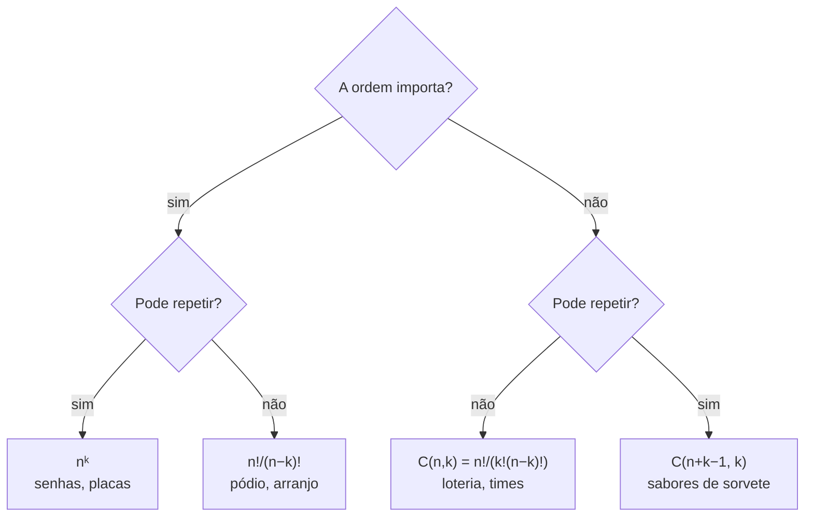

# Combinatória e probabilidade básica

## Por que isso importa

"Quantas senhas de 8 caracteres existem?" decide se um ataque de força bruta leva segundos ou séculos. "Qual a chance de dois usuários receberem o mesmo ID aleatório?" decide quantos bits seu UUID precisa. "Em média, quantas comparações o quick sort faz com pivô aleatório?" é valor esperado. Contar possibilidades e medir chances aparece em segurança, em análise de algoritmos aleatorizados, em testes A/B, em hashing (ED-04) e em machine learning. E a intuição humana para probabilidade é péssima, então as contas evitam erros caros.

## Intuição

- **Regra do produto**: um restaurante com 3 entradas e 4 pratos principais oferece 3 × 4 = 12 refeições diferentes. Escolhas **em sequência** se multiplicam.
- **Regra da soma**: se você vai comer **ou** pizza (5 sabores) **ou** sushi (7 combinados), são 5 + 7 = 12 opções. Escolhas **alternativas** (que não se sobrepõem) se somam.
- **Probabilidade**: se todos os resultados são igualmente prováveis, a chance de um evento é "casos favoráveis ÷ casos possíveis". Tudo se resume a **contar bem**.

## Visual



| Pergunta | Tipo | Conta |
|---|---|---|
| Senhas de 4 dígitos | ordem importa, repete | 10⁴ = 10.000 |
| Pódio (ouro, prata, bronze) entre 10 atletas | ordem importa, não repete | 10 · 9 · 8 = 720 |
| Times de 3 entre 10 pessoas | ordem não importa, não repete | 720 / 3! = 120 |
| Mega-Sena (6 de 60) | ordem não importa, não repete | C(60, 6) = 50.063.860 |
| 3 bolas de sorvete com 5 sabores (pode repetir) | ordem não importa, repete | C(7, 3) = 35 |

## Conceito técnico

### Fatorial, permutações e arranjos

- **n!** = n · (n − 1) · ... · 1, com 0! = 1. É o número de **ordens** de n itens distintos.
- **Arranjo** de k entre n: A(n, k) = n! / (n − k)! = n · (n − 1) · ... · (n − k + 1).
- **Permutação com repetição de itens**: as letras de "BANANA" (6 letras: A×3, N×2, B×1) formam 6! / (3! · 2! · 1!) = 60 palavras diferentes. Divide-se pelas trocas entre letras iguais, que não mudam a palavra.

### Combinações

**C(n, k)** ("n escolhe k") = n! / (k! (n − k)!): quantos **subconjuntos** de tamanho k um conjunto de n elementos tem. É o arranjo dividido por k!, porque cada grupo aparece em k! ordens.

Propriedades úteis:

```text
C(n, k) = C(n, n − k)                    escolher quem entra = escolher quem fica de fora
C(n, k) = C(n − 1, k − 1) + C(n − 1, k)  o item n entra ou não entra (triângulo de Pascal)
Σ C(n, k) para k = 0..n = 2ⁿ             todos os subconjuntos (MD-02)
```

Em Python: `math.comb(n, k)`, `math.perm(n, k)` e `math.factorial(n)`.

### Princípio da casa dos pombos

Se n + 1 pombos entram em n casas, alguma casa fica com 2 ou mais (MD-02). Versão geral: com N itens em k caixas, alguma tem pelo menos ⌈N / k⌉. Exemplo: entre 367 pessoas, duas fazem aniversário no mesmo dia, com certeza.

### Probabilidade

Num espaço com resultados **igualmente prováveis**:

```text
P(evento) = |casos favoráveis| / |casos possíveis|
```

Regras:

| Regra | Fórmula |
|---|---|
| Complemento | P(não A) = 1 − P(A) |
| União | P(A ou B) = P(A) + P(B) − P(A e B) |
| Condicional | P(A \| B) = P(A e B) / P(B) |
| Independência | A e B independentes ⇔ P(A e B) = P(A) · P(B) |

O **complemento** é o truque mais útil: "pelo menos um" costuma ser difícil de contar diretamente, mas "nenhum" é fácil. Chance de tirar pelo menos um 6 em 4 dados: 1 − (5/6)⁴ ≈ 51,8%.

### Paradoxo do aniversário

Quantas pessoas numa sala para que a chance de duas fazerem aniversário no mesmo dia passe de 50%? A intuição diz ~180. A resposta é **23**.

```text
P(todos diferentes) = 365/365 · 364/365 · 363/365 · ... · (365 − n + 1)/365
P(alguma coincidência) = 1 − P(todos diferentes)
n = 23 → ≈ 50,7%        n = 50 → ≈ 97%        n = 70 → ≈ 99,9%
```

Por quê? Com 23 pessoas há C(23, 2) = 253 **pares**, e cada par tem uma chance de coincidir. Em computação: com valores aleatórios de b bits, uma colisão fica provável depois de cerca de **2^(b/2)** valores, e não 2ᵇ. Um hash de 64 bits colide com ~4 bilhões de itens; por isso UUIDs usam 122 bits aleatórios e hashes criptográficos usam 256.

### Valor esperado

A **média ponderada** dos resultados de uma variável aleatória X:

```text
E[X] = Σ valor · P(valor)
dado justo: E = (1 + 2 + 3 + 4 + 5 + 6) / 6 = 3,5
```

**Linearidade**: E[X + Y] = E[X] + E[Y], **sempre**, mesmo se X e Y não forem independentes. Ela resolve problemas que parecem difíceis: o número esperado de pontos fixos numa permutação aleatória de n itens é n · (1/n) = 1, para qualquer n.

**Distribuição geométrica**: se cada tentativa tem chance p de sucesso, o número esperado de tentativas até o primeiro sucesso é 1/p. Um dado leva em média 6 jogadas para dar 6.

## Código

Contando com `math` e conferindo por força bruta com `itertools`:

```python
from math import comb, perm, factorial
from itertools import combinations, permutations

print(comb(60, 6))                                    # 50063860
print(perm(10, 3), len(list(permutations(range(10), 3))))   # 720 720
print(comb(10, 3), len(list(combinations(range(10), 3))))   # 120 120
print(factorial(6) // (factorial(3) * factorial(2)))  # 60 anagramas de BANANA
print(len(set(permutations("BANANA"))))               # 60
```

Paradoxo do aniversário, exato e simulado:

```python
import random

def p_coincidencia(n, dias=365):
    p_diferentes = 1.0
    for i in range(n):
        p_diferentes *= (dias - i) / dias
    return 1 - p_diferentes

def simula(n, rodadas=20000):
    hits = 0
    for _ in range(rodadas):
        aniversarios = [random.randrange(365) for _ in range(n)]
        if len(set(aniversarios)) < n:
            hits += 1
    return hits / rodadas

for n in [10, 23, 50]:
    print(n, round(p_coincidencia(n), 3), round(simula(n), 3))
```

## Erros comuns

- **Usar arranjo quando a ordem não importa** (ou o contrário). Pergunte: trocar a ordem gera um resultado diferente?
- **Somar quando deveria multiplicar.** Escolhas "e depois" se multiplicam; escolhas "ou" (exclusivas) se somam.
- **Somar probabilidades de eventos que se sobrepõem.** P(A ou B) precisa subtrair P(A e B).
- **Multiplicar probabilidades de eventos dependentes** como se fossem independentes. Tirar duas cartas sem reposição muda a segunda chance.
- **Falácia do apostador**: depois de 5 caras seguidas, a próxima moeda continua 50%. Moedas não têm memória.
- **Calcular `factorial(n) // factorial(k)` com floats** para n grande: perde precisão. Use inteiros (`math.comb`) ou frações (`fractions.Fraction`).

## Pratique

```quiz
id: MD-05-q1
tipo: multipla_escolha
pergunta: "Quantas senhas de 6 caracteres existem usando só letras minúsculas (26) e dígitos (10), com repetição?"
opcoes: ["36 · 6", "36⁶ ≈ 2,2 bilhões", "C(36, 6)", "6³⁶"]
resposta: 1
explicacao: "Cada posição tem 26 + 10 = 36 opções (regra da soma), e as 6 posições são escolhas em sequência (regra do produto): 36⁶ = 2.176.782.336. Uma GPU testa isso em segundos, por isso senhas curtas são fracas."
dificuldade: 1
```

```quiz
id: MD-05-q2
tipo: multipla_escolha
pergunta: "De quantas formas se escolhe uma comissão de 3 pessoas num grupo de 8?"
opcoes: ["24", "56", "336", "512"]
resposta: 1
explicacao: "A ordem não importa e ninguém repete: C(8, 3) = 8 · 7 · 6 / 3! = 336 / 6 = 56. 336 seria se os 3 tivessem cargos diferentes (arranjo)."
dificuldade: 1
```

```quiz
id: MD-05-q3
tipo: multipla_escolha
pergunta: "Qual a chance de tirar pelo menos uma cara em 3 lançamentos de uma moeda justa?"
opcoes: ["1/2", "3/4", "7/8", "1/8"]
resposta: 2
explicacao: "Pelo complemento: a única forma de não ter nenhuma cara é coroa-coroa-coroa, com chance (1/2)³ = 1/8. Logo, 1 − 1/8 = 7/8."
dificuldade: 1
```

```quiz
id: MD-05-q4
tipo: verdadeiro_falso
pergunta: "Com valores aleatórios de 32 bits, só é provável aparecer uma colisão depois de gerar cerca de 2³¹ valores."
resposta: false
explicacao: "Pelo paradoxo do aniversário, a colisão fica provável perto de 2^(32/2) = 2¹⁶ ≈ 65 mil valores, e não bilhões. É por isso que IDs aleatórios precisam de muitos bits."
dificuldade: 2
```

```quiz
id: MD-05-q5
tipo: multipla_escolha
pergunta: "Você embaralha n cartas numeradas de 1 a n. Em média, quantas cartas ficam na posição do seu número?"
opcoes: ["0", "1", "n/2", "Depende de n"]
resposta: 1
explicacao: "Cada carta tem chance 1/n de cair na sua posição. Pela linearidade do valor esperado, a média total é n · 1/n = 1, para qualquer n, mesmo que os eventos não sejam independentes."
dificuldade: 3
```

```quiz
id: MD-05-q6
tipo: resposta_curta
pergunta: "Explique por que 23 pessoas já bastam para passar de 50% de chance de aniversário repetido, mesmo o ano tendo 365 dias."
resposta: "Porque a coincidência pode acontecer entre qualquer par de pessoas, e com 23 pessoas já existem 253 pares. Cada par tem uma pequena chance de coincidir, mas somadas sobre tantos pares elas passam de 50%. O número de pares cresce com o quadrado do número de pessoas."
palavras_chave: ["pares", "253", "quadrado", "qualquer"]
dificuldade: 2
```

```quiz
id: MD-05-q7
tipo: codigo
linguagem: python
pergunta: |
  **Contador.** Escreva `contar(n, k, ordem, repete)` que devolve quantas formas existem de escolher `k` itens entre `n`, sabendo se a **ordem** importa e se é permitido **repetir** (os quatro casos do diagrama). Use só inteiros (pode usar `math.comb`, `math.perm` e `math.factorial`).
codigo_inicial: |
  def contar(n, k, ordem, repete):
      return n ** k
usa: [def, return]
testes:
  - chamada: "contar(10, 4, True, True)"
    saida: "10000"
  - chamada: "contar(10, 3, True, False)"
    saida: "720"
  - chamada: "contar(10, 3, False, False)"
    saida: "120"
  - chamada: "contar(5, 3, False, True)"
    saida: "35"
  - chamada: "contar(60, 6, False, False)"
    visivel: false
    saida: "50063860"
  - chamada: "contar(3, 5, True, False)"
    visivel: false
    saida: "0"
dica: "Ordem e repete: n ** k. Ordem sem repetir: math.perm(n, k). Sem ordem nem repetição: math.comb(n, k). Sem ordem com repetição: math.comb(n + k - 1, k)."
solucao: |
  from math import comb, perm


  def contar(n, k, ordem, repete):
      if ordem and repete:
          return n ** k
      if ordem:
          return perm(n, k)
      if repete:
          return comb(n + k - 1, k)
      return comb(n, k)
explicacao: "O último teste pede 5 itens distintos e ordenados entre só 3: impossível, e math.perm(3, 5) já devolve 0. O caso 'sem ordem, com repetição' é o das 'estrelas e barras': escolher k bolas de n sabores equivale a posicionar n − 1 divisórias entre k estrelas, C(n + k − 1, k)."
dificuldade: 2
```

```quiz
id: MD-05-q8
tipo: codigo
linguagem: python
pergunta: |
  **Aniversário.** Escreva `menor_grupo(dias, p)` que devolve o **menor** número de pessoas para que a chance de pelo menos duas fazerem aniversário no mesmo dia (num ano de `dias` dias equiprováveis) seja **maior ou igual** a `p`. Calcule a chance exata, multiplicando as probabilidades de "todos diferentes".
codigo_inicial: |
  def menor_grupo(dias, p):
      return int(dias * p)
usa: [def, while, return]
testes:
  - chamada: "menor_grupo(365, 0.5)"
    saida: "23"
  - chamada: "menor_grupo(365, 0.99)"
    saida: "57"
  - chamada: "menor_grupo(2, 0.5)"
    saida: "2"
  - chamada: "menor_grupo(10 ** 6, 0.5)"
    visivel: false
    saida: "1178"
dica: "n = 1, diferentes = 1.0. Enquanto 1 - diferentes < p: multiplique diferentes por (dias - n) / dias e some 1 em n. Pense: ao adicionar a pessoa n + 1, ela precisa evitar os n dias já ocupados."
solucao: |
  def menor_grupo(dias, p):
      n = 1
      diferentes = 1.0
      while 1 - diferentes < p:
          diferentes *= (dias - n) / dias
          n += 1
      return n
explicacao: "Com 1 milhão de dias (pense em IDs de 20 bits), bastam 1178 itens para 50% de chance de colisão: perto de √(2 · ln 2 · 10⁶) ≈ 1177. A intuição diria 500 mil. É a regra dos 2^(b/2) em ação."
dificuldade: 2
```

```quiz
id: MD-05-q9
tipo: codigo
linguagem: python
pergunta: |
  **Soma de dados, exata.** Escreva `prob_soma(dados, faces, alvo)` que devolve a probabilidade **exata** (como `Fraction`) de a soma de `dados` dados de `faces` faces dar `alvo`. Conte as formas com programação dinâmica (não liste todas as combinações).
codigo_inicial: |
  from fractions import Fraction
  from itertools import product


  def prob_soma(dados, faces, alvo):
      total = favoraveis = 0
      for jogada in product(range(1, faces + 1), repeat=dados):
          total += 1
          if sum(jogada) == alvo:
              favoraveis += 1
      return Fraction(favoraveis, total)
usa: [def, for, Fraction]
testes:
  - chamada: "prob_soma(2, 6, 7)"
    saida: "Fraction(1, 6)"
  - chamada: "prob_soma(2, 6, 2)"
    saida: "Fraction(1, 36)"
  - chamada: "prob_soma(1, 6, 7)"
    saida: "Fraction(0, 1)"
  - chamada: "prob_soma(3, 6, 10)"
    saida: "Fraction(1, 8)"
  - chamada: "prob_soma(12, 20, 126)"
    visivel: false
    saida: "Fraction(807720084129, 40960000000000)"
dica: "formas = {0: 1}. Para cada dado, novo = {} e, para cada (soma, qtd) em formas e cada face f, novo[soma + f] += qtd. No fim, Fraction(formas.get(alvo, 0), faces ** dados)."
solucao: |
  from fractions import Fraction


  def prob_soma(dados, faces, alvo):
      formas = {0: 1}
      for _ in range(dados):
          novo = {}
          for soma, qtd in formas.items():
              for f in range(1, faces + 1):
                  novo[soma + f] = novo.get(soma + f, 0) + qtd
          formas = novo
      return Fraction(formas.get(alvo, 0), faces ** dados)
explicacao: "Com 12 dados de 20 faces, listar as jogadas seria 20¹² ≈ 4 trilhões. A PD guarda só 'de quantas formas cada soma aparece', e há no máximo 240 somas possíveis. Fraction mantém a resposta exata, sem os erros de arredondamento do float."
dificuldade: 3
```

## Resumo

- **Produto** para escolhas em sequência; **soma** para escolhas alternativas.
- Ordem importa? Pode repetir? → nᵏ, A(n, k), C(n, k) ou C(n + k − 1, k).
- **Casa dos pombos**: N itens em k caixas ⇒ alguma com ⌈N/k⌉.
- P = favoráveis / possíveis. **Complemento** para "pelo menos um". Condicional e independência.
- **Aniversário**: colisões aparecem perto de √(possibilidades), ou 2^(b/2) com b bits.
- **Valor esperado** é linear, sempre.

## Para ir além

- Os capítulos 17 a 19 do MIT 6.042J têm ótimos problemas de probabilidade "contraintuitiva" (Monty Hall incluído).
- **Próximo módulo**: com isto, a trilha de Matemática discreta está completa. Ela volta na Teoria da computação (TC) e em IA/ML.
