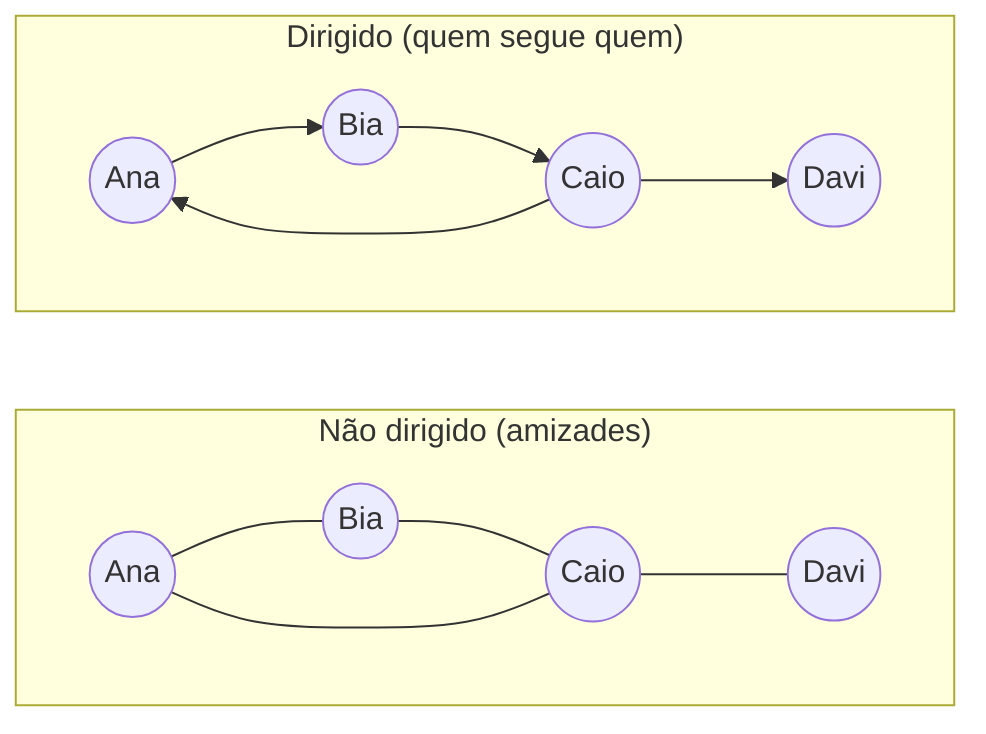

# Teoria dos grafos: definições, representações, propriedades

## Por que isso importa

Grafos modelam **qualquer coisa feita de coisas e ligações entre elas**: amigos numa rede social, cidades e estradas no GPS, páginas e links na web, tarefas e dependências num projeto, pacotes do npm, roteadores na internet. Quando você reconhece que um problema "é um grafo", ganha décadas de algoritmos prontos: BFS, DFS, Dijkstra, ordenação topológica (AL-05 a AL-07). Esta aula é o vocabulário. Sem ela, os algoritmos viram receita decorada.

## Intuição

Desenhe **bolinhas** (vértices) e **linhas** entre elas (arestas). Só isso é um grafo. Não importa a posição das bolinhas no papel nem o formato das linhas: importa **quem está ligado a quem**.

- Se a ligação tem **mão única** ("Ana segue Bia", mas Bia talvez não siga Ana), use **setas**: grafo **dirigido**.
- Se a ligação tem **custo** (km da estrada, latência do cabo), escreva um número na linha: grafo **ponderado**.

## Visual



No não dirigido: grau(Ana) = 2, grau(Bia) = 2, grau(Caio) = 3, grau(Davi) = 1. Soma = 8 = 2 × 4 arestas.

## Conceito técnico

### Definições

Um **grafo** G = (V, E) é um conjunto de **vértices** V e um conjunto de **arestas** E. Numa aresta não dirigida {u, v}, u e v são **vizinhos** (adjacentes). Numa aresta dirigida (u, v), ela sai de u e entra em v.

| Termo | Significado |
|---|---|
| **Grau** de v | número de arestas que tocam v. Em dirigidos: **grau de entrada** e **grau de saída** |
| **Caminho** | sequência de vértices em que cada par consecutivo é ligado por uma aresta |
| **Caminho simples** | sem repetir vértice |
| **Ciclo** | caminho que volta ao início (com pelo menos 3 vértices, em não dirigidos simples) |
| **Conexo** | existe caminho entre quaisquer dois vértices |
| **Componente conexa** | um "pedaço" conexo máximo do grafo |
| **Grafo simples** | sem laços (aresta de v para v) e sem arestas repetidas |
| **Completo Kₙ** | todo par de vértices é ligado: n(n − 1)/2 arestas |
| **Denso / esparso** | muitas arestas (perto de n²) / poucas (perto de n) |

Um grafo simples com n vértices tem **no máximo n(n − 1)/2** arestas (não dirigido) ou n(n − 1) (dirigido). Redes reais (estradas, amizades) costumam ser **esparsas**: cada vértice tem poucos vizinhos comparado a n.

### Lema do aperto de mãos

Em todo grafo não dirigido, **a soma dos graus é o dobro do número de arestas**:

```text
Σ grau(v) = 2 · |E|
```

Cada aresta tem duas pontas e contribui com 1 para o grau de cada uma. Consequência: **o número de vértices de grau ímpar é sempre par**. Numa festa, o número de pessoas que apertaram a mão de um número ímpar de outras é par.

Em dirigidos: Σ grau_entrada = Σ grau_saída = |E|.

### Árvores

Uma **árvore** é um grafo não dirigido **conexo e sem ciclos**. Para um grafo com n vértices, são equivalentes:

1. É conexo e sem ciclos.
2. É conexo e tem exatamente **n − 1** arestas.
3. Não tem ciclos e tem exatamente n − 1 arestas.
4. Existe **exatamente um** caminho simples entre cada par de vértices.

Tirar qualquer aresta de uma árvore a desconecta; adicionar qualquer aresta cria um ciclo. As árvores binárias de ED-05 são árvores com uma raiz escolhida. Uma **floresta** é um grafo sem ciclos (várias árvores).

### Grafos bipartidos

Um grafo é **bipartido** se os vértices podem ser divididos em dois grupos tal que **toda aresta liga um grupo ao outro**. Exemplos: alunos e disciplinas (quem cursa o quê), candidatos e vagas. Teorema: um grafo é bipartido **se e somente se não tem ciclo de tamanho ímpar**. Um triângulo nunca é bipartido. (Em AL-05, você testa isso com BFS, pintando os vértices de duas cores.)

### DAGs

Um **DAG** (grafo dirigido acíclico) é um grafo dirigido **sem ciclos dirigidos**. Modela dependências: pré-requisitos de disciplinas (como os desta plataforma!), tarefas de build, planilhas (célula que depende de célula). Todo DAG tem uma **ordenação topológica**: uma ordem dos vértices em que toda aresta vai "para a frente". Se houver um ciclo, não há ordem possível: A precisa de B, que precisa de A.

### Caminhos de Euler

O problema que fundou a teoria dos grafos (Euler, 1736): dá para atravessar as 7 pontes de Königsberg **passando uma única vez por cada ponte**? Euler mostrou que, num grafo conexo:

| Vértices de grau ímpar | Resultado |
|---|---|
| 0 | existe **ciclo de Euler** (começa e termina no mesmo vértice) |
| 2 | existe **caminho de Euler** (começa num ímpar, termina no outro) |
| mais de 2 | **não existe** |

Por quê? Cada vez que você passa por um vértice no meio do caminho, usa uma aresta para entrar e outra para sair: os graus do meio são pares. Só o início e o fim podem ser ímpares. Königsberg tinha 4 vértices de grau ímpar: impossível. É o que está por trás do jogo "desenhe a casinha sem tirar o lápis do papel".

Contraste: um **caminho de Hamilton** passa uma vez por cada **vértice**. Parece parecido, mas não se conhece nenhum algoritmo eficiente para decidir se ele existe (é NP-completo, como você vai ver na trilha de Teoria da Computação).

### Representações (prévia de ED-08)

```text
Lista de arestas:    [(0, 1), (0, 2), (1, 2), (2, 3)]
Lista de adjacência: {0: [1, 2], 1: [0, 2], 2: [0, 1, 3], 3: [2]}
Matriz:              0 1 2 3
                   0 0 1 1 0
                   1 1 0 1 0
                   2 1 1 0 1
                   3 0 0 1 0
```

A ED-08 compara custos e quando usar cada uma.

## Código

Graus e o lema do aperto de mãos:

```python
arestas = [("Ana", "Bia"), ("Bia", "Caio"), ("Ana", "Caio"), ("Caio", "Davi")]

grau = {}
for u, v in arestas:
    grau[u] = grau.get(u, 0) + 1
    grau[v] = grau.get(v, 0) + 1

print(grau)                                 # {'Ana': 2, 'Bia': 2, 'Caio': 3, 'Davi': 1}
print(sum(grau.values()) == 2 * len(arestas))   # True
impares = [v for v, g in grau.items() if g % 2 == 1]
print(impares)                              # ['Caio', 'Davi']: 2 ímpares → caminho de Euler
```

Pontes de Königsberg (4 regiões, 7 pontes; um multigrafo):

```python
pontes = [("A", "B"), ("A", "B"), ("A", "C"), ("A", "C"), ("A", "D"), ("B", "D"), ("C", "D")]
grau = {}
for u, v in pontes:
    grau[u] = grau.get(u, 0) + 1
    grau[v] = grau.get(v, 0) + 1
print(grau)                                         # A: 5, B: 3, C: 3, D: 3
print(sum(1 for g in grau.values() if g % 2))       # 4 → impossível
```

## Erros comuns

- **Achar que a posição do desenho importa.** Dois desenhos diferentes com as mesmas ligações são o mesmo grafo.
- **Usar grafo não dirigido para uma relação de mão única** (seguir, depender, link). Perde-se informação.
- **Contar cada aresta duas vezes** ao somar os graus e esquecer de dividir por 2.
- **Achar que "conexo" e "completo" são a mesma coisa.** Conexo: dá para chegar de todo vértice a todo outro, por algum caminho. Completo: todo par é **diretamente** ligado.
- **Confundir caminho de Euler (arestas) com caminho de Hamilton (vértices).** O primeiro se decide contando graus; o segundo é um problema difícil.
- **Esquecer a exigência de conexidade** no teorema de Euler: dois triângulos separados têm todos os graus pares e nenhum ciclo de Euler.

## Pratique

```quiz
id: MD-06-q1
tipo: multipla_escolha
pergunta: "Um grafo não dirigido tem 6 vértices com graus 3, 3, 2, 2, 1 e 1. Quantas arestas ele tem?"
opcoes: ["6", "12", "3", "Impossível saber"]
resposta: 0
explicacao: "Pelo lema do aperto de mãos, a soma dos graus é 2|E|: 3 + 3 + 2 + 2 + 1 + 1 = 12 = 2|E|, então |E| = 6."
dificuldade: 1
```

```quiz
id: MD-06-q2
tipo: multipla_escolha
pergunta: "Existe um grafo simples com 5 vértices de graus 3, 3, 3, 3 e 3?"
opcoes: ["Sim, o K₅", "Sim, um ciclo de 5 vértices", "Não: a soma dos graus seria ímpar", "Não: um grafo com 5 vértices tem no máximo 4 arestas"]
resposta: 2
explicacao: "A soma seria 15, mas ela precisa ser 2|E|, um número par. O número de vértices de grau ímpar tem que ser par, e aqui são 5. O K₅ tem todos os graus iguais a 4; o ciclo, todos iguais a 2."
dificuldade: 2
```

```quiz
id: MD-06-q3
tipo: multipla_escolha
pergunta: "Um grafo conexo tem 10 vértices e 9 arestas. O que se pode afirmar?"
opcoes: ["Tem exatamente um ciclo", "É uma árvore", "É completo", "É bipartido mas pode ter ciclos"]
resposta: 1
explicacao: "Conexo com n − 1 arestas é uma das definições equivalentes de árvore: não tem ciclos. Uma árvore é sempre bipartida também (não tem nenhum ciclo, então nenhum ímpar)."
dificuldade: 2
```

```quiz
id: MD-06-q4
tipo: verdadeiro_falso
pergunta: "Todo grafo que contém um triângulo (ciclo de 3 vértices) não é bipartido."
resposta: true
explicacao: "Num ciclo ímpar, ao alternar os grupos A, B, A, ao voltar ao início o vértice precisaria estar em B e em A ao mesmo tempo. Um grafo é bipartido se e só se não tem ciclos de tamanho ímpar."
dificuldade: 1
```

```quiz
id: MD-06-q5
tipo: multipla_escolha
pergunta: "Os pré-requisitos das disciplinas de um curso devem formar que tipo de grafo?"
opcoes: ["Não dirigido e completo", "Dirigido e acíclico (DAG)", "Árvore binária", "Bipartido"]
resposta: 1
explicacao: "'A é pré-requisito de B' tem direção. Um ciclo (A antes de B, B antes de A) tornaria o curso impossível de fazer. Por isso é um DAG, e uma ordenação topológica dá uma ordem válida para cursar."
dificuldade: 1
```

```quiz
id: MD-06-q6
tipo: resposta_curta
pergunta: "Por que um grafo conexo com exatamente 2 vértices de grau ímpar tem um caminho de Euler, mas não um ciclo de Euler?"
resposta: "Num ciclo, todo vértice é atravessado entrando e saindo, usando as arestas em pares, então todos os graus teriam que ser pares. Num caminho, só o início e o fim podem usar um número ímpar de arestas. Com 2 ímpares, o caminho começa num deles e termina no outro."
palavras_chave: ["entra", "sai", "pares", "início e fim"]
dificuldade: 2
```

```quiz
id: MD-06-q7
tipo: codigo
linguagem: python
pergunta: |
  **Graus.** Os vértices são `0` a `n − 1` e as arestas (não dirigidas) vêm numa lista de pares. Escreva `graus(n, arestas)` que devolve a lista com o grau de cada vértice. Um laço `(v, v)` conta **2** no grau de v (as duas pontas).
codigo_inicial: |
  def graus(n, arestas):
      g = [0] * n
      return g
usa: [def, for, return]
testes:
  - chamada: "graus(4, [(0, 1), (1, 2), (0, 2), (2, 3)])"
    saida: "[2, 2, 3, 1]"
  - chamada: "graus(3, [])"
    saida: "[0, 0, 0]"
  - chamada: "graus(2, [(0, 1), (0, 1), (1, 1)])"
    saida: "[2, 4]"
  - chamada: "(lambda a: sum(graus(1000, a)) == 2 * len(a))([(i, (i * 7) % 1000) for i in range(1000)])"
    visivel: false
    saida: "True"
dica: "Para cada (u, v): g[u] += 1 e g[v] += 1. Se u == v, isso já soma 2 no mesmo vértice, como pedido."
solucao: |
  def graus(n, arestas):
      g = [0] * n
      for u, v in arestas:
          g[u] += 1
          g[v] += 1
      return g
explicacao: "Cada aresta soma 1 em cada ponta, por isso a soma dos graus é sempre 2|E|, inclusive com arestas repetidas e laços. O teste oculto confere o lema do aperto de mãos num grafo com 1000 arestas."
dificuldade: 1
```

```quiz
id: MD-06-q8
tipo: codigo
linguagem: python
pergunta: |
  **Euler.** Supondo que o grafo (não dirigido, vértices `0` a `n − 1`) é **conexo**, escreva `euler(n, arestas)` que devolve `"ciclo"` se existe ciclo de Euler, `"caminho"` se existe só caminho de Euler, ou `"nenhum"`.
codigo_inicial: |
  def euler(n, arestas):
      return "nenhum"
usa: [def, for, return]
testes:
  - chamada: "euler(3, [(0, 1), (1, 2), (2, 0)])"
    saida: "'ciclo'"
  - chamada: "euler(4, [(0, 1), (1, 2), (2, 3)])"
    saida: "'caminho'"
  - chamada: "euler(4, [(0, 1), (0, 2), (0, 3)])"
    saida: "'nenhum'"
  - chamada: "euler(4, [(0, 1), (0, 1), (0, 2), (0, 2), (0, 3), (1, 3), (2, 3)])"
    visivel: false
    saida: "'nenhum'"
  - chamada: "euler(5, [(0, 1), (1, 2), (2, 3), (3, 4), (4, 0), (0, 2), (2, 4)])"
    visivel: false
    saida: "'caminho'"
dica: "Calcule os graus como no desafio anterior, conte quantos são ímpares e decida: 0 → ciclo, 2 → caminho, senão nenhum."
solucao: |
  def euler(n, arestas):
      g = [0] * n
      for u, v in arestas:
          g[u] += 1
          g[v] += 1
      impares = sum(1 for x in g if x % 2 == 1)
      if impares == 0:
          return "ciclo"
      if impares == 2:
          return "caminho"
      return "nenhum"
explicacao: "O quarto teste são as pontes de Königsberg (graus 5, 3, 3, 3): 4 ímpares, nenhum caminho. A estrela com 3 pontas tem graus 3, 1, 1, 1: também 4 ímpares. Repare que nunca dá para ter exatamente 1 ou 3 ímpares, pelo lema do aperto de mãos."
dificuldade: 2
```

```quiz
id: MD-06-q9
tipo: codigo
linguagem: python
pergunta: |
  **É um caminho simples?** Escreva `caminho_simples(arestas, seq)` que recebe as arestas de um grafo **não dirigido** e uma sequência de vértices, e devolve `True` se `seq` é um caminho simples: tem pelo menos 1 vértice, não repete vértice e cada par consecutivo é ligado por uma aresta (em qualquer direção).
codigo_inicial: |
  def caminho_simples(arestas, seq):
      return True
usa: [def, for, return]
testes:
  - chamada: "caminho_simples([(0, 1), (1, 2), (2, 3)], [0, 1, 2, 3])"
    saida: "True"
  - chamada: "caminho_simples([(0, 1), (1, 2), (2, 3)], [3, 2, 1])"
    saida: "True"
  - chamada: "caminho_simples([(0, 1), (1, 2), (2, 3)], [0, 2])"
    saida: "False"
  - chamada: "caminho_simples([(0, 1), (1, 2), (2, 0)], [0, 1, 2, 0])"
    saida: "False"
  - chamada: "caminho_simples([(0, 1)], [])"
    visivel: false
    saida: "False"
  - chamada: "caminho_simples([], [5])"
    visivel: false
    saida: "True"
dica: "Monte um set com as arestas nas duas direções: {(u, v), (v, u)}. Confira len(seq) >= 1, len(set(seq)) == len(seq) e, para cada i, (seq[i], seq[i + 1]) no set."
solucao: |
  def caminho_simples(arestas, seq):
      if len(seq) == 0 or len(set(seq)) != len(seq):
          return False
      ligados = set()
      for u, v in arestas:
          ligados.add((u, v))
          ligados.add((v, u))
      for i in range(len(seq) - 1):
          if (seq[i], seq[i + 1]) not in ligados:
              return False
      return True
explicacao: "[0, 1, 2, 0] é um ciclo, não um caminho simples (repete o 0). Guardar as arestas num set nas duas direções transforma 'são vizinhos?' numa consulta O(1), a mesma ideia da matriz de adjacência que você vai ver em ED-08. Um único vértice é um caminho simples de tamanho 0."
dificuldade: 2
```

## Resumo

- **Grafo** = vértices + arestas. Dirigido (setas) ou não; ponderado (pesos) ou não.
- **Aperto de mãos**: Σ graus = 2|E|; o número de vértices de grau ímpar é par.
- **Árvore**: conexa e sem ciclos ⇔ conexa com n − 1 arestas ⇔ um único caminho entre cada par.
- **Bipartido** ⇔ sem ciclo ímpar. **DAG**: dirigido sem ciclos, tem ordenação topológica.
- **Euler** (conexo): 0 ímpares → ciclo; 2 → caminho; mais → nenhum. Hamilton é difícil.

## Para ir além

- Leia a história das pontes de Königsberg e tente o problema da "casinha" no papel antes de contar os graus.
- **Próximo módulo**: ED-08 Grafos: lista e matriz de adjacência, que transforma estas definições em estruturas de dados.
