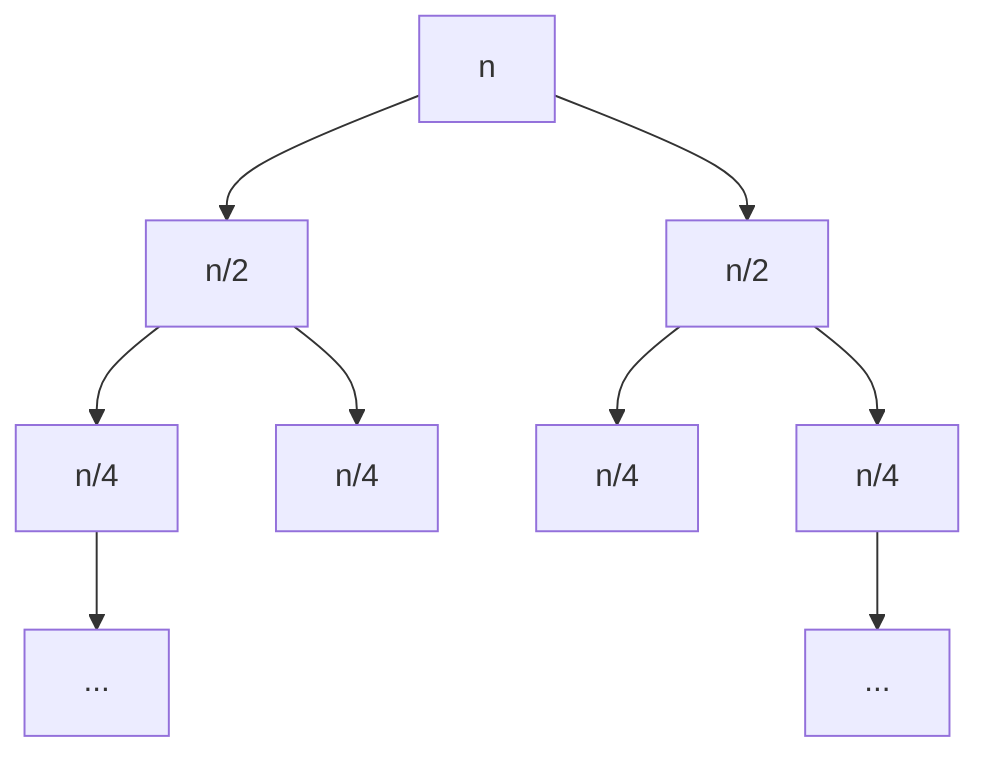

# Recorrências e somatórios

## Por que isso importa

Para analisar um laço, você **soma** o custo de cada iteração: é um **somatório**. Para analisar uma função **recursiva**, o custo de n depende do custo de casos menores: é uma **recorrência**, como T(n) = 2T(n/2) + n no merge sort (AL-03). Esta aula dá as ferramentas para transformar essas expressões numa resposta simples como O(n log n) ou O(2ⁿ). É o que permite dizer, antes de rodar, se o algoritmo aguenta 1 milhão de itens. E prepara o Teorema Mestre da AL-04.

## Intuição

- **Somatório**: a conta do supermercado. Cada item (iteração) tem um preço; o total é a soma.
- **Recorrência**: uma dívida que se refere a si mesma. "O custo de organizar n gavetas é organizar n − 1 gavetas mais uma." Para saber o total, você **desenrola** até chegar no caso que não depende de nada.
- **Árvore de recursão**: um organograma de quem chama quem. O custo total é a soma de todos os "chefes" e "funcionários" da árvore.

## Visual

Árvore de recursão do merge sort, T(n) = 2T(n/2) + n:



```text
nível 0:   n                         → soma n
nível 1:   n/2 + n/2                 → soma n
nível 2:   n/4 + n/4 + n/4 + n/4     → soma n
...
nível log₂ n: n folhas de custo 1    → soma n
                                     ─────────────
total: n por nível × (log₂ n + 1) níveis = Θ(n log n)
```

## Conceito técnico

### Notação de somatório

```text
  n
  Σ  f(i)   =  f(1) + f(2) + ... + f(n)
 i=1
```

É um laço `for i in range(1, n + 1): total += f(i)`. Propriedades úteis:

```text
Σ (a·f(i) + g(i)) = a·Σ f(i) + Σ g(i)       (é linear)
Σ c (de i = 1 a n) = c·n                     (constante somada n vezes)
```

### As somas que mais aparecem

| Soma | Fórmula fechada | Ordem | Onde aparece |
|---|---|---|---|
| 1 + 2 + ... + n | n(n + 1)/2 | Θ(n²) | laços aninhados triangulares (AL-02) |
| 1 + 1 + ... + 1 (n vezes) | n | Θ(n) | um laço simples |
| 1 + 2 + 4 + ... + 2ᵏ | 2ᵏ⁺¹ − 1 | Θ(2ᵏ) | número de nós numa árvore binária cheia |
| 1 + 1/2 + 1/4 + ... | < 2 | Θ(1) | heapify (ED-07), arrays dinâmicos |
| 1 + 1/2 + 1/3 + ... + 1/n | ≈ ln n | Θ(log n) | série harmônica: quicksort aleatório |
| 1² + 2² + ... + n² | n(n + 1)(2n + 1)/6 | Θ(n³) | três laços aninhados triangulares |

**Série geométrica**: com razão r ≠ 1, 1 + r + r² + ... + rᵏ = (rᵏ⁺¹ − 1)/(r − 1). Regra prática: numa série geométrica, **o maior termo domina**. Se cresce (r > 1), a soma é Θ(último termo); se decresce (r < 1), é Θ(primeiro termo).

Exemplo: por que o `append` de uma lista do Python é O(1) amortizado? Quando a lista enche, ela dobra de tamanho e copia tudo. Para chegar a n itens, as cópias somam 1 + 2 + 4 + ... + n < 2n. Divididas por n appends, dão menos de 2 por operação.

### Recorrências

Uma recorrência define T(n) em função de valores menores, mais um **caso base**:

```python
def soma(l):                 # T(n) = T(n − 1) + c,  T(0) = c
    if not l:
        return 0
    return l[0] + soma(l[1:])
```

(Aqui `l[1:]` copia a lista, então o custo real é T(n) = T(n − 1) + n. Detalhes de implementação mudam a recorrência!)

### Método 1: substituição repetida (desenrolar)

Substitua a recorrência nela mesma até ver o padrão.

```text
T(n) = T(n − 1) + n
     = T(n − 2) + (n − 1) + n
     = T(n − 3) + (n − 2) + (n − 1) + n
     ...
     = T(0) + 1 + 2 + ... + n
     = c + n(n + 1)/2  =  Θ(n²)
```

```text
Busca binária:  T(n) = T(n/2) + c
     = T(n/4) + c + c
     = T(n/8) + 3c
     ...  depois de k passos:  T(n/2ᵏ) + k·c
     para em n/2ᵏ = 1, ou seja, k = log₂ n
     = T(1) + c·log₂ n  =  Θ(log n)
```

### Método 2: árvore de recursão

Desenhe as chamadas, some o custo de cada **nível** e depois some os níveis. Funciona muito bem quando cada chamada gera várias outras. Vimos acima que 2T(n/2) + n dá Θ(n log n). Outro exemplo:

```text
Hanói / Fibonacci ingênuo:  T(n) = 2T(n − 1) + c
nível 0: 1 chamada   → c
nível 1: 2 chamadas  → 2c
nível 2: 4 chamadas  → 4c
...
nível n: 2ⁿ chamadas → 2ⁿc
total: c(1 + 2 + ... + 2ⁿ) = c(2ⁿ⁺¹ − 1) = Θ(2ⁿ)
```

### Método 3: chutar e provar por indução

Se você tem um palpite (de desenrolar, da árvore ou de rodar código), prove por indução (MD-03). Para T(n) = 2T(n − 1) + 1 com T(0) = 0, o palpite é T(n) = 2ⁿ − 1:

```text
Base: T(0) = 0 = 2⁰ − 1.  ✓
Passo: T(k + 1) = 2T(k) + 1 = 2(2ᵏ − 1) + 1 = 2ᵏ⁺¹ − 1.  ✓
```

### Tabela de padrões

| Recorrência | Solução | Exemplo |
|---|---|---|
| T(n) = T(n − 1) + c | Θ(n) | percorrer lista recursivamente |
| T(n) = T(n − 1) + n | Θ(n²) | selection sort recursivo |
| T(n) = T(n/2) + c | Θ(log n) | busca binária |
| T(n) = T(n/2) + n | Θ(n) | quickselect no caso bom |
| T(n) = 2T(n/2) + c | Θ(n) | percorrer árvore balanceada |
| T(n) = 2T(n/2) + n | Θ(n log n) | merge sort |
| T(n) = 2T(n − 1) + c | Θ(2ⁿ) | Hanói, Fibonacci ingênuo |

A AL-04 generaliza a família T(n) = a·T(n/b) + f(n) com o **Teorema Mestre**.

## Código

Uma recorrência vira código diretamente, e dá para comparar com a fórmula fechada:

```python
def T(n):                      # T(n) = 2T(n/2) + n, T(1) = 1 (n potência de 2)
    if n == 1:
        return 1
    return 2 * T(n // 2) + n

import math
for k in range(1, 6):
    n = 2 ** k
    print(n, T(n), n * math.log2(n) + n)    # batem: T(n) = n log₂ n + n
```

Contando as operações de verdade de um laço triangular:

```python
def conta(n):
    passos = 0
    for i in range(n):
        for j in range(i):
            passos += 1
    return passos

for n in [10, 100, 1000]:
    print(n, conta(n), n * (n - 1) // 2)    # Σ i de 0 a n−1 = n(n−1)/2
```

## Erros comuns

- **Esquecer o caso base** ao desenrolar: a recorrência sozinha não determina T(n).
- **Errar o número de níveis.** Dividir por 2 dá log₂ n níveis; subtrair 1 dá n níveis. Essa diferença é a distância entre O(log n) e O(n).
- **Somar só um ramo da árvore.** Em 2T(n/2), cada nível tem o **dobro** de chamadas; o custo do nível é a soma de todas.
- **Ignorar o custo escondido** de fatias e cópias, como `l[1:]` ou `l[:meio]`, que são O(n).
- **Confundir 2T(n/2) com 2T(n − 1).** A primeira dá Θ(n log n) (com + n); a segunda explode em Θ(2ⁿ).
- **Achar que 1 + 1/2 + 1/4 + ... cresce sem parar.** A série geométrica decrescente é limitada por 2.

## Pratique

```quiz
id: MD-07-q1
tipo: multipla_escolha
pergunta: "Quanto vale Σ i para i de 1 a 100?"
opcoes: ["100", "5050", "10000", "5000"]
resposta: 1
explicacao: "n(n + 1)/2 = 100 · 101 / 2 = 5050. É a soma que o jovem Gauss teria calculado juntando 1 + 100, 2 + 99, ..., 50 pares que somam 101."
dificuldade: 1
```

```quiz
id: MD-07-q2
tipo: multipla_escolha
pergunta: "Qual é a solução de T(n) = T(n/2) + 1, com T(1) = 1?"
opcoes: ["Θ(1)", "Θ(log n)", "Θ(n)", "Θ(n log n)"]
resposta: 1
explicacao: "Cada passo divide n por 2 e soma 1. Até chegar em 1 são log₂ n passos: T(n) = log₂ n + 1. É a recorrência da busca binária."
dificuldade: 1
```

```quiz
id: MD-07-q3
tipo: multipla_escolha
pergunta: "Qual é a solução de T(n) = 2T(n − 1) + 1, com T(0) = 0?"
opcoes: ["n²", "2n", "2ⁿ − 1", "n log n"]
resposta: 2
explicacao: "Cada nível dobra o número de chamadas: 1 + 2 + 4 + ... + 2ⁿ⁻¹ = 2ⁿ − 1. É o número de movimentos da Torre de Hanói com n discos."
dificuldade: 2
```

```quiz
id: MD-07-q4
tipo: verdadeiro_falso
pergunta: "A soma 1 + 2 + 4 + 8 + ... + 2ᵏ é menor que o dobro do último termo."
resposta: true
explicacao: "A soma é 2ᵏ⁺¹ − 1, que é menor que 2 · 2ᵏ = 2ᵏ⁺¹. Numa série geométrica crescente, o último termo domina. É por isso que dobrar a capacidade de um array dá O(1) amortizado por append."
dificuldade: 2
```

```quiz
id: MD-07-q5
tipo: multipla_escolha
pergunta: |
  Qual recorrência descreve este código?
  ```python
  def f(l):
      if len(l) <= 1:
          return 0
      meio = len(l) // 2
      return f(l[:meio]) + f(l[meio:]) + sum(l)
  ```
opcoes: ["T(n) = T(n/2) + 1", "T(n) = 2T(n/2) + 1", "T(n) = 2T(n/2) + n", "T(n) = T(n − 1) + n"]
resposta: 2
explicacao: "Duas chamadas de tamanho n/2, e o trabalho extra é O(n): as fatias l[:meio] e l[meio:] copiam n itens e sum(l) percorre n. Logo T(n) = 2T(n/2) + n = Θ(n log n)."
dificuldade: 2
```

```quiz
id: MD-07-q6
tipo: resposta_curta
pergunta: "Use a árvore de recursão para explicar por que T(n) = 2T(n/2) + n é Θ(n log n)."
resposta: "No nível k há 2ᵏ chamadas de tamanho n/2ᵏ, que somam n. A árvore tem cerca de log₂ n níveis até o tamanho chegar a 1. Somando n por nível em log₂ n níveis, o total é n log n."
palavras_chave: ["nível", "soma n", "log", "2^k"]
dificuldade: 2
```

```quiz
id: MD-07-q7
tipo: prever_saida
pergunta: |
  O que este código imprime?
  ```python
  passos = 0
  n = 16
  while n > 1:
      n //= 2
      passos += 1
  print(passos)
  ```
resposta: "4"
explicacao: "16 → 8 → 4 → 2 → 1: quatro divisões por 2. É log₂ 16 = 4, o padrão T(n) = T(n/2) + 1."
dificuldade: 1
```

```quiz
id: MD-07-q8
tipo: codigo
linguagem: python
pergunta: |
  **Recorrência que vira código.** Escreva `T(n, a, b, c)` que calcula **exatamente** a recorrência `T(n) = a·T(n // b) + c·n` com `T(1) = 1` (e `T(0) = 0`), usando recursão.
codigo_inicial: |
  def T(n, a, b, c):
      return n
usa: [def, return, T]
testes:
  - chamada: "[T(2 ** k, 2, 2, 1) for k in range(5)]"
    saida: "[1, 4, 12, 32, 80]"
  - chamada: "T(1024, 1, 2, 0)"
    saida: "1"
  - chamada: "T(0, 3, 2, 5)"
    saida: "0"
  - chamada: "T(81, 3, 3, 1)"
    visivel: false
    saida: "405"
  - chamada: "T(1000, 1, 2, 1)"
    visivel: false
    saida: "1994"
dica: "Dois casos base: n == 0 devolve 0 e n == 1 devolve 1. Senão, a * T(n // b, a, b, c) + c * n."
solucao: |
  def T(n, a, b, c):
      if n == 0:
          return 0
      if n == 1:
          return 1
      return a * T(n // b, a, b, c) + c * n
explicacao: "Com a = b = 2 e c = 1, T(2ᵏ) = 2ᵏ · (k + 1), que é n log₂ n + n: o merge sort. Com a = 1, b = 2 e c = 1, T(1000) = 1000 + 500 + 250 + ... ≈ 2n: o padrão T(n/2) + n é Θ(n), porque é uma série geométrica decrescente. Rodar a recorrência é uma ótima forma de testar um palpite antes de provar."
dificuldade: 2
```

```quiz
id: MD-07-q9
tipo: codigo
linguagem: python
pergunta: |
  **Somas fechadas.** Escreva `somas(n)` que devolve a tupla `(s1, s2, s3)` com:
  - `s1` = 1 + 2 + ... + n
  - `s2` = 1² + 2² + ... + n²
  - `s3` = 1 + 2 + 4 + ... + 2ⁿ

  usando as **fórmulas fechadas** (sem laço), para funcionar rápido mesmo com n enorme.
codigo_inicial: |
  def somas(n):
      s1 = sum(range(1, n + 1))
      s2 = sum(i * i for i in range(1, n + 1))
      s3 = sum(2 ** i for i in range(n + 1))
      return (s1, s2, s3)
usa: [def, return]
testes:
  - chamada: "somas(1)"
    saida: "(1, 1, 3)"
  - chamada: "somas(10)"
    saida: "(55, 385, 2047)"
  - chamada: "somas(0)"
    saida: "(0, 0, 1)"
  - chamada: "(lambda r: (r[0], r[1], r[2] % 1000003))(somas(10 ** 8))"
    visivel: false
    saida: "(5000000050000000, 333333338333333350000000, 97297)"
dica: "s1 = n * (n + 1) // 2, s2 = n * (n + 1) * (2 * n + 1) // 6, s3 = 2 ** (n + 1) - 1. Use // para manter inteiros."
solucao: |
  def somas(n):
      s1 = n * (n + 1) // 2
      s2 = n * (n + 1) * (2 * n + 1) // 6
      s3 = 2 ** (n + 1) - 1
      return (s1, s2, s3)
explicacao: "O código inicial está certo, mas com n = 10⁸ cada laço faz 100 milhões de passos e estoura o tempo. As fórmulas fechadas são O(1) (bem, 2ⁿ⁺¹ é um número enorme, mas o Python calcula potência de 2 muito rápido). Essa é a utilidade prática de resolver um somatório."
dificuldade: 2
```

```quiz
id: MD-07-q10
tipo: codigo
linguagem: python
pergunta: |
  **Contar chamadas.** O Fibonacci ingênuo `fib(n) = fib(n − 1) + fib(n − 2)` (com `fib(0) = 0` e `fib(1) = 1`) faz muitas chamadas. Seja C(n) o **número total de chamadas** para calcular fib(n): C(0) = C(1) = 1 e C(n) = 1 + C(n − 1) + C(n − 2). Escreva `chamadas(n)` que calcula C(n) **sem** chamar fib, de forma iterativa, rápido até para n = 1000.
codigo_inicial: |
  def chamadas(n):
      if n <= 1:
          return 1
      return 1 + chamadas(n - 1) + chamadas(n - 2)
usa: [def, for, return]
testes:
  - chamada: "[chamadas(n) for n in range(8)]"
    saida: "[1, 1, 3, 5, 9, 15, 25, 41]"
  - chamada: "chamadas(30)"
    saida: "2692537"
  - chamada: "chamadas(1000) % 1000000007"
    visivel: false
    saida: "215159877"
dica: "Guarde só os dois últimos valores: a, b = 1, 1 (C(0) e C(1)). Para i de 2 até n, faça a, b = b, 1 + a + b. No fim, devolva b (ou 1 se n <= 1)."
solucao: |
  def chamadas(n):
      a, b = 1, 1
      for _ in range(2, n + 1):
          a, b = b, 1 + a + b
      return b
explicacao: "C(n) = 2·fib(n + 1) − 1 cresce como 1,618ⁿ: para n = 30 já são 2,7 milhões de chamadas, e para n = 1000 seria um número com 209 dígitos. Calcular a recorrência de baixo para cima, guardando só o necessário, é a ideia central da programação dinâmica (AL-09)."
dificuldade: 3
```

## Resumo

- **Somatório** = custo de um laço. Decore: Σi = n(n+1)/2, Σ2ⁱ = 2ⁿ⁺¹ − 1, geométrica decrescente < 2, harmônica ≈ ln n.
- **Recorrência** = custo de uma recursão. Sempre com caso base.
- **Desenrolar**: substitua até ver o padrão. **Árvore**: some por nível, depois os níveis. **Chutar e provar**: indução.
- Padrões: T(n−1)+c → n; T(n−1)+n → n²; T(n/2)+c → log n; 2T(n/2)+n → n log n; 2T(n−1)+c → 2ⁿ.

## Para ir além

- Resolva as recorrências dos algoritmos de AL-02 e AL-03 sozinho e confira com código, como no desafio q8.
- **Próximo módulo**: AL-04 Recursão e divisão e conquista, com o Teorema Mestre, que resolve T(n) = aT(n/b) + f(n) de uma vez.
