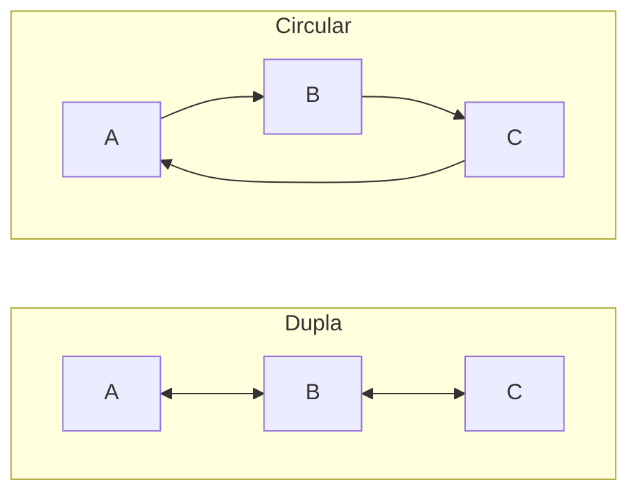

# Listas ligadas (simples, dupla, circular)

## Por que isso importa

O array (a `list` do Python) guarda tudo em posições **vizinhas** de memória: acessar a posição 1000 é instantâneo, mas inserir no começo obriga a empurrar todo mundo. A **lista ligada** faz a troca oposta: cada elemento sabe onde está o próximo, então inserir e remover nas pontas é O(1), mas achar o 1000º exige andar 1000 passos. Ela é a base de filas e pilhas eficientes, do `deque` do Python, de caches LRU, do histórico de "voltar/avançar" do navegador e das listas de adjacência de grafos. E é presença garantida em entrevistas, porque treina raciocínio com **ponteiros**.

## Intuição

Uma **caça ao tesouro**: cada pista diz o que você ganhou ali e **onde está a próxima pista**. Para chegar à 5ª pista, você precisa passar pelas 4 primeiras: não dá para pular direto. Em compensação, para acrescentar uma pista nova no começo, basta escrever um papel apontando para a antiga primeira pista; nenhuma outra precisa mudar.

O array é um **trem com vagões numerados** grudados: você vai direto ao vagão 7, mas para colocar um vagão novo no começo precisa renumerar todos.

## Visual

Lista simplesmente ligada com 3 nós. Cada nó tem um **valor** e uma referência **prox**:

```
 cabeca
   │
   ▼
┌────┬───┐    ┌────┬───┐    ┌────┬──────┐
│ 10 │ ●─┼───►│ 20 │ ●─┼───►│ 30 │ None │
└────┴───┘    └────┴───┘    └────┴──────┘
 valor prox
```

Inserir no começo (O(1)): o nó novo aponta para a antiga cabeça, e a cabeça passa a ser o nó novo.

```
 cabeca (novo)
   │
   ▼
┌────┬───┐    ┌────┬───┐    ┌────┬───┐    ┌────┬──────┐
│  5 │ ●─┼───►│ 10 │ ●─┼───►│ 20 │ ●─┼───►│ 30 │ None │
└────┴───┘    └────┴───┘    └────┴───┘    └────┴──────┘
```

Remover o 20 (depois de achar o nó anterior, o 10): basta "pular" o 20.

```
┌────┬───┐                  ┌────┬──────┐
│ 10 │ ●─┼─────────────────►│ 30 │ None │       o 20 fica sem ninguém apontando
└────┴───┘   ┌────┬───┐     └────┴──────┘       e o coletor de lixo o apaga
             │ 20 │ ●─┼──►
             └────┴───┘
```

Variações:



## Conceito técnico

### Nó e lista

```python
class No:
    def __init__(self, valor, prox=None):
        self.valor = valor
        self.prox = prox      # referência para o próximo nó (ou None no fim)
```

A lista em si é só uma referência para o primeiro nó, a **cabeça** (`head`). Às vezes guarda-se também a **cauda** (`tail`) e o tamanho, para tornar `append` e `len` O(1).

### Custos: lista ligada × array dinâmico

| Operação | Array dinâmico (`list`) | Lista simplesmente ligada |
|---|---|---|
| Acessar o i-ésimo | **O(1)** | O(n): precisa andar |
| Buscar um valor | O(n) | O(n) |
| Inserir/remover no **começo** | O(n): desloca tudo | **O(1)** |
| Inserir no **fim** | O(1) amortizado | O(1) com ponteiro para a cauda, senão O(n) |
| Inserir/remover no meio, **já tendo o nó anterior** | O(n) | **O(1)** |
| Memória extra | pouca (espaço reservado) | uma referência por nó |
| Uso da cache da CPU | ótimo (memória contígua) | ruim (nós espalhados) |

Na prática, arrays costumam ser mais rápidos para quase tudo por causa da cache. Listas ligadas brilham quando há muitas inserções e remoções nas pontas ou em posições que você já tem em mãos (por exemplo, o `deque` e o cache LRU).

### Percorrer: o padrão fundamental

```python
atual = cabeca
while atual is not None:
    ... atual.valor ...
    atual = atual.prox       # avança. Esquecer esta linha = laço infinito
```

### Variações

- **Duplamente ligada**: cada nó tem `prox` e `ant`. Permite andar para trás e remover um nó em O(1) sabendo só ele mesmo. Custa uma referência a mais por nó. É o que o `collections.deque` e o histórico do navegador usam.
- **Circular**: o último nó aponta de volta para o primeiro. Útil para rodízio (escalonador de processos em round-robin, jogadores numa mesa).
- **Nó sentinela** (*dummy*): um nó falso no começo que nunca é removido. Elimina o caso especial de "lista vazia" e de "remover a cabeça", deixando o código mais simples.

### Técnica dos dois ponteiros

Dois ponteiros andando em velocidades diferentes resolvem vários problemas em uma passada:

- **Meio da lista**: `lento` anda 1, `rapido` anda 2. Quando o rápido chega ao fim, o lento está no meio.
- **Detectar ciclo** (algoritmo de Floyd, "tartaruga e lebre"): se há ciclo, o rápido acaba alcançando o lento.

## Código

Uma lista ligada com as operações básicas:

```python
class No:
    def __init__(self, valor, prox=None):
        self.valor = valor
        self.prox = prox


class ListaLigada:
    def __init__(self):
        self.cabeca = None
        self.tamanho = 0

    def inserir_inicio(self, valor):            # O(1)
        self.cabeca = No(valor, self.cabeca)
        self.tamanho += 1

    def contem(self, valor):                    # O(n)
        atual = self.cabeca
        while atual is not None:
            if atual.valor == valor:
                return True
            atual = atual.prox
        return False

    def remover(self, valor):                   # O(n) para achar, O(1) para remover
        if self.cabeca is None:
            return False
        if self.cabeca.valor == valor:          # caso especial: remover a cabeça
            self.cabeca = self.cabeca.prox
            self.tamanho -= 1
            return True
        anterior = self.cabeca
        while anterior.prox is not None:
            if anterior.prox.valor == valor:
                anterior.prox = anterior.prox.prox   # pula o nó removido
                self.tamanho -= 1
                return True
            anterior = anterior.prox
        return False

    def __str__(self):
        partes = []
        atual = self.cabeca
        while atual is not None:
            partes.append(str(atual.valor))
            atual = atual.prox
        return " -> ".join(partes) + " -> None"


l = ListaLigada()
for x in [30, 20, 10]:
    l.inserir_inicio(x)
print(l)                 # 10 -> 20 -> 30 -> None
l.remover(20)
print(l, l.tamanho)      # 10 -> 30 -> None 2
print(l.contem(30))      # True
```

Inverter a lista no lugar, o exercício clássico de entrevista (três ponteiros):

```python
def inverter(cabeca):
    anterior = None
    atual = cabeca
    while atual is not None:
        proximo = atual.prox     # 1. guarda o resto da lista
        atual.prox = anterior    # 2. vira a seta para trás
        anterior = atual         # 3. avança os dois ponteiros
        atual = proximo
    return anterior              # o antigo último nó é a nova cabeça
```

```
passo a passo com 1 → 2 → 3:
  None ← 1    2 → 3        anterior=1, atual=2
  None ← 1 ← 2    3        anterior=2, atual=3
  None ← 1 ← 2 ← 3         anterior=3, atual=None → devolve 3
```

## Erros comuns

- **Esquecer `atual = atual.prox`** no laço: laço infinito.
- **Perder o resto da lista** ao mudar `atual.prox` antes de guardar o próximo (por isso o `proximo = atual.prox` vem primeiro no inverter).
- **Não tratar a lista vazia** (`cabeca is None`) e chamar `.valor` em `None`: `AttributeError: 'NoneType' object has no attribute 'valor'`.
- **Não tratar a remoção da cabeça**, que não tem nó anterior. (Um nó sentinela resolve.)
- **Achar que lista ligada é sempre mais rápida para inserir.** Se você ainda precisa **procurar** a posição, a busca já custa O(n).
- **Esquecer de atualizar `tamanho` ou a cauda** depois de inserir ou remover.

## Pratique

```quiz
id: ED-03-q1
tipo: multipla_escolha
pergunta: "Qual o custo de acessar o elemento da posição i numa lista simplesmente ligada com n nós?"
opcoes: ["O(1)", "O(log n)", "O(i), ou seja, O(n) no pior caso", "O(n²)"]
resposta: 2
explicacao: "Não há como pular direto: é preciso seguir as referências a partir da cabeça, i vezes. No pior caso (o último), são n passos. No array, o acesso é O(1) porque a posição na memória é calculada com uma conta."
dificuldade: 1
```

```quiz
id: ED-03-q2
tipo: multipla_escolha
pergunta: "Em qual situação uma lista ligada é claramente melhor que um array?"
opcoes: ["Acessar elementos por índice muitas vezes", "Inserir e remover muitas vezes no começo da sequência", "Ordenar os elementos", "Economizar memória"]
resposta: 1
explicacao: "Inserir/remover no começo é O(1) na lista ligada e O(n) no array (que desloca todos os elementos). Para acesso por índice o array é muito melhor, e a lista ligada gasta mais memória (uma referência por nó)."
dificuldade: 1
```

```quiz
id: ED-03-q3
tipo: prever_saida
pergunta: |
  O que este programa imprime?
  ```python
  class No:
      def __init__(self, valor, prox=None):
          self.valor = valor
          self.prox = prox

  c = No(1, No(2, No(3)))
  c.prox = c.prox.prox
  atual = c
  while atual:
      print(atual.valor, end=" ")
      atual = atual.prox
  ```
resposta: "1 3"
explicacao: "A lista começa 1 → 2 → 3. c.prox = c.prox.prox faz o 1 apontar direto para o 3, pulando o 2: é exatamente a operação de remoção. O percurso imprime 1 e 3."
dificuldade: 2
```

```quiz
id: ED-03-q4
tipo: verdadeiro_falso
pergunta: "Numa lista duplamente ligada, dá para remover um nó em O(1) tendo só a referência para ele mesmo."
resposta: true
explicacao: "Com ant e prox, o nó sabe quem são seus vizinhos: basta fazer no.ant.prox = no.prox e no.prox.ant = no.ant. Na lista simples isso não dá, porque o nó não sabe quem é o anterior."
dificuldade: 2
```

```quiz
id: ED-03-q5
tipo: resposta_curta
pergunta: "Como achar o nó do meio de uma lista ligada em uma única passada, sem saber o tamanho?"
resposta: "Com dois ponteiros: um lento, que anda um nó por vez, e um rápido, que anda dois. Quando o rápido chega ao fim, o lento está no meio, porque andou metade da distância."
palavras_chave: ["dois ponteiros", "lento", "rápido", "metade"]
dificuldade: 2
```

```quiz
id: ED-03-q6
tipo: codigo
linguagem: python
pergunta: |
  **Tamanho e soma.** Escreva `tamanho(cabeca)` e `soma(cabeca)`, que percorrem a lista ligada e devolvem a quantidade de nós e a soma dos valores. A classe `No` e a função `montar` (que cria uma lista ligada a partir de uma lista do Python) já estão prontas.
codigo_inicial: |
  class No:
      def __init__(self, valor, prox=None):
          self.valor = valor
          self.prox = prox


  def montar(valores):
      cabeca = None
      for v in reversed(valores):
          cabeca = No(v, cabeca)
      return cabeca


  def tamanho(cabeca):
      pass


  def soma(cabeca):
      pass
usa: [def, while, return]
testes:
  - chamada: "tamanho(montar([10, 20, 30]))"
    saida: "3"
  - chamada: "soma(montar([10, 20, 30]))"
    saida: "60"
  - chamada: "(tamanho(None), soma(None))"
    saida: "(0, 0)"
  - chamada: "(tamanho(montar([7])), soma(montar([-1, 1, 5])))"
    visivel: false
    saida: "(1, 5)"
dica: "O padrão é sempre o mesmo: atual = cabeca; while atual is not None: (use atual.valor); atual = atual.prox. Lista vazia é cabeca = None, e o laço simplesmente não roda."
solucao: |
  class No:
      def __init__(self, valor, prox=None):
          self.valor = valor
          self.prox = prox


  def montar(valores):
      cabeca = None
      for v in reversed(valores):
          cabeca = No(v, cabeca)
      return cabeca


  def tamanho(cabeca):
      qtd = 0
      atual = cabeca
      while atual is not None:
          qtd += 1
          atual = atual.prox
      return qtd


  def soma(cabeca):
      total = 0
      atual = cabeca
      while atual is not None:
          total += atual.valor
          atual = atual.prox
      return total
explicacao: "Percorrer é o 'for' da lista ligada: um ponteiro que avança de nó em nó até None. Repare que montar insere de trás para frente no começo, que é O(1) por inserção, para manter a ordem original."
dificuldade: 1
```

```quiz
id: ED-03-q7
tipo: codigo
linguagem: python
pergunta: |
  **Inverter a lista.** Escreva `inverter(cabeca)` que inverte a lista ligada **no lugar** (mudando as referências `prox`, sem criar nós novos nem usar lista do Python) e devolve a nova cabeça. `para_lista` (pronta) converte de volta para uma lista do Python, para os testes.
codigo_inicial: |
  class No:
      def __init__(self, valor, prox=None):
          self.valor = valor
          self.prox = prox


  def montar(valores):
      cabeca = None
      for v in reversed(valores):
          cabeca = No(v, cabeca)
      return cabeca


  def para_lista(cabeca):
      saida = []
      while cabeca is not None:
          saida.append(cabeca.valor)
          cabeca = cabeca.prox
      return saida


  def inverter(cabeca):
      pass
usa: [def, while, return]
testes:
  - chamada: "para_lista(inverter(montar([1, 2, 3, 4])))"
    saida: "[4, 3, 2, 1]"
  - chamada: "para_lista(inverter(montar([])))"
    saida: "[]"
  - chamada: "para_lista(inverter(montar([42])))"
    saida: "[42]"
  - chamada: "(lambda c: (para_lista(inverter(c)), c.prox))(montar([5, 6]))"
    visivel: false
    saida: "([6, 5], None)"
dica: "Três ponteiros: anterior = None e atual = cabeca. No laço: guarde proximo = atual.prox, vire atual.prox = anterior, depois avance anterior = atual e atual = proximo. No fim, a nova cabeça é anterior."
solucao: |
  class No:
      def __init__(self, valor, prox=None):
          self.valor = valor
          self.prox = prox


  def montar(valores):
      cabeca = None
      for v in reversed(valores):
          cabeca = No(v, cabeca)
      return cabeca


  def para_lista(cabeca):
      saida = []
      while cabeca is not None:
          saida.append(cabeca.valor)
          cabeca = cabeca.prox
      return saida


  def inverter(cabeca):
      anterior = None
      atual = cabeca
      while atual is not None:
          proximo = atual.prox
          atual.prox = anterior
          anterior = atual
          atual = proximo
      return anterior
explicacao: "O teste oculto confere que foi no lugar: o antigo primeiro nó (5) passa a ser o último, com prox = None. O(n) de tempo e O(1) de memória extra. A ordem das quatro atribuições importa: guardar o próximo antes de virar a seta."
dificuldade: 2
```

```quiz
id: ED-03-q8
tipo: codigo
linguagem: python
pergunta: |
  **Remover todas as ocorrências.** Escreva `remover_todos(cabeca, valor)` que remove todos os nós com aquele valor e devolve a cabeça (que pode mudar). Dica de projeto: um **nó sentinela** antes da cabeça elimina o caso especial.
codigo_inicial: |
  class No:
      def __init__(self, valor, prox=None):
          self.valor = valor
          self.prox = prox


  def montar(valores):
      cabeca = None
      for v in reversed(valores):
          cabeca = No(v, cabeca)
      return cabeca


  def para_lista(cabeca):
      saida = []
      while cabeca is not None:
          saida.append(cabeca.valor)
          cabeca = cabeca.prox
      return saida


  def remover_todos(cabeca, valor):
      pass
usa: [def, while, return]
testes:
  - chamada: "para_lista(remover_todos(montar([1, 2, 1, 3]), 1))"
    saida: "[2, 3]"
  - chamada: "para_lista(remover_todos(montar([7, 7, 7]), 7))"
    saida: "[]"
  - chamada: "para_lista(remover_todos(montar([4, 5]), 9))"
    saida: "[4, 5]"
  - chamada: "para_lista(remover_todos(montar([2, 2, 3, 2, 2, 4, 2]), 2))"
    visivel: false
    saida: "[3, 4]"
dica: "sentinela = No(None, cabeca); anterior = sentinela. Enquanto anterior.prox existir: se anterior.prox.valor == valor, pule o nó (anterior.prox = anterior.prox.prox) SEM avançar; senão, avance anterior. Devolva sentinela.prox."
solucao: |
  class No:
      def __init__(self, valor, prox=None):
          self.valor = valor
          self.prox = prox


  def montar(valores):
      cabeca = None
      for v in reversed(valores):
          cabeca = No(v, cabeca)
      return cabeca


  def para_lista(cabeca):
      saida = []
      while cabeca is not None:
          saida.append(cabeca.valor)
          cabeca = cabeca.prox
      return saida


  def remover_todos(cabeca, valor):
      sentinela = No(None, cabeca)
      anterior = sentinela
      while anterior.prox is not None:
          if anterior.prox.valor == valor:
              anterior.prox = anterior.prox.prox
          else:
              anterior = anterior.prox
      return sentinela.prox
explicacao: "Com o sentinela, a cabeça vira um nó comum (ela também tem um 'anterior'), e o mesmo código remove no começo, no meio e no fim. Não avançar depois de remover é o que permite pegar repetidos seguidos, como 2, 2."
dificuldade: 2
```

```quiz
id: ED-03-q9
tipo: codigo
linguagem: python
pergunta: |
  **Meio da lista com dois ponteiros.** Escreva `meio(cabeca)` que devolve o **valor** do nó do meio em uma única passada (sem contar o tamanho antes). Com quantidade par de nós, devolva o segundo dos dois do meio. Lista vazia devolve `None`.
codigo_inicial: |
  class No:
      def __init__(self, valor, prox=None):
          self.valor = valor
          self.prox = prox


  def montar(valores):
      cabeca = None
      for v in reversed(valores):
          cabeca = No(v, cabeca)
      return cabeca


  def meio(cabeca):
      pass
usa: [def, while, return]
testes:
  - chamada: "meio(montar([1, 2, 3, 4, 5]))"
    saida: "3"
  - chamada: "meio(montar([1, 2, 3, 4]))"
    saida: "3"
  - chamada: "meio(montar([9]))"
    saida: "9"
  - chamada: "meio(None)"
    visivel: false
    saida: "None"
  - chamada: "meio(montar(list(range(10, 20))))"
    visivel: false
    saida: "15"
dica: "lento = rapido = cabeca. Enquanto rapido e rapido.prox existirem: lento anda 1 (lento.prox) e rapido anda 2 (rapido.prox.prox). No fim, lento está no meio."
solucao: |
  class No:
      def __init__(self, valor, prox=None):
          self.valor = valor
          self.prox = prox


  def montar(valores):
      cabeca = None
      for v in reversed(valores):
          cabeca = No(v, cabeca)
      return cabeca


  def meio(cabeca):
      if cabeca is None:
          return None
      lento = cabeca
      rapido = cabeca
      while rapido is not None and rapido.prox is not None:
          lento = lento.prox
          rapido = rapido.prox.prox
      return lento.valor
explicacao: "O rápido anda o dobro, então quando ele chega ao fim o lento andou metade. A condição rapido and rapido.prox protege contra AttributeError nas listas de tamanho par e ímpar. A mesma ideia (tartaruga e lebre) detecta ciclos."
dificuldade: 2
```

## Resumo

- Lista ligada = **nós** com valor + referência ao **próximo**; a lista é só a **cabeça**.
- Inserir/remover nas pontas (ou tendo o nó anterior) é **O(1)**; acessar por posição é **O(n)**.
- Percorrer: `atual = cabeca; while atual: ...; atual = atual.prox`.
- **Dupla** (anda para trás, remove em O(1)), **circular** (rodízio), **sentinela** (sem casos especiais).
- **Dois ponteiros** (lento e rápido) acham o meio e detectam ciclos em uma passada.

## Para ir além

- Desafio extra: detecte se uma lista tem ciclo com o algoritmo de Floyd (tartaruga e lebre).
- Desafio extra: implemente uma fila com lista ligada mantendo ponteiros para cabeça e cauda, com `enfileirar` e `desenfileirar` O(1).
- **Próximos módulos**: ED-04 Tabelas hash e ED-05 Árvores binárias.
