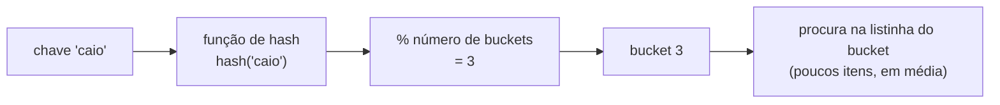

# Tabelas hash: funções de hash, colisões, rehash

## Por que isso importa

A tabela hash é provavelmente a estrutura de dados **mais usada** do mundo. O `dict` e o `set` do Python, o `Map` e os objetos do JavaScript, o `HashMap` do Java, índices de banco de dados, caches (Redis), o roteamento de requisições, a deduplicação de arquivos e os compiladores (tabela de símbolos) dependem dela. Ela transforma buscas O(n) em O(1) na média, e o truque "troque a lista por um set/dict" resolve uma enorme quantidade de problemas de entrevista e do dia a dia.

## Intuição

Imagine uma **biblioteca sem catálogo**: para achar um livro, você olha estante por estante (O(n)). Agora imagine uma regra: "o livro vai para a estante número **(soma das letras do título) % 100**". Para achar *Dom Casmurro*, você faz a conta, vai direto à estante 37 e procura só ali. A regra é a **função de hash**, as estantes são os **buckets** (baldes). Às vezes dois livros caem na mesma estante: é uma **colisão**, e você procura entre os poucos livros daquela estante. Se as estantes ficarem lotadas, você constrói uma biblioteca com o dobro de estantes e redistribui tudo: é o **rehash**.

## Visual

Inserindo chaves numa tabela com 8 buckets, com colisões tratadas por **encadeamento** (cada bucket é uma pequena lista):

```
hash("ana")   % 8 = 3        bucket
hash("bia")   % 8 = 6          0 │ ("davi", 6.0)
hash("caio")  % 8 = 3          1 │ ·
hash("davi")  % 8 = 0          2 │ ·
                               3 │ ("ana", 9.0) → ("caio", 7.5)     ← colisão: os dois caem no 3
                               4 │ ·
                               5 │ ·
                               6 │ ("bia", 8.0)
                               7 │ ·

buscar "caio": calcula hash → bucket 3 → procura só ali (2 itens) → achou
```



## Conceito técnico

### A ideia

Uma tabela hash guarda pares **chave → valor** num array de **buckets**. Para achar onde uma chave mora:

```
índice = hash(chave) % número_de_buckets
```

Se a função de hash espalha bem as chaves, cada bucket tem poucos itens, e buscar, inserir e remover custam **O(1) na média**.

### Função de hash

Transforma a chave num número inteiro. Uma boa função de hash:

1. É **determinística**: a mesma chave dá sempre o mesmo número (senão você nunca acharia de volta).
2. **Espalha** bem: chaves parecidas ("ana", "anb") caem em lugares bem diferentes.
3. É **rápida** de calcular.

Por isso **só chaves imutáveis** podem ser chaves de dict ou itens de set: se a chave mudasse depois de guardada, o hash mudaria e ela ficaria "perdida" no bucket errado. Em Python, `str`, `int`, `float`, `tuple` (de imutáveis) e `frozenset` são *hashable*; `list`, `dict` e `set` não são (`TypeError: unhashable type: 'list'`).

Obs.: funções de hash de tabelas **não** são funções de hash criptográficas (SHA-256), que têm outros requisitos (SE-02). E no Python o hash de strings muda a cada execução do programa (por segurança, contra ataques que forçam colisões).

### Colisões

Duas chaves diferentes no mesmo bucket são inevitáveis (há infinitas chaves e poucos buckets: princípio da casa dos pombos). Duas estratégias:

| Estratégia | Como funciona | Usado em |
|---|---|---|
| **Encadeamento** (*chaining*) | cada bucket guarda uma lista dos itens que caíram nele | Java `HashMap` |
| **Endereçamento aberto** (*open addressing*) | se o bucket está ocupado, procura o próximo livre (sondagem linear, quadrática...) | Python `dict` e `set` |

### Fator de carga e rehash

**Fator de carga** = itens / buckets. Quanto maior, mais colisões e mais lento. Quando passa de um limite (cerca de 0,66 no Python, 0,75 no Java), a tabela **cresce** (normalmente dobra) e todos os itens são **reinseridos** com o novo tamanho: o **rehash**. Ele custa O(n), mas acontece raramente, então o custo **amortizado** por inserção continua O(1), como no `append` da lista.

### Custos

| Operação | Média | Pior caso |
|---|---|---|
| Inserir, buscar, remover | **O(1)** | O(n): todas as chaves no mesmo bucket |
| Percorrer tudo | O(n) | O(n) |
| Achar o menor / percorrer em ordem | O(n) | sem ordem por chave (use árvore, ED-05) |

O pior caso é raro com uma boa função de hash, mas pode ser provocado de propósito por um atacante (ataque de *hash flooding*), por isso as linguagens usam hash com semente aleatória.

### dict e set no Python

```python
notas = {"ana": 9.0, "bia": 8.0}
notas["caio"] = 7.5               # insere ou atualiza
print(notas["ana"])               # 9.0  (KeyError se não existir)
print(notas.get("davi", 0))       # 0    (valor padrão em vez de erro)
print("bia" in notas)             # True: O(1)!
del notas["bia"]                  # remove
for nome, nota in notas.items():  # percorre pares (na ordem de inserção)
    print(nome, nota)

vistos = set()                    # set = só as chaves, sem valores
vistos.add(3)
print(3 in vistos)                # True, O(1)
print({1, 2, 3} & {2, 3, 4})      # interseção: {2, 3}
```

`collections.Counter` conta ocorrências e `collections.defaultdict(list)` cria valores padrão sozinho, dois atalhos muito usados.

### Padrões de problema que viram O(n) com hash

| Problema | Ingênuo | Com hash |
|---|---|---|
| Tem repetido? | comparar todos os pares, O(n²) | set dos vistos, O(n) |
| Dois números que somam X | todos os pares, O(n²) | set/dict dos complementos, O(n) |
| Contar frequências | `lista.count` para cada, O(n²) | dict de contadores, O(n) |
| Agrupar (anagramas, por categoria) | comparar todos com todos | dict de chave → lista, O(n) |
| Interseção de duas listas | O(n·m) | set, O(n + m) |

## Código

Contando palavras com dict (e depois com Counter):

```python
from collections import Counter

texto = "o rato roeu a roupa do rei de roma o rato fugiu"
contagem = {}
for palavra in texto.split():
    contagem[palavra] = contagem.get(palavra, 0) + 1
print(contagem["rato"], contagem["o"])   # 2 2

print(Counter(texto.split()).most_common(2))   # [('o', 2), ('rato', 2)]
```

Uma tabela hash de verdade, com encadeamento e rehash, para ver o que o `dict` faz por baixo:

```python
class TabelaHash:
    def __init__(self, capacidade=4):
        self.buckets = [[] for _ in range(capacidade)]
        self.tamanho = 0

    def _indice(self, chave):
        return hash(chave) % len(self.buckets)

    def inserir(self, chave, valor):
        bucket = self.buckets[self._indice(chave)]
        for par in bucket:
            if par[0] == chave:       # chave já existe: atualiza
                par[1] = valor
                return
        bucket.append([chave, valor])
        self.tamanho += 1
        if self.tamanho / len(self.buckets) > 0.75:   # fator de carga
            self._rehash()

    def buscar(self, chave):
        for k, v in self.buckets[self._indice(chave)]:
            if k == chave:
                return v
        raise KeyError(chave)

    def _rehash(self):
        antigos = self.buckets
        self.buckets = [[] for _ in range(2 * len(antigos))]
        self.tamanho = 0
        for bucket in antigos:
            for k, v in bucket:
                self.inserir(k, v)


t = TabelaHash()
for i, nome in enumerate(["ana", "bia", "caio", "davi", "eva", "fabio"]):
    t.inserir(nome, i)
print(t.buscar("davi"), len(t.buckets))   # 3 8: no 4º item (4/4 > 0,75) cresceu de 4 para 8
```

## Erros comuns

- **Usar lista como chave** de dict ou item de set: `TypeError: unhashable type`. Converta para tupla.
- **`x in lista` dentro de um laço** quando poderia ser `x in conjunto`: transforma O(n) em O(n²) sem perceber.
- **Acessar `d[chave]` sem saber se existe**: `KeyError`. Use `in`, `.get(chave, padrao)` ou `defaultdict`.
- **Esperar ordem por chave.** O dict mantém a ordem de **inserção** (Python 3.7+), não a ordem alfabética; set não garante ordem nenhuma.
- **Alterar um dict enquanto percorre** (`RuntimeError: dictionary changed size during iteration`). Percorra uma cópia: `for k in list(d):`.
- **Esquecer que O(1) é na média.** Com muitas colisões, vira O(n).

## Pratique

```quiz
id: ED-04-q1
tipo: multipla_escolha
pergunta: "Por que uma `list` não pode ser chave de um `dict` em Python?"
opcoes: ["Porque é grande demais", "Porque é mutável: se mudasse depois de guardada, o hash mudaria e a chave ficaria no bucket errado", "Porque listas não têm ordem", "Porque o dict só aceita strings"]
resposta: 1
explicacao: "A posição da chave na tabela depende do hash. Se a chave pudesse mudar, o hash mudaria e a busca procuraria no bucket errado. Por isso só objetos imutáveis (str, int, tupla de imutáveis) são hashable."
dificuldade: 1
```

```quiz
id: ED-04-q2
tipo: multipla_escolha
pergunta: "Qual o custo de `x in s` quando `s` é um `set` com n elementos?"
opcoes: ["O(1) na média", "O(log n)", "O(n)", "O(n log n)"]
resposta: 0
explicacao: "O set é uma tabela hash: calcula o hash de x, vai direto ao bucket e confere poucos itens. Na lista, x in l é O(n) porque compara um por um. O pior caso do set é O(n), mas é raro."
dificuldade: 1
```

```quiz
id: ED-04-q3
tipo: multipla_escolha
pergunta: "Uma tabela com 8 buckets tem 6 itens. Qual o fator de carga, e o que acontece se o limite for 0,75 e você inserir mais um item?"
opcoes: ["0,75; nada", "0,75; a tabela é redimensionada (rehash) porque 7/8 passa do limite", "1,33; a tabela encolhe", "6; a inserção falha"]
resposta: 1
explicacao: "Fator de carga = itens / buckets = 6/8 = 0,75. Com o 7º item, 7/8 = 0,875 passa do limite: a tabela dobra (16 buckets) e reinsere tudo. O custo O(n) é raro, então a inserção continua O(1) amortizado."
dificuldade: 2
```

```quiz
id: ED-04-q4
tipo: verdadeiro_falso
pergunta: "Numa tabela hash, buscar uma chave é sempre O(1), em qualquer situação."
resposta: false
explicacao: "É O(1) na média, com uma função de hash que espalha bem. No pior caso (todas as chaves no mesmo bucket), a busca percorre todos: O(n). Por isso a qualidade da função de hash e o rehash importam."
dificuldade: 1
```

```quiz
id: ED-04-q5
tipo: prever_saida
pergunta: |
  O que este programa imprime?
  ```python
  d = {}
  for c in "banana":
      d[c] = d.get(c, 0) + 1
  print(d)
  print(len(set("banana")))
  ```
resposta: "{'b': 1, 'a': 3, 'n': 2} e depois 3"
explicacao: "O dict conta cada letra, mantendo a ordem da primeira aparição (b, a, n). O set guarda só os elementos distintos: b, a, n, portanto 3."
dificuldade: 1
```

```quiz
id: ED-04-q6
tipo: resposta_curta
pergunta: "Compare encadeamento e endereçamento aberto para tratar colisões."
resposta: "No encadeamento, cada bucket guarda uma lista com todos os itens que caíram nele, e a busca percorre essa lista. No endereçamento aberto, cada bucket guarda no máximo um item: se estiver ocupado, procura-se outra posição da própria tabela (próxima livre, por exemplo). O primeiro usa memória extra para as listas; o segundo precisa manter o fator de carga mais baixo."
palavras_chave: ["lista", "bucket", "próxima", "posição"]
dificuldade: 2
```

```quiz
id: ED-04-q7
tipo: codigo
linguagem: python
pergunta: |
  **Primeiro repetido.** Escreva `primeiro_repetido(itens)` que devolve o primeiro elemento que aparece pela **segunda vez** ao percorrer a lista da esquerda para a direita, ou `None` se não houver repetidos. Precisa ser O(n): use um `set`.
codigo_inicial: |
  def primeiro_repetido(itens):
      pass
usa: [def, set, for, return]
testes:
  - chamada: "primeiro_repetido([3, 1, 4, 1, 5, 3])"
    saida: "1"
  - chamada: "primeiro_repetido(['a', 'b', 'c'])"
    saida: "None"
  - chamada: "primeiro_repetido([])"
    saida: "None"
  - chamada: "primeiro_repetido(list(range(100000)) + [99999])"
    visivel: false
    saida: "99999"
dica: "vistos = set(). Para cada x: se x in vistos, retorne x; senão, vistos.add(x). Se o laço acabar, retorne None."
solucao: |
  def primeiro_repetido(itens):
      vistos = set()
      for x in itens:
          if x in vistos:
              return x
          vistos.add(x)
      return None
explicacao: "Em [3, 1, 4, 1, 5, 3], o 1 se repete antes do 3. Com um set, cada consulta é O(1) e o total é O(n). O teste oculto tem 100 mil itens: com uma lista no lugar do set (x in lista), seriam bilhões de comparações e o tempo limite estouraria."
dificuldade: 1
```

```quiz
id: ED-04-q8
tipo: codigo
linguagem: python
pergunta: |
  **Dois números que somam o alvo, devolvendo as posições.** Escreva `indices_soma(nums, alvo)` que devolve uma tupla `(i, j)` com `i < j` e `nums[i] + nums[j] == alvo`, ou `None` se não existir. Em O(n), com um dicionário `valor → posição`. Se houver mais de uma resposta, devolva a que tem o menor `j`.
codigo_inicial: |
  def indices_soma(nums, alvo):
      pass
usa: [def, for, return]
testes:
  - chamada: "indices_soma([2, 7, 11, 15], 9)"
    saida: "(0, 1)"
  - chamada: "indices_soma([3, 2, 4], 6)"
    saida: "(1, 2)"
  - chamada: "indices_soma([3, 3], 6)"
    saida: "(0, 1)"
  - chamada: "indices_soma([1, 2], 7)"
    visivel: false
    saida: "None"
  - chamada: "indices_soma(list(range(50000)), 99997)"
    visivel: false
    saida: "(49998, 49999)"
dica: "posicao = {}. Percorra com enumerate: para cada (j, x), se alvo - x está em posicao, devolva (posicao[alvo - x], j). Depois guarde posicao[x] = j. Guardar depois de testar evita usar o mesmo elemento duas vezes."
solucao: |
  def indices_soma(nums, alvo):
      posicao = {}
      for j, x in enumerate(nums):
          if alvo - x in posicao:
              return (posicao[alvo - x], j)
          posicao[x] = j
      return None
explicacao: "É o problema 'Two Sum', o mais famoso de entrevistas. Para cada número, o par que falta é alvo - x; o dict responde em O(1) se ele já apareceu e onde. Total: uma passada, O(n), em vez de testar todos os pares em O(n²)."
dificuldade: 2
```

```quiz
id: ED-04-q9
tipo: codigo
linguagem: python
pergunta: |
  **Agrupar anagramas.** Escreva `agrupar_anagramas(palavras)` que agrupa as palavras que são anagramas entre si (mesmas letras em outra ordem). Devolva uma lista de grupos; cada grupo em ordem alfabética e os grupos ordenados pela primeira palavra. `agrupar_anagramas(["amor", "roma", "ovo", "mora"])` devolve `[['amor', 'mora', 'roma'], ['ovo']]`.
codigo_inicial: |
  def agrupar_anagramas(palavras):
      pass
usa: [def, for, sorted, return]
testes:
  - chamada: "agrupar_anagramas(['amor', 'roma', 'ovo', 'mora'])"
    saida: "[['amor', 'mora', 'roma'], ['ovo']]"
  - chamada: "agrupar_anagramas([])"
    saida: "[]"
  - chamada: "agrupar_anagramas(['sal', 'las', 'pato', 'topa', 'apto', 'z'])"
    visivel: false
    saida: "[['apto', 'pato', 'topa'], ['las', 'sal'], ['z']]"
dica: "Anagramas têm as mesmas letras ordenadas: \"\".join(sorted(\"roma\")) é \"amor\". Use essa string como chave de um dict que guarda a lista de palavras do grupo. No fim, ordene cada grupo e a lista de grupos."
solucao: |
  def agrupar_anagramas(palavras):
      grupos = {}
      for p in palavras:
          chave = "".join(sorted(p))
          if chave not in grupos:
              grupos[chave] = []
          grupos[chave].append(p)
      return sorted(sorted(g) for g in grupos.values())
explicacao: "A chave canônica (letras ordenadas) é igual para todos os anagramas, então o dict os junta numa passada. Escolher uma boa chave é o truque de muitos problemas de agrupamento. Ordenar listas de strings compara pelo primeiro elemento, que é o que o enunciado pede."
dificuldade: 2
```

```quiz
id: ED-04-q10
tipo: codigo
linguagem: python
pergunta: |
  **Sua própria tabela hash.** Complete `inserir`, `buscar` e `remover` da classe com **encadeamento** (cada bucket é uma lista de pares `[chave, valor]`). `buscar` e `remover` lançam `KeyError` se a chave não existir. Não precisa fazer rehash. Os testes usam a função `usar` (pronta).
codigo_inicial: |
  class TabelaHash:
      def __init__(self, capacidade=8):
          self.buckets = [[] for _ in range(capacidade)]

      def _indice(self, chave):
          return hash(chave) % len(self.buckets)

      def inserir(self, chave, valor):
          pass

      def buscar(self, chave):
          pass

      def remover(self, chave):
          pass


  # não mude: os testes usam esta função
  def usar(ops, capacidade=8):
      t = TabelaHash(capacidade)
      saida = []
      for op in ops:
          try:
              if op[0] == "set":
                  t.inserir(op[1], op[2])
              elif op[0] == "get":
                  saida.append(t.buscar(op[1]))
              else:
                  t.remover(op[1])
          except KeyError:
              saida.append("KeyError")
      return saida
usa: [class, def, for, raise]
testes:
  - chamada: "usar([('set', 'a', 1), ('set', 'b', 2), ('get', 'a'), ('get', 'b')])"
    saida: "[1, 2]"
  - chamada: "usar([('set', 'a', 1), ('set', 'a', 5), ('get', 'a')])"
    saida: "[5]"
  - chamada: "usar([('get', 'x'), ('set', 'x', 3), ('del', 'x'), ('get', 'x'), ('del', 'x')])"
    saida: "['KeyError', 'KeyError', 'KeyError']"
  - chamada: "usar([('set', k, k * 10) for k in range(20)] + [('get', 13), ('del', 5), ('get', 5), ('get', 19)], capacidade=2)"
    visivel: false
    saida: "[130, 'KeyError', 190]"
dica: "Em todas: bucket = self.buckets[self._indice(chave)]. inserir: se achar um par com essa chave, troque o valor; senão, append([chave, valor]). buscar: devolva o valor do par com a chave. remover: ache a posição i do par e use bucket.pop(i). Se não achar, raise KeyError(chave)."
solucao: |
  class TabelaHash:
      def __init__(self, capacidade=8):
          self.buckets = [[] for _ in range(capacidade)]

      def _indice(self, chave):
          return hash(chave) % len(self.buckets)

      def inserir(self, chave, valor):
          bucket = self.buckets[self._indice(chave)]
          for par in bucket:
              if par[0] == chave:
                  par[1] = valor
                  return
          bucket.append([chave, valor])

      def buscar(self, chave):
          for k, v in self.buckets[self._indice(chave)]:
              if k == chave:
                  return v
          raise KeyError(chave)

      def remover(self, chave):
          bucket = self.buckets[self._indice(chave)]
          for i in range(len(bucket)):
              if bucket[i][0] == chave:
                  bucket.pop(i)
                  return
          raise KeyError(chave)


  # não mude: os testes usam esta função
  def usar(ops, capacidade=8):
      t = TabelaHash(capacidade)
      saida = []
      for op in ops:
          try:
              if op[0] == "set":
                  t.inserir(op[1], op[2])
              elif op[0] == "get":
                  saida.append(t.buscar(op[1]))
              else:
                  t.remover(op[1])
          except KeyError:
              saida.append("KeyError")
      return saida
explicacao: "O teste oculto usa só 2 buckets para 20 chaves: muitas colisões, e mesmo assim tudo funciona, só que mais devagar (cada bucket vira uma lista de ~10 itens). É exatamente por isso que tabelas reais fazem rehash quando o fator de carga cresce."
dificuldade: 3
```

## Resumo

- Tabela hash: `índice = hash(chave) % buckets`; busca, inserção e remoção **O(1) na média**.
- Boa função de hash: **determinística**, **espalha bem**, rápida. Chaves precisam ser **imutáveis**.
- **Colisões** são inevitáveis: encadeamento (listas nos buckets) ou endereçamento aberto (procura outra posição).
- **Fator de carga** alto → **rehash** (dobra e reinsere); custo amortizado continua O(1).
- `dict` e `set` transformam muitos O(n²) em O(n): repetidos, Two Sum, contagem, agrupamento.

## Para ir além

- Leia sobre **filtros de Bloom**: uma estrutura baseada em hash que responde "talvez esteja / com certeza não está" usando pouquíssima memória.
- **Próximo módulo**: ED-05 Árvores binárias e árvores binárias de busca (quando você precisa de ordem, que a hash não tem).
