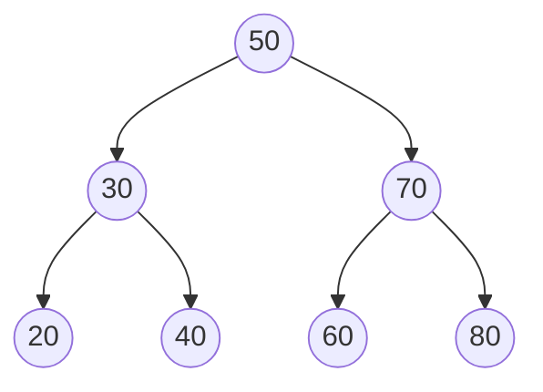

# Árvores binárias e árvores binárias de busca

## Por que isso importa

Muita coisa no mundo é **hierárquica**: pastas dentro de pastas, o HTML de uma página (a árvore DOM), o organograma de uma empresa, o código que o compilador lê (árvore sintática), as jogadas possíveis num jogo. Árvores representam isso. E a **árvore binária de busca** junta o melhor de dois mundos: busca rápida como a busca binária **e** inserção rápida, mantendo tudo **em ordem**, o que a tabela hash não faz. Bancos de dados (índices B-tree), o `TreeMap` do Java e o `std::map` do C++ são árvores de busca.

## Intuição

Uma **árvore genealógica de cabeça para baixo**: lá em cima, a **raiz** (o ancestral); cada pessoa tem filhos embaixo; quem não tem filhos é uma **folha**.

A **árvore binária de busca** é o jogo de **adivinhar o número** com dicas: "é maior ou menor que 50?". Menor, vai para a esquerda; maior, vai para a direita. A cada pergunta você descarta um lado inteiro da árvore, como na busca binária.

## Visual

Uma BST com os valores 50, 30, 70, 20, 40, 60, 80 (inseridos nessa ordem):



```
Vocabulário (usando a árvore acima):
  raiz ........... 50
  folhas ......... 20, 40, 60, 80 (sem filhos)
  filhos de 30 ... 20 (esquerdo) e 40 (direito)
  altura ......... 2 (arestas no caminho mais longo da raiz até uma folha)
  profundidade de 40 ... 2 (arestas da raiz até ele)
  subárvore esquerda de 50 ... a árvore com raiz 30

Buscar 60:  50 → (60 > 50) direita → 70 → (60 < 70) esquerda → 60 ✓   3 comparações
```

Os quatro percursos da mesma árvore:

```
pré-ordem  (raiz, esq, dir):  50 30 20 40 70 60 80
em ordem   (esq, raiz, dir):  20 30 40 50 60 70 80   ← numa BST, sai ORDENADO!
pós-ordem  (esq, dir, raiz):  20 40 30 60 80 70 50
por nível  (largura):         50 30 70 20 40 60 80
```

A mesma BST, se os valores forem inseridos já ordenados (20, 30, 40, ...), degenera numa "lista":

```
20
  \
   30
     \
      40          altura 6 para 7 nós: buscar vira O(n)
        \
         ...
```

## Conceito técnico

### Árvore binária

Cada nó tem um valor e **no máximo dois filhos**: `esq` e `dir`. Uma árvore é **vazia** (`None`) ou um nó cujos filhos são, eles mesmos, árvores. Essa definição **recursiva** é a chave: quase toda função sobre árvores é recursiva e segue o mesmo molde:

```python
def f(no):
    if no is None:          # caso base: árvore vazia
        return ...          # (0, [], False, ... depende da pergunta)
    a = f(no.esq)           # resolve a subárvore esquerda
    b = f(no.dir)           # resolve a subárvore direita
    return combina(no.valor, a, b)
```

Por exemplo, a **altura**: vazia tem altura −1 (ou 0, se você contar nós em vez de arestas); senão é `1 + max(altura(esq), altura(dir))`.

### Percursos

- **Em profundidade** (recursivos): pré-ordem (copiar a árvore, imprimir estrutura de pastas), **em ordem** (numa BST, devolve os valores ordenados), pós-ordem (apagar a árvore, calcular o tamanho de pastas: os filhos antes do pai).
- **Por nível** (em largura): usa uma **fila** (ED-02). Mostra a árvore andar por andar. É a base da BFS em grafos (AL-05).

### Árvore binária de busca (BST)

Propriedade, válida para **todo** nó:

> todos os valores da subárvore **esquerda** são **menores** que o nó, e todos da **direita** são **maiores**.

| Operação | Como | Custo |
|---|---|---|
| Buscar | compara e desce para um lado só | O(h) |
| Inserir | desce como na busca e pendura o novo nó onde achou `None` | O(h) |
| Mínimo / máximo | desce sempre para a esquerda / direita | O(h) |
| Listar em ordem | percurso em ordem | O(n) |
| Remover | três casos (abaixo) | O(h) |

**h** é a altura. Numa árvore **balanceada**, h ≈ log₂ n (1 milhão de nós → ~20 níveis). Numa **degenerada** (valores inseridos em ordem), h = n − 1 e tudo vira O(n).

**Remover** um nó:

1. **Folha**: basta tirá-la (o pai passa a apontar para `None`).
2. **Um filho**: o pai passa a apontar para esse filho.
3. **Dois filhos**: troque o valor pelo do **sucessor** (o menor da subárvore direita), e remova o sucessor, que cai no caso 1 ou 2.

### Balanceamento

Árvores **autobalanceadas** fazem pequenas **rotações** a cada inserção e remoção para garantir h = O(log n) sempre:

- **AVL**: a diferença de altura entre as subárvores de cada nó é no máximo 1.
- **Rubro-negra**: regras de cor que mantêm a árvore "quase" balanceada; usada no `TreeMap` do Java e no `std::map` do C++.
- **B-tree**: muitos filhos por nó, feita para disco; é o índice dos bancos de dados (BD-04).

### BST × tabela hash

| | Tabela hash | BST balanceada |
|---|---|---|
| Buscar / inserir | O(1) médio | O(log n) |
| Mantém ordem | não | **sim** |
| Menor, maior, "próximo depois de x", intervalo [a, b] | O(n) | **O(log n)** |

Precisa só de "existe?" → hash. Precisa de ordem ou de intervalos → árvore.

## Código

Uma BST com inserção, busca, percurso em ordem e altura:

```python
class No:
    def __init__(self, valor):
        self.valor = valor
        self.esq = None
        self.dir = None


def inserir(raiz, valor):
    """Insere e devolve a raiz (que só muda se a árvore estava vazia)."""
    if raiz is None:
        return No(valor)
    if valor < raiz.valor:
        raiz.esq = inserir(raiz.esq, valor)
    elif valor > raiz.valor:
        raiz.dir = inserir(raiz.dir, valor)
    return raiz                    # valores repetidos são ignorados


def buscar(raiz, valor):
    atual = raiz
    while atual is not None:
        if valor == atual.valor:
            return True
        atual = atual.esq if valor < atual.valor else atual.dir
    return False


def em_ordem(raiz):
    if raiz is None:
        return []
    return em_ordem(raiz.esq) + [raiz.valor] + em_ordem(raiz.dir)


def altura(raiz):
    if raiz is None:
        return -1
    return 1 + max(altura(raiz.esq), altura(raiz.dir))


raiz = None
for v in [50, 30, 70, 20, 40, 60, 80]:
    raiz = inserir(raiz, v)
print(em_ordem(raiz))                  # [20, 30, 40, 50, 60, 70, 80]
print(buscar(raiz, 60), buscar(raiz, 65))   # True False
print(altura(raiz))                    # 2

degenerada = None
for v in [20, 30, 40, 50, 60, 70, 80]:
    degenerada = inserir(degenerada, v)
print(altura(degenerada))              # 6: virou uma lista
```

Percurso por nível com uma fila:

```python
from collections import deque


def por_nivel(raiz):
    if raiz is None:
        return []
    saida = []
    fila = deque([raiz])
    while fila:
        no = fila.popleft()
        saida.append(no.valor)
        if no.esq:
            fila.append(no.esq)
        if no.dir:
            fila.append(no.dir)
    return saida


print(por_nivel(raiz))   # [50, 30, 70, 20, 40, 60, 80]
```

## Erros comuns

- **Esquecer o caso base `if no is None`** na recursão: `AttributeError` ao acessar `.esq` de `None`.
- **Validar uma BST olhando só os filhos diretos.** A regra vale para a **subárvore inteira**: um 55 na subárvore esquerda de 50, mesmo como filho direito do 30, quebra a BST.
- **Achar que BST é sempre O(log n).** Só se estiver balanceada; inserir dados já ordenados degenera.
- **Esquecer de reatribuir o retorno** na inserção recursiva (`inserir(raiz.esq, v)` sem `raiz.esq = ...`): o nó novo se perde.
- **Confundir altura e profundidade.** Altura mede para baixo (até a folha mais funda); profundidade, para cima (até a raiz).

## Pratique

```quiz
id: ED-05-q1
tipo: multipla_escolha
pergunta: "Qual percurso de uma BST devolve os valores em ordem crescente?"
opcoes: ["Pré-ordem", "Em ordem (esquerda, raiz, direita)", "Pós-ordem", "Por nível"]
resposta: 1
explicacao: "Em ordem visita toda a subárvore esquerda (os menores), depois o nó, depois a direita (os maiores). Pela propriedade da BST, isso produz exatamente a sequência ordenada."
dificuldade: 1
```

```quiz
id: ED-05-q2
tipo: multipla_escolha
pergunta: "Você insere 1, 2, 3, 4, 5, 6, 7, nessa ordem, numa BST simples (sem balanceamento). Qual a altura da árvore?"
opcoes: ["2", "3", "6", "7"]
resposta: 2
explicacao: "Cada valor é maior que todos os anteriores, então sempre vai para a direita: a árvore vira uma 'lista' com 7 nós e 6 arestas de altura. Com os mesmos valores inseridos na ordem 4, 2, 6, 1, 3, 5, 7, a altura seria 2."
dificuldade: 2
```

```quiz
id: ED-05-q3
tipo: prever_saida
pergunta: |
  Para a árvore abaixo, quais são os percursos em pré-ordem e pós-ordem?
  ```
        8
       / \
      3   10
     / \    \
    1   6    14
  ```
resposta: "Pré-ordem: 8 3 1 6 10 14. Pós-ordem: 1 6 3 14 10 8."
explicacao: "Pré-ordem visita a raiz antes dos filhos (8, depois toda a esquerda 3 1 6, depois a direita 10 14). Pós-ordem visita os filhos antes da raiz, então a raiz 8 é a última."
dificuldade: 2
```

```quiz
id: ED-05-q4
tipo: verdadeiro_falso
pergunta: "Para saber se uma árvore é uma BST, basta conferir, em cada nó, que o filho esquerdo é menor e o filho direito é maior que ele."
resposta: false
explicacao: "A regra vale para subárvores inteiras. Exemplo: raiz 50, filho esquerdo 30, e o 30 tem filho direito 55. Cada pai e filho direto 'parece' certo, mas 55 está à esquerda de 50, o que quebra a BST. É preciso carregar os limites mínimo e máximo na recursão."
dificuldade: 2
```

```quiz
id: ED-05-q5
tipo: multipla_escolha
pergunta: "Ao remover de uma BST um nó com dois filhos, o que se faz?"
opcoes: ["Remove o nó e toda a subárvore dele", "Troca o valor pelo do sucessor (menor da subárvore direita) e remove o sucessor", "Sobe o filho esquerdo e descarta o direito", "Não é possível remover"]
resposta: 1
explicacao: "O sucessor em ordem é o menor valor maior que o nó: colocá-lo no lugar mantém a propriedade da BST. Ele tem no máximo um filho (não tem filho esquerdo), então removê-lo cai num caso simples."
dificuldade: 2
```

```quiz
id: ED-05-q6
tipo: resposta_curta
pergunta: "Quando escolher uma BST balanceada em vez de uma tabela hash?"
resposta: "Quando precisar de ordem: listar os itens ordenados, achar o menor ou o maior, o próximo depois de um valor, ou todos os itens num intervalo. A hash é mais rápida para só verificar existência (O(1) contra O(log n)), mas não mantém ordem."
palavras_chave: ["ordem", "intervalo", "menor", "log"]
dificuldade: 2
```

```quiz
id: ED-05-q7
tipo: codigo
linguagem: python
pergunta: |
  **Recursão em árvores.** Escreva `altura(no)` (árvore vazia tem altura −1 e uma folha tem altura 0), `contar_folhas(no)` e `soma(no)`, todas **recursivas**. A classe `No` e a função `montar_bst` (pronta) estão no editor.
codigo_inicial: |
  class No:
      def __init__(self, valor, esq=None, dir=None):
          self.valor = valor
          self.esq = esq
          self.dir = dir


  def montar_bst(valores):
      raiz = None
      for v in valores:
          raiz = _inserir(raiz, v)
      return raiz


  def _inserir(no, v):
      if no is None:
          return No(v)
      if v < no.valor:
          no.esq = _inserir(no.esq, v)
      else:
          no.dir = _inserir(no.dir, v)
      return no


  def altura(no):
      pass


  def contar_folhas(no):
      pass


  def soma(no):
      pass
usa: [def, if, return, altura, contar_folhas, soma]
testes:
  - chamada: "altura(montar_bst([50, 30, 70, 20, 40, 60, 80]))"
    saida: "2"
  - chamada: "contar_folhas(montar_bst([50, 30, 70, 20, 40, 60, 80]))"
    saida: "4"
  - chamada: "soma(montar_bst([50, 30, 70, 20, 40, 60, 80]))"
    saida: "350"
  - chamada: "(altura(None), contar_folhas(None), soma(None))"
    saida: "(-1, 0, 0)"
  - chamada: "(altura(montar_bst([1, 2, 3, 4])), contar_folhas(montar_bst([1, 2, 3, 4])))"
    visivel: false
    saida: "(3, 1)"
  - chamada: "(altura(montar_bst([7])), contar_folhas(montar_bst([7])), soma(montar_bst([5, 3, 8, 1])))"
    visivel: false
    saida: "(0, 1, 17)"
dica: "Molde: if no is None: return (valor da árvore vazia). Altura: 1 + max(altura(esq), altura(dir)). Folhas: se os dois filhos são None, é 1; senão, folhas da esquerda + da direita. Soma: valor + soma(esq) + soma(dir)."
solucao: |
  class No:
      def __init__(self, valor, esq=None, dir=None):
          self.valor = valor
          self.esq = esq
          self.dir = dir


  def montar_bst(valores):
      raiz = None
      for v in valores:
          raiz = _inserir(raiz, v)
      return raiz


  def _inserir(no, v):
      if no is None:
          return No(v)
      if v < no.valor:
          no.esq = _inserir(no.esq, v)
      else:
          no.dir = _inserir(no.dir, v)
      return no


  def altura(no):
      if no is None:
          return -1
      return 1 + max(altura(no.esq), altura(no.dir))


  def contar_folhas(no):
      if no is None:
          return 0
      if no.esq is None and no.dir is None:
          return 1
      return contar_folhas(no.esq) + contar_folhas(no.dir)


  def soma(no):
      if no is None:
          return 0
      return no.valor + soma(no.esq) + soma(no.dir)
explicacao: "As três seguem o mesmo molde: caso base para a árvore vazia e uma combinação dos resultados das duas subárvores. Com −1 para a vazia, uma folha dá 1 + max(−1, −1) = 0. Inserir 1, 2, 3, 4 em ordem gera uma árvore degenerada de altura 3 com uma única folha."
dificuldade: 2
```

```quiz
id: ED-05-q8
tipo: codigo
linguagem: python
pergunta: |
  **Inserir e listar em ordem.** Escreva `inserir(raiz, valor)` para uma BST (ignorando repetidos, devolvendo a raiz) e `em_ordem(raiz)` que devolve a lista de valores em ordem crescente. Com elas, `ordenar(valores)` (pronta) ordena qualquer lista: é o *tree sort*.
codigo_inicial: |
  class No:
      def __init__(self, valor):
          self.valor = valor
          self.esq = None
          self.dir = None


  def inserir(raiz, valor):
      pass


  def em_ordem(raiz):
      pass


  # não mude: os testes usam esta função
  def ordenar(valores):
      raiz = None
      for v in valores:
          raiz = inserir(raiz, v)
      return em_ordem(raiz)
usa: [def, return, inserir, em_ordem]
testes:
  - chamada: "ordenar([50, 30, 70, 20, 40, 60, 80])"
    saida: "[20, 30, 40, 50, 60, 70, 80]"
  - chamada: "ordenar([])"
    saida: "[]"
  - chamada: "ordenar([3, 1, 3, 2, 1])"
    saida: "[1, 2, 3]"
  - chamada: "ordenar(['pera', 'uva', 'kiwi', 'abacate'])"
    visivel: false
    saida: "['abacate', 'kiwi', 'pera', 'uva']"
  - chamada: "ordenar([9, -4, 0, 12, -10, 7])"
    visivel: false
    saida: "[-10, -4, 0, 7, 9, 12]"
dica: "inserir: se raiz é None, devolva No(valor); se valor < raiz.valor, raiz.esq = inserir(raiz.esq, valor); se maior, o mesmo à direita; devolva raiz. em_ordem: vazia é []; senão em_ordem(esq) + [valor] + em_ordem(dir)."
solucao: |
  class No:
      def __init__(self, valor):
          self.valor = valor
          self.esq = None
          self.dir = None


  def inserir(raiz, valor):
      if raiz is None:
          return No(valor)
      if valor < raiz.valor:
          raiz.esq = inserir(raiz.esq, valor)
      elif valor > raiz.valor:
          raiz.dir = inserir(raiz.dir, valor)
      return raiz


  def em_ordem(raiz):
      if raiz is None:
          return []
      return em_ordem(raiz.esq) + [raiz.valor] + em_ordem(raiz.dir)


  # não mude: os testes usam esta função
  def ordenar(valores):
      raiz = None
      for v in valores:
          raiz = inserir(raiz, v)
      return em_ordem(raiz)
explicacao: "O raiz.esq = inserir(raiz.esq, valor) é o detalhe importante: quando a subárvore está vazia, inserir devolve o nó novo, e a atribuição o pendura no pai. Como a BST só compara com < e >, funciona com textos também. Valores iguais não entram (nem à esquerda nem à direita)."
dificuldade: 2
```

```quiz
id: ED-05-q9
tipo: codigo
linguagem: python
pergunta: |
  **Validar uma BST.** Escreva `eh_bst(no)` que devolve `True` se a árvore respeita a propriedade da BST **em todas as subárvores** (valores distintos). Cuidado com a pegadinha da pergunta de verdadeiro ou falso acima: olhar só pai e filho não basta.
codigo_inicial: |
  class No:
      def __init__(self, valor, esq=None, dir=None):
          self.valor = valor
          self.esq = esq
          self.dir = dir


  def eh_bst(no):
      pass
usa: [def, return, if]
testes:
  - chamada: "eh_bst(No(50, No(30, No(20), No(40)), No(70, No(60), No(80))))"
    saida: "True"
  - chamada: "eh_bst(No(50, No(30, No(20), No(55)), No(70)))"
    saida: "False"
  - chamada: "eh_bst(None)"
    saida: "True"
  - chamada: "eh_bst(No(10, No(5), No(8)))"
    visivel: false
    saida: "False"
  - chamada: "eh_bst(No(10, None, No(20, No(15, No(12)), No(25))))"
    visivel: false
    saida: "True"
  - chamada: "eh_bst(No(10, None, No(20, No(5), None)))"
    visivel: false
    saida: "False"
dica: "Crie uma função auxiliar valida(no, minimo, maximo): se no é None, True; se no.valor não está estritamente entre minimo e maximo, False; senão valida a esquerda com (minimo, no.valor) e a direita com (no.valor, maximo). Comece com float('-inf') e float('inf')."
solucao: |
  class No:
      def __init__(self, valor, esq=None, dir=None):
          self.valor = valor
          self.esq = esq
          self.dir = dir


  def eh_bst(no):
      return _valida(no, float("-inf"), float("inf"))


  def _valida(no, minimo, maximo):
      if no is None:
          return True
      if not (minimo < no.valor < maximo):
          return False
      return _valida(no.esq, minimo, no.valor) and _valida(no.dir, no.valor, maximo)
explicacao: "Cada nó herda um intervalo permitido: ao descer para a esquerda, o máximo vira o valor do pai; para a direita, o mínimo vira o valor do pai. Assim o 55 abaixo do 30 é recusado, porque precisa ser menor que 50. Outra solução: conferir se o percurso em ordem sai estritamente crescente."
dificuldade: 3
```

```quiz
id: ED-05-q10
tipo: codigo
linguagem: python
pergunta: |
  **Árvore por níveis.** Escreva `niveis(raiz)` que devolve uma lista de listas, uma por nível, da esquerda para a direita. Para a BST de 50, 30, 70, 20, 40, 60, 80, devolve `[[50], [30, 70], [20, 40, 60, 80]]`. Use uma fila (`collections.deque`).
codigo_inicial: |
  from collections import deque


  class No:
      def __init__(self, valor, esq=None, dir=None):
          self.valor = valor
          self.esq = esq
          self.dir = dir


  def niveis(raiz):
      pass
usa: [def, while, popleft, return]
testes:
  - chamada: "niveis(No(50, No(30, No(20), No(40)), No(70, No(60), No(80))))"
    saida: "[[50], [30, 70], [20, 40, 60, 80]]"
  - chamada: "niveis(None)"
    saida: "[]"
  - chamada: "niveis(No(1, No(2, No(4)), No(3, None, No(5, No(6)))))"
    visivel: false
    saida: "[[1], [2, 3], [4, 5], [6]]"
dica: "Comece com fila = deque([raiz]). Enquanto a fila não estiver vazia: o tamanho atual da fila é exatamente o número de nós deste nível. Tire esse tanto de nós com popleft, guarde os valores numa lista do nível e enfileire os filhos que existirem."
solucao: |
  from collections import deque


  class No:
      def __init__(self, valor, esq=None, dir=None):
          self.valor = valor
          self.esq = esq
          self.dir = dir


  def niveis(raiz):
      if raiz is None:
          return []
      resultado = []
      fila = deque([raiz])
      while fila:
          nivel = []
          for _ in range(len(fila)):
              no = fila.popleft()
              nivel.append(no.valor)
              if no.esq is not None:
                  fila.append(no.esq)
              if no.dir is not None:
                  fila.append(no.dir)
          resultado.append(nivel)
      return resultado
explicacao: "A fila garante que os nós saem na ordem em que foram descobertos, andar por andar. O truque de ler len(fila) no início de cada nível separa os níveis. É a mesma BFS que você vai usar em grafos para achar o caminho mais curto (AL-05)."
dificuldade: 3
```

## Resumo

- Árvore binária: cada nó tem até dois filhos; vocabulário de **raiz, folha, altura, profundidade**.
- Funções sobre árvores são **recursivas**: caso base `None` + combinar esquerda e direita.
- Percursos: **pré**, **em ordem** (ordenado na BST), **pós** (recursivos) e **por nível** (com fila).
- **BST**: esquerda < nó < direita em **toda** subárvore; buscar, inserir e remover em **O(h)**.
- Balanceada: h ≈ log n. Degenerada (inserção ordenada): O(n). **AVL** e **rubro-negra** se rebalanceiam com rotações.

## Para ir além

- Desafio extra: implemente a remoção na BST com os três casos.
- Visualize inserções e rotações em **visualgo.net/pt/bst**.
- **Próximos módulos**: ED-06 Árvores balanceadas (AVL e rubro-negra) e ED-07 Heaps; no seu caminho, AL-01 Busca linear e binária.
