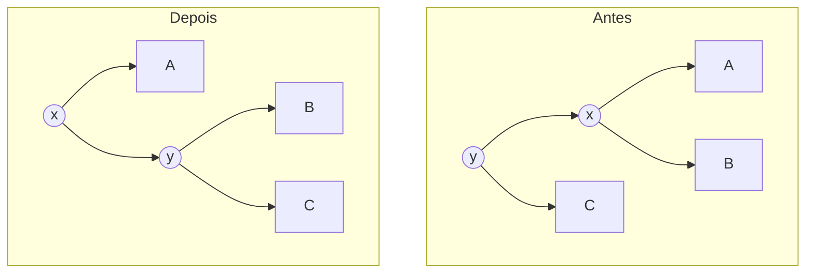

# Árvores balanceadas: AVL e rubro-negra

## Por que isso importa

Em ED-05 você viu que a BST busca, insere e remove em O(altura). O problema: se os itens chegam **em ordem** (1, 2, 3, 4...), cada um vai para a direita do anterior e a árvore vira uma **lista ligada** com altura n. Tudo fica O(n). E dados chegando em ordem são comuns: IDs crescentes, datas, nomes já ordenados. As árvores **balanceadas** se reorganizam sozinhas a cada inserção para manter a altura em **O(log n)**, sempre. Com 1 bilhão de itens, isso é a diferença entre ~30 passos e 1 bilhão. É o que está dentro do `TreeMap` do Java, do `std::map` do C++, do agendador de processos do Linux e dos índices de muitos bancos de dados.

## Intuição

Pense num **móbile** pendurado no teto. Se um lado fica muito mais pesado, ele tomba. Para endireitar, você **gira** o ponto de apoio: o lado pesado sobe, o leve desce, e a ordem dos objetos da esquerda para a direita continua a mesma.

Uma árvore balanceada faz isso: depois de cada inserção, ela confere se algum nó ficou "torto" demais e, se ficou, faz uma **rotação**. A rotação muda quem é pai de quem, mas **não muda a ordem** dos valores, então a árvore continua sendo uma BST válida.

## Visual

Inserindo 1, 2, 3 numa BST comum e numa AVL:

```text
BST comum             AVL
1                     depois do 3, o nó 1 fica torto (direita 2 níveis mais alta)
 \                    rotação à esquerda no 1:
  2                         2
   \                       / \
    3                     1   3
altura 2 (lista)      altura 1 (balanceada)
```

Rotação à direita em y (o filho esquerdo x sobe):



A, B e C são subárvores. Em ordem: A < x < B < y < C, antes e depois. Só a subárvore **B** muda de pai: era filha direita de x e vira filha esquerda de y.

## Conceito técnico

### Altura e fator de balanceamento

- **Altura** de um nó: número de arestas no caminho mais longo até uma folha. Convenção: folha tem altura 0, árvore vazia tem altura −1.
- **Fator de balanceamento**: fb(n) = altura(esquerda) − altura(direita).

### Árvore AVL

(Adelson-Velsky e Landis, 1962.) Uma BST em que **todo nó** tem fb ∈ {−1, 0, +1}: as alturas das duas subárvores diferem no máximo em 1.

Isso garante altura ≤ ~1,44 · log₂ n. A menor AVL de altura h tem N(h) = N(h − 1) + N(h − 2) + 1 nós, uma recorrência parecida com Fibonacci (MD-07), que cresce exponencialmente. Logo a altura cresce só logaritmicamente.

### Inserção AVL

1. Insira como numa BST comum.
2. Na volta da recursão, atualize a altura de cada ancestral.
3. Se algum nó ficou com |fb| = 2, aplique uma das **quatro** correções:

| Caso | Situação | Correção |
|---|---|---|
| **LL** | fb = +2 e o filho esquerdo pende à esquerda (fb ≥ 0) | rotação à **direita** no nó |
| **RR** | fb = −2 e o filho direito pende à direita (fb ≤ 0) | rotação à **esquerda** no nó |
| **LR** | fb = +2 e o filho esquerdo pende à direita (fb < 0) | rotação à esquerda no filho, depois à direita no nó |
| **RL** | fb = −2 e o filho direito pende à esquerda (fb > 0) | rotação à direita no filho, depois à esquerda no nó |

Os casos LR e RL são **zigue-zagues**: uma rotação só não resolve, porque o neto do meio precisa subir duas posições. Exemplo LR: inserir 3, 1, 2.

```text
    3            3            2
   /            /            / \
  1     →      2     →      1   3
   \          /
    2        1
 (zigue-zague)  rot. esq. no 1   rot. dir. no 3
```

Cada rotação é O(1) (troca alguns ponteiros). A inserção inteira é **O(log n)**: descer, subir atualizando alturas e, no máximo, uma correção (simples ou dupla).

A remoção segue a mesma ideia, mas pode precisar de rotações em vários níveis na subida. Continua O(log n).

### Árvore rubro-negra

Outra forma de balancear, com regras mais "frouxas". Cada nó é **vermelho** ou **preto**:

1. A raiz é preta.
2. As folhas nulas (os `None`) contam como pretas.
3. Um nó vermelho não tem filho vermelho (sem dois vermelhos seguidos).
4. Todo caminho de um nó até as folhas nulas abaixo dele tem o **mesmo número de nós pretos** (a "altura negra").

Consequência: o caminho mais longo (alternando preto e vermelho) é no máximo **o dobro** do mais curto (só pretos). Altura ≤ 2 · log₂(n + 1).

Inserir: o nó novo entra **vermelho**. Se o pai também for vermelho (quebra a regra 3), conserte **recolorindo** (se o "tio" for vermelho) ou **rotacionando** (se o tio for preto). As regras exatas são longas; o importante é saber que cada inserção faz no máximo **2 rotações**.

### AVL ou rubro-negra?

| | AVL | Rubro-negra |
|---|---|---|
| Altura máxima | ~1,44 log n (mais baixa) | ~2 log n |
| Busca | um pouco mais rápida | um pouco mais lenta |
| Inserção/remoção | mais rotações | menos rotações (no máximo 2 na inserção, 3 na remoção) |
| Usada em | bancos em memória, leitura intensa | `TreeMap` (Java), `std::map` (C++), escalonador CFS do Linux |

Ambas garantem O(log n) para buscar, inserir e remover. Para dados em **disco** (bancos de dados, sistemas de arquivos), a escolha é outra: a **B-tree** (ED-09), que tem muitos filhos por nó.

### E o Python?

Python não tem uma árvore balanceada na biblioteca padrão. Para "dicionário ordenado por chave" ou "achar o próximo maior que x", use o módulo `bisect` numa lista ordenada (inserção O(n), mas muito rápida na prática) ou o pacote externo `sortedcontainers`.

## Código

Uma AVL completa, com inserção e altura guardada em cada nó:

```python
class No:
    def __init__(self, valor):
        self.valor = valor
        self.esq = None
        self.dir = None
        self.altura = 0


def h(n):
    return n.altura if n else -1


def atualizar(n):
    n.altura = 1 + max(h(n.esq), h(n.dir))


def rot_dir(y):
    x = y.esq
    y.esq = x.dir
    x.dir = y
    atualizar(y)
    atualizar(x)
    return x


def rot_esq(x):
    y = x.dir
    x.dir = y.esq
    y.esq = x
    atualizar(x)
    atualizar(y)
    return y


def inserir(n, valor):
    if n is None:
        return No(valor)
    if valor < n.valor:
        n.esq = inserir(n.esq, valor)
    else:
        n.dir = inserir(n.dir, valor)
    atualizar(n)
    fb = h(n.esq) - h(n.dir)
    if fb > 1:
        if h(n.esq.esq) < h(n.esq.dir):      # LR
            n.esq = rot_esq(n.esq)
        return rot_dir(n)                    # LL
    if fb < -1:
        if h(n.dir.dir) < h(n.dir.esq):      # RL
            n.dir = rot_dir(n.dir)
        return rot_esq(n)                    # RR
    return n


raiz = None
for v in range(1, 1001):          # o pior caso de uma BST comum
    raiz = inserir(raiz, v)
print("altura:", raiz.altura)     # 9 (uma BST comum teria 999)
```

## Erros comuns

- **Esquecer de devolver a nova raiz** da rotação e de ligá-la no pai (`n.esq = rot_esq(n.esq)`). A subárvore rotacionada "some".
- **Atualizar as alturas na ordem errada** depois de rotacionar. Primeiro o nó que **desceu**, depois o que **subiu** (que agora é pai dele).
- **Usar rotação simples num zigue-zague** (LR/RL). A árvore continua desbalanceada, só que para o outro lado.
- **Confundir altura de árvore vazia**: com a convenção folha = 0, vazia tem que ser −1, senão o fator de balanceamento sai errado.
- **Achar que balanceada significa "completa"** ou "perfeita". A AVL permite diferença de 1 em cada nó, e isso se acumula: as folhas podem estar em níveis bem diferentes.
- **Implementar sua própria árvore balanceada em produção.** Use a da linguagem ou uma biblioteca testada; implemente para aprender.

## Pratique

```quiz
id: ED-06-q1
tipo: multipla_escolha
pergunta: "Inserindo 1, 2, 3, ..., 1000 em ordem numa BST comum (sem balanceamento), qual é a altura final?"
opcoes: ["~10", "~20", "500", "999"]
resposta: 3
explicacao: "Cada número é maior que todos os anteriores e vai sempre para a direita: a árvore vira uma lista com 1000 nós e altura 999. Numa AVL, a mesma sequência dá altura 9."
dificuldade: 1
```

```quiz
id: ED-06-q2
tipo: multipla_escolha
pergunta: "Um nó tem subárvore esquerda de altura 3 e direita de altura 1. Qual é o fator de balanceamento e a árvore é AVL?"
opcoes: ["fb = 2, não é AVL", "fb = −2, não é AVL", "fb = 2, é AVL", "fb = 1, é AVL"]
resposta: 0
explicacao: "fb = altura(esq) − altura(dir) = 3 − 1 = 2. A AVL exige |fb| ≤ 1 em todo nó, então este nó precisa de uma rotação (à direita, se o filho esquerdo pender à esquerda)."
dificuldade: 1
```

```quiz
id: ED-06-q3
tipo: multipla_escolha
pergunta: "Numa AVL vazia, você insere 30, 10 e 20, nessa ordem. Que correção é necessária?"
opcoes: ["Nenhuma", "Rotação simples à direita no 30 (LL)", "Rotação à esquerda no 10 e depois à direita no 30 (LR)", "Rotação simples à esquerda no 30 (RR)"]
resposta: 2
explicacao: "30 tem o 10 à esquerda, e o 20 entra à direita do 10: um zigue-zague esquerda-direita. Primeiro gira à esquerda no 10 (o 20 sobe), depois à direita no 30. Resultado: 20 na raiz, com 10 e 30 como filhos."
dificuldade: 2
```

```quiz
id: ED-06-q4
tipo: verdadeiro_falso
pergunta: "Uma rotação muda a ordem em que os valores aparecem num percurso em ordem (in-order)."
resposta: false
explicacao: "A rotação só reorganiza quem é pai de quem, preservando A < x < B < y < C. Por isso a árvore continua sendo uma BST válida e o percurso em ordem é exatamente o mesmo antes e depois."
dificuldade: 1
```

```quiz
id: ED-06-q5
tipo: multipla_escolha
pergunta: "Qual regra da árvore rubro-negra garante que nenhum caminho é mais que o dobro de outro?"
opcoes: ["A raiz é preta", "Nós novos entram vermelhos", "Sem dois vermelhos seguidos + mesmo número de pretos em todo caminho", "Toda folha é vermelha"]
resposta: 2
explicacao: "Todos os caminhos têm o mesmo número de pretos (b). O mais curto tem só pretos: b nós. O mais longo alterna preto e vermelho, já que não pode ter dois vermelhos seguidos: no máximo 2b nós."
dificuldade: 2
```

```quiz
id: ED-06-q6
tipo: resposta_curta
pergunta: "Por que uma rotação simples não resolve o caso LR (zigue-zague)?"
resposta: "Porque o nó que precisa subir é o neto do meio, que está à direita do filho esquerdo. Uma rotação à direita na raiz só subiria o filho esquerdo e levaria o neto junto para o outro lado, deixando a árvore desbalanceada no sentido oposto. A primeira rotação (à esquerda no filho) transforma o zigue-zague numa linha reta (caso LL), que a segunda rotação resolve."
palavras_chave: ["neto", "linha reta", "duas rotações", "LL"]
dificuldade: 3
```

```quiz
id: ED-06-q7
tipo: codigo
linguagem: python
pergunta: |
  **É AVL?** Escreva `eh_avl(n)` que recebe a raiz de uma árvore (nós com `valor`, `esq` e `dir`) e devolve `True` se **todo** nó tem fator de balanceamento entre −1 e 1. (Não precisa conferir a ordem da BST.) Faça em uma passada, O(n): uma função auxiliar que devolve a altura ou `None` se achar um desbalanceamento.
codigo_inicial: |
  class No:
      def __init__(self, valor, esq=None, dir=None):
          self.valor = valor
          self.esq = esq
          self.dir = dir


  def eh_avl(n):
      return True
usa: [def, return]
testes:
  - chamada: "eh_avl(No(2, No(1), No(3)))"
    saida: "True"
  - chamada: "eh_avl(No(1, None, No(2, None, No(3))))"
    saida: "False"
  - chamada: "eh_avl(None)"
    saida: "True"
  - chamada: "eh_avl(No(5, No(3, No(2, No(1))), No(8)))"
    saida: "False"
  - chamada: "eh_avl(No(5, No(3, No(2), No(4)), No(8, None, No(9))))"
    visivel: false
    saida: "True"
  - chamada: "eh_avl(No(10, No(5, No(3), No(7)), No(20, None, None)))"
    visivel: false
    saida: "True"
dica: "def altura(n): se n is None, devolva -1. he = altura(n.esq); hd = altura(n.dir); se algum for None ou abs(he - hd) > 1, devolva None; senão 1 + max(he, hd). eh_avl devolve altura(n) is not None."
solucao: |
  class No:
      def __init__(self, valor, esq=None, dir=None):
          self.valor = valor
          self.esq = esq
          self.dir = dir


  def eh_avl(n):
      def altura(n):
          if n is None:
              return -1
          he = altura(n.esq)
          hd = altura(n.dir)
          if he is None or hd is None or abs(he - hd) > 1:
              return None
          return 1 + max(he, hd)

      return altura(n) is not None
explicacao: "No quarto teste, o nó 3 tem à esquerda uma subárvore de altura 1 (2 → 1) e à direita nada (altura −1): diferença 2. A raiz também falha (altura 2 contra 0). Basta um nó fora da regra para não ser AVL. Calcular a altura de cada nó separadamente seria O(n²); devolver 'altura ou falha' numa só recursão é O(n)."
dificuldade: 2
```

```quiz
id: ED-06-q8
tipo: codigo
linguagem: python
pergunta: |
  **Rotações.** Complete `rot_dir(y)` e `rot_esq(x)`: cada uma recebe a raiz de uma subárvore, faz a rotação e devolve a **nova raiz**. Os nós têm `valor`, `esq` e `dir` (sem altura).
codigo_inicial: |
  class No:
      def __init__(self, valor, esq=None, dir=None):
          self.valor = valor
          self.esq = esq
          self.dir = dir


  def rot_dir(y):
      return y


  def rot_esq(x):
      return x


  # não mude: os testes usam esta função
  def forma(n):
      if n is None:
          return None
      return (n.valor, forma(n.esq), forma(n.dir))
usa: [def, return]
testes:
  - chamada: "forma(rot_dir(No(3, No(2, No(1)))))"
    saida: "(2, (1, None, None), (3, None, None))"
  - chamada: "forma(rot_esq(No(1, None, No(2, None, No(3)))))"
    saida: "(2, (1, None, None), (3, None, None))"
  - chamada: "forma(rot_dir(No('y', No('x', No('A'), No('B')), No('C'))))"
    saida: "('x', ('A', None, None), ('y', ('B', None, None), ('C', None, None)))"
  - chamada: "forma(rot_esq(rot_dir(No(4, No(2, No(1), No(3)), No(5)))))"
    visivel: false
    saida: "(4, (2, (1, None, None), (3, None, None)), (5, None, None))"
dica: "rot_dir(y): x = y.esq; y.esq = x.dir; x.dir = y; devolva x. rot_esq(x) é o espelho: y = x.dir; x.dir = y.esq; y.esq = x; devolva y."
solucao: |
  class No:
      def __init__(self, valor, esq=None, dir=None):
          self.valor = valor
          self.esq = esq
          self.dir = dir


  def rot_dir(y):
      x = y.esq
      y.esq = x.dir
      x.dir = y
      return x


  def rot_esq(x):
      y = x.dir
      x.dir = y.esq
      y.esq = x
      return y


  # não mude: os testes usam esta função
  def forma(n):
      if n is None:
          return None
      return (n.valor, forma(n.esq), forma(n.dir))
explicacao: "São só três atribuições, mas a ordem importa: primeiro guarde x, depois passe a subárvore B (x.dir) para y.esq, e só então pendure y em x. O teste oculto mostra que rot_esq desfaz rot_dir: as rotações são inversas uma da outra."
dificuldade: 2
```

```quiz
id: ED-06-q9
tipo: codigo
linguagem: python
pergunta: |
  **Inserção AVL.** Complete `inserir(n, valor)`, que insere na subárvore de raiz `n` e devolve a nova raiz, rebalanceando nos quatro casos (LL, RR, LR, RL). Os nós guardam a `altura` (folha = 0). As funções `h`, `atualizar`, `rot_dir` e `rot_esq` já estão prontas.
codigo_inicial: |
  class No:
      def __init__(self, valor):
          self.valor = valor
          self.esq = None
          self.dir = None
          self.altura = 0


  def h(n):
      return n.altura if n else -1


  def atualizar(n):
      n.altura = 1 + max(h(n.esq), h(n.dir))


  def rot_dir(y):
      x = y.esq
      y.esq = x.dir
      x.dir = y
      atualizar(y)
      atualizar(x)
      return x


  def rot_esq(x):
      y = x.dir
      x.dir = y.esq
      y.esq = x
      atualizar(x)
      atualizar(y)
      return y


  def inserir(n, valor):
      if n is None:
          return No(valor)
      if valor < n.valor:
          n.esq = inserir(n.esq, valor)
      else:
          n.dir = inserir(n.dir, valor)
      atualizar(n)
      return n


  # não mude: os testes usam esta função
  def montar(valores):
      raiz = None
      for v in valores:
          raiz = inserir(raiz, v)
      return raiz


  def em_ordem(n):
      return em_ordem(n.esq) + [n.valor] + em_ordem(n.dir) if n else []
usa: [def, return, rot_dir, rot_esq]
testes:
  - chamada: "(lambda r: (r.valor, r.altura))(montar([1, 2, 3]))"
    saida: "(2, 1)"
  - chamada: "(lambda r: (r.valor, r.altura))(montar([30, 10, 20]))"
    saida: "(20, 1)"
  - chamada: "(lambda r: (r.valor, r.esq.valor, r.dir.valor))(montar([10, 30, 20]))"
    saida: "(20, 10, 30)"
  - chamada: "(lambda r: (r.altura, em_ordem(r) == list(range(1, 1001))))(montar(range(1, 1001)))"
    visivel: false
    saida: "(9, True)"
  - chamada: "(lambda r: (r.altura, len(em_ordem(r))))(montar([(i * 37) % 997 for i in range(997)]))"
    visivel: false
    saida: "(10, 997)"
dica: "Depois de atualizar(n), calcule fb = h(n.esq) - h(n.dir). Se fb > 1: se h(n.esq.esq) < h(n.esq.dir), faça n.esq = rot_esq(n.esq) (LR); depois devolva rot_dir(n). Se fb < -1: espelhado, com n.dir = rot_dir(n.dir) no caso RL e devolvendo rot_esq(n)."
solucao: |
  class No:
      def __init__(self, valor):
          self.valor = valor
          self.esq = None
          self.dir = None
          self.altura = 0


  def h(n):
      return n.altura if n else -1


  def atualizar(n):
      n.altura = 1 + max(h(n.esq), h(n.dir))


  def rot_dir(y):
      x = y.esq
      y.esq = x.dir
      x.dir = y
      atualizar(y)
      atualizar(x)
      return x


  def rot_esq(x):
      y = x.dir
      x.dir = y.esq
      y.esq = x
      atualizar(x)
      atualizar(y)
      return y


  def inserir(n, valor):
      if n is None:
          return No(valor)
      if valor < n.valor:
          n.esq = inserir(n.esq, valor)
      else:
          n.dir = inserir(n.dir, valor)
      atualizar(n)
      fb = h(n.esq) - h(n.dir)
      if fb > 1:
          if h(n.esq.esq) < h(n.esq.dir):
              n.esq = rot_esq(n.esq)
          return rot_dir(n)
      if fb < -1:
          if h(n.dir.dir) < h(n.dir.esq):
              n.dir = rot_dir(n.dir)
          return rot_esq(n)
      return n


  # não mude: os testes usam esta função
  def montar(valores):
      raiz = None
      for v in valores:
          raiz = inserir(raiz, v)
      return raiz


  def em_ordem(n):
      return em_ordem(n.esq) + [n.valor] + em_ordem(n.dir) if n else []
explicacao: "Os três primeiros testes são os casos RR (1, 2, 3), LR (30, 10, 20) e RL (10, 30, 20). O teste com 1 a 1000 em ordem é o pior caso da BST comum: sem balanceamento, a altura seria 999 e a recursão estouraria o limite do Python. Com AVL, altura 9, perto de log₂ 1000 ≈ 10."
dificuldade: 3
```

## Resumo

- BST comum pode virar lista (altura n). **Balanceadas** garantem altura **O(log n)**.
- **AVL**: |altura(esq) − altura(dir)| ≤ 1 em todo nó. Altura ≤ ~1,44 log n.
- **Rotações** (direita/esquerda) consertam o desbalanceamento em O(1) sem mudar a ordem.
- Quatro casos: **LL** → rot. direita; **RR** → rot. esquerda; **LR** e **RL** → rotação dupla.
- **Rubro-negra**: regras de cores; altura ≤ 2 log n; menos rotações. Usada em `TreeMap`, `std::map` e no Linux.

## Para ir além

- Insira sequências à mão em **visualgo.net/pt/bst** (modo AVL) e veja as rotações acontecerem.
- A seção 3.3 do Sedgewick mostra a **left-leaning red-black tree**, uma rubro-negra com código bem mais curto, ligada às árvores 2-3.
- **Próximo módulo**: ED-09 Tries, Union-Find e B-trees.
