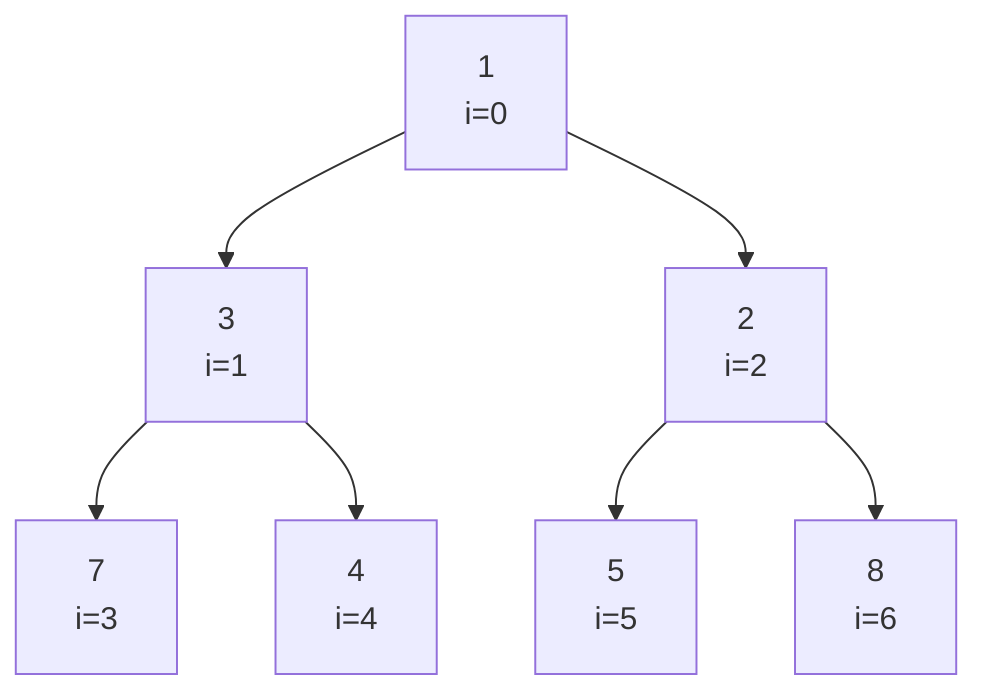

# Heaps e filas de prioridade

## Por que isso importa

Uma fila comum (ED-02) atende na ordem de chegada. Mas no pronto-socorro, quem está mais grave passa na frente; no sistema operacional, processos de alta prioridade rodam antes; no Dijkstra (AL-06), o próximo vértice é sempre o mais próximo. Tudo isso é uma **fila de prioridade**: "me dê o mais importante agora". O **heap** é a estrutura que faz isso em O(log n) por operação, usando só um array. Ele também dá origem ao **heap sort** (AL-03) e resolve o clássico de entrevista "os k maiores de um milhão de itens".

## Intuição

Pense num **torneio**: em cada partida, o mais forte sobe. O campeão fica no topo, e cada "chefe" é mais forte que os dois que estão abaixo dele. Mas **não** existe ordem entre irmãos: o segundo melhor pode estar em qualquer lado.

- **Entrar no torneio**: o novato começa no fim e vai desafiando o chefe acima; se ganhar, troca de lugar e continua subindo.
- **O campeão sai**: o último da fila vai para o topo e vai descendo, trocando com o mais forte dos dois de baixo, até ficar no lugar certo.

Cada subida ou descida percorre uma altura da árvore, que é log n.

## Visual

Um **min-heap**: cada pai é menor ou igual aos filhos. A árvore é guardada **por níveis** num array.



```text
array:   [1, 3, 2, 7, 4, 5, 8]
índice:   0  1  2  3  4  5  6

pai(i)       = (i - 1) // 2
filho_esq(i) = 2*i + 1
filho_dir(i) = 2*i + 2
```

Inserindo o 0 (sobe):

```text
[1, 3, 2, 7, 4, 5, 8, 0]      0 entra no fim (i=7), pai é i=3 (7)
[1, 3, 2, 0, 4, 5, 8, 7]      0 < 7: troca. Agora i=3, pai é i=1 (3)
[1, 0, 2, 3, 4, 5, 8, 7]      0 < 3: troca. Agora i=1, pai é i=0 (1)
[0, 1, 2, 3, 4, 5, 8, 7]      0 < 1: troca. Chegou na raiz.
```

## Conceito técnico

### Fila de prioridade (o tipo abstrato)

| Operação | O que faz |
|---|---|
| `inserir(x)` | adiciona x |
| `minimo()` | olha o menor, sem tirar |
| `remover_min()` | tira e devolve o menor |

Com uma lista desordenada, inserir é O(1) e remover o mínimo é O(n). Com uma lista ordenada, é o contrário. O heap equilibra: **O(log n) nas duas**, e `minimo()` é O(1).

### Heap binário

Duas regras:

1. **Forma**: árvore binária **completa**: todos os níveis cheios, menos talvez o último, que é preenchido da esquerda para a direita. Por isso cabe num array sem buracos, e a altura é ⌊log₂ n⌋.
2. **Ordem de heap**: num **min-heap**, todo pai ≤ seus filhos (a raiz é o mínimo). Num **max-heap**, todo pai ≥ seus filhos.

Não confunda com a BST (ED-05): na BST, esquerda < pai < direita, e dá para buscar qualquer valor em O(log n). No heap, só o **topo** é fácil de achar; buscar um valor qualquer é O(n).

### Inserir: subir (sift up)

1. Coloque o item no fim do array.
2. Enquanto ele for menor que o pai, troque com o pai.

### Remover o mínimo: descer (sift down)

1. Guarde a raiz (é a resposta).
2. Mova o **último** item para a raiz e encurte o array.
3. Enquanto ele for maior que algum filho, troque com o **menor** dos filhos.

Trocar com o menor filho é essencial: ele vira pai do outro filho e precisa ser menor que ele.

### Heapify: construir em O(n)

Inserir n itens um a um custa O(n log n). Dá para fazer melhor: comece do **último pai** (índice n//2 − 1) e vá até a raiz, descendo cada um. Metade dos nós são folhas e não fazem nada; os de baixo descem pouco. A soma dá O(n). É o que `heapq.heapify` faz.

### Custos

| Operação | Heap binário |
|---|---|
| ver mínimo | O(1) |
| inserir | O(log n) |
| remover mínimo | O(log n) |
| construir com n itens | O(n) |
| buscar valor qualquer | O(n) |

### Heap em Python: heapq

O módulo `heapq` transforma uma **lista comum** num min-heap. Não há classe; são funções:

```python
import heapq

h = []
for x in [5, 1, 8, 3, 2]:
    heapq.heappush(h, x)
print(h[0])                  # 1: o mínimo está sempre em h[0]
print(heapq.heappop(h))      # 1
print(heapq.heappop(h))      # 2

l = [9, 4, 7, 1]
heapq.heapify(l)             # O(n), no lugar
print(l[0])                  # 1
```

Para um **max-heap**, guarde os valores **negativos**: `heappush(h, -x)` e `-heappop(h)`. Para prioridades com dados, use **tuplas**: `(prioridade, ordem_de_chegada, tarefa)`. A comparação de tuplas olha o primeiro campo, depois o segundo; o contador de chegada desempata e evita comparar tarefas.

## Código

Um min-heap do zero:

```python
class MinHeap:
    def __init__(self):
        self.a = []

    def inserir(self, x):
        a = self.a
        a.append(x)
        i = len(a) - 1
        while i > 0:
            pai = (i - 1) // 2
            if a[i] >= a[pai]:
                break
            a[i], a[pai] = a[pai], a[i]
            i = pai

    def remover_min(self):
        a = self.a
        topo = a[0]
        ultimo = a.pop()
        if a:
            a[0] = ultimo
            i = 0
            while True:
                esq, dir = 2 * i + 1, 2 * i + 2
                menor = i
                if esq < len(a) and a[esq] < a[menor]:
                    menor = esq
                if dir < len(a) and a[dir] < a[menor]:
                    menor = dir
                if menor == i:
                    break
                a[i], a[menor] = a[menor], a[i]
                i = menor
        return topo


h = MinHeap()
for x in [5, 3, 8, 1, 4]:
    h.inserir(x)
print(h.a)                                     # [1, 3, 8, 5, 4]
print([h.remover_min() for _ in range(5)])     # [1, 3, 4, 5, 8]
```

Os k maiores de uma sequência enorme, com memória O(k): mantenha um **min-heap de tamanho k**. Se o novo item for maior que o menor dos k, ele entra e o menor sai.

```python
import heapq

def k_maiores(itens, k):
    h = []
    for x in itens:
        if len(h) < k:
            heapq.heappush(h, x)
        elif x > h[0]:
            heapq.heapreplace(h, x)    # tira o topo e põe x, numa só operação
    return sorted(h, reverse=True)

print(k_maiores(range(1_000_000), 3))   # [999999, 999998, 999997]
```

Custo: O(n log k), muito melhor que ordenar tudo (O(n log n)) quando k é pequeno.

## Erros comuns

- **Achar que o array do heap está ordenado.** `[1, 3, 2, 7, 4]` é um heap válido e não está ordenado. Só `h[0]` tem garantia.
- **Descer trocando com o filho errado.** Tem que ser o **menor** filho (num min-heap); trocar com o maior quebra a regra.
- **Errar as fórmulas de índice.** Com índice começando em 0: filhos em 2i + 1 e 2i + 2, pai em (i − 1) // 2.
- **Usar `heapq` esperando um max-heap.** Ele é sempre min-heap; use valores negativos.
- **Colocar tuplas `(prioridade, objeto)` sem desempate.** Se duas prioridades empatam, o Python tenta comparar os objetos e pode dar `TypeError`. Use `(prioridade, contador, objeto)`.
- **Usar `sorted(itens)[-k:]` para k pequeno em dados enormes**: funciona, mas gasta O(n log n) de tempo e O(n) de memória.

## Pratique

```quiz
id: ED-07-q1
tipo: multipla_escolha
pergunta: "Num heap guardado num array começando em 0, quais são os filhos do nó de índice 4?"
opcoes: ["3 e 5", "8 e 9", "9 e 10", "5 e 6"]
resposta: 2
explicacao: "Filho esquerdo = 2·4 + 1 = 9; filho direito = 2·4 + 2 = 10. O pai de 4 é (4 − 1) // 2 = 1."
dificuldade: 1
```

```quiz
id: ED-07-q2
tipo: multipla_escolha
pergunta: "Qual destes arrays é um min-heap válido?"
opcoes: ["[1, 5, 2, 4, 3]", "[2, 1, 3]", "[1, 3, 2, 7, 4, 5]", "[1, 2, 3, 0]"]
resposta: 2
explicacao: "Em [1, 3, 2, 7, 4, 5]: a raiz 1 é menor que 3 e 2; o 3 (i=1) é menor que os filhos 7 e 4; o 2 (i=2) é menor que o filho 5. As outras quebram a regra: em [1, 5, 2, 4, 3] o 5 tem filhos 4 e 3; em [2, 1, 3] a raiz é maior que o 1; em [1, 2, 3, 0] o 2 tem o filho 0. Repare que o heap válido nem está ordenado."
dificuldade: 2
```

```quiz
id: ED-07-q3
tipo: multipla_escolha
pergunta: "Qual é o custo de remover o mínimo de um heap binário com n elementos?"
opcoes: ["O(1)", "O(log n)", "O(n)", "O(n log n)"]
resposta: 1
explicacao: "O último item vai para a raiz e desce no máximo a altura da árvore, que é ⌊log₂ n⌋ por ela ser completa. Só olhar o mínimo (sem remover) é O(1)."
dificuldade: 1
```

```quiz
id: ED-07-q4
tipo: verdadeiro_falso
pergunta: "Construir um heap com heapify a partir de uma lista de n itens custa O(n), menos que inserir os itens um a um."
resposta: true
explicacao: "Heapify desce os nós de baixo para cima. Metade dos nós são folhas (custo 0), um quarto desce no máximo 1 nível, um oitavo no máximo 2... A soma n/4·1 + n/8·2 + n/16·3 + ... é limitada por n. Inserir um a um é O(n log n)."
dificuldade: 2
```

```quiz
id: ED-07-q5
tipo: prever_saida
pergunta: |
  O que este código imprime?
  ```python
  import heapq
  h = []
  for x in [4, 1, 7, 3]:
      heapq.heappush(h, -x)
  print(-heapq.heappop(h), -h[0])
  ```
resposta: "7 4"
explicacao: "Guardar os negativos transforma o min-heap num max-heap: -7 é o menor, então sai primeiro e vira 7. Depois, o topo é -4, que representa o 4."
dificuldade: 2
```

```quiz
id: ED-07-q6
tipo: resposta_curta
pergunta: "Por que, ao descer um item num min-heap, ele deve ser trocado com o MENOR dos dois filhos?"
resposta: "Porque o filho que sobe vira pai do outro filho. Se subir o maior, ele ficaria acima de um filho menor que ele e quebraria a regra do heap. Subindo o menor, ele é menor ou igual ao irmão e ao item que desceu."
palavras_chave: ["menor", "pai", "irmão", "regra"]
dificuldade: 2
```

```quiz
id: ED-07-q7
tipo: codigo
linguagem: python
pergunta: |
  **Min-heap do zero.** Complete a classe `MinHeap` com `inserir(x)` (sobe) e `remover_min()` (desce), guardando os itens na lista `self.a`. Não use `heapq` nem `sort`/`sorted`/`min`.
codigo_inicial: |
  class MinHeap:
      def __init__(self):
          self.a = []

      def inserir(self, x):
          self.a.append(x)

      def remover_min(self):
          return self.a.pop(0)


  # não mude: os testes usam esta função
  def operar(heap, ops):
      saiu = []
      for op in ops:
          if op == "sai":
              saiu.append(heap.remover_min())
          else:
              heap.inserir(op)
      return saiu
usa: [class, while, def]
testes:
  - chamada: "operar(MinHeap(), [5, 3, 8, 1, 'sai', 'sai', 4, 'sai', 'sai', 'sai'])"
    saida: "[1, 3, 4, 5, 8]"
  - chamada: "(lambda h: (operar(h, [5, 3, 8, 1, 4]), h.a))(MinHeap())"
    saida: "([], [1, 3, 8, 5, 4])"
  - chamada: "operar(MinHeap(), [2, 2, 1, 'sai', 'sai', 'sai'])"
    saida: "[1, 2, 2]"
  - chamada: "(lambda h: operar(h, list(range(200, 0, -1)) + ['sai'] * 200) == list(range(1, 201)))(MinHeap())"
    visivel: false
    saida: "True"
  - chamada: "operar(MinHeap(), [9, 'sai', 7, 'sai'])"
    visivel: false
    saida: "[9, 7]"
dica: "Inserir: append e, enquanto i > 0 e a[i] < a[(i - 1) // 2], troque e suba. Remover: guarde a[0], tire o último com pop(), e se sobrou algo ponha-o em a[0] e desça trocando com o menor filho (2i + 1 ou 2i + 2) enquanto ele for menor."
solucao: |
  class MinHeap:
      def __init__(self):
          self.a = []

      def inserir(self, x):
          a = self.a
          a.append(x)
          i = len(a) - 1
          while i > 0 and a[i] < a[(i - 1) // 2]:
              pai = (i - 1) // 2
              a[i], a[pai] = a[pai], a[i]
              i = pai

      def remover_min(self):
          a = self.a
          topo = a[0]
          ultimo = a.pop()
          if a:
              a[0] = ultimo
              i = 0
              while True:
                  menor = i
                  for f in (2 * i + 1, 2 * i + 2):
                      if f < len(a) and a[f] < a[menor]:
                          menor = f
                  if menor == i:
                      break
                  a[i], a[menor] = a[menor], a[i]
                  i = menor
          return topo


  # não mude: os testes usam esta função
  def operar(heap, ops):
      saiu = []
      for op in ops:
          if op == "sai":
              saiu.append(heap.remover_min())
          else:
              heap.inserir(op)
      return saiu
explicacao: "O segundo teste confere a forma do array depois de inserir 5, 3, 8, 1, 4: o 1 sobe até a raiz e empurra o 3 e o 5 para baixo. O código inicial 'funciona' para alguns casos, mas pop(0) sem reorganizar não devolve o mínimo. Cuidado com o caso de remover o último item: a lista fica vazia e não há o que descer."
dificuldade: 3
```

```quiz
id: ED-07-q8
tipo: codigo
linguagem: python
pergunta: |
  **Os k mais frequentes.** Escreva `mais_frequentes(palavras, k)` que devolve as k palavras que mais aparecem, da mais frequente para a menos frequente. Em caso de empate na contagem, a palavra que vem **antes em ordem alfabética** ganha. Use `heapq`.
codigo_inicial: |
  import heapq


  def mais_frequentes(palavras, k):
      return []
usa: [def, return, heappush]
testes:
  - chamada: "mais_frequentes(['a', 'b', 'a', 'c', 'b', 'a'], 2)"
    saida: "['a', 'b']"
  - chamada: "mais_frequentes(['uva', 'kiwi', 'uva', 'kiwi', 'pera'], 2)"
    saida: "['kiwi', 'uva']"
  - chamada: "mais_frequentes(['x'], 3)"
    saida: "['x']"
  - chamada: "mais_frequentes(['b', 'c', 'a', 'c', 'b', 'a', 'd'], 3)"
    visivel: false
    saida: "['a', 'b', 'c']"
  - chamada: "mais_frequentes([str(i % 1000) for i in range(100000)] + ['7'], 1)"
    visivel: false
    saida: "['7']"
dica: "Conte com um dict. Ponha no heap tuplas (-contagem, palavra): o min-heap tira primeiro a maior contagem e, no empate, a menor palavra. Depois faça heappop k vezes (ou até o heap esvaziar)."
solucao: |
  import heapq


  def mais_frequentes(palavras, k):
      cont = {}
      for p in palavras:
          cont[p] = cont.get(p, 0) + 1
      h = []
      for p, c in cont.items():
          heapq.heappush(h, (-c, p))
      resultado = []
      while h and len(resultado) < k:
          resultado.append(heapq.heappop(h)[1])
      return resultado
explicacao: "A tupla (-contagem, palavra) resolve as duas regras de uma vez: o sinal negativo transforma o min-heap em 'maior contagem primeiro', e o segundo campo desempata em ordem alfabética. É o mesmo truque de prioridade + desempate dos agendadores de tarefas."
dificuldade: 2
```

```quiz
id: ED-07-q9
tipo: codigo
linguagem: python
pergunta: |
  **Mesclar k listas ordenadas.** Escreva `mesclar(listas)` que recebe várias listas já ordenadas e devolve uma única lista ordenada com todos os itens, em O(N log k) (N = total de itens, k = número de listas). Não use `sort`/`sorted`. Ideia: um heap com o próximo item de cada lista.
codigo_inicial: |
  import heapq


  def mesclar(listas):
      return []
usa: [def, while, heappop]
testes:
  - chamada: "mesclar([[1, 4, 7], [2, 5, 8], [3, 6, 9]])"
    saida: "[1, 2, 3, 4, 5, 6, 7, 8, 9]"
  - chamada: "mesclar([[1, 1, 2], [], [0, 5]])"
    saida: "[0, 1, 1, 2, 5]"
  - chamada: "mesclar([])"
    saida: "[]"
  - chamada: "mesclar([list(range(i, 3000, 3)) for i in range(3)]) == list(range(3000))"
    visivel: false
    saida: "True"
dica: "Ponha no heap tuplas (valor, i, j): o valor, o número da lista e a posição nela. Tire o menor, adicione ao resultado e, se a lista i tiver um item em j + 1, empurre (listas[i][j + 1], i, j + 1)."
solucao: |
  import heapq


  def mesclar(listas):
      h = []
      for i, l in enumerate(listas):
          if l:
              heapq.heappush(h, (l[0], i, 0))
      resultado = []
      while h:
          valor, i, j = heapq.heappop(h)
          resultado.append(valor)
          if j + 1 < len(listas[i]):
              heapq.heappush(h, (listas[i][j + 1], i, j + 1))
      return resultado
explicacao: "O heap nunca tem mais de k itens (um por lista), então cada push e pop custa O(log k), e há N de cada. O índice i na tupla também serve de desempate quando dois valores são iguais. É o passo final do merge sort externo, usado para ordenar arquivos maiores que a memória."
dificuldade: 3
```

```quiz
id: ED-07-q10
tipo: codigo
linguagem: javascript
pergunta: |
  **Heapify em JavaScript.** Escreva `heapify(arr)` que devolve um **novo** array reorganizado como min-heap, usando o método O(n): para cada índice de `Math.floor(n / 2) - 1` até 0, desça o item.
codigo_inicial: |
  function heapify(arr) {
    const a = [...arr];
    return a;
  }
usa: [function, while, return]
testes:
  - chamada: "heapify([5, 3, 8, 1, 4])"
    saida: "[ 1, 3, 8, 5, 4 ]"
  - chamada: "heapify([3, 2, 1])"
    saida: "[ 1, 2, 3 ]"
  - chamada: "heapify([])"
    saida: "[]"
  - chamada: "heapify([9, 8, 7, 6, 5, 4, 3, 2, 1])"
    visivel: false
    saida: "[ 1, 2, 3, 6, 5, 4, 7, 8, 9 ]"
  - chamada: "((o) => [heapify(o), o])([2, 1])"
    visivel: false
    saida: "[ [ 1, 2 ], [ 2, 1 ] ]"
dica: "Dentro do for (let k = Math.floor(a.length / 2) - 1; k >= 0; k--), faça let i = k e um while (true) que acha o menor entre a[i], a[2i+1] e a[2i+2]; se for o próprio i, break; senão troque e continue de lá."
solucao: |
  function heapify(arr) {
    const a = [...arr];
    for (let k = Math.floor(a.length / 2) - 1; k >= 0; k--) {
      let i = k;
      while (true) {
        let menor = i;
        const esq = 2 * i + 1;
        const dir = 2 * i + 2;
        if (esq < a.length && a[esq] < a[menor]) menor = esq;
        if (dir < a.length && a[dir] < a[menor]) menor = dir;
        if (menor === i) break;
        [a[i], a[menor]] = [a[menor], a[i]];
        i = menor;
      }
    }
    return a;
  }
explicacao: "Os nós de índice ≥ n/2 são folhas e já são heaps sozinhos. Descendo cada pai de baixo para cima, quando chegamos num nó as duas subárvores dele já são heaps, e uma descida basta para arrumar. Em [9, 8, ..., 1] o resultado é um heap válido, mas não ordenado."
dificuldade: 2
```

## Resumo

- **Fila de prioridade**: inserir e tirar o mínimo (ou máximo). O heap faz as duas em **O(log n)** e mostra o topo em O(1).
- **Heap binário**: árvore completa num array; filhos em **2i+1** e **2i+2**, pai em **(i−1)//2**.
- **Inserir** = pôr no fim e **subir**. **Remover** = último vai para a raiz e **desce** trocando com o menor filho.
- **Heapify** constrói em **O(n)**.
- `heapq`: min-heap sobre lista; negativos para max-heap; tuplas `(prioridade, desempate, dado)`.
- **Top-k** com min-heap de tamanho k: O(n log k) de tempo, O(k) de memória.

## Para ir além

- Veja a animação em **visualgo.net/pt/heap** e compare inserir um a um com o heapify.
- **Próximo módulo**: AL-03 Ordenação eficiente, onde o heap vira o **heap sort**. Mais adiante, o heap volta no Dijkstra (AL-06) e no Prim (AL-07).
