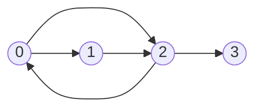

# Grafos: lista e matriz de adjacência

## Por que isso importa

Em MD-06 você viu o que é um grafo. Agora a pergunta é prática: **como guardar um grafo na memória** para que os algoritmos rodem rápido? A escolha muda tudo. O grafo de amizades do Facebook tem bilhões de vértices, mas cada pessoa tem poucas centenas de amigos. Uma matriz n × n precisaria de 10¹⁸ posições, mais memória do que existe no planeta; uma lista de adjacência cabe num cluster de servidores. Por outro lado, para perguntar "A e B são ligados?" milhões de vezes num grafo pequeno e denso, a matriz responde em O(1). BFS, DFS, Dijkstra e todos os algoritmos que vêm a seguir começam com uma dessas representações.

## Intuição

- **Lista de arestas**: um caderno com uma linha por ligação: "Ana–Bia", "Bia–Caio"... Simples, mas para achar os amigos da Ana você lê o caderno inteiro.
- **Lista de adjacência**: a **agenda de contatos** de cada pessoa. Para ver os amigos da Ana, abra a agenda dela. Ocupa espaço proporcional ao número de amizades.
- **Matriz de adjacência**: uma **tabela de dupla entrada** com todo mundo nas linhas e nas colunas, e um ✓ quando há ligação. Responde "Ana e Caio são amigos?" na hora, mas a tabela é enorme e quase toda vazia quando cada pessoa conhece poucas.

## Visual

O mesmo grafo dirigido de 4 vértices nas três representações:



```text
Lista de arestas:     [(0, 1), (0, 2), (1, 2), (2, 0), (2, 3)]

Lista de adjacência:  0: [1, 2]
                      1: [2]
                      2: [0, 3]
                      3: []

Matriz de adjacência:      para
                          0  1  2  3
                  de  0 [ 0, 1, 1, 0 ]
                      1 [ 0, 0, 1, 0 ]
                      2 [ 1, 0, 0, 1 ]
                      3 [ 0, 0, 0, 0 ]
```

Num grafo **não dirigido**, cada aresta aparece nas duas listas (u em v e v em u), e a matriz é **simétrica**.

## Conceito técnico

### Custos

Com n = |V| vértices, m = |E| arestas e grau(v) o número de vizinhos de v:

| Operação | Lista de arestas | Lista de adjacência | Matriz |
|---|---|---|---|
| Memória | O(m) | **O(n + m)** | O(n²) |
| "u e v são ligados?" | O(m) | O(grau(u)) | **O(1)** |
| Percorrer os vizinhos de u | O(m) | **O(grau(u))** | O(n) |
| Percorrer todas as arestas | **O(m)** | **O(n + m)** | O(n²) |
| Adicionar aresta | O(1) | O(1) | O(1) |
| Adicionar vértice | O(1) | O(1) | O(n²) (recriar) |

Quase todos os algoritmos de grafos (BFS, DFS, Dijkstra) fazem "para cada vizinho de u", então a **lista de adjacência é o padrão**. Com ela, BFS e DFS custam O(n + m); com a matriz, O(n²).

### Esparso ou denso?

Um grafo simples tem no máximo ~n² arestas.

- **Esparso** (m próximo de n): estradas, redes sociais, a web, dependências de pacotes. Use **lista de adjacência**.
- **Denso** (m próximo de n²): distâncias entre todas as cidades, pequenos grafos completos, jogos em tabuleiro pequeno. A **matriz** fica competitiva, e é natural para algoritmos como Floyd-Warshall.

Conta rápida: n = 100 mil vértices com 10 vizinhos cada. Lista: ~1 milhão de entradas. Matriz: 10 bilhões de células. Mesmo com 1 bit por célula, 1,25 GB, quase tudo zero.

### Variações

- **Ponderado**: guarde o peso. Lista: `{u: [(v, peso), ...]}` ou `{u: {v: peso}}`. Matriz: o peso na célula, e `inf` (ou `None`) onde não há aresta.
- **Vértices com nome**: use um dict `{"Ana": ["Bia", "Caio"]}`, ou mapeie cada nome para um número de 0 a n − 1 e use listas (mais rápido e compacto).
- **Lista com set**: `{u: set()}` dá "u e v são ligados?" em O(1) em média, com a memória da lista. Perde a ordem dos vizinhos.
- **Grafo implícito**: às vezes você nem guarda o grafo. Num labirinto em grade, os vizinhos de (l, c) são (l ± 1, c) e (l, c ± 1); num quebra-cabeça, os vizinhos de um estado são os estados alcançáveis com um movimento. Basta uma **função** `vizinhos(v)`.

### Grafo transposto

O **transposto** Gᵀ tem as mesmas arestas com o sentido **invertido**. "Quem eu sigo" vira "quem me segue". Na matriz, é a matriz transposta (trocar linhas e colunas). É usado para achar componentes fortemente conexas (algoritmo de Kosaraju) e para responder "quem aponta para mim?" em O(grau de entrada).

## Código

Uma classe de grafo com lista de adjacência:

```python
class Grafo:
    def __init__(self, n, dirigido=False):
        self.n = n
        self.dirigido = dirigido
        self.adj = [[] for _ in range(n)]     # não use [[]] * n!

    def adicionar(self, u, v, peso=1):
        self.adj[u].append((v, peso))
        if not self.dirigido:
            self.adj[v].append((u, peso))

    def vizinhos(self, u):
        return [v for v, _ in self.adj[u]]

    def matriz(self):
        m = [[0] * self.n for _ in range(self.n)]
        for u in range(self.n):
            for v, peso in self.adj[u]:
                m[u][v] = peso
        return m


g = Grafo(4, dirigido=True)
for u, v in [(0, 1), (0, 2), (1, 2), (2, 0), (2, 3)]:
    g.adicionar(u, v)
print(g.vizinhos(2))        # [0, 3]
for linha in g.matriz():
    print(linha)
```

Um grafo implícito (grade com paredes):

```python
grade = [
    "..#",
    ".#.",
    "...",
]

def vizinhos(l, c):
    for dl, dc in [(-1, 0), (1, 0), (0, -1), (0, 1)]:
        nl, nc = l + dl, c + dc
        if 0 <= nl < len(grade) and 0 <= nc < len(grade[0]) and grade[nl][nc] != "#":
            yield (nl, nc)

print(list(vizinhos(0, 0)))   # [(1, 0), (0, 1)]
print(list(vizinhos(2, 1)))   # [(2, 0), (2, 2)]
```

## Erros comuns

- **`[[]] * n` ou `[[0] * n] * n`.** Cria n referências para a **mesma** lista: adicionar um vizinho em um vértice adiciona em todos. Use compreensão: `[[] for _ in range(n)]`.
- **Esquecer a volta no grafo não dirigido.** A aresta {u, v} precisa estar na lista de u **e** na de v.
- **Matriz para grafo grande e esparso.** Estoura memória e deixa BFS/DFS em O(n²).
- **Testar "u e v são ligados?" com `v in adj[u]` numa lista** dentro de um laço quente: é O(grau). Use um set se precisar disso muitas vezes.
- **Confundir o índice da matriz**: `m[u][v]` é a aresta **de u para v**. Inverter isso transpõe o grafo sem querer.
- **Usar 0 como "sem aresta" num grafo ponderado** que pode ter arestas de peso 0. Use `None` ou `inf`.

## Pratique

```quiz
id: ED-08-q1
tipo: multipla_escolha
pergunta: "Qual representação usa O(n + m) de memória?"
opcoes: ["Matriz de adjacência", "Lista de adjacência", "Ambas", "Nenhuma das duas"]
resposta: 1
explicacao: "A lista tem uma entrada por vértice (n) e uma por aresta (m, ou 2m em não dirigidos). A matriz sempre usa n², não importa quantas arestas existam."
dificuldade: 1
```

```quiz
id: ED-08-q2
tipo: multipla_escolha
pergunta: "Um mapa de ruas tem 1 milhão de cruzamentos, cada um com até 4 ruas. Qual representação usar?"
opcoes: ["Matriz de adjacência, para testar ligações em O(1)", "Lista de adjacência, porque o grafo é muito esparso", "Lista de arestas, porque é a mais simples", "Tanto faz"]
resposta: 1
explicacao: "São ~2 milhões de arestas contra 10¹² células de uma matriz. A lista de adjacência guarda só o que existe e percorre os vizinhos de cada cruzamento em O(4), que é o que o GPS precisa."
dificuldade: 1
```

```quiz
id: ED-08-q3
tipo: multipla_escolha
pergunta: "Qual é o custo de uma BFS (que visita cada vértice e olha todos os seus vizinhos) usando uma matriz de adjacência?"
opcoes: ["O(n + m)", "O(n²)", "O(m²)", "O(n log n)"]
resposta: 1
explicacao: "Para listar os vizinhos de cada vértice na matriz, é preciso percorrer a linha inteira (n células). Fazendo isso para os n vértices, O(n²), mesmo que o grafo tenha poucas arestas. Com lista de adjacência, O(n + m)."
dificuldade: 2
```

```quiz
id: ED-08-q4
tipo: verdadeiro_falso
pergunta: "A matriz de adjacência de um grafo não dirigido é sempre simétrica (m[u][v] == m[v][u])."
resposta: true
explicacao: "Uma aresta não dirigida {u, v} liga u a v e v a u ao mesmo tempo, então as duas células são marcadas. Em grafos dirigidos isso não vale: seguir alguém não significa ser seguido."
dificuldade: 1
```

```quiz
id: ED-08-q5
tipo: prever_saida
pergunta: |
  O que este código imprime?
  ```python
  adj = [[]] * 3
  adj[0].append(1)
  print(adj)
  ```
resposta: "[[1], [1], [1]]"
explicacao: "[[]] * 3 cria uma lista com três referências para a MESMA lista vazia. Adicionar em adj[0] aparece em todas. O certo é [[] for _ in range(3)], que cria três listas independentes."
dificuldade: 2
```

```quiz
id: ED-08-q6
tipo: resposta_curta
pergunta: "Dê um exemplo de situação em que a matriz de adjacência é a melhor escolha e explique por quê."
resposta: "Um grafo pequeno e denso em que se pergunta muitas vezes se dois vértices são ligados, como a tabela de distâncias entre 50 cidades usada no Floyd-Warshall. A matriz responde em O(1) e, como quase todos os pares têm aresta, não desperdiça memória."
palavras_chave: ["denso", "O(1)", "pequeno", "ligados"]
dificuldade: 2
```

```quiz
id: ED-08-q7
tipo: codigo
linguagem: python
pergunta: |
  **Montar a lista de adjacência.** Escreva `lista_adj(n, arestas, dirigido)` que devolve uma lista de listas com os vizinhos de cada vértice `0..n−1`, na ordem em que as arestas aparecem. Se `dirigido` for `False`, cada aresta entra nos dois sentidos.
codigo_inicial: |
  def lista_adj(n, arestas, dirigido):
      adj = [[]] * n
      for u, v in arestas:
          adj[u].append(v)
      return adj
usa: [def, for, return]
testes:
  - chamada: "lista_adj(4, [(0, 1), (0, 2), (1, 2), (2, 0), (2, 3)], True)"
    saida: "[[1, 2], [2], [0, 3], []]"
  - chamada: "lista_adj(3, [(0, 1), (1, 2)], False)"
    saida: "[[1], [0, 2], [1]]"
  - chamada: "lista_adj(2, [], False)"
    saida: "[[], []]"
  - chamada: "(lambda a: (len(a[0]), sum(map(len, a))))(lista_adj(1000, [(0, i) for i in range(1, 1000)], False))"
    visivel: false
    saida: "(999, 1998)"
dica: "O código inicial tem o bug do [[]] * n. Crie com [[] for _ in range(n)]. No laço, adicione v em adj[u] e, se não for dirigido, u em adj[v]."
solucao: |
  def lista_adj(n, arestas, dirigido):
      adj = [[] for _ in range(n)]
      for u, v in arestas:
          adj[u].append(v)
          if not dirigido:
              adj[v].append(u)
      return adj
explicacao: "Com [[]] * n, todos os vértices compartilham a mesma lista e cada um parece ter todos os vizinhos de todos. No não dirigido, a soma dos tamanhos das listas é 2m, o lema do aperto de mãos (MD-06) aparecendo na estrutura de dados."
dificuldade: 1
```

```quiz
id: ED-08-q8
tipo: codigo
linguagem: python
pergunta: |
  **Lista para matriz e transposta.** Escreva `matriz_e_transposta(adj)` que recebe uma lista de adjacência de um grafo **dirigido** e devolve a tupla `(m, mt)`: a matriz de adjacência (0/1) e a matriz do grafo **transposto** (todas as arestas invertidas).
codigo_inicial: |
  def matriz_e_transposta(adj):
      n = len(adj)
      m = [[0] * n] * n
      mt = m
      return (m, mt)
usa: [def, for, return]
testes:
  - chamada: "matriz_e_transposta([[1, 2], [2], [0, 3], []])"
    saida: "([[0, 1, 1, 0], [0, 0, 1, 0], [1, 0, 0, 1], [0, 0, 0, 0]], [[0, 0, 1, 0], [1, 0, 0, 0], [1, 1, 0, 0], [0, 0, 1, 0]])"
  - chamada: "matriz_e_transposta([[], []])"
    saida: "([[0, 0], [0, 0]], [[0, 0], [0, 0]])"
  - chamada: "matriz_e_transposta([[1], [0]])"
    visivel: false
    saida: "([[0, 1], [1, 0]], [[0, 1], [1, 0]])"
dica: "Crie as duas matrizes com [[0] * n for _ in range(n)]. Para cada u e cada v em adj[u]: m[u][v] = 1 e mt[v][u] = 1."
solucao: |
  def matriz_e_transposta(adj):
      n = len(adj)
      m = [[0] * n for _ in range(n)]
      mt = [[0] * n for _ in range(n)]
      for u in range(n):
          for v in adj[u]:
              m[u][v] = 1
              mt[v][u] = 1
      return (m, mt)
explicacao: "Na transposta, a linha v mostra quem aponta PARA v: os 'seguidores' em vez dos 'seguidos'. Repare que mt é exatamente m com linhas e colunas trocadas. No último teste, o grafo 0 ⇄ 1 é igual ao seu transposto, como todo grafo com matriz simétrica."
dificuldade: 2
```

```quiz
id: ED-08-q9
tipo: codigo
linguagem: python
pergunta: |
  **Amigos em comum.** Uma rede social é dada como um dict `{pessoa: [amigos]}` (não dirigido, já com os dois sentidos). Escreva `sugestoes(rede, pessoa)` que devolve as pessoas que **não** são amigas de `pessoa` (nem ela mesma) mas têm pelo menos um amigo em comum com ela, ordenadas pelo número de amigos em comum (mais amigos primeiro) e, no empate, pelo nome.
codigo_inicial: |
  def sugestoes(rede, pessoa):
      return []
usa: [def, for, return]
testes:
  - chamada: "sugestoes({'ana': ['bia', 'caio'], 'bia': ['ana', 'davi'], 'caio': ['ana', 'davi', 'eva'], 'davi': ['bia', 'caio'], 'eva': ['caio']}, 'ana')"
    saida: "['davi', 'eva']"
  - chamada: "sugestoes({'ana': ['bia'], 'bia': ['ana']}, 'ana')"
    saida: "[]"
  - chamada: "sugestoes({'x': ['a', 'b'], 'a': ['x', 'z', 'y'], 'b': ['x', 'y'], 'y': ['a', 'b'], 'z': ['a']}, 'x')"
    visivel: false
    saida: "['y', 'z']"
dica: "Faça um set com os amigos de pessoa. Percorra os amigos dos amigos contando num dict quantas vezes cada um aparece, pulando a própria pessoa e quem já é amigo. Ordene com sorted(cont, key=lambda p: (-cont[p], p))."
solucao: |
  def sugestoes(rede, pessoa):
      amigos = set(rede[pessoa])
      cont = {}
      for a in rede[pessoa]:
          for b in rede[a]:
              if b != pessoa and b not in amigos:
                  cont[b] = cont.get(b, 0) + 1
      return sorted(cont, key=lambda p: (-cont[p], p))
explicacao: "Davi é amigo de Bia e de Caio: 2 em comum. Eva só de Caio: 1. Esse é o 'pessoas que você talvez conheça' das redes sociais: olhar os vizinhos dos vizinhos (distância 2). Com lista de adjacência, o custo é a soma dos graus dos amigos, sem tocar no resto da rede."
dificuldade: 2
```

```quiz
id: ED-08-q10
tipo: codigo
linguagem: c
pergunta: |
  **Graus de entrada e saída em C.** Leia `n` (vértices 0 a n−1, n ≤ 100) e `m`, depois `m` arestas dirigidas `u v`. Imprima, para cada vértice, uma linha com `grau_saida grau_entrada`. (Use variáveis auxiliares na leitura, como no código inicial.) Para as entradas `3 3`, `0 1`, `0 2` e `1 2`:

  ```
  2 0
  1 1
  0 2
  ```
codigo_inicial: |
  #include <stdio.h>

  int main() {
      int n, m;
      scanf("%d %d", &n, &m);
      int saida[100];
      int entrada[100];
      for (int i = 0; i < m; i++) {
          int u, v;
          scanf("%d %d", &u, &v);
      }
      for (int i = 0; i < n; i++) {
          printf("%d %d\n", 0, 0);
      }
      return 0;
  }
usa: [for, scanf, printf]
testes:
  - entradas: ["3 3", "0 1", "0 2", "1 2"]
    saida: "2 0\n1 1\n0 2"
  - entradas: ["2 0"]
    saida: "0 0\n0 0"
  - entradas: ["4 5", "0 1", "1 2", "2 0", "2 3", "3 3"]
    visivel: false
    saida: "1 1\n1 1\n2 1\n1 2"
dica: "Antes do laço de leitura, zere os dois vetores com um for. Ao ler cada aresta, faça saida[u]++ e entrada[v]++."
solucao: |
  #include <stdio.h>

  int main() {
      int n, m;
      scanf("%d %d", &n, &m);
      int saida[100];
      int entrada[100];
      for (int i = 0; i < n; i++) {
          saida[i] = 0;
          entrada[i] = 0;
      }
      for (int i = 0; i < m; i++) {
          int u, v;
          scanf("%d %d", &u, &v);
          saida[u]++;
          entrada[v]++;
      }
      for (int i = 0; i < n; i++) {
          printf("%d %d\n", saida[i], entrada[i]);
      }
      return 0;
  }
explicacao: "Em C, um vetor local não começa zerado: sem o laço de inicialização, ele pode conter lixo da memória. A soma de todos os graus de saída é m, e a de entrada também, a versão dirigida do aperto de mãos. O laço 3 → 3 conta 1 na saída e 1 na entrada do vértice 3."
dificuldade: 2
```

## Resumo

- **Lista de arestas**: simples, O(m); ruim para achar vizinhos.
- **Lista de adjacência**: O(n + m) de memória, vizinhos em O(grau). **Padrão** para grafos esparsos e para BFS/DFS/Dijkstra.
- **Matriz**: O(n²) de memória, "ligados?" em O(1). Boa para grafos pequenos e densos.
- Não dirigido: aresta nos dois sentidos; matriz simétrica. Ponderado: guarde o peso.
- **Grafo implícito**: uma função `vizinhos(v)` em vez de uma estrutura guardada.
- **Transposto**: arestas invertidas; responde "quem aponta para mim?".

## Para ir além

- A seção 4.1 do Sedgewick tem a API `Graph` em Java; compare com a classe desta aula.
- **Próximo módulo**: AL-05 Busca em grafos: BFS e DFS, que percorre essas estruturas.
