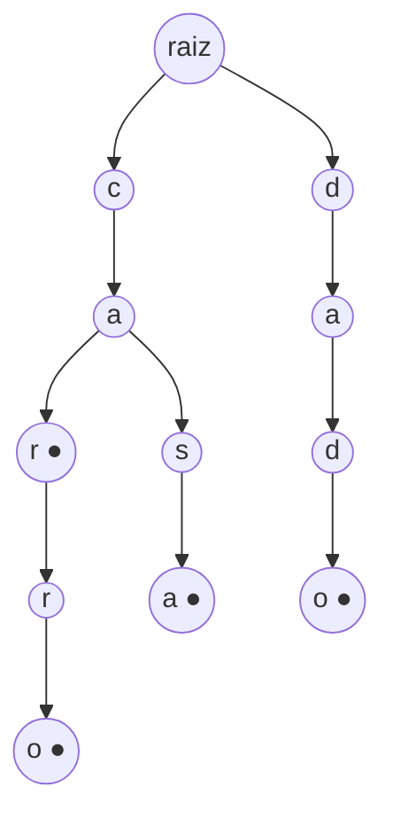

# Tries, Union-Find e B-trees

## Por que isso importa

Três estruturas especializadas que resolvem, cada uma, um tipo de pergunta melhor que qualquer estrutura genérica:

- **Trie**: "quais palavras começam com 'prog'?". É o autocompletar do teclado do celular, da barra de busca e da sua IDE, e também a tabela de rotas de um roteador.
- **Union-Find**: "estes dois estão no mesmo grupo?", com grupos que vão se **juntando** ao longo do tempo. É a base do algoritmo de Kruskal (AL-07), de detecção de redes conectadas e de "quem é amigo de amigo de amigo".
- **B-tree**: a árvore dos **bancos de dados** e dos **sistemas de arquivos**. Quando você cria um índice no PostgreSQL ou no MySQL, está criando uma B-tree (na verdade, uma B+tree).

## Intuição

- **Trie**: um **dicionário de papel com abas**. Para achar "casa", você vai para a aba C, depois para a seção CA, depois CAS... Palavras com o mesmo começo compartilham o mesmo caminho.
- **Union-Find**: cada grupo tem um **representante** (um "chefe"). Para saber se duas pessoas estão no mesmo grupo, pergunte quem é o chefe de cada uma. Para juntar dois grupos, um chefe passa a responder ao outro.
- **B-tree**: um **fichário** com gavetas grandes. Ler do disco é muito lento comparado a comparar números, então cada leitura traz uma gaveta inteira com centenas de chaves. Com poucas gavetas abertas, você chega em qualquer ficha entre bilhões.

## Visual

Trie com as palavras "car", "carro", "casa" e "dado" (● marca fim de palavra):



Union-Find: juntando grupos.

```text
início:      0  1  2  3  4      cada um é seu próprio chefe
unir(0, 1):  1←0                0 passa a apontar para 1
unir(2, 3):  3←2
unir(1, 3):  3←1←0              o chefe do grupo de 1 aponta para o chefe do grupo de 3
             3←2
achar(0):    0 → 1 → 3          chefe de 0 é 3
             depois da compressão de caminho: 0 → 3 direto
grupos: {0, 1, 2, 3} e {4}
```

## Conceito técnico

### Trie (árvore de prefixos)

Cada nó representa um **prefixo**; cada aresta, um caractere. Um nó guarda seus filhos (um dict `caractere → nó`) e uma marca de "aqui termina uma palavra".

| Operação | Custo (L = tamanho da palavra) |
|---|---|
| inserir | O(L) |
| buscar palavra | O(L) |
| existe palavra com prefixo p? | O(len(p)) |
| listar as k palavras com prefixo p | O(len(p) + tamanho da subárvore) |

O custo **não depende de quantas palavras** existem, só do tamanho delas. Uma tabela hash também busca palavras inteiras em O(L), mas **não sabe responder sobre prefixos** sem olhar todas as chaves.

O preço é memória: cada nó tem um dict de filhos. Variações compactam caminhos sem bifurcação (radix tree / Patricia trie), como nas tabelas de rotas IP.

### Union-Find (conjuntos disjuntos)

Mantém uma partição de elementos em grupos disjuntos, com duas operações:

- `achar(x)`: devolve o representante do grupo de x.
- `unir(x, y)`: junta os grupos de x e y.

"x e y estão juntos?" é `achar(x) == achar(y)`.

Implementação com um vetor `pai`: cada elemento aponta para outro do mesmo grupo, e o representante aponta para si mesmo. Duas otimizações essenciais:

1. **União por tamanho** (ou por altura/rank): ao unir, pendure o grupo **menor** no maior. A árvore não fica comprida.
2. **Compressão de caminho**: durante `achar(x)`, faça todos os nós do caminho apontarem **direto** para o representante.

Com as duas, cada operação custa O(α(n)) amortizado, em que α é a inversa da função de Ackermann: ≤ 4 para qualquer n que caiba no universo. Na prática, **O(1)**.

Union-Find é ótimo para **conectividade incremental** (arestas só chegam, nunca saem): componentes conexas de uma rede, detectar ciclo ao adicionar arestas (se os dois lados já estão no mesmo grupo, a aresta fecha um ciclo), Kruskal (AL-07), agrupar pixels de uma imagem.

Ele **não** sabe desfazer uniões nem listar o caminho entre dois elementos; para isso, use BFS/DFS (AL-05).

### B-tree

Uma árvore de busca **balanceada** com **muitos filhos por nó**. Uma B-tree de ordem m:

- Cada nó tem até m − 1 chaves ordenadas e até m filhos.
- Todas as folhas estão na **mesma profundidade**.
- Cada nó (exceto a raiz) fica pelo menos meio cheio.

Por que isso? No disco (e até na RAM, por causa do cache), ler **um bloco** de 4 KB ou 16 KB custa quase o mesmo que ler 1 byte. Então vale a pena colocar centenas de chaves num nó do tamanho de um bloco. Com m = 500, a altura é log₅₀₀(n):

```text
n = 1 bilhão de chaves
árvore binária balanceada:  ~30 níveis → ~30 leituras de disco
B-tree com m = 500:          ~4 níveis  → ~4 leituras (e a raiz fica sempre em memória)
```

Inserir: desça até a folha certa e insira a chave. Se o nó estourar (m chaves), **divida-o** em dois e suba a chave do meio para o pai (o que pode se propagar até a raiz, e é assim que a árvore cresce: pela raiz).

A **B+tree**, variação usada em quase todos os bancos, guarda os dados só nas folhas e liga as folhas numa lista. Assim, uma consulta de intervalo (`WHERE preco BETWEEN 10 AND 20`) acha o começo e depois só anda pelas folhas.

### Qual usar?

| Pergunta | Estrutura |
|---|---|
| "x existe?", "qual o valor da chave x?" | tabela hash (ED-04) |
| "qual o menor ≥ x?", intervalos, ordem | árvore balanceada (ED-06), ou B-tree em disco |
| "palavras com prefixo p?" | **trie** |
| "x e y estão no mesmo grupo?", com grupos que se juntam | **Union-Find** |
| índice de banco de dados, sistema de arquivos | **B-tree / B+tree** |

## Código

Trie com autocompletar:

```python
class Trie:
    def __init__(self):
        self.raiz = {}

    def inserir(self, palavra):
        no = self.raiz
        for ch in palavra:
            no = no.setdefault(ch, {})
        no["$"] = True                 # "$" marca fim de palavra

    def com_prefixo(self, prefixo):
        no = self.raiz
        for ch in prefixo:
            if ch not in no:
                return []
            no = no[ch]
        resultado = []
        pilha = [(no, prefixo)]
        while pilha:
            atual, texto = pilha.pop()
            if "$" in atual:
                resultado.append(texto)
            for ch, filho in atual.items():
                if ch != "$":
                    pilha.append((filho, texto + ch))
        return sorted(resultado)


t = Trie()
for p in ["car", "carro", "casa", "dado", "carta"]:
    t.inserir(p)
print(t.com_prefixo("car"))    # ['car', 'carro', 'carta']
print(t.com_prefixo("x"))      # []
```

Union-Find com as duas otimizações:

```python
class UnionFind:
    def __init__(self, n):
        self.pai = list(range(n))
        self.tamanho = [1] * n
        self.grupos = n

    def achar(self, x):
        raiz = x
        while self.pai[raiz] != raiz:
            raiz = self.pai[raiz]
        while self.pai[x] != raiz:          # compressão de caminho
            self.pai[x], x = raiz, self.pai[x]
        return raiz

    def unir(self, a, b):
        ra, rb = self.achar(a), self.achar(b)
        if ra == rb:
            return False                    # já estavam juntos
        if self.tamanho[ra] < self.tamanho[rb]:
            ra, rb = rb, ra
        self.pai[rb] = ra                   # menor embaixo do maior
        self.tamanho[ra] += self.tamanho[rb]
        self.grupos -= 1
        return True


uf = UnionFind(5)
uf.unir(0, 1)
uf.unir(2, 3)
uf.unir(1, 3)
print(uf.achar(0) == uf.achar(2), uf.achar(0) == uf.achar(4), uf.grupos)   # True False 2
```

## Erros comuns

- **Esquecer a marca de fim de palavra** na trie. Sem ela, inserir "carro" faria "car" e "carr" parecerem palavras.
- **Usar trie quando só precisa de busca exata.** Um `set` ou `dict` é mais simples e usa menos memória.
- **Union-Find sem otimizações.** Unindo em fila (0-1, 1-2, 2-3...), o "chefe" vira uma lista e `achar` custa O(n).
- **Comparar `pai[x] == pai[y]`** em vez de `achar(x) == achar(y)`. Dois elementos do mesmo grupo podem ter pais diferentes.
- **Esperar que Union-Find separe grupos.** Ele só junta. Para remover arestas, recalcule ou use outra estrutura.
- **Achar que B-tree é uma árvore binária.** O "B" não é de "binária"; cada nó tem centenas de filhos.

## Pratique

```quiz
id: ED-09-q1
tipo: multipla_escolha
pergunta: "Qual é o custo de verificar se existe alguma palavra com o prefixo p numa trie com 1 milhão de palavras?"
opcoes: ["O(1 milhão)", "O(log 1 milhão)", "O(len(p))", "O(len(p) · 1 milhão)"]
resposta: 2
explicacao: "Basta descer um nó por caractere de p. Se o caminho existe, há palavras com esse prefixo. O número total de palavras não importa."
dificuldade: 1
```

```quiz
id: ED-09-q2
tipo: multipla_escolha
pergunta: "Você recebe um fluxo de pares (a, b) dizendo 'a e b estão conectados' e precisa responder rapidamente, a qualquer momento, se x e y estão conectados. Qual estrutura?"
opcoes: ["Trie", "Union-Find", "Heap", "Lista de adjacência + BFS a cada pergunta"]
resposta: 1
explicacao: "As conexões só chegam (nunca saem) e a pergunta é 'mesmo grupo?'. Union-Find responde em O(α(n)) ≈ O(1). Uma BFS a cada pergunta custaria O(n + m) cada vez."
dificuldade: 1
```

```quiz
id: ED-09-q3
tipo: multipla_escolha
pergunta: "Por que bancos de dados usam B-trees em vez de árvores AVL para índices?"
opcoes: ["B-trees ocupam menos memória", "Com muitas chaves por nó, a árvore fica baixíssima e cada nível é uma leitura de disco", "AVL não suporta chaves repetidas", "B-trees não precisam ser balanceadas"]
resposta: 1
explicacao: "O gargalo é o número de leituras de disco, não de comparações. Um nó do tamanho de um bloco com centenas de chaves deixa a árvore com 3 ou 4 níveis para bilhões de linhas. Uma AVL teria ~30 níveis, ou seja, ~30 leituras."
dificuldade: 2
```

```quiz
id: ED-09-q4
tipo: verdadeiro_falso
pergunta: "Em Union-Find, se pai[x] == pai[y], então x e y estão no mesmo grupo; e se pai[x] != pai[y], estão em grupos diferentes."
resposta: false
explicacao: "A primeira parte é verdade, mas a segunda não: x pode apontar para y, que aponta para o chefe. Os pais são diferentes e o grupo é o mesmo. Compare sempre os representantes: achar(x) == achar(y)."
dificuldade: 2
```

```quiz
id: ED-09-q5
tipo: prever_saida
pergunta: |
  Com a classe `UnionFind` da seção Código, o que este trecho imprime?
  ```python
  uf = UnionFind(6)
  print(uf.unir(0, 1), uf.unir(1, 2), uf.unir(0, 2), uf.grupos)
  ```
resposta: "True True False 4"
explicacao: "0-1 junta dois grupos (True), 1-2 junta o 2 ao grupo {0, 1} (True). 0-2 já estão juntos: unir devolve False, e essa aresta fecharia um ciclo. Sobram os grupos {0, 1, 2}, {3}, {4} e {5}."
dificuldade: 2
```

```quiz
id: ED-09-q6
tipo: resposta_curta
pergunta: "Explique o que a compressão de caminho faz e por que ela acelera as próximas operações."
resposta: "Durante achar(x), depois de descobrir o representante, ela faz todos os nós visitados no caminho apontarem diretamente para ele. Assim, a próxima busca a partir de qualquer um desses nós chega ao representante em um passo, e a árvore fica cada vez mais rasa."
palavras_chave: ["achar", "aponta direto", "representante", "rasa"]
dificuldade: 2
```

```quiz
id: ED-09-q7
tipo: codigo
linguagem: python
pergunta: |
  **Autocompletar.** Complete a classe `Trie` com `inserir(palavra)` e `sugerir(prefixo, k)`, que devolve até `k` palavras que começam com `prefixo`, em ordem alfabética. Use um dict de filhos por nó e uma marca de fim de palavra.
codigo_inicial: |
  class Trie:
      def __init__(self):
          self.palavras = []

      def inserir(self, palavra):
          self.palavras.append(palavra)

      def sugerir(self, prefixo, k):
          return [p for p in self.palavras if p.startswith(prefixo)][:k]


  # não mude: os testes usam esta função
  def montar(palavras):
      t = Trie()
      for p in palavras:
          t.inserir(p)
      return t
usa: [class, def, for, return]
testes:
  - chamada: "montar(['carro', 'car', 'casa', 'dado', 'carta']).sugerir('car', 10)"
    saida: "['car', 'carro', 'carta']"
  - chamada: "montar(['carro', 'car', 'casa', 'dado', 'carta']).sugerir('ca', 2)"
    saida: "['car', 'carro']"
  - chamada: "montar(['ab', 'ab', 'abc']).sugerir('ab', 5)"
    saida: "['ab', 'abc']"
  - chamada: "montar(['sol']).sugerir('x', 3)"
    saida: "[]"
  - chamada: "montar(['sol', 'so']).sugerir('', 5)"
    visivel: false
    saida: "['so', 'sol']"
  - chamada: "(lambda t: t.sugerir('zz', 3))(montar([a + b + c for a in 'abcdefghijklmnopqrstuvwxyz' for b in 'abcdefghijklmnopqrstuvwxyz' for c in 'abcdefghijklmnopqrstuvwxyz']))"
    visivel: false
    saida: "['zza', 'zzb', 'zzc']"
dica: "No __init__, self.raiz = {}. Inserir: desça com no = no.setdefault(ch, {}) e marque no['$'] = True. Sugerir: desça pelo prefixo (se faltar um caractere, devolva []); depois faça uma DFS que visita os filhos em ordem alfabética (sorted das chaves, sem '$') e pare ao juntar k palavras."
solucao: |
  class Trie:
      def __init__(self):
          self.raiz = {}

      def inserir(self, palavra):
          no = self.raiz
          for ch in palavra:
              no = no.setdefault(ch, {})
          no["$"] = True

      def sugerir(self, prefixo, k):
          no = self.raiz
          for ch in prefixo:
              if ch not in no:
                  return []
              no = no[ch]
          resultado = []

          def dfs(no, texto):
              if len(resultado) == k:
                  return
              if "$" in no:
                  resultado.append(texto)
              for ch in sorted(c for c in no if c != "$"):
                  dfs(no[ch], texto + ch)

          dfs(no, prefixo)
          return resultado


  # não mude: os testes usam esta função
  def montar(palavras):
      t = Trie()
      for p in palavras:
          t.inserir(p)
      return t
explicacao: "Visitar os filhos em ordem alfabética e registrar a palavra ANTES de descer garante a ordem do dicionário ('car' antes de 'carro'). Parar ao juntar k evita percorrer a subárvore inteira. Inserir a mesma palavra duas vezes só remarca o mesmo nó, então não há repetição."
dificuldade: 3
```

```quiz
id: ED-09-q8
tipo: codigo
linguagem: python
pergunta: |
  **Union-Find.** Complete `achar` (com compressão de caminho) e `unir` (com união por tamanho; devolve `False` se já estavam juntos) e mantenha `self.grupos` com o número de grupos.
codigo_inicial: |
  class UnionFind:
      def __init__(self, n):
          self.pai = list(range(n))
          self.tamanho = [1] * n
          self.grupos = n

      def achar(self, x):
          return x

      def unir(self, a, b):
          return True


  # não mude: os testes usam esta função
  def processar(n, pares):
      uf = UnionFind(n)
      novos = [uf.unir(a, b) for a, b in pares]
      return novos, uf.grupos
usa: [class, while, def]
testes:
  - chamada: "processar(5, [(0, 1), (2, 3), (1, 3), (0, 2)])"
    saida: "([True, True, True, False], 2)"
  - chamada: "processar(3, [])"
    saida: "([], 3)"
  - chamada: "processar(4, [(0, 0), (3, 2), (2, 3)])"
    saida: "([False, True, False], 3)"
  - chamada: "(lambda r: (sum(r[0]), r[1]))(processar(200000, [(i, i + 1) for i in range(199999)] + [(0, 199999)] * 50000))"
    visivel: false
    saida: "(199999, 1)"
dica: "achar: suba até a raiz (pai[r] == r) com um while e depois, num segundo while, faça cada nó do caminho apontar para a raiz. unir: ache as duas raízes; se iguais, False. Senão, pendure a de menor tamanho na maior, some os tamanhos, diminua grupos e devolva True."
solucao: |
  class UnionFind:
      def __init__(self, n):
          self.pai = list(range(n))
          self.tamanho = [1] * n
          self.grupos = n

      def achar(self, x):
          raiz = x
          while self.pai[raiz] != raiz:
              raiz = self.pai[raiz]
          while self.pai[x] != raiz:
              proximo = self.pai[x]
              self.pai[x] = raiz
              x = proximo
          return raiz

      def unir(self, a, b):
          ra = self.achar(a)
          rb = self.achar(b)
          if ra == rb:
              return False
          if self.tamanho[ra] < self.tamanho[rb]:
              ra, rb = rb, ra
          self.pai[rb] = ra
          self.tamanho[ra] += self.tamanho[rb]
          self.grupos -= 1
          return True


  # não mude: os testes usam esta função
  def processar(n, pares):
      uf = UnionFind(n)
      novos = [uf.unir(a, b) for a, b in pares]
      return novos, uf.grupos
explicacao: "O teste oculto une 200 mil elementos em fila e depois pergunta 50 mil vezes pelas duas pontas. Sem as otimizações, a cadeia teria 200 mil de comprimento e cada pergunta subiria por ela inteira. Com união por tamanho, a altura fica ≤ log₂ n; com a compressão, as perguntas seguintes custam um passo."
dificuldade: 3
```

```quiz
id: ED-09-q9
tipo: codigo
linguagem: python
pergunta: |
  **A aresta que fecha o ciclo.** Um grafo não dirigido com vértices `0..n−1` é montado adicionando as arestas na ordem dada. Escreva `primeiro_ciclo(n, arestas)` que devolve o **índice** da primeira aresta que fecha um ciclo, ou `-1` se nenhuma fechar. Use Union-Find (pode escrever uma versão enxuta dentro da função).
codigo_inicial: |
  def primeiro_ciclo(n, arestas):
      return -1
usa: [def, for, return]
testes:
  - chamada: "primeiro_ciclo(4, [(0, 1), (1, 2), (2, 0), (2, 3)])"
    saida: "2"
  - chamada: "primeiro_ciclo(4, [(0, 1), (1, 2), (2, 3)])"
    saida: "-1"
  - chamada: "primeiro_ciclo(3, [(0, 1), (1, 0)])"
    saida: "1"
  - chamada: "primeiro_ciclo(100000, [(i, i + 1) for i in range(99999)] + [(99999, 0)])"
    visivel: false
    saida: "99999"
dica: "pai = list(range(n)). Escreva achar(x) com compressão (um while que faz pai[x] = pai[pai[x]] já funciona bem). Para cada (i, (a, b)): se achar(a) == achar(b), devolva i; senão, pai[achar(a)] = achar(b)."
solucao: |
  def primeiro_ciclo(n, arestas):
      pai = list(range(n))

      def achar(x):
          while pai[x] != x:
              pai[x] = pai[pai[x]]
              x = pai[x]
          return x

      for i, (a, b) in enumerate(arestas):
          ra, rb = achar(a), achar(b)
          if ra == rb:
              return i
          pai[ra] = rb
      return -1
explicacao: "Se as duas pontas já estão no mesmo grupo, existe um caminho entre elas, e a nova aresta fecha um ciclo. O 'pai[x] = pai[pai[x]]' é a compressão pela metade (path halving): mais curta de escrever e quase tão boa. É exatamente o teste que o Kruskal (AL-07) faz para não criar ciclos."
dificuldade: 2
```

```quiz
id: ED-09-q10
tipo: codigo
linguagem: javascript
pergunta: |
  **Contar por prefixo em JS.** Escreva a classe `TriePrefixo` com `inserir(palavra)` e `contar(prefixo)`, que devolve **quantas palavras inseridas** começam com o prefixo, em O(tamanho do prefixo). Dica: guarde em cada nó um contador de quantas palavras passaram por ele. Use objetos ou `Map`.
codigo_inicial: |
  class TriePrefixo {
    constructor() {
      this.lista = [];
    }
    inserir(palavra) {
      this.lista.push(palavra);
    }
    contar(prefixo) {
      return 0;
    }
  }

  // não mude: os testes usam esta função
  function testar(palavras, prefixos) {
    const t = new TriePrefixo();
    for (const p of palavras) t.inserir(p);
    return prefixos.map((p) => t.contar(p));
  }
usa: [class, for, return]
testes:
  - chamada: "testar(['casa', 'casco', 'carro', 'dado'], ['ca', 'cas', 'd', 'x'])"
    saida: "[ 3, 2, 1, 0 ]"
  - chamada: "testar(['a', 'a'], ['a', ''])"
    saida: "[ 2, 2 ]"
  - chamada: "testar([], ['a'])"
    saida: "[ 0 ]"
  - chamada: "testar(Array.from({ length: 5000 }, (_, i) => 'p' + i), ['p', 'p1', 'p49', 'q'])"
    visivel: false
    saida: "[ 5000, 1111, 111, 0 ]"
dica: "Cada nó: { filhos: new Map(), passa: 0 }. A raiz conta todas as palavras. Ao inserir, incremente raiz.passa e, a cada caractere, crie o filho se faltar, desça e incremente passa. contar desce pelo prefixo; se faltar um caractere, 0; senão devolva o passa do nó final."
solucao: |
  class TriePrefixo {
    constructor() {
      this.raiz = { filhos: new Map(), passa: 0 };
    }
    inserir(palavra) {
      let no = this.raiz;
      no.passa++;
      for (const ch of palavra) {
        if (!no.filhos.has(ch)) no.filhos.set(ch, { filhos: new Map(), passa: 0 });
        no = no.filhos.get(ch);
        no.passa++;
      }
    }
    contar(prefixo) {
      let no = this.raiz;
      for (const ch of prefixo) {
        if (!no.filhos.has(ch)) return 0;
        no = no.filhos.get(ch);
      }
      return no.passa;
    }
  }

  // não mude: os testes usam esta função
  function testar(palavras, prefixos) {
    const t = new TriePrefixo();
    for (const p of palavras) t.inserir(p);
    return prefixos.map((p) => t.contar(p));
  }
explicacao: "O contador em cada nó troca uma busca na subárvore inteira por uma leitura: O(tamanho do prefixo) por consulta. 'p1' aparece em p1, p10-p19, p100-p199 e p1000-p1999: 1 + 10 + 100 + 1000 = 1111. Palavras repetidas contam duas vezes, porque cada inserção passa pelo caminho."
dificuldade: 2
```

## Resumo

- **Trie**: um nó por prefixo; inserir e buscar em O(L); responde perguntas sobre **prefixos** (autocompletar). Custa memória.
- **Union-Find**: `achar` e `unir` grupos que só se juntam; com **união por tamanho + compressão de caminho**, praticamente O(1). Componentes, ciclos, Kruskal.
- **B-tree**: árvore balanceada com **muitas chaves por nó**, altura minúscula, poucas leituras de disco. B+tree é o índice padrão de bancos.

## Para ir além

- Use os exercícios de Union-Find e de tries da seção 1.5 e 5.2 do Sedgewick; o problema "percolação" da 1.5 é um clássico.
- Veja uma B-tree crescendo em **cs.usfca.edu/~galles/visualization/BTree.html**.
- **Próximo módulo**: AL-06 Caminhos mínimos: Dijkstra e Bellman-Ford.
