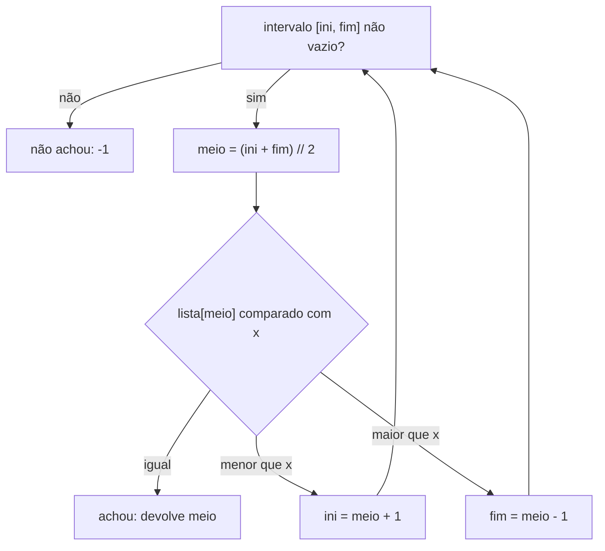

# Busca linear e busca binária

## Por que isso importa

Buscar é a operação mais comum da computação: achar um contato, um produto, uma linha num log, uma versão do código que introduziu um bug (`git bisect` é busca binária!). A diferença entre as duas buscas desta aula é brutal: num milhão de itens, a linear pode precisar de **1.000.000** comparações; a binária, de no máximo **20**. Além disso, a ideia de "descartar metade a cada passo" aparece em árvores de busca (ED-05), em índices de banco de dados e em muitos problemas de entrevista onde ninguém diz "use busca binária".

## Intuição

- **Busca linear**: procurar uma chave **numa gaveta bagunçada**. Você tira item por item até achar ou a gaveta acabar.
- **Busca binária**: procurar uma palavra **no dicionário de papel**. Você abre no meio: a palavra vem antes ou depois? Joga fora a metade errada e repete. Só funciona porque o dicionário está **em ordem alfabética**.

## Visual

Busca binária procurando **23** numa lista ordenada de 10 elementos:

```
índice:   0   1   2   3   4   5   6   7   8   9
valor:    2   5   8  12  16  23  38  56  72  91

passo 1:  ini=0                 meio=4              fim=9
          [2   5   8  12  16  23  38  56  72  91]     16 < 23 → descarta a esquerda
passo 2:                       ini=5  meio=7        fim=9
                               [23  38  56  72  91]   56 > 23 → descarta a direita
passo 3:                       ini=5 meio=5 fim=6
                               [23  38]                23 == 23 → achou no índice 5 ✓
```

Quantos passos no pior caso? Cada passo corta o intervalo pela metade:

```
n:          8    16    1.000    1.000.000    1.000.000.000
linear:     8    16    1.000    1.000.000    1.000.000.000
binária:    4     5       10           20               30      ≈ log₂ n + 1
```



## Conceito técnico

### Busca linear

Percorre do início ao fim comparando cada elemento.

- **Pior caso**: O(n) (o item está no fim ou não existe). **Melhor caso**: O(1).
- **Funciona sempre**: lista desordenada, lista ligada, arquivo lido linha a linha.
- É o que `x in lista`, `lista.index(x)` e `str.find` fazem.

### Busca binária

Pré-requisito: **dados ordenados** e **acesso por índice em O(1)** (array). Mantém um intervalo `[ini, fim]` onde o item **pode** estar e o corta pela metade a cada comparação.

```python
def busca_binaria(lista, x):
    ini, fim = 0, len(lista) - 1
    while ini <= fim:                  # intervalo ainda não vazio
        meio = (ini + fim) // 2
        if lista[meio] == x:
            return meio
        elif lista[meio] < x:
            ini = meio + 1             # x só pode estar à direita
        else:
            fim = meio - 1             # x só pode estar à esquerda
    return -1
```

- **Custo**: O(log n) comparações, O(1) de memória (a versão recursiva usa O(log n) de pilha).
- **Invariante**: "se x está na lista, ele está entre `ini` e `fim`". Cada atualização preserva isso, e quando o intervalo fica vazio (`ini > fim`), x não existe.
- **Vale a pena ordenar só para buscar?** Ordenar custa O(n log n). Para **uma** busca, a linear (O(n)) ganha. Para **muitas** buscas nos mesmos dados, ordenar uma vez e fazer buscas binárias compensa. (Para só "existe ou não", um `set` faz O(1), ED-04.)

### Variações que aparecem muito

**Primeira ocorrência** (lista com repetidos): quando achar, **não pare**; guarde a posição e continue procurando à esquerda (`fim = meio - 1`).

**Posição de inserção** (*lower bound*): o primeiro índice cujo valor é `>= x`. É onde x entraria mantendo a ordem. Também responde "quantos elementos são menores que x".

**Busca no espaço de respostas**: a lista nem precisa existir! Se a pergunta é "qual o **menor** valor que satisfaz uma condição" e a condição é **monotônica** (falsa, falsa, ..., verdadeira, verdadeira), faça busca binária sobre os valores possíveis. Exemplos: raiz quadrada inteira, menor capacidade de caminhão para entregar tudo em D dias, a primeira versão com bug (`git bisect`).

### O módulo bisect

```python
import bisect
notas = [3, 5, 5, 5, 8, 9]
bisect.bisect_left(notas, 5)    # 1: primeira posição onde o 5 entraria (primeira ocorrência)
bisect.bisect_right(notas, 5)   # 4: depois do último 5
bisect.insort(notas, 7)         # insere mantendo a ordem: [3, 5, 5, 5, 7, 8, 9]
```

Quantas vezes o 5 aparece? `bisect_right - bisect_left = 3`, em O(log n).

## Código

Comparando as duas buscas contando comparações:

```python
def linear(lista, x):
    comparacoes = 0
    for i, v in enumerate(lista):
        comparacoes += 1
        if v == x:
            return i, comparacoes
    return -1, comparacoes


def binaria(lista, x):
    ini, fim = 0, len(lista) - 1
    comparacoes = 0
    while ini <= fim:
        meio = (ini + fim) // 2
        comparacoes += 1
        if lista[meio] == x:
            return meio, comparacoes
        if lista[meio] < x:
            ini = meio + 1
        else:
            fim = meio - 1
    return -1, comparacoes


dados = list(range(0, 2_000_000, 2))    # 1 milhão de pares, ordenados
print(linear(dados, 1_999_998))         # (999999, 1000000)
print(binaria(dados, 1_999_998))        # (999999, 20)
print(binaria(dados, 7))                # (-1, 20): ímpar, não existe
```

Busca no espaço de respostas: raiz quadrada inteira sem `math.sqrt`.

```python
def raiz_inteira(n):
    """Maior r tal que r * r <= n."""
    ini, fim = 0, n
    resposta = 0
    while ini <= fim:
        meio = (ini + fim) // 2
        if meio * meio <= n:
            resposta = meio        # meio serve; tenta um maior
            ini = meio + 1
        else:
            fim = meio - 1
    return resposta


print(raiz_inteira(10**12), raiz_inteira(26))   # 1000000 5
```

## Erros comuns

- **Usar busca binária em lista desordenada.** Ela não dá erro: só devolve resposta errada.
- **`while ini < fim`** com `fim = len - 1`: o último elemento do intervalo nunca é testado. Com intervalo fechado `[ini, fim]`, a condição é `<=`.
- **`ini = meio` ou `fim = meio`** (sem o ±1) no modelo fechado: o intervalo pode parar de diminuir, e o laço fica infinito.
- **Overflow no meio** em linguagens com inteiro de tamanho fixo (C, Java): `(ini + fim) / 2` pode passar do limite. Use `ini + (fim - ini) / 2`. (O bug existiu por anos na biblioteca do Java.)
- **Ordenar a lista a cada busca**: O(n log n) por busca, pior que a linear.
- **Parar na primeira ocorrência** quando o problema pede a primeira (ou a última) de vários repetidos.

## Pratique

```quiz
id: AL-01-q1
tipo: multipla_escolha
pergunta: "No pior caso, quantas comparações a busca binária faz numa lista ordenada de 1.000.000 de elementos?"
opcoes: ["Cerca de 20", "Cerca de 1.000", "Cerca de 500.000", "1.000.000"]
resposta: 0
explicacao: "Cada comparação corta o intervalo pela metade: 2²⁰ ≈ 1.048.576, então em cerca de 20 passos o intervalo fica com um elemento. A linear faria até 1.000.000."
dificuldade: 1
```

```quiz
id: AL-01-q2
tipo: multipla_escolha
pergunta: "Qual é o pré-requisito da busca binária?"
opcoes: ["Os elementos serem números", "Os dados estarem ordenados e com acesso por índice rápido", "A lista ter tamanho potência de 2", "Não haver repetidos"]
resposta: 1
explicacao: "Ela decide qual metade descartar comparando com o meio, o que só faz sentido se os dados estiverem ordenados. E precisa pular para o meio em O(1), por isso não funciona bem em lista ligada. Funciona com textos, repetidos e qualquer tamanho."
dificuldade: 1
```

```quiz
id: AL-01-q3
tipo: prever_saida
pergunta: |
  Usando a busca binária desta aula para procurar 9 em `[1, 3, 5, 7, 9, 11]`, quais valores de `meio` são testados, em ordem?
resposta: "2 (valor 5), depois 4 (valor 9): achou."
explicacao: "ini=0, fim=5 → meio=2, lista[2]=5 < 9, então ini=3. ini=3, fim=5 → meio=4, lista[4]=9: achou. Foram 2 comparações."
dificuldade: 2
```

```quiz
id: AL-01-q4
tipo: verdadeiro_falso
pergunta: "Para fazer uma única busca numa lista desordenada, vale a pena ordenar primeiro e depois usar a busca binária."
resposta: false
explicacao: "Ordenar custa O(n log n), mais do que a busca linear O(n). Ordenar só compensa quando você vai fazer muitas buscas nos mesmos dados (ou usar um set, se só precisa saber se existe)."
dificuldade: 1
```

```quiz
id: AL-01-q5
tipo: multipla_escolha
pergunta: "Com `notas = [2, 4, 4, 4, 7]`, quanto vale `bisect.bisect_right(notas, 4) - bisect.bisect_left(notas, 4)`?"
opcoes: ["1", "3", "4", "0"]
resposta: 1
explicacao: "bisect_left dá 1 (a posição do primeiro 4) e bisect_right dá 4 (logo depois do último 4). A diferença é a quantidade de 4s: 3, calculada em O(log n)."
dificuldade: 2
```

```quiz
id: AL-01-q6
tipo: resposta_curta
pergunta: "Explique o que é a invariante da busca binária e por que ela garante que o algoritmo está correto."
resposta: "A invariante é: se x está na lista, ele está entre ini e fim. Ela vale no começo (o intervalo é a lista toda) e cada passo a mantém, porque só descarta a metade onde x certamente não pode estar, já que a lista é ordenada. Quando o intervalo fica vazio, x não está na lista."
palavras_chave: ["ini", "fim", "intervalo", "ordenada"]
dificuldade: 2
```

```quiz
id: AL-01-q7
tipo: codigo
linguagem: python
pergunta: |
  **Busca binária.** Escreva `busca_binaria(lista, x)` **iterativa** que devolve o índice de `x` na lista ordenada, ou `-1` se não estiver. Não use `in`, `index` nem `bisect`. O teste oculto usa uma lista de 1 milhão de elementos.
codigo_inicial: |
  def busca_binaria(lista, x):
      ini = 0
      fim = len(lista) - 1
      return -1
usa: [def, while, return]
testes:
  - chamada: "busca_binaria([2, 5, 8, 12, 16, 23, 38, 56, 72, 91], 23)"
    saida: "5"
  - chamada: "busca_binaria([2, 5, 8, 12, 16, 23, 38, 56, 72, 91], 2)"
    saida: "0"
  - chamada: "busca_binaria([2, 5, 8, 12, 16, 23, 38, 56, 72, 91], 91)"
    saida: "9"
  - chamada: "busca_binaria([], 1)"
    saida: "-1"
  - chamada: "busca_binaria([1, 3], 2)"
    visivel: false
    saida: "-1"
  - chamada: "busca_binaria(list(range(0, 2000000, 2)), 1234568)"
    visivel: false
    saida: "617284"
dica: "Enquanto ini <= fim: meio = (ini + fim) // 2. Se lista[meio] == x, devolva meio; se for menor que x, ini = meio + 1; senão, fim = meio - 1. Depois do laço, devolva -1."
solucao: |
  def busca_binaria(lista, x):
      ini = 0
      fim = len(lista) - 1
      while ini <= fim:
          meio = (ini + fim) // 2
          if lista[meio] == x:
              return meio
          elif lista[meio] < x:
              ini = meio + 1
          else:
              fim = meio - 1
      return -1
explicacao: "Os testes conferem as bordas: primeiro elemento, último, lista vazia e um valor entre dois existentes. Com 1 milhão de itens, a busca termina em ~20 passos."
dificuldade: 1
```

```quiz
id: AL-01-q8
tipo: codigo
linguagem: python
pergunta: |
  **Primeira ocorrência.** Numa lista ordenada **com repetidos**, escreva `primeira(lista, x)` que devolve o índice da **primeira** ocorrência de `x`, ou `-1`. Precisa ser O(log n): quando achar `x`, guarde a posição e continue procurando à esquerda.
codigo_inicial: |
  def primeira(lista, x):
      pass
usa: [def, while, return]
testes:
  - chamada: "primeira([1, 2, 2, 2, 3], 2)"
    saida: "1"
  - chamada: "primeira([5, 5, 5, 5], 5)"
    saida: "0"
  - chamada: "primeira([1, 3, 5], 4)"
    saida: "-1"
  - chamada: "primeira([0] * 500000 + [1] * 500000, 1)"
    visivel: false
    saida: "500000"
  - chamada: "primeira([1, 1, 2, 3, 3, 3, 3, 9], 3)"
    visivel: false
    saida: "3"
dica: "Igual à busca binária, mas com uma variável resposta = -1. Quando lista[meio] == x: resposta = meio e fim = meio - 1 (pode haver outra ocorrência mais à esquerda). No fim, devolva resposta."
solucao: |
  def primeira(lista, x):
      ini = 0
      fim = len(lista) - 1
      resposta = -1
      while ini <= fim:
          meio = (ini + fim) // 2
          if lista[meio] == x:
              resposta = meio
              fim = meio - 1
          elif lista[meio] < x:
              ini = meio + 1
          else:
              fim = meio - 1
      return resposta
explicacao: "Ao achar x, a resposta pode estar ali ou mais à esquerda, então guardamos e continuamos. Andar para a esquerda a partir do achado, de um em um, seria O(n) no pior caso (lista com meio milhão de 1s, como no teste oculto)."
dificuldade: 2
```

```quiz
id: AL-01-q9
tipo: codigo
linguagem: python
pergunta: |
  **Busca no espaço de respostas.** Uma gráfica precisa imprimir `paginas` páginas usando impressoras com velocidades diferentes (`velocidades[i]` páginas por minuto, todas trabalhando ao mesmo tempo). Escreva `tempo_minimo(velocidades, paginas)` que devolve o **menor número inteiro de minutos** para imprimir tudo. Em `t` minutos, a impressora `i` imprime `velocidades[i] * t` páginas.
codigo_inicial: |
  def tempo_minimo(velocidades, paginas):
      pass
usa: [def, while, return]
testes:
  - chamada: "tempo_minimo([2, 3], 10)"
    saida: "2"
  - chamada: "tempo_minimo([1], 7)"
    saida: "7"
  - chamada: "tempo_minimo([5, 5, 5], 1)"
    saida: "1"
  - chamada: "tempo_minimo([1, 2, 3], 100)"
    visivel: false
    saida: "17"
  - chamada: "tempo_minimo([7, 13], 10 ** 15)"
    visivel: false
    saida: "50000000000000"
dica: "A condição 'dá para imprimir tudo em t minutos' (sum(v * t for v in velocidades) >= paginas) é falsa até certo t e verdadeira depois: é monotônica. Faça busca binária em t entre 1 e paginas (o pior caso tem só a impressora de velocidade 1), guardando o menor t que funciona."
solucao: |
  def tempo_minimo(velocidades, paginas):
      ini = 1
      fim = paginas
      resposta = paginas
      while ini <= fim:
          meio = (ini + fim) // 2
          if sum(v * meio for v in velocidades) >= paginas:
              resposta = meio
              fim = meio - 1
          else:
              ini = meio + 1
      return resposta
explicacao: "Não há lista para buscar: buscamos no intervalo de respostas possíveis. Testar t = 1, 2, 3... seria O(resposta), inviável com 10¹⁵ páginas; a busca binária faz ~50 testes. Reconhecer uma condição monotônica é o que revela a busca binária escondida no problema."
dificuldade: 3
```

```quiz
id: AL-01-q10
tipo: codigo
linguagem: c
pergunta: |
  **Busca binária em C.** Leia `n`, depois `n` inteiros em ordem crescente e por fim o valor `x` (tudo separado por espaço ou em linhas). Imprima o índice de `x` ou `-1`, seguido de quebra de linha. Para calcular o meio sem risco de overflow, use `ini + (fim - ini) / 2`. (A leitura usa uma variável auxiliar `lido` porque o C do navegador ainda não aceita `scanf` direto em `&v[i]`.) Para as entradas `5`, `1 3 5 7 9` e `7`:

  ```
  3
  ```
codigo_inicial: |
  #include <stdio.h>

  int main() {
      int n;
      scanf("%d", &n);
      int v[100];
      for (int i = 0; i < n; i++) {
          int lido;
          scanf("%d", &lido);
          v[i] = lido;
      }
      int x;
      scanf("%d", &x);
      // busca binária aqui
      printf("%d\n", -1);
      return 0;
  }
usa: [while, scanf, printf]
testes:
  - entradas: ["5", "1 3 5 7 9", "7"]
    saida: "3"
  - entradas: ["5", "1 3 5 7 9", "4"]
    saida: "-1"
  - entradas: ["1", "42", "42"]
    saida: "0"
  - entradas: ["8", "-9 -3 0 2 4 8 16 32", "-9"]
    visivel: false
    saida: "0"
  - entradas: ["8", "-9 -3 0 2 4 8 16 32", "32"]
    visivel: false
    saida: "7"
dica: "Declare int ini = 0, fim = n - 1, resposta = -1. while (ini <= fim) { int meio = ini + (fim - ini) / 2; ... }. Em C, a divisão entre ints já é inteira. Use break ao achar e imprima resposta no fim."
solucao: |
  #include <stdio.h>

  int main() {
      int n;
      scanf("%d", &n);
      int v[100];
      for (int i = 0; i < n; i++) {
          int lido;
          scanf("%d", &lido);
          v[i] = lido;
      }
      int x;
      scanf("%d", &x);
      int ini = 0;
      int fim = n - 1;
      int resposta = -1;
      while (ini <= fim) {
          int meio = ini + (fim - ini) / 2;
          if (v[meio] == x) {
              resposta = meio;
              break;
          } else if (v[meio] < x) {
              ini = meio + 1;
          } else {
              fim = meio - 1;
          }
      }
      printf("%d\n", resposta);
      return 0;
  }
explicacao: "O algoritmo é o mesmo em qualquer linguagem; muda a sintaxe (chaves, ponto e vírgula, tipos declarados). Em C, int tem 32 bits: com índices perto de 2 bilhões, ini + fim estouraria (MD-04), por isso a forma ini + (fim - ini) / 2."
dificuldade: 2
```

## Resumo

- **Linear**: O(n), funciona com qualquer coleção. **Binária**: O(log n), exige dados **ordenados** com acesso por índice.
- Modelo seguro: intervalo fechado `[ini, fim]`, `while ini <= fim`, `ini = meio + 1` / `fim = meio - 1`.
- **Primeira ocorrência / posição de inserção**: ao achar, guarde e continue à esquerda (ou use `bisect_left`).
- **Busca no espaço de respostas**: se a condição é monotônica, faça busca binária nos valores possíveis.
- Em C/Java, calcule o meio com `ini + (fim - ini) / 2`.

## Para ir além

- Use `git bisect` num repositório seu para achar o commit que introduziu um bug: é busca binária no histórico.
- **Próximo módulo**: AL-02 Ordenação simples (para ter dados ordenados, alguém precisa ordenar!).
