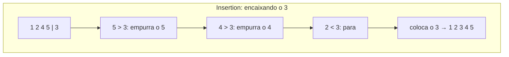

# Ordenação simples: bubble, selection, insertion

## Por que isso importa

Dados ordenados são a base de muita coisa: busca binária (AL-01), remover repetidos, achar a mediana, juntar listas, mostrar um ranking. No dia a dia você vai usar o `sorted()` da linguagem, mas os três algoritmos desta aula ensinam a **pensar em algoritmos**: invariantes, contagem de operações, melhor e pior caso. Eles também são a pergunta clássica de entrevista, e o insertion sort é usado **de verdade** dentro do Timsort (o `sorted` do Python e do Java) para trechos pequenos.

## Intuição

- **Bubble sort**: alunos numa fila comparando altura **com o vizinho** e trocando de lugar se o da frente for mais alto. A cada rodada, o mais alto "borbulha" até o fim da fila.
- **Selection sort**: escolher um time na educação física: a cada rodada, você **procura o melhor** entre os que sobraram e o põe na próxima posição.
- **Insertion sort**: arrumar **cartas na mão**: você pega uma carta nova e a **encaixa** no lugar certo entre as que já estão arrumadas, empurrando as maiores para a direita.

## Visual

Os três ordenando `[5, 2, 4, 1, 3]`. A barra `|` separa a parte já ordenada.

```
BUBBLE (compara vizinhos; o maior vai para o fim)
  rodada 1: [2, 4, 1, 3 | 5]     5 borbulhou até o fim
  rodada 2: [2, 1, 3 | 4, 5]
  rodada 3: [1, 2 | 3, 4, 5]
  rodada 4: [1 | 2, 3, 4, 5]

SELECTION (acha o menor do resto e põe na frente)
  passo 1: menor de [5,2,4,1,3] é 1 → troca com o 5:   [1 | 2, 4, 5, 3]
  passo 2: menor de [2,4,5,3]   é 2 → já está no lugar: [1, 2 | 4, 5, 3]
  passo 3: menor de [4,5,3]     é 3 → troca com o 4:    [1, 2, 3 | 5, 4]
  passo 4: menor de [5,4]       é 4 → troca com o 5:    [1, 2, 3, 4 | 5]

INSERTION (encaixa o próximo na parte arrumada)
  [5 | 2, 4, 1, 3]   pega 2, encaixa antes do 5     → [2, 5 | 4, 1, 3]
  [2, 5 | 4, 1, 3]   pega 4, encaixa entre 2 e 5    → [2, 4, 5 | 1, 3]
  [2, 4, 5 | 1, 3]   pega 1, encaixa no começo      → [1, 2, 4, 5 | 3]
  [1, 2, 4, 5 | 3]   pega 3, encaixa entre 2 e 4    → [1, 2, 3, 4, 5]
```



## Conceito técnico

### Bubble sort

Percorre a lista comparando pares vizinhos e trocando os que estão fora de ordem. Depois da rodada `k`, os `k` maiores estão na posição final. **Otimização**: se uma rodada inteira não fizer nenhuma troca, a lista já está ordenada e dá para parar.

```python
def bubble(l):
    n = len(l)
    for fim in range(n - 1, 0, -1):          # a parte desordenada vai de 0 a fim
        trocou = False
        for i in range(fim):
            if l[i] > l[i + 1]:
                l[i], l[i + 1] = l[i + 1], l[i]
                trocou = True
        if not trocou:
            break
```

### Selection sort

Para cada posição `i`, acha o **menor** elemento de `i` até o fim e troca com a posição `i`. Faz sempre ~n²/2 comparações, mesmo com a lista já ordenada, mas no máximo **n − 1 trocas** (útil quando trocar é caro, como mover objetos grandes ou escrever em memória flash).

```python
def selection(l):
    n = len(l)
    for i in range(n - 1):
        menor = i
        for j in range(i + 1, n):
            if l[j] < l[menor]:
                menor = j
        l[i], l[menor] = l[menor], l[i]
```

### Insertion sort

Mantém `l[0:i]` ordenado e insere `l[i]` nele, deslocando para a direita os maiores.

```python
def insertion(l):
    for i in range(1, len(l)):
        atual = l[i]
        j = i - 1
        while j >= 0 and l[j] > atual:   # empurra os maiores para a direita
            l[j + 1] = l[j]
            j -= 1
        l[j + 1] = atual                 # encaixa no buraco que sobrou
```

Numa lista **já ordenada**, o `while` nunca roda: O(n). Em geral, o custo é O(n + inversões), em que uma **inversão** é um par fora de ordem. Por isso é ótimo para listas **quase ordenadas** e para listas pequenas.

### Comparação

| Algoritmo | Melhor caso | Pior caso | Trocas (pior) | Estável? | No lugar? |
|---|---|---|---|---|---|
| Bubble (com parada) | O(n): já ordenada | O(n²) | O(n²) | sim | sim |
| Selection | O(n²) | O(n²) | **O(n)** | não | sim |
| Insertion | **O(n)**: já ordenada | O(n²) | O(n²) | sim | sim |

- **No lugar (in-place)**: usa só O(1) de memória extra; reorganiza a própria lista.
- **Estável**: elementos com a **mesma chave** mantêm a ordem relativa original. Importa quando você ordena por um critério e depois por outro: ordenar alunos por nome e depois, de forma estável, por nota mantém os de mesma nota em ordem alfabética.

Na prática, os três são O(n²) e lentos para listas grandes: 100 mil itens dão ~5 bilhões de comparações. Em AL-03 você vai ver merge sort e quick sort, O(n log n). O `sorted()` do Python usa o **Timsort**: merge sort + insertion sort para trechos pequenos, estável e O(n) para dados já ordenados.

## Código

Contando comparações para ver o melhor e o pior caso na prática:

```python
def insertion_contando(l):
    l = l[:]                       # trabalha numa cópia
    comparacoes = 0
    for i in range(1, len(l)):
        atual = l[i]
        j = i - 1
        while j >= 0:
            comparacoes += 1
            if l[j] <= atual:
                break
            l[j + 1] = l[j]
            j -= 1
        l[j + 1] = atual
    return comparacoes


n = 1000
print("ordenada:", insertion_contando(list(range(n))))          # 999
print("invertida:", insertion_contando(list(range(n, 0, -1))))  # 499500 = n(n-1)/2
quase = list(range(n))
quase[10], quase[11] = quase[11], quase[10]                     # 1 inversão
print("quase:", insertion_contando(quase))                      # 1000
```

Estabilidade na prática: ordenar por nota mantendo a ordem alfabética entre empatados.

```python
alunos = [("Ana", 8), ("Bia", 9), ("Caio", 8), ("Davi", 9)]   # já em ordem alfabética
por_nota = sorted(alunos, key=lambda a: a[1], reverse=True)    # sorted é estável
print(por_nota)   # [('Bia', 9), ('Davi', 9), ('Ana', 8), ('Caio', 8)]
```

## Erros comuns

- **Índice fora da lista no bubble**: comparar `l[i]` com `l[i + 1]` com `i` indo até `n - 1`. O laço interno vai até `fim - 1`.
- **Esquecer de guardar `atual`** no insertion antes de deslocar: o valor é sobrescrito.
- **Trocar dentro do laço interno no selection** em vez de só anotar a posição do menor e trocar uma vez no fim.
- **Achar que selection sort é estável.** A troca de longa distância pode passar um elemento à frente de outro igual.
- **Usar algoritmo O(n²) em produção** com listas grandes, em vez do `sorted()` da linguagem.
- **Esperar que `sorted(l)` altere `l`** (não altera) ou que `l.sort()` devolva a lista (devolve `None`).

## Pratique

```quiz
id: AL-02-q1
tipo: multipla_escolha
pergunta: "Depois da primeira rodada do bubble sort em `[4, 3, 2, 1]`, como fica a lista?"
opcoes: ["[1, 2, 3, 4]", "[3, 2, 1, 4]", "[3, 4, 2, 1]", "[1, 3, 2, 4]"]
resposta: 1
explicacao: "Comparando vizinhos: 4>3 troca → [3,4,2,1]; 4>2 troca → [3,2,4,1]; 4>1 troca → [3,2,1,4]. O maior (4) borbulhou até o fim, que é a garantia de cada rodada."
dificuldade: 1
```

```quiz
id: AL-02-q2
tipo: multipla_escolha
pergunta: "Qual dos três algoritmos é O(n) quando a lista já está ordenada?"
opcoes: ["Só o selection sort", "Insertion sort (e o bubble sort com parada antecipada)", "Nenhum, todos são O(n²) sempre", "Só o bubble sort sem otimização"]
resposta: 1
explicacao: "No insertion, cada elemento é comparado uma vez com o anterior e já fica no lugar: n − 1 comparações. O bubble com a flag 'trocou' para após uma rodada sem trocas. O selection sempre procura o menor do resto: ~n²/2 comparações."
dificuldade: 2
```

```quiz
id: AL-02-q3
tipo: multipla_escolha
pergunta: "Qual algoritmo faz no máximo n − 1 trocas?"
opcoes: ["Bubble sort", "Selection sort", "Insertion sort", "Todos"]
resposta: 1
explicacao: "O selection faz exatamente uma troca por posição (coloca o menor do resto no lugar). Bubble e insertion podem fazer O(n²) trocas/deslocamentos numa lista invertida."
dificuldade: 1
```

```quiz
id: AL-02-q4
tipo: verdadeiro_falso
pergunta: "Um algoritmo de ordenação estável mantém a ordem original entre elementos considerados iguais pela chave de ordenação."
resposta: true
explicacao: "É a definição. Exemplo: ordenar [(Ana, 8), (Caio, 8)] pela nota mantém Ana antes de Caio. Bubble e insertion são estáveis; selection não é (uma troca pode pular um elemento igual)."
dificuldade: 1
```

```quiz
id: AL-02-q5
tipo: prever_saida
pergunta: |
  Rastreie o insertion sort em `[3, 1, 2]`. Como fica a lista depois de encaixar cada elemento?
resposta: "[1, 3, 2] depois de encaixar o 1, e [1, 2, 3] depois de encaixar o 2."
explicacao: "i=1: atual=1; 3 > 1, empurra o 3 → encaixa o 1 na posição 0: [1, 3, 2]. i=2: atual=2; 3 > 2, empurra o 3; 1 < 2, para → encaixa o 2 na posição 1: [1, 2, 3]."
dificuldade: 1
```

```quiz
id: AL-02-q6
tipo: resposta_curta
pergunta: "Você recebe todo dia uma lista de 1 milhão de pedidos já ordenada por horário, mas com uns poucos pedidos fora do lugar. Entre os três algoritmos, qual escolheria e por quê?"
resposta: "Insertion sort, porque o custo dele é proporcional a n mais o número de inversões. Com poucos itens fora do lugar, ele fica perto de O(n), enquanto selection continua O(n²) e o bubble pode precisar de muitas rodadas se um item estiver longe do lugar."
palavras_chave: ["insertion", "quase ordenada", "inversões", "O(n)"]
dificuldade: 2
```

```quiz
id: AL-02-q7
tipo: codigo
linguagem: python
pergunta: |
  **Bubble sort com parada antecipada.** Escreva `bubble(lista)` que ordena **uma cópia** da lista (sem alterar a original) e devolve uma tupla `(lista_ordenada, rodadas)`, em que `rodadas` é quantas passadas completas o laço externo fez, parando assim que uma passada não fizer nenhuma troca (essa passada também conta). Não use `sort`/`sorted`.
codigo_inicial: |
  def bubble(lista):
      l = lista[:]
      rodadas = 0
      return l, rodadas
usa: [def, for, return]
testes:
  - chamada: "bubble([5, 2, 4, 1, 3])"
    saida: "([1, 2, 3, 4, 5], 4)"
  - chamada: "bubble([1, 2, 3, 4])"
    saida: "([1, 2, 3, 4], 1)"
  - chamada: "bubble([2, 1, 3, 4, 5])"
    saida: "([1, 2, 3, 4, 5], 2)"
  - chamada: "bubble([])"
    visivel: false
    saida: "([], 0)"
  - chamada: "(lambda o: (bubble(o)[0], o))([3, 1, 2])"
    visivel: false
    saida: "([1, 2, 3], [3, 1, 2])"
dica: "for fim in range(len(l) - 1, 0, -1): conte a rodada, use trocou = False, compare l[i] e l[i + 1] para i em range(fim) e troque com l[i], l[i + 1] = l[i + 1], l[i]. Se não trocou, break."
solucao: |
  def bubble(lista):
      l = lista[:]
      rodadas = 0
      for fim in range(len(l) - 1, 0, -1):
          rodadas += 1
          trocou = False
          for i in range(fim):
              if l[i] > l[i + 1]:
                  l[i], l[i + 1] = l[i + 1], l[i]
                  trocou = True
          if not trocou:
              break
      return l, rodadas
explicacao: "Numa lista já ordenada, a primeira passada não troca nada e o algoritmo para: O(n). Em [2, 1, 3, 4, 5], a primeira passada corrige o par 2-1 e a segunda confirma que acabou. Sem a parada, seriam sempre n − 1 rodadas."
dificuldade: 2
```

```quiz
id: AL-02-q8
tipo: codigo
linguagem: python
pergunta: |
  **Selection sort contando trocas.** Escreva `selection(lista)` que ordena **no lugar** (alterando a lista recebida) e devolve quantas trocas efetivas fez (não conte quando o menor já está na posição certa). Não use `sort`/`sorted`/`min`.
codigo_inicial: |
  def selection(lista):
      trocas = 0
      return trocas
usa: [def, for, return]
testes:
  - chamada: "(lambda l: (selection(l), l))([5, 2, 4, 1, 3])"
    saida: "(3, [1, 2, 3, 4, 5])"
  - chamada: "(lambda l: (selection(l), l))([1, 2, 3])"
    saida: "(0, [1, 2, 3])"
  - chamada: "(lambda l: (selection(l), l))([4, 3, 2, 1])"
    visivel: false
    saida: "(2, [1, 2, 3, 4])"
  - chamada: "(lambda l: (selection(l), l))(['d', 'a', 'c', 'b'])"
    visivel: false
    saida: "(2, ['a', 'b', 'c', 'd'])"
dica: "Para cada i de 0 a len - 2: menor = i; percorra j de i + 1 até o fim atualizando menor quando lista[j] < lista[menor]. Depois, se menor != i, troque e conte."
solucao: |
  def selection(lista):
      trocas = 0
      n = len(lista)
      for i in range(n - 1):
          menor = i
          for j in range(i + 1, n):
              if lista[j] < lista[menor]:
                  menor = j
          if menor != i:
              lista[i], lista[menor] = lista[menor], lista[i]
              trocas += 1
      return trocas
explicacao: "O laço interno só procura; a troca acontece uma vez por posição, no máximo n − 1 no total. Em [4, 3, 2, 1], trocar 4↔1 e depois 3↔2 já resolve: 2 trocas. As comparações, porém, são sempre ~n²/2."
dificuldade: 2
```

```quiz
id: AL-02-q9
tipo: codigo
linguagem: python
pergunta: |
  **Insertion sort por chave, estável.** Escreva `ordenar_por(itens, chave)` que devolve uma **nova** lista ordenada pelo valor `chave(item)`, usando insertion sort (sem `sort`/`sorted`). Precisa ser **estável**: itens com a mesma chave mantêm a ordem original.
codigo_inicial: |
  def ordenar_por(itens, chave):
      l = itens[:]
      return l
usa: [def, for, while, return]
testes:
  - chamada: "ordenar_por([('Ana', 8), ('Bia', 9), ('Caio', 8), ('Davi', 7)], lambda a: a[1])"
    saida: "[('Davi', 7), ('Ana', 8), ('Caio', 8), ('Bia', 9)]"
  - chamada: "ordenar_por(['banana', 'kiwi', 'uva', 'pera'], len)"
    saida: "['uva', 'kiwi', 'pera', 'banana']"
  - chamada: "ordenar_por([], len)"
    saida: "[]"
  - chamada: "ordenar_por([3, -1, 2, -3, 1], abs)"
    visivel: false
    saida: "[-1, 1, 2, 3, -3]"
dica: "Insertion sort normal, mas comparando chave(l[j]) > chave(atual). Use > estrito (não >=): assim um item nunca passa à frente de outro com a mesma chave, e a ordenação fica estável."
solucao: |
  def ordenar_por(itens, chave):
      l = itens[:]
      for i in range(1, len(l)):
          atual = l[i]
          j = i - 1
          while j >= 0 and chave(l[j]) > chave(atual):
              l[j + 1] = l[j]
              j -= 1
          l[j + 1] = atual
      return l
explicacao: "A estabilidade depende de um detalhe: com >= no while, itens iguais seriam empurrados e trocariam de ordem. Com > estrito, o atual para logo depois de um igual. É assim que o key= do sorted funciona por fora: o algoritmo compara as chaves, mas move os itens inteiros."
dificuldade: 2
```

```quiz
id: AL-02-q10
tipo: codigo
linguagem: javascript
pergunta: |
  **Insertion sort em JavaScript.** Escreva `insertionSort(arr)` que devolve um **novo** array ordenado (números), sem usar `sort`. Copie com `[...arr]` antes de mexer.
codigo_inicial: |
  function insertionSort(arr) {
    const a = [...arr];
    return a;
  }
usa: [function, while, return]
testes:
  - chamada: "insertionSort([5, 2, 4, 1, 3])"
    saida: "[ 1, 2, 3, 4, 5 ]"
  - chamada: "insertionSort([])"
    saida: "[]"
  - chamada: "insertionSort([10, -2, 7, -2, 0])"
    visivel: false
    saida: "[ -2, -2, 0, 7, 10 ]"
  - chamada: "((o) => [insertionSort(o), o])([2, 1])"
    visivel: false
    saida: "[ [ 1, 2 ], [ 2, 1 ] ]"
dica: "for (let i = 1; i < a.length; i++) { const atual = a[i]; let j = i - 1; while (j >= 0 && a[j] > atual) { a[j + 1] = a[j]; j--; } a[j + 1] = atual; }"
solucao: |
  function insertionSort(arr) {
    const a = [...arr];
    for (let i = 1; i < a.length; i++) {
      const atual = a[i];
      let j = i - 1;
      while (j >= 0 && a[j] > atual) {
        a[j + 1] = a[j];
        j--;
      }
      a[j + 1] = atual;
    }
    return a;
  }
explicacao: "O algoritmo é idêntico ao do Python. Cuidado extra no JavaScript: o sort() nativo sem função de comparação ordena como texto ([10, 9, 1].sort() dá [1, 10, 9]); para números, use a.sort((x, y) => x - y)."
dificuldade: 1
```

## Resumo

- **Bubble**: troca vizinhos; o maior borbulha para o fim. **Selection**: põe o menor do resto na frente. **Insertion**: encaixa cada item na parte já ordenada.
- Os três são **O(n²)** no pior caso e **no lugar** (O(1) de memória extra).
- **Insertion** (e bubble com parada) é **O(n)** em lista ordenada; ótimo para listas pequenas ou quase ordenadas.
- **Selection** faz no máximo **n − 1 trocas**, mas sempre ~n²/2 comparações, e **não é estável**.
- **Estável** = iguais mantêm a ordem original. Na prática, use `sorted()` (Timsort, O(n log n), estável).

## Para ir além

- Veja os três (e outros) animados em **visualgo.net/pt/sorting** e no vídeo "15 Sorting Algorithms in 6 Minutes".
- **Próximo módulo**: AL-03 Ordenação eficiente (merge sort, quick sort, heap sort). No seu caminho, em paralelo: MC-01 Funções, limites e derivadas.
