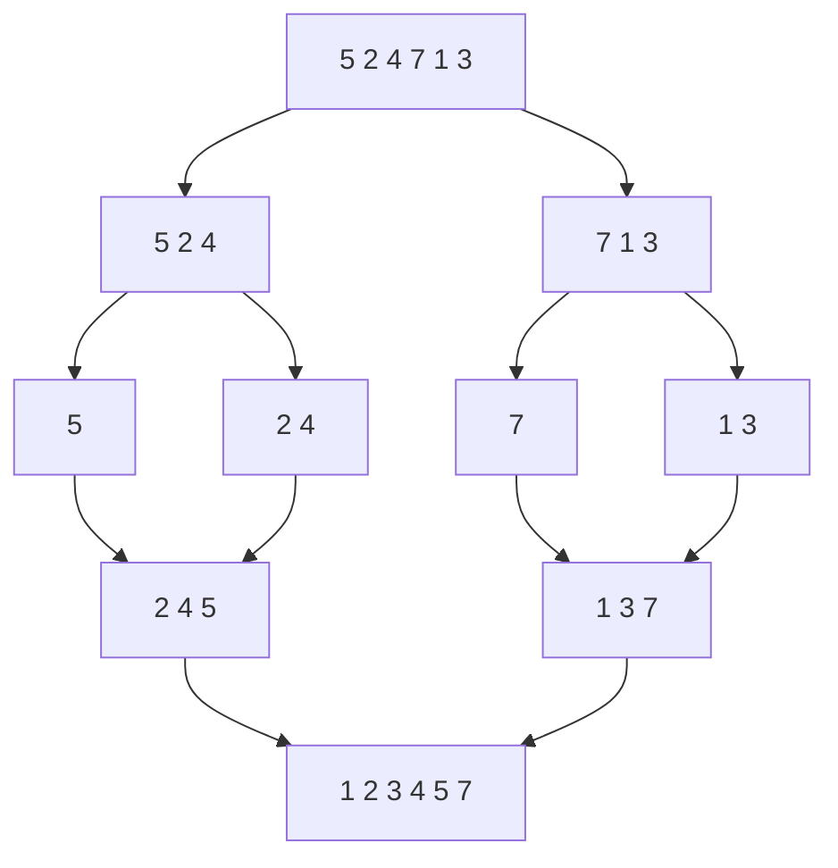

# Ordenação eficiente: merge sort, quick sort, heap sort

## Por que isso importa

Os algoritmos de AL-02 são O(n²): ordenar 1 milhão de itens daria cerca de 500 bilhões de comparações. Os desta aula são **O(n log n)**: cerca de 20 milhões. É a diferença entre horas e milissegundos. Eles também são a melhor introdução a **divisão e conquista**, a técnica de quebrar um problema em partes menores, resolver cada uma e juntar (AL-04). E são presença garantida em entrevistas: "implemente o merge", "explique o pior caso do quick sort", "qual é estável?".

## Intuição

- **Merge sort**: para ordenar um monte de provas, divida em dois montes, peça para dois colegas ordenarem cada um, e depois **intercale** os dois montes ordenados pegando sempre a menor do topo. Os colegas fazem o mesmo, até sobrar uma prova por monte (que já está ordenado).
- **Quick sort**: escolha uma prova como **pivô** (nota 7, digamos). Faça um monte com as notas menores e outro com as maiores. O pivô já está no lugar certo, entre os dois montes. Repita em cada monte.
- **Heap sort**: monte um "torneio" (heap, ED-07) com todas as provas e vá tirando o campeão, um por vez.

## Visual

Merge sort em `[5, 2, 4, 7, 1, 3]`:



Intercalando `[2, 4, 5]` e `[1, 3, 7]`:

```text
esquerda   direita    resultado
[2,4,5]    [1,3,7]    []           1 < 2 → pega 1
[2,4,5]    [3,7]      [1]          2 < 3 → pega 2
[4,5]      [3,7]      [1,2]        3 < 4 → pega 3
[4,5]      [7]        [1,2,3]      4 < 7 → pega 4
[5]        [7]        [1,2,3,4]    5 < 7 → pega 5
[]         [7]        [1,2,3,4,5]  esquerda acabou → copia o resto
                      [1,2,3,4,5,7]
```

Particionamento do quick sort (pivô = último, 4):

```text
[7, 2, 1, 6, 8, 5, 3, 4]       pivô = 4; "menores" vão para a frente
[2, 1, 3 | 6, 8, 5, 7, 4]      depois de percorrer: 2, 1, 3 são < 4
[2, 1, 3, 4, 8, 5, 7, 6]       pivô vai para logo depois dos menores (posição 3)
 └─ < 4 ─┘ ↑  └── > 4 ──┘      o 4 está na posição final; repete nos dois lados
```

## Conceito técnico

### Merge sort

1. Se a lista tem 0 ou 1 item, já está ordenada.
2. Divida ao meio, ordene cada metade **recursivamente**.
3. **Intercale** (merge) as duas metades ordenadas.

O merge percorre as duas metades uma vez: O(n). Quantos níveis de divisão existem? Dividir n ao meio até chegar em 1 leva **log₂ n** níveis. Em cada nível, os merges somados processam os n itens. Total: **O(n log n)**, no melhor, médio e pior caso.

```text
nível 0:  1 lista de n          → merge custa n
nível 1:  2 listas de n/2       → 2 · n/2 = n
nível 2:  4 listas de n/4       → n
...
log₂ n níveis × n por nível = n log n
```

Em termos de recorrência (MD-07): T(n) = 2T(n/2) + n, que dá Θ(n log n).

- **Estável**: sim, desde que, no empate, o merge pegue da **esquerda** primeiro (`<=`).
- **Memória**: O(n) extra para as listas intercaladas. Não é no lugar.

### Quick sort

1. Escolha um **pivô**.
2. **Particione**: menores que o pivô à esquerda, maiores à direita. O pivô fica na posição final.
3. Ordene recursivamente os dois lados.

Particionamento de **Lomuto** (pivô = último):

```python
def particionar(a, ini, fim):        # ordena a[ini..fim] em volta de a[fim]
    pivo = a[fim]
    i = ini                          # a[ini:i] são os menores que o pivô
    for j in range(ini, fim):
        if a[j] < pivo:
            a[i], a[j] = a[j], a[i]
            i += 1
    a[i], a[fim] = a[fim], a[i]      # pivô vai para o lugar certo
    return i
```

O custo depende do pivô:

| Caso | Quando acontece | Custo |
|---|---|---|
| Melhor/médio | pivô divide mais ou menos ao meio | O(n log n) |
| Pior | pivô sempre é o menor ou o maior (ex.: lista **já ordenada** com pivô = último) | O(n²) |

A solução prática é escolher o pivô **ao acaso** (ou a mediana de três): o pior caso vira extremamente improvável. Mesmo com pior caso O(n²), o quick sort costuma ser o mais rápido na prática: é **no lugar** (O(log n) de pilha) e acessa a memória de forma sequencial, o que o cache adora.

- **Estável**: não (as trocas de longa distância embaralham iguais).

### Heap sort

1. Transforme a lista num **max-heap** (heapify, O(n)).
2. Troque a raiz (o maior) com o último item, encolha o heap em 1 e desça a nova raiz. Repita.

Cada uma das n remoções custa O(log n): **O(n log n)** em qualquer caso, **no lugar** (O(1) extra). Não é estável e, na prática, é mais lento que o quick sort por pular muito pela memória. Brilha quando você precisa de garantia de O(n log n) **sem** memória extra.

### Comparação

| Algoritmo | Melhor | Médio | Pior | Memória extra | Estável? |
|---|---|---|---|---|---|
| Merge sort | n log n | n log n | n log n | O(n) | sim |
| Quick sort | n log n | n log n | **n²** | O(log n) | não |
| Heap sort | n log n | n log n | n log n | O(1) | não |
| Insertion (AL-02) | **n** | n² | n² | O(1) | sim |

Na vida real: o `sorted` do Python e o `Arrays.sort` de objetos do Java usam o **Timsort** (merge sort + insertion sort, estável). O `std::sort` do C++ usa o **introsort**: quick sort que muda para heap sort se a recursão ficar funda demais (fugindo do pior caso) e usa insertion sort em trechos pequenos.

### O limite de n log n

Qualquer ordenação que só compara pares de itens precisa de **Ω(n log n)** comparações no pior caso. Ideia: existem n! ordens possíveis da entrada, cada comparação tem 2 respostas, então são necessárias pelo menos log₂(n!) ≈ n log₂ n comparações para distinguir todas. Algoritmos que **não** comparam (counting sort, radix sort) podem ser O(n), mas só para chaves especiais (inteiros num intervalo pequeno, por exemplo).

## Código

Merge sort completo:

```python
def merge(esq, dir):
    resultado = []
    i = j = 0
    while i < len(esq) and j < len(dir):
        if esq[i] <= dir[j]:          # <= mantém a estabilidade
            resultado.append(esq[i])
            i += 1
        else:
            resultado.append(dir[j])
            j += 1
    resultado.extend(esq[i:])         # um dos dois sobrou
    resultado.extend(dir[j:])
    return resultado


def merge_sort(l):
    if len(l) <= 1:
        return l
    meio = len(l) // 2
    return merge(merge_sort(l[:meio]), merge_sort(l[meio:]))


print(merge_sort([5, 2, 4, 7, 1, 3]))   # [1, 2, 3, 4, 5, 7]
```

Medindo a diferença para o insertion sort:

```python
import random
import time

def insertion(l):
    l = l[:]
    for i in range(1, len(l)):
        atual, j = l[i], i - 1
        while j >= 0 and l[j] > atual:
            l[j + 1] = l[j]
            j -= 1
        l[j + 1] = atual
    return l

def merge_sort(l):
    if len(l) <= 1:
        return l
    m = len(l) // 2
    a, b = merge_sort(l[:m]), merge_sort(l[m:])
    r, i, j = [], 0, 0
    while i < len(a) and j < len(b):
        if a[i] <= b[j]:
            r.append(a[i]); i += 1
        else:
            r.append(b[j]); j += 1
    return r + a[i:] + b[j:]

dados = [random.random() for _ in range(2000)]
for f in (insertion, merge_sort, sorted):
    t = time.perf_counter()
    f(dados)
    print(f.__name__, round(time.perf_counter() - t, 3), "s")
```

## Erros comuns

- **Esquecer o resto no merge.** Quando uma metade acaba, o que sobrou da outra precisa ser copiado.
- **Usar `<` no merge.** Funciona, mas perde a estabilidade: no empate, o item da direita passa na frente.
- **Caso base errado na recursão.** `if len(l) == 1` quebra com lista vazia (recursão infinita). Use `<= 1`.
- **Quick sort com pivô fixo em dados ordenados.** Vira O(n²) e, em Python, estoura o limite de recursão. Sorteie o pivô.
- **Achar que O(n log n) é sempre mais rápido.** Para listas pequenas (dezenas de itens), o insertion sort ganha; por isso as bibliotecas misturam os dois.
- **`l[:meio]` com índices errados**, como `l[:meio]` e `l[meio + 1:]`, que perde o item do meio.

## Pratique

```quiz
id: AL-03-q1
tipo: multipla_escolha
pergunta: "Qual é o custo do merge sort numa lista que já está ordenada?"
opcoes: ["O(n)", "O(n log n)", "O(n²)", "O(log n)"]
resposta: 1
explicacao: "O merge sort sempre divide até o fim e sempre intercala tudo, sem olhar se a lista já estava ordenada: O(n log n) em qualquer caso. O Timsort, que mistura merge e insertion, detecta trechos já ordenados e chega a O(n)."
dificuldade: 1
```

```quiz
id: AL-03-q2
tipo: multipla_escolha
pergunta: "Quick sort com pivô = último elemento recebe uma lista já ordenada de n itens. O que acontece?"
opcoes: ["O(n log n), como sempre", "O(n²): cada partição separa só o pivô e n − 1 itens de um lado", "O(n): ele detecta que está ordenada", "Dá erro"]
resposta: 1
explicacao: "O último é sempre o maior, então a partição deixa tudo de um lado e nada do outro. São n níveis de recursão, com n, n−1, n−2... comparações: ~n²/2. Pivô aleatório ou mediana de três resolvem."
dificuldade: 2
```

```quiz
id: AL-03-q3
tipo: multipla_escolha
pergunta: "Você precisa ordenar registros por data, mantendo a ordem anterior (por nome) entre registros da mesma data. Qual algoritmo serve?"
opcoes: ["Quick sort", "Heap sort", "Merge sort", "Qualquer um dos três"]
resposta: 2
explicacao: "A exigência é estabilidade. O merge sort é estável (com <= no merge); quick e heap sort não são. O sorted do Python (Timsort) também é estável."
dificuldade: 1
```

```quiz
id: AL-03-q4
tipo: verdadeiro_falso
pergunta: "O heap sort ordena no lugar, com O(1) de memória extra, e é O(n log n) mesmo no pior caso."
resposta: true
explicacao: "Ele constrói um max-heap dentro da própria lista e vai trocando a raiz com o fim da parte não ordenada. Não precisa de lista auxiliar nem de recursão. O preço é não ser estável e ser mais lento que o quick sort na prática."
dificuldade: 1
```

```quiz
id: AL-03-q5
tipo: prever_saida
pergunta: |
  Usando o particionamento de Lomuto (pivô = último), como fica `[3, 8, 2, 5, 1, 4]` depois de UMA partição, e qual índice é devolvido?
resposta: "[3, 2, 1, 4, 8, 5] e o índice 3"
explicacao: "Pivô 4, i = 0. j=0: 3 < 4, troca a[0] com a[0], i=1. j=1: 8 não. j=2: 2 < 4, troca a[1]↔a[2] → [3,2,8,5,1,4], i=2. j=3: 5 não. j=4: 1 < 4, troca a[2]↔a[4] → [3,2,1,5,8,4], i=3. Por fim troca a[3]↔a[5]: [3,2,1,4,8,5]. O pivô ficou no índice 3."
dificuldade: 2
```

```quiz
id: AL-03-q6
tipo: resposta_curta
pergunta: "Por que o merge sort tem log n níveis de recursão e por que cada nível custa O(n)?"
resposta: "Porque cada nível divide os pedaços ao meio, e dividir n por 2 até chegar em 1 leva log₂ n vezes. Em cada nível, os pedaços somados têm n itens no total, e o merge é linear no tamanho, então o nível inteiro custa O(n)."
palavras_chave: ["metade", "log", "n itens", "merge linear"]
dificuldade: 2
```

```quiz
id: AL-03-q7
tipo: codigo
linguagem: python
pergunta: |
  **Merge sort.** Escreva `merge_sort(l)` que devolve uma **nova** lista ordenada, usando divisão e conquista: divida ao meio, ordene cada metade recursivamente e intercale. Não use `sort`/`sorted`. Deve ser **estável**.
codigo_inicial: |
  def merge_sort(l):
      return l
usa: [def, while, merge_sort]
testes:
  - chamada: "merge_sort([5, 2, 4, 7, 1, 3])"
    saida: "[1, 2, 3, 4, 5, 7]"
  - chamada: "merge_sort([])"
    saida: "[]"
  - chamada: "merge_sort([3, 3, 1])"
    saida: "[1, 3, 3]"
  - chamada: "(lambda r: r == sorted(r))(merge_sort([(i * 7919) % 10007 for i in range(20000)]))"
    visivel: false
    saida: "True"
  - chamada: "(lambda o: (merge_sort(o), o))([2, 1])"
    visivel: false
    saida: "([1, 2], [2, 1])"
dica: "Caso base: len(l) <= 1 devolve l[:] (uma cópia). Senão, meio = len(l) // 2; a = merge_sort(l[:meio]); b = merge_sort(l[meio:]); intercale com dois índices i e j e um while, usando <= no empate, e no fim some o que sobrou: r + a[i:] + b[j:]."
solucao: |
  def merge_sort(l):
      if len(l) <= 1:
          return l[:]
      meio = len(l) // 2
      a = merge_sort(l[:meio])
      b = merge_sort(l[meio:])
      r = []
      i = j = 0
      while i < len(a) and j < len(b):
          if a[i] <= b[j]:
              r.append(a[i])
              i += 1
          else:
              r.append(b[j])
              j += 1
      return r + a[i:] + b[j:]
explicacao: "20 mil itens passam rápido porque são ~20000 · 15 = 300 mil comparações; o insertion sort faria ~200 milhões. O teste com [2, 1] confere que a lista original não muda: o caso base devolve uma cópia e as fatias l[:meio] também criam listas novas."
dificuldade: 2
```

```quiz
id: AL-03-q8
tipo: codigo
linguagem: python
pergunta: |
  **Quick sort no lugar.** Escreva `quick_sort(a, ini=0, fim=None)` que ordena a lista `a` **no lugar** (alterando-a) usando o particionamento de Lomuto. Para evitar o pior caso, antes de particionar **troque `a[fim]` com o elemento do meio** (`(ini + fim) // 2`). Não use `sort`/`sorted`.
codigo_inicial: |
  def quick_sort(a, ini=0, fim=None):
      if fim is None:
          fim = len(a) - 1


  # não mude: os testes usam esta função
  def ordenar(l):
      quick_sort(l)
      return l
usa: [def, for, quick_sort]
testes:
  - chamada: "ordenar([7, 2, 1, 6, 8, 5, 3, 4])"
    saida: "[1, 2, 3, 4, 5, 6, 7, 8]"
  - chamada: "ordenar([])"
    saida: "[]"
  - chamada: "ordenar([2, 2, 1, 1])"
    saida: "[1, 1, 2, 2]"
  - chamada: "ordenar(list(range(5000))) == list(range(5000))"
    visivel: false
    saida: "True"
  - chamada: "ordenar([(i * 31) % 997 for i in range(3000)]) == sorted((i * 31) % 997 for i in range(3000))"
    visivel: false
    saida: "True"
dica: "Se ini >= fim, retorne. Calcule m = (ini + fim) // 2 e troque a[m] com a[fim]. Particione: pivo = a[fim], i = ini, para j de ini até fim - 1, se a[j] < pivo troque a[i] e a[j] e incremente i. Troque a[i] e a[fim]. Chame quick_sort(a, ini, i - 1) e quick_sort(a, i + 1, fim)."
solucao: |
  def quick_sort(a, ini=0, fim=None):
      if fim is None:
          fim = len(a) - 1
      if ini >= fim:
          return
      m = (ini + fim) // 2
      a[m], a[fim] = a[fim], a[m]
      pivo = a[fim]
      i = ini
      for j in range(ini, fim):
          if a[j] < pivo:
              a[i], a[j] = a[j], a[i]
              i += 1
      a[i], a[fim] = a[fim], a[i]
      quick_sort(a, ini, i - 1)
      quick_sort(a, i + 1, fim)


  # não mude: os testes usam esta função
  def ordenar(l):
      quick_sort(l)
      return l
explicacao: "O teste oculto com 5000 itens já ordenados é a armadilha: com o pivô no último elemento, a recursão teria 5000 níveis e estouraria o limite do Python (1000). Usando o elemento do meio como pivô, uma lista ordenada vira o melhor caso, com ~log₂ 5000 ≈ 13 níveis."
dificuldade: 3
```

```quiz
id: AL-03-q9
tipo: codigo
linguagem: python
pergunta: |
  **Contar inversões.** Uma inversão é um par (i, j) com i < j e `l[i] > l[j]`. Ela mede o quanto a lista está "fora de ordem" (é o número de trocas do bubble sort). Escreva `inversoes(l)` que conta as inversões em O(n log n), adaptando o merge sort: ao pegar um item da metade **direita**, todos os que **sobraram na esquerda** formam inversão com ele.
codigo_inicial: |
  def inversoes(l):
      total = 0
      for i in range(len(l)):
          for j in range(i + 1, len(l)):
              if l[i] > l[j]:
                  total += 1
      return total
usa: [def, while, return]
testes:
  - chamada: "inversoes([2, 4, 1, 3, 5])"
    saida: "3"
  - chamada: "inversoes([1, 2, 3])"
    saida: "0"
  - chamada: "inversoes([3, 2, 1])"
    saida: "3"
  - chamada: "inversoes(list(range(60000, 0, -1)))"
    visivel: false
    saida: "1799970000"
dica: "Escreva uma função auxiliar que devolve (lista_ordenada, contagem). Ela ordena e conta cada metade, depois intercala: quando b[j] < a[i], conte len(a) - i (todos os que restam em a são maiores que b[j]). Some as três contagens."
solucao: |
  def inversoes(l):
      def ordena_conta(x):
          if len(x) <= 1:
              return x, 0
          m = len(x) // 2
          a, ca = ordena_conta(x[:m])
          b, cb = ordena_conta(x[m:])
          r = []
          i = j = 0
          c = ca + cb
          while i < len(a) and j < len(b):
              if a[i] <= b[j]:
                  r.append(a[i])
                  i += 1
              else:
                  r.append(b[j])
                  j += 1
                  c += len(a) - i
          return r + a[i:] + b[j:], c

      return ordena_conta(l)[1]
explicacao: "O código inicial está certo, mas é O(n²): com 60 mil itens são 1,8 bilhão de pares e ele estoura o tempo. O merge transforma isso em O(n log n): quando um item da direita passa à frente, ele 'pula' todos os len(a) − i itens restantes da esquerda de uma vez, contando todas essas inversões numa só operação."
dificuldade: 3
```

```quiz
id: AL-03-q10
tipo: codigo
linguagem: javascript
pergunta: |
  **Heap sort em JavaScript.** Escreva `heapSort(arr)` que devolve um **novo** array em ordem crescente usando heap sort: construa um **max-heap** no próprio array (descendo de `Math.floor(n / 2) - 1` até 0) e depois, para `fim` de `n - 1` até 1, troque `a[0]` com `a[fim]` e desça a nova raiz considerando só os índices menores que `fim`. Não use `sort`.
codigo_inicial: |
  function heapSort(arr) {
    const a = [...arr];
    return a;
  }
usa: [function, while, return]
testes:
  - chamada: "heapSort([5, 2, 4, 7, 1, 3])"
    saida: "[ 1, 2, 3, 4, 5, 7 ]"
  - chamada: "heapSort([])"
    saida: "[]"
  - chamada: "heapSort([1, 1, 0])"
    saida: "[ 0, 1, 1 ]"
  - chamada: "heapSort([9, -3, 5, 0, -3, 12, 7])"
    visivel: false
    saida: "[ -3, -3, 0, 5, 7, 9, 12 ]"
  - chamada: "((o) => [heapSort(o), o])([2, 1])"
    visivel: false
    saida: "[ [ 1, 2 ], [ 2, 1 ] ]"
dica: "Escreva uma função descer(a, i, n) que, enquanto houver filho < n, troca a[i] com o MAIOR filho se ele for maior que a[i]. Use-a no heapify (n = a.length) e depois a cada troca da raiz com a[fim] (n = fim)."
solucao: |
  function heapSort(arr) {
    const a = [...arr];
    function descer(i, n) {
      while (true) {
        let maior = i;
        const esq = 2 * i + 1;
        const dir = 2 * i + 2;
        if (esq < n && a[esq] > a[maior]) maior = esq;
        if (dir < n && a[dir] > a[maior]) maior = dir;
        if (maior === i) return;
        [a[i], a[maior]] = [a[maior], a[i]];
        i = maior;
      }
    }
    for (let k = Math.floor(a.length / 2) - 1; k >= 0; k--) descer(k, a.length);
    for (let fim = a.length - 1; fim > 0; fim--) {
      [a[0], a[fim]] = [a[fim], a[0]];
      descer(0, fim);
    }
    return a;
  }
explicacao: "Com um max-heap, o maior está na raiz; trocá-lo com o último lugar da parte não ordenada o põe na posição final. O heap encolhe uma posição e a raiz nova desce. A lista vai se ordenando de trás para a frente, sem nenhum array auxiliar."
dificuldade: 3
```

## Resumo

- **Merge sort**: divide ao meio, ordena as metades, **intercala**. O(n log n) sempre, estável, O(n) de memória.
- **Quick sort**: **particiona** em volta de um pivô e recursa nos lados. O(n log n) médio, **O(n²)** no pior caso; pivô aleatório/meio evita. No lugar, não estável, muito rápido na prática.
- **Heap sort**: max-heap + tirar a raiz n vezes. O(n log n) sempre, O(1) de memória, não estável.
- Ordenação por comparação não vence **Ω(n log n)**. Na prática, use o `sorted` da linguagem (Timsort, estável).

## Para ir além

- Compare os três animados em **visualgo.net/pt/sorting** e veja a "dança" do quick sort em "Quick-sort with Hungarian folk dance" no YouTube.
- **Próximo módulo**: no caminho principal, o Mês 3 começa com MD-07 Recorrências e somatórios e AL-04 Divisão e conquista, que explicam de onde vem o n log n.
