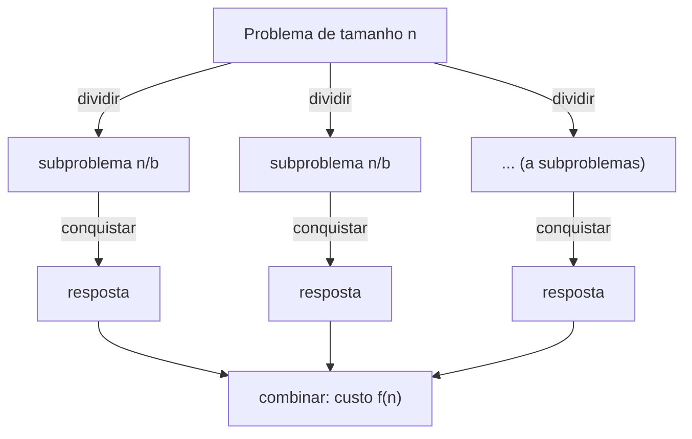

# Recursão e divisão e conquista (Teorema Mestre)

## Por que isso importa

Merge sort, quick sort e busca binária são o mesmo truque: **quebrar o problema em pedaços menores do mesmo tipo**, resolver cada um e juntar. Esse truque, chamado **divisão e conquista**, também está por trás da multiplicação rápida de números enormes (usada em criptografia), da FFT (áudio, imagens, 5G) e do MapReduce (processar dados em milhares de máquinas). E com o **Teorema Mestre** você descobre a complexidade desses algoritmos em segundos, sem desenhar árvores de recursão.

## Intuição

Você precisa achar a pessoa mais alta de um estádio com 60 mil pessoas. Sozinho, olhando uma a uma, demora. Então você divide: cada **setor** acha o seu mais alto, cada setor divide em **fileiras**, e cada fileira compara os seus. No fim, você só compara os campeões dos setores.

1. **Dividir**: partir o problema em subproblemas menores (setores).
2. **Conquistar**: resolver cada subproblema recursivamente; os bem pequenos, direto (uma pessoa é a mais alta da sua "fileira de um").
3. **Combinar**: juntar as respostas (comparar os campeões).

## Visual



Potência rápida: calcular 3¹³ com poucas multiplicações.

```text
3¹³ = 3 · (3⁶)²          13 é ímpar
3⁶  = (3³)²              6 é par
3³  = 3 · (3¹)²          3 é ímpar
3¹  = 3 · (3⁰)²          1 é ímpar
3⁰  = 1                  caso base

5 níveis em vez de 12 multiplicações. Para expoente 1 bilhão: ~30 níveis.
```

## Conceito técnico

### A recorrência padrão

Um algoritmo que divide em **a** subproblemas de tamanho **n/b** e gasta **f(n)** para dividir e combinar tem custo:

```text
T(n) = a · T(n / b) + f(n)
```

| Algoritmo | a | b | f(n) | Recorrência |
|---|---|---|---|---|
| Busca binária | 1 | 2 | 1 | T(n/2) + 1 |
| Merge sort | 2 | 2 | n | 2T(n/2) + n |
| Potência rápida | 1 | 2 | 1 | T(n/2) + 1 |
| Percorrer árvore balanceada | 2 | 2 | 1 | 2T(n/2) + 1 |
| Karatsuba (multiplicação) | 3 | 2 | n | 3T(n/2) + n |

### Teorema Mestre (versão simplificada)

Para T(n) = a·T(n/b) + Θ(nᵈ), com a ≥ 1, b > 1 e d ≥ 0, compare **a** com **bᵈ**:

| Caso | Condição | Solução | Quem domina |
|---|---|---|---|
| 1 | a < bᵈ | Θ(nᵈ) | o trabalho da **raiz** (combinar) |
| 2 | a = bᵈ | Θ(nᵈ log n) | **todos os níveis** pesam igual |
| 3 | a > bᵈ | Θ(n^(log_b a)) | as **folhas** (muitos subproblemas) |

De onde vem isso? Na árvore de recursão, o nível k tem aᵏ subproblemas de tamanho n/bᵏ, cada um custando (n/bᵏ)ᵈ. O custo do nível é nᵈ · (a/bᵈ)ᵏ: uma **série geométrica** de razão a/bᵈ (MD-07). Se a razão é < 1, o primeiro termo domina; se é 1, todos são iguais e há log n deles; se é > 1, o último termo (as folhas) domina.

Exemplos:

```text
Merge sort:   a=2, b=2, d=1 → bᵈ = 2 = a       → caso 2: Θ(n log n)
Busca binária: a=1, b=2, d=0 → bᵈ = 1 = a      → caso 2: Θ(log n)
2T(n/2) + 1:  a=2, b=2, d=0 → bᵈ = 1 < 2       → caso 3: Θ(n^(log₂ 2)) = Θ(n)
T(n/2) + n:   a=1, b=2, d=1 → bᵈ = 2 > 1       → caso 1: Θ(n)
Karatsuba:    a=3, b=2, d=1 → bᵈ = 2 < 3       → caso 3: Θ(n^(log₂ 3)) ≈ Θ(n^1.585)
4T(n/2) + n²: a=4, b=2, d=2 → bᵈ = 4 = a       → caso 2: Θ(n² log n)
```

O teorema **não** se aplica a recorrências como T(n − 1) + n (o tamanho não é dividido) ou com subproblemas de tamanhos diferentes. Para elas, use os métodos da MD-07.

### Exemplo 1: potência rápida

```python
def potencia(x, n):
    if n == 0:
        return 1
    metade = potencia(x, n // 2)     # uma chamada só, reaproveitada
    if n % 2 == 0:
        return metade * metade
    return x * metade * metade
```

T(n) = T(n/2) + 1 = Θ(log n). Cuidado: escrever `potencia(x, n // 2) * potencia(x, n // 2)` faz **duas** chamadas: T(n) = 2T(n/2) + 1 = Θ(n). Toda a vantagem some.

### Exemplo 2: subarray de soma máxima

Dada uma lista com números positivos e negativos, qual trecho **contíguo** tem a maior soma? Em `[2, -5, 3, 4, -1, 2, -6]`, é `[3, 4, -1, 2]`, com soma 8.

Divisão e conquista: o melhor trecho está (1) inteiro na metade esquerda, (2) inteiro na direita, ou (3) **cruzando o meio**. Os dois primeiros são recursivos. O terceiro se calcula em O(n): a melhor soma que termina no meio, indo para a esquerda, mais a melhor que começa logo depois do meio, indo para a direita.

T(n) = 2T(n/2) + n = Θ(n log n). (Existe uma solução O(n), o algoritmo de Kadane, que você vai ver em AL-09.)

### Exemplo 3: quickselect

Achar o **k-ésimo menor** item (a mediana, por exemplo) sem ordenar tudo. Particione como no quick sort (AL-03). O pivô fica na posição p. Se p = k, achou. Se k < p, procure só **na esquerda**; senão, só **na direita**.

Diferente do quick sort, só um lado é visitado: T(n) = T(n/2) + n = **Θ(n)** em média (caso 1 do Teorema Mestre). No pior caso (pivô ruim sempre), O(n²); com pivô aleatório, isso é muito improvável.

### Quando dividir não ajuda

Se os subproblemas **se repetem**, a divisão e conquista refaz trabalho. Fibonacci ingênuo, fib(n) = fib(n − 1) + fib(n − 2), calcula fib(n − 2) duas vezes, fib(n − 3) três vezes... e explode em O(1,618ⁿ). A solução é lembrar as respostas: **programação dinâmica** (AL-09).

## Código

Comparando o número de multiplicações:

```python
def potencia_lenta(x, n):
    r, mult = 1, 0
    for _ in range(n):
        r *= x
        mult += 1
    return r, mult

def potencia_rapida(x, n):
    if n == 0:
        return 1, 0
    metade, mult = potencia_rapida(x, n // 2)
    r, mult = metade * metade, mult + 1
    if n % 2 == 1:
        r, mult = r * x, mult + 1
    return r, mult

print(potencia_lenta(3, 1000)[1])     # 1000 multiplicações
print(potencia_rapida(3, 1000)[1])    # 16 multiplicações
print(potencia_lenta(3, 1000)[0] == potencia_rapida(3, 1000)[0])   # True
```

O Python já faz isso no `pow(x, n)` e no `x ** n`. E `pow(x, n, m)` faz potência **modular** rápida, base da criptografia RSA.

## Erros comuns

- **Chamar a recursão duas vezes com os mesmos argumentos**, como na potência. Guarde o resultado numa variável.
- **Esquecer o caso base**, ou ter um que nunca é atingido (como dividir n = 1 em 0 e 1 para sempre).
- **Aplicar o Teorema Mestre onde ele não vale**: T(n − 1) + n, ou T(n/3) + T(2n/3) + n.
- **Esquecer o custo de dividir.** Fatiar `l[:meio]` custa O(n), o que muda f(n). Passar índices `ini` e `fim` evita as cópias.
- **Ignorar o caso "cruzando o meio"** em problemas como o subarray máximo: a resposta pode não estar inteira em nenhuma metade.
- **Achar que dividir sempre acelera.** 2T(n/2) + 1 é Θ(n), igual a um laço simples. O ganho vem de descartar metades (busca binária) ou de combinar barato.

## Pratique

```quiz
id: AL-04-q1
tipo: multipla_escolha
pergunta: "Pelo Teorema Mestre, quanto é T(n) = 4T(n/2) + n?"
opcoes: ["Θ(n)", "Θ(n log n)", "Θ(n²)", "Θ(n² log n)"]
resposta: 2
explicacao: "a = 4, b = 2, d = 1: bᵈ = 2 < 4 = a. Caso 3, as folhas dominam: Θ(n^(log₂ 4)) = Θ(n²). São 4 subproblemas por nível, e o número de folhas cresce mais rápido que o trabalho de combinar."
dificuldade: 2
```

```quiz
id: AL-04-q2
tipo: multipla_escolha
pergunta: "Pelo Teorema Mestre, quanto é T(n) = 2T(n/2) + n²?"
opcoes: ["Θ(n)", "Θ(n log n)", "Θ(n²)", "Θ(n² log n)"]
resposta: 2
explicacao: "a = 2, b = 2, d = 2: bᵈ = 4 > 2 = a. Caso 1, a raiz domina: Θ(n²). O trabalho de combinar no topo é tão grande que a soma de todos os níveis de baixo é menor que ele."
dificuldade: 2
```

```quiz
id: AL-04-q3
tipo: multipla_escolha
pergunta: "Por que a potência rápida guarda `metade = potencia(x, n // 2)` em vez de calcular `potencia(x, n // 2) * potencia(x, n // 2)`?"
opcoes: ["Para economizar memória", "Porque com duas chamadas a recorrência vira 2T(n/2) + 1 = Θ(n) e perde a vantagem", "Porque Python não permite duas chamadas recursivas na mesma linha", "Não faz diferença no custo"]
resposta: 1
explicacao: "Com uma chamada só, T(n) = T(n/2) + 1 = Θ(log n). Duas chamadas iguais dobram o trabalho em cada nível: 2T(n/2) + 1, que pelo caso 3 do Teorema Mestre é Θ(n), igual ao laço simples."
dificuldade: 2
```

```quiz
id: AL-04-q4
tipo: verdadeiro_falso
pergunta: "O Teorema Mestre resolve a recorrência T(n) = T(n − 1) + n."
resposta: false
explicacao: "O teorema só vale para T(n) = aT(n/b) + f(n), em que o tamanho é DIVIDIDO por b > 1. Aqui ele é subtraído de 1. Desenrolando (MD-07), T(n) = n + (n − 1) + ... + 1 = Θ(n²)."
dificuldade: 1
```

```quiz
id: AL-04-q5
tipo: multipla_escolha
pergunta: "Qual é o custo médio do quickselect para achar a mediana de n números?"
opcoes: ["Θ(log n)", "Θ(n)", "Θ(n log n)", "Θ(n²)"]
resposta: 1
explicacao: "Ele particiona (custo n) e recursa em UM lado só, de tamanho ~n/2 em média: T(n) = T(n/2) + n = n + n/2 + n/4 + ... < 2n = Θ(n). Ordenar tudo para pegar o do meio custaria Θ(n log n)."
dificuldade: 2
```

```quiz
id: AL-04-q6
tipo: resposta_curta
pergunta: "No subarray de soma máxima por divisão e conquista, por que não basta olhar as duas metades separadamente?"
resposta: "Porque o melhor trecho pode cruzar o meio, com uma parte na esquerda e outra na direita. Nenhuma das chamadas recursivas o enxerga inteiro, então é preciso calcular à parte a melhor soma que passa pelo meio e comparar com as duas respostas recursivas."
palavras_chave: ["cruza", "meio", "esquerda", "direita"]
dificuldade: 2
```

```quiz
id: AL-04-q7
tipo: codigo
linguagem: python
pergunta: |
  **Potência modular rápida.** Escreva `pot_mod(x, n, m)` que calcula `(x ** n) % m` em O(log n) por divisão e conquista, mantendo os números pequenos (aplique `% m` a cada multiplicação). Não use `**` nem `pow`.
codigo_inicial: |
  def pot_mod(x, n, m):
      r = 1
      for _ in range(n):
          r = r * x % m
      return r
usa: [def, return, pot_mod]
testes:
  - chamada: "pot_mod(3, 13, 1000)"
    saida: "323"
  - chamada: "pot_mod(2, 10, 1000)"
    saida: "24"
  - chamada: "pot_mod(7, 0, 13)"
    saida: "1"
  - chamada: "pot_mod(2, 10 ** 18, 1000000007)"
    visivel: false
    saida: "719476260"
  - chamada: "pot_mod(123456789, 987654321, 998244353)"
    visivel: false
    saida: "730701112"
dica: "Caso base: n == 0 devolve 1 % m. Calcule metade = pot_mod(x, n // 2, m) uma vez. r = metade * metade % m; se n for ímpar, r = r * x % m."
solucao: |
  def pot_mod(x, n, m):
      if n == 0:
          return 1 % m
      metade = pot_mod(x, n // 2, m)
      r = metade * metade % m
      if n % 2 == 1:
          r = r * x % m
      return r
explicacao: "Com expoente 10¹⁸, o laço do código inicial levaria milênios; a versão por divisão e conquista faz cerca de 60 níveis de recursão. Aplicar % m a cada passo mantém os números pequenos. É exatamente o que pow(x, n, m) do Python faz, e o que torna o RSA viável."
dificuldade: 2
```

```quiz
id: AL-04-q8
tipo: codigo
linguagem: python
pergunta: |
  **Subarray de soma máxima.** Escreva `soma_maxima(l)` que devolve a maior soma de um trecho **contíguo e não vazio** da lista, usando divisão e conquista em O(n log n): resposta = máximo entre (melhor da esquerda, melhor da direita, melhor cruzando o meio). Trabalhe com índices, sem fatiar a lista.
codigo_inicial: |
  def soma_maxima(l):
      melhor = l[0]
      for i in range(len(l)):
          for j in range(i, len(l)):
              melhor = max(melhor, sum(l[i:j + 1]))
      return melhor
usa: [def, return, max]
testes:
  - chamada: "soma_maxima([2, -5, 3, 4, -1, 2, -6])"
    saida: "8"
  - chamada: "soma_maxima([-3, -1, -2])"
    saida: "-1"
  - chamada: "soma_maxima([5])"
    saida: "5"
  - chamada: "soma_maxima([1, 2, 3])"
    saida: "6"
  - chamada: "soma_maxima([(i * 37) % 101 - 50 for i in range(20000)])"
    visivel: false
    saida: "124"
dica: "Função auxiliar resolve(ini, fim). Se ini == fim, devolva l[ini]. meio = (ini + fim) // 2. Para o caso cruzado: some de meio para trás até ini guardando o melhor, e de meio + 1 para a frente até fim guardando o melhor; cruzado = melhor_esq + melhor_dir. Devolva max(resolve(ini, meio), resolve(meio + 1, fim), cruzado)."
solucao: |
  def soma_maxima(l):
      def resolve(ini, fim):
          if ini == fim:
              return l[ini]
          meio = (ini + fim) // 2
          s, melhor_esq = 0, l[meio]
          for i in range(meio, ini - 1, -1):
              s += l[i]
              melhor_esq = max(melhor_esq, s)
          s, melhor_dir = 0, l[meio + 1]
          for j in range(meio + 1, fim + 1):
              s += l[j]
              melhor_dir = max(melhor_dir, s)
          return max(resolve(ini, meio), resolve(meio + 1, fim), melhor_esq + melhor_dir)

      return resolve(0, len(l) - 1)
explicacao: "O trecho que cruza o meio tem que incluir l[meio] e l[meio + 1], então é a melhor soma 'para trás' a partir do meio mais a melhor 'para a frente' a partir de meio + 1. O código inicial é O(n³) (dois laços e um sum) e estoura o tempo com 20 mil itens."
dificuldade: 3
```

```quiz
id: AL-04-q9
tipo: codigo
linguagem: python
pergunta: |
  **Quickselect.** Escreva `k_esimo(l, k)` que devolve o k-ésimo menor elemento (k começa em 0, então `k = 0` é o mínimo), sem ordenar a lista inteira. Use particionamento com o elemento do meio como pivô e recurse (ou repita num laço) só no lado que contém a posição k. Não altere a lista recebida.
codigo_inicial: |
  def k_esimo(l, k):
      return l[k]
usa: [def, while, return]
testes:
  - chamada: "k_esimo([7, 2, 9, 4, 1], 0)"
    saida: "1"
  - chamada: "k_esimo([7, 2, 9, 4, 1], 2)"
    saida: "4"
  - chamada: "k_esimo([7, 2, 9, 4, 1], 4)"
    saida: "9"
  - chamada: "k_esimo([3, 3, 3, 1], 2)"
    visivel: false
    saida: "3"
  - chamada: "(lambda o: (k_esimo(o, 50000), o[:3]))([(i * 7919) % 100003 for i in range(100001)])"
    visivel: false
    saida: "(50000, [0, 7919, 15838])"
dica: "Copie: a = l[:]. ini, fim = 0, len(a) - 1. while True: troque o meio com a[fim], particione (Lomuto) e obtenha p. Se p == k, devolva a[p]; se k < p, fim = p - 1; senão, ini = p + 1."
solucao: |
  def k_esimo(l, k):
      a = l[:]
      ini, fim = 0, len(a) - 1
      while True:
          m = (ini + fim) // 2
          a[m], a[fim] = a[fim], a[m]
          pivo = a[fim]
          p = ini
          for j in range(ini, fim):
              if a[j] < pivo:
                  a[p], a[j] = a[j], a[p]
                  p += 1
          a[p], a[fim] = a[fim], a[p]
          if p == k:
              return a[p]
          if k < p:
              fim = p - 1
          else:
              ini = p + 1
explicacao: "Depois de particionar, o pivô está na posição final p: há exatamente p itens menores. Se k < p, a resposta está à esquerda, e a direita pode ser descartada. Como só um lado continua, o trabalho é n + n/2 + n/4 + ... ≈ 2n. Essa é a recursão de cauda que vira laço."
dificuldade: 3
```

```quiz
id: AL-04-q10
tipo: codigo
linguagem: javascript
pergunta: |
  **Máximo por divisão e conquista em JS.** Escreva `maximo(arr, ini = 0, fim = arr.length - 1)` que devolve o maior número do array dividindo ao meio e combinando com `Math.max`. Para array vazio, devolva `-Infinity`. Não use `Math.max(...arr)` nem `reduce`.
codigo_inicial: |
  function maximo(arr, ini = 0, fim = arr.length - 1) {
    return arr[ini];
  }
usa: [function, return, maximo]
testes:
  - chamada: "maximo([3, 9, 2, 7])"
    saida: "9"
  - chamada: "maximo([-5, -2, -8])"
    saida: "-2"
  - chamada: "maximo([])"
    saida: "-Infinity"
  - chamada: "maximo(Array.from({ length: 100000 }, (_, i) => (i * 7919) % 100003))"
    visivel: false
    saida: "100002"
dica: "Se ini > fim, devolva -Infinity. Se ini === fim, devolva arr[ini]. Senão, meio = Math.floor((ini + fim) / 2) e devolva Math.max(maximo(arr, ini, meio), maximo(arr, meio + 1, fim))."
solucao: |
  function maximo(arr, ini = 0, fim = arr.length - 1) {
    if (ini > fim) return -Infinity;
    if (ini === fim) return arr[ini];
    const meio = Math.floor((ini + fim) / 2);
    return Math.max(maximo(arr, ini, meio), maximo(arr, meio + 1, fim));
  }
explicacao: "T(n) = 2T(n/2) + 1 = Θ(n): não é mais rápido que um laço. Mas a profundidade da recursão é só log₂ n ≈ 17 para 100 mil itens, e as duas metades são independentes, o que permite resolvê-las em paralelo. É o princípio do MapReduce."
dificuldade: 1
```

## Resumo

- **Divisão e conquista**: dividir, conquistar recursivamente, combinar.
- Custo: **T(n) = a·T(n/b) + Θ(nᵈ)**. Teorema Mestre: compare a com bᵈ. Menor → Θ(nᵈ); igual → Θ(nᵈ log n); maior → Θ(n^(log_b a)).
- **Potência rápida**: Θ(log n) multiplicações; uma chamada recursiva só.
- **Subarray máximo**: esquerda, direita ou **cruzando o meio**; Θ(n log n).
- **Quickselect**: k-ésimo menor em Θ(n) médio, visitando só um lado.
- Subproblemas **repetidos** pedem programação dinâmica (AL-09), não divisão e conquista.

## Para ir além

- Leia sobre o algoritmo de **Karatsuba** (3 multiplicações em vez de 4) no capítulo 1 do Algorithms Illuminated: é o primeiro "truque" de divisão e conquista da história.
- **Próximo módulo**: AL-11 Padrões de problemas (two pointers, sliding window, prefix sum). Depois, MD-06 Teoria dos grafos.
