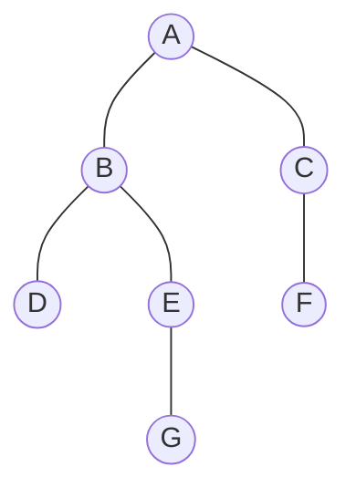

# Busca em grafos: BFS e DFS

## Por que isso importa

Quase todo problema de grafo começa **percorrendo** o grafo. "Qual o menor número de conexões entre duas pessoas no LinkedIn?" é uma BFS. "Este labirinto tem saída?" é uma DFS (ou BFS). "Em que ordem compilar estes módulos?" é uma ordenação topológica, que é uma DFS. "Quantas ilhas tem este mapa?" é contar componentes. O balde de tinta do Paint, o coletor de lixo do Python e do Java, o crawler do Google e o resolvedor de dependências do npm são variações dessas duas buscas. São, de longe, os algoritmos de grafos mais cobrados em entrevistas.

## Intuição

Você perdeu as chaves num prédio.

- **BFS (largura)**: você procura **em ondas**. Primeiro todas as salas a 1 porta de distância, depois todas a 2 portas, depois a 3... Como uma pedra na água. A primeira vez que acha as chaves, foi pelo **caminho mais curto**.
- **DFS (profundidade)**: você entra no primeiro corredor e vai **até o fundo**. Chegou num beco sem saída? **Volta** até a última bifurcação e tenta o próximo corredor. Como explorar um labirinto com a mão sempre na parede.

As duas visitam todo mundo alcançável. A diferença é a **ordem**, e ela vem de uma estrutura só: BFS usa uma **fila** (ED-02, primeiro a entrar, primeiro a sair) e DFS usa uma **pilha** (último a entrar, primeiro a sair), ou a pilha de chamadas da recursão.

## Visual



```text
BFS a partir de A (fila):
  fila: [A]            visita A   → enfileira B, C
  fila: [B, C]         visita B   → enfileira D, E
  fila: [C, D, E]      visita C   → enfileira F
  fila: [D, E, F]      visita D
  fila: [E, F]         visita E   → enfileira G
  fila: [F, G]         visita F
  fila: [G]            visita G
  ordem: A B C D E F G     (por camadas: A | B C | D E F | G)
  distâncias: A=0, B=1, C=1, D=2, E=2, F=2, G=3

DFS a partir de A (recursão, vizinhos em ordem):
  A → B → D (beco, volta) → E → G (beco, volta, volta, volta) → C → F
  ordem: A B D E G C F
```

## Conceito técnico

### BFS

```python
from collections import deque

def bfs(adj, origem):
    dist = {origem: 0}
    fila = deque([origem])
    while fila:
        u = fila.popleft()
        for v in adj[u]:
            if v not in dist:            # marca ao ENFILEIRAR, não ao visitar
                dist[v] = dist[u] + 1
                fila.append(v)
    return dist
```

**Propriedade-chave**: num grafo **sem pesos**, `dist[v]` é o **menor número de arestas** de `origem` até `v`. A fila garante que todos os vértices à distância d são processados antes de qualquer um à distância d + 1.

Para reconstruir o caminho, guarde o **pai** de cada vértice (quem o descobriu) e volte do destino até a origem.

### DFS

```python
def dfs(adj, u, visitado):
    visitado.add(u)
    for v in adj[u]:
        if v not in visitado:
            dfs(adj, v, visitado)
```

Versão iterativa, com pilha explícita (evita o limite de ~1000 níveis de recursão do Python):

```python
def dfs_iterativa(adj, origem):
    visitado = set()
    pilha = [origem]
    ordem = []
    while pilha:
        u = pilha.pop()
        if u in visitado:
            continue
        visitado.add(u)
        ordem.append(u)
        for v in reversed(adj[u]):      # reversed: visita os vizinhos na ordem original
            if v not in visitado:
                pilha.append(v)
    return ordem
```

A DFS **não** dá menores caminhos, mas sua estrutura de "entrar e sair" de cada vértice é ótima para detectar ciclos e ordenar dependências.

### Custo

Com lista de adjacência, cada vértice entra na fila/pilha uma vez e cada aresta é olhada uma vez (duas, em não dirigidos): **O(n + m)**. Com matriz de adjacência, O(n²) (ED-08).

### Aplicações

| Problema | Ferramenta |
|---|---|
| Menor número de passos (grafo sem pesos, labirinto em grade) | **BFS** |
| Está conectado? Quantas componentes? ("ilhas") | BFS ou DFS a partir de cada não visitado |
| É bipartido? | BFS/DFS pintando com 2 cores; conflito ⇒ ciclo ímpar |
| Tem ciclo (dirigido)? | DFS com 3 estados (não visto, **em andamento**, terminado) |
| Ordem de dependências (DAG) | ordenação topológica (Kahn ou DFS) |
| Pintar região (balde de tinta) | BFS/DFS na grade |

### Componentes conexas

```python
def componentes(n, adj):
    visitado = [False] * n
    total = 0
    for s in range(n):
        if not visitado[s]:
            total += 1                    # achei uma componente nova
            pilha = [s]
            visitado[s] = True
            while pilha:
                u = pilha.pop()
                for v in adj[u]:
                    if not visitado[v]:
                        visitado[v] = True
                        pilha.append(v)
    return total
```

### Ciclos em grafos dirigidos

Na DFS, marque cada vértice como **em andamento** ao entrar e **terminado** ao sair. Se você encontra uma aresta para um vértice **em andamento**, ela volta para um ancestral no caminho atual: é um **ciclo**. (Achar um vértice já terminado não é ciclo: é só outro caminho que chega nele.)

### Ordenação topológica: algoritmo de Kahn

Num DAG, uma ordem em que toda aresta u → v tem u antes de v.

1. Calcule o **grau de entrada** de cada vértice.
2. Ponha numa fila todos com grau de entrada 0 (sem dependências).
3. Tire um vértice da fila, coloque na resposta e "remova" suas arestas: diminua o grau de entrada de cada vizinho; quem chegar a 0 entra na fila.
4. Se a resposta tiver menos de n vértices, sobrou um **ciclo**.

É assim que um sistema de build, um gerenciador de pacotes ou esta plataforma (com os pré-requisitos das aulas) decide a ordem.

### Grafos em grade

Labirintos e mapas são grafos **implícitos** (ED-08): o vértice é (linha, coluna) e os vizinhos são as 4 casas ao lado que não são parede. Use BFS para o menor caminho e marque visitados numa matriz ou num set de tuplas.

## Código

BFS em grade, devolvendo o caminho mais curto:

```python
from collections import deque

mapa = [
    "S.#.....",
    ".##.###.",
    "....#...",
    ".##...#E",
]

def menor_caminho(mapa):
    L, C = len(mapa), len(mapa[0])
    inicio = next((l, c) for l in range(L) for c in range(C) if mapa[l][c] == "S")
    pai = {inicio: None}
    fila = deque([inicio])
    while fila:
        l, c = fila.popleft()
        if mapa[l][c] == "E":
            caminho = []
            atual = (l, c)
            while atual is not None:
                caminho.append(atual)
                atual = pai[atual]
            return caminho[::-1]
        for dl, dc in [(-1, 0), (1, 0), (0, -1), (0, 1)]:
            nl, nc = l + dl, c + dc
            if 0 <= nl < L and 0 <= nc < C and mapa[nl][nc] != "#" and (nl, nc) not in pai:
                pai[(nl, nc)] = (l, c)
                fila.append((nl, nc))
    return None

caminho = menor_caminho(mapa)
print(len(caminho) - 1, "passos")
for l, linha in enumerate(mapa):
    print("".join("*" if (l, c) in caminho and ch == "." else ch for c, ch in enumerate(linha)))
```

## Erros comuns

- **Marcar como visitado só ao tirar da fila** (e não ao enfileirar). O mesmo vértice entra na fila várias vezes; o resultado continua certo, mas o custo pode explodir.
- **Usar `lista.pop(0)` como fila.** É O(n) por operação; a BFS vira O(n²). Use `collections.deque` e `popleft()`.
- **Esperar menor caminho da DFS.** Ela acha **um** caminho, não o mais curto.
- **Recursão funda demais** em Python: uma DFS recursiva numa lista com 10 mil vértices em fila estoura o limite. Use a versão com pilha.
- **Começar a busca só do vértice 0** quando o grafo pode ser desconexo. Para contar componentes ou checar bipartição, faça um laço sobre todos os vértices.
- **Detectar ciclo dirigido só com "visitado"**. Num DAG em losango (A→B, A→C, B→D, C→D), D é visitado duas vezes sem haver ciclo. Use o estado "em andamento".
- **Usar BFS em grafo com pesos** esperando o caminho mais barato. A BFS conta arestas, não soma pesos; para pesos, use Dijkstra (AL-06).

## Pratique

```quiz
id: AL-05-q1
tipo: multipla_escolha
pergunta: "Qual estrutura de dados faz a BFS visitar o grafo em camadas (distância 0, depois 1, depois 2...)?"
opcoes: ["Pilha", "Fila", "Heap", "Conjunto"]
resposta: 1
explicacao: "A fila é FIFO: os vértices descobertos primeiro (mais próximos) saem primeiro. Todos os da distância d entram antes dos da distância d + 1. Trocando por uma pilha, o mesmo código vira uma DFS."
dificuldade: 1
```

```quiz
id: AL-05-q2
tipo: multipla_escolha
pergunta: "Qual é o custo de uma BFS com lista de adjacência, num grafo com n vértices e m arestas?"
opcoes: ["O(n)", "O(m)", "O(n + m)", "O(n · m)"]
resposta: 2
explicacao: "Cada vértice entra e sai da fila uma vez (O(n)) e cada lista de adjacência é percorrida uma vez, somando O(m). Mesmo com m = 0, é preciso tocar nos vértices; mesmo com poucos vértices, é preciso olhar as arestas."
dificuldade: 1
```

```quiz
id: AL-05-q3
tipo: multipla_escolha
pergunta: "Você quer o menor número de conexões entre duas pessoas numa rede social. Qual algoritmo usar?"
opcoes: ["DFS", "BFS", "Ordenação topológica", "Qualquer busca serve"]
resposta: 1
explicacao: "As arestas não têm peso, e o que se mede é o número de passos. A BFS garante que a primeira vez que alcança um vértice é pelo menor número de arestas. A DFS pode achar um caminho bem mais longo primeiro."
dificuldade: 1
```

```quiz
id: AL-05-q4
tipo: verdadeiro_falso
pergunta: "Num grafo dirigido, se a DFS encontra uma aresta para um vértice já visitado, o grafo tem um ciclo."
resposta: false
explicacao: "Só é ciclo se o vértice estiver EM ANDAMENTO (ainda na pilha de recursão, ou seja, é um ancestral). Num losango A→B→D e A→C→D, a DFS visita D por B, termina, e depois o encontra de novo por C: já visitado, mas não há ciclo."
dificuldade: 2
```

```quiz
id: AL-05-q5
tipo: prever_saida
pergunta: |
  Com `adj = {1: [2, 3], 2: [4], 3: [4], 4: []}`, o que este código imprime?
  ```python
  from collections import deque
  visto, fila, ordem = {1}, deque([1]), []
  while fila:
      u = fila.popleft()
      ordem.append(u)
      for v in adj[u]:
          if v not in visto:
              visto.add(v)
              fila.append(v)
  print(ordem)
  ```
resposta: "[1, 2, 3, 4]"
explicacao: "1 enfileira 2 e 3. Ao processar 2, o 4 é enfileirado. Ao processar 3, o 4 já está marcado e não entra de novo. A ordem é por camadas: 1 | 2 3 | 4."
dificuldade: 1
```

```quiz
id: AL-05-q6
tipo: resposta_curta
pergunta: "Explique como a BFS testa se um grafo é bipartido."
resposta: "Pinte a origem com uma cor e, ao descobrir cada vizinho, pinte-o com a cor oposta à do vértice atual. Se em algum momento uma aresta ligar dois vértices da mesma cor, existe um ciclo ímpar e o grafo não é bipartido. Repita a partir de cada vértice ainda não pintado para cobrir todas as componentes."
palavras_chave: ["duas cores", "oposta", "mesma cor", "ciclo ímpar"]
dificuldade: 2
```

```quiz
id: AL-05-q7
tipo: codigo
linguagem: python
pergunta: |
  **Menor caminho num labirinto.** O mapa é uma lista de strings com `.` (livre), `#` (parede), `S` (início) e `E` (saída). Andando para cima, baixo, esquerda ou direita, escreva `passos(mapa)` que devolve o **menor número de passos** de S até E, ou `-1` se não houver caminho. Use BFS com `collections.deque`.
codigo_inicial: |
  from collections import deque


  def passos(mapa):
      return -1
usa: [def, while, deque, popleft]
testes:
  - chamada: "passos(['S.#', '..#', '#.E'])"
    saida: "4"
  - chamada: "passos(['S#E'])"
    saida: "-1"
  - chamada: "passos(['SE'])"
    saida: "1"
  - chamada: "passos(['S.#.....', '.##.###.', '....#...', '.##...#E'])"
    visivel: false
    saida: "12"
  - chamada: "passos(['S' + '.' * 299] + ['.' * 300] * 298 + ['.' * 299 + 'E'])"
    visivel: false
    saida: "598"
dica: "Ache S com dois laços. dist = {inicio: 0}; fila = deque([inicio]). Ao tirar (l, c): se for E, devolva dist[(l, c)]. Para cada vizinho dentro do mapa, que não seja # e não esteja em dist, marque dist[viz] = dist[(l, c)] + 1 e enfileire."
solucao: |
  from collections import deque


  def passos(mapa):
      L, C = len(mapa), len(mapa[0])
      inicio = None
      for l in range(L):
          for c in range(C):
              if mapa[l][c] == "S":
                  inicio = (l, c)
      dist = {inicio: 0}
      fila = deque([inicio])
      while fila:
          l, c = fila.popleft()
          if mapa[l][c] == "E":
              return dist[(l, c)]
          for dl, dc in ((-1, 0), (1, 0), (0, -1), (0, 1)):
              nl, nc = l + dl, c + dc
              if 0 <= nl < L and 0 <= nc < C and mapa[nl][nc] != "#" and (nl, nc) not in dist:
                  dist[(nl, nc)] = dist[(l, c)] + 1
                  fila.append((nl, nc))
      return -1
explicacao: "A grade 300 × 300 tem 90 mil casas. Marcando ao enfileirar, cada uma entra na fila uma vez só. A resposta 598 é a distância de Manhattan (299 + 299), já que não há paredes. Sem a marcação no momento certo, a mesma casa entraria na fila muitas vezes."
dificuldade: 2
```

```quiz
id: AL-05-q8
tipo: codigo
linguagem: python
pergunta: |
  **Contar ilhas.** O mapa é uma lista de strings com `#` (terra) e `.` (água). Uma ilha é um grupo de `#` ligados na horizontal ou na vertical. Escreva `ilhas(mapa)` que conta as ilhas. Use DFS **com pilha** (não recursão: os mapas podem ser grandes).
codigo_inicial: |
  def ilhas(mapa):
      return sum(linha.count("#") for linha in mapa)
usa: [def, while, pop]
testes:
  - chamada: "ilhas(['##..', '#..#', '...#'])"
    saida: "2"
  - chamada: "ilhas(['#.#', '.#.', '#.#'])"
    saida: "5"
  - chamada: "ilhas(['....'])"
    saida: "0"
  - chamada: "ilhas(['#' * 200] * 200)"
    visivel: false
    saida: "1"
  - chamada: "ilhas([''.join('#' if (l + c) % 2 == 0 else '.' for c in range(50)) for l in range(50)])"
    visivel: false
    saida: "1250"
dica: "Guarde as casas visitadas num set. Percorra todas as casas; ao achar um # não visitado, some 1 e faça uma DFS a partir dele: pilha = [(l, c)], marcando e empilhando os vizinhos # ainda não visitados."
solucao: |
  def ilhas(mapa):
      L = len(mapa)
      C = len(mapa[0]) if L else 0
      visto = set()
      total = 0
      for l in range(L):
          for c in range(C):
              if mapa[l][c] == "#" and (l, c) not in visto:
                  total += 1
                  visto.add((l, c))
                  pilha = [(l, c)]
                  while pilha:
                      x, y = pilha.pop()
                      for nx, ny in ((x - 1, y), (x + 1, y), (x, y - 1), (x, y + 1)):
                          if 0 <= nx < L and 0 <= ny < C and mapa[nx][ny] == "#" and (nx, ny) not in visto:
                              visto.add((nx, ny))
                              pilha.append((nx, ny))
      return total
explicacao: "Cada DFS 'apaga' uma ilha inteira; o número de vezes que uma nova DFS começa é o número de componentes. Em diagonal não conta, por isso o tabuleiro de xadrez tem 1250 ilhas de uma casa. Um mapa 200 × 200 todo de terra é uma ilha com 40 mil casas: uma DFS recursiva estouraria o limite do Python."
dificuldade: 2
```

```quiz
id: AL-05-q9
tipo: codigo
linguagem: python
pergunta: |
  **Bipartido.** Escreva `bipartido(n, arestas)` para um grafo não dirigido com vértices `0..n−1` que devolve `True` se ele é bipartido. Atenção: o grafo pode ser **desconexo**.
codigo_inicial: |
  def bipartido(n, arestas):
      return True
usa: [def, while, return]
testes:
  - chamada: "bipartido(4, [(0, 1), (1, 2), (2, 3), (3, 0)])"
    saida: "True"
  - chamada: "bipartido(3, [(0, 1), (1, 2), (2, 0)])"
    saida: "False"
  - chamada: "bipartido(2, [])"
    saida: "True"
  - chamada: "bipartido(6, [(0, 1), (3, 4), (4, 5), (5, 3)])"
    visivel: false
    saida: "False"
  - chamada: "bipartido(10000, [(i, i + 1) for i in range(9999)])"
    visivel: false
    saida: "True"
dica: "Monte a lista de adjacência. cor = [-1] * n. Para cada s com cor -1: cor[s] = 0 e faça BFS (ou DFS com pilha). Para cada vizinho v de u: se cor[v] == -1, cor[v] = 1 - cor[u] e enfileire; se cor[v] == cor[u], devolva False."
solucao: |
  from collections import deque


  def bipartido(n, arestas):
      adj = [[] for _ in range(n)]
      for u, v in arestas:
          adj[u].append(v)
          adj[v].append(u)
      cor = [-1] * n
      for s in range(n):
          if cor[s] != -1:
              continue
          cor[s] = 0
          fila = deque([s])
          while fila:
              u = fila.popleft()
              for v in adj[u]:
                  if cor[v] == -1:
                      cor[v] = 1 - cor[u]
                      fila.append(v)
                  elif cor[v] == cor[u]:
                      return False
      return True
explicacao: "O quarto teste é a armadilha: os vértices 0 e 1 formam uma componente bipartida, mas 3-4-5 é um triângulo numa componente separada. Começar a busca só do vértice 0 daria True errado. O caminho de 10 mil vértices alterna as cores e mostra por que usar fila (ou pilha) em vez de recursão."
dificuldade: 2
```

```quiz
id: AL-05-q10
tipo: codigo
linguagem: python
pergunta: |
  **Ordem das aulas.** Os pré-requisitos são pares `(antes, depois)`. Escreva `ordem_topologica(aulas, prereqs)` que devolve uma ordem válida de todas as aulas usando o algoritmo de **Kahn**. Quando houver várias aulas liberadas ao mesmo tempo, escolha a de **menor nome** primeiro (use um heap). Se houver ciclo, devolva `None`.
codigo_inicial: |
  import heapq


  def ordem_topologica(aulas, prereqs):
      return sorted(aulas)
usa: [def, while, heappop, return]
testes:
  - chamada: "ordem_topologica(['AL-01', 'ED-01', 'FP-05'], [('FP-05', 'ED-01'), ('ED-01', 'AL-01')])"
    saida: "['FP-05', 'ED-01', 'AL-01']"
  - chamada: "ordem_topologica(['c', 'b', 'a', 'd'], [('a', 'd'), ('b', 'd')])"
    saida: "['a', 'b', 'c', 'd']"
  - chamada: "ordem_topologica(['x', 'y'], [('x', 'y'), ('y', 'x')])"
    saida: "None"
  - chamada: "ordem_topologica(['MD-01', 'MD-02', 'MD-03', 'MD-06', 'MD-07'], [('MD-01', 'MD-02'), ('MD-01', 'MD-03'), ('MD-02', 'MD-06'), ('MD-03', 'MD-07')])"
    visivel: false
    saida: "['MD-01', 'MD-02', 'MD-03', 'MD-06', 'MD-07']"
  - chamada: "ordem_topologica(['d', 'c', 'b', 'a'], [('d', 'c'), ('c', 'b'), ('b', 'a')])"
    visivel: false
    saida: "['d', 'c', 'b', 'a']"
dica: "Calcule grau_entrada (dict) e a lista de quem depende de quem. Ponha num heap todas as aulas com grau 0. Enquanto houver: tire a menor com heappop, adicione à resposta, e para cada dependente diminua o grau; se chegar a 0, heappush. No fim, se a resposta tiver menos aulas que o total, devolva None."
solucao: |
  import heapq


  def ordem_topologica(aulas, prereqs):
      grau = {a: 0 for a in aulas}
      depois = {a: [] for a in aulas}
      for antes, dep in prereqs:
          depois[antes].append(dep)
          grau[dep] += 1
      prontas = [a for a in aulas if grau[a] == 0]
      heapq.heapify(prontas)
      ordem = []
      while prontas:
          a = heapq.heappop(prontas)
          ordem.append(a)
          for d in depois[a]:
              grau[d] -= 1
              if grau[d] == 0:
                  heapq.heappush(prontas, d)
      if len(ordem) < len(aulas):
          return None
      return ordem
explicacao: "Uma aula só é liberada quando todos os seus pré-requisitos já saíram (grau de entrada 0). Num ciclo, nenhuma das aulas do ciclo chega a grau 0, então elas nunca entram na resposta. O heap no lugar da fila deixa a resposta determinística, e o último teste mostra que a ordem alfabética só vale entre aulas liberadas ao mesmo tempo."
dificuldade: 3
```

## Resumo

- **BFS**: fila, camadas; dá o **menor número de arestas** em grafos sem peso. Marque ao enfileirar. Use `deque`.
- **DFS**: pilha ou recursão; vai fundo e volta. Ótima para componentes, ciclos e ordenação topológica.
- Ambas são **O(n + m)** com lista de adjacência.
- **Componentes**: uma busca nova para cada vértice ainda não visitado.
- **Bipartido**: pinte com 2 cores; conflito = ciclo ímpar.
- **Ciclo dirigido**: aresta para vértice **em andamento**. **Kahn**: remove quem tem grau de entrada 0; se sobrar alguém, há ciclo.

## Para ir além

- Veja BFS e DFS lado a lado em **visualgo.net/pt/dfsbfs**.
- **Próximo módulo**: ED-06 Árvores balanceadas e ED-09 Tries e Union-Find. Depois, AL-06 Caminhos mínimos, que generaliza a BFS para arestas com peso.
