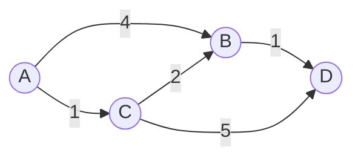

# Caminhos mínimos: Dijkstra, Bellman-Ford

## Por que isso importa

O GPS que acha a rota mais rápida, o roteador que decide por onde mandar seus pacotes (os protocolos OSPF e RIP), o jogo que move um personagem até o clique do mouse, o app de passagens que acha a combinação de voos mais barata: todos resolvem **caminho mínimo em grafos com pesos**. A BFS (AL-05) conta arestas; aqui, cada aresta tem um custo (km, minutos, reais), e o melhor caminho é o de menor **soma**. Dijkstra é um dos algoritmos mais famosos da computação, e Bellman-Ford mostra como lidar com custos negativos (descontos, câmbio).

## Intuição

Imagine derramar água num ponto de uma rede de canos, em que cada cano leva um tempo diferente para encher. A água chega primeiro aos lugares **mais próximos** (em tempo, não em número de canos), e de lá avança. Dijkstra simula isso: sempre expande o ponto **ainda não finalizado mais próximo da origem**. Quando um ponto é finalizado, a distância dele está garantida, porque qualquer outro caminho teria que passar por pontos mais distantes, e só ficaria mais caro (se não houver custos negativos).

Bellman-Ford é mais paciente: repete n − 1 vezes "para cada aresta, veja se ela melhora a distância de alguém". É mais lento, mas funciona com negativos.

## Visual



```text
Dijkstra a partir de A:

passo  finaliza   dist (A, B, C, D)        heap (candidatos)
0      -          A=0, B=∞, C=∞, D=∞       [(0, A)]
1      A (0)      B=4, C=1                 [(1, C), (4, B)]
2      C (1)      B = min(4, 1+2) = 3      [(3, B), (4, B), (6, D)]
                  D = 1+5 = 6
3      B (3)      D = min(6, 3+1) = 4      [(4, B)*, (4, D), (6, D)*]
4      D (4)      -                        (* entradas velhas: ignoradas)

resultado: A=0, C=1, B=3, D=4.  Caminho até D: A → C → B → D
A BFS diria "A → B → D" (2 arestas), que custa 4 + 1 = 5.
```

## Conceito técnico

### Relaxar uma aresta

A operação central dos dois algoritmos:

```python
# aresta u → v com peso w
if dist[u] + w < dist[v]:
    dist[v] = dist[u] + w      # achei um caminho melhor até v, passando por u
    pai[v] = u
```

### Dijkstra

Requer **pesos não negativos**.

1. `dist[origem] = 0`, todos os outros ∞. Heap com `(0, origem)`.
2. Tire do heap o par `(d, u)` de menor d. Se `d > dist[u]`, é uma entrada velha: ignore.
3. Para cada aresta u → v de peso w, relaxe; se melhorou, empurre `(dist[v], v)` no heap.
4. Repita até o heap esvaziar.

```python
import heapq

def dijkstra(adj, origem):              # adj[u] = [(v, peso), ...]
    dist = {origem: 0}
    heap = [(0, origem)]
    while heap:
        d, u = heapq.heappop(heap)
        if d > dist[u]:
            continue                     # entrada desatualizada
        for v, w in adj[u]:
            nd = d + w
            if nd < dist.get(v, float("inf")):
                dist[v] = nd
                heapq.heappush(heap, (nd, v))
    return dist
```

**Custo**: cada aresta pode empurrar uma entrada no heap, e cada operação de heap custa O(log m). Total **O((n + m) log n)**. (Em vez de atualizar a prioridade dentro do heap, empurramos uma entrada nova e ignoramos as velhas. É a "lazy deletion", o jeito mais simples com `heapq`.)

**Por que funciona**: quando u sai do heap com a menor distância entre os não finalizados, qualquer outro caminho até u passaria por algum vértice ainda no heap, que já está a uma distância ≥ dist[u]. Com pesos ≥ 0, somar mais arestas não diminui. Logo dist[u] é definitivo.

**Por que falha com negativos**:

```text
A → B (2),  A → C (3),  C → B (−2)
Dijkstra finaliza B com 2 (é o menor do heap), mas A → C → B custa 3 − 2 = 1.
Quando C é processado, B já foi "finalizado" com a resposta errada.
```

### Bellman-Ford

Funciona com pesos **negativos**, desde que não haja ciclo negativo alcançável.

1. `dist[origem] = 0`, os outros ∞.
2. Repita **n − 1** vezes: relaxe **todas** as arestas.
3. Faça mais uma rodada: se alguma aresta ainda melhorar uma distância, existe um **ciclo negativo**.

Por que n − 1? Um caminho mínimo simples tem no máximo n − 1 arestas. Depois da rodada k, todo caminho mínimo com até k arestas já está correto (prova por indução, MD-03).

**Custo**: O(n · m). Bem mais lento que Dijkstra, por isso só se usa quando há negativos.

**Ciclo negativo**: um ciclo cuja soma é negativa. Dando voltas nele, o custo cai para −∞, e "caminho mínimo" deixa de fazer sentido. Exemplo real: **arbitragem de câmbio**. Se trocar reais → dólares → euros → reais te dá mais reais do que tinha, há um ciclo negativo no grafo com pesos −log(taxa).

### Qual usar?

| Grafo | Algoritmo | Custo |
|---|---|---|
| Sem pesos (ou todos iguais) | **BFS** | O(n + m) |
| Pesos 0 ou 1 | BFS 0-1 (deque) | O(n + m) |
| Pesos ≥ 0 | **Dijkstra** | O((n + m) log n) |
| Pesos negativos, sem ciclo negativo | **Bellman-Ford** | O(n·m) |
| DAG (qualquer peso) | relaxar em ordem topológica | O(n + m) |
| Todos os pares, grafo pequeno | Floyd-Warshall | O(n³) |

O **A\*** (usado em jogos e mapas) é um Dijkstra que prioriza também uma **estimativa** da distância restante até o destino (por exemplo, a distância em linha reta), explorando muito menos.

## Código

Dijkstra com reconstrução de caminho:

```python
import heapq

grafo = {
    "A": [("B", 4), ("C", 1)],
    "B": [("D", 1)],
    "C": [("B", 2), ("D", 5)],
    "D": [],
}

def caminho_minimo(adj, origem, destino):
    dist = {origem: 0}
    pai = {origem: None}
    heap = [(0, origem)]
    while heap:
        d, u = heapq.heappop(heap)
        if u == destino:
            break
        if d > dist[u]:
            continue
        for v, w in adj[u]:
            if d + w < dist.get(v, float("inf")):
                dist[v] = d + w
                pai[v] = u
                heapq.heappush(heap, (d + w, v))
    if destino not in dist:
        return None, []
    caminho = []
    v = destino
    while v is not None:
        caminho.append(v)
        v = pai[v]
    return dist[destino], caminho[::-1]

print(caminho_minimo(grafo, "A", "D"))    # (4, ['A', 'C', 'B', 'D'])
```

## Erros comuns

- **Usar BFS em grafo com pesos.** Ela minimiza o número de arestas, não a soma.
- **Usar Dijkstra com pesos negativos.** Pode dar a resposta errada sem nenhum aviso.
- **Esquecer de ignorar entradas velhas do heap** (`if d > dist[u]: continue`). O resultado continua certo, mas o algoritmo refaz trabalho e pode ficar muito mais lento.
- **Marcar como finalizado ao empurrar no heap**, como na BFS. No Dijkstra, um vértice só está garantido quando **sai** do heap.
- **Fazer só n − 2 rodadas** no Bellman-Ford, ou esquecer a rodada extra que detecta ciclo negativo.
- **Somar com `float('inf')`** e comparar: `inf + 5` é `inf`, então funciona em Python, mas em C ou Java com `INT_MAX` a soma estoura. Pule vértices com distância infinita.

## Pratique

```quiz
id: AL-06-q1
tipo: multipla_escolha
pergunta: "Por que a BFS não acha o caminho mais barato num grafo com pesos?"
opcoes: ["Porque ela não visita todos os vértices", "Porque ela minimiza o número de arestas, não a soma dos pesos", "Porque ela só funciona em árvores", "Porque ela usa pilha"]
resposta: 1
explicacao: "A BFS processa por camadas de número de arestas. Um caminho com 2 arestas de peso 10 seria preferido a um com 3 arestas de peso 1. Com pesos, é preciso processar por distância acumulada, que é o que o Dijkstra faz com o heap."
dificuldade: 1
```

```quiz
id: AL-06-q2
tipo: multipla_escolha
pergunta: "Qual é o custo do Dijkstra com heap binário, num grafo com n vértices e m arestas?"
opcoes: ["O(n + m)", "O((n + m) log n)", "O(n · m)", "O(n³)"]
resposta: 1
explicacao: "Cada vértice sai do heap e cada aresta pode empurrar uma entrada nova; cada operação de heap custa O(log n). O(n · m) é o Bellman-Ford; O(n³) é o Floyd-Warshall."
dificuldade: 1
```

```quiz
id: AL-06-q3
tipo: multipla_escolha
pergunta: "Arestas: A→B (2), A→C (3), C→B (−2). Dijkstra a partir de A diz que dist(B) = 2. Qual é o valor correto e por que o Dijkstra erra?"
opcoes: ["2; ele acerta", "1; B foi finalizado antes de C, e o caminho por C usa um peso negativo", "−2; ele ignora a aresta C→B", "5; ele soma tudo"]
resposta: 1
explicacao: "A→C→B custa 3 + (−2) = 1. O Dijkstra finaliza B com 2 porque era o menor do heap, assumindo que nenhum caminho por vértices mais distantes poderia ficar mais barato. Com pesos negativos, essa garantia cai. Bellman-Ford acha 1."
dificuldade: 2
```

```quiz
id: AL-06-q4
tipo: verdadeiro_falso
pergunta: "Se, depois de n − 1 rodadas do Bellman-Ford, alguma aresta ainda consegue diminuir uma distância, então o grafo tem um ciclo negativo alcançável."
resposta: true
explicacao: "Sem ciclos negativos, todo caminho mínimo é simples e tem no máximo n − 1 arestas, então n − 1 rodadas bastam. Se ainda há melhoria, existe um 'caminho' mais barato com n ou mais arestas, o que só acontece repetindo um ciclo de soma negativa."
dificuldade: 2
```

```quiz
id: AL-06-q5
tipo: multipla_escolha
pergunta: "Você precisa do menor tempo entre estações de metrô, com tempos positivos em cada trecho, para milhares de consultas por segundo. Qual algoritmo?"
opcoes: ["BFS", "Dijkstra (ou A*)", "Bellman-Ford", "Ordenação topológica"]
resposta: 1
explicacao: "Pesos positivos e diferentes: Dijkstra é o padrão, e A* com uma boa estimativa explora ainda menos. BFS ignoraria os tempos, e Bellman-Ford seria lento demais sem necessidade."
dificuldade: 1
```

```quiz
id: AL-06-q6
tipo: resposta_curta
pergunta: "Por que o Dijkstra só considera a distância de um vértice definitiva quando ele SAI do heap, e não quando entra?"
resposta: "Porque quando o vértice entra no heap ainda pode existir um caminho mais barato até ele, passando por vértices que ainda não foram processados. Quando ele sai com a menor distância de todo o heap, qualquer outro caminho passaria por vértices pelo menos tão distantes e, sem pesos negativos, não ficaria mais barato."
palavras_chave: ["sai", "menor", "caminho mais barato", "não negativos"]
dificuldade: 2
```

```quiz
id: AL-06-q7
tipo: codigo
linguagem: python
pergunta: |
  **Dijkstra.** Os vértices são `0..n−1` e as arestas são dirigidas, dadas como `(u, v, peso)` com pesos ≥ 0. Escreva `dijkstra(n, arestas, origem)` que devolve a lista de distâncias, com `-1` para vértices inalcançáveis. Use `heapq`.
codigo_inicial: |
  import heapq


  def dijkstra(n, arestas, origem):
      return [-1] * n
usa: [def, while, heappop, heappush]
testes:
  - chamada: "dijkstra(4, [(0, 1, 4), (0, 2, 1), (2, 1, 2), (1, 3, 1), (2, 3, 5)], 0)"
    saida: "[0, 3, 1, 4]"
  - chamada: "dijkstra(3, [(0, 1, 7)], 0)"
    saida: "[0, 7, -1]"
  - chamada: "dijkstra(3, [(0, 1, 0), (1, 2, 0)], 2)"
    saida: "[-1, -1, 0]"
  - chamada: "dijkstra(2, [(0, 1, 5), (0, 1, 2)], 0)"
    visivel: false
    saida: "[0, 2]"
  - chamada: "(lambda d: (d[-1], sum(d)))(dijkstra(20000, [(i, i + 1, 3) for i in range(19999)] + [(i, i + 2, 5) for i in range(19998)], 0))"
    visivel: false
    saida: "(49998, 499980000)"
dica: "Monte adj = [[] for _ in range(n)] com (v, peso). dist = [inf] * n; dist[origem] = 0; heap = [(0, origem)]. Tire (d, u); se d > dist[u], continue; relaxe cada (v, w) e empurre (nova, v) quando melhorar. No fim, troque inf por -1."
solucao: |
  import heapq


  def dijkstra(n, arestas, origem):
      adj = [[] for _ in range(n)]
      for u, v, w in arestas:
          adj[u].append((v, w))
      inf = float("inf")
      dist = [inf] * n
      dist[origem] = 0
      heap = [(0, origem)]
      while heap:
          d, u = heapq.heappop(heap)
          if d > dist[u]:
              continue
          for v, w in adj[u]:
              if d + w < dist[v]:
                  dist[v] = d + w
                  heapq.heappush(heap, (d + w, v))
      return [x if x != inf else -1 for x in dist]
explicacao: "O teste com arestas paralelas (5 e 2 entre os mesmos vértices) mostra que relaxar resolve sozinho: fica a menor. No grafo grande, pular 2 casas custa 5 (2,5 por casa) e andar 1 custa 3, então o melhor é pular sempre que possível. Arestas de peso 0 são permitidas no Dijkstra; só negativas quebram."
dificuldade: 2
```

```quiz
id: AL-06-q8
tipo: codigo
linguagem: python
pergunta: |
  **Rota com caminho.** Escreva `rota(grafo, origem, destino)` em que `grafo` é um dict `{cidade: [(vizinha, km), ...]}` (dirigido, km ≥ 0). Devolva a tupla `(km_total, [cidades do caminho])` do caminho mais curto, ou `None` se não houver caminho.
codigo_inicial: |
  import heapq


  def rota(grafo, origem, destino):
      return None
usa: [def, while, heappop, return]
testes:
  - chamada: "rota({'A': [('B', 4), ('C', 1)], 'B': [('D', 1)], 'C': [('B', 2), ('D', 5)], 'D': []}, 'A', 'D')"
    saida: "(4, ['A', 'C', 'B', 'D'])"
  - chamada: "rota({'A': [('B', 1)], 'B': []}, 'B', 'A')"
    saida: "None"
  - chamada: "rota({'X': []}, 'X', 'X')"
    saida: "(0, ['X'])"
  - chamada: "rota({'SP': [('RJ', 430), ('BH', 590)], 'RJ': [('BH', 440), ('VIX', 520)], 'BH': [('VIX', 520)], 'VIX': []}, 'SP', 'VIX')"
    visivel: false
    saida: "(950, ['SP', 'RJ', 'VIX'])"
dica: "Igual ao Dijkstra, mas guarde pai[v] = u quando relaxar. Pode parar quando o destino sair do heap. Para montar o caminho, volte de destino seguindo pai até None e inverta."
solucao: |
  import heapq


  def rota(grafo, origem, destino):
      dist = {origem: 0}
      pai = {origem: None}
      heap = [(0, origem)]
      while heap:
          d, u = heapq.heappop(heap)
          if u == destino:
              break
          if d > dist[u]:
              continue
          for v, w in grafo.get(u, []):
              if d + w < dist.get(v, float("inf")):
                  dist[v] = d + w
                  pai[v] = u
                  heapq.heappush(heap, (d + w, v))
      if destino not in dist:
          return None
      caminho = []
      v = destino
      while v is not None:
          caminho.append(v)
          v = pai[v]
      return (dist[destino], caminho[::-1])
explicacao: "Guardar só o pai de cada vértice é suficiente: o caminho mínimo até v é o caminho mínimo até pai[v] mais uma aresta. Parar quando o destino sai do heap é seguro, porque nesse momento a distância dele está garantida. É o que o GPS faz, com A* para explorar ainda menos."
dificuldade: 2
```

```quiz
id: AL-06-q9
tipo: codigo
linguagem: python
pergunta: |
  **Bellman-Ford.** Escreva `bellman_ford(n, arestas, origem)` (arestas dirigidas `(u, v, peso)`, pesos podem ser negativos). Devolva a lista de distâncias (com `None` para inalcançáveis), ou a string `"ciclo negativo"` se houver um ciclo negativo alcançável a partir da origem.
codigo_inicial: |
  def bellman_ford(n, arestas, origem):
      return [None] * n
usa: [def, for, return]
testes:
  - chamada: "bellman_ford(3, [(0, 1, 2), (0, 2, 3), (2, 1, -2)], 0)"
    saida: "[0, 1, 3]"
  - chamada: "bellman_ford(3, [(0, 1, 1), (1, 2, -1), (2, 1, -1)], 0)"
    saida: "'ciclo negativo'"
  - chamada: "bellman_ford(4, [(0, 1, 5), (2, 3, -1), (3, 2, -1)], 0)"
    saida: "[0, 5, None, None]"
  - chamada: "bellman_ford(1, [], 0)"
    visivel: false
    saida: "[0]"
  - chamada: "bellman_ford(5, [(3, 4, -2), (2, 3, -2), (1, 2, -2), (0, 1, -2)], 0)"
    visivel: false
    saida: "[0, -2, -4, -6, -8]"
dica: "dist = [inf] * n; dist[origem] = 0. Repita n - 1 vezes: para cada (u, v, w), se dist[u] != inf e dist[u] + w < dist[v], atualize. Depois, uma rodada extra: se alguma aresta ainda melhorar, devolva 'ciclo negativo'. No fim, troque inf por None."
solucao: |
  def bellman_ford(n, arestas, origem):
      inf = float("inf")
      dist = [inf] * n
      dist[origem] = 0
      for _ in range(n - 1):
          for u, v, w in arestas:
              if dist[u] != inf and dist[u] + w < dist[v]:
                  dist[v] = dist[u] + w
      for u, v, w in arestas:
          if dist[u] != inf and dist[u] + w < dist[v]:
              return "ciclo negativo"
      return [d if d != inf else None for d in dist]
explicacao: "O terceiro teste tem um ciclo negativo (2 ⇄ 3), mas ele não é alcançável a partir de 0, então não atrapalha: o 'dist[u] != inf' evita relaxar a partir de vértices não alcançados. O último teste lista as arestas na ordem 'errada' (do fim para o começo): cada rodada só avança uma aresta, e são exatamente as n − 1 rodadas que garantem a resposta."
dificuldade: 3
```

```quiz
id: AL-06-q10
tipo: codigo
linguagem: python
pergunta: |
  **Tempo de propagação.** Uma mensagem sai do servidor `origem` e se espalha por uma rede (arestas dirigidas `(u, v, ms)`). Escreva `tempo_total(n, arestas, origem)` que devolve em quantos milissegundos **todos** os `n` servidores terão recebido a mensagem, ou `-1` se algum nunca receber.
codigo_inicial: |
  import heapq


  def tempo_total(n, arestas, origem):
      return -1
usa: [def, while, heappop, max]
testes:
  - chamada: "tempo_total(4, [(1, 0, 1), (1, 2, 1), (2, 3, 1)], 1)"
    saida: "2"
  - chamada: "tempo_total(2, [(0, 1, 1)], 1)"
    saida: "-1"
  - chamada: "tempo_total(1, [], 0)"
    saida: "0"
  - chamada: "tempo_total(3, [(0, 1, 10), (0, 2, 1), (2, 1, 1)], 0)"
    visivel: false
    saida: "2"
dica: "Rode o Dijkstra a partir da origem. A resposta é a MAIOR das menores distâncias (o último a receber). Se algum vértice ficou com distância infinita, devolva -1."
solucao: |
  import heapq


  def tempo_total(n, arestas, origem):
      adj = [[] for _ in range(n)]
      for u, v, w in arestas:
          adj[u].append((v, w))
      inf = float("inf")
      dist = [inf] * n
      dist[origem] = 0
      heap = [(0, origem)]
      while heap:
          d, u = heapq.heappop(heap)
          if d > dist[u]:
              continue
          for v, w in adj[u]:
              if d + w < dist[v]:
                  dist[v] = d + w
                  heapq.heappush(heap, (d + w, v))
      maior = max(dist)
      return -1 if maior == inf else maior
explicacao: "Cada servidor recebe a mensagem pelo caminho mais rápido (o Dijkstra), e todos receberam quando o mais demorado recebeu: o máximo das distâncias. No último teste, o caminho direto 0 → 1 leva 10 ms, mas 0 → 2 → 1 leva 2 ms."
dificuldade: 2
```

## Resumo

- **Relaxar**: se `dist[u] + w < dist[v]`, atualize v.
- **Dijkstra**: heap, sempre o mais próximo não finalizado; pesos **≥ 0**; O((n + m) log n). Ignore entradas velhas do heap.
- **Bellman-Ford**: n − 1 rodadas relaxando tudo; aceita negativos; rodada extra detecta **ciclo negativo**; O(n·m).
- Sem pesos → BFS. Pesos ≥ 0 → Dijkstra. Negativos → Bellman-Ford.
- Caminho: guarde `pai[v]` e volte do destino.

## Para ir além

- Compare Dijkstra e A* animados em **visualgo.net/pt/sssp** e em "Introduction to the A* Algorithm" do Red Blob Games.
- **Próximo módulo**: AL-07 Árvore geradora mínima: Kruskal e Prim, que usa o Union-Find (ED-09) e o heap de novo.
