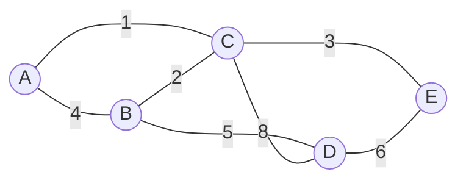

# Árvore geradora mínima: Kruskal e Prim

## Por que isso importa

Você precisa ligar 50 bairros com cabos de fibra óptica, e cada ligação possível tem um custo. Quer que todos fiquem conectados (direta ou indiretamente) gastando o mínimo. Isso é uma **árvore geradora mínima**. O mesmo problema aparece em redes elétricas, de água e de computadores, em agrupamento de dados (clustering), em segmentação de imagens e como peça de algoritmos de aproximação (por exemplo, para o caixeiro-viajante). E os dois algoritmos clássicos, Kruskal e Prim, são os melhores exemplos de **algoritmos gulosos** que provadamente acertam (AL-08).

## Intuição

- **Kruskal**: ordene todas as ligações da mais barata para a mais cara. Vá aceitando cada uma, **a não ser que ela feche um ciclo** (ligue dois bairros que já estão conectados por outro caminho, o que seria desperdício). É como montar uma rede começando pelos cabos mais baratos do catálogo.
- **Prim**: comece de um bairro qualquer e vá **crescendo** a rede: a cada passo, adicione a ligação mais barata entre um bairro **já conectado** e um **ainda não conectado**. Como uma mancha que se espalha sempre pela borda mais barata.

Os dois são **gulosos**: tomam a melhor decisão local e nunca voltam atrás. E, para este problema, isso dá a resposta ótima.

## Visual



```text
Kruskal (arestas ordenadas):
  A-C (1)  aceita         grupos: {A,C} {B} {D} {E}
  B-C (2)  aceita         grupos: {A,B,C} {D} {E}
  C-E (3)  aceita         grupos: {A,B,C,E} {D}
  A-B (4)  REJEITA        A e B já estão no mesmo grupo (fecharia o ciclo A-B-C)
  B-D (5)  aceita         grupos: {A,B,C,D,E}   ← 4 arestas = n − 1: pronto
  custo total: 1 + 2 + 3 + 5 = 11

Prim (começando em A):
  árvore {A}             borda: A-C 1, A-B 4          → pega A-C (1)
  árvore {A,C}           borda: C-B 2, C-E 3, A-B 4, C-D 8  → pega C-B (2)
  árvore {A,B,C}         borda: C-E 3, A-B 4*, B-D 5, C-D 8 → pega C-E (3)
  árvore {A,B,C,E}       borda: B-D 5, E-D 6, C-D 8   → pega B-D (5)
  mesma árvore, custo 11
```

## Conceito técnico

### Definições

Num grafo **não dirigido, conexo e ponderado**:

- Uma **árvore geradora** é um subconjunto de arestas que liga **todos** os vértices sem formar ciclos. Ela tem exatamente **n − 1** arestas (MD-06).
- A **árvore geradora mínima** (MST, *minimum spanning tree*) é a árvore geradora de **menor peso total**. Pode haver mais de uma, se houver pesos iguais.

Se o grafo não for conexo, não há árvore geradora; o melhor possível é uma **floresta** geradora mínima (uma MST por componente).

### Propriedade do corte

Divida os vértices em dois grupos quaisquer (um **corte**). A aresta **mais leve** que atravessa o corte pertence a alguma MST.

Por quê? Se uma MST não usasse essa aresta e, adicionarmos a aresta, formaria um ciclo que atravessa o corte em outro ponto, por uma aresta mais pesada (ou igual). Trocar a pesada pela leve dá uma árvore geradora com custo menor ou igual. Essa propriedade é o que justifica os dois algoritmos:

- No **Prim**, o corte é "árvore atual × resto". Ele sempre pega a aresta mais leve desse corte.
- No **Kruskal**, quando uma aresta liga dois grupos diferentes, ela é a mais leve que sai de qualquer um deles (as mais leves já foram consideradas).

### Kruskal

1. Ordene as arestas por peso.
2. Crie um Union-Find com n vértices (ED-09).
3. Para cada aresta (u, v, w) em ordem: se `achar(u) != achar(v)`, aceite e faça `unir(u, v)`. Senão, descarte (fecharia ciclo).
4. Pare ao aceitar n − 1 arestas.

Custo: **O(m log m)**, dominado pela ordenação. O Union-Find é praticamente O(1) por operação. Ótimo para grafos **esparsos** e quando as arestas já vêm numa lista.

### Prim

1. Comece de qualquer vértice; marque-o como na árvore.
2. Ponha num heap todas as arestas que saem dele.
3. Tire a aresta mais leve. Se ela leva a um vértice **já na árvore**, descarte. Senão, aceite, marque o vértice e ponha no heap as arestas que saem dele.
4. Repita até a árvore ter n vértices.

Custo: **O(m log n)** com heap binário. Muito parecido com o Dijkstra (AL-06): a diferença é que a prioridade é o **peso da aresta**, e não a distância acumulada desde a origem. Com matriz de adjacência e sem heap, dá para fazer em O(n²), o que é bom para grafos **densos**.

### MST não é caminho mínimo

A MST minimiza o custo **total da rede**, não a distância entre dois vértices. Num triângulo com arestas A-B 2, B-C 2 e A-C 3, a MST usa A-B e B-C (custo total 4). Nela, ir de A até C custa 2 + 2 = 4, mas o caminho mínimo no grafo é a aresta direta, com custo 3. Use MST para "ligar todo mundo barato" e Dijkstra (AL-06) para "ir de X a Y barato".

## Código

Kruskal com um Union-Find enxuto:

```python
def kruskal(n, arestas):                       # arestas: (peso, u, v)
    pai = list(range(n))

    def achar(x):
        while pai[x] != x:
            pai[x] = pai[pai[x]]
            x = pai[x]
        return x

    arvore, custo = [], 0
    for w, u, v in sorted(arestas):
        ru, rv = achar(u), achar(v)
        if ru != rv:
            pai[ru] = rv
            arvore.append((u, v, w))
            custo += w
    return custo, arvore


# A=0, B=1, C=2, D=3, E=4
arestas = [(4, 0, 1), (1, 0, 2), (2, 1, 2), (5, 1, 3), (8, 2, 3), (3, 2, 4), (6, 3, 4)]
print(kruskal(5, arestas))   # (11, [(0, 2, 1), (1, 2, 2), (2, 4, 3), (1, 3, 5)])
```

## Erros comuns

- **Usar Dijkstra achando que dá a MST.** A árvore de caminhos mínimos a partir de um vértice pode ser bem mais cara no total.
- **No Kruskal, testar ciclo com BFS a cada aresta.** Funciona, mas vira O(m · (n + m)). Use Union-Find.
- **No Prim, não descartar arestas para vértices já na árvore.** O heap tem entradas velhas; sem o teste, a "árvore" ganha ciclos.
- **Esquecer que o grafo pode ser desconexo.** Kruskal termina com menos de n − 1 arestas; Prim para antes de cobrir tudo. Verifique e trate.
- **Rodar MST em grafo dirigido.** O problema análogo (arborescência mínima) é outro, com outro algoritmo.
- **Ordenar por peso usando tuplas `(u, v, peso)`.** A ordenação olha o primeiro campo. Ponha o peso primeiro ou use `key=`.

## Pratique

```quiz
id: AL-07-q1
tipo: multipla_escolha
pergunta: "Um grafo conexo tem 10 vértices e 30 arestas. Quantas arestas tem uma árvore geradora mínima dele?"
opcoes: ["9", "10", "29", "30"]
resposta: 0
explicacao: "Toda árvore com n vértices tem n − 1 arestas (MD-06). Com 10 vértices, 9 arestas. As outras 21 ficam de fora."
dificuldade: 1
```

```quiz
id: AL-07-q2
tipo: multipla_escolha
pergunta: "No Kruskal, quando uma aresta é descartada?"
opcoes: ["Quando o peso dela é maior que a média", "Quando as duas pontas já estão no mesmo componente (ela fecharia um ciclo)", "Quando ela sai de um vértice já usado", "Nunca: todas as arestas entram"]
resposta: 1
explicacao: "Se u e v já estão conectados pelas arestas aceitas antes (que são mais leves), adicionar u-v criaria um ciclo e só aumentaria o custo. O Union-Find responde 'mesmo componente?' em tempo quase constante."
dificuldade: 1
```

```quiz
id: AL-07-q3
tipo: multipla_escolha
pergunta: "Qual é a principal diferença entre o Prim e o Dijkstra?"
opcoes: ["O Prim usa fila e o Dijkstra usa pilha", "O Prim prioriza o peso da aresta que liga à árvore; o Dijkstra prioriza a distância acumulada desde a origem", "O Prim só funciona em DAGs", "Não há diferença"]
resposta: 1
explicacao: "A estrutura é quase igual (heap, marcar ao tirar). Mas o Prim quer conectar todo mundo barato e olha só a aresta da borda; o Dijkstra quer chegar barato a cada vértice e soma o caminho todo."
dificuldade: 2
```

```quiz
id: AL-07-q4
tipo: verdadeiro_falso
pergunta: "Na árvore geradora mínima, o caminho entre dois vértices é sempre o caminho mínimo entre eles no grafo original."
resposta: false
explicacao: "A MST minimiza o total, não cada par. No triângulo A-B (2), B-C (2), A-C (3), a MST é A-B + B-C (total 4), e o caminho de A a C nela custa 4, mas a aresta direta custa 3."
dificuldade: 2
```

```quiz
id: AL-07-q5
tipo: multipla_escolha
pergunta: "Qual é o custo do Kruskal, num grafo com n vértices e m arestas?"
opcoes: ["O(n)", "O(m log m)", "O(n · m)", "O(m²)"]
resposta: 1
explicacao: "Ordenar as arestas custa O(m log m); depois, m operações de Union-Find praticamente O(1) cada. Como m ≤ n², log m ≤ 2 log n, e às vezes se escreve O(m log n)."
dificuldade: 1
```

```quiz
id: AL-07-q6
tipo: resposta_curta
pergunta: "Enuncie a propriedade do corte e explique por que ela garante que o Prim acerta."
resposta: "Para qualquer divisão dos vértices em dois grupos, a aresta mais leve que atravessa a divisão pertence a alguma árvore geradora mínima. O Prim, a cada passo, considera o corte entre a árvore já construída e o resto e escolhe exatamente a aresta mais leve desse corte, então cada aresta que ele adiciona é segura."
palavras_chave: ["corte", "mais leve", "atravessa", "árvore atual"]
dificuldade: 3
```

```quiz
id: AL-07-q7
tipo: codigo
linguagem: python
pergunta: |
  **Kruskal.** Escreva `kruskal(n, arestas)` para um grafo não dirigido com vértices `0..n−1` e arestas `(u, v, peso)`. Devolva o **custo total** da árvore geradora mínima, ou `-1` se o grafo for desconexo. Use Union-Find.
codigo_inicial: |
  def kruskal(n, arestas):
      return sum(w for u, v, w in arestas)
usa: [def, for, sorted, return]
testes:
  - chamada: "kruskal(5, [(0, 1, 4), (0, 2, 1), (1, 2, 2), (1, 3, 5), (2, 3, 8), (2, 4, 3), (3, 4, 6)])"
    saida: "11"
  - chamada: "kruskal(3, [(0, 1, 2), (1, 2, 2), (0, 2, 3)])"
    saida: "4"
  - chamada: "kruskal(4, [(0, 1, 1), (2, 3, 1)])"
    saida: "-1"
  - chamada: "kruskal(1, [])"
    saida: "0"
  - chamada: "kruskal(5000, [(i, j, (i * 31 + j * 17) % 1000 + 1) for i in range(5000) for j in (i + 1, i + 7) if j < 5000])"
    visivel: false
    saida: "1486720"
dica: "pai = list(range(n)) e uma função achar com compressão. Ordene com sorted(arestas, key=lambda a: a[2]). Para cada aresta, se achar(u) != achar(v), una, some o peso e conte. No fim, se o número de arestas aceitas for n - 1, devolva o custo; senão -1."
solucao: |
  def kruskal(n, arestas):
      pai = list(range(n))

      def achar(x):
          while pai[x] != x:
              pai[x] = pai[pai[x]]
              x = pai[x]
          return x

      custo = 0
      aceitas = 0
      for u, v, w in sorted(arestas, key=lambda a: a[2]):
          ru, rv = achar(u), achar(v)
          if ru != rv:
              pai[ru] = rv
              custo += w
              aceitas += 1
      return custo if aceitas == n - 1 else -1
explicacao: "As arestas aqui vêm como (u, v, peso), então sorted(arestas) ordenaria por u: o key=lambda a: a[2] é essencial. Contar as arestas aceitas detecta grafo desconexo: uma árvore geradora precisa de exatamente n − 1."
dificuldade: 2
```

```quiz
id: AL-07-q8
tipo: codigo
linguagem: python
pergunta: |
  **Prim.** Escreva `prim(n, arestas)` (mesmo formato do desafio anterior) que devolve o custo da MST usando o algoritmo de **Prim** com `heapq`, começando do vértice 0. Devolva `-1` se o grafo for desconexo.
codigo_inicial: |
  import heapq


  def prim(n, arestas):
      return -1
usa: [def, while, heappop, heappush]
testes:
  - chamada: "prim(5, [(0, 1, 4), (0, 2, 1), (1, 2, 2), (1, 3, 5), (2, 3, 8), (2, 4, 3), (3, 4, 6)])"
    saida: "11"
  - chamada: "prim(3, [(0, 1, 2), (1, 2, 2), (0, 2, 3)])"
    saida: "4"
  - chamada: "prim(4, [(0, 1, 1), (2, 3, 1)])"
    saida: "-1"
  - chamada: "prim(1, [])"
    saida: "0"
  - chamada: "prim(5000, [(i, j, (i * 31 + j * 17) % 1000 + 1) for i in range(5000) for j in (i + 1, i + 7) if j < 5000])"
    visivel: false
    saida: "1486720"
dica: "Lista de adjacência nos dois sentidos com (peso, vizinho). na_arvore = [False] * n; heap = [(0, 0)]. Enquanto houver: tire (w, u); se u já está na árvore, continue; senão marque, some w, conte e empurre (peso, v) de cada vizinho v fora da árvore. No fim, confira se contou n vértices."
solucao: |
  import heapq


  def prim(n, arestas):
      adj = [[] for _ in range(n)]
      for u, v, w in arestas:
          adj[u].append((w, v))
          adj[v].append((w, u))
      na_arvore = [False] * n
      heap = [(0, 0)]
      custo = 0
      dentro = 0
      while heap:
          w, u = heapq.heappop(heap)
          if na_arvore[u]:
              continue
          na_arvore[u] = True
          custo += w
          dentro += 1
          for peso, v in adj[u]:
              if not na_arvore[v]:
                  heapq.heappush(heap, (peso, v))
      return custo if dentro == n else -1
explicacao: "Começar com (0, 0) no heap é um truque: o primeiro vértice entra 'por uma aresta de peso 0'. Os testes são os mesmos do Kruskal e as respostas batem, como deveriam: os dois acham uma MST (se houver várias, o custo é o mesmo)."
dificuldade: 2
```

```quiz
id: AL-07-q9
tipo: codigo
linguagem: python
pergunta: |
  **Agrupar em k clusters.** Um uso clássico do Kruskal é **clustering**: rode o Kruskal normalmente, mas **pare quando restarem k grupos**. A "separação" é o peso da próxima aresta que uniria dois grupos diferentes (a menor distância entre clusters). Escreva `separacao(n, arestas, k)` que devolve essa separação, ou `None` se o grafo não tiver aresta ligando grupos diferentes nesse ponto.
codigo_inicial: |
  def separacao(n, arestas, k):
      return None
usa: [def, for, sorted, return]
testes:
  - chamada: "separacao(4, [(0, 1, 1), (2, 3, 2), (1, 2, 10), (0, 3, 12)], 2)"
    saida: "10"
  - chamada: "separacao(4, [(0, 1, 1), (2, 3, 2), (1, 2, 10), (0, 3, 12)], 3)"
    saida: "2"
  - chamada: "separacao(3, [(0, 1, 5)], 2)"
    saida: "None"
  - chamada: "separacao(6, [(0, 1, 1), (1, 2, 1), (3, 4, 1), (4, 5, 1), (2, 3, 7), (0, 5, 9), (1, 4, 8)], 2)"
    visivel: false
    saida: "7"
dica: "Union-Find com um contador de grupos = n. Percorra as arestas ordenadas por peso: se ligam grupos diferentes e grupos > k, una e diminua o contador; se ligam grupos diferentes e grupos == k, essa é a resposta. Se acabar, devolva None."
solucao: |
  def separacao(n, arestas, k):
      pai = list(range(n))

      def achar(x):
          while pai[x] != x:
              pai[x] = pai[pai[x]]
              x = pai[x]
          return x

      grupos = n
      for u, v, w in sorted(arestas, key=lambda a: a[2]):
          ru, rv = achar(u), achar(v)
          if ru == rv:
              continue
          if grupos == k:
              return w
          pai[ru] = rv
          grupos -= 1
      return None
explicacao: "Parar o Kruskal com k grupos dá o agrupamento que MAXIMIZA a menor distância entre clusters (single-linkage clustering). No primeiro teste, {0, 1} e {2, 3} ficam separados por 10. No terceiro, o vértice 2 está isolado: ao chegar em 2 grupos, não sobra aresta entre eles."
dificuldade: 3
```

## Resumo

- **MST**: n − 1 arestas que ligam todos os vértices com custo total mínimo.
- **Propriedade do corte**: a aresta mais leve que cruza qualquer corte é segura. Justifica as escolhas gulosas.
- **Kruskal**: arestas em ordem + Union-Find para rejeitar ciclos; O(m log m); bom para esparsos.
- **Prim**: cresce a partir de um vértice pela aresta mais leve da borda (heap); O(m log n); parecido com Dijkstra.
- MST **≠** caminho mínimo. Desconexo ⇒ floresta.

## Para ir além

- Veja os dois em ação em **visualgo.net/pt/mst**.
- **Próximo módulo**: AL-08 Algoritmos gulosos, que generaliza a ideia de "decidir o melhor agora e nunca voltar atrás" e mostra quando ela falha.
