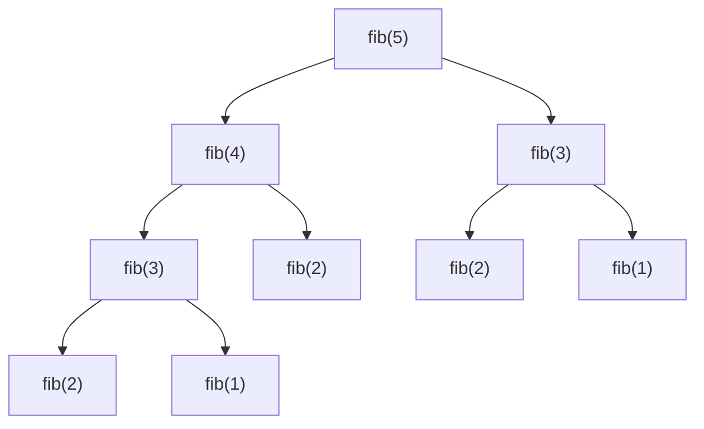

# Programação dinâmica

## Por que isso importa

Programação dinâmica (PD) é a técnica que transforma problemas "impossíveis" (exponenciais) em problemas rápidos (polinomiais). O corretor ortográfico que sugere "casa" quando você digita "csaa" usa distância de edição. O `git diff` e o comparador de DNA usam a maior subsequência comum. O roteamento de internet, o reconhecimento de fala e a previsão de texto usam PD. Em entrevistas, é o tema que mais assusta, e com razão: exige prática. A boa notícia é que existe um **roteiro**, e a ideia central cabe numa frase: **não calcule a mesma coisa duas vezes**.

## Intuição

Quanto é 1 + 1 + 1 + 1 + 1? Cinco. E se eu colocar mais um "+ 1" no final? Seis. Você não recontou tudo: **lembrou** que antes dava cinco.

PD é isso. Quando uma recursão chama os mesmos subproblemas muitas vezes (como o Fibonacci ingênuo da MD-07, que faz milhões de chamadas repetidas), basta **anotar** cada resposta numa tabela na primeira vez e consultar nas próximas. Duas formas de fazer:

- **De cima para baixo (memoização)**: escreva a recursão normal e adicione um dicionário de "já calculados".
- **De baixo para cima (tabulação)**: preencha a tabela a partir dos casos pequenos até chegar no que você quer, com laços.

## Visual

Chamadas do Fibonacci ingênuo para fib(5): fib(2) é calculado 3 vezes, fib(3) duas.



Tabela do troco mínimo com moedas {1, 3, 4}: `dp[v]` = menor número de moedas para o valor v.

```text
v:      0  1  2  3  4  5  6
dp[v]:  0  1  2  1  1  2  2

dp[6] = 1 + min(dp[6−1], dp[6−3], dp[6−4]) = 1 + min(2, 1, 2) = 2   (3 + 3)
O guloso da AL-08 daria 3 (4 + 1 + 1).
```

## Conceito técnico

### Quando usar

Duas condições:

1. **Subestrutura ótima**: a solução ótima é feita de soluções ótimas de subproblemas.
2. **Subproblemas sobrepostos**: os mesmos subproblemas aparecem muitas vezes. (Se não se repetem, é só divisão e conquista, AL-04.)

Sinais no enunciado: "de quantas formas...", "o mínimo/máximo de...", "é possível...", com escolhas em sequência (pegar ou não pegar, andar para a direita ou para baixo, apagar ou trocar uma letra).

### Roteiro em 5 passos

1. **Estado**: o que identifica um subproblema? (`dp[v]` = melhor resposta para o valor v; `dp[i][j]` = resposta para os prefixos de tamanho i e j.)
2. **Transição**: como a resposta de um estado depende de estados menores? (Pense na **última** escolha.)
3. **Casos base**: os menores estados, com resposta direta.
4. **Ordem**: em que ordem preencher, para que os estados necessários já estejam prontos.
5. **Resposta**: qual estado (ou combinação) responde a pergunta original.

Custo = (número de estados) × (custo de cada transição).

### Memoização e tabulação

```python
from functools import lru_cache

@lru_cache(maxsize=None)          # memoização pronta do Python
def fib(n):
    return n if n < 2 else fib(n - 1) + fib(n - 2)

def fib_tab(n):                   # tabulação com O(1) de memória
    a, b = 0, 1
    for _ in range(n):
        a, b = b, a + b
    return a

print(fib(90), fib_tab(90))       # instantâneo; o ingênuo levaria séculos
```

| | Memoização | Tabulação |
|---|---|---|
| Como escrever | recursão + cache | laços sobre a tabela |
| Calcula | só os estados necessários | todos os estados |
| Risco | limite de recursão (~1000 em Python) | pensar na ordem certa |
| Memória | difícil de reduzir | fácil: guardar só a linha anterior |

### Exemplo 1: troco mínimo

- Estado: `dp[v]` = menor número de moedas que somam v.
- Transição: a última moeda usada foi alguma c ≤ v: `dp[v] = 1 + min(dp[v − c])`.
- Base: `dp[0] = 0`.
- Ordem: v de 1 até o valor.
- Custo: O(valor × número de moedas).

### Exemplo 2: mochila 0/1

Itens com peso e valor, capacidade W, cada item inteiro ou nada.

- Estado: `dp[i][w]` = melhor valor usando os primeiros i itens com capacidade w.
- Transição (o item i entra ou não):

```text
dp[i][w] = max( dp[i−1][w],                         ← não leva o item i
                dp[i−1][w − peso_i] + valor_i )      ← leva (se couber)
```

- Base: `dp[0][w] = 0`.
- Custo: O(n × W). Dá para usar uma única linha, percorrendo w **de trás para frente** (para não usar o mesmo item duas vezes).

### Exemplo 3: maior subsequência comum (LCS)

Subsequência: letras na mesma ordem, não necessariamente seguidas. LCS("ABCBDAB", "BDCABA") = 4 (por exemplo, "BCBA").

- Estado: `dp[i][j]` = LCS dos prefixos `a[:i]` e `b[:j]`.
- Transição: se `a[i−1] == b[j−1]`, `dp[i][j] = dp[i−1][j−1] + 1`; senão, `max(dp[i−1][j], dp[i][j−1])`.
- Custo: O(n × m). É a base do `diff`.

### Exemplo 4: distância de edição (Levenshtein)

Menor número de inserções, remoções e trocas de letra para transformar uma palavra na outra. "gato" → "pato" = 1; "casa" → "asas" = 2.

```text
dp[i][j] = dp[i−1][j−1]                       se a[i−1] == b[j−1]
         = 1 + min( dp[i−1][j],      ← remove a[i−1]
                    dp[i][j−1],      ← insere b[j−1]
                    dp[i−1][j−1] )   ← troca
base: dp[i][0] = i, dp[0][j] = j
```

### Exemplo 5: Kadane (subarray de soma máxima em O(n))

Prometido na AL-04. Estado: `melhor_aqui` = maior soma de um trecho que **termina** na posição atual. Transição: ou estende o trecho anterior, ou começa de novo aqui.

```python
def kadane(l):
    melhor_aqui = melhor = l[0]
    for x in l[1:]:
        melhor_aqui = max(x, melhor_aqui + x)
        melhor = max(melhor, melhor_aqui)
    return melhor
```

## Código

Distância de edição com a tabela impressa, para ver a PD trabalhando:

```python
def edicao(a, b):
    dp = [[0] * (len(b) + 1) for _ in range(len(a) + 1)]
    for i in range(len(a) + 1):
        dp[i][0] = i
    for j in range(len(b) + 1):
        dp[0][j] = j
    for i in range(1, len(a) + 1):
        for j in range(1, len(b) + 1):
            if a[i - 1] == b[j - 1]:
                dp[i][j] = dp[i - 1][j - 1]
            else:
                dp[i][j] = 1 + min(dp[i - 1][j], dp[i][j - 1], dp[i - 1][j - 1])
    return dp

a, b = "casa", "asas"
tabela = edicao(a, b)
print("     " + "  ".join(" " + b))
for i, linha in enumerate(tabela):
    print((" " + a)[i], " ", "  ".join(str(x) for x in linha))
print("distância:", tabela[-1][-1])     # 2: remove o c, insere um s no fim
```

## Erros comuns

- **Começar pelo código.** Defina o estado e a transição em palavras (ou no papel) primeiro.
- **Estado incompleto.** Se a transição precisa de uma informação que o estado não guarda (como "quanto de capacidade sobra"), ela precisa entrar no estado.
- **Ordem de preenchimento errada**: usar `dp[i][j]` antes de calculá-lo.
- **Mochila 0/1 numa linha só percorrendo w para a frente.** Isso deixa usar o mesmo item várias vezes (vira a mochila **ilimitada**).
- **Esquecer o caso "impossível"** (troco que não fecha). Use infinito e trate no final.
- **Memoizar com argumentos mutáveis** (listas) no `lru_cache`: dá `TypeError`. Use tuplas ou índices.
- **Recursão funda demais** na memoização: para n grande em Python, prefira tabulação.

## Pratique

```quiz
id: AL-09-q1
tipo: multipla_escolha
pergunta: "O que diferencia a programação dinâmica da divisão e conquista?"
opcoes: ["A PD não usa recursão", "Na PD os subproblemas se repetem, e cada um é resolvido uma vez só", "A divisão e conquista é sempre mais rápida", "A PD só serve para Fibonacci"]
resposta: 1
explicacao: "As duas quebram o problema em subproblemas. No merge sort, as metades são independentes e não se repetem. No Fibonacci, fib(n − 2) aparece em vários ramos: anotar a resposta evita refazer o trabalho."
dificuldade: 1
```

```quiz
id: AL-09-q2
tipo: multipla_escolha
pergunta: "Qual é o custo da mochila 0/1 por programação dinâmica, com n itens e capacidade W?"
opcoes: ["O(n)", "O(n log n)", "O(n × W)", "O(2ⁿ)"]
resposta: 2
explicacao: "São (n + 1) × (W + 1) estados, cada um com uma transição O(1) (leva ou não leva). Testar todos os subconjuntos seria O(2ⁿ). Repare que W é um número, não um tamanho de entrada: se W for enorme, a PD fica lenta."
dificuldade: 2
```

```quiz
id: AL-09-q3
tipo: multipla_escolha
pergunta: "Qual é a distância de edição entre \"gato\" e \"gatos\"?"
opcoes: ["0", "1", "2", "5"]
resposta: 1
explicacao: "Basta inserir um 's' no fim: uma operação."
dificuldade: 1
```

```quiz
id: AL-09-q4
tipo: verdadeiro_falso
pergunta: "Na mochila 0/1 usando um único vetor dp[w], é preciso percorrer w do maior para o menor."
resposta: true
explicacao: "dp[w] usa dp[w − peso] da linha ANTERIOR (sem o item atual). Indo de trás para frente, dp[w − peso] ainda não foi atualizado nesta rodada. Indo para a frente, ele já incluiria o item, e o mesmo item poderia ser usado várias vezes."
dificuldade: 3
```

```quiz
id: AL-09-q5
tipo: prever_saida
pergunta: |
  O que este código imprime?
  ```python
  dp = [0] * 6
  dp[0] = 1
  for moeda in [1, 2]:
      for v in range(moeda, 6):
          dp[v] += dp[v - moeda]
  print(dp[5])
  ```
resposta: "3"
explicacao: "dp[v] conta de quantas formas formar v com as moedas vistas até agora. Com 1 e 2, o valor 5 sai de 1+1+1+1+1, 1+1+1+2 e 1+2+2: três formas. O laço de moedas por fora garante que a ordem das moedas não importa (1+2 e 2+1 contam como uma)."
dificuldade: 2
```

```quiz
id: AL-09-q6
tipo: resposta_curta
pergunta: "No troco mínimo, explique o estado, a transição e o caso base."
resposta: "O estado dp[v] é o menor número de moedas que somam v. A transição considera qual foi a última moeda c usada: dp[v] = 1 + o mínimo de dp[v − c] para cada moeda c ≤ v. O caso base é dp[0] = 0, e valores impossíveis ficam com infinito."
palavras_chave: ["dp[v]", "última moeda", "1 + min", "dp[0] = 0"]
dificuldade: 2
```

```quiz
id: AL-09-q7
tipo: codigo
linguagem: python
pergunta: |
  **Troco mínimo.** Escreva `troco(moedas, valor)` que devolve o menor número de moedas que somam exatamente `valor` (moedas ilimitadas de cada tipo), ou `-1` se for impossível. Use tabulação.
codigo_inicial: |
  def troco(moedas, valor):
      n = 0
      for m in sorted(moedas, reverse=True):
          n += valor // m
          valor %= m
      return n if valor == 0 else -1
usa: [def, for, return]
testes:
  - chamada: "troco([1, 3, 4], 6)"
    saida: "2"
  - chamada: "troco([2], 3)"
    saida: "-1"
  - chamada: "troco([1, 5, 10, 25], 63)"
    saida: "6"
  - chamada: "troco([7], 0)"
    saida: "0"
  - chamada: "troco([1, 7, 10], 14)"
    visivel: false
    saida: "2"
  - chamada: "troco([3, 7, 405, 436], 8839)"
    visivel: false
    saida: "25"
dica: "inf = float('inf'); dp = [0] + [inf] * valor. Para v de 1 até valor, para cada moeda c <= v, dp[v] = min(dp[v], dp[v - c] + 1). Devolva -1 se dp[valor] for inf."
solucao: |
  def troco(moedas, valor):
      inf = float("inf")
      dp = [0] + [inf] * valor
      for v in range(1, valor + 1):
          for c in moedas:
              if c <= v and dp[v - c] + 1 < dp[v]:
                  dp[v] = dp[v - c] + 1
      return dp[valor] if dp[valor] != inf else -1
explicacao: "O código inicial é o guloso da AL-08: acerta com moedas canônicas (o terceiro teste) e erra com {1, 3, 4} e {1, 7, 10} (14 = 7 + 7, o guloso faria 10 + 1 + 1 + 1 + 1). A PD testa todas as 'últimas moedas' possíveis e nunca se compromete cedo demais."
dificuldade: 2
```

```quiz
id: AL-09-q8
tipo: codigo
linguagem: python
pergunta: |
  **Mochila 0/1.** Itens são pares `(peso, valor)` e cada um pode ser levado no máximo uma vez. Escreva `mochila(itens, capacidade)` que devolve o maior valor total. Use um único vetor `dp` de tamanho `capacidade + 1`.
codigo_inicial: |
  def mochila(itens, capacidade):
      total = 0
      for peso, valor in sorted(itens, key=lambda i: i[1] / i[0], reverse=True):
          if peso <= capacidade:
              total += valor
              capacidade -= peso
      return total
usa: [def, for, return]
testes:
  - chamada: "mochila([(10, 60), (20, 100), (30, 120)], 50)"
    saida: "220"
  - chamada: "mochila([(5, 10)], 4)"
    saida: "0"
  - chamada: "mochila([(1, 1), (1, 1), (1, 1)], 2)"
    saida: "2"
  - chamada: "mochila([(4, 5), (3, 4), (2, 3), (1, 1)], 6)"
    visivel: false
    saida: "8"
  - chamada: "mochila([((i * 37) % 50 + 1, (i * 53) % 97 + 1) for i in range(200)], 1000)"
    visivel: false
    saida: "4944"
dica: "dp = [0] * (capacidade + 1). Para cada item (p, v): para w de capacidade até p, de trás para frente (range(capacidade, p - 1, -1)), dp[w] = max(dp[w], dp[w - p] + v). Devolva dp[capacidade]."
solucao: |
  def mochila(itens, capacidade):
      dp = [0] * (capacidade + 1)
      for p, v in itens:
          for w in range(capacidade, p - 1, -1):
              if dp[w - p] + v > dp[w]:
                  dp[w] = dp[w - p] + v
      return dp[capacidade]
explicacao: "O guloso por valor/peso dá 160 no primeiro teste; o ótimo é 220. O laço de trás para frente garante que cada item é usado no máximo uma vez. No terceiro teste, ir para a frente deixaria levar o primeiro item de peso 1 várias vezes, e o resultado seria o mesmo por acaso; no teste oculto não seria."
dificuldade: 3
```

```quiz
id: AL-09-q9
tipo: codigo
linguagem: python
pergunta: |
  **Maior subsequência comum.** Escreva `lcs(a, b)` que devolve o **tamanho** da maior subsequência comum entre as strings `a` e `b`.
codigo_inicial: |
  def lcs(a, b):
      if not a or not b:
          return 0
      if a[-1] == b[-1]:
          return lcs(a[:-1], b[:-1]) + 1
      return max(lcs(a[:-1], b), lcs(a, b[:-1]))
usa: [def, for, return]
testes:
  - chamada: "lcs('ABCBDAB', 'BDCABA')"
    saida: "4"
  - chamada: "lcs('abc', 'def')"
    saida: "0"
  - chamada: "lcs('', 'abc')"
    saida: "0"
  - chamada: "lcs('programacao', 'programador')"
    saida: "9"
  - chamada: "lcs('abcdefghij' * 4, 'jihgfedcba' * 4)"
    visivel: false
    saida: "7"
  - chamada: "lcs('ab' * 300, 'ba' * 300)"
    visivel: false
    saida: "599"
dica: "dp = [[0] * (len(b) + 1) for _ in range(len(a) + 1)]. Para i de 1 a len(a) e j de 1 a len(b): se a[i - 1] == b[j - 1], dp[i][j] = dp[i - 1][j - 1] + 1; senão, o max de dp[i - 1][j] e dp[i][j - 1]."
solucao: |
  def lcs(a, b):
      dp = [[0] * (len(b) + 1) for _ in range(len(a) + 1)]
      for i in range(1, len(a) + 1):
          for j in range(1, len(b) + 1):
              if a[i - 1] == b[j - 1]:
                  dp[i][j] = dp[i - 1][j - 1] + 1
              else:
                  dp[i][j] = max(dp[i - 1][j], dp[i][j - 1])
      return dp[len(a)][len(b)]
explicacao: "O código inicial é a recursão correta, mas sem memória: com duas strings de 40 letras que quase não combinam, ela se ramifica bilhões de vezes. Cada estado (i, j) é um par de prefixos, então há só 41 × 41 estados distintos; a tabela calcula cada um uma vez. É a mesma ideia do diff do Git, aplicada a linhas em vez de letras."
dificuldade: 3
```

```quiz
id: AL-09-q10
tipo: codigo
linguagem: python
pergunta: |
  **Distância de edição.** Escreva `edicao(a, b)` que devolve o menor número de inserções, remoções e trocas de um caractere para transformar `a` em `b`. Para economizar memória, guarde só **duas linhas** da tabela.
codigo_inicial: |
  def edicao(a, b):
      return abs(len(a) - len(b))
usa: [def, for, return]
testes:
  - chamada: "edicao('gato', 'pato')"
    saida: "1"
  - chamada: "edicao('casa', 'asas')"
    saida: "2"
  - chamada: "edicao('', 'abc')"
    saida: "3"
  - chamada: "edicao('kitten', 'sitting')"
    saida: "3"
  - chamada: "edicao('a' * 1500 + 'b', 'b' + 'a' * 1500)"
    visivel: false
    saida: "2"
dica: "anterior = list(range(len(b) + 1)). Para cada i de 1 a len(a): atual = [i] + [0] * len(b); para j de 1 a len(b): se as letras forem iguais, atual[j] = anterior[j - 1]; senão 1 + min(anterior[j], atual[j - 1], anterior[j - 1]). No fim do i, anterior = atual."
solucao: |
  def edicao(a, b):
      anterior = list(range(len(b) + 1))
      for i in range(1, len(a) + 1):
          atual = [i] + [0] * len(b)
          for j in range(1, len(b) + 1):
              if a[i - 1] == b[j - 1]:
                  atual[j] = anterior[j - 1]
              else:
                  atual[j] = 1 + min(anterior[j], atual[j - 1], anterior[j - 1])
          anterior = atual
      return anterior[len(b)]
explicacao: "Cada linha só depende da anterior, então O(len(b)) de memória basta. No teste oculto, mover o 'b' do fim para o começo custa 2 operações (remover e inserir), mesmo com 1500 letras. É o que corretores ortográficos e a busca 'você quis dizer?' calculam."
dificuldade: 3
```

```quiz
id: AL-09-q11
tipo: codigo
linguagem: javascript
pergunta: |
  **Caminhos na grade.** Numa grade de `linhas × colunas`, você sai do canto superior esquerdo e só pode andar para a **direita** ou para **baixo**. Algumas casas são bloqueadas: `bloqueadas` é um array de pares `[l, c]`. Escreva `caminhos(linhas, colunas, bloqueadas)` que devolve quantos caminhos chegam ao canto inferior direito. Use `BigInt` para não perder precisão e devolva o resultado como **string**.
codigo_inicial: |
  function caminhos(linhas, colunas, bloqueadas) {
    return "0";
  }
usa: [function, for, return]
testes:
  - chamada: "caminhos(3, 3, [])"
    saida: "'6'"
  - chamada: "caminhos(3, 3, [[1, 1]])"
    saida: "'2'"
  - chamada: "caminhos(1, 1, [])"
    saida: "'1'"
  - chamada: "caminhos(2, 2, [[0, 0]])"
    visivel: false
    saida: "'0'"
  - chamada: "caminhos(35, 35, [])"
    visivel: false
    saida: "'28453041475240576740'"
dica: "Crie um Set com as chaves `${l},${c}` bloqueadas. dp é uma matriz de BigInt (0n). Se a origem não estiver bloqueada, dp[0][0] = 1n. Para cada casa não bloqueada, dp[l][c] += dp[l-1][c] (se l > 0) + dp[l][c-1] (se c > 0). Devolva dp[linhas-1][colunas-1].toString()."
solucao: |
  function caminhos(linhas, colunas, bloqueadas) {
    const bloq = new Set(bloqueadas.map(([l, c]) => `${l},${c}`));
    const dp = Array.from({ length: linhas }, () => Array(colunas).fill(0n));
    for (let l = 0; l < linhas; l++) {
      for (let c = 0; c < colunas; c++) {
        if (bloq.has(`${l},${c}`)) continue;
        if (l === 0 && c === 0) {
          dp[l][c] = 1n;
          continue;
        }
        let total = 0n;
        if (l > 0) total += dp[l - 1][c];
        if (c > 0) total += dp[l][c - 1];
        dp[l][c] = total;
      }
    }
    return dp[linhas - 1][colunas - 1].toString();
  }
explicacao: "Só se chega a uma casa vindo de cima ou da esquerda, então os caminhos até ela são a soma dos caminhos até essas duas. Sem bloqueios, o resultado é o coeficiente binomial C(68, 34), um número com 20 dígitos: maior que Number.MAX_SAFE_INTEGER, por isso o BigInt."
dificuldade: 2
```

## Resumo

- **PD** = recursão com subproblemas **repetidos** + anotar cada resposta uma vez.
- **Memoização** (de cima para baixo, `lru_cache`) ou **tabulação** (de baixo para cima, laços).
- Roteiro: **estado → transição → base → ordem → resposta**. Custo = estados × transição.
- Clássicos: troco mínimo O(V·k), mochila 0/1 O(n·W), LCS e edição O(n·m), Kadane O(n).
- Economize memória guardando só a linha anterior.

## Para ir além

- Resolva a lista "Dynamic Programming" do LeetCode começando pelos fáceis (Climbing Stairs, House Robber) antes dos médios.
- Assista às aulas 15 a 18 do MIT 6.006 (2020): o roteiro "SRTBOT" é uma versão mais detalhada dos 5 passos desta aula.
- **Próximo módulo**: AL-10 Backtracking, para quando é preciso listar todas as soluções, e não só contar ou otimizar.
