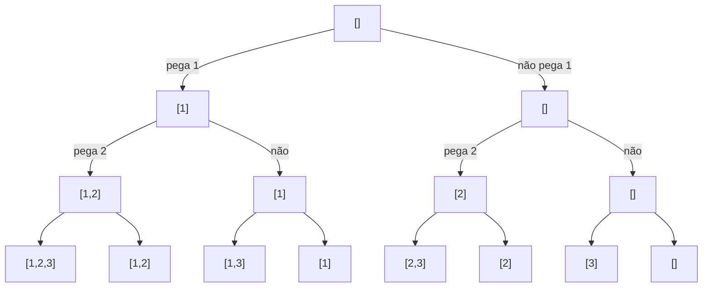

# Backtracking

## Por que isso importa

Alguns problemas pedem **todas** as soluções, ou uma solução que satisfaça várias restrições ao mesmo tempo, e não há atalho conhecido: montar escalas de plantão respeitando folgas, preencher um Sudoku, gerar todas as senhas que seguem uma regra, achar todas as formas de pagar uma conta com as notas que você tem. O **backtracking** explora as possibilidades de forma organizada e, o mais importante, **abandona cedo** os caminhos que já não têm como dar certo. É a técnica por trás de resolvedores de Sudoku, de restrições (SAT solvers), de expressões regulares e de muitos problemas de entrevista ("gere todas as permutações", "N rainhas", "palavras numa grade").

## Intuição

Você está num labirinto e marca o caminho com giz. Em cada bifurcação, escolhe um corredor. Se der num beco sem saída, **volta** até a última bifurcação, **apaga** a marca e tenta o próximo corredor. Isso é backtracking: **escolher, explorar, desfazer**.

A poda é perceber mais cedo que um corredor não leva a lugar nenhum. Se a placa diz "sem saída", você nem entra.

## Visual

Árvore de escolhas para gerar os subconjuntos de [1, 2, 3]: em cada nível, decide se o item entra ou não.



As 8 folhas são os 2³ subconjuntos.

Quatro rainhas num tabuleiro 4 × 4, sem duas se atacando. Uma rainha por linha; poda ao primeiro ataque:

```text
linha 0: coluna 0          Q . . .
linha 1: col 0 ✗ col 1 ✗   . . Q .     (col 2 ok)
linha 2: todas ✗ → volta    
linha 1: col 3             . . . Q     (tenta a próxima)
linha 2: col 1             . Q . .
linha 3: todas ✗ → volta, volta, volta...
...
primeira solução:          . Q . .
                           . . . Q
                           Q . . .
                           . . Q .
```

## Conceito técnico

### O molde

```python
def backtrack(estado):
    if estado é uma solução completa:
        registre a solução
        return
    for escolha in escolhas possíveis a partir de estado:
        if escolha é válida:            # poda
            faça a escolha              # modifica o estado
            backtrack(estado)
            desfaça a escolha           # volta ao estado anterior
```

É uma **DFS** (AL-05) na árvore de escolhas, que nunca é construída na memória: só o caminho atual existe.

### Os três geradores clássicos

| Problema | Quantas soluções | Escolha em cada nível |
|---|---|---|
| Subconjuntos de n itens | 2ⁿ | pega ou não pega o item i |
| Permutações de n itens | n! | qual item ainda não usado vai na posição i |
| Combinações de k entre n | C(n, k) | próximo item, sempre com índice maior que o anterior |

```python
def permutacoes(itens):
    resultado, atual, usado = [], [], [False] * len(itens)

    def bt():
        if len(atual) == len(itens):
            resultado.append(atual[:])        # cópia! atual vai mudar
            return
        for i, x in enumerate(itens):
            if not usado[i]:
                usado[i] = True
                atual.append(x)
                bt()
                atual.pop()                   # desfaz
                usado[i] = False

    bt()
    return resultado

print(permutacoes([1, 2, 3]))
```

O módulo `itertools` já tem `permutations`, `combinations` e `product`. Use-os quando bastarem; escreva o backtracking quando precisar **podar**.

### Poda

O que faz o backtracking ser muito melhor que a força bruta é cortar ramos inteiros:

- **Restrição violada**: nas N rainhas, se a rainha da linha 2 já é atacada, nenhuma configuração das linhas 3 em diante vai salvar. Corta.
- **Limite**: na soma de subconjunto com números positivos, se a soma parcial já passou do alvo, corta. Se os itens estão ordenados, pode até parar o laço (`break`), porque os próximos são maiores.
- **Simetria**: com itens repetidos, ordene e pule duplicatas no mesmo nível, para não gerar a mesma solução várias vezes.

### Custo

Exponencial no pior caso: O(2ⁿ) para subconjuntos, O(n!) para permutações. A poda não muda o pior caso teórico, mas na prática reduz muito. Referência: 2²⁰ ≈ 1 milhão (ok), 2⁴⁰ ≈ 1 trilhão (inviável), 10! ≈ 3,6 milhões (ok), 15! ≈ 1,3 trilhão (inviável).

### Backtracking ou programação dinâmica?

- Precisa **listar** todas as soluções? Backtracking (não há como ser mais rápido que o número de soluções).
- Precisa **contar** ou **otimizar**, e os subproblemas se repetem? PD (AL-09) costuma ser exponencialmente mais rápida.

Exemplo: "quantos subconjuntos de [1..30] somam 100?" com backtracking puro explora até 2³⁰ ramos; com PD (como a contagem de troco), O(30 × 100).

## Código

N rainhas contando soluções, com conjuntos para checar ataques em O(1):

```python
def n_rainhas(n):
    colunas, diag1, diag2 = set(), set(), set()
    total = 0

    def bt(linha):
        nonlocal total
        if linha == n:
            total += 1
            return
        for c in range(n):
            if c in colunas or (linha - c) in diag1 or (linha + c) in diag2:
                continue                       # poda: atacada
            colunas.add(c)
            diag1.add(linha - c)
            diag2.add(linha + c)
            bt(linha + 1)
            colunas.remove(c)
            diag1.remove(linha - c)
            diag2.remove(linha + c)

    bt(0)
    return total

for n in range(1, 9):
    print(n, n_rainhas(n))      # 1 1, 2 0, 3 0, 4 2, 5 10, 6 4, 7 40, 8 92
```

Numa mesma diagonal "\\", `linha − coluna` é constante; numa diagonal "/", `linha + coluna` é constante.

## Erros comuns

- **Guardar a lista `atual` sem copiar.** `resultado.append(atual)` guarda a referência; quando `atual` for esvaziada, todas as soluções guardadas ficam vazias. Use `atual[:]`.
- **Esquecer de desfazer a escolha** (o `pop`, o `remove`). O estado "vaza" para os outros ramos.
- **Desfazer na ordem errada** ou desfazer algo que não foi feito (por exemplo, quando o `continue` pula a escolha, mas o desfazer roda mesmo assim).
- **Gerar duplicatas com itens repetidos.** Ordene e pule `itens[i] == itens[i − 1]` no mesmo nível.
- **Não podar.** Sem poda, é força bruta; com n = 25, a diferença pode ser de horas para milissegundos.
- **Usar backtracking para contar** quando há subproblemas repetidos: PD resolve muito mais rápido.

## Pratique

```quiz
id: AL-10-q1
tipo: multipla_escolha
pergunta: "Quantas permutações tem uma lista de 6 itens distintos?"
opcoes: ["36", "64", "720", "46656"]
resposta: 2
explicacao: "6 escolhas para a primeira posição, 5 para a segunda... 6! = 720. 64 = 2⁶ seria o número de subconjuntos."
dificuldade: 1
```

```quiz
id: AL-10-q2
tipo: multipla_escolha
pergunta: "Qual é o papel do passo 'desfazer a escolha' no backtracking?"
opcoes: ["Liberar memória", "Devolver o estado ao que era antes, para que o próximo ramo comece do mesmo ponto", "Evitar recursão infinita", "Ordenar as soluções"]
resposta: 1
explicacao: "Todos os ramos compartilham o mesmo estado (a lista atual, os conjuntos de colunas usadas). Depois de explorar um ramo, é preciso apagar o giz para que o próximo ramo veja o tabuleiro como estava na bifurcação."
dificuldade: 1
```

```quiz
id: AL-10-q3
tipo: verdadeiro_falso
pergunta: "Na soma de subconjunto com números positivos ordenados, se a soma parcial mais o próximo número já passa do alvo, dá para parar de testar os números seguintes naquele nível."
resposta: true
explicacao: "Como estão em ordem crescente, os próximos são maiores ou iguais e também passariam do alvo. Um 'break' corta todos esses ramos de uma vez. Com números negativos, essa poda não vale."
dificuldade: 2
```

```quiz
id: AL-10-q4
tipo: prever_saida
pergunta: |
  O que este código imprime?
  ```python
  resultado, atual = [], []
  def bt(i):
      if i == 2:
          resultado.append(atual)
          return
      for x in "ab":
          atual.append(x)
          bt(i + 1)
          atual.pop()
  bt(0)
  print(resultado)
  ```
resposta: "[[], [], [], []]"
explicacao: "As quatro soluções foram registradas, mas como a MESMA lista atual, sem cópia. No fim, todos os pops a esvaziaram, e as quatro referências mostram a lista vazia. Com resultado.append(atual[:]), sairia [['a','a'], ['a','b'], ['b','a'], ['b','b']]."
dificuldade: 2
```

```quiz
id: AL-10-q5
tipo: resposta_curta
pergunta: "Por que verificar as diagonais com linha − coluna e linha + coluna funciona nas N rainhas?"
resposta: "Ao andar numa diagonal descendente, linha e coluna aumentam juntas, então a diferença linha − coluna é constante. Na diagonal ascendente, uma aumenta e a outra diminui, então a soma linha + coluna é constante. Guardando essas diferenças e somas em conjuntos, um ataque vira uma consulta O(1)."
palavras_chave: ["diferença", "soma", "constante", "conjunto"]
dificuldade: 2
```

```quiz
id: AL-10-q6
tipo: codigo
linguagem: python
pergunta: |
  **Subconjuntos.** Escreva `subconjuntos(itens)` que devolve **todos** os subconjuntos da lista (itens distintos), cada um como lista na ordem original, e o resultado **ordenado** (`sorted`). Use backtracking (não use `itertools`).
codigo_inicial: |
  def subconjuntos(itens):
      return [[]] + [[x] for x in itens]
usa: [def, return, append, pop]
testes:
  - chamada: "subconjuntos([1, 2, 3])"
    saida: "[[], [1], [1, 2], [1, 2, 3], [1, 3], [2], [2, 3], [3]]"
  - chamada: "subconjuntos([])"
    saida: "[[]]"
  - chamada: "len(subconjuntos(list(range(15))))"
    saida: "32768"
  - chamada: "subconjuntos(['b', 'a'])"
    visivel: false
    saida: "[[], ['a'], ['b'], ['b', 'a']]"
dica: "resultado, atual = [], []. def bt(i): se i == len(itens), guarde atual[:] e retorne. Senão: atual.append(itens[i]); bt(i + 1); atual.pop(); bt(i + 1). Chame bt(0) e devolva sorted(resultado)."
solucao: |
  def subconjuntos(itens):
      resultado, atual = [], []

      def bt(i):
          if i == len(itens):
              resultado.append(atual[:])
              return
          atual.append(itens[i])
          bt(i + 1)
          atual.pop()
          bt(i + 1)

      bt(0)
      return sorted(resultado)
explicacao: "Cada nível decide um item: entra ou não. São 2ⁿ folhas, e cada uma é um subconjunto. A cópia atual[:] é essencial. O sorted no fim só deixa a saída previsível; o algoritmo em si já gera cada subconjunto exatamente uma vez."
dificuldade: 2
```

```quiz
id: AL-10-q7
tipo: codigo
linguagem: python
pergunta: |
  **N rainhas.** Escreva `n_rainhas(n)` que devolve **quantas** formas existem de colocar n rainhas num tabuleiro n × n sem que duas se ataquem. Use backtracking com poda (uma rainha por linha).
codigo_inicial: |
  from itertools import permutations


  def n_rainhas(n):
      total = 0
      for p in permutations(range(n)):
          if len({i - p[i] for i in range(n)}) == n and len({i + p[i] for i in range(n)}) == n:
              total += 1
      return total
usa: [def, for, return]
testes:
  - chamada: "[n_rainhas(n) for n in range(1, 7)]"
    saida: "[1, 0, 0, 2, 10, 4]"
  - chamada: "n_rainhas(8)"
    saida: "92"
  - chamada: "n_rainhas(11)"
    visivel: false
    saida: "2680"
dica: "Três conjuntos: colunas, linha - coluna e linha + coluna. def bt(linha): se linha == n, conte 1. Para cada coluna c livre nos três conjuntos, adicione, chame bt(linha + 1) e remova."
solucao: |
  def n_rainhas(n):
      colunas, d1, d2 = set(), set(), set()

      def bt(linha):
          if linha == n:
              return 1
          total = 0
          for c in range(n):
              if c in colunas or linha - c in d1 or linha + c in d2:
                  continue
              colunas.add(c)
              d1.add(linha - c)
              d2.add(linha + c)
              total += bt(linha + 1)
              colunas.remove(c)
              d1.remove(linha - c)
              d2.remove(linha + c)
          return total

      return bt(0)
explicacao: "O código inicial testa as 11! ≈ 40 milhões de permutações inteiras e estoura o tempo. O backtracking descarta uma posição assim que ela é atacada e nunca chega a montar a maior parte dessas permutações: para n = 11, visita algumas centenas de milhares de nós."
dificuldade: 3
```

```quiz
id: AL-10-q8
tipo: codigo
linguagem: python
pergunta: |
  **Formas de pagar.** Escreva `formas(notas, valor)` que devolve todas as combinações de notas (cada nota pode ser usada **várias vezes**) que somam exatamente `valor`. Cada combinação em ordem crescente, sem repetir combinações, e a lista final ordenada. Os valores das notas são positivos e distintos. Pode com `break` quando passar do valor.
codigo_inicial: |
  def formas(notas, valor):
      return []
usa: [def, for, return, append, pop]
testes:
  - chamada: "formas([2, 3, 5], 8)"
    saida: "[[2, 2, 2, 2], [2, 3, 3], [3, 5]]"
  - chamada: "formas([2], 3)"
    saida: "[]"
  - chamada: "formas([1], 0)"
    saida: "[[]]"
  - chamada: "formas([10, 5, 2], 12)"
    visivel: false
    saida: "[[2, 2, 2, 2, 2, 2], [2, 5, 5], [2, 10]]"
  - chamada: "len(formas([2, 5, 10, 20, 50], 200))"
    visivel: false
    saida: "1586"
dica: "Ordene as notas. def bt(inicio, resta): se resta == 0, guarde atual[:]. Para i de inicio até o fim: se notas[i] > resta, break. Senão append, bt(i, resta - notas[i]) (i, e não i + 1, porque pode repetir) e pop."
solucao: |
  def formas(notas, valor):
      notas = sorted(notas)
      resultado, atual = [], []

      def bt(inicio, resta):
          if resta == 0:
              resultado.append(atual[:])
              return
          for i in range(inicio, len(notas)):
              if notas[i] > resta:
                  break
              atual.append(notas[i])
              bt(i, resta - notas[i])
              atual.pop()

      bt(0, valor)
      return sorted(resultado)
explicacao: "Começar o laço em 'inicio' (e chamar com i, não i + 1) faz cada combinação sair em ordem não decrescente, então [2, 3, 3] aparece uma vez só, e nunca [3, 2, 3]. O break funciona porque as notas estão ordenadas. Se a pergunta fosse só 'quantas formas', a PD da AL-09 faria isso sem listar nada."
dificuldade: 3
```

```quiz
id: AL-10-q9
tipo: codigo
linguagem: javascript
pergunta: |
  **Parênteses válidos.** Escreva `parenteses(n)` que devolve todas as strings com `n` pares de parênteses **bem formados**, em ordem alfabética (`(` vem antes de `)`). Use backtracking: só adicione `(` se ainda houver algum para abrir e só adicione `)` se houver algum aberto para fechar.
codigo_inicial: |
  function parenteses(n) {
    return ["()".repeat(n)];
  }
usa: [function, return, push]
testes:
  - chamada: "parenteses(1)"
    saida: "[ '()' ]"
  - chamada: "parenteses(3)"
    saida: "[ '((()))', '(()())', '(())()', '()(())', '()()()' ]"
  - chamada: "parenteses(0)"
    saida: "[ '' ]"
  - chamada: "parenteses(10).length"
    visivel: false
    saida: "16796"
dica: "function bt(atual, abertos, fechados): se atual.length === 2 * n, push e retorne. Se abertos < n, bt(atual + '(', abertos + 1, fechados). Se fechados < abertos, bt(atual + ')', abertos, fechados + 1). Tentar '(' primeiro já gera em ordem alfabética."
solucao: |
  function parenteses(n) {
    const resultado = [];
    function bt(atual, abertos, fechados) {
      if (atual.length === 2 * n) {
        resultado.push(atual);
        return;
      }
      if (abertos < n) bt(atual + "(", abertos + 1, fechados);
      if (fechados < abertos) bt(atual + ")", abertos, fechados + 1);
    }
    bt("", 0, 0);
    return resultado;
  }
explicacao: "As duas condições são a poda: nunca se cria uma string que já começa inválida, como ')(' ou '(()))'. Por isso o algoritmo só gera as 16796 válidas de n = 10 (o número de Catalan), em vez de testar as 2²⁰ ≈ 1 milhão de strings de parênteses. Aqui não precisa desfazer nada: a string nova é passada como argumento."
dificuldade: 2
```

## Resumo

- **Backtracking** = DFS na árvore de escolhas: **escolher, explorar, desfazer**.
- Geradores: subconjuntos (2ⁿ), permutações (n!), combinações (C(n, k)).
- **Poda** é o que o torna viável: corte ramos que violam restrições ou passam de limites.
- Guarde **cópias** das soluções; desfaça **exatamente** o que fez.
- Para **contar** ou **otimizar** com subproblemas repetidos, prefira PD.

## Para ir além

- O capítulo 2 do livro de Jeff Erickson tem uma ótima explicação das N rainhas e de "game trees".
- Tente escrever um resolvedor de Sudoku com backtracking: é o mesmo molde das N rainhas, com três conjuntos por linha, coluna e bloco.
- **Próximo módulo**: com isto, a trilha de Algoritmos está completa. No caminho principal, o Mês 4 começa com Arquitetura de computadores (AC-01) e Sistemas operacionais (SO-01).
