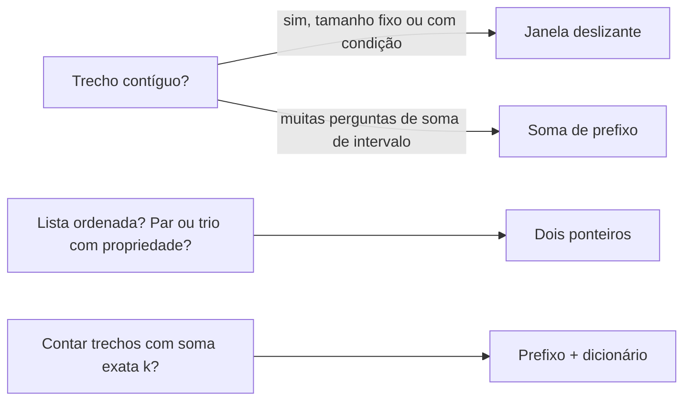

# Padrões de problemas: two pointers, sliding window, prefix sum

## Por que isso importa

Uma grande parte das perguntas de entrevista sobre listas e strings cai em três padrões. Todos eles transformam uma busca O(n²), "testar todos os pares" ou "testar todos os trechos", em **uma passada O(n)**. Reconhecer o padrão é metade da solução: depois de ver "trecho contíguo", "par com soma X numa lista ordenada" ou "soma de muitos intervalos", você já sabe por onde começar. Eles também aparecem fora das entrevistas: médias móveis em gráficos de ações, limites de requisições por minuto numa API, mesclar listas ordenadas.

## Intuição

- **Dois ponteiros**: duas pessoas lendo uma lista ordenada, uma do começo e outra do fim, andando uma em direção à outra. Cada passo descarta uma possibilidade inteira.
- **Janela deslizante**: uma lupa que passa por cima da lista. Ao andar uma casa, você **soma o que entrou e tira o que saiu**, em vez de recalcular tudo o que está dentro.
- **Soma de prefixo**: o hodômetro do carro. Para saber quanto você andou entre a cidade A e a B, não precisa refazer a viagem: basta fazer "km na chegada em B − km na chegada em A".

## Visual

Dois ponteiros: achar um par com soma 10 em `[1, 3, 4, 6, 8, 11]`.

```text
 i                 j
[1, 3, 4, 6, 8, 11]    1 + 11 = 12 > 10 → soma grande demais: j anda para a esquerda
 i              j
[1, 3, 4, 6, 8, 11]    1 + 8 = 9 < 10   → soma pequena demais: i anda para a direita
    i           j
[1, 3, 4, 6, 8, 11]    3 + 8 = 11 > 10  → j para a esquerda
    i        j
[1, 3, 4, 6, 8, 11]    3 + 6 = 9 < 10   → i para a direita
       i     j
[1, 3, 4, 6, 8, 11]    4 + 6 = 10       → achou!
```

Janela deslizante: maior soma de 3 itens seguidos em `[2, 1, 5, 1, 3, 2]`.

```text
[2, 1, 5] 1, 3, 2      soma = 8
 2 [1, 5, 1] 3, 2      8 − 2 + 1 = 7
 2, 1 [5, 1, 3] 2      7 − 1 + 3 = 9   ← maior
 2, 1, 5 [1, 3, 2]     9 − 5 + 2 = 6
```

Soma de prefixo:

```text
lista:    [3, 1, 4, 1, 5, 9]
prefixo: [0, 3, 4, 8, 9, 14, 23]      prefixo[i] = soma dos i primeiros

soma de lista[2..4] (4 + 1 + 5) = prefixo[5] − prefixo[2] = 14 − 4 = 10
```



## Conceito técnico

### Dois ponteiros

Dois índices percorrem a lista, e cada passo move **um** deles. Como cada ponteiro anda no máximo n vezes, o total é O(n). Duas formas comuns:

1. **Pontas opostas** (`i` no começo, `j` no fim), em lista **ordenada**: par com soma alvo, verificar palíndromo, "container with most water".
2. **Mesma direção** (rápido e lento): remover duplicatas no lugar, mesclar duas listas ordenadas (o `merge` de AL-03), detectar ciclo numa lista ligada (ED-03).

Por que o par com soma funciona? Se `l[i] + l[j]` é pequeno demais, nenhum par com esse `i` serve: todos os outros parceiros possíveis são menores que `l[j]`. Então `i` pode avançar com segurança. É um argumento de **descarte**, como na busca binária.

### Janela deslizante

Mantenha um trecho `[ini, fim]` e um resumo dele (soma, contagens, conjunto de caracteres).

- **Tamanho fixo k**: a cada passo, entra `l[fim]`, sai `l[fim − k]`.
- **Tamanho variável**: aumente `fim` sempre; quando a janela ficar **inválida** (passou da soma, repetiu letra), avance `ini` até ela voltar a ser válida. Cada índice entra e sai uma vez: O(n).

```python
def maior_sem_repetir(s):            # maior trecho sem caractere repetido
    visto = set()
    ini = melhor = 0
    for fim, c in enumerate(s):
        while c in visto:            # janela inválida: encolhe pela esquerda
            visto.remove(s[ini])
            ini += 1
        visto.add(c)
        melhor = max(melhor, fim - ini + 1)
    return melhor
```

O `while` dentro do `for` parece O(n²), mas `ini` só anda para a frente, no total no máximo n vezes. Isso é **análise amortizada**.

### Soma de prefixo

Construa `pre` com `pre[0] = 0` e `pre[i + 1] = pre[i] + l[i]`. Então:

```text
soma(l[a..b]) = pre[b + 1] − pre[a]          (a e b inclusive)
```

Construir custa O(n); cada pergunta custa **O(1)**. Com q perguntas, o total é O(n + q) em vez de O(n·q).

Variações:

- **2D**: somas de retângulos numa matriz (imagens, mapas), com `pre[i][j]` = soma do retângulo do canto até (i, j).
- **Diferenças**: o inverso. Para somar v a todos os itens de um intervalo muitas vezes, marque `+v` no início e `−v` depois do fim, e no final faça a soma de prefixo.

### Prefixo + dicionário

"Quantos trechos contíguos somam exatamente k?" Com negativos, a janela não funciona (aumentar a janela pode diminuir a soma). Truque: um trecho `(a, b]` soma k quando `pre[b] − pre[a] = k`, ou seja, `pre[a] = pre[b] − k`. Percorra guardando num dicionário **quantas vezes cada prefixo já apareceu**:

```python
def conta_soma_k(l, k):
    vistos = {0: 1}                   # o prefixo vazio
    soma = total = 0
    for x in l:
        soma += x
        total += vistos.get(soma - k, 0)
        vistos[soma] = vistos.get(soma, 0) + 1
    return total

print(conta_soma_k([1, 2, 3, -2, 2], 3))   # 4: [1, 2], [2, 3, -2], [3] e [3, -2, 2]
```

### Como reconhecer

| Sinal no enunciado | Padrão |
|---|---|
| "lista ordenada", "par/trio com soma", "palíndromo" | dois ponteiros (pontas) |
| "no lugar", "sem memória extra", "remover duplicatas" | dois ponteiros (rápido/lento) |
| "subarray/substring contígua", "maior/menor trecho tal que" | janela deslizante |
| "média móvel", "k itens seguidos" | janela de tamanho fixo |
| "soma do intervalo", muitas perguntas | soma de prefixo |
| "quantos subarrays somam k", com negativos | prefixo + dicionário |

## Código

Comparando a força bruta com o prefixo, para 2000 perguntas:

```python
import random
import time

l = [random.randint(-100, 100) for _ in range(5000)]
perguntas = [sorted(random.sample(range(5000), 2)) for _ in range(2000)]

t = time.perf_counter()
r1 = [sum(l[a:b + 1]) for a, b in perguntas]
print("força bruta:", round(time.perf_counter() - t, 3), "s")

t = time.perf_counter()
pre = [0]
for x in l:
    pre.append(pre[-1] + x)
r2 = [pre[b + 1] - pre[a] for a, b in perguntas]
print("prefixo:    ", round(time.perf_counter() - t, 3), "s")
print(r1 == r2)
```

O módulo `itertools` já tem a soma de prefixo pronta: `list(accumulate(l, initial=0))`.

## Erros comuns

- **Usar dois ponteiros de pontas opostas em lista não ordenada.** O argumento de descarte depende da ordem. Ordene antes (O(n log n)) ou use um `set`.
- **Errar em 1 o índice do prefixo.** Com `pre[0] = 0`, a soma de `l[a..b]` é `pre[b + 1] − pre[a]`. Desenhe um exemplo pequeno.
- **Recalcular a janela inteira a cada passo** (`sum(l[i:i + k])`), o que volta para O(n·k).
- **Janela variável com números negativos.** Encolher a janela não garante diminuir a soma; use prefixo + dicionário.
- **Esquecer `{0: 1}`** no contador de prefixos e perder os trechos que começam no índice 0.
- **Mover os dois ponteiros juntos** quando só um deveria andar, pulando respostas.

## Pratique

```quiz
id: AL-11-q1
tipo: multipla_escolha
pergunta: "Qual padrão resolve melhor \"maior média de 7 dias seguidos de vendas, num ano de dados\"?"
opcoes: ["Dois ponteiros de pontas opostas", "Janela deslizante de tamanho fixo", "Ordenar e pegar os 7 maiores", "Busca binária"]
resposta: 1
explicacao: "É um trecho contíguo de tamanho fixo (7). A cada dia, some o dia que entrou e tire o que saiu: O(n). Ordenar perderia a noção de 'seguidos'."
dificuldade: 1
```

```quiz
id: AL-11-q2
tipo: multipla_escolha
pergunta: "Com `pre = [0, 3, 4, 8, 9, 14, 23]` (prefixo de `[3, 1, 4, 1, 5, 9]`), quanto vale a soma de `l[1..3]` (índices 1 a 3, inclusive)?"
opcoes: ["5", "6", "8", "9"]
resposta: 1
explicacao: "pre[3 + 1] − pre[1] = 9 − 3 = 6, que é 1 + 4 + 1. O + 1 no índice final vem de pre[i] guardar a soma dos i PRIMEIROS itens (até o índice i − 1)."
dificuldade: 1
```

```quiz
id: AL-11-q3
tipo: multipla_escolha
pergunta: "Na busca de par com soma alvo numa lista ordenada com dois ponteiros, se `l[i] + l[j]` é MAIOR que o alvo, o que fazer?"
opcoes: ["Avançar i", "Recuar j", "Avançar i e recuar j", "Recomeçar com i = 0"]
resposta: 1
explicacao: "Para diminuir a soma, troque o maior termo por um menor: j − 1. Nenhum par com esse j serve, porque todo l[i'] com i' > i é ainda maior. Por isso o j pode ser descartado."
dificuldade: 1
```

```quiz
id: AL-11-q4
tipo: verdadeiro_falso
pergunta: "A janela deslizante com um while dentro do for é sempre O(n²), porque são dois laços aninhados."
resposta: false
explicacao: "O while só avança ini, e ini nunca volta. No total, ini anda no máximo n vezes durante toda a execução, e fim também. Então o custo total é O(n). Contar quantas vezes cada ponteiro anda (análise amortizada) é melhor que contar laços."
dificuldade: 2
```

```quiz
id: AL-11-q5
tipo: prever_saida
pergunta: |
  O que este código imprime?
  ```python
  from itertools import accumulate
  l = [2, -1, 3, 0]
  pre = list(accumulate(l, initial=0))
  print(pre, pre[4] - pre[1])
  ```
resposta: "[0, 2, 1, 4, 4] 2"
explicacao: "As somas acumuladas são 0, 2, 2−1 = 1, 1+3 = 4, 4+0 = 4. pre[4] − pre[1] é a soma de l[1..3] = −1 + 3 + 0 = 2."
dificuldade: 1
```

```quiz
id: AL-11-q6
tipo: resposta_curta
pergunta: "Por que a janela deslizante de tamanho variável não serve para contar subarrays com soma exatamente k quando há números negativos?"
resposta: "Porque com negativos a soma não cresce sempre ao aumentar a janela nem diminui ao encolhê-la. A regra 'passou do alvo, encolhe pela esquerda' deixa de ser segura e pode descartar trechos válidos. A solução é usar somas de prefixo com um dicionário."
palavras_chave: ["negativos", "monotônica", "encolher", "prefixo"]
dificuldade: 3
```

```quiz
id: AL-11-q7
tipo: codigo
linguagem: python
pergunta: |
  **Par com soma alvo.** Dada uma lista **ordenada** e um `alvo`, escreva `par_soma(l, alvo)` que devolve uma tupla `(i, j)` com `i < j` e `l[i] + l[j] == alvo`, ou `None` se não existir. Use dois ponteiros, em O(n) e O(1) de memória. Se houver vários pares, devolva o primeiro que os ponteiros encontrarem.
codigo_inicial: |
  def par_soma(l, alvo):
      for i in range(len(l)):
          for j in range(i + 1, len(l)):
              if l[i] + l[j] == alvo:
                  return (i, j)
      return None
usa: [def, while, return]
testes:
  - chamada: "par_soma([1, 3, 4, 6, 8, 11], 10)"
    saida: "(2, 3)"
  - chamada: "par_soma([1, 2, 3], 7)"
    saida: "None"
  - chamada: "par_soma([-3, 0, 2, 5], 2)"
    saida: "(0, 3)"
  - chamada: "par_soma([], 0)"
    visivel: false
    saida: "None"
  - chamada: "par_soma(list(range(0, 400000, 2)), 3)"
    visivel: false
    saida: "None"
dica: "i, j = 0, len(l) - 1. while i < j: s = l[i] + l[j]; se s == alvo, devolva (i, j); se s < alvo, i += 1; senão, j -= 1."
solucao: |
  def par_soma(l, alvo):
      i, j = 0, len(l) - 1
      while i < j:
          s = l[i] + l[j]
          if s == alvo:
              return (i, j)
          if s < alvo:
              i += 1
          else:
              j -= 1
      return None
explicacao: "Com 200 mil números pares e alvo ímpar, a força bruta testaria 20 bilhões de pares; os dois ponteiros param depois de 200 mil passos. O primeiro teste é o traçado da seção Visual: 4 + 6 = 10, nos índices 2 e 3."
dificuldade: 2
```

```quiz
id: AL-11-q8
tipo: codigo
linguagem: python
pergunta: |
  **Maior trecho sem repetir.** Escreva `maior_sem_repetir(s)` que devolve o **tamanho** do maior trecho contíguo da string `s` sem nenhum caractere repetido. Use janela deslizante, em O(n).
codigo_inicial: |
  def maior_sem_repetir(s):
      melhor = 0
      for i in range(len(s)):
          for j in range(i, len(s)):
              if len(set(s[i:j + 1])) == j - i + 1:
                  melhor = max(melhor, j - i + 1)
      return melhor
usa: [def, for, while, return]
testes:
  - chamada: "maior_sem_repetir('abcabcbb')"
    saida: "3"
  - chamada: "maior_sem_repetir('bbbb')"
    saida: "1"
  - chamada: "maior_sem_repetir('')"
    saida: "0"
  - chamada: "maior_sem_repetir('pwwkew')"
    saida: "3"
  - chamada: "maior_sem_repetir('abcdefghij' * 20000 + 'xyz')"
    visivel: false
    saida: "13"
dica: "Guarde os caracteres da janela num set e o início em ini. Para cada fim, c = s[fim]: enquanto c estiver no set, remova s[ini] e avance ini. Depois adicione c e atualize melhor com fim - ini + 1."
solucao: |
  def maior_sem_repetir(s):
      visto = set()
      ini = melhor = 0
      for fim, c in enumerate(s):
          while c in visto:
              visto.remove(s[ini])
              ini += 1
          visto.add(c)
          melhor = max(melhor, fim - ini + 1)
      return melhor
explicacao: "Em 'pwwkew', a janela cresce até 'pw', encolhe ao ver o segundo w (sai p, sai w) e cresce de novo até 'wke'. A resposta é 3. Repare que 'pwke' não conta: não é contíguo. A força bruta é O(n³) e estoura com 200 mil caracteres."
dificuldade: 2
```

```quiz
id: AL-11-q9
tipo: codigo
linguagem: python
pergunta: |
  **Somas de intervalo.** Escreva `somas_intervalo(l, perguntas)` que recebe uma lista e uma lista de pares `(a, b)` e devolve a lista com a soma de `l[a..b]` (inclusive) para cada pergunta. Construa as somas de prefixo uma vez e responda cada pergunta em O(1).
codigo_inicial: |
  def somas_intervalo(l, perguntas):
      return [sum(l[a:b + 1]) for a, b in perguntas]
usa: [def, for, return]
testes:
  - chamada: "somas_intervalo([3, 1, 4, 1, 5, 9], [(0, 0), (1, 3), (0, 5), (4, 5)])"
    saida: "[3, 6, 23, 14]"
  - chamada: "somas_intervalo([-2, 5], [(0, 1), (1, 1)])"
    saida: "[3, 5]"
  - chamada: "somas_intervalo([7], [])"
    saida: "[]"
  - chamada: "sum(somas_intervalo(list(range(100000)), [(0, 99999)] * 30000))"
    visivel: false
    saida: "149998500000000"
dica: "pre = [0]; para cada x, pre.append(pre[-1] + x). A resposta de (a, b) é pre[b + 1] - pre[a]."
solucao: |
  def somas_intervalo(l, perguntas):
      pre = [0]
      for x in l:
          pre.append(pre[-1] + x)
      return [pre[b + 1] - pre[a] for a, b in perguntas]
explicacao: "O teste oculto faz 30 mil perguntas sobre 100 mil itens: a versão com sum soma 3 bilhões de números; a com prefixo faz 100 mil somas para construir e 30 mil subtrações. É o padrão de qualquer sistema que responde 'quanto vendemos entre o dia X e o dia Y' muitas vezes."
dificuldade: 2
```

```quiz
id: AL-11-q10
tipo: codigo
linguagem: javascript
pergunta: |
  **Remover duplicatas no lugar.** Escreva `removerDuplicatas(arr)` que recebe um array **ordenado**, remove as repetições **no próprio array** usando dois ponteiros (lento e rápido) e devolve o novo tamanho `k`. Os `k` primeiros itens devem ficar com os valores únicos em ordem; não importa o que sobra depois. Não use `Set`, `filter` nem `splice`.
codigo_inicial: |
  function removerDuplicatas(arr) {
    return arr.length;
  }

  // não mude: os testes usam esta função
  function testar(arr) {
    const k = removerDuplicatas(arr);
    return [k, arr.slice(0, k)];
  }
usa: [function, for, return]
testes:
  - chamada: "testar([1, 1, 2, 3, 3, 3, 4])"
    saida: "[ 4, [ 1, 2, 3, 4 ] ]"
  - chamada: "testar([])"
    saida: "[ 0, [] ]"
  - chamada: "testar([5, 5, 5])"
    saida: "[ 1, [ 5 ] ]"
  - chamada: "testar([-2, -2, 0, 7, 7, 9])"
    visivel: false
    saida: "[ 4, [ -2, 0, 7, 9 ] ]"
dica: "Se o array estiver vazio, devolva 0. let k = 1 (o primeiro sempre fica). Para i de 1 até o fim: se arr[i] !== arr[k - 1], faça arr[k] = arr[i] e k++."
solucao: |
  function removerDuplicatas(arr) {
    if (arr.length === 0) return 0;
    let k = 1;
    for (let i = 1; i < arr.length; i++) {
      if (arr[i] !== arr[k - 1]) {
        arr[k] = arr[i];
        k++;
      }
    }
    return k;
  }

  // não mude: os testes usam esta função
  function testar(arr) {
    const k = removerDuplicatas(arr);
    return [k, arr.slice(0, k)];
  }
explicacao: "O ponteiro rápido i lê todos os itens; o lento k marca onde escrever o próximo valor novo. Como a lista é ordenada, um valor repetido é sempre igual ao último escrito (arr[k − 1]). O(n) de tempo e O(1) de memória extra."
dificuldade: 2
```

## Resumo

- **Dois ponteiros**: pontas opostas em lista ordenada (par com soma, palíndromo) ou rápido/lento (no lugar, merge). Cada passo descarta algo: O(n).
- **Janela deslizante**: trecho contíguo; entra um, sai um. Tamanho variável: cresce à direita e encolhe à esquerda quando ficar inválida. O(n) amortizado.
- **Soma de prefixo**: `soma(a..b) = pre[b+1] − pre[a]`; O(n) para montar, O(1) por pergunta.
- **Prefixo + dicionário**: conta subarrays com soma k, mesmo com negativos.

## Para ir além

- Treine no LeetCode com as listas "Two Pointers", "Sliding Window" e "Prefix Sum"; os problemas "Two Sum II", "Longest Substring Without Repeating Characters" e "Subarray Sum Equals K" são os desta aula.
- **Próximo módulo**: MD-06 Teoria dos grafos, a porta de entrada para BFS, DFS e Dijkstra.
