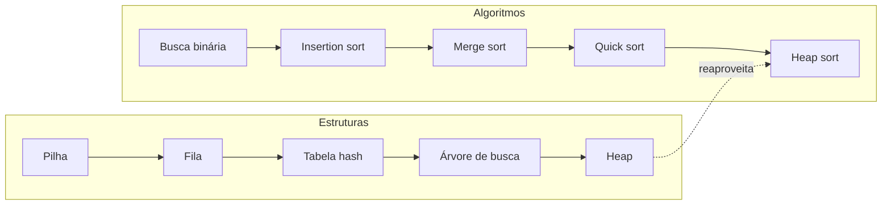
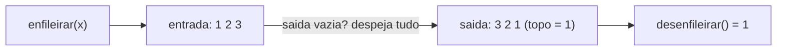

# Projeto: implementar e visualizar 5 estruturas e 5 algoritmos

## O que você vai construir

Uma pequena biblioteca Python, `visual`, com **cinco estruturas de dados** e **cinco algoritmos** escritos por você, cada um capaz de **mostrar o que está fazendo** no terminal. Em vez de confiar que o merge sort "divide e junta", você vai ver cada junção acontecer:

```text
junta [5] + [2] -> [2, 5]
junta [9] + [1] -> [1, 9]
junta [2, 5] + [1, 9] -> [1, 2, 5, 9]
```

Este projeto fecha as Trilhas 2 e 3. Ele revisita ED-02 (pilhas e filas), ED-04 (hash), ED-05 (árvores), ED-07 (heaps), AL-01 (busca binária), AL-02 e AL-03 (ordenação). A ideia, do livro *Algorithms Illuminated*, é que só se entende um algoritmo de verdade depois de implementá-lo e observar casos pequenos à mão.

## Como o projeto funciona

São 10 etapas, uma por estrutura ou algoritmo. Em cada uma:

1. Você implementa a estrutura (uma classe) ou o algoritmo (uma função).
2. Você escreve a **visualização**: um `__str__` que desenha a estrutura, ou `print`s que mostram cada passo do algoritmo.
3. Uma função pronta no fim do editor ("não mude") lê comandos da entrada e executa. Os testes comparam o desenho, então a visualização faz parte da resposta.



Não use as versões prontas do Python (`collections.deque`, `heapq`, `sorted`, `bisect`, `dict` para a tabela hash): o objetivo é construir. Listas comuns do Python podem ser usadas como "memória" das estruturas.

## Etapa 1: pilha

Pilha é **LIFO** (o último a entrar é o primeiro a sair). Uma lista Python com `append` e `pop` no final já dá O(1) nas duas operações.

```quiz
id: PJ-02-e1
tipo: codigo
linguagem: python
pergunta: |
  Complete a classe `Pilha` com `empilhar(x)`, `desempilhar()` (devolve o item do topo; se a pilha estiver vazia, lance `IndexError("pilha vazia")`), `vazia()` e `__str__`, que desenha a pilha da base para o topo:

  ```text
  | 1 | 2 | 3 | <- topo
  ```

  Pilha vazia é desenhada como `(vazia)`. A função `rodar` no fim lê comandos como `push 1; push 2; pop` e imprime a pilha depois de cada um.
codigo_inicial: |
  class Pilha:
      def __init__(self) -> None:
          self.itens = []

      def empilhar(self, x: int) -> None:
          pass

      def desempilhar(self) -> int:
          pass

      def vazia(self) -> bool:
          pass

      def __str__(self) -> str:
          return "?"


  # não mude: executa os comandos e mostra a pilha a cada passo
  def rodar(comandos: str) -> None:
      p = Pilha()
      for cmd in comandos.split(";"):
          partes = cmd.split()
          try:
              if partes[0] == "push":
                  p.empilhar(int(partes[1]))
              else:
                  print("saiu", p.desempilhar())
          except IndexError as e:
              print("erro:", e)
          print(p)


  rodar(input())
usa: [class, def, return, raise, join]
testes:
  - entrada: "push 1; push 2; push 3; pop"
    saida: |
      | 1 | <- topo
      | 1 | 2 | <- topo
      | 1 | 2 | 3 | <- topo
      saiu 3
      | 1 | 2 | <- topo
  - entrada: "push 7; pop; pop"
    saida: |
      | 7 | <- topo
      saiu 7
      (vazia)
      erro: pilha vazia
      (vazia)
  - entrada: "pop; push 4; push 5; pop; push 6"
    visivel: false
    saida: |
      erro: pilha vazia
      (vazia)
      | 4 | <- topo
      | 4 | 5 | <- topo
      saiu 5
      | 4 | <- topo
      | 4 | 6 | <- topo
dica: "empilhar é self.itens.append(x); desempilhar confere if self.vazia(): raise IndexError(\"pilha vazia\") e depois return self.itens.pop(). No __str__, \" | \".join(str(x) for x in self.itens) monta o meio; coloque \"| \" antes e \" | <- topo\" depois."
solucao: |
  class Pilha:
      def __init__(self) -> None:
          self.itens = []

      def empilhar(self, x: int) -> None:
          self.itens.append(x)

      def desempilhar(self) -> int:
          if self.vazia():
              raise IndexError("pilha vazia")
          return self.itens.pop()

      def vazia(self) -> bool:
          return len(self.itens) == 0

      def __str__(self) -> str:
          if self.vazia():
              return "(vazia)"
          return "| " + " | ".join(str(x) for x in self.itens) + " | <- topo"


  # não mude: executa os comandos e mostra a pilha a cada passo
  def rodar(comandos: str) -> None:
      p = Pilha()
      for cmd in comandos.split(";"):
          partes = cmd.split()
          try:
              if partes[0] == "push":
                  p.empilhar(int(partes[1]))
              else:
                  print("saiu", p.desempilhar())
          except IndexError as e:
              print("erro:", e)
          print(p)


  rodar(input())
explicacao: "O topo é o fim da lista porque append e pop no fim são O(1); usar o começo (insert(0, x) e pop(0)) seria O(n), pois todos os itens se deslocam. Lançar uma exceção clara na pilha vazia é melhor que devolver None, que poderia ser confundido com um item."
dificuldade: 1
```

## Etapa 2: fila com duas pilhas

Fila é **FIFO**. Tirar do começo de uma lista Python (`pop(0)`) custa O(n). Um truque clássico usa **duas pilhas**: os itens entram na pilha `entrada`; quando é hora de sair e a pilha `saida` está vazia, despejamos `entrada` inteira em `saida`, o que inverte a ordem. Cada item é movido no máximo uma vez, então o custo **amortizado** é O(1).



```quiz
id: PJ-02-e2
tipo: codigo
linguagem: python
pergunta: |
  Complete a classe `Fila` usando **duas listas usadas como pilhas** (`self.entrada` e `self.saida`, só com `append` e `pop()` sem argumento). Implemente `enfileirar(x)`, `desenfileirar()` (lance `IndexError("fila vazia")` se não houver itens) e `__str__`, que mostra os itens da frente para o fim:

  ```text
  frente -> 1 2 3 <- fim
  ```

  Fila vazia é `(vazia)`. Dica de visualização: a frente da fila é o **fim** de `self.saida`.
codigo_inicial: |
  class Fila:
      def __init__(self) -> None:
          self.entrada = []
          self.saida = []

      def enfileirar(self, x: int) -> None:
          pass

      def desenfileirar(self) -> int:
          pass

      def __str__(self) -> str:
          return "?"


  # não mude
  def rodar(comandos: str) -> None:
      f = Fila()
      for cmd in comandos.split(";"):
          partes = cmd.split()
          try:
              if partes[0] == "in":
                  f.enfileirar(int(partes[1]))
              else:
                  print("saiu", f.desenfileirar())
          except IndexError as e:
              print("erro:", e)
          print(f)


  rodar(input())
usa: [class, def, while, pop, raise]
testes:
  - entrada: "in 1; in 2; in 3; out; in 4; out"
    saida: |
      frente -> 1 <- fim
      frente -> 1 2 <- fim
      frente -> 1 2 3 <- fim
      saiu 1
      frente -> 2 3 <- fim
      frente -> 2 3 4 <- fim
      saiu 2
      frente -> 3 4 <- fim
  - entrada: "out; in 9; out"
    saida: |
      erro: fila vazia
      (vazia)
      frente -> 9 <- fim
      saiu 9
      (vazia)
  - entrada: "in 5; in 6; out; in 7; in 8; out; out; out"
    visivel: false
    saida: |
      frente -> 5 <- fim
      frente -> 5 6 <- fim
      saiu 5
      frente -> 6 <- fim
      frente -> 6 7 <- fim
      frente -> 6 7 8 <- fim
      saiu 6
      frente -> 7 8 <- fim
      saiu 7
      frente -> 8 <- fim
      saiu 8
      (vazia)
dica: "desenfileirar: if not self.saida: while self.entrada: self.saida.append(self.entrada.pop()). Depois, se saida continua vazia, lance o erro; senão return self.saida.pop(). No __str__, a ordem da frente para o fim é list(reversed(self.saida)) + self.entrada."
solucao: |
  class Fila:
      def __init__(self) -> None:
          self.entrada = []
          self.saida = []

      def enfileirar(self, x: int) -> None:
          self.entrada.append(x)

      def desenfileirar(self) -> int:
          if not self.saida:
              while self.entrada:
                  self.saida.append(self.entrada.pop())
          if not self.saida:
              raise IndexError("fila vazia")
          return self.saida.pop()

      def __str__(self) -> str:
          ordem = list(reversed(self.saida)) + self.entrada
          if not ordem:
              return "(vazia)"
          return "frente -> " + " ".join(str(x) for x in ordem) + " <- fim"


  # não mude
  def rodar(comandos: str) -> None:
      f = Fila()
      for cmd in comandos.split(";"):
          partes = cmd.split()
          try:
              if partes[0] == "in":
                  f.enfileirar(int(partes[1]))
              else:
                  print("saiu", f.desenfileirar())
          except IndexError as e:
              print("erro:", e)
          print(f)


  rodar(input())
explicacao: "Só despejamos quando `saida` está vazia; se despejássemos sempre, a ordem se misturaria. Um `desenfileirar` pode custar O(n) (o despejo), mas cada item é despejado uma única vez em toda a sua vida: somando tudo, n operações custam O(n), ou seja, O(1) amortizado por operação."
dificuldade: 2
```

## Etapa 3: tabela hash com encadeamento

A tabela tem `m` **baldes** (buckets). A função hash transforma a chave num número de balde; colisões (duas chaves no mesmo balde) ficam numa lista dentro do balde (**encadeamento**). Aqui usaremos uma função hash didática: a soma dos códigos das letras (`ord`) módulo `m`.

```quiz
id: PJ-02-e3
tipo: codigo
linguagem: python
pergunta: |
  Complete a classe `TabelaHash` (com `m = 5` baldes, cada balde uma lista de pares `[chave, valor]`):

  - `indice(chave)` devolve `sum(ord(c) for c in chave) % self.m`;
  - `inserir(chave, valor)`: se a chave já existe no balde, **atualiza** o valor; senão acrescenta o par no fim do balde;
  - `buscar(chave)` devolve o valor ou `None`;
  - `__str__` desenha um balde por linha: `0: ana=1 -> rui=4` (balde vazio fica só `2:`).
codigo_inicial: |
  class TabelaHash:
      def __init__(self, m: int = 5) -> None:
          self.m = m
          self.baldes = [[] for _ in range(m)]

      def indice(self, chave: str) -> int:
          return 0

      def inserir(self, chave: str, valor: int) -> None:
          pass

      def buscar(self, chave: str) -> int | None:
          return None

      def __str__(self) -> str:
          return "?"


  # não mude
  def rodar(comandos: str) -> None:
      t = TabelaHash()
      for cmd in comandos.split(";"):
          partes = cmd.split()
          if partes[0] == "put":
              t.inserir(partes[1], int(partes[2]))
          else:
              print(partes[1], "=", t.buscar(partes[1]))
      print(t)


  rodar(input())
usa: [class, def, for, return, ord]
testes:
  - entrada: "put ana 1; put bia 2; put rui 3; get bia; get zeca"
    saida: |
      bia = 2
      zeca = None
      0: bia=2
      1: rui=3
      2:
      3:
      4: ana=1
  - entrada: "put ana 1; put ana 9; put naa 5; get ana; get naa"
    saida: |
      ana = 9
      naa = 5
      0:
      1:
      2:
      3:
      4: ana=9 -> naa=5
  - entrada: "put x 1; put y 2; put z 3; put w 4; put v 5; put u 6; get u; put x 7; get x"
    visivel: false
    saida: |
      u = 6
      x = 7
      0: x=7
      1: y=2
      2: z=3 -> u=6
      3: v=5
      4: w=4
dica: "inserir: b = self.baldes[self.indice(chave)]; percorra for par in b: if par[0] == chave: par[1] = valor e return. Se o laço terminar, b.append([chave, valor]). buscar segue o mesmo laço. No __str__, para cada i, junte f\"{k}={v}\" com \" -> \" e monte f\"{i}: ...\"."
solucao: |
  class TabelaHash:
      def __init__(self, m: int = 5) -> None:
          self.m = m
          self.baldes = [[] for _ in range(m)]

      def indice(self, chave: str) -> int:
          return sum(ord(c) for c in chave) % self.m

      def inserir(self, chave: str, valor: int) -> None:
          balde = self.baldes[self.indice(chave)]
          for par in balde:
              if par[0] == chave:
                  par[1] = valor
                  return
          balde.append([chave, valor])

      def buscar(self, chave: str) -> int | None:
          for k, v in self.baldes[self.indice(chave)]:
              if k == chave:
                  return v
          return None

      def __str__(self) -> str:
          linhas = []
          for i, balde in enumerate(self.baldes):
              itens = " -> ".join(f"{k}={v}" for k, v in balde)
              linhas.append(f"{i}: {itens}")
          return "\n".join(linhas)


  # não mude
  def rodar(comandos: str) -> None:
      t = TabelaHash()
      for cmd in comandos.split(";"):
          partes = cmd.split()
          if partes[0] == "put":
              t.inserir(partes[1], int(partes[2]))
          else:
              print(partes[1], "=", t.buscar(partes[1]))
      print(t)


  rodar(input())
explicacao: "Veja no segundo teste: 'ana' e 'naa' têm as mesmas letras, então a soma dos ord é igual e caem no mesmo balde. É a fraqueza desta função hash didática: anagramas sempre colidem. Funções reais (como a do dict do Python) misturam a posição de cada caractere. Com poucas colisões, buscar e inserir são O(1) em média; com tudo num balde só, viram O(n)."
dificuldade: 2
```

## Etapa 4: árvore binária de busca

Na **árvore binária de busca** (BST), tudo à esquerda de um nó é menor e tudo à direita é maior. A visualização deita a árvore de lado: a raiz fica na margem esquerda, a subárvore direita **acima** e a esquerda **abaixo**, com 4 espaços por nível. Incline a cabeça para a esquerda e você vê a árvore.

```text
    8          inserindo 5, 3, 8, 1, 4:
5                     5
        4            / \
    3               3   8
        1          / \
                  1   4
```

```quiz
id: PJ-02-e4
tipo: codigo
linguagem: python
pergunta: |
  Complete a `ArvoreBusca` (os nós são da classe `No`, já pronta):

  - `inserir(valor)`: desce comparando e cria o nó no lugar vazio (valores repetidos são ignorados);
  - `em_ordem()` devolve a lista dos valores em ordem crescente (esquerda, nó, direita);
  - `altura()` devolve o número de níveis (árvore vazia = 0, só a raiz = 1);
  - `desenhar()` devolve as linhas do desenho deitado: para cada nó, primeiro a subárvore **direita**, depois o próprio valor com `"    " * nivel` antes, depois a **esquerda**.

  Use funções recursivas auxiliares que recebem um nó.
codigo_inicial: |
  class No:
      def __init__(self, valor: int) -> None:
          self.valor = valor
          self.esq = None
          self.dir = None


  class ArvoreBusca:
      def __init__(self) -> None:
          self.raiz = None

      def inserir(self, valor: int) -> None:
          pass

      def em_ordem(self) -> list[int]:
          return []

      def altura(self) -> int:
          return 0

      def desenhar(self) -> list[str]:
          return []


  # não mude
  def rodar(valores: str) -> None:
      a = ArvoreBusca()
      for v in valores.split():
          a.inserir(int(v))
      print("em ordem:", a.em_ordem())
      print("altura:", a.altura())
      print("\n".join(a.desenhar()))


  rodar(input())
usa: [class, def, return, if]
testes:
  - entrada: "5 3 8 1 4"
    saida: |
      em ordem: [1, 3, 4, 5, 8]
      altura: 3
          8
      5
              4
          3
              1
  - entrada: "1 2 3 4"
    saida: |
      em ordem: [1, 2, 3, 4]
      altura: 4
                  4
              3
          2
      1
  - entrada: "10 5 15 5 12 20 3 7 25"
    visivel: false
    saida: |
      em ordem: [3, 5, 7, 10, 12, 15, 20, 25]
      altura: 4
                  25
              20
          15
              12
      10
              7
          5
              3
dica: "Escreva auxiliares fora da classe: _inserir(no, valor) devolve o nó (se no is None: return No(valor); se valor < no.valor: no.esq = _inserir(no.esq, valor) ...) e em inserir faça self.raiz = _inserir(self.raiz, valor). Altura: 0 se None, senão 1 + max(alt(esq), alt(dir)). Desenho: _desenhar(no, nivel, linhas) chama a direita com nivel + 1, faz linhas.append(\"    \" * nivel + str(no.valor)) e chama a esquerda."
solucao: |
  class No:
      def __init__(self, valor: int) -> None:
          self.valor = valor
          self.esq = None
          self.dir = None


  def _inserir(no, valor):
      if no is None:
          return No(valor)
      if valor < no.valor:
          no.esq = _inserir(no.esq, valor)
      elif valor > no.valor:
          no.dir = _inserir(no.dir, valor)
      return no


  def _em_ordem(no, saida):
      if no is not None:
          _em_ordem(no.esq, saida)
          saida.append(no.valor)
          _em_ordem(no.dir, saida)


  def _altura(no):
      if no is None:
          return 0
      return 1 + max(_altura(no.esq), _altura(no.dir))


  def _desenhar(no, nivel, linhas):
      if no is not None:
          _desenhar(no.dir, nivel + 1, linhas)
          linhas.append("    " * nivel + str(no.valor))
          _desenhar(no.esq, nivel + 1, linhas)


  class ArvoreBusca:
      def __init__(self) -> None:
          self.raiz = None

      def inserir(self, valor: int) -> None:
          self.raiz = _inserir(self.raiz, valor)

      def em_ordem(self) -> list[int]:
          saida = []
          _em_ordem(self.raiz, saida)
          return saida

      def altura(self) -> int:
          return _altura(self.raiz)

      def desenhar(self) -> list[str]:
          linhas = []
          _desenhar(self.raiz, 0, linhas)
          return linhas


  # não mude
  def rodar(valores: str) -> None:
      a = ArvoreBusca()
      for v in valores.split():
          a.inserir(int(v))
      print("em ordem:", a.em_ordem())
      print("altura:", a.altura())
      print("\n".join(a.desenhar()))


  rodar(input())
explicacao: "O segundo teste mostra o pior caso: inserir em ordem crescente gera uma 'árvore' que é uma linha (altura 4 com 4 nós), e a busca vira O(n). Com dados embaralhados a altura fica perto de log₂ n. Árvores balanceadas (AVL, rubro-negra) fazem rotações para garantir O(log n) sempre. O percurso em ordem sair ordenado é a prova visual de que a propriedade de busca foi respeitada."
dificuldade: 3
```

## Etapa 5: heap mínimo

O **heap mínimo** é uma árvore quase completa guardada numa lista: o nó da posição `i` tem filhos em `2i + 1` e `2i + 2` e pai em `(i - 1) // 2`. Todo pai é menor ou igual aos filhos, então o mínimo está sempre na posição 0. Inserir coloca no fim e **sobe**; remover troca a raiz com o último, tira o último e faz a nova raiz **descer**.

```quiz
id: PJ-02-e5
tipo: codigo
linguagem: python
pergunta: |
  Complete o `HeapMin` com `inserir(x)` (acrescenta e sobe), `remover_min()` (devolve o menor; lance `IndexError("heap vazio")` se vazio) e `niveis()`, que devolve uma linha por nível da árvore: `nível 0: 1`, `nível 1: 3 2`, ... (o nível `k` são as posições de `2**k - 1` até `2**(k+1) - 2`).
codigo_inicial: |
  class HeapMin:
      def __init__(self) -> None:
          self.a = []

      def inserir(self, x: int) -> None:
          pass

      def remover_min(self) -> int:
          pass

      def niveis(self) -> list[str]:
          return []


  # não mude
  def rodar(comandos: str) -> None:
      h = HeapMin()
      for cmd in comandos.split(";"):
          partes = cmd.split()
          if partes[0] == "add":
              h.inserir(int(partes[1]))
          else:
              print("menor:", h.remover_min())
      print(h.a)
      print("\n".join(h.niveis()))


  rodar(input())
usa: [class, def, while, return, raise]
testes:
  - entrada: "add 5; add 3; add 8; add 1; add 4"
    saida: |
      [1, 3, 8, 5, 4]
      nível 0: 1
      nível 1: 3 8
      nível 2: 5 4
  - entrada: "add 5; add 3; add 8; add 1; add 4; min; min"
    saida: |
      menor: 1
      menor: 3
      [4, 5, 8]
      nível 0: 4
      nível 1: 5 8
  - entrada: "add 9; add 7; add 6; add 2; add 2; add 10; add 1; min"
    visivel: false
    saida: |
      menor: 1
      [2, 6, 2, 9, 7, 10]
      nível 0: 2
      nível 1: 6 2
      nível 2: 9 7 10
dica: "Subir: i = len(self.a) - 1; while i > 0 and self.a[i] < self.a[(i - 1) // 2]: troque com o pai e i = pai. Descer: a partir de i = 0, ache o menor entre i, 2i+1 e 2i+2 (só os que existem); se for o próprio i, pare; senão troque e continue dali. niveis: k = 0, ini = 0; while ini < len(self.a): pegue self.a[ini:2*ini+1] e avance ini = 2*ini + 1."
solucao: |
  class HeapMin:
      def __init__(self) -> None:
          self.a = []

      def inserir(self, x: int) -> None:
          self.a.append(x)
          i = len(self.a) - 1
          while i > 0 and self.a[i] < self.a[(i - 1) // 2]:
              pai = (i - 1) // 2
              self.a[i], self.a[pai] = self.a[pai], self.a[i]
              i = pai

      def remover_min(self) -> int:
          if not self.a:
              raise IndexError("heap vazio")
          menor = self.a[0]
          ultimo = self.a.pop()
          if self.a:
              self.a[0] = ultimo
              i = 0
              while True:
                  m = i
                  for f in (2 * i + 1, 2 * i + 2):
                      if f < len(self.a) and self.a[f] < self.a[m]:
                          m = f
                  if m == i:
                      break
                  self.a[i], self.a[m] = self.a[m], self.a[i]
                  i = m
          return menor

      def niveis(self) -> list[str]:
          linhas = []
          k = 0
          ini = 0
          while ini < len(self.a):
              fatia = self.a[ini:2 * ini + 1]
              linhas.append(f"nível {k}: " + " ".join(str(x) for x in fatia))
              k += 1
              ini = 2 * ini + 1
          return linhas


  # não mude
  def rodar(comandos: str) -> None:
      h = HeapMin()
      for cmd in comandos.split(";"):
          partes = cmd.split()
          if partes[0] == "add":
              h.inserir(int(partes[1]))
          else:
              print("menor:", h.remover_min())
      print(h.a)
      print("\n".join(h.niveis()))


  rodar(input())
explicacao: "A lista não fica ordenada (veja [1, 3, 8, 5, 4]); só a regra pai ≤ filhos é garantida, e isso basta para o mínimo estar na raiz. Subir e descer percorrem no máximo a altura da árvore, que é log₂ n porque ela é quase completa: por isso inserir e remover são O(log n)."
dificuldade: 3
```

## Etapa 6: busca binária com rastro

Agora os algoritmos. Comece pela busca binária: a cada passo ela olha o **meio** do intervalo e descarta a metade onde o alvo não pode estar. O rastro deixa ver o intervalo encolhendo pela metade.

```quiz
id: PJ-02-e6
tipo: codigo
linguagem: python
pergunta: |
  Escreva `busca_binaria(lista, alvo) -> int` (lista ordenada) que devolve o índice do alvo ou `-1`. A cada passo, **antes** de comparar, imprima o intervalo e o meio:

  ```text
  ini=0 fim=6 meio=3 valor=7
  ```

  A entrada tem a lista na primeira linha e o alvo na segunda; o fim do editor imprime o resultado.
codigo_inicial: |
  def busca_binaria(lista: list[int], alvo: int) -> int:
      return -1


  # não mude
  numeros = [int(x) for x in input().split()]
  alvo = int(input())
  print("resultado:", busca_binaria(numeros, alvo))
usa: [def, while, return, print]
testes:
  - entradas: ["1 3 5 7 9 11 13", "11"]
    saida: |
      ini=0 fim=6 meio=3 valor=7
      ini=4 fim=6 meio=5 valor=11
      resultado: 5
  - entradas: ["1 3 5 7 9 11 13", "4"]
    saida: |
      ini=0 fim=6 meio=3 valor=7
      ini=0 fim=2 meio=1 valor=3
      ini=2 fim=2 meio=2 valor=5
      resultado: -1
  - entradas: ["2 4 6 8 10 12 14 16 18 20 22 24 26 28 30 32", "2"]
    visivel: false
    saida: |
      ini=0 fim=15 meio=7 valor=16
      ini=0 fim=6 meio=3 valor=8
      ini=0 fim=2 meio=1 valor=4
      ini=0 fim=0 meio=0 valor=2
      resultado: 0
  - entradas: ["5", "5"]
    visivel: false
    saida: |
      ini=0 fim=0 meio=0 valor=5
      resultado: 0
dica: "ini, fim = 0, len(lista) - 1; while ini <= fim: meio = (ini + fim) // 2; imprima com f-string; se lista[meio] == alvo devolva meio; se for menor, ini = meio + 1; senão fim = meio - 1. Depois do laço, return -1."
solucao: |
  def busca_binaria(lista: list[int], alvo: int) -> int:
      ini, fim = 0, len(lista) - 1
      while ini <= fim:
          meio = (ini + fim) // 2
          print(f"ini={ini} fim={fim} meio={meio} valor={lista[meio]}")
          if lista[meio] == alvo:
              return meio
          if lista[meio] < alvo:
              ini = meio + 1
          else:
              fim = meio - 1
      return -1


  # não mude
  numeros = [int(x) for x in input().split()]
  alvo = int(input())
  print("resultado:", busca_binaria(numeros, alvo))
explicacao: "Conte as linhas do rastro: com 7 itens, no máximo 3 passos; com 16 itens, no máximo 5 (o terceiro teste usa 4 até achar o 2 no canto). Dobrar o tamanho da lista acrescenta só um passo: isso é O(log n) visto a olho nu. Quando o alvo não existe, o intervalo fica vazio (ini > fim) e o laço termina."
dificuldade: 1
```

## Etapa 7: insertion sort, passo a passo

O **insertion sort** mantém um prefixo ordenado e, a cada passo, insere o próximo item no lugar certo desse prefixo, empurrando os maiores uma casa para a direita. Na visualização, a barra `|` separa a parte ordenada da que ainda falta.

```quiz
id: PJ-02-e7
tipo: codigo
linguagem: python
pergunta: |
  Escreva `insertion_sort(lista)` que ordena a lista **no lugar** (sem criar outra) e, depois de inserir cada item a partir do segundo, imprime a lista com `|` depois da parte já ordenada:

  ```text
  2 5 | 4 6 1 3
  2 4 5 | 6 1 3
  ```

  Depois do último item não há nada à direita, então a linha termina na barra: `1 2 3 4 5 6 |`. Lista com 0 ou 1 item não imprime nada.
codigo_inicial: |
  def insertion_sort(lista: list[int]) -> None:
      pass


  # não mude
  numeros = [int(x) for x in input().split()]
  insertion_sort(numeros)
  print("ordenada:", numeros)
usa: [def, for, while]
testes:
  - entrada: "5 2 4 6 1 3"
    saida: |
      2 5 | 4 6 1 3
      2 4 5 | 6 1 3
      2 4 5 6 | 1 3
      1 2 4 5 6 | 3
      1 2 3 4 5 6 |
      ordenada: [1, 2, 3, 4, 5, 6]
  - entrada: "1 2 3"
    saida: |
      1 2 | 3
      1 2 3 |
      ordenada: [1, 2, 3]
  - entrada: "9 7 5 3"
    visivel: false
    saida: |
      7 9 | 5 3
      5 7 9 | 3
      3 5 7 9 |
      ordenada: [3, 5, 7, 9]
dica: "for i in range(1, len(lista)): guarde x = lista[i] e j = i - 1; while j >= 0 and lista[j] > x: lista[j + 1] = lista[j]; j -= 1. Depois, lista[j + 1] = x. Para imprimir: \" \".join(map(str, lista[:i + 1])) + \" | \" + \" \".join(map(str, lista[i + 1:])) e um .rstrip() no fim."
solucao: |
  def insertion_sort(lista: list[int]) -> None:
      for i in range(1, len(lista)):
          x = lista[i]
          j = i - 1
          while j >= 0 and lista[j] > x:
              lista[j + 1] = lista[j]
              j -= 1
          lista[j + 1] = x
          feita = " ".join(str(v) for v in lista[:i + 1])
          resto = " ".join(str(v) for v in lista[i + 1:])
          print(f"{feita} | {resto}".rstrip())


  # não mude
  numeros = [int(x) for x in input().split()]
  insertion_sort(numeros)
  print("ordenada:", numeros)
explicacao: "Com a lista já ordenada (segundo teste), cada item só é comparado com o vizinho e nada se move: O(n), o melhor caso. Com a lista invertida (teste oculto), cada item atravessa todo o prefixo: 1 + 2 + ... + (n - 1) deslocamentos, O(n²). O rastro deixa ver essa diferença."
dificuldade: 2
```

## Etapa 8: merge sort e suas junções

O **merge sort** divide a lista ao meio até sobrar um item, e depois **junta** (merge) as metades ordenadas. Toda a lógica está na junção, então é ela que vamos mostrar.

```quiz
id: PJ-02-e8
tipo: codigo
linguagem: python
pergunta: |
  Escreva `merge_sort(lista) -> list` recursivo, que devolve uma **nova** lista ordenada. Cada vez que juntar duas metades, imprima:

  ```text
  junta [5] + [2] -> [2, 5]
  ```

  Divida assim: `meio = len(lista) // 2`, esquerda `lista[:meio]` e direita `lista[meio:]`, e ordene primeiro a esquerda.
codigo_inicial: |
  def merge_sort(lista: list[int]) -> list[int]:
      return lista


  # não mude
  numeros = [int(x) for x in input().split()]
  print("ordenada:", merge_sort(numeros))
usa: [def, return, while, print]
testes:
  - entrada: "5 2 9 1"
    saida: |
      junta [5] + [2] -> [2, 5]
      junta [9] + [1] -> [1, 9]
      junta [2, 5] + [1, 9] -> [1, 2, 5, 9]
      ordenada: [1, 2, 5, 9]
  - entrada: "3 1 2"
    saida: |
      junta [1] + [2] -> [1, 2]
      junta [3] + [1, 2] -> [1, 2, 3]
      ordenada: [1, 2, 3]
  - entrada: "8 3 5 4 7 6 1 2"
    visivel: false
    saida: |
      junta [8] + [3] -> [3, 8]
      junta [5] + [4] -> [4, 5]
      junta [3, 8] + [4, 5] -> [3, 4, 5, 8]
      junta [7] + [6] -> [6, 7]
      junta [1] + [2] -> [1, 2]
      junta [6, 7] + [1, 2] -> [1, 2, 6, 7]
      junta [3, 4, 5, 8] + [1, 2, 6, 7] -> [1, 2, 3, 4, 5, 6, 7, 8]
      ordenada: [1, 2, 3, 4, 5, 6, 7, 8]
  - entrada: "4"
    visivel: false
    saida: "ordenada: [4]"
dica: "Caso base: if len(lista) <= 1: return lista. Senão esq = merge_sort(lista[:meio]) e dir = merge_sort(lista[meio:]). Na junção, use dois índices i e j: while i < len(esq) and j < len(dir), copie o menor; depois acrescente o que sobrou (esq[i:] e dir[j:]). Imprima antes do return."
solucao: |
  def merge_sort(lista: list[int]) -> list[int]:
      if len(lista) <= 1:
          return lista
      meio = len(lista) // 2
      esq = merge_sort(lista[:meio])
      dir = merge_sort(lista[meio:])
      junta = []
      i = j = 0
      while i < len(esq) and j < len(dir):
          if esq[i] <= dir[j]:
              junta.append(esq[i])
              i += 1
          else:
              junta.append(dir[j])
              j += 1
      junta += esq[i:] + dir[j:]
      print(f"junta {esq} + {dir} -> {junta}")
      return junta


  # não mude
  numeros = [int(x) for x in input().split()]
  print("ordenada:", merge_sort(numeros))
explicacao: "Repare no rastro de 8 números: 4 junções de 1+1, 2 de 2+2 e 1 de 4+4. São log₂ 8 = 3 'andares', e em cada andar todos os 8 itens são copiados uma vez: 8 × 3, ou O(n log n). Usar <= na comparação mantém a ordem original dos iguais (ordenação estável)."
dificuldade: 2
```

## Etapa 9: quick sort e o pivô

O **quick sort** escolhe um **pivô**, separa os menores e os maiores e ordena cada lado recursivamente. A versão abaixo cria listas novas (mais fácil de ver; a versão "no lugar" de AL-03 economiza memória). O rastro mostra cada partição.

```quiz
id: PJ-02-e9
tipo: codigo
linguagem: python
pergunta: |
  Escreva `quick_sort(lista) -> list` recursivo usando o **último** item como pivô. Separe `menores` (< pivô), `iguais` (== pivô, inclui o próprio) e `maiores` (> pivô), mantendo a ordem em que aparecem, e imprima a partição **antes** das chamadas recursivas:

  ```text
  pivô 4: [3, 1, 2] [4] [6, 5]
  ```

  Listas com 0 ou 1 item voltam sem imprimir nada.
codigo_inicial: |
  def quick_sort(lista: list[int]) -> list[int]:
      return lista


  # não mude
  numeros = [int(x) for x in input().split()]
  print("ordenada:", quick_sort(numeros))
usa: [def, return, print]
testes:
  - entrada: "3 6 1 5 2 4"
    saida: |
      pivô 4: [3, 1, 2] [4] [6, 5]
      pivô 2: [1] [2] [3]
      pivô 5: [] [5] [6]
      ordenada: [1, 2, 3, 4, 5, 6]
  - entrada: "2 2 1"
    saida: |
      pivô 1: [] [1] [2, 2]
      pivô 2: [] [2, 2] []
      ordenada: [1, 2, 2]
  - entrada: "1 2 3 4 5"
    visivel: false
    saida: |
      pivô 5: [1, 2, 3, 4] [5] []
      pivô 4: [1, 2, 3] [4] []
      pivô 3: [1, 2] [3] []
      pivô 2: [1] [2] []
      ordenada: [1, 2, 3, 4, 5]
dica: "pivo = lista[-1]; menores = [x for x in lista if x < pivo], e o mesmo para iguais e maiores. Imprima com f\"pivô {pivo}: {menores} {iguais} {maiores}\" e devolva quick_sort(menores) + iguais + quick_sort(maiores)."
solucao: |
  def quick_sort(lista: list[int]) -> list[int]:
      if len(lista) <= 1:
          return lista
      pivo = lista[-1]
      menores = [x for x in lista if x < pivo]
      iguais = [x for x in lista if x == pivo]
      maiores = [x for x in lista if x > pivo]
      print(f"pivô {pivo}: {menores} {iguais} {maiores}")
      return quick_sort(menores) + iguais + quick_sort(maiores)


  # não mude
  numeros = [int(x) for x in input().split()]
  print("ordenada:", quick_sort(numeros))
explicacao: "O teste oculto com a lista já ordenada mostra o pior caso do pivô 'último item': cada partição tira só um elemento, o rastro tem n - 1 linhas e o custo vai a O(n²). Com um pivô que divide ao meio, seriam só log n níveis. Por isso implementações reais sorteiam o pivô ou usam a mediana de três."
dificuldade: 2
```

## Etapa 10: heap sort com o seu heap

O último algoritmo reaproveita a etapa 5: coloque tudo num heap mínimo e tire o menor, n vezes. Cada operação é O(log n), então o total é **O(n log n)**, sem o pior caso do quick sort.

```quiz
id: PJ-02-e10
tipo: codigo
linguagem: python
pergunta: |
  Usando o `HeapMin` (pronto no editor), escreva `heap_sort(lista) -> list` que insere todos os itens no heap e depois remove o mínimo até esvaziar, guardando cada um numa lista nova. Depois de inserir todos, imprima o estado do heap com `print("heap:", h.a)`; depois, a cada remoção, imprima `tira X, sobra [...]`.
codigo_inicial: |
  class HeapMin:
      def __init__(self) -> None:
          self.a = []

      def inserir(self, x: int) -> None:
          self.a.append(x)
          i = len(self.a) - 1
          while i > 0 and self.a[i] < self.a[(i - 1) // 2]:
              pai = (i - 1) // 2
              self.a[i], self.a[pai] = self.a[pai], self.a[i]
              i = pai

      def remover_min(self) -> int:
          menor = self.a[0]
          ultimo = self.a.pop()
          if self.a:
              self.a[0] = ultimo
              i = 0
              while True:
                  m = i
                  for f in (2 * i + 1, 2 * i + 2):
                      if f < len(self.a) and self.a[f] < self.a[m]:
                          m = f
                  if m == i:
                      break
                  self.a[i], self.a[m] = self.a[m], self.a[i]
                  i = m
          return menor


  def heap_sort(lista: list[int]) -> list[int]:
      return lista


  # não mude
  numeros = [int(x) for x in input().split()]
  print("ordenada:", heap_sort(numeros))
usa: [def, for, while, return]
testes:
  - entrada: "5 3 8 1 4"
    saida: |
      heap: [1, 3, 8, 5, 4]
      tira 1, sobra [3, 4, 8, 5]
      tira 3, sobra [4, 5, 8]
      tira 4, sobra [5, 8]
      tira 5, sobra [8]
      tira 8, sobra []
      ordenada: [1, 3, 4, 5, 8]
  - entrada: "2 1"
    saida: |
      heap: [1, 2]
      tira 1, sobra [2]
      tira 2, sobra []
      ordenada: [1, 2]
  - entrada: "9 9 4 7 1 6"
    visivel: false
    saida: |
      heap: [1, 4, 6, 9, 7, 9]
      tira 1, sobra [4, 7, 6, 9, 9]
      tira 4, sobra [6, 7, 9, 9]
      tira 6, sobra [7, 9, 9]
      tira 7, sobra [9, 9]
      tira 9, sobra [9]
      tira 9, sobra []
      ordenada: [1, 4, 6, 7, 9, 9]
dica: "h = HeapMin(); for x in lista: h.inserir(x). Depois print(\"heap:\", h.a), crie saida = [] e while h.a: menor = h.remover_min(); saida.append(menor); print(f\"tira {menor}, sobra {h.a}\"). Devolva saida."
solucao: |
  class HeapMin:
      def __init__(self) -> None:
          self.a = []

      def inserir(self, x: int) -> None:
          self.a.append(x)
          i = len(self.a) - 1
          while i > 0 and self.a[i] < self.a[(i - 1) // 2]:
              pai = (i - 1) // 2
              self.a[i], self.a[pai] = self.a[pai], self.a[i]
              i = pai

      def remover_min(self) -> int:
          menor = self.a[0]
          ultimo = self.a.pop()
          if self.a:
              self.a[0] = ultimo
              i = 0
              while True:
                  m = i
                  for f in (2 * i + 1, 2 * i + 2):
                      if f < len(self.a) and self.a[f] < self.a[m]:
                          m = f
                  if m == i:
                      break
                  self.a[i], self.a[m] = self.a[m], self.a[i]
                  i = m
          return menor


  def heap_sort(lista: list[int]) -> list[int]:
      h = HeapMin()
      for x in lista:
          h.inserir(x)
      print("heap:", h.a)
      saida = []
      while h.a:
          menor = h.remover_min()
          saida.append(menor)
          print(f"tira {menor}, sobra {h.a}")
      return saida


  # não mude
  numeros = [int(x) for x in input().split()]
  print("ordenada:", heap_sort(numeros))
explicacao: "A cada remoção o heap se reorganiza para o próximo menor subir à raiz; o 'sobra' nunca está ordenado, mas sempre é um heap válido. Esta versão usa uma lista extra (O(n) de memória); o heap sort clássico de AL-03 faz tudo no lugar com um heap máximo."
dificuldade: 2
```

## Comparando o que você viu

```quiz
id: PJ-02-q1
tipo: multipla_escolha
pergunta: "Você rodou insertion sort, merge sort e quick sort (pivô = último) numa lista **já ordenada** de 1.000 números. Qual dos rastros fica mais curto e qual fica mais longo, em quantidade de trabalho?"
opcoes:
  - "Mais curto: merge sort. Mais longo: insertion sort."
  - "Mais curto: insertion sort (O(n)). Mais longo: quick sort com pivô no último (O(n²))."
  - "Os três fazem o mesmo trabalho, porque são algoritmos de ordenação."
  - "Mais curto: quick sort. Mais longo: merge sort."
resposta: 1
explicacao: "Na lista ordenada o insertion sort só compara vizinhos (O(n)). O merge sort faz O(n log n) sempre, ordenada ou não. O quick sort com o último item como pivô separa um item por vez e cai em O(n²), como você viu no teste oculto da etapa 9."
dificuldade: 2
```

```quiz
id: PJ-02-q2
tipo: resposta_curta
pergunta: "Na etapa 4, inserir 1, 2, 3, 4 gerou uma árvore de altura 4. O que isso tem em comum com o pior caso do quick sort da etapa 9?"
resposta: "Nos dois casos a entrada ordenada desequilibra a divisão: a árvore vira uma linha e o pivô separa só um item por vez. Em vez de log n níveis temos n níveis, e o custo passa de O(log n) por busca (ou O(n log n) na ordenação) para O(n) (ou O(n²)). A correção também é parecida: balancear a árvore, ou escolher um pivô aleatório."
palavras_chave: ["ordenada", "desequilibr", "níveis", "n²"]
dificuldade: 3
```

## Montando tudo no seu computador

Organize o código num pacote para reaproveitar nas próximas trilhas:

```text
visual/
  estruturas.py     Pilha, Fila, TabelaHash, ArvoreBusca, HeapMin
  algoritmos.py     busca_binaria, insertion_sort, merge_sort, quick_sort, heap_sort
  demo.py           menu no terminal: escolha uma estrutura ou algoritmo e veja rodar
  test_visual.py    testes com assert (ou pytest)
```

Para a demonstração ficar animada, faça os algoritmos imprimirem com uma pausa e limpe a tela entre os passos:

```python
import time


def mostrar_barras(lista: list[int], destaque: int = -1) -> None:
    """Desenha a lista como barras; o item em `destaque` ganha uma seta."""
    print("\033[2J\033[H", end="")   # limpa o terminal (ANSI)
    for i, v in enumerate(lista):
        seta = " <-" if i == destaque else ""
        print("#" * v + f" {v}{seta}")
    time.sleep(0.4)


dados = [5, 2, 4, 6, 1, 3]
for i in range(1, len(dados)):
    x = dados[i]
    j = i - 1
    while j >= 0 and dados[j] > x:
        dados[j + 1] = dados[j]
        j -= 1
    dados[j + 1] = x
    mostrar_barras(dados, j + 1)
```

Ideias para ir além:

- **Contar operações**: acrescente um contador de comparações a cada algoritmo e imprima uma tabela para n = 100, 1.000 e 10.000, com listas aleatórias, ordenadas e invertidas. Compare com o Big-O esperado.
- **Medir tempo**: use `time.perf_counter()` e compare com o `sorted` do Python (o Timsort).
- **Gráficos**: com `matplotlib`, desenhe tempo × n para cada algoritmo.
- **Testes aleatórios**: gere 1.000 listas com `random` e confira `seu_sort(lista) == sorted(lista)`. É o jeito mais barato de achar bugs em ordenações.
- Publique no GitHub com um README mostrando um GIF da demonstração.

## Resumo

- Cinco estruturas feitas à mão: **pilha** (LIFO, O(1)), **fila com duas pilhas** (O(1) amortizado), **hash com encadeamento** (O(1) em média), **BST** (O(altura)) e **heap** (O(log n)).
- Cinco algoritmos: **busca binária** (O(log n)), **insertion** (O(n) a O(n²)), **merge** (O(n log n) sempre), **quick** (O(n log n) em média, O(n²) com pivô ruim) e **heap sort** (O(n log n)).
- **Visualizar** o estado e os passos transforma a complexidade em algo que se vê: linhas do rastro, níveis da árvore, andares de junções.
- Entradas **ordenadas** são o pior caso de várias estruturas e algoritmos ingênuos.

## Para ir além

- **Algorithms Illuminated**, partes 1 e 2, cobrem exatamente estas estruturas e algoritmos, com a análise matemática.
- **VisuAlgo** anima cada um deles: rode o mesmo exemplo lá e no seu programa e compare os passos.
- **Próximos módulos**: ED-06 (árvores balanceadas) resolve o pior caso da etapa 4; AL-05 (BFS e DFS) usa a fila e a pilha deste projeto.
