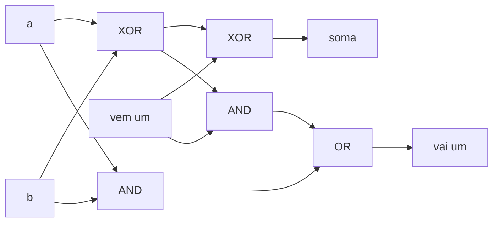

# Portas lógicas e circuitos combinacionais

## Por que isso importa

Todo programa que você escreve, no fim, vira corrente elétrica passando ou não por bilhões de transistores. Esta aula é o primeiro degrau da escada que vai do transistor até o Python: **portas lógicas** combinadas formam um **somador**, somadores formam a **ULA** (AC-03), e a ULA é o coração da CPU. Entender isso desmistifica o computador, explica por que tudo é binário (MD-04) e por que operações como `&`, `|`, `^` e `<<` são tão rápidas. Também é a base do curso Nand2Tetris, do OSSU, em que você constrói um computador inteiro a partir de uma única porta.

## Intuição

Uma porta lógica é um **interruptor controlado por outros interruptores**.

- **AND (E)**: dois interruptores **em série**. A lâmpada só acende se os dois estiverem ligados.
- **OR (OU)**: dois interruptores **em paralelo**. Acende se qualquer um estiver ligado.
- **NOT (NÃO)**: inverte. Ligado vira desligado.
- **XOR (OU exclusivo)**: o interruptor de duas pontas de uma escada: acende quando os dois estão em posições **diferentes**.

Um **circuito combinacional** é uma rede dessas portas em que a saída depende **só das entradas atuais** (sem memória). A memória vem na AC-02.

## Visual

| A | B | AND | OR | XOR | NAND | NOR |
|---|---|---|---|---|---|---|
| 0 | 0 | 0 | 0 | 0 | 1 | 1 |
| 0 | 1 | 0 | 1 | 1 | 1 | 0 |
| 1 | 0 | 0 | 1 | 1 | 1 | 0 |
| 1 | 1 | 1 | 1 | 0 | 0 | 0 |

Somador completo (soma 3 bits: a, b e o "vai um" que chega):



Somando 0110 (6) + 0111 (7) com 4 somadores completos em cadeia (**ripple carry**):

```text
vai um:   1 1 0
          0 1 1 0     (6)
        + 0 1 1 1     (7)
        ---------
          1 1 0 1     (13)
```

## Conceito técnico

### Portas e álgebra booleana

As portas implementam os conectivos da lógica proposicional (MD-01): AND = ∧, OR = ∨, NOT = ¬. Valem as mesmas leis, inclusive **De Morgan**:

```text
NOT (A AND B) = (NOT A) OR (NOT B)
NOT (A OR B)  = (NOT A) AND (NOT B)
```

**XOR** = (A OR B) AND NOT (A AND B). Propriedades: A XOR A = 0, A XOR 0 = A. É usado em somas, paridade, criptografia e no truque de trocar duas variáveis sem auxiliar.

### Universalidade da NAND

**NAND** (NOT AND) sozinha constrói qualquer outra porta:

```text
NOT A    = A NAND A
A AND B  = NOT (A NAND B)            = (A NAND B) NAND (A NAND B)
A OR B   = (NOT A) NAND (NOT B)      = (A NAND A) NAND (B NAND B)
```

Por isso fábricas de chips podem se concentrar em fazer um tipo de porta muito bem. NOR também é universal.

### Meio somador e somador completo

- **Meio somador** (2 bits): `soma = a XOR b`, `vai_um = a AND b`.
- **Somador completo** (3 bits, inclui o vai-um que chega): `soma = a XOR b XOR cin`, `cout = (a AND b) OR (cin AND (a XOR b))`.
- **Somador de n bits**: n somadores completos em cadeia, o vai-um de um entrando no próximo. Simples, mas lento: o último bit espera o vai-um passar por todos (é o **ripple carry**). CPUs reais usam somadores com antecipação de vai-um (*carry lookahead*), que calculam os vai-uns em paralelo.

**Subtração**: a − b = a + (complemento de dois de b) = a + (NOT b) + 1 (MD-04). O mesmo somador faz as duas coisas, só invertendo b e começando com vai-um 1.

**Overflow**: somando dois números com sinal de mesmo sinal, se o resultado tem sinal diferente, estourou. 0111 (7) + 0001 (1) = 1000 (−8 em 4 bits).

### Multiplexador e decodificador

- **Multiplexador (MUX)**: um "seletor". Com entradas a, b e um bit de seleção s, a saída é a se s = 0 e b se s = 1: `saida = (a AND NOT s) OR (b AND s)`. É um `if` em hardware. Um MUX com k bits de seleção escolhe entre 2ᵏ entradas.
- **Decodificador**: recebe k bits e ativa **exatamente uma** de 2ᵏ saídas. É como a CPU escolhe qual registrador ou posição de memória usar.

### Do circuito ao Python

Os operadores de bits do Python fazem as portas sobre **todos os bits de um número ao mesmo tempo**:

| Porta | Python | Exemplo |
|---|---|---|
| AND | `a & b` | `0b1100 & 0b1010 == 0b1000` |
| OR | `a \| b` | `0b1100 \| 0b1010 == 0b1110` |
| XOR | `a ^ b` | `0b1100 ^ 0b1010 == 0b0110` |
| NOT (k bits) | `~a & (2**k − 1)` | `~0b1100 & 0b1111 == 0b0011` |
| deslocar | `a << 1`, `a >> 1` | multiplica / divide por 2 |

(O `~` do Python sozinho dá −a − 1, porque os inteiros do Python não têm tamanho fixo. Aplique uma máscara.)

## Código

Somador de n bits feito só com portas:

```python
def xor(a, b):
    return (a | b) & (1 - (a & b))      # (A OR B) AND NOT (A AND B), com bits 0/1

def somador_completo(a, b, cin):
    s1 = xor(a, b)
    soma = xor(s1, cin)
    cout = (a & b) | (s1 & cin)
    return soma, cout

def somar_bits(x, y, n=8):
    resultado, vai_um = 0, 0
    for i in range(n):                   # do bit menos significativo para o mais
        a = (x >> i) & 1
        b = (y >> i) & 1
        s, vai_um = somador_completo(a, b, vai_um)
        resultado |= s << i
    return resultado, vai_um             # vai_um final = 1 indica que estourou n bits

print(somar_bits(6, 7))          # (13, 0)
print(somar_bits(200, 100))      # (44, 1): 300 não cabe em 8 bits (300 − 256 = 44)
```

Imprimindo a tabela-verdade de qualquer função booleana:

```python
from itertools import product

def tabela(f, n):
    for bits in product([0, 1], repeat=n):
        print(*bits, "|", f(*bits))

tabela(lambda a, b, s: (a & (1 - s)) | (b & s), 3)   # um multiplexador
```

## Erros comuns

- **Confundir os operadores lógicos com os de bits.** `and`/`or` decidem verdadeiro/falso e devolvem um dos operandos; `&`/`|` operam bit a bit. `6 and 3` é 3, mas `6 & 3` é 2.
- **Usar `~x` sem máscara** e se assustar com números negativos.
- **Esquecer o vai-um que chega** e montar um somador de n bits com meios somadores.
- **Achar que XOR é "OU"**: 1 XOR 1 = 0.
- **Ignorar o vai-um final.** Em n bits, ele indica que o resultado não coube (overflow sem sinal).
- **Precedência**: em Python, `a & b == c` é `a & (b == c)`. Use parênteses: `(a & b) == c`.

## Pratique

```quiz
id: AC-01-q1
tipo: multipla_escolha
pergunta: "Qual porta dá 1 somente quando as duas entradas são diferentes?"
opcoes: ["AND", "OR", "XOR", "NAND"]
resposta: 2
explicacao: "XOR (ou exclusivo): 0 XOR 1 = 1 XOR 0 = 1, e 0 XOR 0 = 1 XOR 1 = 0. É exatamente a soma de dois bits sem o vai-um."
dificuldade: 1
```

```quiz
id: AC-01-q2
tipo: multipla_escolha
pergunta: "Como se faz NOT A usando só uma porta NAND?"
opcoes: ["A NAND 0", "A NAND A", "A NAND 1 NAND 1", "Não é possível"]
resposta: 1
explicacao: "A NAND A = NOT (A AND A) = NOT A. (A NAND 1 também funciona: NOT (A AND 1) = NOT A.) A partir do NOT e da própria NAND, saem AND, OR e todas as outras."
dificuldade: 1
```

```quiz
id: AC-01-q3
tipo: multipla_escolha
pergunta: "Num meio somador, quais portas calculam a soma e o vai-um?"
opcoes: ["soma = AND, vai-um = OR", "soma = XOR, vai-um = AND", "soma = OR, vai-um = XOR", "soma = NAND, vai-um = NOR"]
resposta: 1
explicacao: "1 + 1 = 10 em binário: o bit da soma é 0 (1 XOR 1) e o vai-um é 1 (1 AND 1). Para 0 + 1, soma 1 (XOR) e vai-um 0 (AND)."
dificuldade: 1
```

```quiz
id: AC-01-q4
tipo: verdadeiro_falso
pergunta: "Num somador ripple carry de 64 bits, o bit mais significativo do resultado só fica correto depois que o vai-um percorreu os bits anteriores."
resposta: true
explicacao: "Cada somador completo depende do vai-um do anterior, então o atraso cresce com o número de bits. Por isso CPUs usam somadores com antecipação de vai-um (carry lookahead), que calculam os vai-uns em paralelo."
dificuldade: 2
```

```quiz
id: AC-01-q5
tipo: prever_saida
pergunta: |
  O que este código imprime?
  ```python
  a, b = 0b1100, 0b1010
  print(a & b, a | b, a ^ b, (~a) & 0b1111)
  ```
resposta: "8 14 6 3"
explicacao: "1100 AND 1010 = 1000 (8); OR = 1110 (14); XOR = 0110 (6); NOT 1100 em 4 bits = 0011 (3). A máscara 0b1111 corta o resultado em 4 bits."
dificuldade: 1
```

```quiz
id: AC-01-q6
tipo: resposta_curta
pergunta: "Como o mesmo circuito somador pode fazer subtração?"
resposta: "Usando complemento de dois: a − b é igual a a + (NOT b) + 1. Basta inverter os bits de b com portas XOR (controladas por um sinal de 'subtrair') e começar a soma com o vai-um de entrada igual a 1."
palavras_chave: ["complemento de dois", "NOT b", "+ 1", "vai-um"]
dificuldade: 2
```

```quiz
id: AC-01-q7
tipo: codigo
linguagem: python
pergunta: |
  **Tudo com NAND.** Implemente `nand(a, b)` e, usando **apenas** chamadas a `nand` (sem `&`, `|`, `^`, `not`, `and`, `or`), escreva `nao(a)`, `e(a, b)`, `ou(a, b)` e `xou(a, b)`. As entradas e saídas são 0 ou 1.
codigo_inicial: |
  def nand(a, b):
      return 1 - (a & b)


  def nao(a):
      return 1 - a


  def e(a, b):
      return a & b


  def ou(a, b):
      return a | b


  def xou(a, b):
      return 0


  # não mude: os testes usam esta função
  def tabela(f):
      return [f(a, b) for a in (0, 1) for b in (0, 1)]
usa: [def, return, nand]
testes:
  - chamada: "[nao(0), nao(1)]"
    saida: "[1, 0]"
  - chamada: "(tabela(e), tabela(ou))"
    saida: "([0, 0, 0, 1], [0, 1, 1, 1])"
  - chamada: "tabela(xou)"
    saida: "[0, 1, 1, 0]"
  - chamada: "tabela(lambda a, b: e(ou(a, b), nao(e(a, b))))"
    visivel: false
    saida: "[0, 1, 1, 0]"
dica: "nao(a) = nand(a, a). e(a, b) = nao(nand(a, b)). ou(a, b) = nand(nao(a), nao(b)). Para o XOR, um jeito com 4 NANDs: m = nand(a, b); devolva nand(nand(a, m), nand(b, m))."
solucao: |
  def nand(a, b):
      return 1 - (a & b)


  def nao(a):
      return nand(a, a)


  def e(a, b):
      return nao(nand(a, b))


  def ou(a, b):
      return nand(nao(a), nao(b))


  def xou(a, b):
      m = nand(a, b)
      return nand(nand(a, m), nand(b, m))


  # não mude: os testes usam esta função
  def tabela(f):
      return [f(a, b) for a in (0, 1) for b in (0, 1)]
explicacao: "A nand é a única função que usa um operador de bits; todo o resto é composição. O OR vem de De Morgan: A OR B = NOT (NOT A AND NOT B) = (NOT A) NAND (NOT B). O XOR com 4 NANDs é a construção clássica usada em chips reais e no projeto 1 do Nand2Tetris."
dificuldade: 2
```

```quiz
id: AC-01-q8
tipo: codigo
linguagem: python
pergunta: |
  **Somador de n bits.** Escreva `somar(x, y, n)` que simula um somador ripple carry de `n` bits: percorra os bits do menos significativo para o mais, com um somador completo em cada posição (use só `&`, `|`, `^` sobre bits isolados, sem somar `x + y`). Devolva a tupla `(resultado_em_n_bits, vai_um_final)`.
codigo_inicial: |
  def somar(x, y, n):
      return ((x + y) % (2 ** n), 0)
usa: [def, for, return]
testes:
  - chamada: "somar(6, 7, 4)"
    saida: "(13, 0)"
  - chamada: "somar(200, 100, 8)"
    saida: "(44, 1)"
  - chamada: "somar(0, 0, 1)"
    saida: "(0, 0)"
  - chamada: "somar(15, 1, 4)"
    saida: "(0, 1)"
  - chamada: "somar(2 ** 64 - 1, 2 ** 63, 64)"
    visivel: false
    saida: "(9223372036854775807, 1)"
dica: "vai = 0, r = 0. Para i em range(n): a = (x >> i) & 1; b = (y >> i) & 1; s = a ^ b ^ vai; vai = (a & b) | (vai & (a ^ b)); r |= s << i."
solucao: |
  def somar(x, y, n):
      r = 0
      vai = 0
      for i in range(n):
          a = (x >> i) & 1
          b = (y >> i) & 1
          s = a ^ b ^ vai
          vai = (a & b) | (vai & (a ^ b))
          r |= s << i
      return (r, vai)
explicacao: "O código inicial acerta o resultado, mas nunca informa o vai-um final, que é como o hardware avisa o overflow sem sinal (a 'carry flag' da CPU). 15 + 1 em 4 bits dá 0000 com vai-um 1: o contador 'deu a volta'."
dificuldade: 2
```

```quiz
id: AC-01-q9
tipo: codigo
linguagem: c
pergunta: |
  **Contar bits 1 em C.** Leia um inteiro `n` (0 ≤ n < 2³¹) e imprima quantos bits 1 ele tem em binário (o "peso de Hamming"), usando `&` e `>>`. Para a entrada `13` (1101):

  ```
  3
  ```
codigo_inicial: |
  #include <stdio.h>

  int main() {
      int n;
      scanf("%d", &n);
      int uns = 0;
      printf("%d\n", uns);
      return 0;
  }
usa: [while, scanf, printf]
testes:
  - entradas: ["13"]
    saida: "3"
  - entradas: ["0"]
    saida: "0"
  - entradas: ["255"]
    saida: "8"
  - entradas: ["2147483647"]
    visivel: false
    saida: "31"
  - entradas: ["1024"]
    visivel: false
    saida: "1"
dica: "while (n > 0) { uns += n & 1; n = n >> 1; }"
solucao: |
  #include <stdio.h>

  int main() {
      int n;
      scanf("%d", &n);
      int uns = 0;
      while (n > 0) {
          uns += n & 1;
          n = n >> 1;
      }
      printf("%d\n", uns);
      return 0;
  }
explicacao: "n & 1 isola o bit menos significativo, e n >> 1 descarta-o, trazendo o próximo para a posição 0. São no máximo 31 voltas. CPUs modernas têm uma instrução para isso (POPCNT), usada em xadrez por computador, criptografia e bancos de dados com bitmaps."
dificuldade: 1
```

## Resumo

- **Portas**: AND, OR, NOT, XOR, NAND, NOR. A álgebra booleana é a lógica de MD-01.
- **NAND é universal**: com ela se constrói qualquer circuito.
- **Meio somador**: soma = XOR, vai-um = AND. **Somador completo**: inclui o vai-um de entrada. **n bits**: em cadeia (ripple carry).
- Subtração = soma com complemento de dois. Vai-um final = overflow sem sinal.
- **MUX** escolhe uma entrada (um `if` em hardware); **decodificador** ativa uma de 2ᵏ saídas.
- Em Python: `&`, `|`, `^`, `~` (com máscara), `<<`, `>>`.

## Para ir além

- Faça os projetos 1 e 2 do **Nand2Tetris**: você constrói, num simulador, todas as portas e a ULA a partir da NAND.
- **Próximo módulo**: AC-02 Circuitos sequenciais, onde os circuitos ganham **memória**.
