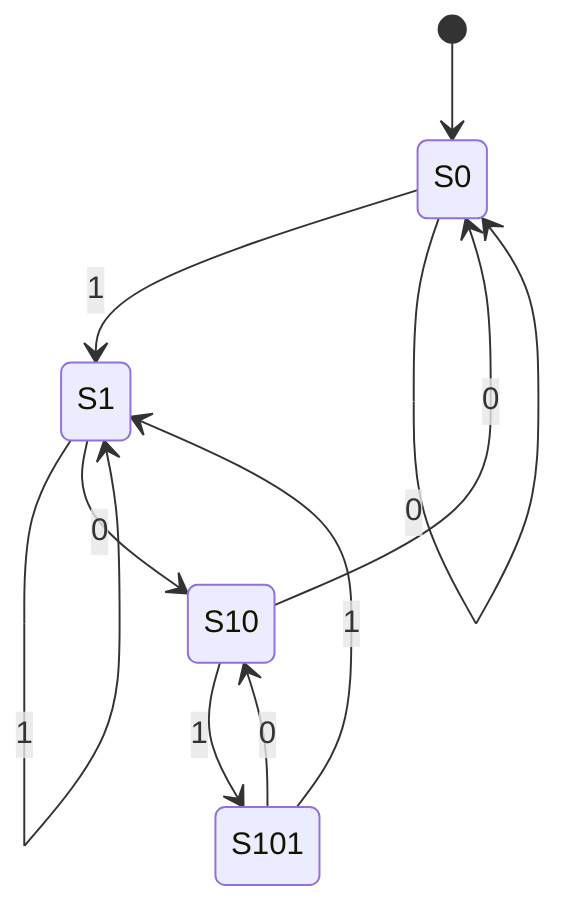

# Circuitos sequenciais: flip-flops, registradores

## Por que isso importa

Os circuitos da AC-01 calculam, mas **esquecem** tudo assim que a entrada muda. Um computador precisa **lembrar**: o valor de uma variável, a próxima instrução, o estado de um jogo. Circuitos **sequenciais** têm memória: a saída depende das entradas **e** do que aconteceu antes. Daqui saem os **registradores** da CPU, o **contador de programa** (que aponta para a próxima instrução), a **RAM** e o **clock**, cuja frequência (3 GHz, por exemplo) você vê na caixa do processador. E o modelo por trás deles, a **máquina de estados finita**, aparece em todo lugar no software: protocolos de rede, analisadores de texto, interfaces, jogos.

## Intuição

- **Realimentação**: ligue a saída de um circuito de volta na entrada dele. Agora o circuito pode "segurar" um valor, como uma pessoa que repete para si mesma um número de telefone para não esquecer.
- **Clock**: um metrônomo. Todos os registradores só aceitam valor novo na **batida** (a borda de subida do sinal). Entre batidas, os circuitos combinacionais calculam com calma, e na próxima batida o resultado é guardado ao mesmo tempo em todo lugar. Sem o metrônomo, cada parte do chip mudaria num momento diferente, e o caos seria inevitável.
- **Máquina de estados**: uma catraca de metrô. Estados: "travada" e "liberada". Evento "moeda" leva de travada para liberada; evento "empurrar" leva de liberada para travada. O comportamento depende do estado atual.

## Visual

O sinal de clock e um flip-flop D:

```text
clock:   _|‾|_|‾|_|‾|_|‾|_|‾|_
           ↑   ↑   ↑   ↑   ↑      bordas de subida: é aqui que Q copia D
D:       ‾‾‾‾‾|___________|‾‾‾‾
Q:       ‾‾‾‾‾‾‾|_______|‾‾‾‾‾‾   Q só muda nas bordas, mesmo que D mude no meio
```

Máquina de estados que detecta a sequência **101** num fluxo de bits:



S0 = "nada útil ainda", S1 = "vi 1", S10 = "vi 10", S101 = "acabei de ver 101" (saída 1).

## Conceito técnico

### Combinacional × sequencial

| | Combinacional | Sequencial |
|---|---|---|
| Saída depende de | só das entradas atuais | entradas + **estado** guardado |
| Tem memória? | não | sim |
| Exemplos | somador, MUX, ULA | flip-flop, registrador, contador, RAM |

### Latch SR

Duas portas NOR em cruz, cada saída realimentando a outra. Entradas **S** (set, liga) e **R** (reset, desliga):

| S | R | Q (próximo) |
|---|---|---|
| 0 | 0 | mantém o anterior (memória!) |
| 1 | 0 | 1 |
| 0 | 1 | 0 |
| 1 | 1 | proibido (inválido) |

É o primeiro circuito capaz de guardar 1 bit.

### Flip-flop D

O **latch D** resolve o caso proibido com uma entrada só, D (dado), e um sinal de habilitação. O **flip-flop D** vai além: copia D para Q **apenas na borda de subida do clock**. No resto do tempo, Q fica parado, não importa o que D faça.

```text
Q(t + 1) = D(t)      "o valor de amanhã é a entrada de hoje"
```

Esse "atraso de um ciclo" é o bloco fundamental de toda memória síncrona.

### Registrador

**n flip-flops D lado a lado** guardam uma palavra de n bits. Com um sinal de **carga** (load) e um MUX na entrada: se load = 1, guarda o valor novo na próxima borda; senão, realimenta o próprio valor.

```text
próximo = load ? entrada : atual          (um MUX por bit)
```

Os registradores da CPU (os 32 do RISC-V, por exemplo) são exatamente isso.

### Contador

Um registrador cuja entrada é a **própria saída + 1** (um somador da AC-01 realimentado). Com sinais extras de **reset** (zera) e **load** (carrega um valor), vira o **contador de programa** (PC): normalmente avança para a próxima instrução, mas um salto carrega outro endereço.

Prioridade típica (como no Nand2Tetris): reset > load > incrementar > manter.

### Registrador de deslocamento

A saída de cada flip-flop entra no próximo. A cada clock, os bits andam uma posição. Converte dados **seriais** (um bit por vez, como numa USB ou num cabo de rede) em **paralelos** (a palavra inteira) e vice-versa.

### RAM

Muitos registradores + um **decodificador** de endereço (AC-01) para escolher qual escrever + um **MUX** para escolher qual ler. RAM de 8 palavras: 8 registradores, endereço de 3 bits.

### Máquina de estados finita (FSM)

Um conjunto de **estados**, um estado inicial, e uma **função de transição** `(estado, entrada) → próximo estado` (mais uma função de saída). Em hardware: um registrador guarda o estado e um circuito combinacional calcula o próximo. Em software: um `dict` ou um `match`.

Usos: semáforos, catracas, protocolo TCP (estados LISTEN, ESTABLISHED, CLOSE_WAIT...), analisadores léxicos de compiladores, expressões regulares (TC-02), personagens de jogos.

### Período do clock

O clock não pode ser mais rápido que o **caminho combinacional mais lento** entre dois registradores. Se o somador leva 0,3 ns para estabilizar, o período tem que ser maior que isso. É por isso que somadores mais rápidos (lookahead) e o **pipeline** (AC-06) permitem clocks mais altos.

## Código

Um flip-flop D e um contador, simulados ciclo a ciclo:

```python
class FlipFlopD:
    def __init__(self):
        self.q = 0

    def borda(self, d):          # chamada a cada borda de subida
        self.q = d


class Contador:
    def __init__(self, bits):
        self.bits = bits
        self.valor = 0

    def borda(self, reset=0, load=0, entrada=0, inc=1):
        if reset:
            self.valor = 0
        elif load:
            self.valor = entrada
        elif inc:
            self.valor = (self.valor + 1) % (2 ** self.bits)   # dá a volta, como no hardware


pc = Contador(4)
saida = []
for ciclo in range(20):
    pc.borda(load=(ciclo == 5), entrada=12)    # no ciclo 5, um "salto" para 12
    saida.append(pc.valor)
print(saida)   # [1, 2, 3, 4, 5, 12, 13, 14, 15, 0, 1, ...]
```

Uma máquina de estados como tabela:

```python
catraca = {
    ("travada", "moeda"): "liberada",
    ("travada", "empurrar"): "travada",
    ("liberada", "moeda"): "liberada",
    ("liberada", "empurrar"): "travada",
}
estado = "travada"
for evento in ["empurrar", "moeda", "moeda", "empurrar", "empurrar"]:
    estado = catraca[(estado, evento)]
    print(evento, "→", estado)
```

## Erros comuns

- **Achar que o flip-flop copia D o tempo todo.** Ele só copia na borda do clock; o latch é que é "transparente" enquanto habilitado.
- **Atualizar registradores em sequência na simulação** quando no hardware eles mudam ao mesmo tempo. Calcule todos os próximos valores primeiro, depois atribua todos (como `a, b = b, a + b`).
- **Esquecer a prioridade** entre reset, load e incremento num contador.
- **Esquecer que contadores dão a volta**: um contador de 4 bits depois de 15 vai para 0.
- **Máquina de estados sem tratar todas as entradas** em todos os estados. Cada par (estado, entrada) precisa de um destino, nem que seja "erro".
- **Detectar padrões sobrepostos errado**: em "10101", o padrão 101 aparece duas vezes; ao achar um, a máquina deve continuar do estado certo (S10), e não voltar ao início.

## Pratique

```quiz
id: AC-02-q1
tipo: multipla_escolha
pergunta: "O que diferencia um circuito sequencial de um combinacional?"
opcoes: ["O sequencial é mais rápido", "O sequencial tem memória: a saída depende também do estado anterior", "O combinacional usa clock", "O sequencial só usa portas NAND"]
resposta: 1
explicacao: "No combinacional, a mesma entrada sempre dá a mesma saída. No sequencial, há um estado guardado (em flip-flops), então a saída depende da história. O clock é típico dos sequenciais síncronos."
dificuldade: 1
```

```quiz
id: AC-02-q2
tipo: multipla_escolha
pergunta: "Num flip-flop D disparado pela borda de subida, quando a saída Q muda?"
opcoes: ["Sempre que D muda", "Só quando o clock vai de 0 para 1, copiando o valor de D naquele instante", "Quando o clock está em 1", "Nunca: ele guarda só o primeiro valor"]
resposta: 1
explicacao: "Ele 'fotografa' D na borda de subida e mantém Q até a próxima borda. Mudanças de D entre bordas são ignoradas. Um latch D, ao contrário, segue D enquanto está habilitado."
dificuldade: 1
```

```quiz
id: AC-02-q3
tipo: multipla_escolha
pergunta: "Um contador de 3 bits está em 6 e recebe 3 bordas de clock com incremento. Qual o valor final?"
opcoes: ["9", "1", "0", "7"]
resposta: 1
explicacao: "6 → 7 → 0 → 1. Com 3 bits, os valores vão de 0 a 7, e depois do 7 o contador dá a volta. É o mesmo overflow da soma em n bits (AC-01)."
dificuldade: 1
```

```quiz
id: AC-02-q4
tipo: verdadeiro_falso
pergunta: "A frequência máxima do clock é limitada pelo caminho combinacional mais lento entre dois registradores."
resposta: true
explicacao: "Entre duas bordas, os sinais precisam atravessar a lógica combinacional e estabilizar antes de serem guardados. Se o clock for mais rápido que o caminho mais lento, um registrador guarda um valor ainda incompleto. O pipeline (AC-06) encurta esses caminhos."
dificuldade: 2
```

```quiz
id: AC-02-q5
tipo: resposta_curta
pergunta: "Como um latch SR consegue guardar um bit usando só portas lógicas?"
resposta: "Por realimentação: as saídas de duas portas NOR são ligadas nas entradas uma da outra. Quando S e R estão em 0, cada porta mantém a outra no mesmo estado, então o valor anterior se sustenta. S = 1 força Q para 1 e R = 1 força Q para 0."
palavras_chave: ["realimentação", "NOR", "mantém", "set e reset"]
dificuldade: 2
```

```quiz
id: AC-02-q6
tipo: codigo
linguagem: python
pergunta: |
  **Contador de programa.** Escreva `simular_pc(bits, sinais)` que simula um contador de `bits` bits começando em 0. `sinais` é uma lista com um dict por borda de clock, com as chaves opcionais `reset`, `load`, `entrada` e `inc` (todas valem 0 se ausentes, exceto `entrada`). Prioridade: reset > load > inc > manter. Devolva a lista dos valores **depois** de cada borda.
codigo_inicial: |
  def simular_pc(bits, sinais):
      valor = 0
      historico = []
      for s in sinais:
          valor += 1
          historico.append(valor)
      return historico
usa: [def, for, return]
testes:
  - chamada: "simular_pc(4, [{'inc': 1}] * 3)"
    saida: "[1, 2, 3]"
  - chamada: "simular_pc(4, [{'inc': 1}, {'load': 1, 'entrada': 9, 'inc': 1}, {'inc': 1}, {}])"
    saida: "[1, 9, 10, 10]"
  - chamada: "simular_pc(2, [{'inc': 1}] * 5)"
    saida: "[1, 2, 3, 0, 1]"
  - chamada: "simular_pc(8, [{'inc': 1}, {'reset': 1, 'load': 1, 'entrada': 50}, {'inc': 1}])"
    visivel: false
    saida: "[1, 0, 1]"
  - chamada: "simular_pc(3, [{'load': 1, 'entrada': 13}])"
    visivel: false
    saida: "[5]"
dica: "Para cada s: use s.get('reset', 0) etc. if reset: valor = 0; elif load: valor = s['entrada'] % 2 ** bits; elif inc: valor = (valor + 1) % 2 ** bits. Adicione valor ao histórico."
solucao: |
  def simular_pc(bits, sinais):
      limite = 2 ** bits
      valor = 0
      historico = []
      for s in sinais:
          if s.get("reset", 0):
              valor = 0
          elif s.get("load", 0):
              valor = s["entrada"] % limite
          elif s.get("inc", 0):
              valor = (valor + 1) % limite
          historico.append(valor)
      return historico
explicacao: "A prioridade é o MUX em cascata do circuito: reset vence tudo, load vence o incremento. O último teste carrega 13 num contador de 3 bits: só os 3 bits de baixo cabem (13 = 1101, fica 101 = 5), exatamente como um registrador físico."
dificuldade: 2
```

```quiz
id: AC-02-q7
tipo: codigo
linguagem: python
pergunta: |
  **Detector de sequência.** Escreva `detectar(bits, padrao)` que recebe uma string de bits e um padrão (string de bits) e devolve a lista de posições (índice do **último** bit) em que o padrão termina, **inclusive sobrepostos**. Implemente como máquina de estados: o estado é "quantos bits do padrão já casaram". Ao errar, recue para o maior prefixo do padrão que ainda é sufixo do que foi lido (pode calcular isso testando prefixos).
codigo_inicial: |
  def detectar(bits, padrao):
      estado = 0
      achados = []
      return achados
usa: [def, for, return]
testes:
  - chamada: "detectar('10101', '101')"
    saida: "[2, 4]"
  - chamada: "detectar('0000', '1')"
    saida: "[]"
  - chamada: "detectar('110110', '110')"
    saida: "[2, 5]"
  - chamada: "detectar('111', '11')"
    saida: "[1, 2]"
  - chamada: "detectar('1001001', '1001')"
    visivel: false
    saida: "[3, 6]"
dica: "estado = 0 e lido = ''. Para cada (i, b): lido += b. Se padrao[estado] == b, estado += 1; senão, ache o maior k < estado + 1 tal que lido termina com padrao[:k] (laço de k decrescente) e faça estado = k. Se estado == len(padrao), registre i e recue para o maior k < len(padrao) com lido terminando em padrao[:k]."
solucao: |
  def detectar(bits, padrao):
      def recuar(lido, limite):
          for k in range(limite, -1, -1):
              if lido.endswith(padrao[:k]):
                  return k
          return 0

      estado = 0
      lido = ""
      achados = []
      for i, b in enumerate(bits):
          lido += b
          if estado < len(padrao) and padrao[estado] == b:
              estado += 1
          else:
              estado = recuar(lido, min(estado, len(padrao) - 1))
          if estado == len(padrao):
              achados.append(i)
              estado = recuar(lido, len(padrao) - 1)
      return achados
explicacao: "Em '10101', depois de achar o primeiro 101 a máquina não volta ao início: o '1' final já é o começo de um novo padrão, então ela recua para o estado 'vi 1'. Essa ideia de recuar para o maior prefixo que também é sufixo é o coração do algoritmo KMP de busca em texto e dos autômatos de expressões regulares (TC-02)."
dificuldade: 3
```

```quiz
id: AC-02-q8
tipo: codigo
linguagem: javascript
pergunta: |
  **Registrador de deslocamento.** Um registrador de `n` bits recebe um bit por borda de clock pela esquerda (o bit mais significativo) e descarta o bit que sai pela direita. Escreva `deslocar(n, bitsEntrada)` que começa com todos os bits em 0 e devolve um array com o valor (como **número**) do registrador depois de cada borda. Use `>>`, `<<` e `|`.
codigo_inicial: |
  function deslocar(n, bitsEntrada) {
    return bitsEntrada.map(() => 0);
  }
usa: [function, for, return]
testes:
  - chamada: "deslocar(4, [1, 0, 1, 1])"
    saida: "[ 8, 4, 10, 13 ]"
  - chamada: "deslocar(2, [1, 1, 1])"
    saida: "[ 2, 3, 3 ]"
  - chamada: "deslocar(3, [])"
    saida: "[]"
  - chamada: "deslocar(8, [1, 0, 0, 0, 0, 0, 0, 0, 0])"
    visivel: false
    saida: "[ 128, 64, 32, 16, 8, 4, 2, 1, 0 ]"
dica: "let r = 0. Para cada bit: r = (r >> 1) | (bit << (n - 1)); guarde r. O >> 1 descarta o bit da direita e abre espaço à esquerda."
solucao: |
  function deslocar(n, bitsEntrada) {
    let r = 0;
    const valores = [];
    for (const bit of bitsEntrada) {
      r = (r >> 1) | (bit << (n - 1));
      valores.push(r);
    }
    return valores;
  }
explicacao: "Depois de n bordas, os n bits que chegaram em série estão todos no registrador, prontos para serem lidos em paralelo: é assim que uma interface serial (USB, SPI) monta um byte. No último teste, o 1 'atravessa' o registrador e sai pela direita na nona borda."
dificuldade: 2
```

## Resumo

- **Sequencial** = combinacional + **memória** (estado).
- **Latch SR**: realimentação guarda 1 bit. **Flip-flop D**: copia D na **borda do clock**: Q(t + 1) = D(t).
- **Registrador**: n flip-flops + load. **Contador**: registrador + somador (PC). **Deslocamento**: serial ↔ paralelo. **RAM**: registradores + decodificador + MUX.
- **Clock** sincroniza tudo; seu período é limitado pelo caminho combinacional mais lento.
- **Máquina de estados**: (estado, entrada) → próximo estado. Hardware, protocolos, regex, jogos.

## Para ir além

- Faça o projeto 3 do **Nand2Tetris** (registradores, RAM e o contador de programa).
- **Próximo módulo**: AC-03 CPU: ciclo busca-decodifica-executa e ULA, que junta tudo num processador.
