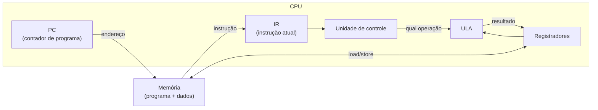

# CPU: ciclo busca-decodifica-executa, ULA

## Por que isso importa

Com as portas (AC-01) e a memória (AC-02), já dá para montar um processador. Esta aula mostra como: uma CPU é uma máquina que repete, bilhões de vezes por segundo, três passos simples: **buscar** uma instrução na memória, **decodificar** o que ela pede e **executar**. Entender esse ciclo explica o que é um "bug de estouro de buffer" (dados sobrescrevendo código), por que um `if` dentro de um laço quente pode deixar o programa lento (AC-06), o que um interpretador como o do Python faz (ele próprio é um ciclo busca-decodifica-executa em software) e como emuladores de videogame funcionam.

## Intuição

Imagine um cozinheiro (a CPU) com um **livro de receitas** (a memória), um **marcador de página** (o contador de programa, PC), uma **bancada** com poucas tigelas (os registradores) e uma **batedeira multifuncional** (a ULA) que soma, subtrai, compara.

1. **Buscar**: lê a linha do livro onde está o marcador.
2. **Decodificar**: entende o que a linha pede ("misture a tigela 1 com a tigela 2").
3. **Executar**: liga a batedeira com o modo certo, guarda o resultado numa tigela, e **avança o marcador**. Algumas linhas dizem "volte para a linha 3 se a massa estiver mole": isso é um **salto condicional**.

O cozinheiro não sabe "fazer bolo". Ele só sabe seguir uma linha de cada vez, muito rápido.

## Visual



O ciclo, para a instrução `ADD R1, R2, R3` (R1 = R2 + R3) no endereço 8:

```text
BUSCA:        IR ← memória[PC]       (lê a instrução do endereço 8)
              PC ← PC + 4            (aponta para a próxima; instruções de 4 bytes)
DECODIFICA:   opcode = ADD, destino = R1, fontes = R2 e R3
              lê R2 e R3 do banco de registradores
EXECUTA:      ULA calcula R2 + R3 (modo "somar")
ESCREVE:      R1 ← resultado; atualiza as flags (zero? negativo?)
              ... e começa de novo com PC = 12
```

## Conceito técnico

### Componentes

| Componente | Função |
|---|---|
| **PC** (program counter) | endereço da próxima instrução. Um contador com load (AC-02) |
| **IR** (instruction register) | guarda a instrução sendo executada |
| **Banco de registradores** | poucas palavras (16 ou 32) de memória ultrarrápida dentro da CPU |
| **ULA** (unidade lógica e aritmética) | circuito combinacional que faz soma, subtração, AND, OR, comparações |
| **Unidade de controle** | decodifica o opcode e liga os sinais certos (qual operação na ULA, qual registrador escrever, se acessa memória) |
| **Barramentos** | fios que levam endereços e dados entre CPU e memória |

### A ULA

Recebe dois operandos e um **código de operação** e devolve o resultado mais **flags**:

- **Z** (zero): resultado é 0.
- **N** (negativo): bit de sinal do resultado é 1.
- **C** (carry, vai-um): houve vai-um no último bit (overflow sem sinal).
- **V** (overflow): estourou o intervalo com sinal.

Por dentro, a ULA calcula **todas** as operações em paralelo (um somador, um bloco AND, um OR...) e um **MUX** (AC-01) escolhe qual resultado sai, conforme o código da operação. As flags alimentam os **saltos condicionais**: `if a == b` vira "subtraia e salte se Z = 1".

### O ciclo de instrução

1. **Busca (fetch)**: `IR ← memória[PC]`; `PC ← PC + tamanho da instrução`.
2. **Decodificação (decode)**: separar os campos da instrução (opcode, registradores, constante) e ler os registradores.
3. **Execução (execute)**: ULA calcula, ou calcula um endereço.
4. **Acesso à memória**: `load`/`store`, se a instrução pedir.
5. **Escrita (write-back)**: guarda o resultado no registrador de destino.

Instruções de **salto** mudam o PC na execução: `JMP 20` faz `PC ← 20`; `JZ 20` faz isso só se a flag Z estiver ligada. Com saltos, você tem **laços** e **ifs**: tudo que é preciso para ser Turing-completo (TC-03).

### Von Neumann

Na arquitetura de **von Neumann** (quase todos os computadores), **programa e dados ficam na mesma memória**. Vantagens: um programa pode carregar outro (é assim que o sistema operacional roda seus apps) e compiladores podem gerar código. Desvantagens: o **gargalo de von Neumann** (o mesmo barramento para instruções e dados) e riscos de segurança (dados sendo executados como código). A arquitetura **Harvard** separa as duas memórias; CPUs modernas usam caches separados para instruções e dados (AC-05), um meio-termo.

### Clock e desempenho

```text
tempo = instruções × ciclos por instrução (CPI) × duração do ciclo
```

Uma CPU de 3 GHz tem ciclo de ~0,33 ns. Se a CPI média é 1, ela executa ~3 bilhões de instruções por segundo. O pipeline (AC-06) e o paralelismo atacam a CPI; processos de fabricação menores atacam a duração do ciclo.

## Código

Um simulador de uma CPU de acumulador minúscula:

```python
def executar(programa, max_passos=1000):
    acc, pc, passos = 0, 0, 0
    memoria = {}
    while pc < len(programa) and passos < max_passos:
        op, arg = programa[pc]          # BUSCA (já decodificada em tupla)
        pc += 1
        passos += 1
        if op == "LOAD":                # DECODIFICA + EXECUTA
            acc = arg
        elif op == "ADD":
            acc += arg
        elif op == "STORE":
            memoria[arg] = acc
        elif op == "ADDM":
            acc += memoria.get(arg, 0)
        elif op == "JNZ":               # salta se o acumulador não for zero
            if acc != 0:
                pc = arg
        elif op == "HALT":
            break
    return acc, memoria, passos


# soma 5 + 4 + 3 + 2 + 1 usando um laço
programa = [
    ("LOAD", 0), ("STORE", "soma"),
    ("LOAD", 5), ("STORE", "i"),
    ("LOAD", 0), ("ADDM", "soma"), ("ADDM", "i"), ("STORE", "soma"),   # soma += i
    ("LOAD", 0), ("ADDM", "i"), ("ADD", -1), ("STORE", "i"),          # i -= 1
    ("JNZ", 4),                                                       # se i != 0, repete
    ("HALT", None),
]
acc, mem, passos = executar(programa)
print(mem["soma"], passos)   # 15 e o número de instruções executadas
```

## Erros comuns

- **Achar que a CPU "entende" o programa.** Ela só executa uma instrução por vez; o significado está no programa.
- **Esquecer de avançar o PC** na busca (laço infinito na mesma instrução) ou avançar depois de um salto (pulando o destino).
- **Confundir registrador com memória.** Registradores são poucos e estão dentro da CPU; memória é grande e fica fora, centenas de vezes mais lenta (AC-05).
- **Confundir a flag C (vai-um, sem sinal) com a V (overflow, com sinal).** 0111 + 0001 = 1000 em 4 bits: C = 0, mas V = 1 (7 + 1 virou −8).
- **Achar que clock maior sempre significa CPU mais rápida.** Depende também da CPI e de quantas instruções o programa precisa.

## Pratique

```quiz
id: AC-03-q1
tipo: multipla_escolha
pergunta: "O que o registrador PC (contador de programa) guarda?"
opcoes: ["O resultado da última operação", "O endereço da próxima instrução a ser buscada", "O número de instruções já executadas", "A instrução que está sendo executada"]
resposta: 1
explicacao: "O PC aponta para onde buscar a próxima instrução. Normalmente ele avança sozinho; saltos e chamadas de função o carregam com outro endereço. A instrução atual fica no IR."
dificuldade: 1
```

```quiz
id: AC-03-q2
tipo: multipla_escolha
pergunta: "Como a CPU executa um `if (a == b)`?"
opcoes: ["A ULA tem uma instrução especial para if", "Subtrai a − b e usa a flag Z (zero) num salto condicional", "O compilador remove o if", "A unidade de controle compara as strings"]
resposta: 1
explicacao: "Uma comparação é uma subtração cujo resultado é descartado, mas as flags ficam. Se a − b = 0, Z = 1, e uma instrução de salto condicional decide para onde o PC vai. Laços funcionam do mesmo jeito."
dificuldade: 2
```

```quiz
id: AC-03-q3
tipo: verdadeiro_falso
pergunta: "Na arquitetura de von Neumann, instruções e dados ficam na mesma memória."
resposta: true
explicacao: "É a ideia do 'programa armazenado': o programa é só mais um dado na memória. Isso permite que sistemas operacionais carreguem programas e compiladores gerem código, mas também cria o gargalo de um barramento compartilhado."
dificuldade: 1
```

```quiz
id: AC-03-q4
tipo: multipla_escolha
pergunta: "Um programa executa 6 bilhões de instruções com CPI média 1,5 numa CPU de 3 GHz. Quanto tempo leva?"
opcoes: ["2 s", "3 s", "4,5 s", "9 s"]
resposta: 1
explicacao: "tempo = instruções × CPI / frequência = 6 × 10⁹ × 1,5 / (3 × 10⁹) = 3 s."
dificuldade: 2
```

```quiz
id: AC-03-q5
tipo: resposta_curta
pergunta: "Descreva as três etapas principais do ciclo de instrução."
resposta: "Busca: a CPU lê da memória a instrução no endereço do PC e avança o PC. Decodificação: a unidade de controle interpreta o opcode e os operandos e lê os registradores. Execução: a ULA faz a operação (ou calcula um endereço), e o resultado é escrito no registrador ou na memória, ou o PC é alterado num salto."
palavras_chave: ["busca", "PC", "decodifica", "executa", "ULA"]
dificuldade: 1
```

```quiz
id: AC-03-q6
tipo: codigo
linguagem: python
pergunta: |
  **ULA de 8 bits.** Escreva `ula(op, a, b)` com `a` e `b` entre 0 e 255. As operações são `'ADD'`, `'SUB'`, `'AND'`, `'OR'`, `'XOR'` e `'NOT'` (que ignora `b`). Devolva `(resultado, flags)`, com o resultado em 8 bits e `flags` um dict com `'Z'` (resultado zero), `'N'` (bit 7 ligado) e `'C'` (vai-um: no ADD, se a + b > 255; no SUB, se a < b, o "empresta"; nas outras, 0). Os valores das flags são 0 ou 1.
codigo_inicial: |
  def ula(op, a, b):
      return (0, {"Z": 1, "N": 0, "C": 0})
usa: [def, if, return]
testes:
  - chamada: "ula('ADD', 200, 100)"
    saida: "(44, {'Z': 0, 'N': 0, 'C': 1})"
  - chamada: "ula('SUB', 5, 5)"
    saida: "(0, {'Z': 1, 'N': 0, 'C': 0})"
  - chamada: "ula('SUB', 3, 5)"
    saida: "(254, {'Z': 0, 'N': 1, 'C': 1})"
  - chamada: "ula('NOT', 0b00001111, 0)"
    saida: "(240, {'Z': 0, 'N': 1, 'C': 0})"
  - chamada: "[ula(op, 0b1100, 0b1010)[0] for op in ('AND', 'OR', 'XOR')]"
    visivel: false
    saida: "[8, 14, 6]"
dica: "Calcule o resultado bruto conforme op, depois r = bruto & 0xFF. C: no ADD, bruto > 255; no SUB, a < b. Z = 1 se r == 0; N = (r >> 7) & 1."
solucao: |
  def ula(op, a, b):
      c = 0
      if op == "ADD":
          bruto = a + b
          c = 1 if bruto > 255 else 0
      elif op == "SUB":
          bruto = a - b
          c = 1 if a < b else 0
      elif op == "AND":
          bruto = a & b
      elif op == "OR":
          bruto = a | b
      elif op == "XOR":
          bruto = a ^ b
      else:
          bruto = ~a
      r = bruto & 0xFF
      return (r, {"Z": 1 if r == 0 else 0, "N": (r >> 7) & 1, "C": c})
explicacao: "3 − 5 em 8 bits dá 11111110 = 254 sem sinal, ou −2 com sinal (complemento de dois): o bit 7 ligado acende N, e o 'empresta' acende C. A máscara & 0xFF faz o papel dos 8 fios de saída: o que não cabe simplesmente não existe."
dificuldade: 2
```

```quiz
id: AC-03-q7
tipo: codigo
linguagem: python
pergunta: |
  **Simulador de CPU.** Uma CPU tem 4 registradores (`R0` a `R3`, começando em 0). O programa é uma lista de tuplas:

  - `('LI', r, n)`: r ← n
  - `('ADD', r, a, b)`: r ← a + b (a e b são registradores)
  - `('SUB', r, a, b)`: r ← a − b
  - `('JZ', r, alvo)`: se r == 0, PC ← alvo
  - `('JMP', alvo)`: PC ← alvo
  - `('HALT',)`: para

  Escreva `rodar(programa)` que executa o ciclo busca-decodifica-executa e devolve `(registradores, instrucoes_executadas)`, com os registradores como lista `[R0, R1, R2, R3]`. Pare também se passar de 10000 instruções.
codigo_inicial: |
  def rodar(programa):
      reg = [0, 0, 0, 0]
      pc = 0
      executadas = 0
      return (reg, executadas)
usa: [def, while, return]
testes:
  - chamada: "rodar([('LI', 0, 7), ('LI', 1, 5), ('ADD', 2, 0, 1), ('HALT',)])"
    saida: "([7, 5, 12, 0], 4)"
  - chamada: "rodar([('LI', 0, 3), ('LI', 1, 1), ('LI', 2, 0), ('JZ', 0, 7), ('ADD', 2, 2, 0), ('SUB', 0, 0, 1), ('JMP', 3), ('HALT',)])"
    saida: "([0, 1, 6, 0], 17)"
  - chamada: "rodar([('JMP', 0)])"
    saida: "([0, 0, 0, 0], 10000)"
  - chamada: "rodar([('LI', 3, 9)])"
    visivel: false
    saida: "([0, 0, 0, 9], 1)"
dica: "while pc < len(programa) and executadas < 10000: ins = programa[pc]; pc += 1; executadas += 1; op = ins[0]. Trate cada op. Saltos sobrescrevem pc. HALT dá break."
solucao: |
  def rodar(programa):
      reg = [0, 0, 0, 0]
      pc = 0
      executadas = 0
      while pc < len(programa) and executadas < 10000:
          ins = programa[pc]
          pc += 1
          executadas += 1
          op = ins[0]
          if op == "LI":
              reg[ins[1]] = ins[2]
          elif op == "ADD":
              reg[ins[1]] = reg[ins[2]] + reg[ins[3]]
          elif op == "SUB":
              reg[ins[1]] = reg[ins[2]] - reg[ins[3]]
          elif op == "JZ":
              if reg[ins[1]] == 0:
                  pc = ins[2]
          elif op == "JMP":
              pc = ins[1]
          elif op == "HALT":
              break
      return (reg, executadas)
explicacao: "O segundo programa soma 3 + 2 + 1 num laço: R0 é o contador, R2 acumula, e o par JZ/JMP forma um while. Avançar o PC na busca, antes de executar, é o detalhe que faz os saltos funcionarem: um salto apenas sobrescreve o valor já avançado. O interpretador do Python (o laço de avaliação do CPython) tem exatamente essa estrutura."
dificuldade: 3
```

```quiz
id: AC-03-q8
tipo: codigo
linguagem: javascript
pergunta: |
  **Decodificar uma instrução.** Numa CPU de brinquedo, cada instrução é um número de 16 bits dividido em 4 campos de 4 bits: `opcode` (bits 15 a 12), `rd` (11 a 8), `rs1` (7 a 4) e `rs2` (3 a 0). Escreva `decodificar(palavra)` que devolve o objeto `{ opcode, rd, rs1, rs2 }` usando deslocamentos (`>>`) e máscaras (`&`).
codigo_inicial: |
  function decodificar(palavra) {
    return { opcode: 0, rd: 0, rs1: 0, rs2: 0 };
  }
usa: [function, return]
testes:
  - chamada: "decodificar(0x1234)"
    saida: "{ opcode: 1, rd: 2, rs1: 3, rs2: 4 }"
  - chamada: "decodificar(0)"
    saida: "{ opcode: 0, rd: 0, rs1: 0, rs2: 0 }"
  - chamada: "decodificar(0xFFFF)"
    saida: "{ opcode: 15, rd: 15, rs1: 15, rs2: 15 }"
  - chamada: "decodificar(0b1010000100100011)"
    visivel: false
    saida: "{ opcode: 10, rd: 1, rs1: 2, rs2: 3 }"
dica: "opcode = (palavra >> 12) & 0xF; rd = (palavra >> 8) & 0xF; rs1 = (palavra >> 4) & 0xF; rs2 = palavra & 0xF."
solucao: |
  function decodificar(palavra) {
    return {
      opcode: (palavra >> 12) & 0xf,
      rd: (palavra >> 8) & 0xf,
      rs1: (palavra >> 4) & 0xf,
      rs2: palavra & 0xf,
    };
  }
explicacao: "Deslocar para a direita traz o campo para os bits de baixo, e a máscara 0xF (1111) apaga o resto. Em hexadecimal, cada dígito é exatamente um campo de 4 bits, por isso 0x1234 se lê tão fácil. A unidade de controle faz isso só com fios: cada campo é um grupo de fios ligado ao lugar certo."
dificuldade: 1
```

## Resumo

- CPU = **PC** + **IR** + **registradores** + **ULA** + **unidade de controle**, ligados por barramentos à memória.
- **Ciclo**: busca (IR ← mem[PC], PC avança) → decodifica → executa → acessa memória → escreve.
- **ULA**: calcula todas as operações e um MUX escolhe; gera **flags** Z, N, C, V.
- **Saltos** mudam o PC; com saltos condicionais e flags, temos ifs e laços.
- **Von Neumann**: programa e dados na mesma memória.
- tempo = instruções × CPI × duração do ciclo.

## Para ir além

- Faça os projetos 2 (ALU) e 5 (CPU) do **Nand2Tetris**: a CPU Hack tem só dois tipos de instrução e roda programas de verdade.
- **Próximo módulo**: AC-04 Conjunto de instruções e assembly (RISC-V), a linguagem que a CPU realmente entende.
