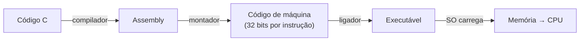

# Conjunto de instruções e assembly (RISC-V)

## Por que isso importa

O **conjunto de instruções** (ISA) é o contrato entre o software e o hardware: a lista exata de operações que a CPU sabe fazer. Todo código em Python, Java ou C acaba virando essas instruções, seja por um compilador, seja pelo interpretador. Ler assembly te ajuda a entender o que é "rápido" de verdade, a depurar falhas de segmentação, a ler a saída do Compiler Explorer (godbolt.org), a entender vulnerabilidades como estouro de pilha e a apreciar o que o compilador faz por você. O **RISC-V** é uma ISA aberta e moderna, cada vez mais usada em microcontroladores, servidores e ensino (é a ISA do livro de Patterson & Hennessy e do CS61C de Berkeley).

## Intuição

Uma linguagem de alto nível é como uma receita escrita para um chef: "faça um molho branco". Assembly é a mesma receita escrita para um robô de cozinha que só entende comandos minúsculos: "pegue a tigela 3", "coloque 50 g de manteiga", "aqueça por 2 minutos", "se a mistura estiver líquida, volte ao passo 4".

Cada linha de assembly é **uma** instrução de máquina, com um nome legível (`add`, `lw`, `beq`) em vez de um número de 32 bits. O **montador** (assembler) traduz uma pela outra.

## Visual

Um `for` em C e o assembly RISC-V equivalente:

```text
// C                              # RISC-V (x10 = endereço de v, x11 = n)
int soma = 0;                     addi x5, x0, 0          # soma = 0
for (int i = 0; i < n; i++)       addi x6, x0, 0          # i = 0
    soma += v[i];               laco:
                                  bge  x6, x11, fim        # se i >= n, sai
                                  slli x7, x6, 2           # x7 = i * 4 (int = 4 bytes)
                                  add  x7, x10, x7         # x7 = &v[i]
                                  lw   x28, 0(x7)          # x28 = v[i]
                                  add  x5, x5, x28         # soma += v[i]
                                  addi x6, x6, 1           # i++
                                  jal  x0, laco            # volta
                                fim:
```



## Conceito técnico

### ISA, RISC e CISC

A **ISA** define instruções, registradores, modos de endereçamento e formato binário. Duas filosofias:

| | RISC (RISC-V, ARM) | CISC (x86) |
|---|---|---|
| Instruções | poucas, simples, tamanho fixo | muitas, complexas, tamanho variável |
| Memória | só `load` e `store` acessam a memória | muitas instruções operam direto na memória |
| Decodificação | simples, fácil de fazer pipeline | complexa |
| Exemplo | celulares (ARM), Apple M, microcontroladores | PCs e servidores Intel/AMD |

CPUs x86 modernas traduzem internamente as instruções complexas em micro-operações parecidas com RISC.

### Registradores do RISC-V (RV32I)

32 registradores inteiros de 32 bits, `x0` a `x31`. Os mais importantes, pelo nome da convenção:

| Registrador | Nome | Uso |
|---|---|---|
| x0 | zero | sempre vale 0 (escritas são ignoradas) |
| x1 | ra | endereço de retorno |
| x2 | sp | ponteiro da pilha |
| x10–x11 | a0–a1 | argumentos e valores de retorno |
| x12–x17 | a2–a7 | mais argumentos |
| x5–x7, x28–x31 | t0–t6 | temporários (a função chamada pode estragar) |
| x8–x9, x18–x27 | s0–s11 | salvos (a função chamada precisa preservar) |

### Instruções essenciais

| Tipo | Exemplo | Significado |
|---|---|---|
| Aritmética | `add x5, x6, x7` | x5 = x6 + x7 |
| | `sub x5, x6, x7` | x5 = x6 − x7 |
| | `addi x5, x6, 10` | x5 = x6 + 10 (imediato de 12 bits) |
| Lógica / bits | `and`, `or`, `xor`, `slli x5, x6, 2` | operações de bits; `slli` desloca (× 4) |
| Memória | `lw x5, 8(x10)` | x5 = memória[x10 + 8] (load word, 4 bytes) |
| | `sw x5, 8(x10)` | memória[x10 + 8] = x5 |
| Desvio condicional | `beq x5, x6, rotulo` | se x5 == x6, salta |
| | `bne`, `blt`, `bge` | ≠, <, ≥ |
| Salto | `jal x1, funcao` | x1 = PC + 4; salta (chamada) |
| | `jalr x0, 0(x1)` | salta para x1 (retorno, o `ret`) |

Não existe "mover": `mv x5, x6` é uma **pseudo-instrução** para `addi x5, x6, 0`. `li x5, 42` vira `addi x5, x0, 42`. O `x0` sempre zero simplifica muito a ISA.

### Ifs e laços

```text
// if (a == b) c = 1; else c = 2;     (a em x5, b em x6, c em x7)
      bne  x5, x6, senao      # inverte a condição: se diferentes, vai para o else
      addi x7, x0, 1
      jal  x0, fim
senao:
      addi x7, x0, 2
fim:
```

O compilador inverte a condição: salta **para fora** do bloco quando ela é falsa.

### Vetores e endereços

`v[i]` num vetor de `int` (4 bytes) fica no endereço `v + 4·i`. Por isso o `slli x7, x6, 2` (multiplica por 4) antes do `lw`. Num vetor de `char`, seria `v + i` e a instrução `lb` (load byte).

### Funções e a pilha

1. Quem chama coloca os argumentos em `a0`–`a7` e faz `jal ra, funcao` (guarda o retorno em `ra`).
2. A função usa a **pilha** para guardar o que precisa preservar: `addi sp, sp, -8` (abre espaço; a pilha cresce para baixo), `sw ra, 4(sp)`, `sw s0, 0(sp)`.
3. Coloca o resultado em `a0`, restaura os registradores salvos, `addi sp, sp, 8` e `jalr x0, 0(ra)`.

Cada chamada empilha um **quadro** (stack frame). Uma recursão infinita esgota a pilha: é o **stack overflow**. E escrever além de um vetor local pode sobrescrever o `ra` salvo: é o **estouro de buffer** clássico, que permite a um atacante desviar o programa (SG-02).

### Formato das instruções

Todas as instruções RV32I têm **32 bits**. O tipo **R** (registrador-registrador), usado por `add`, `sub`, `and`...:

```text
 31      25 24  20 19  15 14  12 11   7 6      0
[ funct7  ][ rs2 ][ rs1 ][funct3][ rd  ][ opcode ]
   7 bits   5      5      3       5      7 bits

add x5, x6, x7:  funct7=0000000 rs2=00111 rs1=00110 funct3=000 rd=00101 opcode=0110011
                 = 0x007302B3
```

Com 5 bits por registrador, dá para escolher entre 32. Outros formatos (I, S, B, U, J) trocam campos de registrador por imediatos.

## Código

Um mini-interpretador de RISC-V para um subconjunto de instruções, para você experimentar sem um simulador:

```python
import re

def rodar_riscv(fonte, max_passos=10000):
    linhas, rotulos = [], {}
    for linha in fonte.strip().splitlines():
        linha = linha.split("#")[0].strip()
        if not linha:
            continue
        if linha.endswith(":"):
            rotulos[linha[:-1]] = len(linhas)
            continue
        op, *args = re.split(r"[,\s]+", linha)
        linhas.append((op, args))
    x = [0] * 32
    reg = lambda r: int(r[1:])
    pc = passos = 0
    while pc < len(linhas) and passos < max_passos:
        op, a = linhas[pc]
        pc += 1
        passos += 1
        if op == "addi":
            x[reg(a[0])] = x[reg(a[1])] + int(a[2])
        elif op == "add":
            x[reg(a[0])] = x[reg(a[1])] + x[reg(a[2])]
        elif op == "sub":
            x[reg(a[0])] = x[reg(a[1])] - x[reg(a[2])]
        elif op == "blt" and x[reg(a[0])] < x[reg(a[1])]:
            pc = rotulos[a[2]]
        elif op == "beq" and x[reg(a[0])] == x[reg(a[1])]:
            pc = rotulos[a[2]]
        x[0] = 0                         # x0 é sempre zero
    return x

programa = """
    addi x5, x0, 0      # soma = 0
    addi x6, x0, 1      # i = 1
    addi x7, x0, 11     # limite
laco:
    add  x5, x5, x6     # soma += i
    addi x6, x6, 1      # i++
    blt  x6, x7, laco   # enquanto i < 11
"""
print(rodar_riscv(programa)[5])   # 55
```

Para ver assembly real gerado por um compilador, cole uma função C em **godbolt.org** e escolha "RISC-V rv32gc gcc".

## Erros comuns

- **Esquecer de multiplicar o índice** pelo tamanho do elemento: `v[i]` de `int` está em `v + 4i`, não em `v + i`.
- **Escrever em `x0`** esperando guardar algo: o valor é descartado.
- **Usar um registrador temporário (`t`) depois de uma chamada** como se ele tivesse sido preservado. Só os `s` são preservados pela função chamada.
- **Não salvar `ra`** numa função que chama outra: o `jal` interno sobrescreve o endereço de retorno.
- **Desalinhar a pilha** (não desfazer o `addi sp, sp, -n`) ou ler fora do quadro.
- **Confundir a ordem dos operandos**: em `sw x5, 8(x10)`, o valor é x5 e o endereço é x10 + 8. Em `add x5, x6, x7`, o destino vem primeiro.

## Pratique

```quiz
id: AC-04-q1
tipo: multipla_escolha
pergunta: "No RISC-V, quais instruções acessam a memória?"
opcoes: ["Todas as aritméticas", "Só load (lw, lb...) e store (sw, sb...)", "Só os saltos", "add e sub"]
resposta: 1
explicacao: "É a regra das arquiteturas load/store (RISC): para somar um valor da memória, primeiro carregue-o num registrador com lw, some com add e, se precisar, guarde com sw. No x86 (CISC), um add pode ler direto da memória."
dificuldade: 1
```

```quiz
id: AC-04-q2
tipo: multipla_escolha
pergunta: "O vetor de int `v` começa no endereço que está em x10. Qual instrução carrega `v[3]` em x5?"
opcoes: ["lw x5, 3(x10)", "lw x5, 12(x10)", "lw x5, 4(x10)", "addi x5, x10, 3"]
resposta: 1
explicacao: "Cada int ocupa 4 bytes, então v[3] está em v + 3 · 4 = v + 12. O deslocamento do lw é em bytes. lw x5, 3(x10) leria um endereço desalinhado no meio de v[0]."
dificuldade: 1
```

```quiz
id: AC-04-q3
tipo: prever_saida
pergunta: |
  Qual o valor final de x5?
  ```text
  addi x5, x0, 1
  addi x6, x0, 4
  laco:
  add  x5, x5, x5
  addi x6, x6, -1
  bne  x6, x0, laco
  ```
resposta: "16"
explicacao: "x5 começa em 1 e dobra a cada volta (x5 + x5). O laço roda 4 vezes (x6 de 4 até 0): 2, 4, 8, 16."
dificuldade: 2
```

```quiz
id: AC-04-q4
tipo: verdadeiro_falso
pergunta: "Numa função RISC-V que chama outra função, é preciso salvar o registrador ra na pilha antes da chamada."
resposta: true
explicacao: "O jal da chamada interna escreve o seu próprio endereço de retorno em ra, apagando o valor que a função atual precisa para voltar a quem a chamou. Por isso ela guarda ra na pilha e o restaura antes do ret."
dificuldade: 2
```

```quiz
id: AC-04-q5
tipo: multipla_escolha
pergunta: "Para que serve o registrador x0 sempre valer zero?"
opcoes: ["Para economizar energia", "Para simplificar a ISA: mv, li, nop e comparações com zero viram instruções comuns usando x0", "Para guardar o endereço de retorno", "Não serve para nada"]
resposta: 1
explicacao: "li x5, 42 é addi x5, x0, 42; mv x5, x6 é addi x5, x6, 0; beqz x5 é beq x5, x0. Com um registrador constante, a ISA não precisa de instruções separadas para esses casos."
dificuldade: 2
```

```quiz
id: AC-04-q6
tipo: resposta_curta
pergunta: "Traduza para RISC-V: `if (a < b) c = a; else c = b;`, com a em x5, b em x6 e c em x7. Explique a ideia."
resposta: "bge x5, x6, senao; addi x7, x5, 0; jal x0, fim; senao: addi x7, x6, 0; fim:. A ideia é inverter a condição: se a >= b, salta para o else; senão, executa o then e pula o else com um salto incondicional."
palavras_chave: ["bge", "inverter", "senao", "jal"]
dificuldade: 2
```

```quiz
id: AC-04-q7
tipo: codigo
linguagem: python
pergunta: |
  **Codificar uma instrução R.** Escreva `codificar_r(funct7, rs2, rs1, funct3, rd, opcode)` que monta a instrução de 32 bits do formato R do RISC-V (campos de 7, 5, 5, 3, 5 e 7 bits, do bit 31 ao 0) e devolve como string hexadecimal com 8 dígitos e prefixo `0x`, em maiúsculas (por exemplo `'0x007302B3'`).
codigo_inicial: |
  def codificar_r(funct7, rs2, rs1, funct3, rd, opcode):
      return "0x00000000"
usa: [def, return]
testes:
  - chamada: "codificar_r(0, 7, 6, 0, 5, 0b0110011)"
    saida: "'0x007302B3'"
  - chamada: "codificar_r(0b0100000, 7, 6, 0, 5, 0b0110011)"
    saida: "'0x407302B3'"
  - chamada: "codificar_r(0, 0, 0, 0, 0, 0)"
    saida: "'0x00000000'"
  - chamada: "codificar_r(0, 3, 2, 0b111, 1, 0b0110011)"
    visivel: false
    saida: "'0x003170B3'"
dica: "palavra = (funct7 << 25) | (rs2 << 20) | (rs1 << 15) | (funct3 << 12) | (rd << 7) | opcode. Depois, f'0x{palavra:08X}'."
solucao: |
  def codificar_r(funct7, rs2, rs1, funct3, rd, opcode):
      palavra = (funct7 << 25) | (rs2 << 20) | (rs1 << 15) | (funct3 << 12) | (rd << 7) | opcode
      return f"0x{palavra:08X}"
explicacao: "O primeiro teste é add x5, x6, x7; o segundo, sub x5, x6, x7: a única diferença é o bit 30 (funct7 = 0100000), que a ULA usa para escolher subtrair. O último é and x1, x2, x3 (funct3 = 111). Cada campo é deslocado para a sua posição e combinado com OR: exatamente o que o montador faz."
dificuldade: 2
```

```quiz
id: AC-04-q8
tipo: codigo
linguagem: python
pergunta: |
  **Interpretador RISC-V.** Escreva `rodar(linhas)` que executa uma lista de instruções já separadas em listas de strings, com rótulos como strings terminadas em `:`. Suporte `addi`, `add`, `sub`, `slli`, `beq`, `bne`, `blt` e `jal` (só na forma `jal x0, rotulo`). Os registradores são `x0` a `x31` (x0 sempre 0). Pare no fim do programa ou depois de 100000 instruções. Devolva a lista dos 32 registradores.
codigo_inicial: |
  def rodar(linhas):
      x = [0] * 32
      return x
usa: [def, while, return]
testes:
  - chamada: "rodar([['addi', 'x5', 'x0', '7'], ['addi', 'x6', 'x0', '3'], ['sub', 'x7', 'x5', 'x6']])[5:8]"
    saida: "[7, 3, 4]"
  - chamada: "rodar([['addi', 'x0', 'x0', '9'], ['addi', 'x1', 'x0', '1'], ['slli', 'x2', 'x1', '4']])[:3]"
    saida: "[0, 1, 16]"
  - chamada: "rodar([['addi', 'x5', 'x0', '0'], ['addi', 'x6', 'x0', '1'], ['addi', 'x7', 'x0', '11'], 'laco:', ['add', 'x5', 'x5', 'x6'], ['addi', 'x6', 'x6', '1'], ['blt', 'x6', 'x7', 'laco']])[5]"
    saida: "55"
  - chamada: "rodar([['addi', 'x5', 'x0', '3'], 'topo:', ['beq', 'x5', 'x0', 'fim'], ['addi', 'x5', 'x5', '-1'], ['addi', 'x6', 'x6', '2'], ['jal', 'x0', 'topo'], 'fim:'])[5:7]"
    visivel: false
    saida: "[0, 6]"
dica: "Primeiro passe: separe instruções e rotulos (rotulo → índice da próxima instrução). r = lambda s: int(s[1:]). No laço: busque, avance o pc, trate cada op e, ao fim de cada instrução, faça x[0] = 0."
solucao: |
  def rodar(linhas):
      prog, rotulos = [], {}
      for item in linhas:
          if isinstance(item, str):
              rotulos[item[:-1]] = len(prog)
          else:
              prog.append(item)
      x = [0] * 32
      r = lambda s: int(s[1:])
      pc = passos = 0
      while pc < len(prog) and passos < 100000:
          op, *a = prog[pc]
          pc += 1
          passos += 1
          if op == "addi":
              x[r(a[0])] = x[r(a[1])] + int(a[2])
          elif op == "add":
              x[r(a[0])] = x[r(a[1])] + x[r(a[2])]
          elif op == "sub":
              x[r(a[0])] = x[r(a[1])] - x[r(a[2])]
          elif op == "slli":
              x[r(a[0])] = x[r(a[1])] << int(a[2])
          elif op == "beq":
              if x[r(a[0])] == x[r(a[1])]:
                  pc = rotulos[a[2]]
          elif op == "bne":
              if x[r(a[0])] != x[r(a[1])]:
                  pc = rotulos[a[2]]
          elif op == "blt":
              if x[r(a[0])] < x[r(a[1])]:
                  pc = rotulos[a[2]]
          elif op == "jal":
              pc = rotulos[a[1]]
          x[0] = 0
      return x
explicacao: "Os rótulos não são instruções: o montador (aqui, o primeiro passe) apenas anota o endereço da instrução seguinte. O teste com 'addi x0, x0, 9' confere que x0 continua 0. O último programa é um while com o teste no topo (beq para sair) e um jal incondicional para voltar."
dificuldade: 3
```

## Resumo

- **ISA** = contrato software/hardware. **RISC** (RISC-V, ARM): poucas instruções simples, load/store. **CISC** (x86): muitas e complexas.
- RISC-V: 32 registradores, **x0 = 0**, `a0`–`a7` argumentos, `ra` retorno, `sp` pilha, `t` temporários, `s` salvos.
- Instruções: `add/sub/addi`, `lw/sw`, `beq/bne/blt/bge`, `jal/jalr`.
- `if` = desvio com a condição invertida; laço = desvio para trás; `v[i]` = `v + i × tamanho`.
- Funções usam a **pilha** para salvar `ra` e `s`; quadros demais = stack overflow.
- Toda instrução RV32I tem **32 bits**, com campos fixos.

## Para ir além

- Use o simulador **Venus** (venus.cs61c.org) para rodar RISC-V no navegador, passo a passo, vendo registradores e memória.
- Cole funções C no **godbolt.org** e compare o assembly com e sem otimização (`-O0` e `-O2`).
- **Próximo módulo**: AC-05 Hierarquia de memória e cache.
