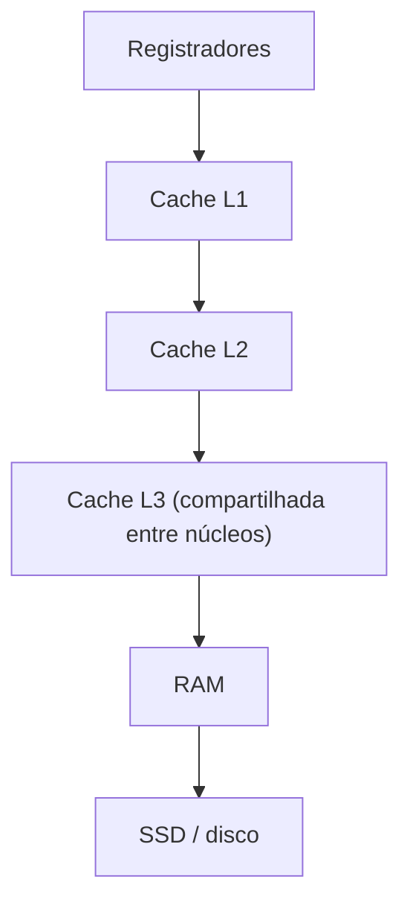

# Hierarquia de memória e cache

## Por que isso importa

Uma CPU moderna executa uma instrução em menos de 1 nanossegundo, mas buscar um dado na RAM leva ~100 ns. Sem truques, ela passaria 99% do tempo esperando. A solução é uma **hierarquia**: memórias pequenas e rapidíssimas perto da CPU (as **caches**) guardando cópias do que está sendo usado agora. Isso explica fenômenos que surpreendem quem só olha a notação Big-O: percorrer uma matriz por linhas pode ser **10 vezes** mais rápido que por colunas, mesmo sendo os mesmos O(n²) acessos; um array costuma ganhar de uma lista ligada mesmo quando a teoria empata. E a mesma ideia de cache aparece em todo lugar: navegador, CDN, Redis, `functools.lru_cache`.

## Intuição

Você estuda na biblioteca. Na **mesa** cabem 5 livros (cache L1): pegar um deles leva 1 segundo. Na **estante ao lado** cabem 50 (L2): 10 segundos. No **acervo do prédio** (RAM): 5 minutos. No **depósito da cidade** (SSD/disco): um dia.

Duas observações fazem a mesa valer a pena:

- **Localidade temporal**: o livro que você usou agora provavelmente vai usar de novo logo. Deixe-o na mesa.
- **Localidade espacial**: se você pegou o volume 3 de uma enciclopédia, provavelmente vai querer o volume 4. Traga a **prateleira inteira** de uma vez (um **bloco**, ou linha de cache).

Quando a mesa enche, alguém tem que voltar para a estante. Qual? Normalmente o que você usou há **mais tempo** (LRU).

## Visual

Latências aproximadas (os números exatos variam, as ordens de grandeza não):

| Nível | Tamanho típico | Latência | Em "tempo humano" (1 ciclo = 1 s) |
|---|---|---|---|
| Registradores | ~1 KB | ~0,3 ns (1 ciclo) | 1 s |
| Cache L1 | 32–64 KB | ~1 ns | 4 s |
| Cache L2 | 256 KB – 2 MB | ~4 ns | 14 s |
| Cache L3 | 8–64 MB | ~15 ns | 1 min |
| RAM | 8–64 GB | ~100 ns | 6 min |
| SSD | 0,5–4 TB | ~100 µs | 4 dias |
| HD | vários TB | ~10 ms | 1 ano |
| Rede (outro continente) | — | ~150 ms | 15 anos |



Quanto mais para baixo, maior, mais barato por byte e mais lento.

## Conceito técnico

### Acerto, falta e AMAT

- **Acerto (hit)**: o dado está na cache. **Falta (miss)**: não está; é preciso buscar no nível de baixo (a **penalidade**).
- **Taxa de faltas** = faltas / acessos.
- **Tempo médio de acesso (AMAT)**:

```text
AMAT = tempo de acerto + taxa de faltas × penalidade de falta

L1 com acerto de 1 ns, 5% de faltas, penalidade de 100 ns:
AMAT = 1 + 0,05 × 100 = 6 ns          → com 1% de faltas: 2 ns
```

Pequenas melhorias na taxa de faltas mudam muito o desempenho.

### Blocos (linhas de cache)

A cache não traz um byte: traz um **bloco** inteiro, tipicamente de **64 bytes**. Acessar `v[0]` de um vetor de `int` traz `v[0]` a `v[15]` de uma vez. Os próximos 15 acessos são acertos: localidade espacial.

### Cache mapeada diretamente

Cada bloco da memória só pode ficar numa **única** posição da cache. O endereço é dividido em três campos:

```text
| tag | índice | deslocamento |

deslocamento: qual byte dentro do bloco       → log₂(tamanho do bloco) bits
índice:       qual linha da cache              → log₂(número de linhas) bits
tag:          o resto; identifica qual bloco está lá
```

Exemplo: endereços de 32 bits, blocos de 16 bytes, cache de 64 linhas (1 KB).

```text
deslocamento = 4 bits, índice = 6 bits, tag = 32 − 10 = 22 bits

endereço 0x1234 = 0001 0010 0011 0100
deslocamento = 0100 (4), índice = 100011 (35), tag = 000100 (4)
```

Num acesso: vá à linha `índice`; se ela é válida e tem a mesma `tag`, é acerto. Senão, falta: busque o bloco e substitua.

**Problema**: dois blocos usados alternadamente com o **mesmo índice** se expulsam toda vez (faltas de **conflito**).

### Caches associativas

- **Associativa por conjunto de k vias**: o índice escolhe um **conjunto** com k posições, e o bloco pode ficar em qualquer uma delas. Menos conflitos. L1 típica: 8 vias.
- **Totalmente associativa**: um único conjunto; o bloco pode ficar em qualquer lugar. Sem conflitos, mas cara de construir (precisa comparar com todas as tags).

Quando o conjunto está cheio, alguém sai. A política mais comum é **LRU** (least recently used): sai o usado há mais tempo.

### Os três tipos de falta (os "3 Cs")

| Tipo | Causa | Como reduzir |
|---|---|---|
| **Compulsória** | primeiro acesso ao bloco | blocos maiores, pré-busca (prefetch) |
| **Capacidade** | os dados usados não cabem na cache | cache maior, trabalhar com blocos menores de dados |
| **Conflito** | blocos disputando a mesma posição | mais associatividade |

### Escritas

- **Write-through**: escreve na cache e na memória ao mesmo tempo. Simples, mas gera muito tráfego.
- **Write-back**: escreve só na cache e marca o bloco como "sujo"; grava na memória quando o bloco for expulso. Padrão nas CPUs modernas.

### Código amigável à cache

Em C, Python (NumPy) e quase todas as linguagens, uma matriz fica na memória **linha após linha** (row-major). Percorrer por linhas usa cada bloco inteiro; percorrer por colunas pula de linha em linha e desperdiça o resto de cada bloco.

```c
// rápido: acesso sequencial
for (i = 0; i < N; i++)
    for (j = 0; j < N; j++)
        soma += m[i][j];

// lento: cada acesso cai num bloco diferente
for (j = 0; j < N; j++)
    for (i = 0; i < N; i++)
        soma += m[i][j];
```

Mesma complexidade, desempenho muito diferente. É também por isso que **arrays** costumam ser mais rápidos que **listas ligadas** (ED-03), cujos nós ficam espalhados.

## Código

Simulando uma cache mapeada diretamente e contando faltas:

```python
def simular_direta(enderecos, linhas, bloco):
    cache = [None] * linhas              # cada linha guarda uma tag (ou None)
    faltas = 0
    for e in enderecos:
        num_bloco = e // bloco
        indice = num_bloco % linhas
        tag = num_bloco // linhas
        if cache[indice] != tag:
            faltas += 1
            cache[indice] = tag
    return faltas

N = 64
por_linha = [(i * N + j) * 4 for i in range(N) for j in range(N)]      # m[i][j], int de 4 bytes
por_coluna = [(i * N + j) * 4 for j in range(N) for i in range(N)]
print("por linha: ", simular_direta(por_linha, linhas=64, bloco=64))    # 256 faltas
print("por coluna:", simular_direta(por_coluna, linhas=64, bloco=64))   # 4096 faltas: todas!
```

## Erros comuns

- **Achar que memória é "toda igual"**. Acessar a RAM custa ~100 vezes mais que a L1.
- **Confundir localidade temporal (o mesmo dado de novo) com espacial (dados vizinhos).**
- **Errar a divisão do endereço**: o deslocamento usa os bits **de baixo**, depois vem o índice, e a tag é o resto.
- **Esquecer o bit de validade**: uma linha vazia não pode dar acerto, mesmo que a tag "lixo" coincida.
- **Percorrer matrizes por coluna** em linguagens row-major (C, Python, NumPy padrão). Em Fortran e MATLAB, a ordem é a contrária.
- **Achar que o Big-O conta tudo**: duas soluções O(n) podem diferir 10× por causa da cache.

## Pratique

```quiz
id: AC-05-q1
tipo: multipla_escolha
pergunta: "Um programa soma todos os elementos de um vetor, do primeiro ao último. Que tipo de localidade a cache aproveita?"
opcoes: ["Temporal", "Espacial", "Nenhuma", "Só a de instruções"]
resposta: 1
explicacao: "Cada elemento é usado uma vez só (pouca localidade temporal nos dados), mas os elementos vizinhos ficam no mesmo bloco de 64 bytes. Uma falta traz vários elementos, e os próximos acessos são acertos. (O código do laço, esse sim, tem localidade temporal: as mesmas instruções repetem.)"
dificuldade: 1
```

```quiz
id: AC-05-q2
tipo: multipla_escolha
pergunta: "Uma cache tem acerto de 2 ns, taxa de faltas de 10% e penalidade de 80 ns. Qual o tempo médio de acesso?"
opcoes: ["8 ns", "10 ns", "82 ns", "2,8 ns"]
resposta: 1
explicacao: "AMAT = 2 + 0,10 × 80 = 2 + 8 = 10 ns. Reduzir as faltas para 5% daria 6 ns, quase o dobro de velocidade."
dificuldade: 1
```

```quiz
id: AC-05-q3
tipo: multipla_escolha
pergunta: "Cache mapeada diretamente com blocos de 32 bytes e 128 linhas. Quantos bits têm o deslocamento e o índice?"
opcoes: ["5 e 7", "32 e 128", "7 e 5", "4 e 8"]
resposta: 0
explicacao: "Deslocamento = log₂(32) = 5 bits (qual byte no bloco). Índice = log₂(128) = 7 bits (qual linha). Com endereços de 32 bits, a tag fica com 32 − 12 = 20 bits."
dificuldade: 2
```

```quiz
id: AC-05-q4
tipo: verdadeiro_falso
pergunta: "Numa cache mapeada diretamente, dois blocos com o mesmo índice, acessados alternadamente, causam uma falta a cada acesso, mesmo com o resto da cache vazio."
resposta: true
explicacao: "Cada bloco só pode ocupar a linha do seu índice, então um expulsa o outro sempre. São faltas de conflito. Uma cache associativa de 2 vias guardaria os dois no mesmo conjunto."
dificuldade: 2
```

```quiz
id: AC-05-q5
tipo: resposta_curta
pergunta: "Por que percorrer uma matriz em C coluna por coluna costuma ser bem mais lento que linha por linha, se os dois fazem o mesmo número de acessos?"
resposta: "Porque em C a matriz fica guardada linha após linha. Percorrendo por linha, os acessos são sequenciais e cada bloco trazido para a cache é usado por inteiro. Por coluna, cada acesso pula para outra linha da matriz, cai num bloco diferente, e o resto do bloco é desperdiçado, gerando muito mais faltas."
palavras_chave: ["linha após linha", "bloco", "sequencial", "faltas"]
dificuldade: 2
```

```quiz
id: AC-05-q6
tipo: codigo
linguagem: python
pergunta: |
  **Dividir o endereço.** Escreva `dividir(endereco, tam_bloco, num_linhas)` que devolve a tupla `(tag, indice, deslocamento)` de um endereço numa cache mapeada diretamente. `tam_bloco` e `num_linhas` são potências de 2. Use deslocamentos e máscaras de bits.
codigo_inicial: |
  def dividir(endereco, tam_bloco, num_linhas):
      return (0, 0, endereco)
usa: [def, return]
testes:
  - chamada: "dividir(0x1234, 16, 64)"
    saida: "(4, 35, 4)"
  - chamada: "dividir(0, 64, 256)"
    saida: "(0, 0, 0)"
  - chamada: "dividir(0xFFFFFFFF, 64, 512)"
    saida: "(131071, 511, 63)"
  - chamada: "dividir(1000, 8, 4)"
    visivel: false
    saida: "(31, 1, 0)"
dica: "b = tam_bloco.bit_length() - 1 (bits de deslocamento) e i = num_linhas.bit_length() - 1. deslocamento = endereco & (tam_bloco - 1); indice = (endereco >> b) & (num_linhas - 1); tag = endereco >> (b + i)."
solucao: |
  def dividir(endereco, tam_bloco, num_linhas):
      b = tam_bloco.bit_length() - 1
      i = num_linhas.bit_length() - 1
      deslocamento = endereco & (tam_bloco - 1)
      indice = (endereco >> b) & (num_linhas - 1)
      tag = endereco >> (b + i)
      return (tag, indice, deslocamento)
explicacao: "Para uma potência de 2, n − 1 é uma máscara com todos os bits de baixo ligados (16 − 1 = 1111), e x & (n − 1) é o mesmo que x % n, só que mais barato. O hardware nem precisa fazer conta: os campos são só grupos de fios do endereço."
dificuldade: 2
```

```quiz
id: AC-05-q7
tipo: codigo
linguagem: python
pergunta: |
  **Cache associativa com LRU.** Escreva `simular(enderecos, tam_bloco, num_conjuntos, vias)` que simula uma cache associativa por conjunto com política **LRU** e devolve a tupla `(acertos, faltas)`. Com `vias = 1`, é uma cache mapeada diretamente.
codigo_inicial: |
  def simular(enderecos, tam_bloco, num_conjuntos, vias):
      return (0, len(enderecos))
usa: [def, for, return]
testes:
  - chamada: "simular([0, 4, 8, 12, 16], 16, 4, 1)"
    saida: "(3, 2)"
  - chamada: "simular([0, 64, 0, 64, 0, 64], 16, 4, 1)"
    saida: "(0, 6)"
  - chamada: "simular([0, 64, 0, 64, 0, 64], 16, 4, 2)"
    saida: "(4, 2)"
  - chamada: "simular([0, 64, 128, 0], 16, 4, 2)"
    saida: "(0, 4)"
  - chamada: "simular([0, 64, 0, 128, 0], 16, 4, 2)"
    visivel: false
    saida: "(2, 3)"
dica: "Guarde, para cada conjunto, uma lista de tags em ordem de uso (a mais recente no fim). bloco = e // tam_bloco; conj = bloco % num_conjuntos; tag = bloco // num_conjuntos. Se a tag está na lista: acerto, remova e ponha no fim. Senão: falta; se a lista tiver vias itens, remova o primeiro (LRU); adicione a tag no fim."
solucao: |
  def simular(enderecos, tam_bloco, num_conjuntos, vias):
      conjuntos = [[] for _ in range(num_conjuntos)]
      acertos = faltas = 0
      for e in enderecos:
          bloco = e // tam_bloco
          c = conjuntos[bloco % num_conjuntos]
          tag = bloco // num_conjuntos
          if tag in c:
              acertos += 1
              c.remove(tag)
          else:
              faltas += 1
              if len(c) == vias:
                  c.pop(0)
          c.append(tag)
      return (acertos, faltas)
explicacao: "No segundo e terceiro testes, os endereços 0 e 64 caem no mesmo conjunto: com 1 via, um expulsa o outro sempre (conflito); com 2 vias, cabem juntos. No quarto, 0, 64 e 128 disputam um conjunto de 2 vias: o 128 expulsa o 0 (o menos recente), e o último acesso ao 0 vira falta. No oculto, usar o 0 de novo o protege, e quem sai é o 64."
dificuldade: 3
```

```quiz
id: AC-05-q8
tipo: codigo
linguagem: javascript
pergunta: |
  **Cache LRU em software.** A mesma ideia vale para caches de aplicação. Escreva a classe `CacheLRU` com `constructor(capacidade)`, `get(chave)` (devolve o valor ou `undefined`, e marca como usado recentemente) e `put(chave, valor)` (insere ou atualiza; se passar da capacidade, remove o menos usado recentemente). Use um `Map`, que lembra a ordem de inserção.
codigo_inicial: |
  class CacheLRU {
    constructor(capacidade) {
      this.capacidade = capacidade;
      this.dados = new Map();
    }
    get(chave) {
      return this.dados.get(chave);
    }
    put(chave, valor) {
      this.dados.set(chave, valor);
    }
  }

  // não mude: os testes usam esta função
  function testar(capacidade, ops) {
    const c = new CacheLRU(capacidade);
    const saida = [];
    for (const [op, k, v] of ops) {
      if (op === "get") saida.push(c.get(k) ?? null);
      else c.put(k, v);
    }
    return saida;
  }
usa: [class, return, delete]
testes:
  - chamada: "testar(2, [['put', 'a', 1], ['put', 'b', 2], ['get', 'a'], ['put', 'c', 3], ['get', 'b'], ['get', 'a'], ['get', 'c']])"
    saida: "[ 1, null, 1, 3 ]"
  - chamada: "testar(1, [['put', 'x', 1], ['put', 'x', 2], ['get', 'x']])"
    saida: "[ 2 ]"
  - chamada: "testar(2, [['put', 'a', 1], ['put', 'b', 2], ['put', 'a', 9], ['put', 'c', 3], ['get', 'a'], ['get', 'b']])"
    visivel: false
    saida: "[ 9, null ]"
dica: "No get: se existe, guarde o valor, delete e set de novo (vai para o fim = mais recente). No put: delete se existir, set, e se size > capacidade, delete a primeira chave: this.dados.keys().next().value."
solucao: |
  class CacheLRU {
    constructor(capacidade) {
      this.capacidade = capacidade;
      this.dados = new Map();
    }
    get(chave) {
      if (!this.dados.has(chave)) return undefined;
      const valor = this.dados.get(chave);
      this.dados.delete(chave);
      this.dados.set(chave, valor);
      return valor;
    }
    put(chave, valor) {
      this.dados.delete(chave);
      this.dados.set(chave, valor);
      if (this.dados.size > this.capacidade) {
        this.dados.delete(this.dados.keys().next().value);
      }
    }
  }

  // não mude: os testes usam esta função
  function testar(capacidade, ops) {
    const c = new CacheLRU(capacidade);
    const saida = [];
    for (const [op, k, v] of ops) {
      if (op === "get") saida.push(c.get(k) ?? null);
      else c.put(k, v);
    }
    return saida;
  }
explicacao: "O Map mantém as chaves em ordem de inserção, então a primeira é sempre a menos recente: remover e reinserir uma chave a move para o fim. Tudo em O(1). No primeiro teste, o get('a') salva o 'a', e quem sai ao inserir 'c' é o 'b'. É a mesma política do lru_cache do Python e de muitos caches de CDN."
dificuldade: 2
```

## Resumo

- **Hierarquia**: registradores → L1 → L2 → L3 → RAM → SSD. Cada nível: maior, mais barato, mais lento.
- Cache funciona por **localidade temporal** e **espacial**; traz **blocos** de ~64 bytes.
- **AMAT** = acerto + taxa de faltas × penalidade.
- Endereço = **tag | índice | deslocamento**. Direta: 1 lugar por bloco; **associativa de k vias**: k lugares; **LRU** escolhe quem sai.
- Faltas: compulsórias, de capacidade, de conflito. Escrita: write-through ou **write-back**.
- Percorra dados **sequencialmente**: arrays e matrizes por linha.

## Para ir além

- Leia "Latency Numbers Every Programmer Should Know" e o capítulo 6 do CS:APP (com o "memory mountain").
- **Próximo módulo**: AC-06 Pipeline e paralelismo em nível de instrução.
