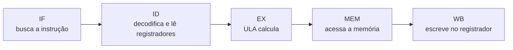
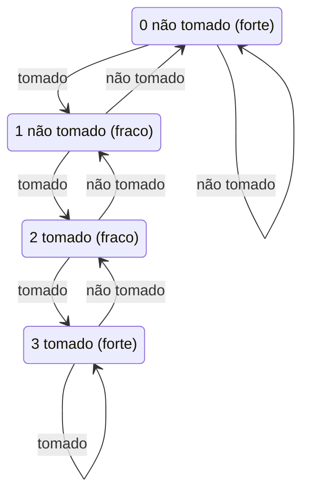

# Pipeline e paralelismo em nível de instrução

## Por que isso importa

Na AC-03, a CPU fazia uma instrução de cada vez: busca, decodifica, executa, e só então começa a próxima. Isso desperdiça hardware, porque enquanto a ULA trabalha, a parte que busca instruções fica parada. Todo processador moderno usa um **pipeline**: várias instruções em andamento ao mesmo tempo, cada uma num estágio diferente. É a principal razão de uma CPU executar bilhões de instruções por segundo. Entender o pipeline explica coisas que parecem mágica no dia a dia: por que um `if` imprevisível dentro de um laço deixa o código lento, por que ordenar um array antes de processá-lo pode acelerar um laço com desvio, e por que compiladores reordenam instruções.

## Intuição

Pense numa **lavanderia** com lavadora, secadora e uma mesa para dobrar, cada etapa levando 30 minutos.

- **Sem pipeline**: você lava, seca e dobra o cesto 1, e só depois começa o cesto 2. Quatro cestos: 4 × 90 = 360 minutos.
- **Com pipeline**: assim que o cesto 1 sai da lavadora, o cesto 2 entra nela. Depois de encher a "linha", sai um cesto pronto **a cada 30 minutos**. Quatro cestos: 90 + 3 × 30 = 180 minutos.

Repare: cada cesto **continua levando 90 minutos** (a **latência** não melhorou). O que melhorou foi a **vazão**: quantos cestos ficam prontos por hora.

Os problemas também aparecem na lavanderia:

- Se a lavadora e a secadora forem a **mesma máquina**, dois cestos disputam o recurso (conflito **estrutural**).
- Se o cesto 2 precisa de uma meia que ainda está secando no cesto 1, ele tem que **esperar** (conflito **de dados**).
- Se você só descobre depois de lavar se o próximo cesto é de roupa branca ou colorida, pode ter começado o cesto errado e precisar **jogar o trabalho fora** (conflito **de controle**).

## Visual

Os 5 estágios clássicos do RISC-V:



Diagrama de tempo de 4 instruções independentes (cada coluna é um ciclo):

| Instrução | 1 | 2 | 3 | 4 | 5 | 6 | 7 | 8 |
|---|---|---|---|---|---|---|---|---|
| `add x1, x2, x3` | IF | ID | EX | MEM | WB | | | |
| `sub x4, x5, x6` | | IF | ID | EX | MEM | WB | | |
| `and x7, x8, x9` | | | IF | ID | EX | MEM | WB | |
| `or x10, x11, x12` | | | | IF | ID | EX | MEM | WB |

São **8 ciclos** para 4 instruções. Sem pipeline seriam 4 × 5 = 20. Com **k** estágios e **n** instruções, o tempo é **k + (n − 1)** ciclos: k para encher a linha e depois uma instrução por ciclo.

Agora com dependência e **sem encaminhamento**: o `sub` precisa do `x1` que o `add` só escreve no WB (ciclo 5). Ele fica parado (uma **bolha**) no ID até poder ler o valor:

| Instrução | 1 | 2 | 3 | 4 | 5 | 6 | 7 |
|---|---|---|---|---|---|---|---|
| `add x1, x2, x3` | IF | ID | EX | MEM | WB | | |
| `sub x4, x1, x5` | | IF | ID | *bolha* | *bolha* | EX | MEM |

## Conceito técnico

### Por que o pipeline acelera

O relógio de uma CPU sem pipeline tem que ser lento o bastante para a instrução **inteira** terminar num ciclo. Com o caminho quebrado em 5 pedaços separados por **registradores de pipeline**, cada ciclo só precisa cobrir o pedaço mais lento, então o relógio pode ser até ~5 vezes mais rápido. O ganho ideal é igual ao número de estágios, mas na prática ele é menor por dois motivos: os estágios nunca são perfeitamente equilibrados, e os **conflitos** forçam bolhas.

**Desempenho** = instruções × **CPI** (ciclos por instrução) × duração do ciclo. O pipeline reduz a duração do ciclo e tenta manter o CPI perto de 1.

### Conflitos (hazards)

**1. Estrutural**: duas instruções querem o mesmo hardware no mesmo ciclo. Exemplo: IF lendo uma instrução e MEM lendo um dado de uma memória única. Solução: duplicar o recurso (caches separadas de **instruções** e **dados**, como você viu na AC-05).

**2. De dados** (RAW, *read after write*): uma instrução lê um registrador que uma anterior ainda não escreveu.

```
add x1, x2, x3     # escreve x1 no WB
sub x4, x1, x5     # quer ler x1 no ID: cedo demais!
```

Soluções:

- **Parar** (*stall*): inserir bolhas até o valor estar no banco de registradores. No nosso modelo, o banco escreve na primeira metade do ciclo e lê na segunda, então o leitor pode estar no ID no **mesmo ciclo** do WB do escritor. Dependência da instrução imediatamente anterior: **2 bolhas**. Da instrução duas antes: **1 bolha**.
- **Encaminhamento** (*forwarding* ou *bypassing*): o resultado sai da ULA no fim do EX. Fios extras levam esse valor **direto** para a entrada da ULA da próxima instrução, sem esperar o WB. Com isso, dependências entre instruções de ULA não custam **nenhuma** bolha.
- **Exceção: load-use**. Um `lw` só tem o dado no fim do **MEM**. A instrução seguinte, se usar esse registrador, precisa de **1 bolha** mesmo com encaminhamento:

| Instrução | 1 | 2 | 3 | 4 | 5 | 6 | 7 |
|---|---|---|---|---|---|---|---|
| `lw x1, 0(x2)` | IF | ID | EX | MEM | WB | | |
| `add x3, x1, x4` | | IF | ID | *bolha* | EX | MEM | WB |

Compiladores tentam esconder essa bolha **reordenando**: colocam entre o `lw` e o uso uma instrução independente.

**3. De controle**: num desvio (`beq`), só se sabe o próximo PC depois de comparar os registradores. Enquanto isso, o IF já buscou instruções que talvez não devessem executar. Soluções:

- **Parar** até saber o resultado (caro: desvios são ~15% a 20% das instruções).
- **Prever** e continuar buscando pelo caminho previsto. Se a previsão errar, as instruções buscadas são **descartadas** (*flush*), e perde-se alguns ciclos.

### Predição de desvio

- **Estática**: "sempre não tomado", ou "desvios para trás (laços) são tomados".
- **Dinâmica de 1 bit**: lembra o que o desvio fez da última vez. Num laço, erra **duas** vezes por execução: na saída e na volta.
- **Dinâmica de 2 bits** (contador saturado): 4 estados, 0 e 1 preveem "não tomado", 2 e 3 preveem "tomado". Tomado soma 1 (até 3), não tomado subtrai 1 (até 0). Precisa errar **duas vezes seguidas** para mudar de ideia, então a saída de um laço não estraga a previsão da próxima execução.



Processadores reais usam preditores bem mais sofisticados (com histórico global, tabelas de vários níveis) e acertam mais de 95% dos desvios. Mas um desvio **aleatório** é impossível de prever: por isso `if (dados[i] >= 128)` num array aleatório é bem mais lento que no mesmo array **ordenado**.

### Além do pipeline simples

- **Superescalar**: buscar e executar **várias** instruções por ciclo (2, 4, 8), com várias ULAs. O CPI fica **abaixo de 1** (fala-se em IPC, instruções por ciclo).
- **Execução fora de ordem**: o hardware olha uma janela de dezenas de instruções e executa as que já têm operandos prontos, enquanto outras esperam um `lw` lento. Os resultados são **confirmados em ordem** para o programa parecer sequencial.
- **Renomeação de registradores**: elimina falsas dependências (WAR e WAW), quando duas instruções só reutilizam o mesmo nome de registrador sem trocar dados.
- **Execução especulativa**: executar adiante do desvio previsto e desfazer se errou. Ataques como **Spectre** exploram rastros que essa especulação deixa na cache.

Tudo isso é **paralelismo em nível de instrução** (ILP): o programa continua sequencial, mas o hardware encontra trabalho independente para fazer ao mesmo tempo.

## Código

Um pequeno simulador que mostra o diagrama de tempo de um programa, com ou sem encaminhamento:

```python
def diagrama(programa, forwarding=True):
    """programa: lista de (op, destino, fontes). Mostra em que ciclo cada instrução entra em cada estágio."""
    ids = []
    for i, (op, rd, fontes) in enumerate(programa):
        ciclo_id = 2 if i == 0 else ids[-1] + 1
        for j in range(i):
            op_j, rd_j, _ = programa[j]
            if rd_j and rd_j != "x0" and rd_j in fontes:
                if forwarding:
                    espera = 2 if op_j == "lw" else 1   # load-use custa 1 bolha
                else:
                    espera = 3                           # esperar o WB do escritor
                ciclo_id = max(ciclo_id, ids[j] + espera)
        ids.append(ciclo_id)
        bolhas = ciclo_id - (ids[-2] + 1 if i else 2)
        print(f"{op:5} {rd or '-':4} entra no ID no ciclo {ciclo_id:2}  ({bolhas} bolha(s))")
    print("total de ciclos:", ids[-1] + 3)

prog = [
    ("lw",  "x1", ("x2",)),
    ("add", "x3", ("x1", "x4")),
    ("sub", "x5", ("x3", "x6")),
    ("sw",  None, ("x5", "x2")),
]
print("sem encaminhamento:"); diagrama(prog, forwarding=False)   # 14 ciclos
print("com encaminhamento:"); diagrama(prog, forwarding=True)    # 9 ciclos
```

Sem dependências, 4 instruções levariam 5 + 3 = 8 ciclos. Com encaminhamento, só a bolha do load-use sobra (9 ciclos). Sem encaminhamento, cada uma das três dependências custa 2 bolhas (14 ciclos).

## Erros comuns

- **Achar que o pipeline deixa cada instrução mais rápida.** A latência de uma instrução é a mesma ou até um pouco maior. O que melhora é a **vazão**.
- **Esquecer o caso load-use.** O encaminhamento resolve dependências de ULA, mas o dado de um `lw` só existe depois do MEM: sobra 1 bolha.
- **Contar dependências com o `x0`.** Escrever no `x0` não tem efeito, e ler `x0` sempre dá 0, então ele nunca cria dependência.
- **Confundir ganho ideal com real.** k estágios dão no máximo k vezes de ganho, e só para programas longos sem conflitos.
- **Achar que predição de desvio é "detalhe de hardware".** Um desvio imprevisível dentro de um laço quente pode custar 10 a 20 ciclos por erro em CPUs com pipelines longos.

## Pratique

```quiz
id: AC-06-q1
tipo: multipla_escolha
pergunta: "Um pipeline de 5 estágios executa 100 instruções sem nenhum conflito. Quantos ciclos leva?"
opcoes: ["100", "104", "105", "500"]
resposta: 1
explicacao: "k + (n − 1) = 5 + 99 = 104. Os primeiros 5 ciclos enchem a linha e entregam a primeira instrução; depois, sai uma por ciclo. Sem pipeline seriam 500."
dificuldade: 1
```

```quiz
id: AC-06-q2
tipo: verdadeiro_falso
pergunta: "Com pipeline, cada instrução individual termina mais rápido do que terminaria sem pipeline."
resposta: false
explicacao: "A latência de cada instrução continua sendo os 5 estágios (às vezes até maior, pelo custo dos registradores de pipeline). O ganho é de vazão: muitas instruções em andamento ao mesmo tempo, uma terminando a cada ciclo."
dificuldade: 1
```

```quiz
id: AC-06-q3
tipo: multipla_escolha
pergunta: "Com encaminhamento completo, qual destas sequências ainda precisa de uma bolha?"
opcoes: ["add x1, x2, x3 seguida de sub x4, x1, x5", "lw x1, 0(x2) seguida de add x3, x1, x4", "add x1, x2, x3 seguida de lw x4, 0(x1)", "lw x1, 0(x2) seguida de add x3, x4, x5"]
resposta: 1
explicacao: "É o caso load-use: o valor carregado só fica pronto no fim do MEM, e o add precisa dele no início do EX, um ciclo antes. Na terceira opção o resultado do add é encaminhado do EX. Na quarta, o add não usa x1."
dificuldade: 2
```

```quiz
id: AC-06-q4
tipo: multipla_escolha
pergunta: "Usar caches separadas para instruções e dados resolve principalmente qual tipo de conflito?"
opcoes: ["De dados", "De controle", "Estrutural", "Load-use"]
resposta: 2
explicacao: "Sem a separação, o IF (buscando uma instrução) e o MEM (lendo um dado de outra instrução) disputariam a mesma memória no mesmo ciclo. Duplicar o recurso elimina o conflito estrutural."
dificuldade: 1
```

```quiz
id: AC-06-q5
tipo: prever_saida
pergunta: |
  Um preditor de 2 bits começa no estado 0 (não tomado forte). O desvio faz: tomado, tomado, tomado, não tomado, tomado. Quantas previsões ele acerta?
  ```
  estados: 0 = NT forte, 1 = NT fraco, 2 = T fraco, 3 = T forte
  prevê "tomado" se estado >= 2
  ```
resposta: "2"
explicacao: "Estado 0 prevê NT, desvio T: erra, vai a 1. Estado 1 prevê NT, desvio T: erra, vai a 2. Estado 2 prevê T, desvio T: acerta, vai a 3. Estado 3 prevê T, desvio NT: erra, vai a 2. Estado 2 prevê T, desvio T: acerta. Total: 2 acertos."
dificuldade: 2
```

```quiz
id: AC-06-q6
tipo: resposta_curta
pergunta: "Por que um laço com `if (v[i] >= 128)` sobre um array aleatório costuma ficar bem mais rápido se o array for ordenado antes?"
resposta: "Porque com o array ordenado o desvio do if fica previsível: primeiro sempre não tomado, depois sempre tomado. O preditor de desvios acerta quase sempre e o pipeline não precisa descartar instruções. Com dados aleatórios, o preditor erra cerca de metade das vezes, e cada erro esvazia o pipeline."
palavras_chave: ["previs", "desvio", "pipeline", "erro"]
dificuldade: 2
```

```quiz
id: AC-06-q7
tipo: codigo
linguagem: python
pergunta: |
  **Contar ciclos com conflitos de dados.** Escreva `ciclos(programa, forwarding)` para o pipeline de 5 estágios. Cada instrução é `(op, destino, fontes)`, com `destino` podendo ser `None` (ex.: `sw`) e `fontes` uma tupla de registradores. Regras, contando o ciclo em que cada instrução está no **ID**:

  - A primeira instrução está no ID no ciclo 2; cada uma entra no ID no mínimo 1 ciclo depois da anterior.
  - Se a instrução lê um registrador escrito por uma anterior `j` (ignore `x0`): **sem** forwarding, ela só pode estar no ID a partir de `ID[j] + 3`; **com** forwarding, a partir de `ID[j] + 1`, ou `ID[j] + 2` se `j` for um `lw`.
  - O total é o ID da última instrução + 3 (ela ainda passa por EX, MEM e WB). Programa vazio: 0.
codigo_inicial: |
  def ciclos(programa, forwarding):
      return len(programa) + 4
usa: [def, for, return]
testes:
  - chamada: "ciclos([('add', 'x1', ('x2', 'x3')), ('sub', 'x4', ('x1', 'x5')), ('and', 'x6', ('x1', 'x7')), ('or', 'x8', ('x9', 'x10'))], False)"
    saida: "10"
  - chamada: "ciclos([('add', 'x1', ('x2', 'x3')), ('sub', 'x4', ('x1', 'x5')), ('and', 'x6', ('x1', 'x7')), ('or', 'x8', ('x9', 'x10'))], True)"
    saida: "8"
  - chamada: "ciclos([('lw', 'x1', ('x2',)), ('add', 'x3', ('x1', 'x4')), ('sw', None, ('x3', 'x2'))], True)"
    saida: "8"
  - chamada: "ciclos([('lw', 'x1', ('x2',)), ('add', 'x3', ('x1', 'x4')), ('sw', None, ('x3', 'x2'))], False)"
    saida: "11"
  - chamada: "ciclos([], True)"
    saida: "0"
  - chamada: "ciclos([('lw', 'x1', ('x5',)), ('lw', 'x2', ('x6',)), ('add', 'x3', ('x1', 'x2')), ('sw', None, ('x3', 'x7')), ('addi', 'x0', ('x3',)), ('add', 'x4', ('x0', 'x0'))], True)"
    visivel: false
    saida: "11"
  - chamada: "ciclos([('lw' if i % 4 == 0 else 'add', 'x%d' % (i % 31 + 1), ('x%d' % ((i - 1) % 31 + 1), 'x%d' % ((i - 3) % 31 + 1))) for i in range(2000)], False)"
    visivel: false
    saida: "6002"
dica: "Guarde uma lista ids com o ciclo de ID de cada instrução. Para a instrução i, comece com 2 (se i == 0) ou ids[-1] + 1. Depois percorra as anteriores j: se programa[j] tem destino diferente de None e de 'x0' e esse destino está nas fontes de i, faça c = max(c, ids[j] + espera)."
solucao: |
  def ciclos(programa, forwarding):
      if not programa:
          return 0
      ids = []
      for i, (op, rd, fontes) in enumerate(programa):
          c = 2 if i == 0 else ids[-1] + 1
          for j in range(i):
              op_j, rd_j, _ = programa[j]
              if rd_j is not None and rd_j != "x0" and rd_j in fontes:
                  if forwarding:
                      espera = 2 if op_j == "lw" else 1
                  else:
                      espera = 3
                  c = max(c, ids[j] + espera)
          ids.append(c)
      return ids[-1] + 3
explicacao: "Sem conflitos, n instruções levam n + 4 ciclos. No primeiro teste, o sub depende do add logo antes: sem forwarding, espera até o WB do add (2 bolhas), e o and já sai junto (10 ciclos). Com forwarding não há bolha (8). No terceiro, sobra a bolha do load-use (7 + 1 = 8). O teste oculto com x0 mostra que ler x0 nunca cria dependência."
dificuldade: 3
```

```quiz
id: AC-06-q8
tipo: codigo
linguagem: python
pergunta: |
  **Preditor de 2 bits.** Escreva `prever(resultados)` que recebe uma lista de booleanos (`True` = desvio tomado) e devolve **quantas previsões** um contador saturado de 2 bits acerta. O estado começa em 0; prevê "tomado" quando o estado é 2 ou 3; tomado soma 1 (no máximo 3), não tomado subtrai 1 (no mínimo 0).
codigo_inicial: |
  def prever(resultados):
      acertos = 0
      for r in resultados:
          if r:
              acertos += 1
      return acertos
usa: [def, for, if, return]
testes:
  - chamada: "prever([True, True, True, True])"
    saida: "2"
  - chamada: "prever([False, False, False])"
    saida: "3"
  - chamada: "prever(([True] * 9 + [False]) * 10)"
    saida: "88"
  - chamada: "prever([True, False] * 10)"
    saida: "10"
  - chamada: "prever([i % 7 != 0 for i in range(1000)])"
    visivel: false
    saida: "856"
dica: "Para cada resultado r: previsao = estado >= 2; se previsao == r, conte um acerto. Depois atualize: estado = min(3, estado + 1) se r, senão max(0, estado - 1)."
solucao: |
  def prever(resultados):
      estado = 0
      acertos = 0
      for r in resultados:
          if (estado >= 2) == r:
              acertos += 1
          if r:
              estado = min(3, estado + 1)
          else:
              estado = max(0, estado - 1)
      return acertos
explicacao: "No laço de 10 voltas repetido 10 vezes, o preditor erra as 2 primeiras (aquecendo de 0 até 2) e depois só a saída de cada laço: 100 − 2 − 10 = 88. O não tomado leva o estado de 3 para 2, que ainda prevê tomado, então a próxima execução do laço começa acertando. Um preditor de 1 bit erraria também a primeira volta de cada execução. No padrão alternado T, N, T, N, o contador fica oscilando entre 0 e 1 e só acerta os N."
dificuldade: 2
```

```quiz
id: AC-06-q9
tipo: codigo
linguagem: javascript
pergunta: |
  **Encontrar dependências perigosas.** Sem forwarding, uma instrução que lê um registrador escrito por uma das **duas** instruções imediatamente anteriores causa bolhas. Escreva `dependencias(programa)` que recebe um array de objetos `{ op, destino, fontes }` e devolve um array de pares `[j, i]` (em ordem de i, sem repetir pares) em que a instrução `i` lê um registrador cujo **último** escritor antes dela é `j`, com `i - j <= 2`. Ignore `x0` e `destino` nulo.
codigo_inicial: |
  function dependencias(programa) {
    const r = [];
    for (let i = 1; i < programa.length; i++) {
      // compare só com a instrução anterior
      if (programa[i].fontes.includes(programa[i - 1].destino)) r.push([i - 1, i]);
    }
    return r;
  }
usa: [function, for, return]
testes:
  - chamada: "dependencias([{op: 'add', destino: 'x1', fontes: ['x2', 'x3']}, {op: 'sub', destino: 'x4', fontes: ['x1', 'x5']}, {op: 'and', destino: 'x6', fontes: ['x1', 'x7']}, {op: 'or', destino: 'x8', fontes: ['x1', 'x9']}])"
    saida: "[ [ 0, 1 ], [ 0, 2 ] ]"
  - chamada: "dependencias([{op: 'lw', destino: 'x1', fontes: ['x2']}, {op: 'add', destino: 'x3', fontes: ['x1', 'x1']}, {op: 'sw', destino: null, fontes: ['x3', 'x2']}])"
    saida: "[ [ 0, 1 ], [ 1, 2 ] ]"
  - chamada: "dependencias([])"
    saida: "[]"
  - chamada: "dependencias([{op: 'add', destino: 'x1', fontes: ['x2', 'x3']}, {op: 'add', destino: 'x1', fontes: ['x4', 'x5']}, {op: 'sub', destino: 'x6', fontes: ['x1', 'x1']}])"
    visivel: false
    saida: "[ [ 1, 2 ] ]"
  - chamada: "dependencias([{op: 'add', destino: 'x0', fontes: ['x2', 'x3']}, {op: 'sub', destino: 'x6', fontes: ['x0', 'x0']}])"
    visivel: false
    saida: "[]"
dica: "Mantenha um objeto ultimo que mapeia registrador → índice da última instrução que o escreveu. Para cada instrução i, olhe cada fonte f (pulando 'x0'): se f in ultimo e i - ultimo[f] <= 2, adicione [ultimo[f], i] se o par ainda não estiver no resultado. Só depois atualize ultimo[destino] = i."
solucao: |
  function dependencias(programa) {
    const r = [];
    const ultimo = {};
    for (let i = 0; i < programa.length; i++) {
      const ins = programa[i];
      for (const f of ins.fontes) {
        if (f !== 'x0' && f in ultimo && i - ultimo[f] <= 2) {
          const j = ultimo[f];
          const repetido = r.some((par) => par[0] === j && par[1] === i);
          if (!repetido) r.push([j, i]);
        }
      }
      if (ins.destino && ins.destino !== 'x0') ultimo[ins.destino] = i;
    }
    return r;
  }
explicacao: "No primeiro teste, o or lê x1 escrito 3 instruções antes: a essa altura o add já fez o WB, então não há conflito. No terceiro oculto, o x1 foi reescrito pela instrução 1, e é dela que o sub depende (o par [0, 2] seria falso). Atualizar ultimo só depois de olhar as fontes é o que faz uma instrução como add x1, x1, x2 depender da anterior, e não de si mesma. Essa é a análise que compiladores fazem para decidir como reordenar instruções e esconder bolhas."
dificuldade: 3
```

## Resumo

- **Pipeline**: instruções sobrepostas em estágios (IF, ID, EX, MEM, WB). Melhora a **vazão**, não a latência. Tempo ideal: **k + (n − 1)** ciclos.
- **Conflitos**: **estrutural** (recurso disputado), **de dados** (RAW) e **de controle** (desvios).
- **Encaminhamento** elimina bolhas entre instruções de ULA; o **load-use** ainda custa 1.
- **Predição de desvio**: o contador de **2 bits** só muda de ideia depois de dois erros seguidos. Desvios imprevisíveis custam caro.
- **Superescalar**, **fora de ordem**, **renomeação** e **especulação** extraem ainda mais paralelismo em nível de instrução.

## Para ir além

- Leia sobre o famoso caso "Why is processing a sorted array faster than an unsorted array?" no Stack Overflow e tente reproduzi-lo.
- Simule pipelines visualmente no **Ripes** (simulador RISC-V gratuito) com os programas da AC-04.
- **Próximos módulos**: a trilha de Sistemas operacionais (SO-01) mostra como o software usa esse hardware: processos, memória virtual e escalonamento.
