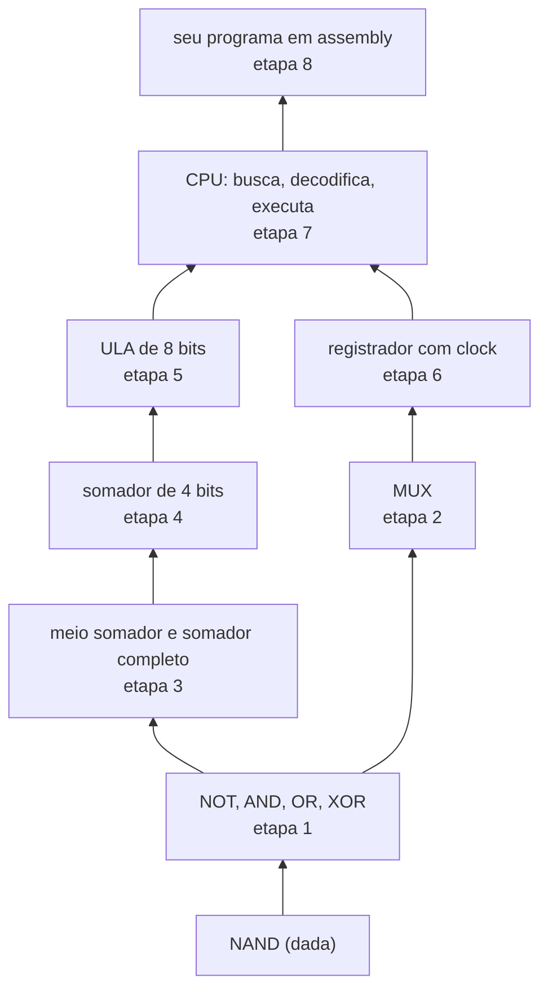
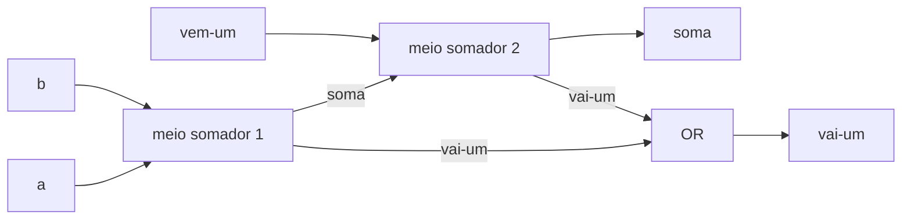

# Projeto: das portas lógicas a uma CPU simples

## O que você vai construir

Um computador inteiro, em Python, começando de **uma única peça**: a porta NAND. Com ela você monta as outras portas, depois somadores, uma ULA, um registrador e, no fim, uma CPU que executa programas escritos por você num assembly de 9 instruções.

```text
LDI 0      ; A = 0
ST 2       ; resultado = 0
LD 1       ; A = contador
JZ 9       ; acabou? pula para o fim
...
```

Este é o projeto da Trilha 4, inspirado no **Nand to Tetris**. Lá os circuitos são descritos numa linguagem de hardware; aqui cada porta é uma função Python que recebe e devolve bits (`0` ou `1`). A regra do jogo é **só usar o que você já construiu**: o XOR não pode usar o `^` do Python, tem que sair das portas.

## Como o projeto funciona



Cada etapa traz pronto, no editor, o que as anteriores construíram. Nas primeiras quatro, use **apenas** as funções de portas (nada de `and`, `or`, `not`, `^`, `+` do Python sobre os bits).

## Etapa 1: tudo a partir da NAND

A NAND devolve 0 só quando as duas entradas são 1. Ela é **universal**: qualquer circuito pode ser feito só com NANDs. As receitas:

| Porta | Com NAND |
|---|---|
| NOT a | `nand(a, a)` |
| a AND b | `NOT(nand(a, b))` |
| a OR b | `nand(NOT a, NOT b)` (lei de De Morgan) |
| a XOR b | `AND(OR(a, b), nand(a, b))` |

```quiz
id: PJ-03-e1
tipo: codigo
linguagem: python
pergunta: |
  Escreva `nao(a)`, `e(a, b)`, `ou(a, b)` e `xou(a, b)` usando **só** a função `nand` (e as portas que você já fez). Os testes conferem a tabela-verdade completa, na ordem (0,0), (0,1), (1,0), (1,1).
codigo_inicial: |
  def nand(a: int, b: int) -> int:
      """A única porta 'de fábrica'. Não mude."""
      return 0 if a == 1 and b == 1 else 1


  def nao(a: int) -> int:
      return 0


  def e(a: int, b: int) -> int:
      return 0


  def ou(a: int, b: int) -> int:
      return 0


  def xou(a: int, b: int) -> int:
      return 0


  # não mude: tabela-verdade de uma porta de 2 entradas
  def tabela(porta) -> list[int]:
      return [porta(a, b) for a in (0, 1) for b in (0, 1)]
usa: [def, return, nand]
testes:
  - chamada: "[nao(0), nao(1)]"
    saida: "[1, 0]"
  - chamada: "tabela(e)"
    saida: "[0, 0, 0, 1]"
  - chamada: "tabela(ou)"
    saida: "[0, 1, 1, 1]"
  - chamada: "tabela(xou)"
    saida: "[0, 1, 1, 0]"
  - chamada: "tabela(lambda a, b: xou(xou(a, b), b))"
    visivel: false
    saida: "[0, 0, 1, 1]"
  - chamada: "tabela(lambda a, b: nao(ou(a, b)))"
    visivel: false
    saida: "[1, 0, 0, 0]"
dica: "nao(a) = nand(a, a). e(a, b) = nao(nand(a, b)). ou(a, b) = nand(nao(a), nao(b)). xou(a, b) = e(ou(a, b), nand(a, b)): 'pelo menos um' E 'não os dois'."
solucao: |
  def nand(a: int, b: int) -> int:
      """A única porta 'de fábrica'. Não mude."""
      return 0 if a == 1 and b == 1 else 1


  def nao(a: int) -> int:
      return nand(a, a)


  def e(a: int, b: int) -> int:
      return nao(nand(a, b))


  def ou(a: int, b: int) -> int:
      return nand(nao(a), nao(b))


  def xou(a: int, b: int) -> int:
      return e(ou(a, b), nand(a, b))


  # não mude: tabela-verdade de uma porta de 2 entradas
  def tabela(porta) -> list[int]:
      return [porta(a, b) for a in (0, 1) for b in (0, 1)]
explicacao: "Repare no teste oculto: xou(xou(a, b), b) devolve a. É a propriedade que faz o XOR servir para criptografia simples e para trocar valores sem variável auxiliar. Na fábrica de chips acontece o mesmo que aqui: produzir um tipo só de porta, em quantidade, é mais barato."
dificuldade: 1
```

## Etapa 2: multiplexador

O **multiplexador** (MUX) é uma chave: com `sel = 0` ele deixa passar `a`; com `sel = 1`, deixa passar `b`. Ele é a base de tudo que "escolhe": registradores (manter o valor ou carregar um novo), a ULA (qual operação sai) e o desvio da CPU (próxima instrução ou salto).

```text
mux(a, b, sel) = (a AND NOT sel) OR (b AND sel)
```

```quiz
id: PJ-03-e2
tipo: codigo
linguagem: python
pergunta: |
  Escreva `mux(a, b, sel)` com as portas da etapa 1, e `mux4(entradas, s1, s0)`, que escolhe um de 4 bits (`entradas[0]` a `entradas[3]`) pelos dois bits de seleção, usando **três** `mux` (dois na primeira camada com `s0`, um na segunda com `s1`).
codigo_inicial: |
  def nand(a, b):
      return 0 if a == 1 and b == 1 else 1


  def nao(a):
      return nand(a, a)


  def e(a, b):
      return nao(nand(a, b))


  def ou(a, b):
      return nand(nao(a), nao(b))


  def mux(a: int, b: int, sel: int) -> int:
      return a


  def mux4(entradas: list[int], s1: int, s0: int) -> int:
      return entradas[0]
usa: [def, return, ou, e, nao]
testes:
  - chamada: "[mux(a, b, s) for s in (0, 1) for a in (0, 1) for b in (0, 1)]"
    saida: "[0, 0, 1, 1, 0, 1, 0, 1]"
  - chamada: "[mux4([1, 0, 0, 0], 0, 0), mux4([0, 1, 0, 0], 0, 1), mux4([0, 0, 1, 0], 1, 0)]"
    saida: "[1, 1, 1]"
  - chamada: "[mux4([0, 1, 1, 0], s1, s0) for s1 in (0, 1) for s0 in (0, 1)]"
    visivel: false
    saida: "[0, 1, 1, 0]"
  - chamada: "[mux4([1, 1, 1, 0], 1, 1), mux4([1, 0, 1, 1], 0, 1)]"
    visivel: false
    saida: "[0, 0]"
dica: "mux: ou(e(a, nao(sel)), e(b, sel)). mux4: x = mux(entradas[0], entradas[1], s0); y = mux(entradas[2], entradas[3], s0); devolva mux(x, y, s1)."
solucao: |
  def nand(a, b):
      return 0 if a == 1 and b == 1 else 1


  def nao(a):
      return nand(a, a)


  def e(a, b):
      return nao(nand(a, b))


  def ou(a, b):
      return nand(nao(a), nao(b))


  def mux(a: int, b: int, sel: int) -> int:
      return ou(e(a, nao(sel)), e(b, sel))


  def mux4(entradas: list[int], s1: int, s0: int) -> int:
      x = mux(entradas[0], entradas[1], s0)
      y = mux(entradas[2], entradas[3], s0)
      return mux(x, y, s1)
explicacao: "Os bits (s1, s0) formam o número da entrada escolhida em binário: (1, 0) é 2. Montar o MUX de 4 com MUX de 2 é o mesmo padrão de árvore que, em escala, escolhe uma entre milhões de posições da memória a partir do endereço."
dificuldade: 2
```

## Etapa 3: somadores

Somar dois bits dá um bit de **soma** e um de **vai-um** (carry): `1 + 1 = 10` em binário. O **meio somador** faz isso com um XOR (soma) e um AND (vai-um). O **somador completo** soma três bits (os dois e o vai-um que veio da coluna anterior) usando dois meio somadores e um OR.



```quiz
id: PJ-03-e3
tipo: codigo
linguagem: python
pergunta: |
  Escreva `meio_somador(a, b)` e `somador_completo(a, b, c)`, que devolvem a tupla `(soma, vai_um)`. Use só as portas (já prontas no editor) e, no completo, dois meio somadores.
codigo_inicial: |
  def nand(a, b):
      return 0 if a == 1 and b == 1 else 1


  def nao(a):
      return nand(a, a)


  def e(a, b):
      return nao(nand(a, b))


  def ou(a, b):
      return nand(nao(a), nao(b))


  def xou(a, b):
      return e(ou(a, b), nand(a, b))


  def meio_somador(a: int, b: int) -> tuple[int, int]:
      return (0, 0)


  def somador_completo(a: int, b: int, c: int) -> tuple[int, int]:
      return (0, 0)
usa: [def, return, xou, meio_somador]
testes:
  - chamada: "[meio_somador(a, b) for a in (0, 1) for b in (0, 1)]"
    saida: "[(0, 0), (1, 0), (1, 0), (0, 1)]"
  - chamada: "somador_completo(1, 1, 1)"
    saida: "(1, 1)"
  - chamada: "[somador_completo(a, b, c) for a in (0, 1) for b in (0, 1) for c in (0, 1)]"
    visivel: false
    saida: "[(0, 0), (1, 0), (1, 0), (0, 1), (1, 0), (0, 1), (0, 1), (1, 1)]"
dica: "meio_somador: (xou(a, b), e(a, b)). somador_completo: s1, c1 = meio_somador(a, b); s2, c2 = meio_somador(s1, c); devolva (s2, ou(c1, c2))."
solucao: |
  def nand(a, b):
      return 0 if a == 1 and b == 1 else 1


  def nao(a):
      return nand(a, a)


  def e(a, b):
      return nao(nand(a, b))


  def ou(a, b):
      return nand(nao(a), nao(b))


  def xou(a, b):
      return e(ou(a, b), nand(a, b))


  def meio_somador(a: int, b: int) -> tuple[int, int]:
      return (xou(a, b), e(a, b))


  def somador_completo(a: int, b: int, c: int) -> tuple[int, int]:
      s1, c1 = meio_somador(a, b)
      s2, c2 = meio_somador(s1, c)
      return (s2, ou(c1, c2))
explicacao: "1 + 1 + 1 = 3 = 11 em binário: soma 1, vai-um 1. Os dois meio somadores nunca geram vai-um ao mesmo tempo (se a e b geram, s1 é 0), por isso um OR basta para juntar os dois."
dificuldade: 2
```

## Etapa 4: somador de 4 bits

Para somar números de vários bits, encadeie somadores completos: o vai-um de cada coluna entra na próxima, da direita (bit menos significativo) para a esquerda. É o **somador ripple-carry**, igual à conta armada de soma que você aprendeu na escola.

```text
    vai-um:  1 1 1
    a:       0 1 1 1    (7)
  + b:       0 1 0 1    (5)
  = soma:    1 1 0 0    (12)
```

```quiz
id: PJ-03-e4
tipo: codigo
linguagem: python
pergunta: |
  Escreva `somar4(a, b)`, que recebe dois números de 4 bits como **listas com o bit mais significativo primeiro** (`[0, 1, 1, 1]` é 7) e devolve `(bits_da_soma, vai_um_final)`. Use o `somador_completo` (pronto) da direita para a esquerda, começando com vai-um 0.
codigo_inicial: |
  def somador_completo(a: int, b: int, c: int) -> tuple[int, int]:
      """Pronto da etapa 3 (aqui com operadores, para encurtar)."""
      total = a + b + c
      return (total % 2, total // 2)


  def somar4(a: list[int], b: list[int]) -> tuple[list[int], int]:
      return ([0, 0, 0, 0], 0)
usa: [def, for, return, somador_completo]
testes:
  - chamada: "somar4([0, 1, 1, 1], [0, 1, 0, 1])"
    saida: "([1, 1, 0, 0], 0)"
  - chamada: "somar4([0, 0, 0, 1], [0, 0, 0, 1])"
    saida: "([0, 0, 1, 0], 0)"
  - chamada: "somar4([1, 1, 1, 1], [0, 0, 0, 1])"
    visivel: false
    saida: "([0, 0, 0, 0], 1)"
  - chamada: "somar4([1, 0, 1, 0], [0, 1, 1, 0])"
    visivel: false
    saida: "([0, 0, 0, 0], 1)"
dica: "Crie soma = [0, 0, 0, 0] e c = 0. for i in range(3, -1, -1): soma[i], c = somador_completo(a[i], b[i], c). No fim, return (soma, c)."
solucao: |
  def somador_completo(a: int, b: int, c: int) -> tuple[int, int]:
      """Pronto da etapa 3 (aqui com operadores, para encurtar)."""
      total = a + b + c
      return (total % 2, total // 2)


  def somar4(a: list[int], b: list[int]) -> tuple[list[int], int]:
      soma = [0, 0, 0, 0]
      c = 0
      for i in range(3, -1, -1):
          soma[i], c = somador_completo(a[i], b[i], c)
      return (soma, c)
explicacao: "15 + 1 = 16 não cabe em 4 bits: o resultado volta a 0000 e o vai-um final fica 1. É o **estouro** (overflow) sem sinal, que a CPU guarda numa flag. A fraqueza do ripple-carry é a espera: o último bit depende de todos os anteriores. CPUs reais usam somadores com antecipação de vai-um (carry-lookahead)."
dificuldade: 2
```

## Etapa 5: a ULA

A **ULA** (unidade lógica e aritmética) recebe dois operandos e um código de operação e devolve o resultado e as **flags** (sinais sobre o resultado). A nossa trabalha com 8 bits (0 a 255) e a flag **zero**, que a CPU vai usar para decidir saltos.

A subtração usa o **complemento de dois**: `x - y` é o mesmo que `x + (NOT y) + 1`, descartando o que passar de 8 bits. Por isso o hardware não precisa de um circuito separado para subtrair: reaproveita o somador.

Nesta etapa já subimos um nível de abstração: os operandos são inteiros Python, e as operações bit a bit (`&`, `|`, `~`) fazem o papel das portas em paralelo nos 8 bits.

```quiz
id: PJ-03-e5
tipo: codigo
linguagem: python
pergunta: |
  Escreva `ula(x, y, op) -> tuple[int, int]` que devolve `(resultado, zero)`, com resultado sempre em 8 bits (`& 0xFF`) e `zero = 1` se o resultado for 0. Operações:

  - `"ADD"`: x + y
  - `"SUB"`: x + (~y & 0xFF) + 1 (complemento de dois; **não** use o `-` do Python)
  - `"AND"`, `"OR"`: bit a bit
  - `"NOT"`: inverte os 8 bits de x (ignora y)
codigo_inicial: |
  def ula(x: int, y: int, op: str) -> tuple[int, int]:
      resultado = 0
      return (resultado, 0)
usa: [def, if, return]
testes:
  - chamada: "ula(7, 5, 'ADD')"
    saida: "(12, 0)"
  - chamada: "ula(7, 5, 'SUB')"
    saida: "(2, 0)"
  - chamada: "ula(5, 5, 'SUB')"
    saida: "(0, 1)"
  - chamada: "ula(200, 100, 'ADD')"
    saida: "(44, 0)"
  - chamada: "ula(5, 7, 'SUB')"
    visivel: false
    saida: "(254, 0)"
  - chamada: "[ula(12, 10, 'AND'), ula(12, 10, 'OR'), ula(15, 0, 'NOT')]"
    visivel: false
    saida: "[(8, 0), (14, 0), (240, 0)]"
  - chamada: "ula(255, 1, 'ADD')"
    visivel: false
    saida: "(0, 1)"
dica: "Um if/elif por operação calculando resultado; depois resultado = resultado & 0xFF e zero = 1 if resultado == 0 else 0. Na SUB: x + (~y & 0xFF) + 1."
solucao: |
  def ula(x: int, y: int, op: str) -> tuple[int, int]:
      if op == "ADD":
          resultado = x + y
      elif op == "SUB":
          resultado = x + (~y & 0xFF) + 1
      elif op == "AND":
          resultado = x & y
      elif op == "OR":
          resultado = x | y
      elif op == "NOT":
          resultado = ~x
      else:
          raise ValueError(f"operação desconhecida: {op}")
      resultado = resultado & 0xFF
      zero = 1 if resultado == 0 else 0
      return (resultado, zero)
explicacao: "5 - 7 deu 254: em 8 bits com sinal, 254 (11111110) é a representação de -2 em complemento de dois. O mesmo padrão de bits vale 254 sem sinal ou -2 com sinal; quem decide é a instrução que o interpreta. Isso é o que MD-04 mostrou na teoria, agora no circuito."
dificuldade: 2
```

## Etapa 6: registrador e clock

Circuitos combinacionais (portas, somadores, ULA) respondem na hora. Para **guardar** um valor é preciso um circuito sequencial: o registrador. Ele tem uma entrada de dados, um sinal `load` e o **clock**. O valor guardado só muda no pulso do clock, e só se `load` estiver em 1. Entre pulsos, a entrada pode mudar à vontade que a saída não mexe.

Por dentro, cada bit é um flip-flop com um MUX na frente: `proximo = mux(atual, entrada, load)`.

```quiz
id: PJ-03-e6
tipo: codigo
linguagem: python
pergunta: |
  Complete a classe `Registrador`: `preparar(valor, load)` só **apresenta** a entrada (não muda a saída); `tick()` é o pulso de clock, que copia a entrada preparada para `self.saida` se `load` for 1; `ler()` devolve a saída. Ele começa guardando 0 e com `load = 0`.

  A função pronta no fim lê comandos como `set 5 1; tick; set 9 0; tick` e mostra a saída depois de cada um.
codigo_inicial: |
  class Registrador:
      def __init__(self) -> None:
          self.saida = 0
          self.entrada = 0
          self.load = 0

      def preparar(self, valor: int, load: int) -> None:
          pass

      def tick(self) -> None:
          pass

      def ler(self) -> int:
          return self.saida


  # não mude
  def rodar(comandos: str) -> None:
      r = Registrador()
      for cmd in comandos.split(";"):
          partes = cmd.split()
          if partes[0] == "set":
              r.preparar(int(partes[1]), int(partes[2]))
          else:
              r.tick()
          print(f"{cmd.strip():<10} saída = {r.ler()}")


  rodar(input())
usa: [class, def, if]
testes:
  - entrada: "set 5 1; tick; set 9 0; tick"
    saida: |
      set 5 1    saída = 0
      tick       saída = 5
      set 9 0    saída = 5
      tick       saída = 5
  - entrada: "set 3 1; set 4 1; tick"
    saida: |
      set 3 1    saída = 0
      set 4 1    saída = 0
      tick       saída = 4
  - entrada: "tick; set 7 1; tick; set 2 1; set 2 0; tick; set 8 1; tick; tick"
    visivel: false
    saida: |
      tick       saída = 0
      set 7 1    saída = 0
      tick       saída = 7
      set 2 1    saída = 7
      set 2 0    saída = 7
      tick       saída = 7
      set 8 1    saída = 7
      tick       saída = 8
      tick       saída = 8
dica: "preparar só guarda: self.entrada = valor e self.load = load. tick: if self.load == 1: self.saida = self.entrada."
solucao: |
  class Registrador:
      def __init__(self) -> None:
          self.saida = 0
          self.entrada = 0
          self.load = 0

      def preparar(self, valor: int, load: int) -> None:
          self.entrada = valor
          self.load = load

      def tick(self) -> None:
          if self.load == 1:
              self.saida = self.entrada

      def ler(self) -> int:
          return self.saida


  # não mude
  def rodar(comandos: str) -> None:
      r = Registrador()
      for cmd in comandos.split(";"):
          partes = cmd.split()
          if partes[0] == "set":
              r.preparar(int(partes[1]), int(partes[2]))
          else:
              r.tick()
          print(f"{cmd.strip():<10} saída = {r.ler()}")


  rodar(input())
explicacao: "Separar 'preparar' de 'tick' é o que permite a CPU funcionar: durante um ciclo, a ULA calcula um novo valor a partir do valor atual do registrador; só no pulso o resultado é gravado. Sem o clock, a saída alimentaria a entrada sem parar e o valor nunca se estabilizaria."
dificuldade: 1
```

## Etapa 7: a CPU

Agora o computador. A nossa CPU tem um **acumulador** `A` (o registrador de trabalho), um **contador de programa** `PC` (qual instrução vem agora) e uma memória de dados `dados` (uma lista de inteiros de 8 bits). O programa é uma lista de textos, uma instrução por posição.

| Instrução | Efeito |
|---|---|
| `LDI n` | A = n |
| `LD e` | A = dados[e] |
| `ST e` | dados[e] = A |
| `ADD e` | A = A + dados[e] (pela ULA) |
| `SUB e` | A = A - dados[e] (pela ULA) |
| `JMP i` | PC = i |
| `JZ i` | se a última operação da ULA deu zero, PC = i |
| `OUT` | envia A para a saída |
| `HLT` | para |

O laço é o **ciclo busca-decodifica-executa** de AC-03: buscar `programa[PC]`, somar 1 ao PC, separar a operação do argumento e executar.

```quiz
id: PJ-03-e7
tipo: codigo
linguagem: python
pergunta: |
  Escreva `executar(programa, dados) -> list[int]`, que roda o programa e devolve a lista de valores enviados por `OUT`. Use a `ula` (pronta) em ADD e SUB e guarde a flag zero dela; `LD` e `LDI` também atualizam a flag (zero se A ficou 0). Pare no `HLT` ou depois de 1000 instruções (proteção contra laço infinito).
codigo_inicial: |
  def ula(x: int, y: int, op: str) -> tuple[int, int]:
      if op == "ADD":
          r = (x + y) & 0xFF
      else:
          r = (x + (~y & 0xFF) + 1) & 0xFF
      return (r, 1 if r == 0 else 0)


  def executar(programa: list[str], dados: list[int]) -> list[int]:
      saida = []
      a = 0
      pc = 0
      zero = 0
      # ciclo busca-decodifica-executa aqui
      return saida
usa: [def, while, if, return, split]
testes:
  - chamada: "executar(['LDI 5', 'OUT', 'HLT'], [])"
    saida: "[5]"
  - chamada: "executar(['LD 0', 'ADD 1', 'OUT', 'ST 2', 'HLT'], [7, 5, 0])"
    saida: "[12]"
  - chamada: "executar(['LDI 3', 'OUT', 'SUB 0', 'JZ 5', 'JMP 1', 'HLT'], [1])"
    saida: "[3, 2, 1]"
  - chamada: "executar(['LDI 0', 'JZ 3', 'OUT', 'LDI 9', 'OUT', 'HLT'], [])"
    visivel: false
    saida: "[9]"
  - chamada: "executar(['LD 0', 'SUB 1', 'OUT', 'HLT'], [2, 3])"
    visivel: false
    saida: "[255]"
  - chamada: "len(executar(['OUT', 'JMP 0'], []))"
    visivel: false
    saida: "500"
dica: "passos = 0; while pc < len(programa) and passos < 1000: instrucao = programa[pc].split(); pc += 1; passos += 1; op = instrucao[0]; arg = int(instrucao[1]) if len(instrucao) > 1 else 0. Depois um if/elif por op. Em JZ: if zero: pc = arg. Em HLT: break."
solucao: |
  def ula(x: int, y: int, op: str) -> tuple[int, int]:
      if op == "ADD":
          r = (x + y) & 0xFF
      else:
          r = (x + (~y & 0xFF) + 1) & 0xFF
      return (r, 1 if r == 0 else 0)


  def executar(programa: list[str], dados: list[int]) -> list[int]:
      saida = []
      a = 0
      pc = 0
      zero = 0
      passos = 0
      while pc < len(programa) and passos < 1000:
          instrucao = programa[pc].split()
          pc += 1
          passos += 1
          op = instrucao[0]
          arg = int(instrucao[1]) if len(instrucao) > 1 else 0
          if op == "LDI":
              a = arg
              zero = 1 if a == 0 else 0
          elif op == "LD":
              a = dados[arg]
              zero = 1 if a == 0 else 0
          elif op == "ST":
              dados[arg] = a
          elif op == "ADD" or op == "SUB":
              a, zero = ula(a, dados[arg], op)
          elif op == "JMP":
              pc = arg
          elif op == "JZ":
              if zero:
                  pc = arg
          elif op == "OUT":
              saida.append(a)
          elif op == "HLT":
              break
      return saida
explicacao: "O PC avança antes de executar: assim os saltos só precisam sobrescrevê-lo. O terceiro teste é um laço em assembly: OUT, subtrai 1, e se não deu zero volta para o OUT. Não existe 'while' na máquina: laços e ifs viram comparações (a flag) e saltos. O último teste oculto confere a proteção: o laço infinito para em 1000 instruções, 500 delas OUT."
dificuldade: 3
```

## Etapa 8: programe a sua CPU

A CPU não tem multiplicação. Mas multiplicar é somar repetidamente, e isso dá para escrever com o que temos. Este é o mesmo exercício do projeto 4 do Nand to Tetris.

```quiz
id: PJ-03-e8
tipo: codigo
linguagem: python
pergunta: |
  Escreva em `PROGRAMA` (uma lista de instruções do assembly da etapa 7) um programa que calcula `dados[0] * dados[1]`, guarda em `dados[2]` e envia o resultado com `OUT`. A posição `dados[3]` sempre vale 1 (use para decrementar um contador). Os testes rodam o programa com valores diferentes, inclusive zero. A `executar` está pronta.

  Plano sugerido: resultado = 0; enquanto contador (dados[1]) não for zero: resultado += dados[0]; contador -= 1.
codigo_inicial: |
  PROGRAMA = [
      "LDI 0",
      "ST 2",
      "HLT",
  ]


  # não mude: a CPU da etapa 7
  def executar(programa: list[str], dados: list[int]) -> list[int]:
      saida, a, pc, zero, passos = [], 0, 0, 0, 0
      while pc < len(programa) and passos < 1000:
          partes = programa[pc].split()
          pc += 1
          passos += 1
          op, arg = partes[0], int(partes[1]) if len(partes) > 1 else 0
          if op == "LDI":
              a = arg
              zero = int(a == 0)
          elif op == "LD":
              a = dados[arg]
              zero = int(a == 0)
          elif op == "ST":
              dados[arg] = a
          elif op == "ADD":
              a = (a + dados[arg]) & 0xFF
              zero = int(a == 0)
          elif op == "SUB":
              a = (a - dados[arg]) & 0xFF
              zero = int(a == 0)
          elif op == "JMP":
              pc = arg
          elif op == "JZ" and zero:
              pc = arg
          elif op == "OUT":
              saida.append(a)
          elif op == "HLT":
              break
      return saida
testes:
  - chamada: "executar(PROGRAMA, [3, 4, 0, 1])"
    saida: "[12]"
  - chamada: "executar(PROGRAMA, [7, 1, 0, 1])"
    saida: "[7]"
  - chamada: "executar(PROGRAMA, [9, 0, 0, 1])"
    visivel: false
    saida: "[0]"
  - chamada: "executar(PROGRAMA, [0, 5, 0, 1])"
    visivel: false
    saida: "[0]"
  - chamada: "executar(PROGRAMA, [6, 7, 0, 1])"
    visivel: false
    saida: "[42]"
dica: "Um caminho: 0 LDI 0, 1 ST 2 (resultado = 0), 2 LD 1, 3 JZ 11 (contador zero? fim), 4 LD 2, 5 ADD 0, 6 ST 2 (resultado += x), 7 LD 1, 8 SUB 3, 9 ST 1 (contador -= 1), 10 JMP 2, 11 LD 2, 12 OUT, 13 HLT. Numere as linhas num comentário para acertar os destinos dos saltos."
solucao: |
  PROGRAMA = [
      "LDI 0",   # 0: A = 0
      "ST 2",    # 1: resultado = 0
      "LD 1",    # 2: A = contador
      "JZ 11",   # 3: contador zero? vai para o fim
      "LD 2",    # 4: A = resultado
      "ADD 0",   # 5: A = resultado + x
      "ST 2",    # 6: resultado = A
      "LD 1",    # 7: A = contador
      "SUB 3",   # 8: A = contador - 1
      "ST 1",    # 9: contador = A
      "JMP 2",   # 10: volta ao teste
      "LD 2",    # 11: A = resultado
      "OUT",     # 12: mostra
      "HLT",     # 13: fim
  ]


  # não mude: a CPU da etapa 7
  def executar(programa: list[str], dados: list[int]) -> list[int]:
      saida, a, pc, zero, passos = [], 0, 0, 0, 0
      while pc < len(programa) and passos < 1000:
          partes = programa[pc].split()
          pc += 1
          passos += 1
          op, arg = partes[0], int(partes[1]) if len(partes) > 1 else 0
          if op == "LDI":
              a = arg
              zero = int(a == 0)
          elif op == "LD":
              a = dados[arg]
              zero = int(a == 0)
          elif op == "ST":
              dados[arg] = a
          elif op == "ADD":
              a = (a + dados[arg]) & 0xFF
              zero = int(a == 0)
          elif op == "SUB":
              a = (a - dados[arg]) & 0xFF
              zero = int(a == 0)
          elif op == "JMP":
              pc = arg
          elif op == "JZ" and zero:
              pc = arg
          elif op == "OUT":
              saida.append(a)
          elif op == "HLT":
              break
      return saida
explicacao: "O teste do laço vem antes do corpo (como um while), por isso multiplicar por 0 funciona: o JZ pula direto para o fim. Repare quanto trabalho um `x * y` dá em assembly: é exatamente isso que um compilador gera para você, e por que CPUs reais têm um circuito multiplicador dedicado."
dificuldade: 3
```

## Para pensar

```quiz
id: PJ-03-q1
tipo: multipla_escolha
pergunta: "Por que a ULA subtrai com `x + (NOT y) + 1` em vez de ter um circuito de subtração próprio?"
opcoes:
  - "Porque subtrair é impossível com portas lógicas"
  - "Porque, em complemento de dois, -y é NOT y + 1: a subtração reaproveita o mesmo somador, com um inversor e o vai-um inicial em 1"
  - "Porque é mais rápido que a soma"
  - "Porque o Python não tem o operador -"
resposta: 1
explicacao: "Com complemento de dois, somar e subtrair usam o mesmo circuito: basta inverter os bits de y (uma porta NOT por bit, ou um XOR controlado pela operação) e colocar 1 no vai-um de entrada. Menos circuito, menos transistores, menos energia."
dificuldade: 2
```

```quiz
id: PJ-03-q2
tipo: resposta_curta
pergunta: "Na sua CPU não existe instrução `if` nem `while`. Como o programa da etapa 8 faz um laço?"
resposta: "Com a flag zero e saltos: o JZ testa se o contador chegou a zero e pula para o fim; o JMP no final do corpo volta para o teste. Todo if e while de uma linguagem de alto nível vira esse par de comparação (flag) e salto condicional."
palavras_chave: ["JZ", "JMP", "flag", "salto"]
dificuldade: 2
```

## Montando tudo no seu computador

Junte as etapas num repositório:

```text
cpu/
  portas.py        nand, nao, e, ou, xou, mux, mux4
  aritmetica.py    meio_somador, somador_completo, somar4, ula
  memoria.py       Registrador
  cpu.py           executar
  programas/       mult.asm, contagem.asm ...
  montador.py      lê um arquivo .asm (com comentários ;) e roda na CPU
```

Ideias para ir além:

- **Rastro da CPU**: um parâmetro `rastro=True` em `executar` que imprime `PC=03 JZ 11 | A=4 Z=0` a cada instrução. É o depurador da sua máquina.
- **Rótulos no assembly**: escreva `loop:` e `JMP loop` em vez de números, e faça o `montador.py` trocar os rótulos pelos endereços (duas passadas sobre o programa). É o que um montador de verdade faz.
- **ULA só com portas**: refaça a ULA chamando o somador de bits em vez de `+`, e conte quantas NANDs ela usa.
- **Mais instruções**: `JN` (salta se negativo, olhando o bit 7), `CALL`/`RET` com uma pilha na memória.
- **Nand to Tetris**: faça os projetos 1 a 5 do curso, no simulador de hardware deles. Você vai reconhecer cada peça.

## Resumo

- Com **NAND** dá para construir todas as portas; com portas, **MUX** e **somadores**.
- Somadores em cadeia somam números de n bits; o **complemento de dois** transforma subtração em soma.
- A **ULA** calcula; o **registrador** guarda, e só muda no **pulso do clock**.
- A **CPU** repete **busca, decodifica, executa**, guiada pelo **PC**; laços e ifs viram **flags e saltos**.
- Cada camada só usa a de baixo: é a ideia de **abstração** que atravessa toda a computação.

## Para ir além

- **Nand to Tetris**, parte 1 (projetos 1 a 6): o mesmo caminho, com HDL e um montador de verdade.
- **Próximos módulos**: AC-04 (assembly RISC-V) mostra um conjunto de instruções real; AC-06 (pipeline) mostra como a CPU executa várias instruções ao mesmo tempo.
