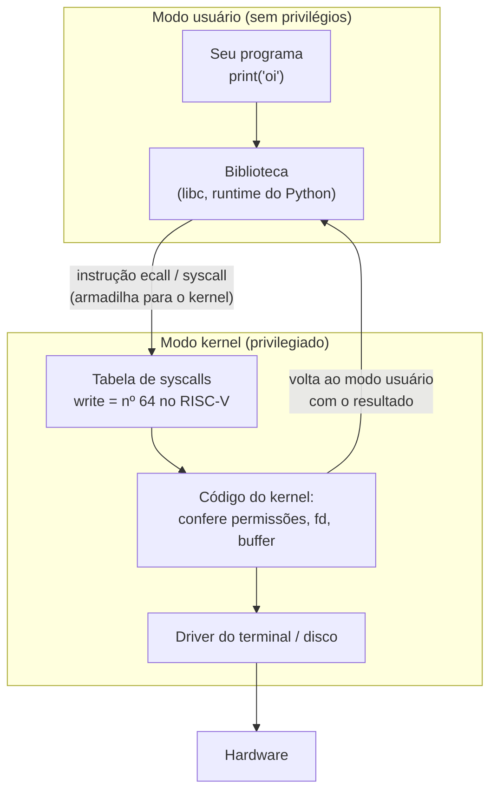

# O que o SO faz: kernel, modo usuário vs. kernel, syscalls

## Por que isso importa

Quando você escreve `print("oi")` ou `open("dados.csv")`, seu programa **não** fala direto com a tela ou com o disco. Ele pede ao **sistema operacional**, que decide se pode, faz o trabalho e devolve o resultado. Entender essa fronteira explica muita coisa do dia a dia de um dev: por que um programa com bug não derruba o computador inteiro, por que `Permission denied` acontece, por que escrever um arquivo caractere por caractere é lento, o que o Docker isola e o que ferramentas como `strace` mostram quando um programa "trava". É também a base de todos os outros módulos desta trilha.

## Intuição

Pense num **banco**. Os clientes (os programas) não entram no cofre. Eles vão ao **caixa** (a interface de syscalls), preenchem um pedido ("sacar 100 da conta 42") e o **funcionário** (o kernel), que tem a chave do cofre, confere se o pedido é válido e executa.

- O cliente **não pode** abrir o cofre sozinho, mesmo que tente: a porta só abre com o crachá de funcionário (o **modo kernel** do processador).
- Vários clientes são atendidos "ao mesmo tempo", porque o funcionário alterna entre eles (**multiplexação**).
- O cliente não precisa saber em que gaveta fica o dinheiro: ele só vê "minha conta" (**abstração**).

Se um cliente faz bagunça no balcão, o banco o retira e continua funcionando. É isso que acontece quando seu programa dá *segmentation fault*: só ele morre.

## Visual



## Conceito técnico

### Os três papéis do SO

1. **Abstrair**: transformar hardware feio em conceitos limpos. Um disco é uma montanha de blocos numerados; o SO oferece **arquivos** com nome. A CPU é uma só; o SO oferece **processos**, cada um achando que tem a máquina para si. A RAM é compartilhada; cada processo vê sua própria **memória virtual**.
2. **Multiplexar** (compartilhar): dividir CPU, memória e dispositivos entre vários programas, no tempo (CPU) e no espaço (memória).
3. **Proteger**: impedir que um programa leia a memória de outro, apague arquivos que não são dele ou monopolize a CPU.

O **kernel** é a parte do SO que roda com privilégio total. O resto (shell, interface gráfica, utilitários como `ls`) são programas comuns.

### Modo usuário vs. modo kernel

A proteção **precisa** de ajuda do hardware. O processador tem um bit de modo:

| | Modo usuário | Modo kernel |
|---|---|---|
| Quem roda | seus programas, bibliotecas | o kernel |
| Pode acessar dispositivos diretamente? | não | sim |
| Pode mudar a tabela de páginas, desligar interrupções? | não | sim |
| Se tentar uma instrução privilegiada | a CPU gera uma **exceção** e o kernel mata o processo | executa |

Só existem três jeitos de a CPU passar do modo usuário para o modo kernel, e todos pulam para endereços que **o kernel escolheu** na inicialização:

- **Syscall**: o programa pede algo de propósito (`ecall` no RISC-V, `syscall` no x86-64).
- **Exceção**: o programa fez algo errado (divisão por zero, acesso a endereço inválido).
- **Interrupção**: um dispositivo avisa algo (tecla pressionada, pacote de rede chegou, o **timer** disparou).

O **timer** é o que garante que um programa com `while True: pass` não trave a máquina: a cada poucos milissegundos ele interrompe a CPU, o kernel recupera o controle e pode escolher outro processo (SO-03).

### O caminho de uma syscall

No Linux RISC-V, `write(1, "oi\n", 3)` vira:

```text
li a7, 64        # número da syscall write
li a0, 1         # fd 1 = saída padrão
la a1, msg       # endereço do texto
li a2, 3         # quantos bytes
ecall            # armadilha: vai para o kernel
                 # ao voltar, a0 tem o resultado (3, ou um erro negativo)
```

O kernel salva os registradores do processo, olha `a7` numa **tabela de syscalls**, confere se os argumentos são válidos (o fd existe? o endereço pertence mesmo ao processo?), executa e devolve o resultado em `a0`. Se der erro, o valor é negativo (por exemplo `-9`, EBADF), e a libc o transforma em `-1` com a variável `errno`.

Uma syscall custa de **centenas a milhares de ciclos** (troca de modo, salvar estado, checagens). Por isso bibliotecas juntam dados num **buffer** e fazem uma syscall só quando ele enche.

### Descritores de arquivo

No Unix, "quase tudo é arquivo": arquivos, terminais, pipes, sockets. O processo os acessa por **descritores de arquivo** (fd), números pequenos que indexam uma tabela **dentro do kernel**:

- `0` = entrada padrão, `1` = saída padrão, `2` = saída de erro.
- `open` devolve o **menor** número livre.
- Cada fd aberto guarda a **posição** atual: dois `read` seguidos continuam de onde o primeiro parou.
- `close` libera o número para ser reutilizado.

O processo só vê o número; quem guarda o que ele significa é o kernel. Então um programa não consegue "inventar" acesso a um arquivo que não abriu.

### Tipos de kernel

- **Monolítico** (Linux): tudo (drivers, sistema de arquivos, rede) roda em modo kernel. Rápido, mas um bug num driver pode derrubar tudo.
- **Microkernel** (seL4, QNX, MINIX 3): o kernel faz o mínimo (memória, escalonamento, mensagens); drivers e sistemas de arquivos são processos em modo usuário. Mais isolado, com custo de mais trocas de contexto.
- **Híbrido** (Windows NT, macOS/XNU): no meio do caminho.

## Código

Em Python, `os` expõe as syscalls quase diretamente, sem o buffer de `open()`:

```python
import os

fd = os.open("exemplo.txt", os.O_WRONLY | os.O_CREAT | os.O_TRUNC, 0o644)
print("descritor:", fd)                 # normalmente 3: 0, 1 e 2 já estão abertos
os.write(fd, b"linha 1\nlinha 2\n")     # uma syscall write
os.close(fd)

fd = os.open("exemplo.txt", os.O_RDONLY)
print(os.read(fd, 5))                   # b'linha'
print(os.read(fd, 100))                 # b' 1\nlinha 2\n': continua da posição
print(os.read(fd, 100))                 # b'': fim do arquivo
os.close(fd)

try:
    os.read(fd, 1)                      # fd já fechado
except OSError as e:
    print("erro:", e.strerror)          # Bad file descriptor (EBADF)
```

No Linux, rode `strace -c python3 -c "print('oi')"` para ver todas as syscalls que até um programa minúsculo faz.

## Erros comuns

- **Achar que `print` "escreve na tela".** Ele escreve num buffer da biblioteca, que depois faz uma syscall `write` no fd 1. Quem fala com a tela é o kernel (e o terminal).
- **Confundir o kernel com o SO inteiro.** O shell e o gerenciador de janelas são programas em modo usuário.
- **Achar que modo kernel é "root".** Root é um **usuário** com permissões amplas, mas os programas dele ainda rodam em modo usuário e pedem coisas por syscalls.
- **Fazer uma syscall por byte.** Ler ou escrever um caractere de cada vez com `os.read`/`os.write` é ordens de grandeza mais lento que usar buffer.
- **Esquecer de fechar descritores.** Cada processo tem um limite (geralmente 1024); servidores que vazam fds acabam com `Too many open files`.

## Pratique

```quiz
id: SO-01-q1
tipo: multipla_escolha
pergunta: "Qual destas ações um programa em modo usuário consegue fazer sem pedir ao kernel?"
opcoes: ["Ler um arquivo do disco", "Somar dois números nos registradores", "Enviar um pacote pela rede", "Desligar as interrupções"]
resposta: 1
explicacao: "Instruções comuns de cálculo rodam direto na CPU em modo usuário, sem custo extra. Disco e rede exigem dispositivos, que só o kernel acessa. Desligar interrupções é uma instrução privilegiada: tentar isso gera uma exceção."
dificuldade: 1
```

```quiz
id: SO-01-q2
tipo: multipla_escolha
pergunta: "O que impede um programa com um laço infinito de travar o computador inteiro?"
opcoes: ["O compilador detecta laços infinitos", "A interrupção do timer devolve o controle ao kernel periodicamente", "O programa faz syscalls de tempos em tempos", "A memória acaba"]
resposta: 1
explicacao: "Um while True: pass nunca faz syscall. O kernel só recupera a CPU porque programou um timer que interrompe o processador a cada poucos milissegundos. Sem isso, um único programa poderia monopolizar a máquina."
dificuldade: 1
```

```quiz
id: SO-01-q3
tipo: verdadeiro_falso
pergunta: "Um programa rodando como root executa em modo kernel."
resposta: false
explicacao: "Root é uma identidade de usuário que o kernel consulta para decidir permissões. Os programas do root continuam em modo usuário e ainda precisam de syscalls para acessar arquivos e dispositivos. Modo kernel é um estado do processador, não um usuário."
dificuldade: 2
```

```quiz
id: SO-01-q4
tipo: prever_saida
pergunta: |
  Um processo acabou de iniciar (fds 0, 1 e 2 abertos). O que é impresso?
  ```python
  import os
  a = os.open("x.txt", os.O_RDONLY)
  b = os.open("y.txt", os.O_RDONLY)
  os.close(a)
  c = os.open("z.txt", os.O_RDONLY)
  print(a, b, c)
  ```
resposta: "3 4 3"
explicacao: "open devolve sempre o menor descritor livre. a recebe 3, b recebe 4. Depois de fechar o 3, ele fica livre de novo, e c o reutiliza."
dificuldade: 2
```

```quiz
id: SO-01-q5
tipo: multipla_escolha
pergunta: "Quais são os três jeitos de a CPU sair do modo usuário e entrar no modo kernel?"
opcoes: ["Syscall, exceção e interrupção", "Função, laço e desvio", "Syscall, malloc e printf", "Login, sudo e reboot"]
resposta: 0
explicacao: "Syscall é um pedido de propósito (ecall). Exceção é um erro do programa (acesso inválido, divisão por zero). Interrupção vem de um dispositivo ou do timer. Nos três casos a CPU pula para um endereço que o próprio kernel configurou, então o programa não escolhe onde o código privilegiado começa."
dificuldade: 2
```

```quiz
id: SO-01-q6
tipo: resposta_curta
pergunta: "Por que a proteção entre programas precisa de suporte do hardware, e não só de software?"
resposta: "Porque se a proteção fosse só uma regra em software, o programa poderia simplesmente executar as instruções proibidas ou escrever na memória do kernel. O processador precisa de um modo privilegiado que recusa certas instruções e acessos em modo usuário, gerando uma exceção que devolve o controle ao kernel."
palavras_chave: ["modo", "instru", "privilegi", "exce"]
dificuldade: 2
```

```quiz
id: SO-01-q7
tipo: codigo
linguagem: python
pergunta: |
  **Uma tabela de descritores.** Implemente a classe `Kernel`, que recebe um dicionário `{nome: conteúdo}` com os arquivos existentes e oferece:

  - `open(nome)`: devolve o **menor** fd livre a partir de 3, ou `-2` (ENOENT) se o arquivo não existe.
  - `read(fd, n)`: devolve até `n` caracteres a partir da posição atual daquele fd e avança a posição; `''` no fim do arquivo.
  - `write(fd, texto)`: acrescenta `texto` ao **final** do arquivo e devolve quantos caracteres escreveu.
  - `close(fd)`: libera o fd e devolve `0`.

  Em `read`, `write` e `close`, um fd que não está aberto devolve `-9` (EBADF). Cada `open` cria uma posição própria, começando em 0.
codigo_inicial: |
  class Kernel:
      def __init__(self, arquivos):
          self.arquivos = dict(arquivos)
          self.tabela = {}  # fd -> [nome, posicao]

      def open(self, nome):
          return 3

      def read(self, fd, n):
          return -9

      def write(self, fd, texto):
          return -9

      def close(self, fd):
          return -9


  # não mude: os testes usam esta função
  def rodar(arquivos, ops):
      k = Kernel(arquivos)
      return [getattr(k, op[0])(*op[1:]) for op in ops]
usa: [class, def, return]
testes:
  - chamada: "rodar({'a.txt': 'ola mundo'}, [('open', 'a.txt'), ('read', 3, 3), ('read', 3, 100), ('read', 3, 5), ('close', 3)])"
    saida: "[3, 'ola', ' mundo', '', 0]"
  - chamada: "rodar({'a.txt': 'x', 'b.txt': 'y'}, [('open', 'a.txt'), ('open', 'b.txt'), ('close', 3), ('open', 'b.txt'), ('open', 'c.txt')])"
    saida: "[3, 4, 0, 3, -2]"
  - chamada: "rodar({'log': ''}, [('open', 'log'), ('write', 3, 'oi'), ('write', 3, '!!'), ('open', 'log'), ('read', 4, 10), ('close', 7), ('read', 9, 1)])"
    saida: "[3, 2, 2, 4, 'oi!!', -9, -9]"
  - chamada: "rodar({'a': '1'}, [('open', 'a') for _ in range(5)] + [('close', 5), ('close', 3), ('open', 'a'), ('open', 'a'), ('open', 'a')])"
    visivel: false
    saida: "[3, 4, 5, 6, 7, 0, 0, 3, 5, 8]"
dica: "Para achar o menor fd livre: fd = 3 e, enquanto fd in self.tabela, fd += 1. No read, pegue nome e pos da tabela, fatie self.arquivos[nome][pos:pos + n] e some len(fatia) à posição guardada."
solucao: |
  class Kernel:
      def __init__(self, arquivos):
          self.arquivos = dict(arquivos)
          self.tabela = {}  # fd -> [nome, posicao]

      def open(self, nome):
          if nome not in self.arquivos:
              return -2
          fd = 3
          while fd in self.tabela:
              fd += 1
          self.tabela[fd] = [nome, 0]
          return fd

      def read(self, fd, n):
          if fd not in self.tabela:
              return -9
          nome, pos = self.tabela[fd]
          dados = self.arquivos[nome][pos:pos + n]
          self.tabela[fd][1] = pos + len(dados)
          return dados

      def write(self, fd, texto):
          if fd not in self.tabela:
              return -9
          nome = self.tabela[fd][0]
          self.arquivos[nome] += texto
          return len(texto)

      def close(self, fd):
          if fd not in self.tabela:
              return -9
          del self.tabela[fd]
          return 0


  # não mude: os testes usam esta função
  def rodar(arquivos, ops):
      k = Kernel(arquivos)
      return [getattr(k, op[0])(*op[1:]) for op in ops]
explicacao: "A tabela de fds é exatamente o que o kernel guarda por processo: o número é só um índice, e a posição mora no kernel. Por isso o segundo read continua de onde o primeiro parou, e um fd inventado (7, 9) é recusado com EBADF. No teste oculto, depois de fechar 5 e 3, os próximos open reutilizam 3, depois 5, e só então pegam o 8."
dificuldade: 2
```

```quiz
id: SO-01-q8
tipo: codigo
linguagem: javascript
pergunta: |
  **Quantas syscalls o buffer economiza?** Uma biblioteca guarda as escritas num buffer de `capacidade` bytes e só chama `write` quando precisa. Escreva `contarSyscalls(escritas, capacidade)`, onde `escritas` é um array com o tamanho de cada escrita, seguindo estas regras para cada tamanho `t`:

  1. Se o buffer não está vazio e `buffer + t > capacidade`, descarregue o buffer (1 syscall).
  2. Se `t >= capacidade`, escreva direto (1 syscall), sem passar pelo buffer. Senão, some `t` ao buffer.

  No fim, se o buffer não estiver vazio, descarregue-o (1 syscall). Devolva o total de syscalls.
codigo_inicial: |
  function contarSyscalls(escritas, capacidade) {
    // sem buffer: uma syscall por escrita
    return escritas.length;
  }
usa: [function, for, return]
testes:
  - chamada: "contarSyscalls([10, 10, 10], 4096)"
    saida: "1"
  - chamada: "contarSyscalls(Array(1000).fill(5), 4096)"
    saida: "2"
  - chamada: "contarSyscalls([3, 3, 3], 5)"
    saida: "3"
  - chamada: "contarSyscalls([], 10)"
    saida: "0"
  - chamada: "contarSyscalls([2, 20, 2], 10)"
    visivel: false
    saida: "3"
  - chamada: "contarSyscalls(Array.from({ length: 10000 }, (_, i) => i % 50), 1000)"
    visivel: false
    saida: "250"
dica: "Guarde duas variáveis: buf (bytes no buffer) e n (syscalls). Aplique as regras na ordem para cada t. Não esqueça do descarregamento final."
solucao: |
  function contarSyscalls(escritas, capacidade) {
    let buf = 0;
    let n = 0;
    for (const t of escritas) {
      if (buf > 0 && buf + t > capacidade) {
        n++;
        buf = 0;
      }
      if (t >= capacidade) {
        n++;
      } else {
        buf += t;
      }
    }
    if (buf > 0) n++;
    return n;
  }
explicacao: "Mil prints de 5 bytes viram só 2 syscalls com um buffer de 4096 bytes, em vez de 1000. Como cada syscall custa centenas de ciclos ou mais, essa é a diferença entre um programa rápido e um lento. É por isso que a saída do Python e do C usa buffer, e por que às vezes um print só aparece quando o programa termina ou quando você chama flush."
dificuldade: 2
```

```quiz
id: SO-01-q9
tipo: codigo
linguagem: python
pergunta: |
  **Resumo do strace.** A ferramenta `strace` mostra cada syscall de um programa numa linha como `read(3, "ola", 4096) = 3`, ou `openat(AT_FDCWD, "x", O_RDONLY) = -1 ENOENT (No such file or directory)` quando dá erro. Escreva `resumo_strace(linhas)` que devolve uma lista de tuplas `(nome, chamadas, erros)`, ordenada por número de chamadas (maior primeiro) e, no empate, por nome. O nome é o que vem antes do primeiro `(`. O resultado é o que vem depois do **último** `=`; é erro quando ele é `-1`.
codigo_inicial: |
  def resumo_strace(linhas):
      nomes = []
      for linha in linhas:
          nomes.append((linha.split('(')[0], 1, 0))
      return nomes
usa: [def, for, return]
testes:
  - chamada: "resumo_strace(['openat(AT_FDCWD, \"a.txt\", O_RDONLY) = 3', 'read(3, \"ola\", 4096) = 3', 'read(3, \"\", 4096) = 0', 'close(3) = 0', 'openat(AT_FDCWD, \"x\", O_RDONLY) = -1 ENOENT (No such file or directory)', 'write(1, \"ola\", 3) = 3'])"
    saida: "[('openat', 2, 1), ('read', 2, 0), ('close', 1, 0), ('write', 1, 0)]"
  - chamada: "resumo_strace([])"
    saida: "[]"
  - chamada: "resumo_strace(['write(1, \"a = b\", 5) = 5', 'write(2, \"erro\", 4) = -1 EBADF (Bad file descriptor)', 'brk(NULL) = 0x55d0'])"
    visivel: false
    saida: "[('write', 2, 1), ('brk', 1, 0)]"
dica: "nome = linha.split('(', 1)[0]. resultado = linha.rsplit('=', 1)[1].split()[0]. Acumule num dicionário nome -> [chamadas, erros] e ordene com key=lambda t: (-t[1], t[0])."
solucao: |
  def resumo_strace(linhas):
      cont = {}
      for linha in linhas:
          nome = linha.split('(', 1)[0]
          resultado = linha.rsplit('=', 1)[1].split()[0]
          c = cont.setdefault(nome, [0, 0])
          c[0] += 1
          if resultado == '-1':
              c[1] += 1
      tuplas = [(nome, c[0], c[1]) for nome, c in cont.items()]
      return sorted(tuplas, key=lambda t: (-t[1], t[0]))
explicacao: "O teste oculto tem um '=' dentro do texto escrito ('a = b'), por isso o resultado precisa vir do último '=', com rsplit. É o tipo de resumo que strace -c faz: descobrir que um programa lento passa o tempo em milhares de read pequenos, ou que um open falha com ENOENT porque procura um arquivo no lugar errado."
dificuldade: 2
```

## Resumo

- O SO **abstrai** (arquivos, processos, memória virtual), **multiplexa** (CPU, memória, dispositivos) e **protege** (um programa não mexe no outro).
- O **kernel** roda em **modo kernel**; seus programas, em **modo usuário**. Instruções privilegiadas em modo usuário geram exceção.
- Entra-se no kernel por **syscall**, **exceção** ou **interrupção**, sempre em endereços que o kernel escolheu. O **timer** garante que o kernel retome a CPU.
- **Descritores de arquivo** são índices numa tabela do kernel; `open` dá o menor livre; cada fd tem sua posição.
- Syscalls são caras: bibliotecas usam **buffers** para fazer menos delas.

## Para ir além

- Leia os capítulos 2 e 6 do OSTEP e rode `strace -c` em comandos que você usa todo dia (`ls`, `git status`).
- **Próximo módulo**: SO-02 Processos e threads.
