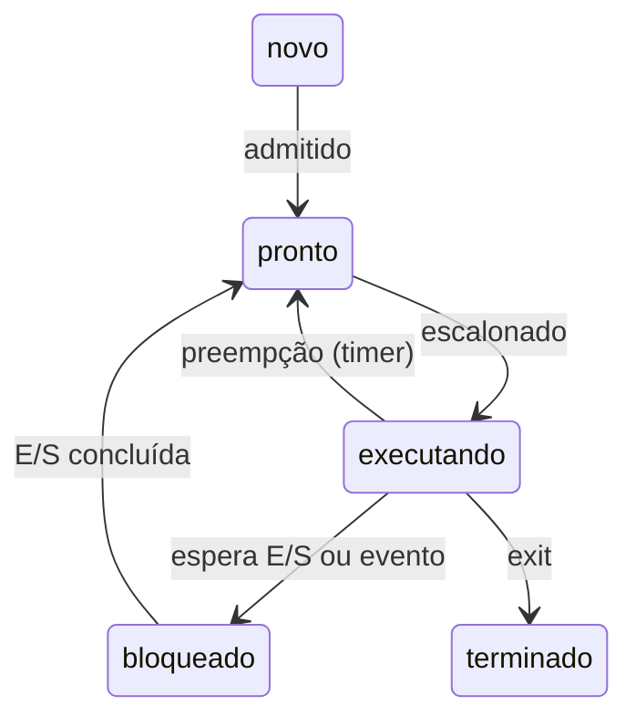

# Processos e threads

## Por que isso importa

Toda vez que você abre um terminal, roda `python main.py` ou sobe um servidor, o SO cria **processos**. Um navegador moderno usa um processo por aba para que uma página travada não derrube as outras. Um servidor web atende milhares de clientes com **threads** ou vários processos. Entender a diferença explica por que um programa Python com threads não fica mais rápido em tarefas de CPU, por que um comando com `&` continua rodando, o que é um processo "zumbi" no `ps` e como o shell executa comandos.

## Intuição

Um **programa** é uma **receita** guardada no livro (um arquivo no disco). Um **processo** é alguém **cozinhando** essa receita agora: tem uma bancada própria (memória), sabe em que passo está (o contador de programa) e tem seus ingredientes separados (registradores, arquivos abertos). Duas pessoas podem cozinhar a mesma receita ao mesmo tempo: são dois processos do mesmo programa.

**Threads** são vários cozinheiros na **mesma bancada**. Eles dividem os ingredientes e os utensílios (a memória), o que é ótimo para colaborar e barato para começar, mas exige cuidado: dois podem pegar a mesma panela ao mesmo tempo (é o assunto da SO-04).

O `fork` é como **clonar** o cozinheiro no meio da receita, com uma cópia da bancada. O `exec` é o clone jogar fora a receita que tinha e começar **outra** do zero.

## Visual

Estados de um processo:



O que cada processo tem, e o que as threads de um processo compartilham:

| | Cada processo tem o seu | Cada thread tem o seu | Threads do mesmo processo compartilham |
|---|---|---|---|
| Código e variáveis globais | sim | | sim |
| Heap (objetos criados) | sim | | sim |
| Arquivos abertos | sim | | sim |
| Pilha (variáveis locais) | sim | sim | |
| Registradores e PC | sim | sim | |

## Conceito técnico

### O que é um processo

Um processo é um **programa em execução** com:

- um **espaço de endereçamento** próprio: código, dados globais, heap e pilha (memória virtual, SO-06);
- o **estado da CPU**: registradores, contador de programa (PC), ponteiro de pilha;
- recursos do SO: descritores de arquivo (SO-01), diretório atual, usuário dono, PID.

O kernel guarda tudo isso num **PCB** (*process control block*, a `struct task_struct` no Linux). Cada processo tem um **PID** e um **PPID** (o PID do pai).

### Estados e troca de contexto

Num núcleo, só **um** processo está **executando** por vez. Os outros estão **prontos** (esperando a vez) ou **bloqueados** (esperando algo: o disco, a rede, o teclado). Um processo bloqueado não ocupa a CPU: quando a E/S termina, uma interrupção o devolve para **pronto**.

A **troca de contexto** é o kernel salvar os registradores do processo atual no PCB dele e carregar os de outro. Custa alguns microssegundos (e esvazia caches e o TLB), então trocar demais também desperdiça tempo.

### A API de processos do Unix

- **`fork()`**: cria uma **cópia** do processo atual. Volta **duas vezes**: no pai devolve o PID do filho; no filho devolve **0**. As memórias são separadas a partir daí (o kernel usa *copy-on-write* para não copiar de verdade até alguém escrever).
- **`exec(programa, args)`**: **substitui** o programa do processo atual por outro. Se der certo, não volta.
- **`wait()`**: o pai espera um filho terminar e recebe o código de saída.
- **`exit(código)`**: termina o processo.

É assim que o shell roda `ls -l`:

```text
pid = fork()
if pid == 0:                 # filho
    exec("ls", ["ls", "-l"]) # vira o ls
else:                        # pai (o shell)
    wait()                   # espera o ls terminar e mostra o prompt de novo
```

Separar `fork` de `exec` parece estranho, mas é poderoso: entre os dois, o filho pode trocar seus descritores de arquivo. É assim que `ls > saida.txt` funciona: o filho fecha o fd 1, abre `saida.txt` (que recebe o menor fd livre, o 1) e só então faz `exec`. O `ls` nem sabe que está escrevendo num arquivo.

### Zumbis e órfãos

- **Zumbi**: o filho terminou, mas o pai ainda não chamou `wait`. O kernel mantém uma entrada mínima (PID e código de saída) para o pai poder ler depois. Aparece como `<defunct>` no `ps`. Poucos zumbis são inofensivos; milhares esgotam a tabela de PIDs.
- **Órfão**: o pai terminou antes do filho. O filho é **adotado** pelo processo de PID 1 (`init` ou `systemd`), que faz `wait` em seus filhos adotivos, então eles nunca ficam zumbis por muito tempo.

### Threads

Uma **thread** é uma linha de execução dentro de um processo: tem seu próprio PC, registradores e pilha, mas compartilha memória e arquivos com as outras threads do processo.

| | Processos | Threads |
|---|---|---|
| Criação | mais cara (novo espaço de endereçamento) | barata |
| Comunicação | pipes, sockets, arquivos, memória compartilhada explícita | direta: as variáveis são as mesmas |
| Isolamento | um processo que quebra não afeta os outros | uma thread que quebra derruba o processo inteiro |
| Perigo principal | custo e comunicação | **condições de corrida** (SO-04) |

No **CPython**, o GIL (*global interpreter lock*) só deixa uma thread executar bytecode Python por vez. Threads ainda ajudam em tarefas de **E/S** (esperar rede ou disco), mas para paralelizar **CPU** usa-se `multiprocessing` (processos). A partir do Python 3.13 existe uma versão experimental sem GIL.

## Código

`fork` não roda no navegador, então experimente este no terminal de um Linux ou macOS:

```text
# salve como fork.py e rode com: python3 fork.py
import os

print("antes do fork, pid", os.getpid())
pid = os.fork()
if pid == 0:
    print(f"  filho: meu pid é {os.getpid()}, meu pai é {os.getppid()}")
    os._exit(7)
else:
    _, status = os.waitpid(pid, 0)
    print(f"pai: o filho {pid} terminou com código {os.waitstatus_to_exitcode(status)}")
```

Threads compartilham memória; processos não. O Python do navegador não cria threads, então este também é para o terminal:

```text
# salve como threads.py e rode com: python3 threads.py
import threading

contador = {"valor": 0}

def trabalhar(nome, vezes):
    for _ in range(vezes):
        contador["valor"] += 1
    print(nome, "terminou")

threads = [threading.Thread(target=trabalhar, args=(f"t{i}", 1000)) for i in range(3)]
for t in threads:
    t.start()
for t in threads:
    t.join()            # como o wait: espera a thread terminar
print("valor final:", contador["valor"])   # as três mexeram no MESMO dicionário
```

## Erros comuns

- **Confundir programa e processo.** O mesmo programa pode estar rodando em vários processos, cada um com sua memória.
- **Achar que depois do `fork` pai e filho compartilham variáveis.** Cada um tem sua cópia; mudar `x` no filho não muda o `x` do pai.
- **Esquecer que `exec` não volta.** O código depois de um `exec` bem-sucedido nunca executa.
- **Não chamar `wait`.** Um servidor que cria filhos e nunca os espera acumula zumbis.
- **Usar threads em Python para acelerar cálculo.** Por causa do GIL, use processos (`multiprocessing`) para trabalho de CPU.
- **Achar que "bloqueado" gasta CPU.** Um processo bloqueado esperando a rede não consome nada até a resposta chegar.

## Pratique

```quiz
id: SO-02-q1
tipo: multipla_escolha
pergunta: "Um processo está esperando a resposta de uma requisição de rede. Em que estado ele está?"
opcoes: ["Executando", "Pronto", "Bloqueado", "Terminado"]
resposta: 2
explicacao: "Ele não pode avançar até a resposta chegar, então não adianta dar a CPU para ele. Quando a placa de rede gerar a interrupção, o kernel o move para pronto, e o escalonador decide quando ele volta a executar."
dificuldade: 1
```

```quiz
id: SO-02-q2
tipo: prever_saida
pergunta: |
  Quantas vezes "oi" é impresso? (Considere que nenhum fork falha.)
  ```text
  fork()
  fork()
  fork()
  print("oi")
  ```
resposta: "8"
explicacao: "Cada fork dobra o número de processos que estão executando aquela linha: 1 → 2 → 4 → 8. Os 8 processos chegam ao print. Com n forks em sequência, são 2ⁿ processos."
dificuldade: 2
```

```quiz
id: SO-02-q3
tipo: prever_saida
pergunta: |
  Qual valor o pai imprime?
  ```text
  x = 10
  pid = fork()
  if pid == 0:
      x = x + 5
      exit(0)
  wait()
  print(x)
  ```
resposta: "10"
explicacao: "Depois do fork, pai e filho têm memórias separadas. O filho muda a cópia dele de x e termina; o x do pai continua 10. Com threads, que compartilham memória, a mudança seria vista."
dificuldade: 2
```

```quiz
id: SO-02-q4
tipo: multipla_escolha
pergunta: "O que as threads de um mesmo processo NÃO compartilham?"
opcoes: ["Variáveis globais", "Heap", "Arquivos abertos", "Pilha e registradores"]
resposta: 3
explicacao: "Cada thread tem sua própria pilha (variáveis locais, endereços de retorno) e seus registradores, inclusive o PC, porque cada uma está num ponto diferente do código. Todo o resto do processo é compartilhado."
dificuldade: 1
```

```quiz
id: SO-02-q5
tipo: verdadeiro_falso
pergunta: "Um processo zumbi continua consumindo CPU até o pai chamar wait."
resposta: false
explicacao: "O zumbi já terminou: não executa nada e não ocupa memória do programa. Sobra só uma entrada na tabela de processos com o PID e o código de saída, esperando o pai ler. O problema de muitos zumbis é esgotar PIDs, não CPU."
dificuldade: 2
```

```quiz
id: SO-02-q6
tipo: resposta_curta
pergunta: "Por que o Unix separa fork e exec em duas chamadas, em vez de ter uma só que cria um processo já rodando outro programa?"
resposta: "Porque entre o fork e o exec o filho ainda roda o código do pai e pode preparar o ambiente do novo programa: redirecionar descritores de arquivo (para > e pipes), mudar de diretório, trocar variáveis de ambiente. O programa executado herda isso sem precisar saber de nada."
palavras_chave: ["redirecion", "descritor", "entre", "herda"]
dificuldade: 3
```

```quiz
id: SO-02-q7
tipo: codigo
linguagem: python
pergunta: |
  **Máquina de estados de processos.** Escreva `simular_estados(eventos)` que recebe uma lista de `(evento, pid)` e devolve um dicionário `{pid: estado}` com o estado final de cada processo, na ordem em que foram criados. Os eventos e transições válidas são:

  - `'criar'`: um pid novo nasce **pronto** (criar um pid que já existe é inválido).
  - `'escalonar'`: pronto → executando. Só **um** processo pode estar executando de cada vez.
  - `'preempcao'`: executando → pronto.
  - `'bloquear'`: executando → bloqueado.
  - `'desbloquear'`: bloqueado → pronto.
  - `'sair'`: executando → terminado.

  No primeiro evento inválido, devolva a string `'inválido: <evento> <pid>'`.
codigo_inicial: |
  def simular_estados(eventos):
      estado = {}
      for evento, pid in eventos:
          if evento == 'criar':
              estado[pid] = 'pronto'
      return estado
usa: [def, for, if, return]
testes:
  - chamada: "simular_estados([('criar', 1), ('criar', 2), ('escalonar', 1), ('bloquear', 1), ('escalonar', 2), ('desbloquear', 1), ('sair', 2), ('escalonar', 1)])"
    saida: "{1: 'executando', 2: 'terminado'}"
  - chamada: "simular_estados([('criar', 1), ('bloquear', 1)])"
    saida: "'inválido: bloquear 1'"
  - chamada: "simular_estados([('criar', 1), ('criar', 2), ('escalonar', 1), ('escalonar', 2)])"
    saida: "'inválido: escalonar 2'"
  - chamada: "simular_estados([])"
    saida: "{}"
  - chamada: "simular_estados([('criar', 7), ('escalonar', 7), ('preempcao', 7), ('escalonar', 7), ('sair', 7), ('escalonar', 7)])"
    visivel: false
    saida: "'inválido: escalonar 7'"
  - chamada: "simular_estados([('criar', 1), ('criar', 1)])"
    visivel: false
    saida: "'inválido: criar 1'"
dica: "Monte um dicionário transicoes = {'escalonar': ('pronto', 'executando'), ...}. Para cada evento, confira se estado.get(pid) é o estado de origem. Para escalonar, confira também se 'executando' não está em estado.values()."
solucao: |
  def simular_estados(eventos):
      transicoes = {
          'escalonar': ('pronto', 'executando'),
          'preempcao': ('executando', 'pronto'),
          'bloquear': ('executando', 'bloqueado'),
          'desbloquear': ('bloqueado', 'pronto'),
          'sair': ('executando', 'terminado'),
      }
      estado = {}
      for evento, pid in eventos:
          invalido = f'inválido: {evento} {pid}'
          if evento == 'criar':
              if pid in estado:
                  return invalido
              estado[pid] = 'pronto'
              continue
          origem, destino = transicoes[evento]
          if estado.get(pid) != origem:
              return invalido
          if destino == 'executando' and 'executando' in estado.values():
              return invalido
          estado[pid] = destino
      return estado
explicacao: "As transições espelham o diagrama de estados. Um processo bloqueado não pode ir direto para executando: quando a E/S termina, ele volta para a fila de prontos e espera a vez. No primeiro teste, enquanto o 1 está bloqueado, a CPU fica com o 2, que é exatamente o ganho de ter vários processos. E um processo terminado nunca volta (teste oculto)."
dificuldade: 2
```

```quiz
id: SO-02-q8
tipo: codigo
linguagem: javascript
pergunta: |
  **Caçando zumbis.** Simule a tabela de processos e devolva, em ordem crescente, os PIDs que ficaram **zumbis** no final. Os eventos são arrays:

  - `['fork', pai, filho]`: o processo `filho` nasce vivo, com aquele pai.
  - `['exit', pid]`: o processo termina. Os filhos dele são **adotados pelo PID 1**, e os que já eram zumbis são recolhidos na hora. Se o pai de `pid` for o 1, ele também é recolhido na hora; senão, vira zumbi.
  - `['wait', pai]`: se o pai tiver algum filho zumbi, recolhe o de **menor** PID (ele some da tabela). Senão, nada acontece.

  O PID 1 nunca termina.
codigo_inicial: |
  function zumbis(eventos) {
    const mortos = [];
    for (const [op, a, b] of eventos) {
      if (op === 'exit') mortos.push(a);
    }
    return mortos;
  }
usa: [function, for, return]
testes:
  - chamada: "zumbis([['fork', 1, 100], ['fork', 100, 101], ['exit', 101]])"
    saida: "[ 101 ]"
  - chamada: "zumbis([['fork', 1, 100], ['fork', 100, 101], ['exit', 101], ['wait', 100]])"
    saida: "[]"
  - chamada: "zumbis([['fork', 1, 100], ['fork', 100, 101], ['fork', 100, 102], ['exit', 102], ['exit', 101], ['wait', 100]])"
    saida: "[ 102 ]"
  - chamada: "zumbis([['fork', 1, 100], ['fork', 100, 101], ['exit', 101], ['exit', 100]])"
    saida: "[]"
  - chamada: "zumbis([['fork', 1, 10], ['fork', 10, 20], ['fork', 20, 30], ['exit', 30], ['exit', 20], ['wait', 10], ['fork', 10, 40], ['exit', 40], ['wait', 99]])"
    visivel: false
    saida: "[ 40 ]"
dica: "Guarde dois objetos: pai[pid] e estado[pid] ('vivo' ou 'zumbi'). Recolher = apagar o pid dos dois. No exit, primeiro percorra os pids cujo pai é o que está saindo: mude o pai para 1 e recolha os que forem zumbis. Depois decida o destino do próprio processo."
solucao: |
  function zumbis(eventos) {
    const pai = {};
    const estado = {};
    const recolher = (pid) => {
      delete pai[pid];
      delete estado[pid];
    };
    for (const [op, a, b] of eventos) {
      if (op === 'fork') {
        pai[b] = a;
        estado[b] = 'vivo';
      } else if (op === 'exit') {
        for (const f of Object.keys(pai).map(Number)) {
          if (pai[f] === a) {
            pai[f] = 1;
            if (estado[f] === 'zumbi') recolher(f);
          }
        }
        if (pai[a] === 1) recolher(a);
        else estado[a] = 'zumbi';
      } else if (op === 'wait') {
        const filhos = Object.keys(pai).map(Number)
          .filter((f) => pai[f] === a && estado[f] === 'zumbi')
          .sort((x, y) => x - y);
        if (filhos.length > 0) recolher(filhos[0]);
      }
    }
    return Object.keys(estado).map(Number)
      .filter((p) => estado[p] === 'zumbi')
      .sort((x, y) => x - y);
  }
explicacao: "Um zumbi só existe enquanto o pai está vivo e não chamou wait. No quarto teste, o pai 100 termina sem esperar o 101: o 101 é adotado pelo init, que o recolhe, e o próprio 100, filho do 1, também some. No oculto, o 30 é recolhido quando o 20 sai, o wait do 10 recolhe o 20, mas o 40 fica zumbi porque o wait foi feito pelo processo errado (99)."
dificuldade: 3
```

## Resumo

- **Processo** = programa em execução: espaço de endereçamento, estado da CPU e recursos, guardados no **PCB**.
- Estados: **pronto**, **executando**, **bloqueado** (mais novo e terminado). A **troca de contexto** salva e restaura registradores.
- **fork** clona (devolve 0 no filho), **exec** troca o programa, **wait** espera um filho, **exit** termina.
- **Zumbi**: terminou e o pai não fez wait. **Órfão**: o pai morreu; o PID 1 adota.
- **Threads** compartilham memória e arquivos, cada uma com sua pilha e registradores: baratas, mas sujeitas a condições de corrida. No CPython, o GIL limita o paralelismo de CPU.

## Para ir além

- Faça o lab "Xv6 and Unix utilities" do MIT 6.1810 (implemente `sleep`, `pingpong` e `primes` com fork e pipes).
- Rode `ps -ef --forest` (Linux) ou `pstree` para ver a árvore de processos do seu sistema.
- **Próximo módulo**: SO-03 Escalonamento de CPU.
