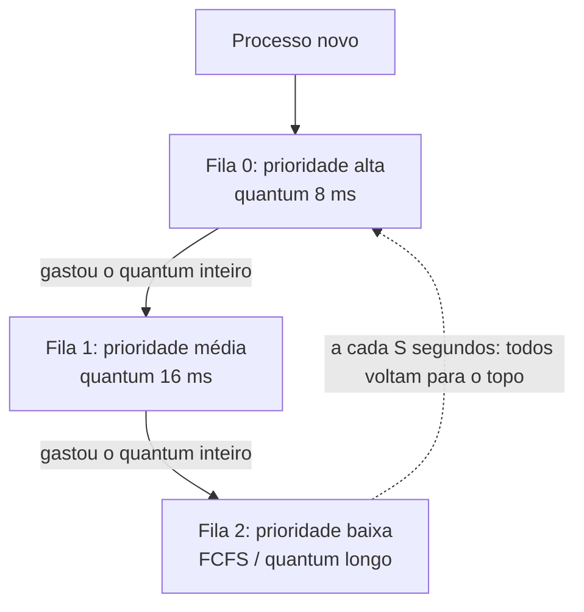

# Escalonamento de CPU

## Por que isso importa

Seu computador tem talvez 8 núcleos e centenas de processos querendo rodar. A cada poucos milissegundos o kernel decide **quem usa a CPU agora**. Essa decisão é o que faz o editor responder na hora enquanto um build pesado roda ao fundo, e o que faz um servidor sobrecarregado ficar lento para todos ou só para alguns. As mesmas ideias aparecem fora do SO: filas de tarefas (Celery, Sidekiq), balanceadores de carga, o event loop do JavaScript e o planejamento de qualquer fila de atendimento.

## Intuição

Uma **fila de supermercado** com um caixa só:

- **FCFS** (primeiro a chegar, primeiro a ser atendido): justo, mas se na sua frente estiver alguém com **dois carrinhos cheios**, você espera 20 minutos para pagar um chiclete. É o **efeito comboio**.
- **SJF** (menor tarefa primeiro): o caixa atende primeiro quem tem menos itens. A espera **média** cai muito, mas quem tem o carrinho cheio pode esperar para sempre se continuarem chegando pessoas com poucos itens (**inanição**).
- **Round Robin**: cada cliente passa **5 itens** e volta para o fim da fila. Ninguém espera muito para **começar** a ser atendido, mas o caixa perde tempo trocando de cliente.

Não existe política melhor em tudo: cada uma otimiza uma métrica diferente.

## Visual

Quatro processos (chegada, duração): A (0, 8), B (1, 4), C (2, 9), D (3, 5). Cada célula é uma unidade de tempo.

```text
FCFS         |A A A A A A A A|B B B B|C C C C C C C C C|D D D D D|
             0               8       12                21        26

SJF          |A A A A A A A A|B B B B|D D D D D|C C C C C C C C C|
             0               8       12        17                26

SRTF         |A|B B B B|D D D D D|A A A A A A A|C C C C C C C C C|
             0 1       5         10            17                26

RR (q = 4)   |A A A A|B B B B|C C C C|D D D D|A A A A|C C C C|D|C|
             0       4       8       12      16      20      24 25 26
```

Fila multinível com realimentação (MLFQ):



## Conceito técnico

### Métricas

Para cada processo:

- **Tempo de retorno** (*turnaround*) = término − chegada.
- **Tempo de espera** = retorno − duração (o tempo que passou na fila de prontos).
- **Tempo de resposta** = primeira vez que executou − chegada (importa para programas interativos).

Também se mede **vazão** (processos concluídos por segundo) e **utilização** da CPU. Na prática, servidores olham a **cauda**: o p99 do tempo de resposta.

### Políticas clássicas

| Política | Preemptiva? | Escolhe | Bom em | Problema |
|---|---|---|---|---|
| **FCFS** | não | quem chegou primeiro | simplicidade | efeito comboio |
| **SJF** | não | menor duração entre os que chegaram | menor espera média (sem preempção) | precisa adivinhar a duração; inanição |
| **SRTF** | sim | menor tempo **restante** | menor espera média de todas | o mesmo, e mais trocas de contexto |
| **Prioridade** | ambos | maior prioridade | tarefas importantes primeiro | inanição (resolvida com **envelhecimento**) |
| **Round Robin** | sim | o próximo da fila, por um **quantum** | tempo de resposta | retorno médio pior que SJF |

No exemplo do Visual, as esperas médias ficam: FCFS 8,75, SJF 7,75, SRTF 6,5.

### O quantum do Round Robin

- Quantum **muito grande**: vira FCFS.
- Quantum **muito pequeno**: a CPU passa boa parte do tempo trocando de contexto. Com quantum de 1 ms e troca de 0,1 ms, 9% do tempo é desperdiçado.
- Valores típicos ficam entre 1 e 100 ms; a ideia é que a maioria das rajadas de CPU termine dentro de um quantum.

**Convenção usada aqui**: quando um processo é preemptado no instante t, os que **chegaram até t** entram na fila **antes** dele.

### Processos limitados por CPU vs. por E/S

Programas reais alternam **rajadas de CPU** e **esperas de E/S**. Um editor de texto usa a CPU por 1 ms e depois espera a próxima tecla; uma compilação usa a CPU por segundos. Uma boa política dá prioridade aos que usam pouco a CPU: eles liberam rápido, voltam a esperar E/S, e o usuário sente o sistema ágil.

### MLFQ: aprender com o comportamento

Como o SO não sabe a duração de cada processo, a **fila multinível com realimentação** observa:

1. Processos novos entram na fila de **maior** prioridade.
2. Quem gasta o quantum **inteiro** desce um nível (parece limitado por CPU).
3. Quem larga a CPU antes (para fazer E/S) fica no nível em que está.
4. De tempos em tempos, **todos sobem** para o topo, evitando inanição e corrigindo processos que mudaram de comportamento.

Assim, programas interativos ficam no topo sem ninguém precisar dizer que são interativos. Windows e o antigo escalonador do macOS são variações disso.

### E o Linux?

De 2007 a 2023 o Linux usou o **CFS** (*Completely Fair Scheduler*): cada processo acumula um "tempo virtual de CPU" (que corre mais devagar para quem tem prioridade alta, o `nice`), e o escolhido é sempre o de **menor** tempo virtual, guardado numa árvore rubro-negra (ED-06). Desde a versão 6.6 ele usa o **EEVDF**, uma evolução que também considera prazos para melhorar a latência.

## Código

Uma função que calcula as métricas de qualquer ordem de execução não preemptiva:

```python
def metricas(processos, ordem):
    """processos: {nome: (chegada, duracao)}; ordem: lista de nomes na ordem de execução."""
    t = 0
    esperas, retornos = [], []
    for nome in ordem:
        chegada, duracao = processos[nome]
        t = max(t, chegada)            # CPU ociosa até o processo chegar
        esperas.append(t - chegada)
        t += duracao
        retornos.append(t - chegada)
        print(f"{nome}: roda de {t - duracao:2} a {t:2}, esperou {t - duracao - chegada}")
    n = len(ordem)
    print(f"espera média {sum(esperas) / n:.2f}, retorno médio {sum(retornos) / n:.2f}\n")

procs = {"A": (0, 24), "B": (0, 3), "C": (0, 3)}
metricas(procs, ["A", "B", "C"])     # efeito comboio: espera média 17
metricas(procs, ["B", "C", "A"])     # curtos primeiro: espera média 3
```

## Erros comuns

- **Esquecer a chegada.** Tempo de espera é contado a partir da chegada, não do instante 0.
- **Achar que SJF é sempre o melhor.** Ele minimiza a espera média, mas precisa saber a duração (que o SO não sabe) e pode deixar processos longos esperando para sempre.
- **Na simulação do Round Robin, colocar o processo preemptado na fila antes dos que acabaram de chegar.** Escolha uma convenção e siga sempre; aqui, quem chega entra antes.
- **Confundir tempo de resposta com tempo de retorno.** Resposta é até a **primeira** execução; retorno é até o **fim**.
- **Usar um quantum minúsculo "para ser mais justo".** O custo das trocas de contexto come o ganho.

## Pratique

```quiz
id: SO-03-q1
tipo: multipla_escolha
pergunta: "Três processos chegam juntos com durações 24, 3 e 3, nessa ordem. Qual a espera média com FCFS?"
opcoes: ["3", "10", "17", "27"]
resposta: 2
explicacao: "As esperas são 0 (o de 24), 24 e 27. Média: 51 / 3 = 17. Se os dois curtos fossem primeiro, as esperas seriam 0, 3 e 6, com média 3: é o efeito comboio."
dificuldade: 1
```

```quiz
id: SO-03-q2
tipo: multipla_escolha
pergunta: "Qual política minimiza o tempo médio de espera quando todas as durações são conhecidas e a preempção é permitida?"
opcoes: ["FCFS", "Round Robin", "SRTF", "Prioridade fixa"]
resposta: 2
explicacao: "SRTF (menor tempo restante primeiro) é ótima para espera média: sempre que um processo mais curto chega, ele passa na frente. O preço é precisar saber as durações e o risco de inanição dos processos longos."
dificuldade: 2
```

```quiz
id: SO-03-q3
tipo: verdadeiro_falso
pergunta: "No Round Robin, aumentar o quantum indefinidamente faz o comportamento se aproximar do FCFS."
resposta: true
explicacao: "Se o quantum é maior que qualquer rajada de CPU, cada processo roda até terminar ou bloquear, na ordem da fila. Isso é exatamente FCFS."
dificuldade: 1
```

```quiz
id: SO-03-q4
tipo: resposta_curta
pergunta: "O que é inanição (starvation) no escalonamento e qual técnica a evita?"
resposta: "É quando um processo pronto nunca recebe a CPU porque sempre há outros com mais prioridade ou mais curtos na frente. O envelhecimento (aging) resolve: a prioridade de quem espera aumenta com o tempo, até ele ser escolhido. No MLFQ, o reajuste periódico que sobe todos para o topo faz o mesmo papel."
palavras_chave: ["nunca", "envelhecimento", "prioridade", "espera"]
dificuldade: 2
```

```quiz
id: SO-03-q5
tipo: multipla_escolha
pergunta: "No MLFQ, um processo que usa a CPU por 1 ms e depois espera o teclado, repetidamente, tende a ficar:"
opcoes: ["Na fila de maior prioridade", "Na fila de menor prioridade", "Alternando entre todas", "Bloqueado para sempre"]
resposta: 0
explicacao: "Ele nunca gasta o quantum inteiro, então nunca desce de nível. É assim que o MLFQ dá prioridade a programas interativos sem que ninguém precise avisar quais são."
dificuldade: 2
```

```quiz
id: SO-03-q6
tipo: codigo
linguagem: python
pergunta: |
  **FCFS e SJF.** Escreva `escalonar(processos, politica)` que recebe uma lista de `(nome, chegada, duracao)` e `politica` igual a `'FCFS'` ou `'SJF'` (sem preempção) e devolve a tupla `(espera_media, retorno_medio)`, cada um com `round(..., 2)`.

  - Quando a CPU fica livre, escolha entre os processos que **já chegaram**: no FCFS, o de menor chegada; no SJF, o de menor duração (empate: menor chegada, depois menor nome).
  - Se nenhum chegou ainda, a CPU fica ociosa até a próxima chegada.
codigo_inicial: |
  def escalonar(processos, politica):
      t = 0
      espera = retorno = 0
      for nome, chegada, duracao in processos:
          espera += t
          t += duracao
          retorno += t
      n = len(processos)
      return (round(espera / n, 2), round(retorno / n, 2))
usa: [def, while, return]
testes:
  - chamada: "escalonar([('A', 0, 8), ('B', 1, 4), ('C', 2, 9), ('D', 3, 5)], 'FCFS')"
    saida: "(8.75, 15.25)"
  - chamada: "escalonar([('A', 0, 8), ('B', 1, 4), ('C', 2, 9), ('D', 3, 5)], 'SJF')"
    saida: "(7.75, 14.25)"
  - chamada: "escalonar([('A', 0, 24), ('B', 0, 3), ('C', 0, 3)], 'SJF')"
    saida: "(3.0, 13.0)"
  - chamada: "escalonar([('A', 5, 2), ('B', 0, 1)], 'FCFS')"
    saida: "(0.0, 1.5)"
  - chamada: "escalonar([('p%d' % i, (i * 7) % 50, (i * 13) % 17 + 1) for i in range(300)], 'SJF')"
    visivel: false
    saida: "(896.27, 905.26)"
  - chamada: "escalonar([('p%d' % i, (i * 7) % 50, (i * 13) % 17 + 1) for i in range(300)], 'FCFS')"
    visivel: false
    saida: "(1311.88, 1320.87)"
dica: "Ordene os pendentes por (chegada, nome). Em um while: chegaram = [p for p in pendentes if p[1] <= t]. Se vazio, t = pendentes[0][1]. Senão, escolha com chegaram[0] (FCFS) ou min(chegaram, key=lambda p: (p[2], p[1], p[0])) (SJF), remova, e some t - chegada à espera."
solucao: |
  def escalonar(processos, politica):
      pendentes = sorted(processos, key=lambda p: (p[1], p[0]))
      t = 0
      espera = retorno = 0
      while pendentes:
          chegaram = [p for p in pendentes if p[1] <= t]
          if not chegaram:
              t = pendentes[0][1]
              continue
          if politica == 'FCFS':
              p = chegaram[0]
          else:
              p = min(chegaram, key=lambda p: (p[2], p[1], p[0]))
          pendentes.remove(p)
          espera += t - p[1]
          t += p[2]
          retorno += t - p[1]
      n = len(processos)
      return (round(espera / n, 2), round(retorno / n, 2))
explicacao: "O código inicial ignora a chegada e a ordem. No quarto teste, a lista não está ordenada por chegada e a CPU fica ociosa de 1 a 5. Nos testes ocultos, com 300 processos, o SJF reduz a espera média em cerca de um terço, como prevê a teoria."
dificuldade: 2
```

```quiz
id: SO-03-q7
tipo: codigo
linguagem: python
pergunta: |
  **Round Robin.** Escreva `round_robin(processos, quantum)` que recebe uma lista de `(nome, chegada, duracao)` e devolve a lista de `(nome, termino)` na ordem em que os processos terminam.

  - Um processo roda por `min(quantum, restante)` unidades.
  - Depois disso, primeiro entram na fila todos os que chegaram **até o fim** dessa fatia (em ordem de chegada, depois nome), e só então o processo volta para o fim da fila, se não terminou.
  - Com a fila vazia, a CPU espera a próxima chegada.
codigo_inicial: |
  def round_robin(processos, quantum):
      t = 0
      resultado = []
      for nome, chegada, duracao in sorted(processos, key=lambda p: p[1]):
          t = max(t, chegada) + duracao
          resultado.append((nome, t))
      return resultado
usa: [def, while, return]
testes:
  - chamada: "round_robin([('A', 0, 24), ('B', 0, 3), ('C', 0, 3)], 4)"
    saida: "[('B', 7), ('C', 10), ('A', 30)]"
  - chamada: "round_robin([('A', 0, 8), ('B', 1, 4), ('C', 2, 9), ('D', 3, 5)], 4)"
    saida: "[('B', 8), ('A', 20), ('D', 25), ('C', 26)]"
  - chamada: "round_robin([('A', 0, 3), ('B', 10, 2)], 2)"
    saida: "[('A', 3), ('B', 12)]"
  - chamada: "round_robin([('A', 0, 5), ('B', 2, 3), ('C', 4, 1)], 2)"
    visivel: false
    saida: "[('C', 7), ('B', 8), ('A', 9)]"
  - chamada: "round_robin([('p%d' % i, (i * 7) % 50, (i * 13) % 17 + 1) for i in range(200)], 3)[-1]"
    visivel: false
    saida: "('p64', 1792)"
dica: "Use collections.deque como fila e um dicionário resto[nome]. Ordene as chegadas e mantenha um índice i do próximo a chegar. Escreva um laço auxiliar 'enquanto i < len(chegadas) e chegadas[i][1] <= t: fila.append(...)' e chame-o antes de escolher e logo depois de cada fatia, antes de devolver o processo à fila."
solucao: |
  from collections import deque

  def round_robin(processos, quantum):
      chegadas = sorted(processos, key=lambda p: (p[1], p[0]))
      resto = {nome: d for nome, _, d in processos}
      fila = deque()
      resultado = []
      i = 0
      t = 0
      while len(resultado) < len(processos):
          while i < len(chegadas) and chegadas[i][1] <= t:
              fila.append(chegadas[i][0])
              i += 1
          if not fila:
              t = chegadas[i][1]
              continue
          nome = fila.popleft()
          fatia = min(quantum, resto[nome])
          t += fatia
          resto[nome] -= fatia
          while i < len(chegadas) and chegadas[i][1] <= t:
              fila.append(chegadas[i][0])
              i += 1
          if resto[nome] == 0:
              resultado.append((nome, t))
          else:
              fila.append(nome)
      return resultado
explicacao: "No primeiro teste, os processos curtos B e C terminam em 7 e 10, em vez de 27 e 30 no FCFS: é o ganho de resposta do Round Robin. O preço aparece em A, que termina em 30 de qualquer jeito. No teste oculto pequeno, C chega no instante 4 e entra na fila antes de A, que acabou de ser preemptado, por isso termina primeiro."
dificuldade: 3
```

```quiz
id: SO-03-q8
tipo: codigo
linguagem: javascript
pergunta: |
  **SRTF (menor tempo restante).** Escreva `srtf(processos)` que recebe um array de `[nome, chegada, duracao]` e devolve um array de `[nome, termino]` na ordem de término. Simule de 1 em 1 unidade de tempo: a cada instante, rode por 1 unidade o processo já chegado com **menor tempo restante** (empate: menor chegada, depois menor nome). Se nenhum chegou, o tempo avança.
codigo_inicial: |
  function srtf(processos) {
    // escolhe o mais curto, mas sem preempção
    const ordem = [...processos].sort((a, b) => a[2] - b[2]);
    let t = 0;
    return ordem.map(([nome, chegada, d]) => {
      t = Math.max(t, chegada) + d;
      return [nome, t];
    });
  }
usa: [function, while, return]
testes:
  - chamada: "srtf([['A', 0, 7], ['B', 2, 4], ['C', 4, 1], ['D', 5, 4]])"
    saida: "[ [ 'C', 5 ], [ 'B', 7 ], [ 'D', 11 ], [ 'A', 16 ] ]"
  - chamada: "srtf([['A', 0, 8], ['B', 1, 4], ['C', 2, 9], ['D', 3, 5]])"
    saida: "[ [ 'B', 5 ], [ 'D', 10 ], [ 'A', 17 ], [ 'C', 26 ] ]"
  - chamada: "srtf([])"
    saida: "[]"
  - chamada: "srtf([['A', 3, 2]])"
    visivel: false
    saida: "[ [ 'A', 5 ] ]"
  - chamada: "srtf([['X', 0, 5], ['Y', 0, 5], ['Z', 1, 5]])"
    visivel: false
    saida: "[ [ 'X', 5 ], [ 'Y', 10 ], [ 'Z', 15 ] ]"
dica: "Guarde resto[nome]. Em um while até todos terminarem: filtre os prontos (chegada <= t e resto > 0); se não houver, t++ e continue. Ordene por resto, chegada e nome; decremente o primeiro e faça t++. Se o resto zerou, registre [nome, t]."
solucao: |
  function srtf(processos) {
    const resto = {};
    for (const [nome, , d] of processos) resto[nome] = d;
    const ordem = [];
    let t = 0;
    while (ordem.length < processos.length) {
      const prontos = processos.filter(([nome, c]) => c <= t && resto[nome] > 0);
      if (prontos.length === 0) {
        t++;
        continue;
      }
      prontos.sort((a, b) => resto[a[0]] - resto[b[0]] || a[1] - b[1] || (a[0] < b[0] ? -1 : 1));
      const nome = prontos[0][0];
      resto[nome]--;
      t++;
      if (resto[nome] === 0) ordem.push([nome, t]);
    }
    return ordem;
  }
explicacao: "No primeiro teste, A começa sozinho, mas é interrompido em 2 porque B (4) tem menos restante que A (5). Em 4, C (1) passa na frente de B (2). O código inicial escolhe pelo mais curto, mas sem preempção: quem já começou nunca é interrompido. No último teste oculto, X tem 4 restantes quando Z chega com 5, então X continua: a preempção só acontece se o novo for estritamente mais curto."
dificuldade: 3
```

## Resumo

- Métricas: **retorno** = término − chegada; **espera** = retorno − duração; **resposta** = primeira execução − chegada.
- **FCFS** sofre com o efeito comboio; **SJF/SRTF** minimizam a espera média mas precisam adivinhar durações e podem causar **inanição**.
- **Round Robin** dá boa resposta; o **quantum** equilibra resposta e custo de troca de contexto.
- **MLFQ** aprende com o comportamento: quem gasta o quantum desce; reajustes periódicos evitam inanição.
- O Linux usou o **CFS** (menor tempo virtual, numa árvore rubro-negra) e hoje usa o **EEVDF**.

## Para ir além

- Leia o capítulo 8 do OSTEP e rode o simulador `mlfq.py` que acompanha o livro.
- Use `nice` e `top` no Linux para ver prioridades e o uso de CPU mudando em tempo real.
- **Próximo módulo**: SO-04 Concorrência: condições de corrida, mutex, semáforos.
