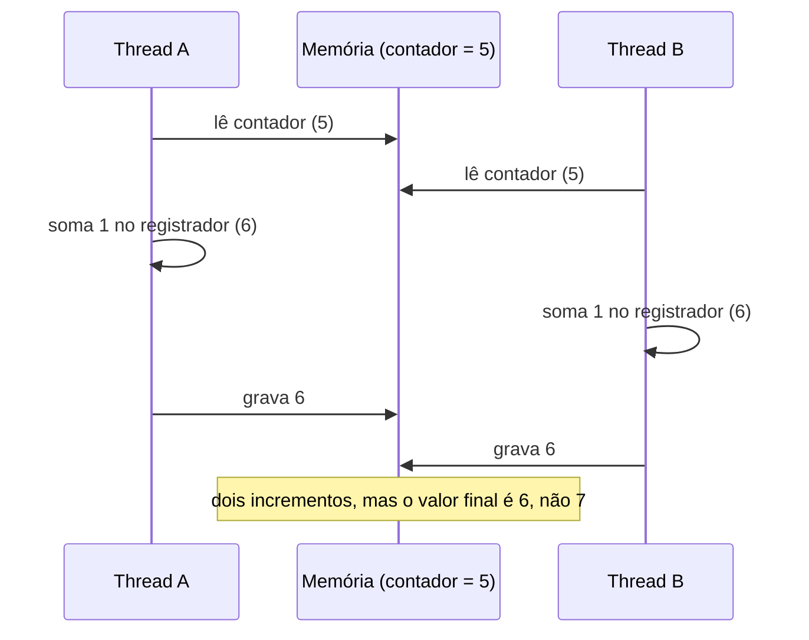

# Concorrência: condições de corrida, mutex, semáforos

## Por que isso importa

Quase todo software sério é concorrente: servidores web atendem pedidos ao mesmo tempo, bancos de dados recebem milhares de transações, aplicativos fazem rede em segundo plano enquanto a tela responde. Bugs de concorrência são os mais traiçoeiros que existem: aparecem uma vez em mil execuções, somem quando você coloca um `print` e reaparecem em produção às 3 da manhã. Já causaram saldo bancário errado, ingressos vendidos duas vezes e até mortes (o caso do Therac-25). Esta aula dá o vocabulário e as ferramentas para pensar nisso com rigor.

## Intuição

Dois caixas eletrônicos acessam a **mesma conta**, com R$ 100. Você saca R$ 50 em um, e seu irmão saca R$ 50 no outro, no mesmo segundo:

1. Caixa 1 lê o saldo: 100.
2. Caixa 2 lê o saldo: 100.
3. Caixa 1 grava 100 − 50 = 50.
4. Caixa 2 grava 100 − 50 = 50.

Saíram R$ 100 da conta, e o saldo diz 50. O banco perdeu dinheiro. O problema não é nenhuma das operações em si: é a **intercalação** delas. A solução é um **cadeado**: quem vai mexer no saldo tranca a conta, faz ler-calcular-gravar e só então destranca. O outro caixa espera.

Um **semáforo** é um cadeado com **contador**: um estacionamento com 10 vagas e uma placa mostrando quantas sobram. Carros entram enquanto o número é positivo; com 0, esperam na cancela até alguém sair.

## Visual

Como `contador += 1` perde atualizações. Em linguagem de máquina, ele vira três passos: **ler**, **somar**, **gravar**.



Com um mutex, a seção crítica vira indivisível para as outras threads:

```text
Thread A                      Thread B
lock(m)        ✓
lê 5                          lock(m)   ✗ bloqueia
soma → 6
grava 6
unlock(m)                     ✓ acorda com o lock
                              lê 6
                              soma → 7
                              grava 7
                              unlock(m)
```

## Conceito técnico

### Condição de corrida e seção crítica

Uma **condição de corrida** acontece quando o resultado depende da ordem em que threads intercalam acessos a dados **compartilhados**, e pelo menos um acesso é **escrita**. O trecho de código que acessa esse dado é a **seção crítica**.

Uma solução correta para a seção crítica precisa de:

1. **Exclusão mútua**: no máximo uma thread dentro de cada vez.
2. **Progresso**: se ninguém está dentro, quem quer entrar consegue.
3. **Espera limitada**: ninguém espera para sempre (sem inanição).

### Por que não basta uma variável `ocupado`?

```text
while ocupado: pass   # espera
ocupado = True        # entra
```

Duas threads podem ver `ocupado == False` ao mesmo tempo e entrar as duas: o teste e a atribuição são dois passos, com o mesmo problema do `+= 1`. Precisa-se de ajuda do **hardware**.

### Operações atômicas

O processador oferece instruções que leem e escrevem num passo só, sem intercalação possível:

- **test-and-set**: grava 1 e devolve o valor antigo.
- **compare-and-swap (CAS)**: "se o valor ainda é `esperado`, troque por `novo`", devolvendo se conseguiu.
- **fetch-and-add**: soma e devolve o valor antigo (contadores atômicos).

Com test-and-set, um **spinlock**:

```text
lock():   while test_and_set(&trava) == 1: pass   # gira até pegar
unlock(): trava = 0
```

### Spinlock vs. mutex com bloqueio

- **Spinlock**: a thread fica girando e gastando CPU. Ótimo para seções críticas **curtíssimas** em multiprocessadores (dentro do kernel, por exemplo).
- **Mutex com bloqueio**: se a trava está ocupada, a thread pede ao SO para **dormir** (fica bloqueada, SO-02) e é acordada no `unlock`. Não gasta CPU esperando, mas dormir e acordar custa uma troca de contexto. O `futex` do Linux combina os dois: tenta com uma operação atômica e só chama o kernel se houver disputa.

### Semáforos

Um **semáforo** (Dijkstra, 1965) é um inteiro com duas operações atômicas:

- **P** (*wait*, *down*, `acquire`): se o valor é positivo, decrementa e segue; senão, **bloqueia** a thread numa fila.
- **V** (*signal*, *up*, `release`): se há alguém na fila, acorda o primeiro; senão, incrementa.

Usos:

- **Semáforo binário** (valor inicial 1) = mutex.
- **Semáforo contador** (valor inicial N) = "no máximo N ao mesmo tempo": conexões com o banco, downloads simultâneos.
- **Sinalização** (valor inicial 0): a thread A faz P e espera até a thread B fazer V ("já terminei de preparar os dados").

### Produtor-consumidor com buffer limitado

Produtores colocam itens num buffer de tamanho N; consumidores tiram. Três semáforos resolvem:

```text
vazios = Semaforo(N)    # vagas livres
cheios = Semaforo(0)    # itens disponíveis
mutex  = Semaforo(1)    # protege o buffer

produtor:                 consumidor:
  P(vazios)                 P(cheios)
  P(mutex)                  P(mutex)
  buffer.append(item)       item = buffer.pop(0)
  V(mutex)                  V(mutex)
  V(cheios)                 V(vazios)
```

Trocar a ordem `P(vazios)` e `P(mutex)` no produtor causa **deadlock** quando o buffer está cheio: o produtor dorme segurando o mutex, e o consumidor nunca consegue entrar para liberar uma vaga (SO-05).

### Variáveis de condição e monitores

Uma **variável de condição** permite esperar "até que algo seja verdade" soltando o mutex enquanto dorme: `cond.wait()` solta o lock e dorme; `cond.notify()` acorda alguém. Sempre use `while`, não `if`, ao redor do `wait`: quem acorda precisa conferir a condição de novo. Um **monitor** é um objeto cujos métodos já rodam com o lock (o `synchronized` do Java).

### Na prática

- Em Python: `threading.Lock`, `threading.Semaphore`, `threading.Condition`, `queue.Queue` (já é um produtor-consumidor pronto).
- Em JavaScript, o código roda numa thread só (event loop), mas condições de corrida ainda aparecem entre `await`s, e `SharedArrayBuffer` com `Atomics` traz concorrência real para Web Workers.
- Prefira estruturas prontas e **dados imutáveis** ou **troca de mensagens** a compartilhar memória com locks feitos à mão.

## Código

O Python do navegador não cria threads, mas dá para **simular** a intercalação de forma determinística, executando um passo de cada "thread" por vez:

```python
memoria = {"contador": 0}

def incrementar(vezes):
    """Cada yield marca um ponto em que o escalonador pode trocar de thread."""
    for _ in range(vezes):
        r = memoria["contador"]       # lê
        yield
        r = r + 1                     # soma
        yield
        memoria["contador"] = r       # grava
        yield

def rodar(ordem, vezes=3):
    """ordem: sequência de 'A'/'B' dizendo quem executa o próximo passo."""
    memoria["contador"] = 0
    threads = {"A": incrementar(vezes), "B": incrementar(vezes)}
    for quem in ordem:
        next(threads[quem], None)
    for t in threads.values():        # termina o que sobrou
        for _ in t:
            pass
    return memoria["contador"]

print(rodar("AAAAAAAAABBBBBBBBB"))    # A inteiro, depois B: 6 (correto)
print(rodar("ABABABABABABABABAB"))    # intercalado passo a passo: 3!
print(rodar("AABABBAABBAB"))          # outra ordem, outro resultado
```

Mesmo código, mesmos dados, resultados diferentes conforme a ordem. É isso que torna esses bugs tão difíceis de reproduzir.

## Erros comuns

- **Achar que uma linha de código é atômica.** `x += 1`, `lista.append` em algumas linguagens, `if chave not in d: d[chave] = ...`: tudo pode ser intercalado.
- **Proteger só a escrita.** Se uma thread lê enquanto outra escreve várias partes de um dado, a leitura pode ver um estado pela metade.
- **Usar locks diferentes para o mesmo dado.** Dois locks que não se conhecem não excluem nada.
- **Esquecer o `unlock` num caminho de erro.** Use `with lock:` (Python) ou `try/finally`.
- **Usar `if` em vez de `while` com variáveis de condição.** Acordar não garante que a condição ainda vale.
- **Segurar o lock durante E/S lenta.** Todas as outras threads ficam paradas esperando a rede.

## Pratique

```quiz
id: SO-04-q1
tipo: multipla_escolha
pergunta: "Duas threads executam 1000 vezes `contador += 1` cada uma, sem lock, começando em 0. Qual afirmação é verdadeira?"
opcoes: ["O resultado é sempre 2000", "O resultado pode ser menor que 2000", "O resultado pode ser maior que 2000", "O programa sempre trava"]
resposta: 1
explicacao: "Cada incremento é ler, somar e gravar. Se as duas leem o mesmo valor antes de gravar, um incremento se perde. Nunca há incrementos a mais, então o valor fica entre 2 e 2000 (sim, 2 é possível com a intercalação certa)."
dificuldade: 1
```

```quiz
id: SO-04-q2
tipo: multipla_escolha
pergunta: "Qual valor inicial de semáforo permite que no máximo 5 threads usem um recurso ao mesmo tempo?"
opcoes: ["0", "1", "5", "-5"]
resposta: 2
explicacao: "Cada thread faz P antes de usar (decrementa) e V depois (incrementa). Com valor inicial 5, as cinco primeiras passam e a sexta bloqueia até alguém liberar. Valor 1 seria um mutex; valor 0 serve para sinalização."
dificuldade: 1
```

```quiz
id: SO-04-q3
tipo: verdadeiro_falso
pergunta: "Se duas threads só LEEM uma variável compartilhada e ninguém a escreve, não há condição de corrida."
resposta: true
explicacao: "Sem escrita, a ordem das leituras não muda o resultado: todas veem o mesmo valor. Por isso dados imutáveis são tão úteis em programas concorrentes, e por isso existem locks de leitura e escrita, que deixam vários leitores entrarem juntos."
dificuldade: 1
```

```quiz
id: SO-04-q4
tipo: multipla_escolha
pergunta: "No produtor-consumidor, o que acontece se o produtor fizer P(mutex) antes de P(vazios) e o buffer estiver cheio?"
opcoes: ["O item é descartado", "O produtor dorme segurando o mutex e o sistema trava", "O consumidor tira dois itens", "Nada: a ordem não importa"]
resposta: 1
explicacao: "O produtor pega o mutex e dorme esperando uma vaga. O consumidor, para liberar uma vaga, precisa do mutex, que nunca será solto. Os dois esperam um pelo outro para sempre: um deadlock. Primeiro espere pelo recurso, depois pegue o mutex."
dificuldade: 2
```

```quiz
id: SO-04-q5
tipo: resposta_curta
pergunta: "Quando um spinlock é melhor que um mutex que põe a thread para dormir?"
resposta: "Quando a seção crítica é muito curta e há vários núcleos: girar alguns ciclos esperando a outra thread terminar custa menos que dormir e ser acordado, que exige troca de contexto. Em seções longas ou com um núcleo só, girar desperdiça CPU, e é melhor bloquear."
palavras_chave: ["curta", "troca de contexto", "núcleo", "girar"]
dificuldade: 2
```

```quiz
id: SO-04-q6
tipo: prever_saida
pergunta: |
  Usando a função `rodar` do exemplo de Código (cada incremento tem 3 passos: ler, somar, gravar), qual o resultado de `rodar("ABABAB", vezes=1)`?
  ```python
  print(rodar("ABABAB", vezes=1))
  ```
resposta: "1"
explicacao: "A lê 0, B lê 0, A soma (1), B soma (1), A grava 1, B grava 1. Os dois incrementos leram o mesmo valor antes de qualquer gravação, então um deles se perdeu."
dificuldade: 2
```

```quiz
id: SO-04-q7
tipo: codigo
linguagem: python
pergunta: |
  **Todos os resultados possíveis.** A thread A faz `n1` incrementos e a B faz `n2`. Cada incremento tem **2 passos**: ler o contador para um registrador próprio, e depois gravar registrador + 1. Escreva `valores_finais(n1, n2)` que devolve a lista **ordenada** de todos os valores finais possíveis do contador (que começa em 0), considerando **todas** as intercalações.

  Um estado é `(passo_a, passo_b, reg_a, reg_b, contador)`. Explore os estados com uma pilha e um conjunto de visitados: sem memorizar, o número de intercalações explode.
codigo_inicial: |
  def valores_finais(n1, n2):
      # só a execução em sequência (sem intercalar)
      return [n1 + n2]
usa: [def, while, return]
testes:
  - chamada: "valores_finais(1, 1)"
    saida: "[1, 2]"
  - chamada: "valores_finais(2, 2)"
    saida: "[2, 3, 4]"
  - chamada: "valores_finais(1, 3)"
    saida: "[1, 2, 3, 4]"
  - chamada: "valores_finais(3, 0)"
    saida: "[3]"
  - chamada: "valores_finais(8, 8)"
    visivel: false
    saida: "[2, 3, 4, 5, 6, 7, 8, 9, 10, 11, 12, 13, 14, 15, 16]"
dica: "Passo par de uma thread = ler (reg = contador); passo ímpar = gravar (contador = reg + 1). A thread A termina quando passo_a == 2 * n1. De cada estado, se A não terminou, empilhe o estado após um passo de A; idem para B. Quando as duas terminaram, guarde o contador."
solucao: |
  def valores_finais(n1, n2):
      finais = set()
      visitados = set()
      pilha = [(0, 0, 0, 0, 0)]
      while pilha:
          estado = pilha.pop()
          if estado in visitados:
              continue
          visitados.add(estado)
          a, b, ra, rb, x = estado
          if a == 2 * n1 and b == 2 * n2:
              finais.add(x)
              continue
          if a < 2 * n1:
              if a % 2 == 0:
                  pilha.append((a + 1, b, x, rb, x))
              else:
                  pilha.append((a + 1, b, ra, rb, ra + 1))
          if b < 2 * n2:
              if b % 2 == 0:
                  pilha.append((a, b + 1, ra, x, x))
              else:
                  pilha.append((a, b + 1, ra, rb, rb + 1))
      return sorted(finais)
explicacao: "O resultado assusta: com 8 incrementos em cada thread, o contador pode terminar em qualquer valor de 2 a 16. O 2 acontece quando A lê 0, B faz 7 incrementos, A grava 1 (apagando o trabalho de B), B lê 1, A termina os seus, e B grava 2 por cima de tudo. É assim que verificadores de modelos (como o TLA+ ou o Spin) encontram bugs de concorrência: explorando estados, com memória do que já viram."
dificuldade: 3
```

```quiz
id: SO-04-q8
tipo: codigo
linguagem: python
pergunta: |
  **Semáforo com fila.** Escreva `semaforo(valor, ops)` que simula um semáforo contador. `ops` é uma lista de `(op, thread)`:

  - `('P', t)`: se `valor > 0`, decrementa e `t` segue; senão, `t` entra no fim da fila de bloqueados.
  - `('V', t)`: se a fila não está vazia, acorda (remove) o **primeiro** da fila; senão, incrementa `valor`.

  Devolva a tupla `(valor_final, fila_final, acordados)`, onde `acordados` é a lista de threads acordadas, na ordem.
codigo_inicial: |
  def semaforo(valor, ops):
      for op, t in ops:
          if op == 'P':
              valor -= 1
          else:
              valor += 1
      return (valor, [], [])
usa: [def, for, if, return]
testes:
  - chamada: "semaforo(1, [('P', 'A'), ('P', 'B'), ('P', 'C'), ('V', 'A'), ('V', 'B')])"
    saida: "(0, [], ['B', 'C'])"
  - chamada: "semaforo(0, [('V', 'A'), ('V', 'A'), ('P', 'B')])"
    saida: "(1, [], [])"
  - chamada: "semaforo(1, [('P', 'A'), ('P', 'B'), ('P', 'C'), ('V', 'A')])"
    saida: "(0, ['C'], ['B'])"
  - chamada: "semaforo(2, [('P', 'A'), ('P', 'B'), ('P', 'C'), ('P', 'D'), ('V', 'A'), ('V', 'B'), ('V', 'C'), ('V', 'D')])"
    visivel: false
    saida: "(2, [], ['C', 'D'])"
dica: "Mantenha fila = [] e acordados = []. No V, se fila: acordados.append(fila.pop(0)). Repare que o V que acorda alguém NÃO incrementa o valor: a vaga passa direto para quem estava esperando."
solucao: |
  def semaforo(valor, ops):
      fila = []
      acordados = []
      for op, t in ops:
          if op == 'P':
              if valor > 0:
                  valor -= 1
              else:
                  fila.append(t)
          else:
              if fila:
                  acordados.append(fila.pop(0))
              else:
                  valor += 1
      return (valor, fila, acordados)
explicacao: "O valor nunca fica negativo nesta versão: quando ele é 0, quem chama P vai para a fila. O detalhe importante está no V: se há alguém esperando, a 'vaga' é entregue direto para ele, sem passar pelo contador, o que impede que uma terceira thread chegue e 'roube' a vaga. Usar uma fila FIFO garante espera limitada."
dificuldade: 2
```

```quiz
id: SO-04-q9
tipo: codigo
linguagem: javascript
pergunta: |
  **Detector de corridas (algoritmo lockset).** O detector Eraser observa a execução e, para cada variável, guarda o conjunto de locks que **sempre** estiveram travados quando ela foi acessada. Escreva `corridas(eventos)` que recebe um array de `[thread, op, nome]` com `op` em `'lock'`, `'unlock'`, `'read'` ou `'write'` (para lock/unlock, `nome` é o lock; para read/write, a variável) e devolve, em ordem alfabética, as variáveis com **possível corrida**:

  - o conjunto candidato começa como os locks da thread no **primeiro** acesso e, a cada acesso, vira a interseção com os locks da thread naquele momento;
  - há corrida se, no fim, o conjunto está **vazio**, a variável foi acessada por **mais de uma** thread e houve pelo menos uma **escrita**.
codigo_inicial: |
  function corridas(eventos) {
    const escritas = new Set();
    for (const [t, op, nome] of eventos) {
      if (op === 'write') escritas.add(nome);
    }
    return [...escritas].sort();
  }
usa: [function, for, return]
testes:
  - chamada: "corridas([['T1', 'write', 'x'], ['T2', 'write', 'x']])"
    saida: "[ 'x' ]"
  - chamada: "corridas([['T1', 'lock', 'm'], ['T1', 'write', 'x'], ['T1', 'unlock', 'm'], ['T2', 'lock', 'm'], ['T2', 'write', 'x'], ['T2', 'unlock', 'm']])"
    saida: "[]"
  - chamada: "corridas([['T1', 'read', 'cfg'], ['T2', 'read', 'cfg'], ['T1', 'write', 'tmp'], ['T1', 'read', 'tmp']])"
    saida: "[]"
  - chamada: "corridas([['T1', 'lock', 'a'], ['T1', 'write', 'x'], ['T1', 'unlock', 'a'], ['T2', 'lock', 'b'], ['T2', 'write', 'x'], ['T2', 'unlock', 'b'], ['T1', 'lock', 'a'], ['T1', 'lock', 'b'], ['T1', 'write', 'y'], ['T1', 'unlock', 'b'], ['T2', 'lock', 'b'], ['T2', 'read', 'y'], ['T1', 'unlock', 'a']])"
    visivel: false
    saida: "[ 'x' ]"
  - chamada: "corridas([['T1', 'lock', 'm'], ['T1', 'write', 'saldo'], ['T1', 'unlock', 'm'], ['T2', 'read', 'saldo'], ['T3', 'lock', 'm'], ['T3', 'write', 'total'], ['T3', 'unlock', 'm']])"
    visivel: false
    saida: "[ 'saldo' ]"
dica: "Guarde travas[thread] (um Set) e, para cada variável, { cand, threads, escrita }. No primeiro acesso, cand = new Set(travas[t]). Em todo acesso: cand = new Set([...cand].filter((l) => travas[t].has(l))), threads.add(t), e marque escrita se op === 'write'."
solucao: |
  function corridas(eventos) {
    const travas = {};
    const info = {};
    for (const [t, op, nome] of eventos) {
      if (!travas[t]) travas[t] = new Set();
      if (op === 'lock') {
        travas[t].add(nome);
      } else if (op === 'unlock') {
        travas[t].delete(nome);
      } else {
        if (!info[nome]) {
          info[nome] = { cand: new Set(travas[t]), threads: new Set(), escrita: false };
        }
        const v = info[nome];
        v.cand = new Set([...v.cand].filter((l) => travas[t].has(l)));
        v.threads.add(t);
        if (op === 'write') v.escrita = true;
      }
    }
    return Object.keys(info)
      .filter((n) => info[n].cand.size === 0 && info[n].threads.size > 1 && info[n].escrita)
      .sort();
  }
explicacao: "No teste oculto, x é protegida por a numa thread e por b na outra: cada acesso tinha um lock, mas não o mesmo, então a interseção é vazia e há corrida. Já y teve sempre b travado. Em cfg só há leituras, e tmp é usada por uma thread só. A vantagem do lockset é achar a corrida mesmo quando a execução observada deu o resultado certo por sorte; a desvantagem são falsos positivos em padrões que não usam locks. O ThreadSanitizer, usado em C++, Go e Rust, combina essa ideia com outras."
dificuldade: 3
```

## Resumo

- **Condição de corrida**: o resultado depende da intercalação de acessos a dados compartilhados com pelo menos uma escrita.
- **Seção crítica** precisa de exclusão mútua, progresso e espera limitada.
- O hardware oferece **operações atômicas** (test-and-set, CAS, fetch-and-add); com elas se constroem **spinlocks** e **mutexes**.
- **Semáforo**: P decrementa ou bloqueia; V acorda alguém ou incrementa. Binário = mutex; contador = limite de N; inicial 0 = sinalização.
- **Produtor-consumidor**: semáforos de vagas e de itens mais um mutex, na ordem certa para evitar deadlock.
- Prefira estruturas prontas (`queue.Queue`), dados imutáveis e troca de mensagens.

## Para ir além

- Resolva os problemas clássicos do "Little Book of Semaphores": rendezvous, barreira, leitores e escritores, jantar dos filósofos.
- Rode um programa com corrida em C ou Go com o ThreadSanitizer (`-fsanitize=thread` ou `go run -race`).
- **Próximo módulo**: SO-05 Deadlocks.
