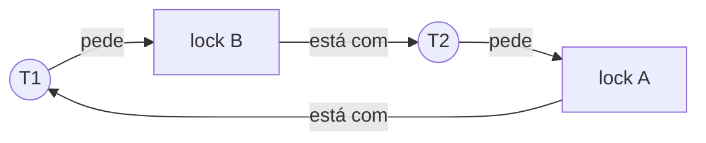

# Deadlocks

## Por que isso importa

Na SO-04, você aprendeu a proteger dados com locks. O preço é um novo tipo de bug: o **deadlock** (impasse), em que threads ficam paradas para sempre, cada uma esperando um recurso que outra segura. Nada quebra, nada dá erro, o programa só **para de responder**. Bancos de dados enfrentam isso todo dia (o PostgreSQL detecta e cancela uma das transações com `deadlock detected`), servidores travam em produção por causa disso, e entrevistas técnicas adoram perguntar. A boa notícia é que existe uma teoria bem simples que diz exatamente quando um deadlock é possível e como evitá-lo.

## Intuição

Um **cruzamento** sem semáforo, com quatro carros, um em cada rua. Cada carro já ocupa metade do cruzamento e precisa da metade à sua frente, que está ocupada pelo próximo carro. Ninguém dá ré. Ninguém avança. Para sempre.

Ou o clássico **jantar dos filósofos**: cinco filósofos em volta de uma mesa redonda, um garfo entre cada par. Para comer, cada um precisa dos **dois** garfos ao seu lado. Se todos pegarem o garfo da esquerda ao mesmo tempo, todos ficam esperando o da direita, que o vizinho segura. Todos morrem de fome com um garfo na mão.

Para sair do impasse, basta quebrar **uma** das regras: um filósofo pega primeiro o garfo da **direita**, ou eles só podem pegar os dois garfos de uma vez, ou alguém pode tomar um garfo à força.

## Visual

Grafo de alocação de recursos: setas de **processo → recurso** são pedidos; de **recurso → processo**, posse. Aqui há um **ciclo**, então há deadlock (com um exemplar de cada recurso):



O mesmo impasse no tempo:

```text
T1: lock(A) ✓ ........ lock(B) ✗ espera T2 ......................
T2: ......... lock(B) ✓ ........ lock(A) ✗ espera T1 ............
```

## Conceito técnico

### As quatro condições de Coffman

Um deadlock só acontece se as **quatro** valem ao mesmo tempo:

1. **Exclusão mútua**: o recurso só pode ser usado por um de cada vez.
2. **Posse e espera** (*hold and wait*): quem já segura um recurso pode pedir outro e esperar.
3. **Sem preempção**: ninguém tira um recurso à força; só quem segura o libera.
4. **Espera circular**: existe um ciclo T1 → T2 → ... → Tn → T1, cada um esperando o próximo.

Basta **quebrar uma** para que deadlocks sejam impossíveis.

### Quatro estratégias

**1. Prevenção**: tornar uma condição impossível por construção.

| Condição | Como quebrar | Custo |
|---|---|---|
| Exclusão mútua | recursos compartilháveis (dados imutáveis, estruturas *lock-free*) | nem sempre dá |
| Posse e espera | pedir **todos** os recursos de uma vez, ou soltar tudo antes de pedir mais | menos concorrência |
| Sem preempção | `try_lock`: se não conseguir o segundo, solta o primeiro e tenta de novo | risco de *livelock* |
| Espera circular | **ordem global**: todos travam os locks na mesma ordem (por exemplo, por id) | disciplina |

A **ordem global de locks** é a técnica mais usada na prática. Para transferir entre duas contas, trave primeiro a de **menor id**, não a de origem:

```text
def transferir(origem, destino, valor):
    primeiro, segundo = sorted([origem, destino], key=lambda c: c.id)
    with primeiro.lock:
        with segundo.lock:
            origem.saldo -= valor
            destino.saldo += valor
```

Sem isso, `transferir(a, b)` e `transferir(b, a)` ao mesmo tempo é exatamente o ciclo do Visual.

**2. Evitação**: o sistema conhece o **máximo** que cada processo pode pedir e só concede um pedido se o estado resultante continuar **seguro**: existe uma ordem em que todos conseguem terminar. É o **algoritmo do banqueiro** (Dijkstra):

```text
livre = disponível
enquanto houver processo não terminado:
    ache um processo i não terminado com (máximo[i] − alocado[i]) <= livre
    se não achar: estado INSEGURO
    finja que i termina: livre += alocado[i]
estado SEGURO (a ordem encontrada é a sequência segura)
```

Inseguro não quer dizer deadlock certo, mas que o sistema não consegue **garantir** que ele não aconteça. É elegante e caro, e exige saber os máximos de antemão, então é pouco usado em SOs de uso geral.

**3. Detecção e recuperação**: deixar acontecer, procurar periodicamente **ciclos** no **grafo de espera** (thread → thread que ela espera) e então recuperar: abortar uma das vítimas, ou fazer *rollback*. É o que **bancos de dados** fazem.

**4. Ignorar** (o "algoritmo do avestruz"): se deadlocks são raros e prevenir é caro, reiniciar o processo de vez em quando sai mais barato. Linux e Windows, em geral, não previnem deadlocks entre programas de usuário.

### Livelock e inanição

- **Livelock**: ninguém está bloqueado, mas ninguém progride. Duas pessoas num corredor que desviam sempre para o mesmo lado. Acontece com `try_lock` + tentar de novo imediatamente; a solução é esperar um tempo **aleatório** antes de tentar de novo.
- **Inanição**: o sistema progride, mas uma thread específica nunca consegue o recurso.

## Código

Detectando o ciclo num grafo de espera com DFS e três cores (como na detecção de ciclos da AL-05):

```python
def achar_ciclo(espera):
    """espera: {thread: [threads que ela espera]}. Devolve um ciclo ou None."""
    cor = {}          # ausente = branco, 1 = cinza (na pilha), 2 = preto (terminado)
    caminho = []

    def dfs(v):
        cor[v] = 1
        caminho.append(v)
        for w in espera.get(v, []):
            if cor.get(w) == 1:                      # voltou para alguém na pilha: ciclo!
                return caminho[caminho.index(w):] + [w]
            if w not in cor:
                ciclo = dfs(w)
                if ciclo:
                    return ciclo
        caminho.pop()
        cor[v] = 2
        return None

    for v in list(espera):
        if v not in cor:
            ciclo = dfs(v)
            if ciclo:
                return ciclo
    return None

print(achar_ciclo({"T1": ["T2"], "T2": ["T3"], "T3": ["T1"]}))   # ['T1', 'T2', 'T3', 'T1']
print(achar_ciclo({"T1": ["T2"], "T2": ["T3"], "T3": []}))       # None: T3 vai terminar
```

## Erros comuns

- **Achar que um ciclo sempre é deadlock.** Com vários exemplares de um recurso, um ciclo no grafo de alocação é necessário mas não suficiente. No grafo de **espera** (thread → thread), ciclo é deadlock.
- **Travar locks em ordens diferentes em lugares diferentes do código.** É a causa número um na prática.
- **Chamar código desconhecido (callbacks, plugins) segurando um lock.** Ele pode tentar pegar outro lock na ordem errada.
- **"Resolver" um deadlock com timeouts e retentativas imediatas.** Pode virar livelock; use espera aleatória e crescente.
- **Confundir estado inseguro com deadlock.** Inseguro é "pode acontecer"; deadlock é "aconteceu".

## Pratique

```quiz
id: SO-05-q1
tipo: multipla_escolha
pergunta: "Qual das condições de Coffman é quebrada quando todas as threads travam os locks em ordem crescente de id?"
opcoes: ["Exclusão mútua", "Posse e espera", "Sem preempção", "Espera circular"]
resposta: 3
explicacao: "Com uma ordem global, uma thread só espera por locks de id maior que todos os que segura. Para haver ciclo, alguém teria que esperar um lock de id menor, o que a regra proíbe. As threads ainda seguram um lock e esperam outro (posse e espera continua valendo)."
dificuldade: 2
```

```quiz
id: SO-05-q2
tipo: verdadeiro_falso
pergunta: "Se o algoritmo do banqueiro diz que um estado é inseguro, então o sistema já está em deadlock."
resposta: false
explicacao: "Inseguro significa que não existe garantia: com a pior sequência de pedidos possível, pode acontecer um deadlock. Mas os processos podem acabar pedindo menos que o máximo declarado e terminar normalmente. O banqueiro é conservador: só aceita estados em que dá para provar que todos terminam."
dificuldade: 2
```

```quiz
id: SO-05-q3
tipo: multipla_escolha
pergunta: "Duas threads chamam `transferir(a, b)` e `transferir(b, a)` ao mesmo tempo, e cada uma trava primeiro a conta de origem. O que pode acontecer?"
opcoes: ["Nada: são contas diferentes", "Deadlock: cada uma segura uma conta e espera a outra", "Condição de corrida no saldo", "Livelock"]
resposta: 1
explicacao: "A primeira trava a, a segunda trava b, e cada uma espera pela conta que a outra segura. Travar sempre a de menor id primeiro resolve, porque as duas tentam pegar a mesma conta antes."
dificuldade: 1
```

```quiz
id: SO-05-q4
tipo: resposta_curta
pergunta: "O que é livelock e como ele difere de deadlock?"
resposta: "No livelock as threads não estão bloqueadas: continuam executando e mudando de estado, mas reagem umas às outras de forma que nenhuma progride, como duas pessoas desviando sempre para o mesmo lado. No deadlock elas ficam paradas esperando. Esperas aleatórias antes de tentar de novo costumam resolver o livelock."
palavras_chave: ["executando", "progride", "bloqueadas", "aleat"]
dificuldade: 2
```

```quiz
id: SO-05-q5
tipo: multipla_escolha
pergunta: "No jantar dos filósofos, qual mudança elimina o deadlock?"
opcoes: ["Todos pegam primeiro o garfo da esquerda", "Um dos filósofos pega primeiro o garfo da direita", "Os filósofos comem mais rápido", "Colocar um garfo a menos na mesa"]
resposta: 1
explicacao: "Se todos pegam a esquerda primeiro, forma-se o ciclo. Um filósofo 'canhoto' quebra a simetria: é o mesmo que impor uma ordem global aos garfos (numerá-los e sempre pegar o de menor número primeiro). Outra solução é deixar no máximo 4 sentarem ao mesmo tempo, com um semáforo."
dificuldade: 2
```

```quiz
id: SO-05-q6
tipo: codigo
linguagem: python
pergunta: |
  **Quem está em deadlock?** Escreva `em_deadlock(espera)` que recebe um dicionário `{thread: [threads que ela espera]}` e devolve a lista **ordenada** das threads que fazem parte de algum **ciclo** (inclusive uma que espera a si mesma). Uma thread que só espera **alguém** num ciclo, sem estar nele, não entra na lista. Threads podem aparecer só como valor, sem ser chave.
codigo_inicial: |
  def em_deadlock(espera):
      # todo mundo que está esperando alguém
      return sorted(t for t, alvos in espera.items() if alvos)
usa: [def, return]
testes:
  - chamada: "em_deadlock({'T1': ['T2'], 'T2': ['T1']})"
    saida: "['T1', 'T2']"
  - chamada: "em_deadlock({'T1': ['T2'], 'T2': ['T3'], 'T3': []})"
    saida: "[]"
  - chamada: "em_deadlock({'A': ['B'], 'B': ['C'], 'C': ['A'], 'D': ['A'], 'E': ['E']})"
    saida: "['A', 'B', 'C', 'E']"
  - chamada: "em_deadlock({})"
    saida: "[]"
  - chamada: "len(em_deadlock({**{'t%04d' % i: ['t%04d' % (i + 1)] for i in range(1500)}, 't1500': ['t1000']}))"
    visivel: false
    saida: "501"
dica: "Uma thread n está num ciclo se, partindo de quem ela espera, dá para chegar de volta nela. Para cada n, faça uma busca (pilha + conjunto de vistos) a partir de espera.get(n, []); se encontrar n, ela entra na lista."
solucao: |
  def em_deadlock(espera):
      nos = set(espera) | {v for alvos in espera.values() for v in alvos}
      resultado = []
      for n in nos:
          vistos = set()
          pilha = list(espera.get(n, []))
          while pilha:
              v = pilha.pop()
              if v == n:
                  resultado.append(n)
                  break
              if v in vistos:
                  continue
              vistos.add(v)
              pilha.extend(espera.get(v, []))
      return sorted(resultado)
explicacao: "D espera A, que está num ciclo, então D também está travada, mas não faz parte do ciclo: abortar D não resolve nada, e por isso ela não é candidata a vítima. No teste oculto, a cadeia t0000 → ... → t1500 volta para t1000, então só t1000 a t1500 (501 threads) formam o ciclo. Para grafos enormes, o algoritmo de Tarjan ou Kosaraju (componentes fortemente conexas) resolve em O(V + E)."
dificuldade: 2
```

```quiz
id: SO-05-q7
tipo: codigo
linguagem: python
pergunta: |
  **Algoritmo do banqueiro.** Escreva `seguro(disponivel, alocado, maximo)`, onde `disponivel` é a lista de unidades livres de cada tipo de recurso, e `alocado[i]` e `maximo[i]` são listas do processo `i`. Devolva a **sequência segura** como lista de índices, ou `None` se o estado for inseguro.

  Para a resposta ser única: a cada passo, escolha o processo de **menor índice** ainda não terminado cuja necessidade (`maximo[i][r] - alocado[i][r]`) cabe em `livre` para todo recurso `r`; depois de escolher um, recomece a procura do índice 0.
codigo_inicial: |
  def seguro(disponivel, alocado, maximo):
      return list(range(len(alocado)))
usa: [def, while, return]
testes:
  - chamada: "seguro([3, 3, 2], [[0, 1, 0], [2, 0, 0], [3, 0, 2], [2, 1, 1], [0, 0, 2]], [[7, 5, 3], [3, 2, 2], [9, 0, 2], [2, 2, 2], [4, 3, 3]])"
    saida: "[1, 3, 0, 2, 4]"
  - chamada: "seguro([0, 0, 0], [[0, 1, 0], [2, 0, 0], [3, 0, 2], [2, 1, 1], [0, 0, 2]], [[7, 5, 3], [3, 2, 2], [9, 0, 2], [2, 2, 2], [4, 3, 3]])"
    saida: "None"
  - chamada: "seguro([1], [[1], [1]], [[2], [3]])"
    saida: "[0, 1]"
  - chamada: "seguro([], [], [])"
    saida: "[]"
  - chamada: "seguro([0], [[1], [1]], [[2], [2]])"
    visivel: false
    saida: "None"
  - chamada: "seguro([2, 3, 0], [[0, 1, 0], [3, 0, 2], [3, 0, 2], [2, 1, 1], [0, 0, 2]], [[7, 5, 3], [3, 2, 2], [9, 0, 2], [2, 2, 2], [4, 3, 3]])"
    visivel: false
    saida: "[1, 3, 0, 2, 4]"
dica: "Use livre = list(disponivel), acabou = [False] * n e seq = []. Enquanto len(seq) < n: percorra i em ordem; se achar um que cabe, some alocado[i] em livre, marque, adicione a seq e dê break. Se o for terminar sem achar (for ... else), devolva None."
solucao: |
  def seguro(disponivel, alocado, maximo):
      n = len(alocado)
      livre = list(disponivel)
      acabou = [False] * n
      seq = []
      while len(seq) < n:
          for i in range(n):
              if acabou[i]:
                  continue
              cabe = all(maximo[i][r] - alocado[i][r] <= livre[r] for r in range(len(livre)))
              if cabe:
                  livre = [livre[r] + alocado[i][r] for r in range(len(livre))]
                  acabou[i] = True
                  seq.append(i)
                  break
          else:
              return None
      return seq
explicacao: "No primeiro teste (o exemplo clássico do livro do Silberschatz), P1 precisa de (1, 2, 2) e cabe em (3, 3, 2); ao terminar, devolve o que tinha e o livre vira (5, 3, 2), o que permite P3, e assim por diante. Sem nada livre (segundo teste), ninguém consegue terminar. No último teste oculto, P1 já recebeu mais (1, 0, 2) e o estado continua seguro: é assim que o banqueiro decide se pode atender um pedido, simulando o estado depois de concedê-lo."
dificuldade: 3
```

```quiz
id: SO-05-q8
tipo: codigo
linguagem: javascript
pergunta: |
  **Ordem de locks perigosa.** Ferramentas como o *lockdep* do Linux avisam sobre deadlocks **possíveis** mesmo sem eles terem acontecido. Escreva `podeTravar(threads)`, onde cada thread é um array de operações `'+nome'` (travar) e `'-nome'` (destravar). Sempre que uma thread trava `b` segurando `a`, crie a aresta `a → b`. Devolva `true` se o grafo de todas as threads tiver um **ciclo**.
codigo_inicial: |
  function podeTravar(threads) {
    // só compara as duas primeiras travas de cada thread
    const primeiras = threads.map((ops) => ops.filter((op) => op[0] === '+').slice(0, 2).join());
    return new Set(primeiras).size > 1;
  }
usa: [function, for, return]
testes:
  - chamada: "podeTravar([['+a', '+b', '-b', '-a'], ['+b', '+a', '-a', '-b']])"
    saida: "true"
  - chamada: "podeTravar([['+a', '+b', '-b', '-a'], ['+a', '+b', '-b', '-a']])"
    saida: "false"
  - chamada: "podeTravar([['+a', '-a', '+b', '-b'], ['+b', '-b', '+a', '-a']])"
    saida: "false"
  - chamada: "podeTravar([['+a', '+b', '-b', '-a'], ['+b', '+c', '-c', '-b'], ['+c', '+a', '-a', '-c']])"
    saida: "true"
  - chamada: "podeTravar([['+a', '+b', '+c', '-c', '-b', '-a'], ['+a', '+c', '-c', '-a'], ['+b', '+c', '-c', '-b']])"
    visivel: false
    saida: "false"
  - chamada: "podeTravar([['+x', '+y', '-x', '+z', '-z', '-y'], ['+z', '+x', '-x', '-z']])"
    visivel: false
    saida: "true"
dica: "Para cada thread, mantenha um array seguros com os locks travados no momento. Em '+b', crie as arestas s → b para todo s em seguros e depois adicione b; em '-b', remova b. Depois procure ciclo com DFS de três estados (0 = não visto, 1 = na pilha, 2 = terminado)."
solucao: |
  function podeTravar(threads) {
    const arestas = {};
    for (const ops of threads) {
      const seguros = [];
      for (const op of ops) {
        const nome = op.slice(1);
        if (op[0] === '+') {
          for (const s of seguros) {
            if (!arestas[s]) arestas[s] = new Set();
            arestas[s].add(nome);
          }
          seguros.push(nome);
        } else {
          seguros.splice(seguros.indexOf(nome), 1);
        }
      }
    }
    const estado = {};
    const visitar = (v) => {
      estado[v] = 1;
      for (const w of arestas[v] || []) {
        if (estado[w] === 1) return true;
        if (!estado[w] && visitar(w)) return true;
      }
      estado[v] = 2;
      return false;
    };
    return Object.keys(arestas).some((v) => !estado[v] && visitar(v));
  }
explicacao: "No terceiro teste, as threads nunca seguram dois locks ao mesmo tempo, então não há arestas nem perigo, mesmo travando em ordens diferentes. O quarto mostra um ciclo de três threads (a → b → c → a), que nenhuma comparação par a par encontraria. No último oculto, a primeira thread solta x mas continua com y quando trava z (y → z), e a segunda faz z → x: com x → y, fecha-se o ciclo. O lockdep faz exatamente isso no kernel, avisando antes de o deadlock acontecer."
dificuldade: 3
```

## Resumo

- **Deadlock**: threads esperando para sempre umas pelas outras. Exige as quatro **condições de Coffman**: exclusão mútua, posse e espera, sem preempção, **espera circular**.
- **Prevenção**: quebrar uma condição; a mais prática é a **ordem global de locks**.
- **Evitação**: o **algoritmo do banqueiro** só concede pedidos que mantêm o estado **seguro**.
- **Detecção**: procurar **ciclos** no grafo de espera e abortar uma vítima (bancos de dados).
- Cuidado com **livelock** (todos ocupados, ninguém progride) e **inanição**.

## Para ir além

- Implemente o jantar dos filósofos com `threading` no seu computador, provoque o deadlock e depois corrija com a ordem dos garfos.
- Leia sobre o *lockdep* do Linux e sobre como o PostgreSQL detecta deadlocks (`deadlock_timeout`).
- **Próximo módulo**: SO-06 Memória virtual e paginação.
