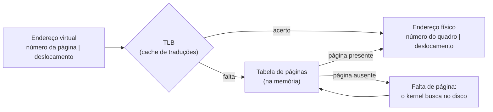

# Memória virtual e paginação

## Por que isso importa

Rode o mesmo programa duas vezes e imprima o endereço de uma variável: os dois processos podem mostrar **o mesmo endereço**, e mesmo assim cada um enxerga o próprio valor. Isso é memória virtual. Ela é o que permite que um processo não leia a memória de outro, que você abra mais programas do que cabe na RAM, que `fork` seja rápido, que bibliotecas sejam carregadas uma vez só para todos os programas, e que um acesso a ponteiro inválido vire *segmentation fault* em vez de corromper o sistema. Também explica por que o computador fica lentíssimo quando a RAM acaba (thrashing) e o que o "uso de memória" do gerenciador de tarefas realmente mede.

## Intuição

Pense num **hotel** onde cada hóspede recebe um **mapa pessoal** dizendo "seu quarto 1 fica no 7º andar, quarto 712; seu quarto 2 fica no 3º andar, quarto 305". Para o hóspede, os quartos dele são "1, 2, 3": contíguos e começando do zero. Só a **recepção** (o SO, com ajuda do hardware) sabe onde cada um fica de verdade.

- Dois hóspedes podem ter um "quarto 1", e são quartos diferentes: **isolamento**.
- A recepção pode guardar a bagagem de um quarto pouco usado no **depósito** (o disco) e liberar o quarto para outro. Se o hóspede voltar, ela busca a bagagem: uma **falta de página**.
- Se dois hóspedes compartilham a mesma sala de reuniões, os dois mapas apontam para o mesmo quarto real: **memória compartilhada**.
- O hóspede não consegue entrar num quarto que não está no mapa dele: a porta nem existe para ele.

## Visual

Tradução de um endereço com páginas de 4 KB (12 bits de deslocamento):



Dois processos, mesmos endereços virtuais, quadros físicos diferentes:

| Página virtual | Processo A → quadro | Processo B → quadro |
|---|---|---|
| 0 (código) | 5 | 5 (mesmo programa: código compartilhado) |
| 1 (dados) | 2 | 9 |
| 2 (heap) | 7 | ausente (no disco) |
| 3 (pilha) | 1 | 4 |

## Conceito técnico

### Espaço de endereçamento

Cada processo enxerga um espaço de endereços **virtual** próprio (por exemplo, de 0 a 2⁴⁸ − 1 no x86-64), com código, dados, heap e pilha. O hardware, mais precisamente a **MMU** (*memory management unit*), traduz **cada acesso** de endereço virtual para físico, usando estruturas que o kernel monta. O processo nunca vê endereços físicos.

### Paginação

A memória virtual é dividida em **páginas** de tamanho fixo (tipicamente 4 KB), e a física em **quadros** (*frames*) do mesmo tamanho. A **tabela de páginas** do processo diz, para cada página virtual, em que quadro ela está, ou que ela não está na memória.

Com páginas de 4096 = 2¹² bytes:

```text
endereço virtual   = número da página (VPN) | deslocamento (12 bits)
VPN                = endereço // 4096       (ou endereço >> 12)
deslocamento       = endereço % 4096        (ou endereço & 0xFFF)
endereço físico    = quadro * 4096 + deslocamento
```

Exemplo: endereço 5000 → página 1, deslocamento 904. Se a página 1 está no quadro 7: 7 × 4096 + 904 = 29576.

Cada entrada da tabela (PTE) também tem **bits**: **presente**, **escrita permitida**, **acessível em modo usuário**, **executável**, **referenciada** (o hardware liga ao acessar) e **suja** (*dirty*, ligada ao escrever). Acessar uma página sem permissão gera uma exceção: é o *segmentation fault*.

Como a paginação não exige que os quadros sejam contíguos, ela elimina a **fragmentação externa** (pedaços livres pequenos demais e espalhados), ao custo de um pouco de fragmentação **interna** (a última página de cada região fica meio vazia).

### TLB

Consultar a tabela de páginas na memória a **cada** acesso dobraria o custo de tudo. A **TLB** (*translation lookaside buffer*) é uma pequena cache **dentro da MMU** com as traduções recentes (dezenas a milhares de entradas). Graças à localidade (AC-05), ela acerta mais de 99% das vezes. Na troca de contexto, as traduções do processo anterior deixam de valer, e a TLB precisa ser limpada ou marcada com o id do processo (ASID).

### Tabelas multinível

Com endereços de 48 bits e páginas de 4 KB, uma tabela simples teria 2³⁶ entradas por processo: centenas de GB. A solução é uma **árvore**: o número da página é dividido em pedaços (4 níveis de 9 bits no x86-64 e no RISC-V Sv48), e só existem as subtabelas das regiões realmente usadas. O preço é que uma falta na TLB exige vários acessos à memória (*page walk*).

### Faltas de página e paginação sob demanda

Quando o processo acessa uma página com o bit **presente** desligado, a MMU gera uma **falta de página** (*page fault*), e o kernel decide:

- **Acesso inválido** (endereço que o processo nunca alocou): mata o processo com SIGSEGV.
- **Página válida, mas no disco** (swap): escolhe um quadro livre (ou expulsa uma página), lê a página do disco, atualiza a tabela e **reexecuta** a instrução. Leva milissegundos: milhões de ciclos.
- **Página nunca tocada**: aloca um quadro zerado. Isso é **paginação sob demanda**: um `malloc` de 1 GB é instantâneo, e a memória só é usada de verdade quando escrita.
- **Copy-on-write**: depois de um `fork`, pai e filho compartilham os quadros marcados como só leitura. Na primeira escrita, a falta de página faz a cópia daquela página só. Por isso `fork` + `exec` é barato.

### Substituição de páginas

Quando a RAM está cheia, alguém precisa sair. Algoritmos clássicos:

| Algoritmo | Expulsa | Observação |
|---|---|---|
| **FIFO** | a página carregada há mais tempo | simples; sofre da **anomalia de Belady** |
| **Ótimo (OPT/MIN)** | a que vai demorar mais para ser usada de novo | impossível na prática (exige prever o futuro); serve de referência |
| **LRU** | a usada há mais tempo | ótima aproximação, cara de implementar exatamente |
| **Relógio** (segunda chance) | percorre os quadros em círculo; quem tem o bit de referência ligado ganha outra chance (o bit é desligado) | aproximação de LRU usada de verdade |

**Anomalia de Belady**: com FIFO, **mais** quadros podem causar **mais** faltas. Com a sequência 1 2 3 4 1 2 5 1 2 3 4 5, FIFO faz 9 faltas com 3 quadros e 10 com 4. LRU e OPT não sofrem disso.

Páginas **sujas** precisam ser gravadas no disco antes de serem expulsas; as limpas podem ser simplesmente descartadas. Por isso SOs preferem expulsar páginas limpas.

### Thrashing

Se a soma dos **conjuntos de trabalho** (as páginas que cada processo usa ativamente) passa da RAM, o sistema passa mais tempo trocando páginas com o disco do que executando: é o **thrashing**. A CPU fica ociosa, o disco a 100%, e tudo trava. A solução é ter menos processos ativos (ou mais RAM). No Linux, quando nem o swap resolve, o **OOM killer** mata um processo para liberar memória.

## Código

Um pequeno modelo de MMU com tabela de páginas e TLB:

```python
TAM_PAGINA = 4096

tabela = {0: 5, 1: 7, 3: 2}          # página virtual -> quadro físico (2 está no disco)
tlb = {}                              # cache das traduções
estatisticas = {"tlb_acerto": 0, "tlb_falta": 0, "falta_pagina": 0}

def acessar(endereco):
    pagina, desloc = divmod(endereco, TAM_PAGINA)
    if pagina in tlb:
        estatisticas["tlb_acerto"] += 1
        quadro = tlb[pagina]
    else:
        estatisticas["tlb_falta"] += 1
        if pagina not in tabela:
            estatisticas["falta_pagina"] += 1
            quadro = 9                # o "kernel" traz a página do disco para o quadro 9
            tabela[pagina] = quadro
        quadro = tabela[pagina]
        tlb[pagina] = quadro
    fisico = quadro * TAM_PAGINA + desloc
    print(f"virtual {endereco:6} -> página {pagina}, desloc {desloc:4} -> físico {fisico}")

for e in [5000, 5004, 100, 9000, 9100, 5008]:
    acessar(e)
print(estatisticas)   # repare como a TLB acerta nos acessos à mesma página
```

## Erros comuns

- **Achar que o endereço que o programa imprime é físico.** Todo ponteiro que seu programa vê é virtual.
- **Confundir página e quadro.** Página é o pedaço da memória **virtual**; quadro é o pedaço da memória **física**.
- **Esquecer que o deslocamento não muda na tradução.** Só o número da página vira número do quadro.
- **Achar que mais RAM (quadros) sempre reduz faltas.** Com FIFO, nem sempre: anomalia de Belady.
- **Achar que `malloc` usa memória imediatamente.** Com paginação sob demanda, só ao escrever.
- **Ler "memória virtual" como sinônimo de swap.** Swap é só uma das coisas que a memória virtual permite.

## Pratique

```quiz
id: SO-06-q1
tipo: multipla_escolha
pergunta: "Com páginas de 4 KB, qual é o número da página e o deslocamento do endereço virtual 10000?"
opcoes: ["Página 2, deslocamento 1808", "Página 1, deslocamento 5904", "Página 10, deslocamento 0", "Página 2, deslocamento 10000"]
resposta: 0
explicacao: "10000 // 4096 = 2 e 10000 % 4096 = 10000 − 8192 = 1808. O deslocamento é sempre menor que o tamanho da página."
dificuldade: 1
```

```quiz
id: SO-06-q2
tipo: multipla_escolha
pergunta: "Para que serve a TLB?"
opcoes: ["Guardar páginas expulsas da memória", "Fazer cache das traduções de endereço virtual para físico", "Guardar a tabela de páginas no disco", "Detectar deadlocks"]
resposta: 1
explicacao: "Sem a TLB, cada acesso à memória exigiria antes um ou mais acessos à tabela de páginas. A TLB guarda as traduções recentes dentro da MMU e, graças à localidade, acerta quase sempre."
dificuldade: 1
```

```quiz
id: SO-06-q3
tipo: verdadeiro_falso
pergunta: "Com o algoritmo FIFO, aumentar o número de quadros nunca aumenta o número de faltas de página."
resposta: false
explicacao: "É a anomalia de Belady: com a sequência 1 2 3 4 1 2 5 1 2 3 4 5, FIFO faz 9 faltas com 3 quadros e 10 com 4. LRU e o algoritmo ótimo são 'algoritmos de pilha' e nunca pioram com mais memória."
dificuldade: 2
```

```quiz
id: SO-06-q4
tipo: resposta_curta
pergunta: "Como o copy-on-write torna o fork rápido?"
resposta: "Em vez de copiar toda a memória do pai, o kernel faz pai e filho apontarem para os mesmos quadros físicos, marcados como só leitura. Só quando um deles escreve numa página acontece uma falta de página, e o kernel copia apenas aquela página. Se o filho chama exec logo depois, quase nada é copiado."
palavras_chave: ["mesmos quadros", "só leitura", "escreve", "copia"]
dificuldade: 2
```

```quiz
id: SO-06-q5
tipo: multipla_escolha
pergunta: "Um computador está com o disco a 100% e a CPU quase ociosa, e tudo responde muito devagar. A causa mais provável é:"
opcoes: ["Deadlock", "Thrashing: os processos precisam de mais memória do que há, e o SO vive trocando páginas", "Um laço infinito", "A TLB está cheia"]
resposta: 1
explicacao: "No thrashing, os conjuntos de trabalho não cabem na RAM. Cada processo causa faltas de página, espera o disco, e enquanto isso a CPU não tem o que fazer. Fechar programas (ou ter mais RAM) resolve."
dificuldade: 2
```

```quiz
id: SO-06-q6
tipo: codigo
linguagem: python
pergunta: |
  **Traduzir um endereço.** Escreva `traduzir(endereco, tabela, tam_pagina)` onde `tabela[p]` é o quadro da página virtual `p`, ou `None` se ela não está na memória. Devolva o endereço físico, ou a string `'falta de página'` se a página estiver ausente ou fora da tabela.
codigo_inicial: |
  def traduzir(endereco, tabela, tam_pagina):
      pagina = endereco // tam_pagina
      return tabela[pagina]
usa: [def, return]
testes:
  - chamada: "traduzir(5000, [2, None, 7], 4096)"
    saida: "'falta de página'"
  - chamada: "traduzir(100, [2, None, 7], 4096)"
    saida: "8292"
  - chamada: "traduzir(9000, [2, None, 7], 4096)"
    saida: "29480"
  - chamada: "traduzir(12288, [2, None, 7], 4096)"
    saida: "'falta de página'"
  - chamada: "traduzir(0x12345, [None] * 0x12 + [0x3A], 0x1000)"
    visivel: false
    saida: "238405"
dica: "pagina, desloc = divmod(endereco, tam_pagina). Confira pagina >= len(tabela) antes de olhar tabela[pagina]. O físico é tabela[pagina] * tam_pagina + desloc."
solucao: |
  def traduzir(endereco, tabela, tam_pagina):
      pagina, desloc = divmod(endereco, tam_pagina)
      if pagina >= len(tabela) or tabela[pagina] is None:
          return 'falta de página'
      return tabela[pagina] * tam_pagina + desloc
explicacao: "9000 está na página 2 (9000 // 4096) com deslocamento 808, e a página 2 está no quadro 7: 7 × 4096 + 808 = 29480. No teste oculto, em hexadecimal fica claro que só o número da página muda: 0x12345 tem página 0x12 e deslocamento 0x345, e vira 0x3A345 = 238405."
dificuldade: 1
```

```quiz
id: SO-06-q7
tipo: codigo
linguagem: python
pergunta: |
  **FIFO, LRU e ótimo.** Escreva `faltas(referencias, quadros, algoritmo)` que conta as faltas de página de uma sequência de referências, com a memória começando vazia, para `algoritmo` igual a `'FIFO'`, `'LRU'` ou `'OPT'`.

  - **FIFO**: expulsa a página carregada há mais tempo.
  - **LRU**: expulsa a página usada há mais tempo.
  - **OPT**: expulsa a página cujo próximo uso está mais longe no futuro (uma que nunca mais será usada é a escolha ideal). Empate: a carregada há mais tempo.
codigo_inicial: |
  def faltas(referencias, quadros, algoritmo):
      memoria = []
      total = 0
      for p in referencias:
          if p not in memoria:
              total += 1
              if len(memoria) == quadros:
                  memoria.pop(0)
              memoria.append(p)
      return total
usa: [def, for, return]
testes:
  - chamada: "faltas([1, 2, 3, 4, 1, 2, 5, 1, 2, 3, 4, 5], 3, 'FIFO')"
    saida: "9"
  - chamada: "faltas([1, 2, 3, 4, 1, 2, 5, 1, 2, 3, 4, 5], 4, 'FIFO')"
    saida: "10"
  - chamada: "faltas([1, 2, 3, 4, 1, 2, 5, 1, 2, 3, 4, 5], 4, 'LRU')"
    saida: "8"
  - chamada: "faltas([7, 0, 1, 2, 0, 3, 0, 4, 2, 3, 0, 3, 2, 1, 2, 0, 1, 7, 0, 1], 3, 'LRU')"
    saida: "12"
  - chamada: "faltas([7, 0, 1, 2, 0, 3, 0, 4, 2, 3, 0, 3, 2, 1, 2, 0, 1, 7, 0, 1], 3, 'OPT')"
    saida: "9"
  - chamada: "faltas([1, 2, 3, 4, 1, 2, 5, 1, 2, 3, 4, 5], 3, 'OPT')"
    visivel: false
    saida: "7"
  - chamada: "[faltas([(i * 7 + i // 5) % 23 for i in range(3000)], 8, a) for a in ['FIFO', 'LRU', 'OPT']]"
    visivel: false
    saida: "[3000, 3000, 1607]"
dica: "Use uma lista memoria em ordem de chegada. No LRU, num acerto, remova a página e ponha no fim (assim memoria[0] é sempre a menos recente). No OPT, para cada candidata q, a distância é futuro.index(q) se q in futuro, senão algo maior que tudo; expulse max(memoria, key=...)."
solucao: |
  def faltas(referencias, quadros, algoritmo):
      memoria = []
      total = 0
      for i, p in enumerate(referencias):
          if p in memoria:
              if algoritmo == 'LRU':
                  memoria.remove(p)
                  memoria.append(p)
              continue
          total += 1
          if len(memoria) == quadros:
              if algoritmo == 'OPT':
                  futuro = referencias[i + 1:]
                  def proximo_uso(q):
                      return futuro.index(q) if q in futuro else len(futuro) + 1
                  memoria.remove(max(memoria, key=proximo_uso))
              else:
                  memoria.pop(0)
          memoria.append(p)
      return total
explicacao: "Os dois primeiros testes mostram a anomalia de Belady. A sequência com 7, 0, 1 é o exemplo do livro do Silberschatz: FIFO faz 15, LRU 12 e OPT 9. No último teste oculto, o padrão percorre 23 páginas em ciclo com só 8 quadros: FIFO e LRU expulsam exatamente a página que vai voltar logo e erram tudo, enquanto o OPT acerta quase metade. É o pior caso conhecido do LRU, que acontece de verdade ao varrer um arquivo maior que a cache."
dificuldade: 3
```

```quiz
id: SO-06-q8
tipo: codigo
linguagem: javascript
pergunta: |
  **Algoritmo do relógio.** Escreva `relogio(refs, quadros)` que conta as faltas usando o algoritmo do relógio (segunda chance). Os quadros formam um círculo, com um ponteiro começando no quadro 0, e cada quadro tem um bit de referência.

  - **Acerto**: liga o bit da página.
  - **Falta**: enquanto o quadro apontado estiver ocupado **e** com bit 1, desligue o bit e avance o ponteiro. Coloque a página no quadro apontado (vazio ou com bit 0), com bit 1, e avance o ponteiro.
codigo_inicial: |
  function relogio(refs, quadros) {
    // isto é FIFO, não relógio
    const mem = [];
    let faltas = 0;
    for (const p of refs) {
      if (!mem.includes(p)) {
        faltas++;
        if (mem.length === quadros) mem.shift();
        mem.push(p);
      }
    }
    return faltas;
  }
usa: [function, for, while, return]
testes:
  - chamada: "relogio([1, 2, 3, 2, 4, 2, 5, 2], 3)"
    saida: "5"
  - chamada: "relogio([7, 0, 1, 2, 0, 3, 0, 4, 2, 3, 0, 3, 2, 1, 2, 0, 1, 7, 0, 1], 3)"
    saida: "14"
  - chamada: "relogio([], 2)"
    saida: "0"
  - chamada: "relogio([1, 2, 1, 3, 1, 4, 1, 5], 2)"
    saida: "6"
  - chamada: "relogio(Array.from({ length: 5000 }, (_, i) => (i % 10 < 7 ? i % 3 : (i * 31) % 50)), 8)"
    visivel: false
    saida: "1753"
dica: "Use dois arrays do tamanho de quadros: pag (começando com null) e bit (começando com 0), e uma variável ptr. Para avançar: ptr = (ptr + 1) % quadros."
solucao: |
  function relogio(refs, quadros) {
    const pag = Array(quadros).fill(null);
    const bit = Array(quadros).fill(0);
    let ptr = 0;
    let faltas = 0;
    for (const p of refs) {
      const i = pag.indexOf(p);
      if (i !== -1) {
        bit[i] = 1;
        continue;
      }
      faltas++;
      while (pag[ptr] !== null && bit[ptr] === 1) {
        bit[ptr] = 0;
        ptr = (ptr + 1) % quadros;
      }
      pag[ptr] = p;
      bit[ptr] = 1;
      ptr = (ptr + 1) % quadros;
    }
    return faltas;
  }
explicacao: "No primeiro teste, a página 2 é usada o tempo todo: o bit dela vive ligado, e o ponteiro sempre a poupa, então o relógio faz 5 faltas onde o FIFO faria 6. No teste oculto, as páginas 0, 1 e 2 formam o conjunto de trabalho, e o relógio faz 1753 faltas contra 2250 do FIFO. Ele não é tão bom quanto LRU, mas só precisa de um bit por quadro, que o hardware já liga sozinho. Variações dele são usadas pelo Linux e por bancos de dados no buffer pool."
dificuldade: 3
```

## Resumo

- Cada processo tem um **espaço de endereçamento virtual**; a **MMU** traduz cada acesso usando a **tabela de páginas** que o kernel monta.
- Endereço = **número da página | deslocamento**; tradução troca a página pelo **quadro** e mantém o deslocamento.
- A **TLB** faz cache das traduções; tabelas **multinível** economizam espaço.
- **Falta de página**: acesso inválido (SIGSEGV), página no disco (swap) ou página nova (paginação sob demanda). **Copy-on-write** deixa o `fork` barato.
- Substituição: **FIFO** (anomalia de Belady), **OPT** (referência teórica), **LRU** e **relógio** (prático).
- **Thrashing**: conjuntos de trabalho maiores que a RAM.

## Para ir além

- Leia os capítulos 18 a 22 do OSTEP e faça o lab de page tables do MIT 6.1810.
- No Linux, veja `cat /proc/self/maps` e `vmstat 1` (colunas `si`/`so` mostram swap em ação).
- **Próximo módulo**: SO-07 Sistemas de arquivos.
