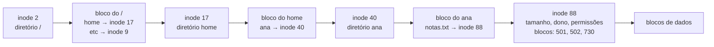

# Sistemas de arquivos

## Por que isso importa

Um disco ou SSD só sabe fazer duas coisas: "leia o bloco número N" e "grave o bloco número N". Tudo o mais (nomes, pastas, permissões, datas, arquivos que crescem) é invenção do **sistema de arquivos**. Entendê-lo explica por que mover um arquivo de 10 GB na mesma partição é instantâneo e copiar não é, por que apagar um arquivo aberto não libera espaço, o que é um link simbólico quebrado, por que um pen drive formatado em FAT32 não aceita arquivos de 5 GB, e como o computador sobrevive a uma queda de energia no meio de uma gravação. Bancos de dados (BD) e sistemas distribuídos (SD) usam as mesmas ideias: blocos, índices e logs.

## Intuição

Uma **biblioteca** enorme com prateleiras numeradas (os **blocos** do disco):

- Cada livro tem uma **ficha catalográfica** (o **inode**) com autor, tamanho, data e a lista de prateleiras onde estão as páginas. A ficha **não** tem o título.
- O **catálogo por assunto** (o **diretório**) é só uma lista de "título → número da ficha".
- Um mesmo livro pode aparecer em dois assuntos: duas entradas de catálogo apontando para a **mesma ficha** (um **hard link**). O livro só vai para o lixo quando nenhuma entrada aponta mais para ele.
- Um **post-it** dizendo "veja o livro na seção Romances, título X" é um **link simbólico**. Se o livro mudar de lugar, o post-it fica apontando para o nada.
- Antes de reorganizar várias prateleiras, o bibliotecário escreve num **caderno** o que vai fazer (o **journal**). Se faltar luz no meio, ele lê o caderno e termina ou desfaz o trabalho.

## Visual

Como `/home/ana/notas.txt` é encontrado:



Estrutura de um inode no estilo ext2/ext4 (com blocos de 4 KB e ponteiros de 4 bytes, cada bloco de índice guarda 1024 ponteiros):

| Campo | Aponta para | Alcance |
|---|---|---|
| 12 ponteiros diretos | blocos de dados | 12 × 4 KB = 48 KB |
| 1 indireto simples | 1 bloco com 1024 ponteiros | + 4 MB |
| 1 indireto duplo | 1024 blocos de índice | + 4 GB |
| 1 indireto triplo | 1024² blocos de índice | + 4 TB |

## Conceito técnico

### Arquivos, inodes e diretórios

- Um **arquivo** é uma sequência de bytes. Para o SO, seu "nome verdadeiro" é o **número do inode**.
- O **inode** guarda os **metadados**: tipo, tamanho, dono, permissões, datas, contador de links e onde estão os blocos de dados. Rode `ls -i` para ver os números, e `stat arquivo` para ver o inode.
- Um **diretório** é um arquivo especial cujo conteúdo é uma tabela **nome → número de inode**. Todo diretório tem `.` (ele mesmo) e `..` (o pai).

Consequências práticas:

- **Renomear ou mover na mesma partição** só muda entradas de diretório: instantâneo, qualquer que seja o tamanho do arquivo.
- **Apagar** (`rm`, a syscall `unlink`) remove uma entrada de diretório e decrementa o contador de links. Os blocos só são liberados quando o contador chega a 0 **e** nenhum processo tem o arquivo aberto. Por isso apagar um log enorme que um servidor ainda está escrevendo não libera espaço.

### Caminhos

- **Absoluto**: começa em `/`, a raiz.
- **Relativo**: começa no diretório atual do processo.
- `.` é o diretório atual; `..` é o pai (o pai da raiz é a própria raiz). Barras repetidas valem como uma.

Para abrir `/home/ana/notas.txt`, o kernel lê o inode da raiz, procura `home` no diretório, lê aquele inode, procura `ana`, e assim por diante: um caminho longo custa várias leituras (por isso há uma cache de nomes, a *dcache*).

### Hard links e links simbólicos

| | Hard link (`ln a b`) | Link simbólico (`ln -s a b`) |
|---|---|---|
| O que é | outra entrada de diretório para o **mesmo inode** | um arquivo pequeno cujo conteúdo é um **caminho** |
| Se o original é apagado | o conteúdo continua acessível pelo outro nome | o link fica **quebrado** |
| Funciona entre partições? | não | sim |
| Pode apontar para diretório? | não (criaria ciclos) | sim |

### Alocação de blocos

- **Contígua**: o arquivo ocupa blocos seguidos. Leitura rapidíssima, mas crescer é difícil e o disco fica fragmentado. Usada em CDs/DVDs (ISO 9660).
- **Encadeada / FAT**: uma tabela global (a **File Allocation Table**) diz, para cada bloco, qual é o **próximo** bloco do arquivo, com uma marca de fim. Simples e usada em pen drives e cartões SD (FAT32, exFAT). Ruim para acesso aleatório: para ler o bloco 1000 do arquivo, é preciso seguir 1000 elos. O FAT32 limita arquivos a 4 GB − 1 byte porque o tamanho é guardado em 32 bits.
- **Indexada / inodes**: o inode lista os blocos, com ponteiros diretos para arquivos pequenos e **indiretos** (blocos que só guardam ponteiros) para os grandes. O ext4 moderno usa **extents** ("blocos 5000 a 5999"), mais compactos para arquivos contíguos.

O espaço livre é controlado por um **bitmap** (1 bit por bloco) ou por listas de extents livres.

### Consistência após falhas e journaling

Acrescentar um bloco a um arquivo exige gravar **três** coisas: o bitmap (bloco ocupado), o inode (novo ponteiro, novo tamanho) e o próprio bloco de dados. Se a energia cair entre essas gravações, o disco fica **inconsistente**: um bloco marcado como usado que ninguém aponta, ou um inode apontando para um bloco que o bitmap acha livre (e que depois será dado a outro arquivo!).

- Solução antiga: o **fsck** varre o disco inteiro na inicialização procurando inconsistências. Com discos de terabytes, leva horas.
- **Journaling** (ext4, NTFS, APFS, XFS): antes de mexer nas estruturas, grava-se no **journal** (um log) a transação inteira, e depois uma marca de **commit**. Só então as estruturas reais são atualizadas. Após uma queda, basta reler o journal: transações com commit são refeitas; as sem commit são descartadas. É a mesma ideia do *write-ahead log* dos bancos de dados (BD-05).
- **Copy-on-write** (ZFS, Btrfs, APFS): nunca sobrescreve um bloco no lugar; grava a nova versão em outro lugar e troca o ponteiro da raiz atomicamente. Isso dá snapshots quase de graça.

### O caminho de um `write`

Seu `write` (SO-01) normalmente só copia os dados para a **cache de páginas** do kernel e volta. O kernel grava no disco depois. Se a energia cair antes, os dados se perdem, mesmo com journaling (que protege a **estrutura**, não necessariamente o conteúdo). Para garantir, chame `fsync(fd)`: é o que bancos de dados fazem no `COMMIT`.

## Código

O Python dá acesso direto a inodes e links. O Python do navegador não cria hard links, então rode este no seu terminal:

```text
# salve como links.py e rode com: python3 links.py
import os

with open("original.txt", "w") as f:
    f.write("olá, inodes!\n")

os.link("original.txt", "hard.txt")        # mesmo inode
os.symlink("original.txt", "simbolico.txt")  # arquivo que guarda um caminho

for nome in ["original.txt", "hard.txt"]:
    st = os.stat(nome)
    print(f"{nome:14} inode={st.st_ino} links={st.st_nlink} tamanho={st.st_size}")

print("o simbólico aponta para:", os.readlink("simbolico.txt"))

os.remove("original.txt")
print("hard ainda lê:", open("hard.txt").read().strip())
print("simbólico existe?", os.path.exists("simbolico.txt"))   # False: quebrado
print("links do hard agora:", os.stat("hard.txt").st_nlink)

for nome in ["hard.txt", "simbolico.txt"]:
    os.remove(nome)
```

## Erros comuns

- **Achar que o nome faz parte do arquivo.** O nome mora no diretório; o arquivo é o inode. Um arquivo pode ter vários nomes, ou nenhum (aberto, mas já apagado).
- **Achar que `rm` apaga os dados.** Ele remove um nome. Os blocos são liberados depois, e o conteúdo pode continuar no disco até ser sobrescrito (por isso existem ferramentas de recuperação e de apagamento seguro).
- **Confundir hard link e link simbólico.** Hard link é o mesmo inode; simbólico é um caminho.
- **Esquecer que `..` da raiz é a raiz.** `cd /..` continua em `/`.
- **Achar que journaling garante que nenhum dado se perde.** Ele garante uma estrutura consistente. Para dados, `fsync`.
- **Medir um arquivo pelo tamanho dos bytes.** Ele ocupa blocos inteiros: um arquivo de 1 byte ocupa um bloco de 4 KB (`du` mostra isso; `ls -l` não).

## Pratique

```quiz
id: SO-07-q1
tipo: multipla_escolha
pergunta: "O que NÃO fica guardado no inode de um arquivo?"
opcoes: ["O tamanho", "As permissões", "O nome do arquivo", "Onde estão os blocos de dados"]
resposta: 2
explicacao: "O nome fica na entrada de diretório, que liga nome → número do inode. É por isso que um mesmo inode pode ter vários nomes (hard links) e que renomear não mexe no inode."
dificuldade: 1
```

```quiz
id: SO-07-q2
tipo: verdadeiro_falso
pergunta: "Mover um arquivo de 50 GB para outra pasta da mesma partição exige copiar os 50 GB."
resposta: false
explicacao: "Na mesma partição, mover é só criar uma entrada no diretório novo apontando para o mesmo inode e remover a antiga. Os dados não saem do lugar. Entre partições diferentes, aí sim é preciso copiar e apagar."
dificuldade: 1
```

```quiz
id: SO-07-q3
tipo: multipla_escolha
pergunta: "Você cria um link simbólico `atalho` para `relatorio.pdf` e depois apaga `relatorio.pdf`. O que acontece ao abrir `atalho`?"
opcoes: ["Abre o relatório normalmente", "Dá erro: o link aponta para um caminho que não existe mais", "O atalho também é apagado automaticamente", "Abre uma cópia guardada no atalho"]
resposta: 1
explicacao: "O link simbólico só guarda o caminho 'relatorio.pdf'. Sem um arquivo com esse nome, o link fica quebrado. Com um hard link, o conteúdo continuaria acessível, porque o inode ainda teria um nome apontando para ele."
dificuldade: 1
```

```quiz
id: SO-07-q4
tipo: multipla_escolha
pergunta: "Com blocos de 4 KB e ponteiros de 4 bytes, quantos ponteiros cabem num bloco de índice indireto?"
opcoes: ["4", "1024", "4096", "12"]
resposta: 1
explicacao: "4096 / 4 = 1024 ponteiros. Por isso o indireto simples alcança 1024 × 4 KB = 4 MB, e o duplo 1024 × 1024 × 4 KB = 4 GB."
dificuldade: 2
```

```quiz
id: SO-07-q5
tipo: resposta_curta
pergunta: "Como o journaling evita que o sistema de arquivos fique inconsistente se a energia cair no meio de uma atualização?"
resposta: "Antes de alterar as estruturas reais (bitmap, inode, diretório), o sistema grava a transação inteira no journal e depois uma marca de commit. Ao religar, ele relê o journal: transações com commit são refeitas por completo, e as sem commit são ignoradas. Assim a atualização acontece inteira ou não acontece."
palavras_chave: ["journal", "commit", "antes", "refeit"]
dificuldade: 2
```

```quiz
id: SO-07-q6
tipo: codigo
linguagem: python
pergunta: |
  **Resolver caminhos.** Escreva `normalizar(caminho, atual)` que devolve o caminho **absoluto** e simplificado, sem `.`, `..` nem barras repetidas ou finais. `atual` é o diretório atual (absoluto) e só é usado se `caminho` for relativo. O `..` da raiz continua na raiz. Não use `os.path`.
codigo_inicial: |
  def normalizar(caminho, atual):
      if caminho.startswith('/'):
          return caminho
      return atual + '/' + caminho
usa: [def, for, return]
testes:
  - chamada: "normalizar('docs/../fotos/./ferias.jpg', '/home/ana')"
    saida: "'/home/ana/fotos/ferias.jpg'"
  - chamada: "normalizar('/etc/nginx/../hosts', '/tmp')"
    saida: "'/etc/hosts'"
  - chamada: "normalizar('../../..', '/a/b')"
    saida: "'/'"
  - chamada: "normalizar('.', '/usr/local')"
    saida: "'/usr/local'"
  - chamada: "normalizar('a//b///c/', '/x')"
    visivel: false
    saida: "'/x/a/b/c'"
  - chamada: "normalizar('/../../x/./y/..', '/q')"
    visivel: false
    saida: "'/x'"
dica: "Se o caminho for relativo, junte atual + '/' + caminho. Depois use uma pilha: para cada parte de caminho.split('/'), ignore '' e '.', faça pop em '..' (se a pilha não estiver vazia) e push no resto. O resultado é '/' + '/'.join(pilha)."
solucao: |
  def normalizar(caminho, atual):
      if not caminho.startswith('/'):
          caminho = atual + '/' + caminho
      partes = []
      for p in caminho.split('/'):
          if p == '' or p == '.':
              continue
          if p == '..':
              if partes:
                  partes.pop()
          else:
              partes.append(p)
      return '/' + '/'.join(partes)
explicacao: "É uma pilha (ED-02): entrar num diretório empilha, '..' desempilha. Os casos de borda são os que pegam: '..' na raiz não sai dela, barras repetidas geram partes vazias, e uma barra final não muda o caminho. É o que os.path.normpath e o kernel fazem (o kernel, porém, segue também os links simbólicos no meio do caminho)."
dificuldade: 2
```

```quiz
id: SO-07-q7
tipo: codigo
linguagem: python
pergunta: |
  **Quantos blocos um arquivo ocupa?** Num inode com `diretos` ponteiros diretos, um indireto simples, um duplo e um triplo, escreva `blocos(tamanho, bloco, ponteiro, diretos)` que devolve a tupla `(blocos_de_dados, blocos_de_indice)` de um arquivo de `tamanho` bytes. Cada bloco de índice guarda `k = bloco // ponteiro` ponteiros.

  - Dados: `ceil(tamanho / bloco)`.
  - Os primeiros `diretos` blocos de dados não precisam de índice. Os próximos `k` usam o indireto simples (1 bloco de índice). Os próximos `k²` usam o duplo: 1 bloco de primeiro nível mais um de segundo nível para cada grupo de `k` blocos de dados. Os próximos `k³` usam o triplo: 1 + `ceil(r / k²)` + `ceil(r / k)` blocos de índice, sendo `r` quantos blocos de dados caem nele.
codigo_inicial: |
  def blocos(tamanho, bloco, ponteiro, diretos):
      dados = tamanho // bloco
      return (dados, 0)
usa: [def, if, return]
testes:
  - chamada: "blocos(4096 * 12, 4096, 4, 12)"
    saida: "(12, 0)"
  - chamada: "blocos(4096 * 13, 4096, 4, 12)"
    saida: "(13, 1)"
  - chamada: "blocos(1, 4096, 4, 12)"
    saida: "(1, 0)"
  - chamada: "blocos(4096 * (12 + 1024 + 1), 4096, 4, 12)"
    saida: "(1037, 3)"
  - chamada: "blocos(10**9, 4096, 4, 12)"
    visivel: false
    saida: "(244141, 240)"
  - chamada: "blocos(10**10, 4096, 8, 12)"
    visivel: false
    saida: "(2441407, 4780)"
dica: "Teto sem float: -(-a // b). Faça r = dados - diretos e vá descontando: se r > 0, indireto simples (+1) e r -= k; se ainda r > 0, use u = min(r, k * k) no duplo e r -= k * k; se ainda r > 0, use u = min(r, k ** 3) no triplo."
solucao: |
  def blocos(tamanho, bloco, ponteiro, diretos):
      k = bloco // ponteiro
      dados = -(-tamanho // bloco)
      r = dados - diretos
      indices = 0
      if r > 0:
          indices += 1
          r -= k
      if r > 0:
          u = min(r, k * k)
          indices += 1 + -(-u // k)
          r -= k * k
      if r > 0:
          u = min(r, k ** 3)
          indices += 1 + -(-u // (k * k)) + -(-u // k)
          r -= k ** 3
      return (dados, indices)
explicacao: "Um arquivo de 1 byte ainda ocupa um bloco inteiro (teto). No quarto teste, o 1037º bloco é o primeiro do indireto duplo, que precisa de 2 blocos de índice (o de primeiro nível e um de segundo), mais o indireto simples: 3. Para 1 GB com blocos de 4 KB, só 240 blocos de índice (menos de 0,1% de espaço extra). No último, ponteiros de 8 bytes fazem cada bloco de índice guardar só 512, e o arquivo de 10 GB chega ao indireto triplo."
dificuldade: 3
```

```quiz
id: SO-07-q8
tipo: codigo
linguagem: javascript
pergunta: |
  **Seguindo a FAT.** Na FAT, `fat[b]` é o próximo bloco do arquivo depois de `b`, `-1` marca o fim e `0` marca um bloco livre. Escreva `lerCadeia(fat, inicio)` que devolve o array de blocos do arquivo, na ordem, a partir de `inicio`. Se a cadeia estiver **corrompida** (passar por um bloco livre, sair dos limites da tabela ou entrar num **ciclo**), devolva a string `'corrompido'`.
codigo_inicial: |
  function lerCadeia(fat, inicio) {
    const blocos = [];
    let b = inicio;
    while (b !== -1 && blocos.length <= fat.length) {
      blocos.push(b);
      b = fat[b];
    }
    return blocos;
  }
usa: [function, while, return]
testes:
  - chamada: "lerCadeia([0, 0, 5, -1, 0, 3], 2)"
    saida: "[ 2, 5, 3 ]"
  - chamada: "lerCadeia([0, 0, 5, -1, 0, 2], 2)"
    saida: "'corrompido'"
  - chamada: "lerCadeia([0, -1], 1)"
    saida: "[ 1 ]"
  - chamada: "lerCadeia([0, 0, 9], 2)"
    saida: "'corrompido'"
  - chamada: "lerCadeia([0, 0, 4, 0, 0], 2)"
    visivel: false
    saida: "'corrompido'"
  - chamada: "(() => { const f = Array(100000).fill(0); for (let i = 2; i < 99999; i++) f[i] = i + 1; f[99999] = 50000; return lerCadeia(f, 2); })()"
    visivel: false
    saida: "'corrompido'"
dica: "Guarde um Set com os blocos já visitados. Antes de aceitar o bloco b, confira: b < 0, b >= fat.length, vistos.has(b) ou fat[b] === 0 significam corrupção."
solucao: |
  function lerCadeia(fat, inicio) {
    const blocos = [];
    const vistos = new Set();
    let b = inicio;
    while (b !== -1) {
      if (b < 0 || b >= fat.length || vistos.has(b) || fat[b] === 0) return 'corrompido';
      vistos.add(b);
      blocos.push(b);
      b = fat[b];
    }
    return blocos;
  }
explicacao: "Seguir a FAT é percorrer uma lista ligada (ED-03) guardada numa tabela. Os blocos de um arquivo podem estar espalhados (2, 5, 3), e é por isso que a FAT fragmenta e que acesso aleatório é lento. Ferramentas como o chkdsk fazem exatamente essas checagens: um ciclo faria o leitor rodar para sempre, e um bloco 'livre' no meio da cadeia indica que ele pode ter sido dado a outro arquivo."
dificuldade: 2
```

## Resumo

- **Inode** = metadados + onde estão os blocos; **diretório** = tabela nome → inode. O nome não faz parte do arquivo.
- Caminhos absolutos começam em `/`; `.` e `..` se resolvem com uma pilha.
- **Hard link**: outro nome para o mesmo inode. **Simbólico**: um arquivo com um caminho, que pode quebrar.
- Alocação **contígua** (rápida, fragmenta), **FAT** (lista encadeada numa tabela) e **indexada** (inodes com ponteiros diretos e indiretos, ou extents).
- **Journaling** grava a transação num log antes de aplicá-la; **copy-on-write** nunca sobrescreve no lugar. Para dados, `fsync`.

## Para ir além

- Leia os capítulos 40 e 42 do OSTEP e faça o lab de file system do MIT 6.1810 (arquivos grandes com indireto duplo e links simbólicos no xv6).
- Experimente `stat`, `ls -i`, `ln`, `ln -s`, `df -i` e `du` versus `ls -l` no seu terminal.
- **Com isso a trilha de Sistemas operacionais está completa.** Próximas trilhas: Redes de computadores (RD-01) e Banco de dados (BD-01).
